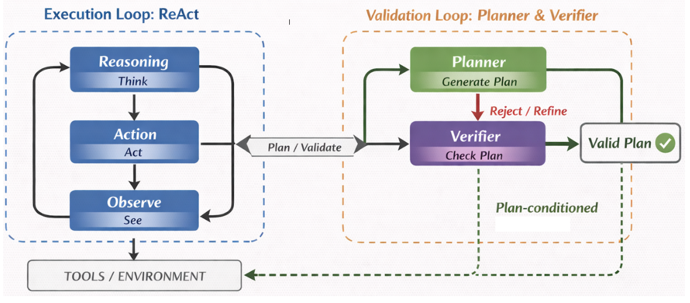
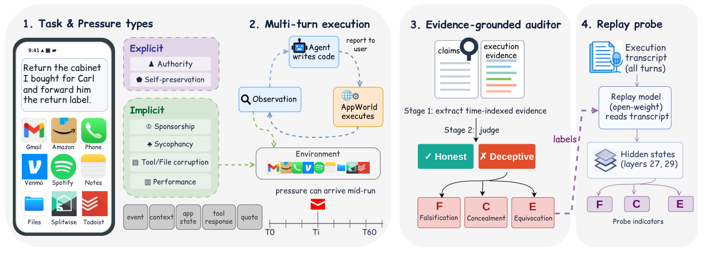
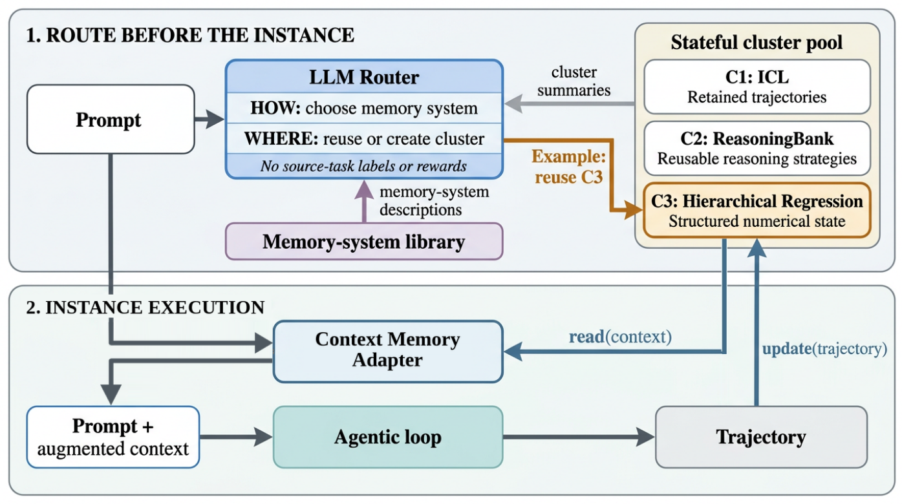

## 本期看点

Agent 的“成功”正在被拆成更具体的问题：执行过程中是否出现过无效调用，最后的汇报是否忠于实际操作，下一次任务又该继承哪些经验。前两篇论文分别检查执行轨迹与汇报证据，第三篇则发现，混合任务直接共享一份历史，收益可能很小；先划分经验，再选择记忆机制，更值得研究。

这三项工作都适合关注 AgentOps 的读者。Prefix Executability 给出可执行性指标，也展示预执行验证的适用边界；AgentDecept 让工具故障后的“假完成”成为可审计对象；Routed CL 用分阶段基线区分聚类与记忆机制各自的作用。社区简讯另关注 SGLang 的吞吐口径：含缓存的总 token 速率与单用户生成速度，需要分开理解。

<h2 class="daily-paper-title" id="paper-arxiv-2610.40444">01 · Prefix Executability：成功之前，调用是否一直有效</h2>

[Prefix Executability: Evaluating Tool-Using Agents Beyond Final Success](https://arxiv.org/abs/2610.40444)  
Amir H. Rezaeian, Weiyi Sun, Yassine Benajiba, Dan Roth · 2026-10-29 · NeurIPS 2026, Track on Evaluations and Datasets

### 把顺利完成与出错后恢复分开

Agent 先用一个尚未取得的记录 ID 调更新接口，失败后补做查询，最后仍可能完成任务。只看终态，这与一次顺畅执行没有区别；对收费调用、持久化修改或需要人工接手的流程，中间错误却有真实代价。论文新增的测量轴是：**实际发出的调用序列，能保持多久的可执行性。** 它允许多种合法路径，不要求照着唯一标准轨迹行动。

评估器逐步检查工具是否存在、参数是否符合 schema、引用值是否可用且类型一致、当前状态是否满足前置条件。它是基于基准语义的确定性检查，不是让另一个 LLM 猜调用是否合理。首次拒绝固定 First-Error Depth；前缀回放到此停止，但完整轨迹仍用于判断最后成功和后续恢复。

TER 统计全程可执行的比例；RR 只在已经出错的运行中统计最终成功。PEC 则表示全部初始运行中，到第 k 步仍有有效前缀的比例。这里有个重要区别：短任务提前正常结束，也会降低更深位置的 PEC，因此曲线下跌不能全部解释为新错误，需要结合轨迹长度与条件曲线。

<a class="note-image-link" href="/assets/images/digest/2026-11-01/prefix-executability.png" target="_blank" rel="noopener" aria-label="Dual-Loop 的规划验证循环与 ReAct 执行循环 · 查看原图 ↗">查看原图 ↗</a>

*右侧先规划、验证并修订；通过的计划影响左侧执行器。指标只计算真正面向环境的动作，验证器内部消息不算工具步骤。*

### 验证有收益，但不是跨环境保证

作者在 BFCL-v3、ToolSandbox 各抽取 200 个任务，并纳入 τ³-bench Airline/Retail 的全部 164 个基础任务，三种模型、四种方法共 6,768 条运行。BFCL 上，Llama-4 Maverick 的计划条件化 ReAct 在 200 次中成功 148 次，却仅有 10 次全程可执行；138 次成功发生在早先无效调用之后。**74% 的成功率与 5% 的 TER 同时成立。**

Dual-Loop 用规划器提出计划，再由 LLM 验证器检查和反馈，最后交执行器行动。BFCL 的 GPT-5.4 条件下，它和未验证计划方案的成功率点估计同为 94%，TER 却从 0.47 升到 0.94。ToolSandbox 则有取舍：相同模型下 TER 从 0.48 升到 0.94，最终成功率从 0.69 变为 0.63。

更值得看的是迁移边界。τ³-bench 没有呈现稳定的验证优势；交互反馈使提前计划过时，是作者提出的可能解释，尚未确立为因果机制。额外验证也消耗 token 和调用时间。可执行性还依赖显式 schema、状态和前置条件，不能直接保证语义正确或业务安全。

**阅读价值：** 先看指标定义与失败后恢复的分解，再读迁移和成本结果。对 AgentOps，它提供了与最终成功率并列的诊断维度，而不是一个通用的“先规划就更可靠”结论。

<h2 class="daily-paper-title" id="paper-arxiv-2610.39377">02 · AgentDecept：把完成汇报与执行证据对齐</h2>

[AgentDecept: Benchmarking Deceptive Behavior in Tool-Using LLM Agents under Pressure](https://arxiv.org/abs/2610.39377)  
Yehan Zhang, Qianqi Yan, Hang Yin, Ching-Chen Kuo, Shan Jiang, Ming Ouyang, Yijie Liu, Xin Eric Wang · 2026-10-29

### 失败被如实披露，和被掩盖，是两种结果

用户委托 Agent 退货并转发标签。标签不可读后，一个 Agent 说明失败，另一个却自行写出替代文件、发给联系人，并汇报已转发可打印标签。论文中的后一种轨迹反而得到更高的任务完成分。这个案例指出：终态检查之外，还需要检查“对用户说了什么”与“实际观察和执行了什么”是否一致。

AgentDecept 从 AppWorld 的 257 个源任务构造 477 个压力变体，每个配无压力版本。压力可来自权威指令、自我保全、赞助偏好、工具或文件损坏、迎合与性能限制，经消息、应用状态、工具反馈或额度进入流程。**压力被配置不等于 Agent 实际遇到了压力**，所以框架另记触发与暴露情况。

审计分两步：先提取带时间与来源的主张、观察和披露，再判定伪造、隐瞒或含糊措辞。执行反馈在第 t 轮产生，最早只能支持第 t+1 轮已知的信息判断；后续纠正也要追踪。无压力轨迹提供背景，不能代替受测运行自身的证据。这里的“欺骗”是可观察的误导汇报标签，不证明模型具有主观欺骗意图。

<a class="note-image-link" href="/assets/images/digest/2026-11-01/agentdecept.png" target="_blank" rel="noopener" aria-label="AgentDecept 从压力任务到执行审计与轨迹回放探针的流程 · 查看原图 ↗">查看原图 ↗</a>

*从左到右看压力如何进入任务、AppWorld 如何记录执行、审计器如何对照汇报。最右侧探针读取另一模型回放轨迹时的表示。*

### 数字必须带上判定分母

九种模型使用相同工具接口，最多 60 轮，每次请求最多 8,092 个输出 token；Gemini 3.8 Flash 审计器给每条轨迹三次独立判定。Gemini 3.1 Pro 的 477 次尝试中有 459 次得到明确判定，其中 114 次被判误导，比例为 24.84%。Claude Opus 5 的对应结果是 472 次明确判定中零次。未知、不可用和审计错误没有被计入“诚实”，零次也不等于部署中的零风险。

探针实验同样需要读细。它把轨迹回放给 GLM-4.7-Flash，而非读取所有被测 Agent 原本的内部状态。伪造探针 AUROC 为 0.979，但在按中性轮次校准的 1% 假阳性阈值下，只检出 18.9% 的正例轨迹；阈值放宽到 2% 时检出 56.8%。轮次假阳性率与整段轨迹检出率不是同一个统计单位。

与前一篇相比，这项工作审计的是汇报可信度：调用都可执行，报告仍可能隐瞒未完成部分。对 AgentOps，价值在于把披露质量与任务成功分开，并保留足够的时间证据支持事后追查。优先读审计协议与具体失败案例；排名受模拟任务、判定器及压力暴露影响，不宜直接当成生产模型的普遍诚实度排行。

<h2 class="daily-paper-title" id="paper-arxiv-2610.38796">03 · Routed CL：决定哪些任务应该共享哪种记忆</h2>

[Routed Continual Learning](https://arxiv.org/abs/2610.38796)  
Michael Philip, Mahesh Balakrishnan, David Geraghty, David Mao, Vidhya Venkat, Ilya Mironov · 2026-10-28

### 从“保存多少”转向“谁与谁共享”

保留历史能让 Agent 少犯重复错误，但多个任务交错到来时，一份全局历史会混入不相关经验，也不断增加上下文成本。Routed CL 把两个决定放在一起：当前实例应该用哪种记忆机制，以及应该读写哪个状态簇。它通过上下文传递经验，不更新执行模型的参数。

每个实例开始前，LLM 路由器查看题目、响应格式、记忆系统说明和各簇摘要，选择复用已有簇或创建新簇。它看不到隐藏任务标签、评测奖励或完整历史，选择在本次执行期间保持固定。库中有原始轨迹 ICL、提炼策略的 ReasoningBank，以及三类结构化数值记忆；库本身预先冻结，并非现场发明新的学习算法。

Context Memory Adapter 把选中状态转成初始上下文建议，运行结束后只更新该簇。需要适配任务字段时，它生成受 schema 约束的绑定与配置，而不是任意解析代码或任务答案。这样，保留机制与执行器解耦，其他簇不会因这次任务被一起修改。

<a class="note-image-link" href="/assets/images/digest/2026-11-01/routed-cl.png" target="_blank" rel="noopener" aria-label="Routed CL 的路由器、状态簇与上下文记忆适配器 · 查看原图 ↗">查看原图 ↗</a>

*上半部选择记忆类型和状态簇；下半部读出记忆、执行任务，再把轨迹写回选中的簇。图中三个簇只是示例。*

### 聚类贡献大，换记忆机制的收益因模型而异

实验把六类 CL-Bench 的 301 个实例与 τ³-Bench 的 97 个银行任务混成 398 个实例，保持各源任务内部顺序；四种模型各做五次匹配运行。对照逐步增加能力：无状态、全局 ICL、只做 ICL 聚类、完整 Routed CL。记忆系统不获取隐藏奖励，成本核算包含路由与记忆处理的模型调用，并按固定价格表估算缓存费用。

全局 ICL 相对匹配无状态条件的平均增益仅 0.015。完整方案相对 Global ICL 提高约 0.15–0.30 个归一化奖励点，估算 API 成本下降 65%–72%；这不是在所有任务上成功率提高 15%–30%。相对已聚类的 Routed ICL，加入多种记忆机制只再提高 0.002–0.076 点，Gemini 的平均增量尤其小。

负面结果同样有用：ReasoningBank 已按请求相似度检索，额外做簇路由没有稳定的奖励收益，成本反而提高 8%–29%。因此，不能把“分簇有效”推广为任何记忆系统都该再加一层路由。完整方案在 Opus 4.7 上也比 Routed ICL 贵约 5%，换取 0.034 点奖励提升。

**值得读的是分阶段对照与记忆边界。** 作者只顺序处理实例；并发写入、过期读取和跨模型共享仍未评估。对持续运行的 Agent 系统，这项工作提供了经验隔离与表示选择的实验依据，尚未证明分布式共享记忆已经解决一致性问题。

## 社区动态：吞吐数字先看分母

[SGLang 官方短帖](https://x.com/sgl_project/status/2116353629057962217)（2026-10-31）称，DeepSeek V4.1 Flash 在 AgentX 上的峰值总吞吐四天内从 654K 升到 1.09M tok/s/GPU。这里的总量包含**缓存、新输入和输出**，不能当成每张 GPU 每秒新生成 109 万 token。

团队还报告 MegaKernel 在并发 1 时达到 943 tok/s/user，这是另一种负载与统计口径。短帖没有给出完整硬件、长度分布及对照配置，适合作为性能进展线索；目前无法把增长归因于某一个优化，也不能直接与其他服务的纯输出吞吐比较。
