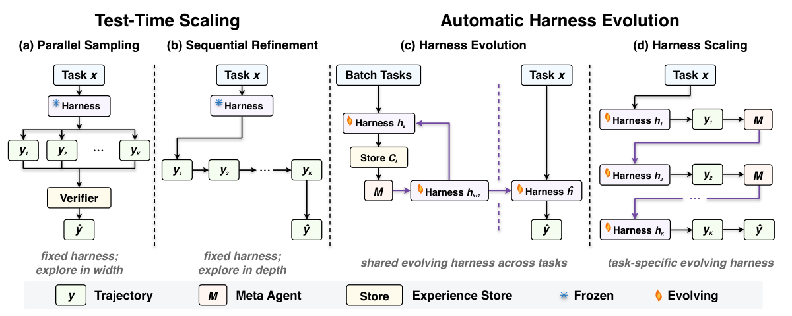

## 本期导读

1 篇论文、2 篇技术笔记。原文发表日期与本期阅读日期分别记录。

<h2 class="daily-paper-title" id="paper-arxiv-2607.12227">01 · Harness 演化：额外计算究竟改进了什么</h2>

[Rethinking the Evaluation of Harness Evolution for Agents](https://arxiv.org/abs/2607.12227v4) 
Yike Wang、Huaisheng Zhu、Zhengyu Hu、Yige Yuan、Zhengyu Chen、Shakti Senthil、Hannaneh Hajishirzi、Yulia Tsvetkov、Noah A. Smith、Pradeep Dasigi、Teng Xiao 
首发 2026-07-14 · 本文依据 2026-10-05 修订的 v4

### 改外围程序，还是多试几次？

Harness 包括模型外部的提示、工具、记忆和控制逻辑。自动演化通常根据轨迹与评分修改这些部件，但成绩上涨可能只是多花计算寻找了答案。若搜索和最终报告还使用同一批任务，就更难判断修改是否可复用。

作者比较四种预算去向：固定 harness 的并行采样、固定 harness 的顺序修订、跨任务共享 harness 的演化，以及每个任务单独修改 harness 的 scaling。最后一种允许实例内适应，不等于学到能迁移到新任务的通用设计。

<a class="note-image-link" href="/assets/images/digest/2026-11-02/harness-method.png" target="_blank" rel="noopener" aria-label="四种预算分配方式：并行采样、顺序修订、跨任务 harness 演化与任务内 harness scaling · 查看原图 ↗">查看原图 ↗</a>

*从左向右，额外预算分别用于独立尝试、修订轨迹、修改跨任务共享程序和修改单任务程序。冻结的对象不同，决定了成绩支持哪一种能力主张。*

### 终端任务：简单基线不能省略

Terminal-Bench 2.1 实验使用 89 个任务、三种模型、K=5 的尝试预算，两次独立运行取平均。各方法从相同初始 harness 出发，AHE 的外部 harness 检索组件被关闭。没有单元测试反馈时，并行采样平均成绩为 72.3，Harness Evolution 为 67.4，直接采样为 68.2；单靠自我判断改程序并未稳定获益。

更关键的是留出测试：45 个训练任务用于演化，10 个验证任务用于选择，34 个测试任务用于最终评估。三个模型的平均 Pass@1 在初始与演化 harness 上都为 **63.2**，分别变化 +1.2、0.0、−1.4 个百分点。它表明这组实验未得到稳健的跨任务提升，不能据此断言所有 harness 优化都无效。

### 游戏：有反馈的任务内适应更有空间

长时程游戏的结果相反。在 25 个公开 ARC-AGI-3 游戏、2,000 次动作预算下，完整 harness scaling 相对关闭记忆演化的 VISTA*，将 Claude Opus 4.8 的 RHAE 从 43.3 提至 77.5，将 GPT-5.6 Terra 从 21.1 提至 38.2，分别约为 79% 和 81% 的相对提升。RHAE 同时涉及完成情况和相对人类的动作效率，不是通关率。只允许记忆演化的 VISTA 居中，说明可编辑工具与技能也有贡献。

EdgeBench 五个游戏／模拟任务使用 12 小时预算，报告过程中取得的最高分、两次运行平均；两模型分别从 48.3 到 54.7、45.9 到 49.8。这里测的是每个任务内持续适应，不是留出任务迁移，不能用来抵消前面的泛化结果。

**最值得带走的是比较协议。** 任务反馈、尝试次数、可编辑对象和最终测试集都要讲清楚。论文的终端成本估算没有计入修改 harness 的开销，因此“同预算”也不等于精确相同的总费用。对自改进系统，先与直接扩展搜索比较，再分别验证任务内收益和跨任务复用，才能知道复杂度增加换来了什么。

## 同日技术笔记

- <a href="/tech/zh/agent-desktop-reliability/">agent-desktop：让桌面动作携带身份与重试证据</a>
- <a href="/tech/zh/particledb-jepsen/">ParticleDB：从单节点反例审视数据库安全承诺</a>
