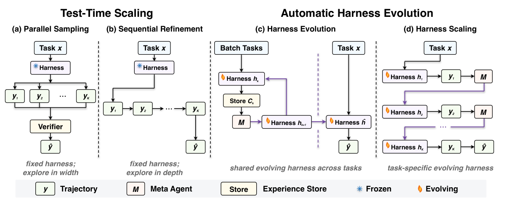

## 本期导读

2 篇论文、2 篇技术笔记与 2 条社区阅读。原文发表日期与本期阅读日期分别记录。

<h2 class="daily-paper-title" id="paper-arxiv-2610.00126">01 · 验证器泄漏：先确认还有问题需要求解</h2>

[A Verifier Can Leak the Answer: Diagnosability Before Optimization in Closed-Loop Agent Debugging](https://arxiv.org/abs/2610.00126) 
Peiying Zhu、Sidi Chang · 首发 2026-09-09 · arXiv v1

### 优化器正确，比较仍可能无效

这项研究的对象是模拟需求与库存环境中的闭环决策策略，并非 LLM Agent。作者最初想比较两种故障定位算法：把聚合轨迹中的异常编译成冲突集合，再用精确最小击中集（MHS）或传播感知贪心方法，选出能解释所有冲突的低成本组件集合。直觉上，精确求解应有机会优于近似选择。

开发实验却发现，两种算法在 12/12 个案例中返回同一支持集，预置故障恢复也同为 9/12。审计揭示，精确锚点谓词在 9/9 个案例里直接给出预置故障对。更隐蔽的是，删除锚点后，限定单组件的硬探针仍与同范围谓词共同生成单元素冲突；传播后，9 个案例都没有剩余冲突需要优化器处理。问题并非 MHS 求错，而是上游已把答案变成必选项。

### 两道门槛先决定能不能诊断

论文由此转向支持度门控。第一道参考门检查干净轨迹是否反复覆盖组件：15 个独立分区中，至少 14 个的支持计数达到 12，才进入参考映射。第二道运行时门要求参考流与当前流在同一个分区同时达到支持条件，仍需至少 14/15 个分区通过。分别累计两边的样本量不够，因为它们可能来自不同分区，不能支撑可比较的差异。

只有通过门控的单元才进入信号判断；未通过者明确弃权。信号阈值由独立校准确定，正式实验不再调参。这套机制解决的是证据是否足够、是否匹配；“探针有没有泄漏目标身份”仍要另外审计，门控本身不会自动消除泄漏。

### 零误报不等于零风险

预注册保留实验包含 1,440 个案例、21,600 个分区行。72 个需求机制—组件单元中，55 个通过参考门，随后 54 个通过运行时门。独立干净对照在 20 个实际组件上没有观察到稳定误准入，但单侧精确 95% 上界为 **0.1391**；它满足预先设定的 0.20 门槛，不是“误报率低于 5%”的保证。大量模拟轨迹也不能替代这 20 个组件作为统计单位。

另一个实用发现是，故障影响了多少正常访问流量，比修改了多少状态单元更能解释检测能力。Agent 很少到达的区域即使改动很大，也可能在聚合轨迹里几乎不可见。

**值得读的是被推翻的优化器假设和验证契约。** 对 AgentOps 与故障注入研究，可迁移的问题是：探针是否透露了注入位置，传播后是否还有真实选择，受测策略是否访问过待诊断区域？正式实验没有证明故障定位准确率，也没有重新证明精确 MHS 优于贪心；支持阈值来自单一模拟器，不能直接套用到语言 Agent。

<h2 class="daily-paper-title" id="paper-arxiv-2607.12227">02 · Harness 演化：额外计算究竟改进了什么</h2>

[Rethinking the Evaluation of Harness Evolution for Agents](https://arxiv.org/abs/2607.12227v4) 
Yike Wang、Huaisheng Zhu、Zhengyu Hu、Yige Yuan、Zhengyu Chen、Shakti Senthil、Hannaneh Hajishirzi、Yulia Tsvetkov、Noah A. Smith、Pradeep Dasigi、Teng Xiao 
首发 2026-07-14 · 本文依据 2026-10-05 修订的 v4

### 改外围程序，还是多试几次？

Harness 包括模型外部的提示、工具、记忆和控制逻辑。自动演化通常根据轨迹与评分修改这些部件，但成绩上涨可能只是多花计算寻找了答案。若搜索和最终报告还使用同一批任务，就更难判断修改是否可复用。

作者比较四种预算去向：固定 harness 的并行采样、固定 harness 的顺序修订、跨任务共享 harness 的演化，以及每个任务单独修改 harness 的 scaling。最后一种允许实例内适应，不等于学到能迁移到新任务的通用设计。

<a class="note-image-link" href="/assets/images/digest/2026-11-02/harness-method.png" target="_blank" rel="noopener" aria-label="四种预算分配方式：并行采样、顺序修订、跨任务 harness 演化与任务内 harness scaling · 查看原图 ↗">查看原图 ↗</a>

*从左向右，额外预算分别用于独立尝试、修订轨迹、修改跨任务共享程序和修改单任务程序。冻结的对象不同，决定了成绩支持哪一种能力主张。*

### 终端任务：简单基线不能省略

Terminal-Bench 2.1 实验使用 89 个任务、三种模型、K=5 的尝试预算，两次独立运行取平均。各方法从相同初始 harness 出发，AHE 的外部 harness 检索组件被关闭。没有单元测试反馈时，并行采样平均成绩为 72.3，Harness Evolution 为 67.4，直接采样为 68.2；单靠自我判断改程序并未稳定获益。

更关键的是留出测试：45 个训练任务用于演化，10 个验证任务用于选择，34 个测试任务用于最终评估。三个模型的平均 Pass@1 在初始与演化 harness 上都为 **63.2**，分别变化 +1.2、0.0、−1.4 个百分点。它表明这组实验未得到稳健的跨任务提升，不能据此断言所有 harness 优化都无效。

### 游戏：有反馈的任务内适应更有空间

长时程游戏的结果相反。在 25 个公开 ARC-AGI-3 游戏、2,000 次动作预算下，完整 harness scaling 相对关闭记忆演化的 VISTA*，将 Claude Opus 4.8 的 RHAE 从 43.3 提至 77.5，将 GPT-5.6 Terra 从 21.1 提至 38.2，分别约为 79% 和 81% 的相对提升。RHAE 同时涉及完成情况和相对人类的动作效率，不是通关率。只允许记忆演化的 VISTA 居中，说明可编辑工具与技能也有贡献。

EdgeBench 五个游戏／模拟任务使用 12 小时预算，报告过程中取得的最高分、两次运行平均；两模型分别从 48.3 到 54.7、45.9 到 49.8。这里测的是每个任务内持续适应，不是留出任务迁移，不能用来抵消前面的泛化结果。

**最值得带走的是比较协议。** 任务反馈、尝试次数、可编辑对象和最终测试集都要讲清楚。论文的终端成本估算没有计入修改 harness 的开销，因此“同预算”也不等于精确相同的总费用。对自改进系统，先与直接扩展搜索比较，再分别验证任务内收益和跨任务复用，才能知道复杂度增加换来了什么。

## 社区动态

<h3 id="community-x-semianalysis-2116666571728863431">社区记录</h3>

[SemiAnalysis 原帖](https://x.com/SemiAnalysis_/status/2116666571728863431) · 2026-10-31 UTC；[vLLM 草稿 PR #64893](https://github.com/vllm-project/vllm/pull/64893)

这项 Hopper 后端面向 **DeepSeek-V4.1-Flash、4×H200、TP4、DSpark k=5**，通过 PDL 串联内核、形状专用的 CuTe DSL 实现及小算子融合，减少低并发 decode 的固定开销。作者以同一构建关闭 executor 为基线，按 ABBA 顺序测试；真实提示、输出 1,024 token、温度 0.7 时，并发 1 的中位 ITL 从 8.76 降到 5.40 ms，下降 38.3%，并发 32 时下降 5.1%。这是延迟降幅，不是通用吞吐增幅。

PR 尚为草稿；超过 192 行的 decode 步、prefill 等走原路径，另需每 GPU 约 0.36 GB 的特定权重副本。质量检查与内核测试由作者报告，CI 没有 4×H200 端到端运行条件。值得关注的是低并发专用路径与回退边界；AI 辅助编写约万行内核，并不能单独证明开发方式可靠。

<h3 id="community-x-semianalysis-2116950855718998288">社区记录</h3>

[SemiAnalysis：NVIDIA AgentX 提交称 agent 集群写的软件让 700B+ 模型超过 1000 tok/s/user，Rubin NVL72 perf/TCO 达 GB300 的 9.11–20.9 倍](https://x.com/SemiAnalysis_/status/2116950855718998288)

SemiAnalysis 讨论 NVIDIA AgentX 提交及 Rubin NVL72 在指定单用户速度下的单位总拥有成本性能。后续帖将部分变化归因于通过 NVLink 跨计算托盘汇聚 Vera 内存中的 KV 状态。所引 TCO 比率依赖提交配置和成本假设，不是硬件通用倍数，也未在本站独立复现。

## 同日技术笔记

- <a href="/tech/zh/agent-desktop-reliability/">agent-desktop：让桌面动作携带身份与重试证据</a>
- <a href="/tech/zh/particledb-jepsen/">ParticleDB：从单节点反例审视数据库安全承诺</a>