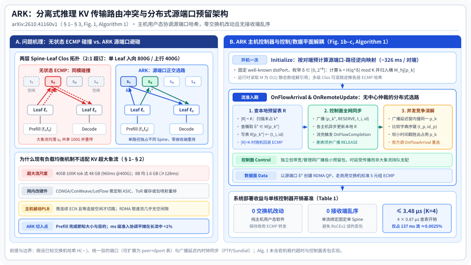
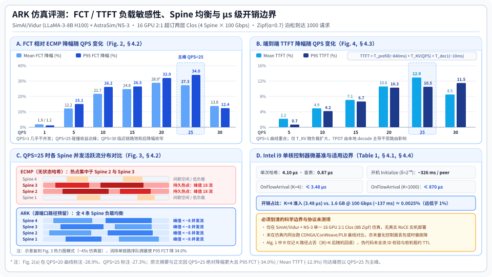
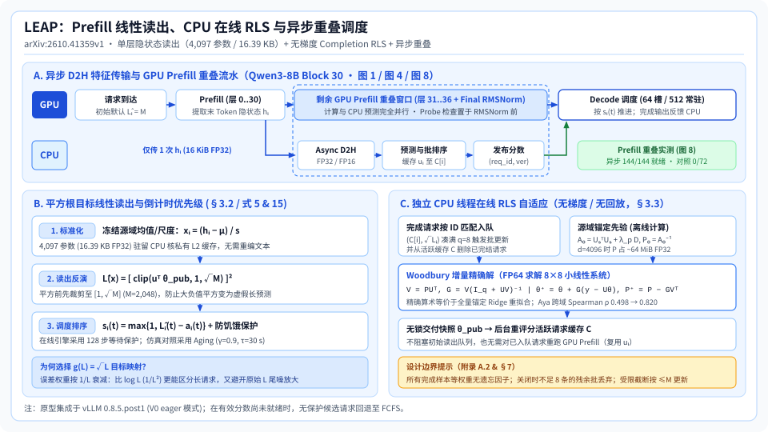
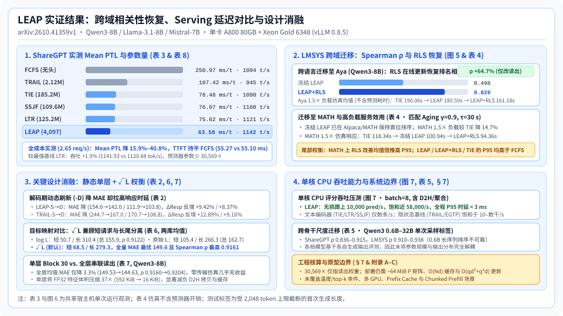
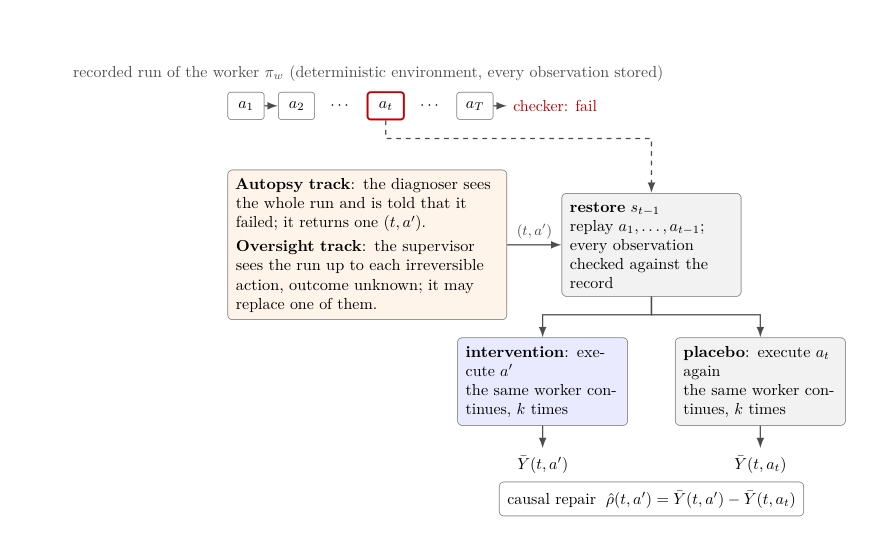
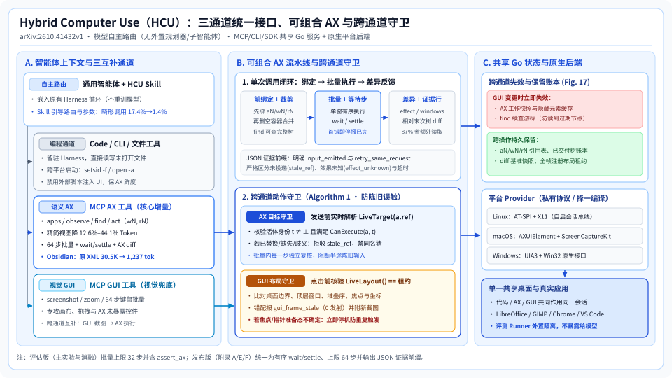
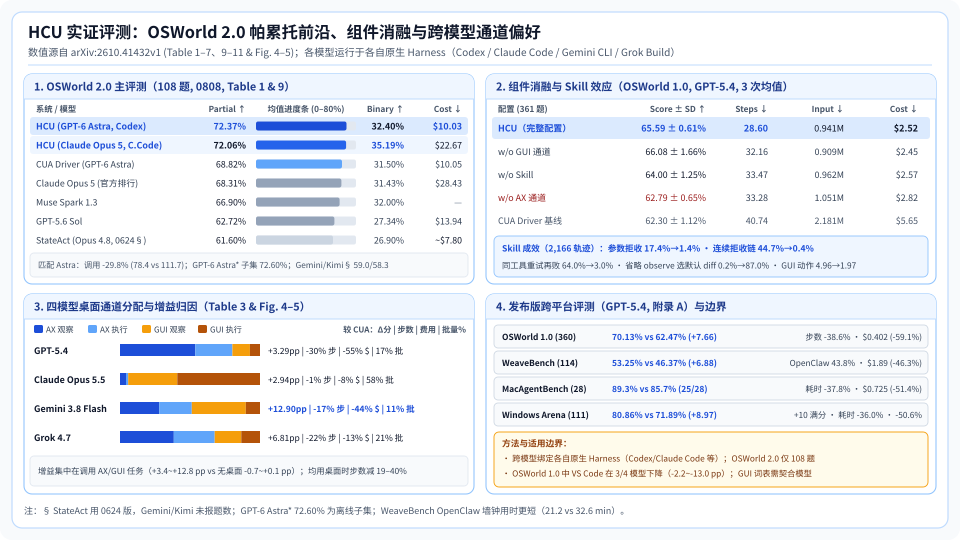
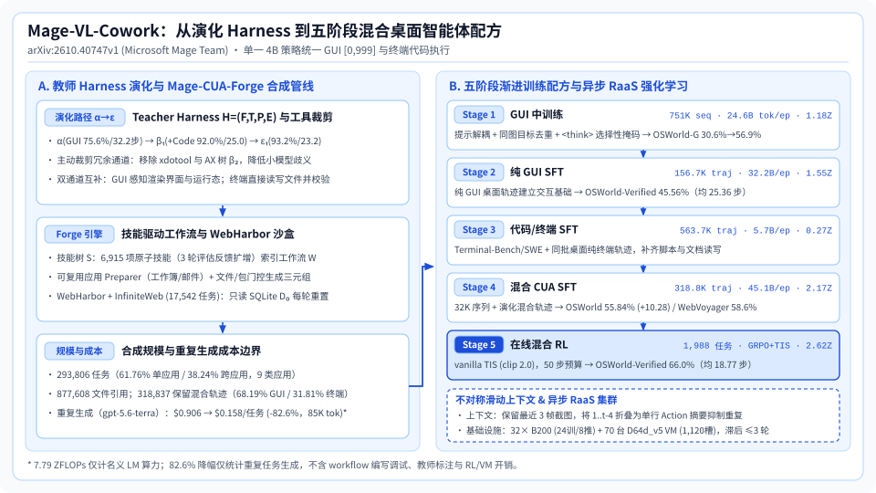
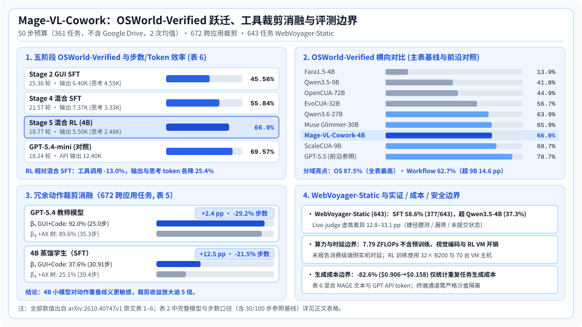

## 本期导读

17 篇论文、2 篇技术笔记与 1 条社区阅读。原文发表日期与本期阅读日期分别记录。

<h2 class="daily-paper-title" id="paper-arxiv-2610.41919">01 · Matching Workloads to Blackwell: Power-Resolved Benchmarking of NVIDIA B200 and B300 across HPC and AI Workloads</h2>

[Matching Workloads to Blackwell: Power-Resolved Benchmarking of NVIDIA B200 and B300 across HPC and AI Workloads](https://arxiv.org/abs/2610.41919) 
Mohsen Zand、Trung Dac Nguyen、H. Birali Runesha

该 B200/B300 研究按工作负载和板卡功耗拆解表现，发现新卡并非所有任务都更快；相同 B300 节点仅更换开发版 vLLM 即出现 2.1 倍 TTFT 差异。

两套集群的驱动和主机条件不同，不能把全部差异归因硅片；输入常驻显存也排除了实际数据管线开销。

来源：[Matching Workloads to Blackwell: Power-Resolved Benchmarking of NVIDIA B200 and B300 across HPC and AI Workloads](https://arxiv.org/abs/2610.41919)

<h2 class="daily-paper-title" id="paper-arxiv-2610.41160">02 · ARK：用源端口路径预留消除 KV 缓存路由碰撞</h2>

[ARK: Avoiding Routing Collisions for KV Cache Transfer in Disaggregated LLM Inference](https://arxiv.org/abs/2610.41160)（[v1 PDF](https://arxiv.org/pdf/2610.41160) · [HTML](https://arxiv.org/html/2610.41160v1) · [ACM DOI](https://doi.org/10.1145/3789240.3828750)）  
Hung-Chun Lin\*、Ting-Wei Hsu\*、Chung-En Ho、Ahmed Saeed（Georgia Institute of Technology；\* 共同一作）· `arXiv:2610.41160v1 [cs.NI]` · ACM SIGCOMM 2026 Workshop on Networks for AI Computing（NAIC '26，pp. 2067–2073）· 2026-10-30 提交（截至核验仅存 `v1`，无修订或撤回记录；论文未附公开代码仓库）

在大语言模型（LLM）的 Prefill–Decode 分离（PD disaggregation）推理架构中，预填充节点生成动辄数 GB 的 KV 缓存，经由数据中心 RDMA 网络传输到解码节点后才能吐出第一个 token。这类持续数百毫秒至数秒的「超大象流（mega elephant flow）」会直接暴露商用无状态等价多路径（ECMP）路由的盲区：若多条 KV 缓存流恰好哈希到同一台 Spine 交换机，它们就会在长达数秒的生命周期内争抢同一条链路，而相邻 Spine 链路却处于空闲状态，进而直接拉长请求首字延迟（TTFT）。`ARK` 并不修改交换机硬件或引入接收端包重排，而是抓住 KV 流「准入即知大小与目的、生命周期足以摊薄毫秒级协调」的两个特点，在主机用户态维护一份轻量同步的路径预留表，并在建链时挑选能哈希到空闲 Spine 的源端口。以下精读严格依据 `arXiv:2610.41160v1` 原文，将作者在包级仿真与微基准中测得的结果、显式设计假设与协议审校边界分开标明。

### 一、为什么 KV 缓存大象流会击穿无状态 ECMP 与现有负载均衡

现代推理集群普遍把计算受限的 Prefill（注意力计算复杂度为 `Θ(L²)` FLOPs）与显存带宽受限的 Decode 拆到独立 GPU 资源池，以消除相互干扰并独立对齐 TTFT 与 TPOT 的服务等级目标（SLO）。这一架构已进入 `DistServe`、`Splitwise`、`vLLM`、`SGLang`、`NVIDIA Dynamo` 与 `llm-d` 等框架，并在 Moonshot AI `Mooncake` 以及 `96` 张 H100 上的 `SGLang DeepSeek-V3` 生产参考部署中规模落地。然而，跨池迁移 KV 缓存把网络推入了前所未有的流量尺度：

- **从十 MB 级跃升至数十 GB 级的传输瓶颈**：单 token KV 缓存占用的字节数为 `2 · L_h · H_kv · d_h · s`。以 `LLaMA-3.1-405B`（`126` 层、`8` 个 KV 头、`d_h = 128`、FP16）为例，单 token 即达 `504 KB`，一条 `100K` token 的上下文对应 `48 GB` KV 缓存，可独占一条 `400 Gbps` 链路达 `960 ms`；即便在本文评测使用的 `LLaMA-3-8B`（`128 KB/token`）上，平均 `1.6 GB` 的流在 `100 Gbps` 链路上至少也要占满 `128 ms`（仿真参考值为 `~137 ms`），比传统数据中心十 MB 级大象流与毫秒级流长出 `3–4` 个数量级。
- **超订 Clos 放大 ECMP 哈希碰撞**：出于成本考量，Meta RoCE 训练网与阿里 HPN 等生产 AI 网络仍保留商用 5 元组无状态 ECMP（`k_i = H(q_i) mod K`），并常在 Leaf–Spine 层采用超订（如本文评测的 `2:1`）。由于哈希函数对流大小无感知，两条或多条并发 KV 大象流一旦撞上同一 `mod K` 索引，便会平分该 Spine 带宽并迅速堆满交换机队列缓冲区，进而触发 RDMA 重传，把排队延迟直接累加到关键路径上的 TTFT。
- **上层缓存优化无法替代路径选择**：多级 KV 存储（`MemServe`、`LMCache`）与压缩/重路由协议（`CacheGen`、`DualPath` 等）旨在减少线上字节数或均衡存储网卡负载，但只要字节进入转发网络，仍需决定走哪条等价 Spine 路径，因此 `ARK` 与这类应用层优化形成正交叠加。
- **既有网内与主机负载均衡为何错配**：网内方案要么需要定制拥塞感知交换机 ASIC（`CONGA`）、可编程 ToR 与逐流重排缓存（`ConWeave`）、交换机流片检测（`LetFlow`），要么靠包喷射带来严重乱序并使接收端承受巨大的 GB 级 CPU 重组装开销。主机端 `PLB` 虽不改交换机，但它是**被动响应式**：需经历 `M` 个连续 ECN 拥塞轮次且等到连接出现空闲间隙才敢改动 IPv6 Flow Label（否则 RoCEv2 RNIC 会把中途换路导致的乱序误判为丢包），而由硬件限速发送的 RDMA KV 传输几乎没有空闲间隙，导致安全重路由条件在流生命周期内难以触发。

相比之下，KV 缓存传输同时具备两项极罕见的调度前提：（1）**流寿命长到足以摊薄协调**：毫秒级准入协调在 `≥128 ms` 传输中的占比远低于 `1%`；（2）**身份在准入瞬间完全已知**：Prefill 结束生成缓存的那一刻，目的 GPU、字节数与发送起始时刻已全部确定，既不需要 `Hedera` 式的运行时大流检测，也不需要 `Fastpass`、`Flowtune`、`FAST` 或 `Crux` 那样的中心化仲裁器或全局流量矩阵。

### 二、ARK 设计：开机哈希逆推、控制/数据平面分离与竞争消解

<figure class="note-figure"><a class="note-image-link" href="/assets/images/digest/2026-11-03/ark-elephant-flow-spine-routing-zh.svg" target="_blank" rel="noopener" aria-label="查看 ARK 问题机理与分布式源端口路径预留架构图原图">查看原图 ↗</a><figcaption>图 1 · ARK 问题机理与主机分布式路径预留架构（整理自 arXiv:2610.41160v1 §1–§3、Fig. 1 与 Algorithm 1）：以用户态源端口桶查表与轻量同步实现零交换机修改、零接收端乱序的 Spine 隔离。</figcaption></figure>

`ARK` 在两层 Spine-Leaf Clos 拓扑上形式化定义其机制：`N_S` 台 Spine 交换机 `V_S = {s₁, ..., s_{N_S}}` 与 `N_L` 台 Leaf（ToR）交换机全互联，每台主机通过单条上行链路接入 Leaf，从而任意跨 Leaf 主机对 `(h_{i,m}, h_{j,n})` 之间共有 `K = N_S` 条等价单 Spine 路径 `p_k = (h_{i,m} → ℓ_i → s_k → ℓ_j → h_{j,n})`。对于更深的多级 Clos 架构（如 Meta 多层 RoCE 网络），可通过在路径沿途每一跳 ECMP 决策点联合逆推哈希函数进行扩展。系统建立在两项显式假设之上：其一，KV 传输应用在所有对端之间固定使用单个约定好的目的端口（因此每个对端组合的 `srcIP`、`dstIP`、`dstPort`、`proto` 均固定，仅 `srcPort` 可变；多目的端口场景可扩展为按 `(peer, dport)` 建表）；其二，各主机时钟同步误差需控制在广播延迟以内（本文部署场景为数微秒级，可通过 IEEE 1588 `PTP`、`Sundial` 或 `Huygens` 等成熟数据中心亚微秒同步方案满足）。

在每台服务器的用户态控制器中，核心状态是一份经轻量广播维持最终一致的本地路径预留表 `R(t) ⊆ P`（将已占用路径 `p_k` 映射到 `(t, id)`），整个生命周期按 Algorithm 1 分为四个步骤执行：

1. **开机一次性预计算（`Initialize`）**：服务器启动时遍历所有对端 `h_j ∈ V` 与源端口偏移 `δ = 0, 1, ..., δ_max`（§4.4 取 `δ_max = 2¹⁶`），模拟交换机哈希函数计算 `k ← H(q^δ) mod K`，将 `δ` 归入桶 `M_{h_j}[p_k]`。此后运行时获取目标 Spine 对应的源端口只是一次 `O(1)` 静态数组解引用。
2. **流准入与回退（`OnFlowArrival`）**：新流 `f_i` 在本地时间 `t_i` 到达时，控制器在 `R` 中扫描最多 `K` 条路径。若 `R` 尚未占满 `K` 条路径，则取最小空闲编号 `k_i* = min{k : p_k ∉ R}`，从 `M_{dst_i}[p_{k_i*}]` 取一源端口 `δ_i*`，写入本地 `R[p_{k_i*}] ← (t_i, id)` 并向对端广播 `(p_{k_i*}, RESERVE, t_i, id)`；若全网所有 `K` 条路径均已被预留，则**回退到 ECMP**，在 `{1, ..., K}` 中随机抽取 `k_i*` 并选取对应 `δ_i*`。随后为 `f_i` 创建源端口为 `δ_i*` 的 RDMA 队列对（QP）并注册完成回调。
3. **控制/数据平面解耦与流结束释放（`OnFlowCompletion`）**：数据面走普通 RDMA 网络与未改动的商用交换机（每条流全程固定单条路径，无需接收端重排）；控制面将极短小、对时延敏感的 `RESERVE`/`RELEASE` 广播放到独立低带宽或管理网络信道，使协调延迟受传播时延而非数据面大象流队列支配（若与数据面共享网络，算法仍可运行，但高负载下竞争时间窗会扩大）。流完成时删除 `R` 中对应表项并广播 `RELEASE`。
4. **广播窗口内的竞争消解（`OnRemoteUpdate`）**：由于 `R` 为异步复制，两台主机可能在一次广播延迟窗口内同时选中同一 `p_k`。收到远端 `RESERVE` 时，控制器比较字典序时间戳键 `(t_p, id_p)` 与本地已记录的 `R[p_k]`：键更小的一方胜出并保留 `p_k`，败方本地覆写表项并重新执行 `OnFlowArrival(f)`，把自己的流改哈希到其他路径。

### 三、仿真实验、Spine 热力图与控制器微基准

<figure class="note-figure"><a class="note-image-link" href="/assets/images/digest/2026-11-03/ark-rdma-fct-ttft-eval-zh.svg" target="_blank" rel="noopener" aria-label="查看 ARK 仿真评测与控制器微基准四象限图原图">查看原图 ↗</a><figcaption>图 2 · 包级仿真表现与微基准边界（整理自 arXiv:2610.41160v1 Fig. 2–4 与 Table 1）：中等拥塞负载下对尾部传输（P95 FCT）与均衡度的改善最显著，接近链路饱和时边际收益收敛。</figcaption></figure>

作者将服务模拟器与包级网络模拟器结合评测 `ARK`：计算侧使用 `SimAI` 调用 `Vidur`（基于 NVIDIA H100 上逐层实测的 `LLaMA-3-8B` profile 训练随机森林回归器预测 `T_prefill` 与 `T_decode-1`）；网络侧使用 `AstraSim` 内置的 `ECMP-based NS-3` 包级 RDMA 后端并实现主机侧 `ARK` 控制器。拓扑复刻阿里 HPN 的两层 Clos 实例：`2` 台 `8` GPU 服务器共 `16` 张 GPU（`Server 1` GPU 1–8 作 Prefill，`Server 2` GPU 9–16 作 Decode）、`2` 台 Leaf 与 `4` 台 Spine（`K = 4`），全部链路速率 `100 Gbps`，形成单 Leaf 入向 `800 Gbps` 对上行 `400 Gbps` 的 `2:1` 超订比。工作负载按 `Zipf(α = 0.7)` 抽取提示长度（均值约 `13,300` token），按 `128 KB/token` 生成 `125 MB` 至 `6.7 GB`（均值 `1.6 GB`）的 KV 流，随机匹配 Prefill–Decode 对并以泊松过程按不同 QPS 注入，每组实验固定 `1,000` 个请求。

| 负载速率 (QPS) | Mean FCT 相对 ECMP 变化 | P95 FCT 相对 ECMP 变化 | Mean TTFT 相对 ECMP 变化 | P95 TTFT 相对 ECMP 变化 | 物理机制与原文口径说明 |
| :--- | :--- | :--- | :--- | :--- | :--- |
| QPS = 1 | -1.9%（§4.2 正文） | -1.2%（§4.2 正文） | 曲线基本重合（Fig. 4a） | 曲线基本重合（Fig. 4b） | 并发流稀少，ECMP 极少发生碰撞 |
| QPS = 5 | -12.2%（Fig. 2a 标注） | -15.1%（Fig. 2b 标注） | -2.2%（正文约 2%） | -0.7%（Fig. 4b 标注） | 开始出现短时双流碰撞，但占比仍小 |
| QPS = 10 | -21.7%（Fig. 2a 标注） | -26.2%（Fig. 2b 标注） | -4.9%（Fig. 4a 标注） | -4.2%（Fig. 4b 标注） | 中低并发下碰撞累积，TTFT 降幅随 `T_KV` 扩大 |
| QPS = 15 | -24.8%（Fig. 2a 标注） | -26.5%（Fig. 2b 标注） | -7.1%（Fig. 4a 标注） | -6.7%（Fig. 4b 标注） | 碰撞频次抬升，P95 长尾同步改善 |
| QPS = 20 | -28.9%（Fig. 2a 曲线标注） | -32.0%（Fig. 2b 标注） | -10.6%（Fig. 4a 标注） | -10.3%（Fig. 4b 标注） | Mean FCT 相对降幅在图面标注略高于 QPS=25，绝对 ms 降幅较小 |
| **QPS = 25（主峰）** | **-27.3%**（摘要 / 正文主峰） | **-34.0%**（摘要 / 正文峰值） | **-12.9%**（摘要 / 正文峰值） | -10.5%（Fig. 4b 标注） | 拥塞而未全饱和；ECMP 热点在 Spine 2/3 达 `18` 流，ARK 全 4 Spine `< ~8` 流 |
| QPS = 30 | -13.8%（§4.2 正文） | -12.4%（§4.2 正文） | -8.5%（Fig. 4a 标注） | **-11.5%**（正文约 12%） | Leaf–Spine 整体趋近饱和，均匀调度剩余空间收窄 |

*表 1 · QPS 扫描下的 FCT 与端到端 TTFT 相对 ECMP 降幅汇总（综合 arXiv:2610.41160v1 §4.2–§4.3 正文数值与 Fig. 2 / Fig. 4 曲线直接标注；注：Fig. 2a 在 QPS = 20 曲线标注 -28.9%，而 QPS = 25 因绝对毫秒降幅更大且 P95 FCT 与 Mean TTFT 同达峰值，被原文摘要与正文选为代表峰值）。*

从 Fig. 3 的 `QPS = 25` 活跃流热力图可以直观看到 FCT 长尾改善的根源：在无状态 ECMP 下，哈希极化把大流长期堆叠到 `Spine 2` 和 `Spine 3`（并发峰值高达 **`18` 条活跃流**），而 `Spine 1` 和 `Spine 4` 则间歇性空闲或低负载运行；拥塞链路上的每条流都要承受与竞争流数成比例的排队延迟。`ARK` 将负载均匀铺满全部四台 Spine，使每条 Spine 的峰值活跃流均压低至 **`~8` 条以下**，从而兑现 `34.0%` 的 P95 FCT 下降。传导至端到端服务延迟 `TTFT = T_prefill(L) + T_KV + T_decode-1(L)` 时，由于 `T_prefill`（`~840 ms`）和首步解码 `T_decode-1`（`~10 ms`）对所有 QPS 构成约 `850 ms` 的固定计算偏置，只有 `T_KV` 随负载放大，因此低负载下 TTFT 降幅仅约 `2%`（`QPS = 5`），到 `QPS = 25` 时 Mean TTFT 改善放大至 **`-12.9%`**（在 `QPS = 30` 时 P95 TTFT 降 **`-11.5%`**，正文约 `12%`），而受 GPU 本地 HBM 带宽主导的逐 token 解码延迟 TPOT 不受路由影响。

| 评测阶段 / 操作或仿真基准参数（来源：Table 1 与 §4.1） | 实测延迟 / 规格口径 | 与 KV 传输或集群规模的对比含义 |
| :--- | :--- | :--- |
| 单次哈希计算（Intel i9 单核单线程，Table 1） | `4.10 µs` | 仅在开机枚举或重算时调用，不进入关键转发开销 |
| 预留表查找（Intel i9 单核单线程，Table 1） | `0.87 µs` | 每次探测 1 个路径表项的耗时，桶 `M` 为静态数组解引用 |
| 开机初始化 `Initialize`（`δ_max = 2¹⁶`，Table 1） | `~326 ms / peer` | 仅服务器启动时按对端一次性付出 |
| 运行时单流最坏开销 `OnFlowArrival`（`K = 4`，Table 1） | `≤ 3.48 µs` | 即 `4 × 0.87 µs`，对应本文 4-Spine 评测拓扑 |
| 运行时单流最坏开销 `OnFlowArrival`（`K = 1000`，Table 1） | `≤ 870 µs` | 随等价路径数 `K` 线性扩展，仍低于 `1 ms` |
| 参考传流耗时与 `K = 4` 控制比值（Table 1） | `~137 ms` / **`≈ 0.0025%`** | 以 `1.6 GB` KV 缓存跑满 `100 Gbps` 为基准，协调开销远低于 `1%` |
| 联合仿真拓扑与负载基准（§4.1） | `16` GPU、`2` Leaf、`4` Spine、`100 Gbps`（`2:1` 超订） | `LLaMA-3-8B` H100 `Zipf(α=0.7)` 均 `~13.3K` token（`125 MB–6.7 GB`），`1000` 请求 |

*表 2 · ARK 单核控制器微基准与 SimAI/NS-3 仿真实验基准参数（严格对照 arXiv:2610.41160v1 Table 1 与 §4.1）。*

### 四、科学边界、协议细节审校与工程落地启示

将 `ARK` 的结论外推到真实生产集群之前，必须把论文已验证部分与尚未实证的工程边界严格拆清：

1. **纯仿真评测与单一对比基线边界**：全文所有 FCT、Spine 热力图与 TTFT 结论均产自 `SimAI/Vidur` + `AstraSim/NS-3` 离散事件仿真，且仅覆盖单一 `16` GPU、`2` Leaf、`4` Spine、`2:1` 超订、`100 Gbps` 链路、`LLaMA-3-8B` 单模型与 `1,000` 条泊松 `Zipf` 请求的设定。论文**未在真实 RoCEv2/InfiniBand 集群硬件上运行部署**，**也未在 NS-3 内同台对比 `CONGA`、`ConWeave`、`LetFlow`、`PLB` 或包喷射等基线**，对突发非泊松到达、非 `2:1` 超订比以及更大规模多级 Clos 仅停留于原理说明。
2. **Algorithm 1 状态粒度与并发边界细节（据伪代码逐行核验）**：细读 Algorithm 1 可发现四处工程化时必须补齐的细节：（a）预留表 `R` 是一个最多容纳 `K` 个路径键的集合，而非每条 Spine 的活跃流数或剩余字节计数器——一旦并发流超过 `K`（例如本文 `K = 4`，而 `QPS = 25` 时图 3 每条 Spine 上存在接近 `~8` 条并发流），`OnFlowArrival` 会触发 `R` 满载分支并**随机抽取 `k ∈ {1..K}`**（虽靠随机性打破了固定 5 元组哈希极化，但无法感知某条 Spine 此时正背负 `2` 条还是 `7` 条流）；（b）伪代码中 `OnFlowCompletion` 直接执行 `R ← R \ {p_{k_i*}}` 而未校验流 ID，若随机回退流共享了 `p_k` 且先于原预留流结束，朴素实现可能过早清空占用位；（c）`OnRemoteUpdate` 在竞争失败时直接重调 `OnFlowArrival(f)`，隐含假设是败方流尚未将数据包注入已建好的 RDMA QP（否则改端口重建 QP 仍会带来切换代价）；（d）伪代码未包含发送端节点宕机漏发 `RELEASE` 时的租约超时（TTL）回收机制。
3. **部署前置依赖未做故障注入量化**：系统假设主机侧预先掌握交换机准确的哈希算法与种子配置 `H(·)`（多厂商交换机异构哈希需开机校准）、全对端统一目的端口（或扩展为按 `(peer, dport)` 维护映射表）、广播延迟以内的时钟同步精度，并推荐额外配置独立管理/低带宽网络传输控制信令；对于**控制包丢失、广播延迟抖动、时钟偏斜越界或与数据面共享网络时的量化退化幅度**，论文并未给出消融实验。
4. **可迁移的系统工程启示**：（1）**在字节入网前以端侧可编程性替代交换机改造**：对于持续百毫秒以上且规模已知的 KV 缓存迁移，通过源端口逆向查表就能以 `~3.5 µs` 级代价在商用 ECMP 网络上消除最剧烈的哈希极化，并且可与 `CacheGen` 压缩或 `LMCache` 池化正交叠加；（2）**生产化需把二值表 `R` 升级为带租约与剩余字节计数的轻量记账**：既然 Prefill 结束时已准确知道流字节数，将 `R` 升级为按 `(flow_id, spine_idx, est_remaining_bytes, lease_ttl)` 维护负载计数，既能防止超过 `K` 条并发流后的随机回退退化，也能优雅回收故障节点的僵尸预留；（3）**QP 发包前留出单次广播等待窗或两阶段确认**：在发首个 RDMA WQE 前等待极短的广播传播窗口处理 `(t_i, id)` 冲突重选，即可在保持零接收端乱序的前提下避免竞争流中途撕毁 QP。

来源：[ARK: Avoiding Routing Collisions for KV Cache Transfer in Disaggregated LLM Inference](https://arxiv.org/abs/2610.41160)
<h2 class="daily-paper-title" id="paper-arxiv-2610.41177">03 · TraceSpec: Understanding and Improving Speculative Decoding for LLM Agents</h2>

[TraceSpec: Understanding and Improving Speculative Decoding for LLM Agents](https://arxiv.org/abs/2610.41177) 
Jihao Zhao、Shuaishuai Zu、Pengfei Li、Biao Qin、Guanghuan Fang、Ben Feng、Baochuan Yang

TraceSpec 把 agent 轨迹按阶段和进度分析，发现总接受率随上下文增长的趋势可能掩盖后期 action 的下降。它按状态分配固定草稿训练预算，replay 吞吐比 DSpark 提高 12.5%–22.6%。

replay 控制前缀，不包含完整工具、搜索和任务成功耗时；不能将倍率直接视为 agent 端到端加速。

来源：[TraceSpec: Understanding and Improving Speculative Decoding for LLM Agents](https://arxiv.org/abs/2610.41177)

<h2 class="daily-paper-title" id="paper-arxiv-2610.41508">04 · HiState: Hierarchical Prefix Cache Management for Hybrid LLM Serving in Agentic Workloads</h2>

[HiState: Hierarchical Prefix Cache Management for Hybrid LLM Serving in Agentic Workloads](https://arxiv.org/abs/2610.41508) 
Zaifeng Pan、Lucas Wang、Xinwei Qiang、Yanbo Zhou、Chang Chen、Zhengding Hu、Yue Guan、Yufei Ding

HiState 利用混合模型命中时需要整段 KV、却只需要一个 recurrent checkpoint 的不对称性，把历史检查点放 SSD，快内存优先留给 KV，并联合调节间隔和淘汰。

最高倍率针对 p99 TTFT；单模型、单 H100 和给定内存预算，不代表全部请求平均延迟同倍下降。

来源：[HiState: Hierarchical Prefix Cache Management for Hybrid LLM Serving in Agentic Workloads](https://arxiv.org/abs/2610.41508)

<h2 class="daily-paper-title" id="paper-arxiv-2610.41359">05 · LEAP：复用 Prefill 隐状态与在线递归最小二乘的长度预测调度</h2>

[LEAP: Efficient LLM Inference Scheduling with Generalizable Length Prediction](https://arxiv.org/abs/2610.41359)（[v1 PDF](https://arxiv.org/pdf/2610.41359) · [HTML](https://arxiv.org/html/2610.41359v1) · [匿名代码仓库](https://anonymous.4open.science/r/LEAP-BBFF/)）  
Kwan Yan（Beijing Normal University）、Jialun Zhong（Peking University）、Yanzeng Li\*（Beijing Normal University；\* 通讯作者）· `arXiv:2610.41359v1 [cs.AI]` · 2026-10-30 提交（截至核验仅存 `v1`，无 `v2` 修订或撤回记录）

按剩余输出长度优先调度（length-aware / shortest-job-first）能有效缓解长请求对短请求的队头阻塞，但在真实在线服务中长期受制于两类矛盾：一方面，依赖独立文本编码器或 MLP 头的预测器参数高达数百万至近两亿，既消耗本该用于推理的 GPU 算力，一旦遭遇任务类型或语种迁移（如从英文对话切到多语种 `Aya`）排序质量仍会骤降；另一方面，在解码过程中反复刷新隐状态虽然能压低 Token 预测误差，却可能反过来拖慢端到端请求响应。`LEAP` 给出的系统解法是**单层 Prefill 隐状态平方根线性读出 + 独立 CPU 线程无梯度递归最小二乘（RLS）在线适应 + 与剩余 GPU Prefill 并行重叠**：在从 `LMSYS` 跨语言迁移至 `Aya` 时，只更新 `4,097` 参数线性头即可将 Spearman `ρ` 相对提升 `64.7%`（`0.498 → 0.820`）；在共享 `vLLM` 实测中相对所评估预测器将平均每 Token 延迟（Mean PTL）降低 `15.9%–40.8%`，并以少 `30,569×` 的预测器权重参数相对最强基线 `LTR` 再提升 `1.9%` 吞吐。以下精读严格依据 `arXiv:2610.41359v1` 原文与附录，将作者实测收益与原型会计边界分开陈述。

### 一、为什么调度不需要重编码：Q1–Q4 问题诊断

论文在 §2 用四个互相咬合的问题拆解了现有长度预测器在生产调度中的失效根源：

1. **Q1（跨领域泛化与离线重训成本）**：源域拟合的提示词-长度映射在更换任务、提示风格或用户群体后容易失效（例如 `LMSYS` 冻结模型迁至非英语 `Aya` 时排序显著退化）。通过采集新标注再训练上亿参数编码器成本高昂，而服务系统中**每一个已完成请求天然回流实际输出长度**，是零人工标注的在线监督信号。
2. **Q2（低 MAE 不等于低服务时延）**：在连续批处理（iteration-level batching）中，调度只需区分 `50` token 与 `500` token 请求的相对顺序，并不需要把 `53` token 修正到 `50` token。论文在 Table 2 的配对控制实验中直接证明了这一点：解码期间动态刷新隐状态（`-D`）虽然把 ShareGPT/LMSYS 的 MAE 分别压低了 `8.2%–36.2%`，却令平均响应时间**反向恶化 `8.37%–12.89%`**（见第三节），说明高昂的特征采集与预测执行成本足以吞噬精度增益。
3. **Q3（为什么要对提示词编码两次）**：`TIE`（DeBERTa）、`SSJF`（BERT）和 `LTR`（独立排序模型）必须在 Prefill 之前另跑一次文本编码器，既增内存又加延迟。对于 Prefill 后才开始的 Decode 排队调度，服务模型本身刚刚在 Prefill 阶段算完了融合「输入提示词」与「生成模型自身特性」的隐状态，直接线性读出即可跳过二次编码。
4. **Q4（为什么用宝贵的 GPU 去决定如何省 GPU）**：GPU 预测头会与生成批争抢算力和显存；把预测迁到 CPU 上若无法跟上并发（如 `TRAIL` 需对全部提示 token 池化并加载超出核私有 L2 缓存的 `8.47 MB` MLP，`EGTP-P` 需在 CPU 重建 `2.49 GB` 全词表投影算熵），调度器仍会被阻塞或被迫使用陈旧优先级。必须连同 **GPU→CPU 特征拷贝、预测、分数发布与调度消费** 全链路计入开销。

### 二、系统与算法机制：单层平方根读出、CPU 在线 RLS 与 Prefill 重叠

<figure class="note-figure"><a class="note-image-link" href="/assets/images/digest/2026-11-03/leap-prefill-rls-length-sched-zh.svg" target="_blank" rel="noopener" aria-label="查看 LEAP 系统架构、平方根线性读出与 CPU 在线 RLS 机制图原图">查看原图 ↗</a><figcaption>图 1 · LEAP 端到端数据流与三项核心机制（整理自 arXiv:2610.41359v1 §3、Fig. 1、Fig. 4 与 Algorithm 1）：单次末 token 隐状态异步拷入 CPU，在剩余 GPU Prefill 期间完成读出与初始批排序，并由独立 CPU 线程以 Woodbury 精确增量更新权重。</figcaption></figure>

`LEAP`（集成于 `vLLM 0.8.5.post1` V0 eager 模式的原生 C++ CPU worker）由三部分协同构成：

- **单层平方根映射线性读出（§3.2，附录 A.1）**：只在单个非末深层的**最后一个提示词 token**截取隐状态 <code>h_i ∈ R^d</code>（`Qwen3-8B` 默认取 block 30，`d = 4,096`；`Mistral-7B-Instruct-v0.3` 取 block 28；`Qwen3` `0.6B/1.7B/4B/8B/14B/32B` 分别取 `24/24/32/30/36/60`）。在 `2,880` 条源域训练请求上拟合逐坐标均值 `μ` 与尺度 `s` 并永久冻结标准化 <code>x_i = (h_i - μ) / s</code>，求解带 L2 正则的岭回归（截距 `b` 不加惩罚，`λ_0` 从 `{10⁻⁴, 10⁻³, 10⁻², 10⁻¹, 1, 10}` 中按 `360` 条源验证集 token MAE 选定：`Qwen3-8B` 在 ShareGPT 取 `1.0`、LMSYS 取 `0.1`）。目标采用平方根变换 <code>g(L) = √L</code>，推理时按预算 `M`（评测上限 `2,048`）执行裁剪后再平方：<code>L̂_0(x) = [ clip(w_0ᵀ x + b_0, 1, √M) ]²</code>（平方前先裁剪，防止负线性值平方反跳成大长度）。初始部署将标准化折入权重 <code>w̄_0, b̄_0</code> 直接作用于 `h_i`，总共仅 **`4,097` 参数（`16.39 KB` FP32）**，可常驻单 CPU 核私有 L2 缓存。为何选 `√L`？小相对误差 `e` 下，对数映射 <code>(log(L+e)-log L)² ≈ e²/L²</code> 随 `1/L²` 过快衰减、过度压扁长输出差异，而平方根 <code>(√(L+e)-√L)² ≈ e²/(4L)</code> 按 `1/L` 衰减，在抑制长尾离群主导与保持长请求区分度之间取得折中。
- **无梯度、无历史回放的源域锚定在线 RLS（§3.3，附录 A.2–A.3）**：将部署态折叠权重精确还原至标准化坐标 <code>θ_0 = [w̄_0 ⊙ s; b̄_0 + μᵀ w̄_0]</code>，离线基于 `2,880` 条源训练特征构造先验精度矩阵 <code>A_0 = U_sᵀ U_s + λ_p D</code>（<code>λ_p = αd</code>，当前取 `α=1, d=4,096`，<code>D = diag(1,...,1,0)</code> 保留无惩罚截距）与逆矩阵 <code>P_0 = A_0⁻¹</code>。运行时以完成请求按 ID 匹配缓存特征 <code>u_j = [x_j; 1]</code> 与实际观测长度 <code>√L_j</code>，在目标函数 <code>min_θ (θ - θ_0)ᵀ A_0 (θ - θ_0) + Σ (u_jᵀ θ - √L_j)²</code> 上执行 Woodbury 增量更新。每攒满 `q = 8` 条已完成样本，独立更新线程用 **FP32 存储 `P`（约 `64 MiB`）**、用 **FP64 求解 `8 × 8` 小系统**（复杂度 <code>O(qd² + q²d + q³)</code>）：<code>V = PUᵀ</code>，<code>G = V(I_q + UV)⁻¹</code>，<code>θ⁺ = θ + G(y - Uθ)</code>，<code>P⁺ = P - GVᵀ</code>。原文证明该增量步骤在精确算术下与联合源-反馈锚定岭回归严格等价且解与批大小 `q` 无关；附录 A.3 检验表明，FP64 合成流逐批与独立联合求解系数差低于 `10⁻¹²`，两段 `4,240` 条对话迁移流的 FP32/FP64 混合实现最大预测偏差仅 `0.00024` 与 `0.00160` token。
- **异步 CPU 预测、版本防错与 GPU Prefill 重叠（§3.4，Algorithm 1）**：请求到达先赋默认值 `M`；Prefill 算完第 30 层后异步拷贝单个末 token 隐状态 `h_i`（FP32 `16 KiB` 或 FP16 `8 KiB`）至 CPU，GPU 同时继续执行第 `31..36` 层与最终 RMSNorm。CPU 预测 worker 标准化 `h_i` 并缓存 `u_i` 至活跃表 `C[i]`，带 `(request_id, predictor_version)` 元数据发布初始 `θ_0` 预测与最新快照 `θ_pub` 预测，防止过期结果污染其他活跃请求；在任务间隙拉取更新线程交接的 `θ_pub` 并重算缓存 `C` 中尚未结束的请求，无需再跑 GPU 前向。Decode 第 `t` 步按已生成 token 数 `a_i(t)` 计算倒计时优先级 <code>s_i(t) = max{1, L̂_i(t) - a_i(t)}</code> 择优推进（在线引擎配 `128` 步等待防饥饿保护，回放/LMSYS 压力对照使用 TIE 的指数 Aging 规则 <code>s̃_i(t) = s_i(t) · γ^{W_i(t)/τ}</code>，`γ=0.9, τ=30 s`）；若无有效分数则回退 `FCFS`。

### 三、定量评测、跨域迁移、消融与 CPU/GPU 实测开销

<figure class="note-figure"><a class="note-image-link" href="/assets/images/digest/2026-11-03/leap-domain-shift-latency-eval-zh.svg" target="_blank" rel="noopener" aria-label="查看 LEAP 实证结果、跨域恢复、消融实验与边界汇总图原图">查看原图 ↗</a><figcaption>图 2 · 关键实证与边界汇总（整理自 arXiv:2610.41359v1 Table 2–8、Fig. 5、Fig. 7 与 §7）：ShareGPT 全成本实测延迟与参数量、Aya/MATH 迁移与尾部权衡、静态单层平方根消融选择，以及单核 CPU 吞吐和原型会计范围。</figcaption></figure>

实测运行于单张 `NVIDIA A800 80GB PCIe` + `8` 逻辑核 `Xeon Gold 6348` 的 `vLLM 0.8.5.post1`（eager 模式，`512` 常驻请求、`64` Decode 槽、`20,592` 块大小 `16` 的 KV 块、`4,096` token 批上限、`0.8` 显存占比）；训练-测试严格排除规范化提示词与对话父节点重叠，测试标签为受 `2,048` token 上限截断的**首次生成输出长度**（`LEAP` 与 `TIE` 训练用多次采样目标，`LTR`/`SSJF`/`EGTP` 用首次采样；训练预算为 `TIE` `20K`、`LTR/SSJF` `10K`、`LEAP/TRAIL/EGTP` `2,880` 条，作者还在 Appendix C.4 Table 9 报告为 `SSJF` 修复目标标准化后在 `2,880` 预算下将 Qwen3-8B ShareGPT/LMSYS 的 MAE 从 `779.39/517.79` 显著修复至 `308.89/240.90`、`ρ` 从 `0.0845/0.1658` 升至 `0.6716/0.7844`，避免弱化基线）。

| 模型与数据集（360 验证 / 1,000 测试） | LEAP（本文）MAE ↓ / ρ ↑ | TIE（DeBERTa）MAE ↓ / ρ ↑ | TRAIL-I（MLP）MAE ↓ / ρ ↑ | LTR（排序，无 MAE）ρ ↑ | SSJF（BERT）MAE ↓ / ρ ↑ | EGTP（前缀熵 MLP）MAE ↓ / ρ ↑ |
| :--- | :--- | :--- | :--- | :--- | :--- | :--- |
| Qwen3-8B · Alpaca | **71.5 / 0.955** | 161.8 / 0.875 | 114.0 / 0.887 | 0.863 | 139.6 / 0.847 | 241.9 / 0.482 |
| Qwen3-8B · ShareGPT | **171.6 / 0.900** | 316.1 / 0.675 | 278.8 / 0.719 | 0.733 | 280.4 / 0.726 | 428.7 / 0.142 |
| Qwen3-8B · LMSYS | **127.5 / 0.932** | 193.7 / 0.848 | 213.1 / 0.791 | 0.817 | 210.2 / 0.811 | 395.5 / 0.448 |
| Llama-3.1-8B-Instruct · Alpaca | **63.0 / 0.942** | 130.7 / 0.821 | 67.9 / 0.933 | 0.862 | 98.1 / 0.865 | 202.2 / 0.462 |
| Llama-3.1-8B-Instruct · ShareGPT | **145.7 / 0.850** | 214.3 / 0.672 | 160.2 / 0.808 | 0.691 | 196.0 / 0.699 | 276.2 / 0.101 |
| Llama-3.1-8B-Instruct · LMSYS | **105.0 / 0.922** | 177.3 / 0.768 | 135.1 / 0.841 | 0.782 | 149.6 / 0.785 | 287.8 / 0.268 |
| Mistral-7B-Instruct-v0.3 · Alpaca | **65.4 / 0.931** | 105.5 / 0.833 | 81.5 / 0.884 | 0.833 | 90.5 / 0.852 | 145.2 / 0.550 |
| Mistral-7B-Instruct-v0.3 · ShareGPT | **143.9 / 0.784** | 193.4 / 0.618 | 173.9 / 0.667 | 0.640 | 178.3 / 0.646 | 243.1 / 0.243 |
| Mistral-7B-Instruct-v0.3 · LMSYS | **106.9 / 0.896** | 163.5 / 0.792 | 139.7 / 0.808 | 0.805 | 131.9 / 0.808 | 198.9 / 0.500 |

*表 1 · 三款骨干模型与三套数据集上的初始长度预测精度（整理自 arXiv:2610.41359v1 Table 1；LTR 输出有符号序数分数，故不计 token MAE；LEAP 在全部 9/9 组合中 MAE 最低且 Spearman ρ 最高，MAE 较次优基线下降 7%–39%）。*

| 调度与预测方案 | 静态预测器参数 / FP32 权重（表 8） | ShareGPT 实测 Mean / P90 PTL (ms/tok, 表 3) | ShareGPT 实测 Mean / P90 TTFT (ms) · 吞吐 (tok/s) | Aya 迁移仿真均值响应 (1.2 / 1.5 负载, s, 表 4) | MATH 迁移仿真均值响应 (1.2 / 1.5 负载, s, 表 4) |
| :--- | :--- | :--- | :--- | :--- | :--- |
| FCFS（无预测对照） | 0（无预测头） | 250.97 / 359.96 | **55.10** / 74.85 · 1094.03 | 138.40 / 226.71 | 91.66 / 148.90 |
| EGTP（前缀熵 MLP） | 8,435,732（33.74 MB†） | —（未纳入表 3 实测） | — | 136.62 / 223.09 | 96.54 / 157.83 |
| TRAIL（初始/在线双头+过滤） | 2,118,184（8.47 MB） | 107.42 / 189.32 | 67.18 / 90.28 · 944.71 | 125.02 / 201.67 | 77.52 / 123.67 |
| SSJF（BERT 代理预测） | 109,597,313（0.438 GB） | 76.07 / 154.50 | 62.27 / 80.34 · 1108.46 | 154.83 / 253.29 | 80.30 / 126.83 |
| LTR（ListMLE 排序） | 125,240,064（0.501 GB） | 75.62 / 151.95 | 60.40 / 80.17 · 1120.88 | 123.32 / 197.28 | 75.12 / 118.93 |
| TIE（DeBERTa 不确定性期望） | 185,211,394（0.741 GB） | 78.48 / 152.33 | 66.50 / 85.22 · 1089.84 | 119.56 / 190.06 | 75.05 / 118.34 |
| LEAP（冻结源头，本文） | **4,097（16.39 KB）** | **63.58 / 127.47** | 55.27 / **73.43** · **1141.93** | 115.18 / 180.59 | 67.39 / 100.94 |
| LEAP+RLS（在线适配，本文） | 4,097 + ~64 MiB `P` 矩阵 | —（仅表 4 跨域测试） | — | **108.07 / 161.18** | **64.83 / 94.36** |

*表 2 · 参数存储（Table 8，不含服务 LLM、激活与求解器状态；† EGTP-P 在 CPU 侧另需 2.49 GB FP32 词表投影）、ShareGPT 全成本实测服务表现（Table 3：500 条请求、2.65 req/s 单次运行，包含完整预测开销）以及 LMSYS 冻结迁移至 Aya/MATH 的匹配 Aging（γ=0.9, τ=30 s）排队仿真平均响应时间（Table 4：4,200 条请求，不含预测器运行时成本）。*

结合正文图 5–8 与消融表 2、5、6、7，可进一步锁定四条实证结论：

- **全成本服务收益与升负载稳定性（Table 3 & Fig. 6）**：在 `2.65 req/s` 的 ShareGPT 实测中，LEAP 将 Mean PTL 降至 `63.58 ms/tok`，分别低于 `LTR`（`75.62`）`15.9%`、低于 `TIE`（`78.48`）`19.0%`、低于 `TRAIL`（`107.42`）`40.8%`，吞吐较 `LTR` 提高 `1.9%`（`1141.93` vs. `1120.88 tok/s`），且 Mean TTFT 接近无预测 `FCFS`（`55.27` vs. `55.10 ms`）。在 `1,024` 条 LMSYS 请求（`544,047` 生成 token）以 `20–100 req/s` 递增压力测试（Fig. 6）下，CPU 执行的 LEAP 在全部四个延迟面板（Mean/P90 PTL、Mean/P90 TTFT）均居最低，随负载攀升 Mean PTL 约为较优 GPU 预测器的一半（需注意该单次运行同时包含 LEAP 排序更准与卸载出 GPU 两项增益，未在 Fig. 6 拆解，且 `60/80/100 req/s` 三档测量时 GPU 1 与核 12–15 运行着另一作业，服务占用 GPU 0 与核 0–7）。
- **跨域迁移、RLS 恢复与尾部权衡（Fig. 5 & Table 4）**：将 `LMSYS` 冻结头迁至 `Alpaca` 与 `MATH` 时，LEAP 保持最高排序相关性（`MATH` 1.5 负载下冻结 LEAP 仿真均值 `100.94 s`，低于 `TIE` `118.34 s` 达 `14.7%`）；但迁至非英语 `Aya` 时冻结 Spearman `ρ` 跌至 `0.498`，经每 `8` 条完成请求无梯度 RLS 更新后回升至 `0.820`（相对提升 **64.7%**），并把 `1.5×` 负载 Aya 仿真均值压至 `161.18 s`。但作者明确指出**：更好平均响应不保证更好尾部**——在 MATH 上 RLS 反而抬高了 P95 响应时间，且 `LEAP`、`LEAP+RLS` 与 `TIE` 的 P95 仍均高于 `FCFS`。
- **静/动态对比、目标映射与单层消融（Tables 2, 5, 6, 7）**：（1）在 Table 2 的 `128` 请求配对控制中，解码期刷新（`-D`）虽降低 MAE（`LEAP` `154.60→141.96` / `111.92→103.82`），平均响应却变慢 `+9.42%` / `+8.37%`（`TRAIL-D` 慢 `+12.89%` / `+9.16%`；作者同时注明 LEAP 的 `-S` 与 `-D` 训练目标分别为多次生成与 round-0 剩余长度，并未孤立刷新变量本身）；（2）在 Table 6 中，`√L` 在总指标上以 `149.6 MAE / 0.9161 ρ` 优于 `log L`（`155.9 / 0.9122`，长输出 `310.4` 差于 `√L` `279.3`）与原始 `L`（`162.7 / 0.8984`，短输出误差恶化至 `105.4`）；（3）Table 7 显示把全部 `36` 个解码层+Embedding 拼接使 Qwen3-8B MAE 仅降 `3.3%`（`149.53→144.63`、`ρ 0.9160→0.9204`），在零传输成本理想回放里也几乎无平均收益（1,000 请求 P95 波动 `-10.36%` 到 `+8.23%`），却让 FP32 特征载荷膨胀 `37×`（`16 KiB → 592 KiB`）；（4）Table 5 跨 `Qwen3 0.6B–32B`（各自输出单次采样）`ρ` 保持 `0.836–0.938`，但 `0.6B` 长序列排序不可靠，且各模型输出分布不同未能孤立参数规模效应。
- **单核 CPU 交付吞吐与 Prefill 重叠实测（Figs. 7 & 8）**：在严格隔离的单预测核压测（batch=8）中，文本编码器（`TIE/LTR/SSJF`）每秒仅交付数条分数且排队延迟高达数十秒，`TRAIL` 与 `EGTP-P/L` 在每秒约 `10` 至数千条间饱和，而 `LEAP` 直到 `10,000 pred/s` 都无损跟进、饱和接近 **`58,000 pred/s`** 且全档 **P95 交付延迟 `< 3 ms`**。在 Fig. 8 的 `Qwen3-8B` Prefill 重叠探针测试中，覆盖 batch `1/8/32` 与 `FP32/FP16` 的全部 **`144/144` 次异步试验**均在 GPU 执行最后 RMSNorm 之前完成 D2H 拷贝、预测与初始批排序（Prefill 后才启动拷贝的负对照 **`72/72` 全部未就绪**；注意二值探针只证实「早于 RMSNorm 完成」，未定量测出剩余时间裕度）。

### 四、科学边界、原型限制与工程迁移启示

把 `LEAP` 引入生产推理调度时，需要严格区分本文已证实的能力与尚未覆盖的系统边界：

1. **首次生成 `2,048` 截断上限与解码策略盲区**：全部测试基准采用受 `M = 2,048` token 截断的首次生成长度；在线性读出仅条件化于 Prefill 隐状态而**未编码 temperature、top-k 等采样超参**，随机解码波动只能靠 RLS 在均值上校准，且触及上限被截断的请求会按观测长度 `≤ 2,048` 进入 RLS，无法提供真实潜在长度。
2. **RLS 等权重更新与在线反馈延迟边界**：当前实现（附录 A.2）对所有已纳入样本施加**严格均等权重**（无滑动窗口或遗忘因子），在经历多次截然不同的工作负载连续漂移后，早期历史样本会逐步拖慢新分布适配速度；更新按 `q = 8` 完整批异步触发，停机前不足 `8` 条的尾批直接丢弃，排队待批与在飞请求在分数发布前仍按 `M` 或旧快照排序。
3. **参数量降 `30,569×` 不等于整套系统内存/CPU 成本等比下降**：Table 8 仅统计静态读出权重（`16.39 KB`），未包含在线 RLS 所需的 **`~64 MiB` FP32 逆精度矩阵 `P`**（`O(d²)`）、活跃请求特征缓存 `C`（`O(Nd)`，每请求 `16 KiB`）、`O(qd² + q²d + q³)` 的 FP64 矩阵算力以及 PCIe D2H 拷贝带宽。
4. **尾部公平性与 `vLLM V0 eager` 单卡原型范围**：`§7` 明确提醒优先短请求必然牺牲长请求公平性（如 `MATH` 上 RLS 抬高 P95）；原型仅在**单 A800 eager 模式**下验证，**尚未验证多卡张量/流水并行、Prefix Caching（前缀复用会跳过或缩短部分 Prefill）以及 Chunked Prefill（分块预填充会推迟末 token 状态出现时机并大幅压缩单块剩余 Prefill 重叠窗口）**。此外，`Table 3` 与 `Fig. 6` 为共享宿主机单次运行观测，`Table 4` 仿真排除了预测器自身运行时消耗；正文第 12 页另附 `AI Usage Disclosure` 声明作者在方法推演、实现、作图与行文中使用了包括 OpenAI Codex 在内的生成式 AI 辅助并由作者核验结果。
5. **可迁移的工程启示**：（1）**能复用推理态就别重编码提示词**：将预测特征锁定在「单层末 token 隐状态」加极简 `√L` 线性头，把工作集塞进 CPU 核心私有 L2 缓存，其端到端收益远胜复杂 MLP 或解码期高频重算；（2）**把 Test-Time Training 做成无梯度闭合更新**：对于在线可观测标量反馈（长度、耗时），源域精确先验锚定 + Woodbury RLS 可以在毫秒级、无回放、无 GPU 占用的条件下扛住跨语言/跨任务分布漂移；（3）**线上部署 Chunked Prefill 或 Prefix Cache 前必须重测重叠探针**：一旦前缀命中跳过大多数层或分块压缩了每批剩余层数，必须核查单核 CPU 传输+排序能否继续藏在 RMSNorm 之前。

来源：[LEAP: Efficient LLM Inference Scheduling with Generalizable Length Prediction](https://arxiv.org/abs/2610.41359)（[v1 PDF](https://arxiv.org/pdf/2610.41359) · [HTML](https://arxiv.org/html/2610.41359v1) · [匿名代码仓库](https://anonymous.4open.science/r/LEAP-BBFF/)）
<h2 class="daily-paper-title" id="paper-arxiv-2610.41073">06 · bf16 Rounding Silently Discards Most RL Policy Updates: A Hidden Training-Inference Mismatch and an Unbiased One-Line Fix</h2>

[bf16 Rounding Silently Discards Most RL Policy Updates: A Hidden Training-Inference Mismatch and an Unbiased One-Line Fix](https://arxiv.org/abs/2610.41073) 
Andrew Gao、William Gao

Fair Cast 揭示小更新可能被 fp32→bf16 最近舍入吞掉，使采样策略滞后。修复需同时采用无偏导出与按实际 served 权重计算 loss；只改 export 一行并非完整接入。

小模型和给定学习率下的配对结果不能推广至所有 RL；error feedback 需要额外残差存储，无偏不保证每步改善。

来源：[bf16 Rounding Silently Discards Most RL Policy Updates: A Hidden Training-Inference Mismatch and an Unbiased One-Line Fix](https://arxiv.org/abs/2610.41073)

<h2 class="daily-paper-title" id="paper-arxiv-2610.40945">07 · On the Origin and Evolution of Training-Inference Mismatch in LLM Reinforcement Learning</h2>

[On the Origin and Evolution of Training-Inference Mismatch in LLM Reinforcement Learning](https://arxiv.org/abs/2610.40945) 
Yu Li、Yufa Zhou、Tian Lan

DLC 把训练—推理误差拆为引擎数值差异与策略滞后：前者用中心化处理，后者用裁剪重要性比率，并在有效样本量下降时重同步 sampler。它关注异步权重反馈环，而不只是同权重前向一致。

主要验证小 Qwen、Countdown 与特定优化设置；ESS 一半的阈值不是所有 RL 系统通用常数。

来源：[On the Origin and Evolution of Training-Inference Mismatch in LLM Reinforcement Learning](https://arxiv.org/abs/2610.40945)

<h2 class="daily-paper-title" id="paper-arxiv-2610.41525">08 · MemX: Memory-Aware Automatic Parallelism for Cross-Vendor Heterogeneous GPU Training</h2>

[MemX: Memory-Aware Automatic Parallelism for Cross-Vendor Heterogeneous GPU Training](https://arxiv.org/abs/2610.41525) 
Lin Meng、Yuzhong Sun、Jie Zhu

MemX 联合优化迭代时间、峰值内存和跨 GPU 内存平衡，用最小 profiling 集与预测器缩小异构并行搜索成本。实测集群有 20 张卡，更大规模由仿真扩展。

17 天 profiling 基线是外推，26.5 秒不含全部数据采集；两家 GPU 厂商匿名限制复现。

来源：[MemX: Memory-Aware Automatic Parallelism for Cross-Vendor Heterogeneous GPU Training](https://arxiv.org/abs/2610.41525)

<h2 class="daily-paper-title" id="paper-arxiv-2610.41700">09 · Provisioning Networks for AI Supercomputers: A Trace-Driven Study of Performance Sensitivity at Unprecedented Scale</h2>

[Provisioning Networks for AI Supercomputers: A Trace-Driven Study of Performance Sensitivity at Unprecedented Scale](https://arxiv.org/abs/2610.41700) 
Tommaso Bonato、Amirreza Rastegari、Daniele De Sensi、Timo Schneider、Siyuan Shen、Ales Kubicek、Prabhat Ram、Torsten Hoefler

该研究分解通信轨迹并用线性规划扫描延迟、带宽与 jitter，寻找不同 AI 工作负载的低敏感区和性能悬崖。它保留已记录 collective 调度，支持大规模网络配置分析。

结果是 LogGP 模型下运行时间下界；4096 GPU 分析不是逐配置硬件实测，也不覆盖调度随网络变化的自适应行为。

来源：[Provisioning Networks for AI Supercomputers: A Trace-Driven Study of Performance Sensitivity at Unprecedented Scale](https://arxiv.org/abs/2610.41700)

<h2 class="daily-paper-title" id="paper-arxiv-2610.41094">10 · AIFaultBench：把真实 AI 软件故障和复现证据打包</h2>

[AIFaultBench: A Reproducible Benchmark of Real-World Faults in AI Software Systems](https://arxiv.org/abs/2610.41094) 
Mehil B Shah、Mohammad Masudur Rahman、Foutse Khomh · 2026-10-30

数据集包含 105 个仓库的 770 个故障，覆盖深度学习、LLM、Agent 等六类系统；每条连接原始报告、代码版本、环境准备、触发脚本和执行记录。作者对每个故障最多用三小时尝试复现，要求三次执行均满足匹配标准，最终记录 652 个复现成功、118 个未成功；后者包括硬件或数据不可用、版本漂移和非确定性等情况。

它与 ReplayRCA 互补：前者提供真实软件缺陷及复现材料，后者评价可恢复环境中的 Agent 干预效果。样本偏向活跃、受关注的公开 Python 仓库，复现比例不是所有 AI 系统的真实故障率；具体案例也可能依赖外部数据、硬件或凭据。原文没有适合说明该数据集机制的架构图。

<h2 class="daily-paper-title" id="paper-aiops26-ranganathan-automation-gaps-llm-serving">11 · LLM Serving：生产故障的检测与缓解自动化落差</h2>

[An Empirical Study of Automation Gaps in LLM Serving Systems](https://cloudintelligenceworkshop.org/papers/aiops26-Ranganathan.pdf) 
Bhala Ranganathan、Minghua Ma、Mickey Zhang、Klein Hu、Rakesh Kelkar、Chetan Bansal · AIOps 2026

### 检测到故障之后，恢复为何仍依赖人？

作者分析一个大规模 LLM 服务平台在 2025 年 4—6 月的 **156 起高严重度事故**，结合事故记录、复盘、运行日志和工程师经验，按基础设施、模型配置、推理引擎和运维四类归因。每起事故只选择一个根因类别和首个有效缓解动作，因此分类呈现的是主要线索，而非完整因果链。

其中 115 起（约 74%）由自动监控先于客户报告发现；但缓解仍大量依赖人工判断。按事故计数，44 起使用人工热修复，15 起通过扩容缓解，75 起需要人工确认并持续观察、最终没有执行技术变更。后者说明，即使系统可能自行恢复，判断是否安全等待也需要证据。自动检测比例不能解读成自动修复成功率。

### 从事故分类走向恢复机会

94 起事故归于推理引擎，类别内部以超时和资源耗尽为主。作者用根因与缓解动作交叉分析寻找可自动化环节，例如连接活性恢复、流量转移和节点重启。在另一段 2025 年 2—5 月的验证期，作者展示某受影响客户的归一化 HTTP 408 错误率从 **2.72% 降到 0.01%**，并将其与连接活性策略的上线联系起来。这是观察性关联和单客户示例，并非随机对照实验，也不意味着所有故障都能自动恢复。

**阅读判断：值得关注的 Ops4LLM 生产证据。** 论文的价值在于把“能否检测”和“能否安全缓解”拆开，并用事故类别和实际动作定位自动化机会。其局限是一家平台、高严重度事故样本，以及单标签和首个有效动作的简化；不同服务的故障比例、人工判断成本与策略效果需要重新验证。

<h2 class="daily-paper-title" id="paper-arxiv-2610.42144">12 · Dittany：保留有效结果，修复多智能体工作流</h2>

[Dittany: Contribution-Guided Repair Framework for MAS Applications](https://arxiv.org/abs/2610.42144) 
Hanqi Sun 等 · arXiv · 2026-10-30

### 修复未完成的贡献，而不是整条链重来

多智能体应用可能已经产生有用的中间结果，却仍遗漏用户要求。Dittany 从应用代码、方法说明和任务要求中提取任务契约，构建结果及其依赖的“贡献图”，并为结果生成验收条件。运行时若单个动作出错且输入足够，就局部修正；如果缺少前置结果或计划无法满足要求，则调整图中尚未完成的工作。已通过验证的结果可以保留并供后续复用。

### 检测、修复和成本分开看

作者在六个框架的 30 个开源应用上准备 9,000 个应用—任务实例。对其中 8,758 条检测标签已确定的执行，报告故障检测精确率 88.28%、召回率 79.18%；在全部任务上，报告任务正确率 84.76%，原生执行为 58.01%，最强聚合修复基线 Reflexion 为 63.48%。这些数字适用于论文的应用、任务、验证器和远程模型配置。

报告的部署 token 成本较原生执行高 17.92%，部分缺失用量通过相似调用估计。论文还允许应用提供领域验证程序和场景模板，因此结果不能视为无需配置的通用自愈保证。与同日 ReplayRCA 关注“干预是否改变结果”不同，Dittany 更关注如何保留有效工作、补齐未满足的任务约束。

<h2 class="daily-paper-title" id="paper-arxiv-2610.41025">13 · ReplayRCA：用反事实重放衡量诊断和监督</h2>

[ReplayRCA: Measuring Post-hoc Diagnosis and Live Oversight of Agent Failures by Counterfactual Replay](https://arxiv.org/abs/2610.41025) 
Jeremy Canale、Fabien Soulis · 2026-10-29

### 从标签一致性转向干预结果

长任务失败可能有多个有效修复点。若基准只比较诊断者选中的步骤与标注答案，另一处同样能修好任务的干预也会被判错。ReplayRCA 不把反事实重放本身作为新发明，而是把它放进评价协议：诊断者选一个步骤和替代工具动作，系统恢复到动作之前，让原执行 Agent 继续完成任务，再由终态检查器判断是否成功。

<a class="note-image-link" href="/assets/images/digest/2026-11-03/replayrca.png" target="_blank" rel="noopener" aria-label="ReplayRCA 干预与对照流程 · 查看原图 ↗">查看原图 ↗</a>

*读图：两条支路从同一动作前状态恢复；左边执行替代动作，右边重放原动作，随后都由原 Agent 继续。两者成功率之差才计入干预收益。*

对照很重要：随机续跑可能自己恢复，重启过程也可能影响结果。作者在两个分支各采样五次，用替代动作的成功率减去同一步重放原动作的成功率，称为 causal repair。环境是确定性的 OpsWorld：系统从初始状态重新执行历史动作，并逐字节核对观察结果，再实施干预；它不是直接对不可回滚的线上系统进行实验。

### 解释失败与防止失败是两项能力

事后诊断者看到完整失败轨迹，并被告知最终失败，可以选择任意一步替换。实时监督者只看到当前轨迹，在退款、取消等不可逆动作前决定放行还是替换；它不知道任务最终是否会失败，最多干预一次，且每次干预在评分中扣除五个百分点。成功任务也混入测试，因此无谓干预会产生代价。

在 62 个经过校准的系统性失败上，13 个模型中最高的事后因果修复得分为 **+51.3 个百分点**；但 78 组模型两两比较经多重检验校正后均不显著，不能据此建立可靠排名。强制一个模型只在最后一步干预，得分下降 17.1 个百分点，说明选择干预位置有实际影响。实时监督涉及 87 次运行；作者观察到一个事后表现较好的监督者在实时任务中表现最弱，同一批运行上两者相差 14.5 个百分点。

**阅读判断：值得精读的评测协议。** 它关注的是“一次替换动作能否改变结果”，并不保证找到最早的根因，也无法证明多步修复无效。任务来自可验证恢复的合成后台环境，外部副作用、复杂真实服务和更长时间跨度仍需另行检验；有限样本与不同模型推理配置也限制了模型间比较。

<h2 class="daily-paper-title" id="paper-arxiv-2610.41453">14 · Evidence-Guided Recovery：工具超时后如何安全继续</h2>

[Evidence-Guided Recovery for AI Agents with Ambiguous Tool Outcomes and Partial Execution](https://arxiv.org/abs/2610.41453) 
Genliang Zhu 等 · arXiv · 2026-10-30

工具调用超时并不说明操作没有生效：账单可能已经创建，也可能仍在执行。直接重试可能重复产生副作用，而停止又可能留下未完成任务。作者根据已授权的任务义务、服务商提供的能力与当前可观察证据，维护仍可能发生的状态，并在每一步检查授权期限、依赖和残留副作用。完成判定区分真实目标是否满足与公开证据是否足以安全确认；无法确定时允许交由人工处理。

在 37 个合成任务的有限模型实验中，规划方法与三种强规则对照均安全确认完成 28 个；规划省下少量合成费用单位，同时增加决策计算，不能称为完成率领先。在另一项预注册的本地模型配对实验中，规划建议组确认 30/58，证据提示组为 9/58；两组共用安全约束，不能据此单独归因于搜索深度。

它补充 Dittany 对工作流中间结果的关注：这里的关键是**外部效果是否已经发生、是否能被证明**。评估依赖已声明的服务能力和受控合成场景，并不保证任意第三方服务都能恰好执行一次。

<h2 class="daily-paper-title" id="paper-arxiv-2610.41432">15 · Hybrid Computer Use：统一代码、语义 AX 与 GUI 的混合桌面接口</h2>

[Hybrid Computer Use: A Unified Programmatic, Semantic, and Visual Interface for General Agents](https://arxiv.org/abs/2610.41432)（[v1 PDF](https://arxiv.org/pdf/2610.41432) · [HTML](https://arxiv.org/html/2610.41432v1) · [项目主页](https://microsoft.github.io/Hybrid-Computer-Use) · [代码仓库](https://github.com/microsoft/Hybrid-Computer-Use)）  
Haoqing Wang\*、Xiaoyi Zhang†、Sicheng Fan、Zhexin Zhang、Xinjie Zhang、Jiahao Li、Bin Li、Yan Lu（Microsoft Research、Fudan University、Tsinghua University；\* MSRA 实习期间完成，† 项目负责人 `xiaoyizhang@microsoft.com`）· `arXiv:2610.41432v1 [cs.HC]` · 2026-10-30 提交（截至核验仅存 `v1`，无 `v2` 修订或撤回记录）

现有计算机使用智能体（Computer-Use Agent）大多沿着「截图 + 键鼠像素操作」构建，相当于强行把人类视觉交互先验套在前哨大模型（LLM）身上：模型明明可以通过命令行改文件、或经由操作系统无障碍接口（Accessibility，简称 `AX`）直接读写控件与数值，却不得不反复解析全屏像素去定位按钮。`Hybrid Computer Use`（`HCU`）将**编程通道（Code / CLI / 文件工具）**、**语义通道（AX）**与**视觉通道（GUI）**并列暴露给同一个通用智能体，通过 **MCP** 接入共享 Go 状态服务、**可组合 AX 批量执行与差异反馈**、**跨通道动作守卫（Action Guards）**以及行为引导 **Skill**，把「何时用哪个通道」交还模型自主决定。在 `OSWorld 2.0`（`0808` 版 `108` 题，`500` 步预算）上，`HCU` 分别以 `GPT-6 Astra` 拿到全场最高 **Partial `72.37%`**（成本 `$10.03`）、以 `Claude Opus 5` 拿到最高 **Binary `35.19%`**（Partial `72.06%`，成本较官方榜单低 `20.26%`）。以下精读严格依据 `arXiv:2610.41432v1` 正文与附录 A–F，将作者实测数据、评估/发布版本差异及跨 Harness 混杂边界分开陈述。

### 一、问题根源：人类交互先验与桌面语义控制的三大障碍

现代桌面系统天然具备三类互补入口：直接访问数据与软件状态的 `Code / CLI`、暴露控件语义树与可调用动作的 `AX`（Linux `AT-SPI`、macOS `AXUIElement`、Windows `UIA3`），以及在语义缺失时兜底的像素 `GUI`。然而先前的混合设计各自存在结构性缺口：

- **纯视觉循环与「双通道缺语义」的代价**：主流 OSWorld 基线及 `ALE`、`WeaveBench` 的桌面插件只把截图和键鼠放进编程智能体，缺少 AX 语义通道；而 `CoAct-1`、`StateAct` 则依赖编排器拆派子智能体（Programmer / GUI Operator），引入额外规划与上下文隔离开销。
- **已有语义接口的三类工程顽疾（§3.1）**：第一，**应用暴露不完备**——自绘控件（如 GIMP 画布）或未渲染的虚拟化列表项可能根本不在 AX 树中；若像 `CUA Driver` 那样每步默认同时回传完整树和截图，会造成输入 token 急剧膨胀（`OSWorld 1.0` 单任务均耗 `2.181M` 输入 token，而原版 `OSWorld 2.0` Obsidian `/accessibility` XML 更达 `30,526` tokens）。第二，**动态目标漂移**——控件常重名、移位、重建甚至出现 AT-SPI `defunct` 对象，依赖行号或文本标签在多步之间极易错点。第三，**投递不等于生效**——`Atspi.Action.do_action` 只回报调用已发出，不保证状态已跃迁；若像 `CUA Driver` 将后置条件检查（postcondition）与重新观测拆成额外轮次，交互步数会显著上升。
- **前台执行优先级取舍**：`CUA Driver` 以「尽力后台操作、不打扰用户当前桌面」为默认契约；`HCU` 则面向专用自动化会话，默认优先可靠完成操作（原生 AX 动作或前台聚焦输入），并把「精简观测、批量带等、返回 diff」压缩进单次调用。

### 二、系统架构：可组合 AX、跨通道动作守卫与 HCU Skill

<figure class="note-figure"><a class="note-image-link" href="/assets/images/digest/2026-11-03/hcu-unified-ax-cli-gui-arch-zh.svg" target="_blank" rel="noopener" aria-label="查看 HCU 三通道统一接口、可组合 AX 与跨通道守卫架构图原图">查看原图 ↗</a><figcaption>图 1 · HCU 总体架构与跨通道一致性机制（整理自 arXiv:2610.41432v1 Fig. 2、Algorithm 1 与 Appendix E）：外部不加规划器或子智能体，由共享 Go 服务承担引用绑定、批量等待、差异计算与双守卫校验。</figcaption></figure>

`HCU` 的运行时边界非常克制：编程工具仍留在宿主智能体（Codex / Claude Code / Gemini CLI / Grok Build）内，而 `AX` 与 `GUI` 两个桌面工具通过 `stdio MCP`、CLI 或 Python SDK 接入同一个共享 Go 服务（`Appendix E.1 / E.5`，Fig. 13 & 19）；评测 Runner 完全隔离于接口之外。其核心工程机制由三部分组成：

1. **前绑定精简 AX 视图与单次调用闭环（§3.1.1 & Appendix E.2–E.3）**：
   - **先绑引用再做结构投影**：服务端先从平台 Provider 拉取完整 AX 属性（角色、名称、值、状态、几何与关系），在内部构建类型化树并绑定短引用——应用 `aN`、顶层逻辑窗口 `wN`、元素 `rN`——**随后才投影生成紧凑 AX 视图**，移除空容器包装、合并相邻无引用文本、去重关系标签、保留同名控件消歧上下文并摘要重复兄弟节点。因此删除子树不会破坏底层 `rN` 映射，漏出视图的控件仍可用 `AX find` 定向检索。以同一次采集对比（`o200k_base` 计词，Fig. 14–15），投影将 `Chrome` 视图从 `1,817` 压至 `1,016` tokens（`-44.1%`，`53/53` 引用全保留）、`Audacity` 从 `439` 压至 `377`（`-14.1%`，`11/11`）、`Obsidian` 从 `1,374` 压至 `1,201`（`-12.6%`，`48/48`），对比原版 `OSWorld 2.0` XML 更从 `30,526` tokens 锐减至 `1,237` tokens。
   - **批量动作 + 内联等待步 + 默认 AX Diff**：发布版 `AX act` 允许在单逻辑窗口内顺序执行最多 `64` 步操作与等待步（主实验评估版上限为 `32` 步，见下文版本说明），支持 `window`、`query`、`ref`（期望值/状态/文本）、`text`、`gone` 反转及无需预测目标标题的 `settle`（等待 UI 发生变更并停止波动），外加按起止引用选区的 `select`（`ref..to_ref`）。任一步失败、等待超时或窗口切换立即中断并回报已执行步数；默认 `observe=diff` 直接返回每目标 `effect:` 摘要、`windows:` 开关/聚焦变更、相对末次交付快照的结构化 `AX diff`，以及首行携带公开错误码（`invalid_argument`、`stale_ref`、`gui_frame_stale`、`wait_timeout`、`window_changed`、`effect_unknown`）、修复提示和 `input_emitted` / `retry_same_request` 标记的 JSON 证据行。
2. **跨通道失效账本与双守卫（§3.2 Algorithm 1 & Appendix E.4 Fig. 17–18）**：
   - 三个通道共享同一台桌面：一个 `AX` 点击可能关掉 `GUI` 刚截好图的弹窗，而一次 `GUI` 拖拽也会令原先的 `AX` 工作快照过期。`HCU` 显式维护失效账本：凡可能改写桌面状态的 `GUI` 输入立即作废 AX 工作快照、隐藏元素缓存与 `find` 游标，同时保留引用表与可对比 diff 基准；每次 `GUI screenshot` 或 `AX observe:"full"/screenshot` 则注册当前全屏帧与私有的 `GUI layout lease`。
   - **AX 目标守卫（AX Target Guard）**：在批量内**每一步** AX 动作发出前实时执行 `LiveTarget(a.ref)` 与 `CanExecute(a, t)` 校验；只要目标缺失、被替换或存在歧义，立即以 `stale_ref` 拒收且不发射任何输入，**绝不按相似名称自动改派**。
   - **GUI 布局守卫（GUI Layout Guard）**：在任意像素坐标批量发出前，比对当前桌面边界、可见顶层窗口、堆叠次序（z-order）、活动窗口以及目标点所在窗口布局是否仍匹配租约 `F.layout`；若不匹配（如 Fig. 18 中 LibreOffice Writer 字符对话框已被 AX 关闭），直接以 `gui_frame_stale` 整批拦截（`0 dispatched`）并附带新截图让模型修正坐标（该记录中模型随后将两点坐标从 `(628,289)`/`(224,95)` 修正为 `(626,292)`/`(232,93)` 并成功执行 7 步批量）。若焦点或指针准备阶段发生不确定异常且 OS 队列可能已触发，守卫直接终止桌面自动化以防重复副作用。
3. **开发轨迹提炼的 HCU Skill（§3.3 & Appendix F.2）**：
   - 由基本原则 `instructions/base.md` 与混合路由指南 `instructions/hybrid.md` 组成（不含任何具体任务答案）：明确按**状态归属**选择通道（未打开的文件用 Shell 格式感知库读写并解析核验；已打开文档优先在应用内通过 AX 修改保存，防止应用保存时覆盖磁盘改写；浏览器优先探测已有调试端点否则走 AX/GUI；画布与像素靠 GUI、菜单与对话框靠 AX）；规定 Linux 下必须用 `setsid -f` 启动桌面程序以免宿主 Shell 返回时杀掉进程组；区分「输入已投递」与「任务结果证据」；并给出各错误码的最小恢复路径。
   - **评估版（Evaluated）与发布版（Released）边界（Appendix B.1）**：正文 §4 实验运行的是**评估版**（单批上限 `32` 步，使用 `assert_ax`、后置条件字段与 `observation_target`）；实验结束后团队将其重构为附录 A/E/F 记载的**发布版**（统一为有序 `wait`/`settle` 步、`apps` 窗口枚举、`64` 步上限、JSON 首行证据、`GUI zoom`、`AX select` 与 Linux 目标点逐点布局检验）。

### 三、实证评测：OSWorld 2.0 前沿、组件消融、跨模型路由与跨平台复核

<figure class="note-figure"><a class="note-image-link" href="/assets/images/digest/2026-11-03/hcu-osworld2-channel-eval-zh.svg" target="_blank" rel="noopener" aria-label="查看 HCU OSWorld 2.0 帕累托前沿、组件消融、跨模型通道分配与跨平台评测汇总图原图">查看原图 ↗</a><figcaption>图 2 · HCU 实证结果总览（整理自 arXiv:2610.41432v1 Table 1–7、9–11 与 Fig. 4–5）：OSWorld 2.0 帕累托前沿、GPT-5.4 消融与 Skill 容错收益、四模型自发形成截然不同的通道配比，以及跨桌面系统泛化表现。</figcaption></figure>

在 `OSWorld 2.0` 全集（`108` 题，`0808` 版，`500` 步上限）上，作者将 `HCU` 与同一 Harness 下的 `CUA Driver`、官方排行榜记录以及厂商/文献基线并列对照：

| 系统（执行 Harness） | 底座模型（推理配置） | Partial (%) ↑ | Binary (%) ↑ | 输出 Token / 1k ↓ | 单任务成本 ↓ | 口径与匹配资源明细（Table 1 &amp; Table 9） |
| :--- | :--- | :--- | :--- | :--- | :--- | :--- |
| **HCU**（Codex, Code Mode） | GPT-6 Astra（xhigh） | **72.37** | 32.40 | 25.4 | `$10.03` | `0808` 全集；`85` Steps、`78.4` 次调用、`6.9M` 输入、`38.25 min`（中位 `32.95`）；与 StateAct 构成前沿 |
| **HCU**（Claude Code） | Claude Opus 5（max） | 72.06 | **35.19** | 118.29 | `$22.67` | `0808` 全集；`75.8` 外轮、`88.0` Steps、`81.6` 调用、`8.16M` 输入、`113.95 min`；较官方榜单降费 `20.26%` |
| CUA Driver（Codex, Code Mode） | GPT-6 Astra（xhigh） | 68.82 | 31.50 | 25.8 | `$10.05` | 同 Harness 匹配基线；`94` Steps、`111.7` 调用、`6.9M` 输入、`48.42 min`（中位 `36.80`）；HCU 少 `29.81%` 调用 |
| Computer-use loop（官方排行） | Claude Opus 5 | 68.31 | 31.43 | 102.87 | `$28.43` | OSWorld 2.0 `0808` 官方榜单；HCU 提升 `+3.75 pp` Partial / `+3.76 pp` Binary |
| Computer-use loop（官方/厂商） | Muse Spark 1.3 | 66.90 | 32.00 | — | — | `0808` 记录；未披露 Token 与成本 |
| Computer-use loop（官方排行） | GPT-5.6 Sol | 62.72 | 27.34 | 36.14 | `$13.94` | `0808` 官方榜单记录 |
| StateAct（§ Pre-0808） | Claude Opus 4.8 | 61.60 | 26.90 | ∼100.00 | `∼$7.80` | 使用 `0624` 基准版本；成本低于 `HCU (GPT-6 Astra)` 约 `$2.23` |
| Computer-use loop（§ Pre-0808） | Gemini 3.8 Flash / Kimi K3 | 59.00 / 58.30 | — | — | — | `pre-0808` 厂商报告，测试任务数未明确说明 |
| Computer-use loop（\* 离线子集） | GPT-6 Astra\* | 72.60 | — | — | — | OpenAI 内部离线子集评测，原文标灰且不参与全集排名 |

*表 1 · OSWorld 2.0 主实验与排行榜参照对比（arXiv:2610.41432v1 Table 1 &amp; Table 9；除 `CUA Driver` 与 `HCU` 为匹配对比外，不同行同时反映模型、Harness 与发布版本的综合差异）。*

为拆解各组件贡献并检验结论能否跨越模型与操作系统，作者进一步在 `OSWorld 1.0`（`361` 题，排除 8 项 Google Drive 任务，`100` 步 / `1,800 s` 上限；`Claude Opus 5.5` 因供应商安全策略拒答 1 题配对 `360` 题）与四大平台基准上展开消融和机制剖析：

| 实验维度 / 模型（原生 Harness） | 配置 / 对照（任务数 × 轮次） | Score (%) ↑ | Steps ↓ | 输入 Token / 时长 | 单任务成本 ↓ | 通道分工、步数拆解与误差来源（Table 2–3 &amp; 10–11） |
| :--- | :--- | :--- | :--- | :--- | :--- | :--- |
| 消融 · GPT-5.4（xhigh, Codex） | **HCU 完整版**（`361 × 3`） | **65.59 ± 0.61** | **28.60** | `0.941M` / `351.3 s` | `$2.52` | 桌面调用中 `80.3%` 为 AX；较 CUA `-29.80%` Steps、`-56.85%` Input、`-29.85%` Time、`-55.36%` Cost |
| 消融 · GPT-5.4（xhigh, Codex） | HCU w/o GUI（`361 × 3`） | 66.08 ± 1.66 | 32.16 | `0.909M` / `352.4 s` | `$2.45` | 3 轮较完整版差值交替（`+0.52 / +0.95 / -2.97`），属方差内；但 Steps 多出 `+12.45%` |
| 消融 · GPT-5.4（xhigh, Codex） | HCU w/o Skill（`361 × 3`） | 64.00 ± 1.25 | 33.47 | `0.962M` / `385.5 s` | `$2.57` | 畸形参数拒收率从 `1.36%` 飙升至 `17.37%`；加入 Skill 提分 `+1.59 pp` 且 Steps `-14.55%` |
| 消融 · GPT-5.4（xhigh, Codex） | HCU w/o AX（`361 × 3`） | 62.79 ± 0.65 | 33.28 | `1.051M` / `401.8 s` | `$2.82` | 去掉 AX 掉分 `-2.79 pp`、Cost 增 `+11.9%`；AX 是分数与资源双增益主引擎 |
| 消融 · GPT-5.4（xhigh, Codex） | CUA Driver（`361 × 3`） | 62.30 ± 1.12 | 40.74 | `2.181M` / `500.8 s` | `$5.65` | 仅保留 AX 时的 `w/o GUI` 仍胜 CUA `+3.79 pp`、省 `58.33%` 输入 token 与 `56.70%` Cost |
| 跨模型 · Claude Opus 5.5（low, Claude Code） | HCU (`2` 轮) vs CUA（`360`） | 71.62 vs 68.68（**+2.94**） | -1% | Input `-32%` / Time `+6%` | -8% | **GUI 占 `94.1%`（`58%` 批量）**，错后仅 `2%` 换通道；仅 HCU 用桌面 `78.5` 题提分 `+7.64` 抵消 `-0.73` 步省 |
| 跨模型 · Gemini 3.8 Flash（high, Gemini CLI） | HCU vs CUA（`361`） | 67.57 vs 54.67（**+12.90**） | -17% | Input `-39%` / Time `-29%` | -44% | `51.3%` AX / `48.7%` GUI；`100` 步撞墙任务从 `148` 降至 `93`，`Writer +43.5 / Impress +38.3 / Calc +29.8` |
| 跨模型 · Grok 4.7（xhigh, Grok Build） | HCU vs CUA（`361`） | 74.71 vs 67.90（**+6.81**） | -22% | Input `-18%` / Time `-13%` | -13% | `67.6%` AX / `32.3%` GUI；撞限从 `27` 降至 `6`，`GIMP +26.9 / Impress +14.2`；非撞限任务贡献 `+4.59 pp` |

*表 2 · OSWorld 1.0 接口组件消融（GPT-5.4 三次运行均值 ± 样本标准差）与四模型跨 Harness 对比（arXiv:2610.41432v1 Table 2、3、10 与 Appendix C–D）。*

深入工具调用与轨迹层面的统计揭示了 `HCU` 起效的四个关键机制：

- **Skill 把接口从「语法报错死循环」里解放出来（`2,166` 条轨迹 / 每组 `1,083` 轮次，Table 11 & Fig. 7）**：加上 Skill 后，AX/GUI 畸形参数拒收占比从 `17.37%`（`2,460/14,160`）直降 `92%` 至 `1.36%`（`147/10,783`）；同一任务上反复试错触发连续 schema 失败的轮次占比从 **`44.69%`（`484/1,083`）坍缩到 `0.37%`（`4/1,083`）**；同工具重试再度失败的比例从 `64.0%` 降至 `3.0%`。同时，AX 批量多动作占比翻倍（`10.8% → 21.2%` 任务轮次；`233/4,241 → 495/3,496` 次调用），`assert_ax` 从 `2` 轮次跃升至 `290` 轮次，显式省略 `observe` 以选用默认 `AX diff` 的调用比例从 **`0.2%` 飙升至 `87.0%`**（含显式 diff 请求从 `81.25% → 96.02%`），每任务 GUI 像素输入则从 `4.96` 降至 `1.97` 次。
- **不同模型自发分工，且增益严格来自 HCU 桌面通道（Fig. 4–5 & 8–12）**：面对同一套接口，`GPT-5.4`（`80.3%`）、`Grok 4.7`（`67.6%`）与 `Gemini 3.8 Flash`（`51.3%`）把大半桌面调用交给 AX，而 `Claude Opus 5.5` 把 `94.1%` 的桌面调用留给 GUI（`35.1%` 观察 + `59.0%` 执行，批量调用达 `58%` 远超其余三模型的 `11–21%`），出错后也只有 `1/55`（`2%`）切换通道（另三者为 `25–37%`）。但只要限定在双方都启用桌面工具的任务子集上，`HCU` 在四款模型上都减少了 `19.1%–40.4%` 的 Steps；而对于完全未调用 AX/GUI 的任务子集，Score 差值仅贡献 `-0.7` 至 `+0.1 pp`，证明整套增益（`+3.4` 至 `+12.8 pp`）实打实源于 HCU 桌面通道。此外，GPT、Gemini、Grok 在使用 GUI 的任务中有 `29–31%` 仅用 GUI 截图观察、随后切回 AX 执行（如 Fig. 9 的 GIMP 图层命名场景，AX 树未回显新文本后截屏确认，再用既有 `ref=r75` 点 `OK`）。
- **GUI 动作词表需匹配模型原生习惯（Table 12, Appendix C.3）**：固定 AX、编程工具、批量与布局守卫不变，仅将默认 `GPT-style` GUI 原语替换为 `Claude-style` 词表时，`Claude Opus 5.5` 提升 `+0.82 pp`（`71.70% → 72.51%`，每千次调用规范错从 `92.49` 降到 `48.14`，含消除了 `27` 次不被支持的 `triple_click`），而 `GPT-5.4` 反掉 `-2.03 pp`（`65.59% → 63.56%`，规范错从 `10.44` 升至 `41.48`）。
- **发布版跨三大桌面操作系统复核（Appendix A, GPT-5.4, Tables 4–7 & Fig. 6）**：将功能补齐后的**发布版 HCU** 运行在四项跨平台基准上均大幅领先 `CUA Driver`**：OSWorld 1.0**（Linux `360` 题，xhigh）达 **`70.13%`**（对比评估版 `65.77%`、CUA Driver `62.47%`），Steps `24.92`（`-38.6%`），Shell 命令从 `21.66` 降至 `8.52`（`-60.7%`）而桌面调用升至 `13.10`，按表 4 计费口径单任务成本从 `$0.983` 降至 `$0.402`（`-59.1%`；注：表 4 计价低于表 2 的 `$5.65 / $2.52`，输入 token 口径相近均为 `2.17M / 0.93M`）；**WeaveBench**（Linux 全集 `114` 题，medium）达 **`53.25%`**（`24/114` 达 `≥ 0.8`），高于 CUA Driver（`46.37%`，`12/114`）与官方 OpenClaw（`43.84%`，`23/114`），费用降 `46.3%`–`48.6%`（`$1.889` vs `$3.518` / `$3.672`，不过 OpenClaw 墙钟耗时更短：`21.19` vs `32.59 min`）；**MacAgentBench**（macOS 依赖 UI 的 `28` 题子集，xhigh）完成 `25/28`（`89.3%` vs `24/28` `85.7%`），耗时 `-37.8%`（`544.5 s` vs `876.0 s`），成本 `-51.4%`（`$0.7245` vs `$1.4899`），AX 占总调用 `49.8%`；**Windows Agent Arena**（`111` 题）达 **`80.86%`**（`88` 题满分 vs `78` 题，`+8.97 pp`；即使剔除 CUA Driver 发生 `Calc` 死锁 OOM 的 1 题，双方均跑完的 `110` 题仍领先 `80.68%` vs `72.54%`），耗时 `-36.0%`，成本 `-50.6%`（`$0.325` vs `$0.664`）。

### 四、科学边界、混杂因素与工程迁移启示

将 `HCU` 纳入实际 AgentOps 平台或编码智能体底座前，必须认清实验设计中尚未隔离的变量与失效域：

1. **跨模型与跨 Harness 混杂（§4.1 & Table 1）**：论文中每款模型只运行在各自原厂 Harness 内（Codex、Claude Code、Gemini CLI、Grok Build）。即便关闭了搜索、记忆、子智能体与规划模式，Codex Code Mode（GPT-6 Astra 平均 `25.4k` 输出 token、`$10.03`）与 Claude Code（Claude Opus 5 平均 `118.29k` 输出 token、`$22.67`）在系统循环与令牌消耗特征上仍存在巨大差异；因此表 1 与表 3 无法把纯模型推理能力与宿主 Harness 剥离，只能验证「同一模型-Harness 配对内 HCU 优于基线」，而不能用来做裸模型排行榜。此外 Table 1 同时并列了 `0808` 全集、`StateAct` 的 `0624` 版本、题数未明的 `Gemini/Kimi` 厂商自报分及 `GPT-6 Astra*` 内部离线子集，横向读取需先对齐口径。
2. **基准规模、应用退化与评估/发布版切分边界**：新版主基准 `OSWorld 2.0`（`0808`）仅有 **`108` 个任务**且主表未报告多次运行方差，难以代表全部专业桌面软件生态；`MacAgentBench` 亦仅取 `28` 个必须走 UI 的子集（剔除了可用 AppleScript/CLI 直接通关的任务）。即使在 `OSWorld 1.0` 上，分应用拆解（Fig. 8）仍暴露 **VS Code（`23` 题）在四款模型中的三款出现退步**（GPT-5.4 `-10.1 pp`、Gemini `-13.0 pp`、Opus 5.5 `-2.2 pp`，仅 Grok `+8.7 pp`），`Thunderbird` 在 Opus（`-10.7 pp`）与 Grok（`-6.7 pp`）亦录得回落，说明在文件与 CLI 本就高度结构化的 IDE 场景，开放额外桌面路径仍可能诱发次优路由。另需注意，主实验与消融测试的是评估版 `HCU`，发布版的 `64` 步批量、统一 `wait/settle` 与 `zoom` 仅在附录 A 中基于 `GPT-5.4` 评测，尚未在 `OSWorld 2.0` 上用 `GPT-6 Astra` 或 `Claude Opus 5` 复跑；跨三通道共享桌面下的跨媒介提示注入防护也未在论文中做对抗评测（本文亦未在本地重跑各操作系统 VM 套件）。
3. **可迁移的系统工程原则**：（1）**引用绑定必须在视图裁剪之前完成**：将结构压缩严格限定于模型展示层（Projection），保持内部全树与短引用对齐，再配 `find` 检索隐藏控件，可兼得 10× 级上下文减负与零寻址失真；（2）**把等待与差异校验焊死在单次工具契约里**：以 `wait/settle` 取代额外轮询，并以首行 JSON `input_emitted` 区分「未投递」与「效果未知」，能直接打掉大量的无谓重试；（3）**多通道共享状态必须配前置守卫与动作词表适配**：任何允许模型混用像素坐标与语义引用的框架，都应内置类似 `LiveTarget` + `GUI layout lease` 的发射前校验，并按主力模型的预训练工具分布提供原生 GUI 动作命名，否则仅动作词表错配就会静默吞掉 `0.8–2.0 pp` 准确率。

来源：[Hybrid Computer Use: A Unified Programmatic, Semantic, and Visual Interface for General Agents](https://arxiv.org/abs/2610.41432)
<h2 class="daily-paper-title" id="paper-arxiv-2610.40747">16 · Mage-VL-Cowork: A Full Training Recipe to Learn Hybrid Computer Use From Evolved Harnesses</h2>

- **论文标题**：[Mage-VL-Cowork: A Full Training Recipe to Learn Hybrid Computer Use From Evolved Harnesses](https://arxiv.org/abs/2610.40747)（[v1 PDF](https://arxiv.org/pdf/2610.40747) · [HTML](https://arxiv.org/html/2610.40747v1) · [项目主页](https://microsoft.github.io/Mage/) · [代码](https://github.com/microsoft/Mage) · [模型](https://huggingface.co/collections/microsoft/mage)）
- **作者与团队**：Xiaoyi Zhang\*†, Haoqing Wang\*, Xinjie Zhang, Xiang Ming, Xing Wang, Senqiao Yang, Kaichen Zhang, Zhaoyang Jia, Andong Tan, Xinjiang Wang, Jinghao Guo, Yifei Shen, Xiao Li, Peng Zhang, Xun Guo, Jiahao Li, Shicheng Zheng, Jinglu Wang, Zongyu Guo, Wenxuan Xie, Bin Li, Yan Lu（Microsoft Mage Team；\*共同一作，†项目负责人 `xiaoyizhang@microsoft.com`）
- **发表与版本**：arXiv:2610.40747v1 `[cs.CL]` · 提交于 2026-10-29（截至核验仅发布 `v1`，无 `v2` 修订或撤稿记录）

`Mage-VL-Cowork` 试图回答一个面向端侧与轻量部署的桌面智能体核心问题：如何让一个仅 `4B` 参数的多模态策略模型，同时学会「看屏幕像素点选」与「在持久化终端里写 Python/CLI」，而不是在纯 GUI 与纯代码两条孤立路线之间二选一。在 `50` 步交互预算下，`Mage-VL-Cowork-4B` 在 `OSWorld-Verified`（`361` 项任务，不含 Google Drive，两次运行均值）达到 `66.0%`，超越多数 `9B`–`72B` 开源模型，并接近闭源 `GPT-5.4-mini`（`69.57%`）。以下精读严格依据 `arXiv:2610.40747v1` 原文，并将论文显式报告的统计口径、未覆盖项以及复现审校边界分开标明。

### 一、问题设定、混合动作空间与教师 Harness 演化（α → ε）

桌面协同办公任务同时横跨两类异构信号：一方面，画布渲染结果、GUI 运行时内存状态（例如已启动浏览器中的缓存偏好设置）以及未暴露到文本接口的交互控件只能通过屏幕视觉捕获；另一方面，电子表格筛选统计、幻灯片与文档的批量结构化改写、结果校验若完全靠 GUI 像素点击，极易陷入高步数与脆弱定位循环。论文因此将单模型策略统一到双通道混合执行框架：

1. **GUI 视觉动作通道**：以全桌面截图为观察输入，输出归一化到 `[0, 999]` 的 `computer_use` 坐标与动作原语。原文在 `Single Step Cowork Bench` 中评测 `8` 类核心原语（`click`、`double_click`、`triple_click`、`drag`、`scroll`、`type`、`keypress`、`terminate`），完整智能体提示词则配置 `10` 类 GUI 动作。
2. **持久化 Docker 终端通道**：在受控容器中执行 Python、命令行与领域库（如直接使用 `python-pptx` 操作幻灯片对象、形状和文本段落，而不是手动解压编辑冗长原始 OOXML）。在作者最终保留的混合 SFT 训练集 `D` 中，动作调用占比为 `68.19%` GUI 与 `31.81%` 终端。

论文将教师智能体形式化为 $$A_T = (M_T, H)$$，其中模型外围脚手架定义为 $$H = (F, \mathcal{T}, P, \mathcal{E})$$，分别对应框架编排 `F`、工具接口集合 `T`、系统提示词 `P` 与终端执行环境 `E`。论文最重要的架构发现之一是**演化不等于工具堆叠，而必须主动裁剪重叠通道**：

- **五阶段 Harness 演化（α → ε）**：在研发验证集上，纯 GUI 基线 `α` 仅为 `75.6%` / `32.19` 轮；接入代码/终端后的 `β₁`（GUI + Code）跃升至 `92.0%` / `25.00` 轮，而同时保留无障碍树（AX）的 `β₂`（GUI + Code + AX）则回落至 `89.6%` / `35.33` 轮；随后的脚手架演进（`γ₁` `92.4%` / `24.40` vs `γ₂` `89.0%` / `55.05` 次调用）、教师模型升级（`δ₁` `92.8%` / `23.80` vs `δ₂` `92.0%` / `25.20`）以及路由提示词微调（`ε₁` `93.2%` / `23.20` vs `ε₂` `92.5%` / `24.50`）持续收紧步数并移除了冗余的 `xdotool` 与 AX 通道。
- **小参数学生对动作歧义更敏感（表 5）**：在 `672` 项保留的多应用测试任务上固定 `GPT-5.4` 作为教师比较 `β₁` 与 `β₂`，教师准确率仅差 `+2.4 pp`（`92.0%` / `25.0` 步 vs `89.6%` / `35.3` 步，步数 `-29.2%`），但将其蒸馏给 `4B` SFT 学生模型后差距被放大到 **`+12.5 pp`**（`37.6%` / `30.91` 步 vs `25.1%` / `39.4` 步，步数 `-21.5%`）。对于参数受限策略，语义高度重叠的工具通道会在推理时制造决策分叉与回退振荡。

### 二、Mage-CUA-Forge 技能合成管线、WebHarbor 沙盒与五阶段训练配方

<figure class="note-figure"><a class="note-image-link" href="/assets/images/digest/2026-11-03/mage-vl-cowork-pipeline-zh.svg" target="_blank" rel="noopener" aria-label="查看 Mage-VL-Cowork 演化 Harness、Forge 合成管线与五阶段训练配方架构图原图">查看原图 ↗</a><figcaption>图 1 · Mage-VL-Cowork 总体技术路线：左侧为教师 Harness 演化（α→ε）与 Mage-CUA-Forge 技能驱动合成引擎；右侧为从 GUI 中训练到异步混合 GRPO 强化学习的五阶段配方与算力分布。</figcaption></figure>

在数据合成侧，`Mage-CUA-Forge` 没有采用「每次任务由大模型从零编写环境脚本」的高成本范式，而是由编写智能体围绕原子技能分类体系 `S`（经学生评测反馈**三轮迭代扩增与精修**至 `6,915` 项原子技能）为每项技能沉淀一条确定性可复用工作流 `W`，将 LLM 节点与可复用的**应用/文件 Preparer**（如 LibreOffice Calc 工作簿构建器、Thunderbird 邮箱配置与邮件库生成器）及环境安装工具耦合，产出（`Instruction`、`Env Setup Script`、`Rubric`）三元组，并经文件级与包级两重验证门控过滤不合格样本。

面向网页与跨应用协同场景，作者构建了完全自托管、可确定性复现的本地网页环境 **InfiniteWeb**（`17,542` 项任务）与扩展版 **WebHarbor**：后端基于 Flask 与 SQLite，每个 episode 从只读种子数据库 `D₀` 重置，严格隔离提示词可见信息与验证器（Oracle）特权状态，直接基于动作轨迹与 SQLite 数据库终态进行核验。最终离线任务池累计 **`293,806` 项任务**（`61.76%` 单应用、`38.24%` 跨应用；`419,505` 应用-任务出现频次覆盖 `9` 类桌面应用：OS `81,974`、Calc `77,665`、Impress `56,962`、Writer `49,540`、VS Code `44,505`、GIMP `38,727`、Chrome `28,162`、VLC `23,423`、Thunderbird `18,547`；另有 `17,542` 项 InfiniteWeb 任务），包含 **`877,608` 条任务-文件引用**（覆盖 `266,030` 项任务即 `90.5%`，均值 `2.99` 文件/任务，跨越 `278` 种扩展名，前几类为代码 `15.6%`/`136,736`、电子表格 `15.5%`/`135,805`、纯文本/MD `15.3%`/`134,050`、图像 `15.0%`、演示文稿 `10.7%`/`93,784`、文档 `8.4%`/`74,052`、PDF `6.2%`/`53,996`）。由同一套任务库分别生成纯 GUI 轨迹（阶段 2）、同批任务的纯终端桌面轨迹（阶段 3）以及 **`318,837` 条保留混合轨迹**（`GPT-5.4-mini` 合成推理思考，`gpt-5.6-terra` 承担 Rubric 裁判）。

在策略上下文与五阶段训练设计上（阶段 1–4 均采用 `32,768` 序列长度与 `2` 个 epoch；按 $$C \approx 6 N_{\text{LM}} T$$ 估算的名义 LM 总算力为 `7.787 × 10²¹ FLOPs`，即 `7.79 ZFLOPs`）：

- **不对称滑动上下文与统一三段式响应（图 12）**：每步模型固定输出 `<think>` + `Action:` + `<tool_call>`。上下文窗口仅保留**最近 `3` 帧截图**（`t-3, t-2, t-1`）与最近 `4` 轮完整响应，从而让模型验证动作前后的屏幕状态跃迁、抑制死循环重复点击；更早历史轮次 `1..t-4` 的截图与推理被丢弃，仅折叠为单行祈使式 `Action:` 摘要，避免长程多图 Token 爆炸。
- **阶段 1（GUI 中训练）纠偏「答题机退化」**：针对纯文本/短指令微调导致的坐标盲答倾向，通过提示词 Schema 解耦（对比 `"enum":["click"]` 单动作约束与 `10` 动作全量提示）、同图目标级去重（防止同一截图内反复抄写 `A_k = A_j`）以及选择性 `<think>` 正文损失掩码（对比 `33` vs `575` token，其中 `69%` 即 `397` token 位于思考块），在自建 `Single Step Cowork Bench`（`342` 步、`8` 类原语）及基准上大幅恢复空间定位与动作判断，`OSWorld-G` 从 `30.6%` 升至 `56.9%`（对比 `Qwen3.5-4B` `54.5%`、`Qwen3-VL-4B` `60.6%`），`ScreenSpot-v2` 从 `78.8%` 升至 `87.2%`（对比 `Qwen3-VL-4B` `85.3%`、`Qwen3.5-4B` `91.4%`）。
- **阶段 2 → 3 → 4 渐进监督微调与阶段 5 异步 RaaS 强化学习**：阶段 2（纯 GUI）建立桌面基础交互能力（`45.56%`）；阶段 3 补充 `563.7k` 条编码与终端轨迹（含 Terminal-Bench/SWE-bench 及 Stage 2 同批桌面任务的纯终端解法）；阶段 4 汇入 `318.8k` 条混合轨迹（阶段 2–4 SFT 算力小计 `3.988 ZFLOPs` 占 `51.2%`）使 `Mage-VL-Cowork-SFT` 升至 `55.84%`（`+10.28 pp`）；阶段 5 在 `1,988` 项 ScaleCUA 任务上执行在线混合 `GRPO` + `vanilla TIS`（截断上限 `2.0`），基于前沿采样与 `50` 步预算推高到最终 **`66.0%`**（`+10.16 pp`）。训练基础设施采用 PoLar + Slime + SGLang 搭建 RaaS（Rollout-as-a-Service）异步体系，经 Azure Relay 划分 Control / Inference / Bulk trajectories 三条独立信道（权重同步留在训练-推理集群内部），并发 `96` 组 × `8` 槽 = `768` 槽位、`4`-batch 滑动窗口并约束策略滞后 `≤ 3` 轮（实测 `408` 次更新平均滞后 `2.71`，范围 `0.0–3.0`；初始化后 `11` 轮均值 `570.3 s`，吞吐 `6.31` 轮/小时；单轮窗口平均含 `18,437.56` 条轮次序列、`34,973.68` 次图像出现、`136.49M` tokens、`2.44 GB` gzip 轨迹流及 `408.25 GiB` CPU 像素张量）。

| 训练阶段 | 训练语料与规模 | 序列数 / 每轮 Token | 名义 LM 算力 | OSWorld-Verified（平均调用 / 输出 / 思考 Token） |
| :--- | :--- | :--- | :--- | :--- |
| Stage 1 · GUI 面向中训练 | 单步定位、原语解耦与选择性 `<think>` 掩码 | `751,346` 序列 · `24.6B tok/ep` | `1.18 ZFLOPs` (`15.2%`) | OSWorld-G `30.6% → 56.9%`；ScreenSpot-v2 `78.8% → 87.2%` |
| Stage 2 · 纯 GUI Agent SFT | `156.7k` 纯 GUI 桌面轨迹（2 epochs） | `983,462` 序列 · `32.2B tok/ep` | `1.55 ZFLOPs` (`19.9%`) | `45.56%`（均 `25.36` 轮 / 中位 `19` / P90 `50`；`6,401.2` / `4,549.4`） |
| Stage 3 · 代码与终端 SFT | `563.7k` 轨迹（Terminal/SWE + 同批纯终端桌面） | `174,029` 序列 · `5.7B tok/ep` | `0.27 ZFLOPs` (`3.5%`) | 夯实 Python/CLI 与直接文档读写能力 |
| Stage 4 · 混合 CUA SFT | `318,837` 混合轨迹（`68.19%` GUI / `31.81%` 终端） | `1,377,805` bins · `45.1B tok/ep` | `2.17 ZFLOPs` (`27.9%`) | `55.84%`（均 `21.57` 轮 / 中位 `15` / P90 `50`；`7,374.4` / `3,327.6`） |
| Stage 5 · 在线混合 RL | `1,988` ScaleCUA 任务 · GRPO + vanilla TIS (`clip 2.0`) | `768` 并发槽 · `32 B200` + `70 D64d_v5` | `2.618 ZFLOPs` (`33.6%`) | **`66.0%`**（均 `18.77` 轮 / 中位 `14` / P90 `42`；`5,498.6` / `2,482.4`） |

### 三、定量评测、通道裁剪消融与成本/时延/评测边界

<figure class="note-figure"><a class="note-image-link" href="/assets/images/digest/2026-11-03/mage-vl-cowork-eval-cost-zh.svg" target="_blank" rel="noopener" aria-label="查看 Mage-VL-Cowork OSWorld-Verified 对比、工具裁剪消融与评测边界图原图">查看原图 ↗</a><figcaption>图 2 · 定量结果与实证边界：五阶段端到端跃迁（表 6）、OSWorld-Verified 主流基线对照（表 2）、672 任务冗余动作裁剪消融（表 5）及静态评测与算力边界。</figcaption></figure>

在 `OSWorld-Verified`（`361` 项任务，排除 Google Drive，默认 `50` 步预算取 `2` 次平均）上，`Mage-VL-Cowork-4B` 以 `66.0%` 取得突出分域表现：**OS `87.5%`**（全对照表最高）、**Office `64.9%`**、**Daily `65.0%`**、**Professional `66.3%`**、**Workflow `62.7%`**（跨应用工作流比 `ScaleCUA-Qwen3.5-9B` 的 `48.1%` 高出 `+14.6 pp`）。纵向看（表 6），从 Stage 4 混合 SFT 进化到 Stage 5 混合 RL，在成功率再涨 `+10.16 pp` 的同时，平均工具调用次数从 `21.57` 降至 `18.77`（`-13.0%`，P90 从 `50` 缩至 `42`），平均输出 token（`7,374.4 → 5,498.6`）与思考 token（`3,327.6 → 2,482.4`）均下降 **`25.4%`**；作为闭源上限参考，`GPT-5.4-mini (xhigh)` 在单次 `50` 步评测中取得 `69.57%`（`18.24` 轮调用），但其 API 输出统计达 `12,397.4` tokens（含 `11,630.6` 思考 token）。

在静态网页基准 **WebVoyager-Static**（`643` 项任务，表 4）上，论文评测的是监督微调检查点 **`Mage-VL-Cowork-SFT`**，取得 **`58.6%`（`377/643`）**，领先 `Qwen3-VL-8B-Thinking`（`53.7%`）、`Qwen3.5-9B`（`53.3%`）、`OpenWebRL-4B`（`47.1%`）、`MolmoWeb-8B`（`46.8%`）、`Fara-7B`（`40.4%`）与 `Qwen3.5-4B`（`37.3%`），仅落后于专攻浏览器的 `Fara1.5-4B`（`68.0%`）。更具方法论价值的是，作者对比发现常见动态 `live-judge` 裁判存在 **`12.8–33.1 pp`** 的虚高偏差，主要掩盖了三类真实失效：凭空臆测捷径作答、多条件筛选漏检以及未实际提交的表单/状态修改。

| 评测与消融维度 | 对比对象 / 方案配置（出处） | 核心定量结果 | 口径差异与审校说明 |
| :--- | :--- | :--- | :--- |
| OSWorld-Verified 同量级/开源基线（表 2） | `Fara1.5-4B` / `Qwen3.5-9B` / `OpenCUA-32B` / `DART-GUI-7B` / `OpenCUA-72B` / `ProCUA-SFT` / `ComputerRL-9B` / `Qwen3.5-27B` / `EvoCUA-32B` / `Qwen3.6-27B` / `Muse Glimmer-30B` / `ScaleCUA-Qwen3.5-9B` | `13.9%` / `41.8%` / `35.1%` / `42.1%` / `44.9%` / `45.0%` / `48.0%` / `56.2%` / `56.7%` / `63.9%` / `65.9%` / `68.7%` vs **本模型 4B `66.0%`** | `Mage-VL-Cowork-4B` 为 50 步 2 次均值；`DART-GUI-7B` 为 30 步；表 2 另含 100 步参照 `UI-TARS-2` (`53.1%`)、`Seed-1.8` (`61.9%`)、`Claude Sonnet 4.5` (`62.9%`) |
| OSWorld-Verified 闭源与人类参照（表 2） | `Claude Sonnet 4` / `Agent S2.5 w/ o3` / `GPT-5.4-mini` / `Human` / `Kimi-K2.6` / `GPT-5.4` / `Claude Opus 4.7` / `GPT-5.5` | `43.9%` / `54.2%` / `69.6%` (`69.57%`) / `72.4%` / `73.1%` / `75.0%` / `78.0%` / `78.7%` | 论文明确报告 `GPT-5.4-mini` 仅运行 1 次；全部 OSWorld-Verified 评测均不含 Google Drive 任务 |
| 通道冗余裁剪消融（672 任务, 表 5） | `β₁ (GUI+Code)` vs `β₂ (GUI+Code+AX)` | 教师 GPT-5.4：`92.0%` (`25.0` 步) vs `89.6%` (`35.3` 步)；**4B 学生**：`37.6%` (`30.91` 步) vs `25.1%` (`39.4` 步) | 固定教师不变时，裁剪 AX 对 `4B` 学生的准确率增益（`+12.5 pp`）为教师侧（`+2.4 pp`）的 **5 倍以上** |
| WebVoyager-Static（643 任务, 表 4） | `Qwen3.5-4B` / `Fara-7B` / `MolmoWeb-8B` / `OpenWebRL-4B` / `Qwen3.5-9B` / `Qwen3-VL-8B-Thinking` / `Mage-VL-Cowork-SFT` / `Fara1.5-4B` | `37.3%` / `40.4%` / `46.8%` / `47.1%` / `53.3%` / `53.7%` / **`58.6%` (`377/643`)** / `68.0%` | 评测对象为 **SFT** 版本而非 RL 终版；`live-judge` 与静态核验存在 `12.8–33.1 pp` 虚高差值 |
| 重复任务生成开销对比（`gpt-5.6-terra`, 表 3） | 每次从零编写脚本合成 vs `Mage-CUA-Forge` 技能工作流复用 | 成本 **`$0.906 → $0.158/任务`（`-82.6%`）**；消耗 `1,276K → 85K tok`（`-93.3%`） | **仅衡量重复生成单任务脚本的 API 支出**，不含一次性工作流编写调试、教师轨迹采集/标注、裁判及后端 GPU/VM 训练开销 |

对于工程采纳与学术审校，原文及相关数据口径还存在四条必须显式划清的边界：
1. **成本与算力口径边界**：`-82.6%` 费用与 `-93.3%` token 下降只刻画 `gpt-5.6-terra` 重复生成单任务的增量开销，绝非端到端总训练降本；同理，`7.79 ZFLOPs` 仅为按 $$6 N_{\text{LM}} T$$ 估算的名义语言主干训练算力，不包含基座预训练、视觉编码器开销、激活重计算以及海量 VM/GPU 推理采样成本。
2. **端侧实机时延未实测**：虽然模型定位于轻量 `4B` 参数，论文并未公布消费级 PC/笔记本上的端到端任务墙钟时延或单步推理吞吐；在线 RL 运行于 `32` 张 `B200`（`24 train / 8 inf`，另测试过 `28/4`）配合 `70` 台 `Standard_D64d_v5` 云主机（`1,120` 槽位，guest `8 vCPU / 4 GiB`，单宿主机上限 `INIT=4 / RUN=16 / POSTRUN=8`），且真实虚拟机 episode 观察到可超过 `40 min`。
3. **跨模型 Token 统计口径不完全对齐**：原文说明表 6 中 `Mage-VL-Cowork` 统计可见输出文本 tokens，而 `GPT-5.4-mini` 直接采用 API 计费输出口径，比较时应结合调用轮次一并评估。
4. **本次阅读边界声明**：以上分析与图表复核完全基于 `arXiv:2610.40747v1` 公开文本与数据；本文并未在本地复跑 `OSWorld-Verified` 或实机测试 `4B` 权重推理延迟。

### 四、对 AgentOps 与编码智能体工程的启示

1. **中小模型上线前先做「工具接口减法」，再做大规模微调**：表 5 的 `β₁` vs `β₂` 对照直接证伪了「给 Agent 接越多工具通道越好」的直觉。当工具间功能高度重叠（如像素点击 + `xdotool` + AX 树选择器），前沿大模型靠冗余推演勉强消歧，而 `4B`–`9B` 实用部署模型会因路由犹豫平白多花 `27%` 以上步数并掉点 `12.5 pp`。AgentOps 平台在开放 MCP/Skill 给端侧小模型前，应优先合并或下线等价冗余原语。
2. **把「视觉感知运行态」与「终端批量改写/自检」显式正交拆分**：`Mage-VL-Cowork` 在跨应用 `Workflow` 拿到 `62.7%`（领先 9B 基线 `14.6 pp`）、在 `OS` 拿到 `87.5%`，核心在于不让视觉模型用鼠标一行行搬运文档和电子表格，而是让终端通过 `python-pptx`、SQLite 与文件断言完成批量写入与结构校验，同时保留 GUI 来捕获运行态缓存与画布效果。这对当前编码智能体接入浏览器/桌面测试工具同样成立。
3. **混合 Shell 权限放大了跨媒介提示注入面，必须制度化沙盒与种子重置**：一旦视觉 Agent 同时拥有持久化终端执行权，邮件正文、网页 DOM 或外部文档中的视觉/文本提示注入就有可能转化为真实 Shell 命令执行。工程化部署应借鉴 `WebHarbor` 的隔离思路：每轮任务由只读种子状态 `D₀` 重建沙盒、切断非授权凭证挂载与出网通路，并对跨边界写操作施加显式策略门控。
4. **用「三帧视觉窗口 + 单行 Action 折叠」与「确定性状态裁判」守住长程可靠性**：长序列 GUI 任务既怕历史截图撑爆 KV Cache，又怕丢掉前后两帧无法确认点击是否生效；保留近 `3` 帧截图配合单行 `Action:` 摘要折衷了显存与可观测性。而在自动化评估与 RL 奖励侧，只有 `WebHarbor`/`WebVoyager-Static` 这类直检数据库与文件系统终态的确定性裁判，才能挤掉 `12.8–33.1 pp` 的口头作答虚高水分。

来源：[Mage-VL-Cowork: A Full Training Recipe to Learn Hybrid Computer Use From Evolved Harnesses](https://arxiv.org/abs/2610.40747)

<h2 class="daily-paper-title" id="paper-arxiv-2607.25333">17 · Specula：让智能体为系统代码构建形式化模型</h2>

[Specula: Scaling formal specifications for autonomous model checking of system code](https://arxiv.org/abs/2607.25333v2) 
Qian Cheng 等 · arXiv · 首次提交 2026-07-28，修订 2026-08-03

Specula 让编码智能体阅读并发与分布式系统代码，提取正确性属性，生成 TLA+ 模型并运行模型检查。它以场景拆分控制状态空间，再通过执行轨迹检查模型与代码是否一致；发现反例后，还尝试在真实代码中复现，避免把抽象错误直接当作代码缺陷。模型、属性和场景通过反馈循环持续改进。

作者报告在 48 个开源系统中发现 249 个缺陷，其中 207 个是新发现、42 个是已知但未修复的问题；89 个已报告，68 个获开发者确认，24 个已修复。249 个中有 200 个经模型检查暴露，其余来自理解代码和建模过程。**发现、报告、确认和修复是不同阶段**，不能将全部发现当成已确认的新缺陷。

这篇工作值得关注的是：它把形式化方法用于系统代码的成本，转化为可迭代的建模、轨迹校验和代码复现问题。多数生成的不变量是安全属性；模型抽象、状态空间、复现条件及算力成本仍会影响可发现的缺陷范围。论文于 7 月首次提交，本次是补读而非新发表。

## 社区动态

<h3 id="community-x-yuval728-2117295636223856702">社区记录</h3>

[vLLM 单机 P/D 分离实测：p99 ITL 从 169ms 降到 29ms，但无 GPU P2P 时 8k prompt 的 KV 传输约 1.3s、TTFT 反升](https://x.com/Yuval728/status/2117295636223856702)

Yuval Mehta 用双 L40S、PCIe 配置说明预填充/解码分离的权衡：尾部 token 间延迟改善，但缺少 GPU 点对点拷贝时，KV 传输使首 token 延迟恶化。帖子注明 Qwen2.5-7B 和不同请求速率。这是特定配置的诊断例子，推广前应确认传输路径并同时比较两种延迟。

## 同日技术笔记

- <a href="/tech/zh/review-lmsys-2026-11-02-hicache-distributed-serving/">HiCache：并行缓存复用的正确性条件</a>
- <a href="/tech/zh/cloudflare-dns-targeted-zone-builds/">Cloudflare 如何缩小 DNS 构建范围并保持正确性</a>
