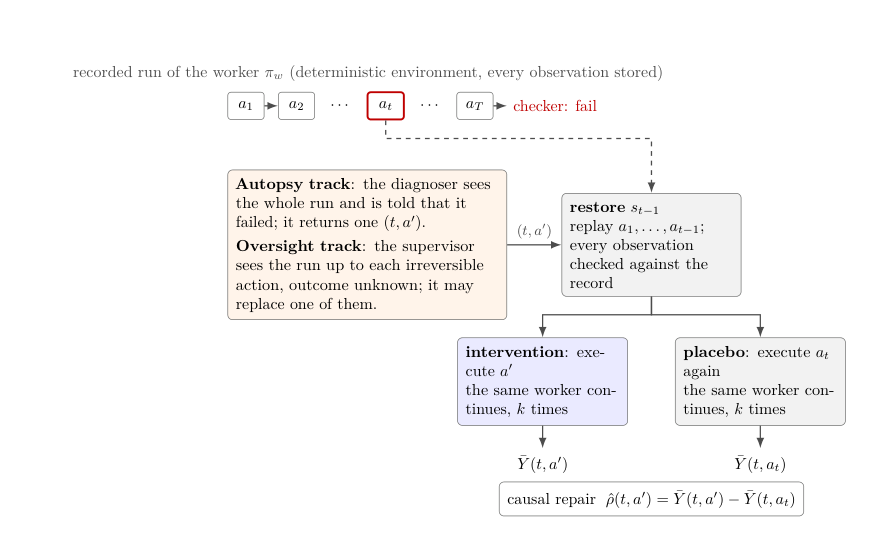

## 本期导读

20 篇论文、3 篇技术笔记与 1 条社区阅读。原文发表日期与本期阅读日期分别记录。

<h2 class="daily-paper-title" id="paper-arxiv-2610.41209">01 · Falcons: Pushing the Speed-Ratio Limits of Lossy Compression for Parallel Scientific Applications</h2>

Falcons 通过规则化插值访存、SIMD 和分布自适应编码降低有界误差压缩成本；除压缩微基准外，还报告完整 WRF 工作流 1.55 倍加速，体现 I/O 优化需看应用总耗时。

局限：有界数值误差不自动保证所有下游科学结论不变；压缩倍率和吞吐最大收益来自不同指标。

来源：[Falcons: Pushing the Speed-Ratio Limits of Lossy Compression for Parallel Scientific Applications](https://arxiv.org/abs/2610.41209)

<h2 class="daily-paper-title" id="paper-arxiv-2610.41919">02 · Matching Workloads to Blackwell: Power-Resolved Benchmarking of NVIDIA B200 and B300 across HPC and AI Workloads</h2>

[Matching Workloads to Blackwell: Power-Resolved Benchmarking of NVIDIA B200 and B300 across HPC and AI Workloads](https://arxiv.org/abs/2610.41919) 
Mohsen Zand、Trung Dac Nguyen、H. Birali Runesha

该 B200/B300 研究按工作负载和板卡功耗拆解表现，发现新卡并非所有任务都更快；相同 B300 节点仅更换开发版 vLLM 即出现 2.1 倍 TTFT 差异。

两套集群的驱动和主机条件不同，不能把全部差异归因硅片；输入常驻显存也排除了实际数据管线开销。

来源：[Matching Workloads to Blackwell: Power-Resolved Benchmarking of NVIDIA B200 and B300 across HPC and AI Workloads](https://arxiv.org/abs/2610.41919)

<h2 class="daily-paper-title" id="paper-arxiv-2610.41160">03 · ARK: Avoiding Routing Collisions for KV Cache Transfer in Disaggregated LLM Inference</h2>

[ARK: Avoiding Routing Collisions for KV Cache Transfer in Disaggregated LLM Inference](https://arxiv.org/abs/2610.41160) 
Hung-Chun Lin、Ting-Wei Hsu、Chung-En Ho、Ahmed Saeed

ARK 利用 KV 传输持续时间较长的特点，通过源端口哈希选择和轻量预留协调，把并发大流分到不同 spine，不改交换机。仿真中可减少 ECMP 碰撞造成的长尾传输。

是网络与 serving 联合仿真，非实际集群部署；收益依赖拓扑、流规模和负载，协调失败也需评估。

来源：[ARK: Avoiding Routing Collisions for KV Cache Transfer in Disaggregated LLM Inference](https://arxiv.org/abs/2610.41160)

<h2 class="daily-paper-title" id="paper-arxiv-2610.41177">04 · TraceSpec: Understanding and Improving Speculative Decoding for LLM Agents</h2>

[TraceSpec: Understanding and Improving Speculative Decoding for LLM Agents](https://arxiv.org/abs/2610.41177) 
Jihao Zhao、Shuaishuai Zu、Pengfei Li、Biao Qin、Guanghuan Fang、Ben Feng、Baochuan Yang

TraceSpec 把 agent 轨迹按阶段和进度分析，发现总接受率随上下文增长的趋势可能掩盖后期 action 的下降。它按状态分配固定草稿训练预算，replay 吞吐比 DSpark 提高 12.5%–22.6%。

replay 控制前缀，不包含完整工具、搜索和任务成功耗时；不能将倍率直接视为 agent 端到端加速。

来源：[TraceSpec: Understanding and Improving Speculative Decoding for LLM Agents](https://arxiv.org/abs/2610.41177)

<h2 class="daily-paper-title" id="paper-arxiv-2610.41508">05 · HiState: Hierarchical Prefix Cache Management for Hybrid LLM Serving in Agentic Workloads</h2>

[HiState: Hierarchical Prefix Cache Management for Hybrid LLM Serving in Agentic Workloads](https://arxiv.org/abs/2610.41508) 
Zaifeng Pan、Lucas Wang、Xinwei Qiang、Yanbo Zhou、Chang Chen、Zhengding Hu、Yue Guan、Yufei Ding

HiState 利用混合模型命中时需要整段 KV、却只需要一个 recurrent checkpoint 的不对称性，把历史检查点放 SSD，快内存优先留给 KV，并联合调节间隔和淘汰。

最高倍率针对 p99 TTFT；单模型、单 H100 和给定内存预算，不代表全部请求平均延迟同倍下降。

来源：[HiState: Hierarchical Prefix Cache Management for Hybrid LLM Serving in Agentic Workloads](https://arxiv.org/abs/2610.41508)

<h2 class="daily-paper-title" id="paper-arxiv-2610.41359">06 · LEAP: Efficient LLM Inference Scheduling with Generalizable Length Prediction</h2>

[LEAP: Efficient LLM Inference Scheduling with Generalizable Length Prediction](https://arxiv.org/abs/2610.41359) 
Kwan Yan、Jialun Zhong、Yanzeng Li

LEAP 从 serving 模型的 prefill 隐状态线性读出输出长度，并用完成请求在 CPU 上递归最小二乘更新，预测与 GPU prefill 重叠。相对所测预测器降低平均每 token 延迟。

标签是首次生成且上限 2048 token；在线反馈有延迟，参数少不等于相同比例的系统成本降低。

来源：[LEAP: Efficient LLM Inference Scheduling with Generalizable Length Prediction](https://arxiv.org/abs/2610.41359)

<h2 class="daily-paper-title" id="paper-arxiv-2610.41457">07 · RecIS: Unifying Sparse and Dense Computation for Efficient Recommendation Training</h2>

RecIS 把特征变换、embedding 访问和 dense 计算作为统一数据流，结合融合、分片与多级通信和跨迭代流水。三个工业模型中，相对 TorchRec 最高吞吐增益为 1.15 倍。

局限：相对 PICASSO 的更大倍率是另一基线；工业数据与具体硬件条件限制外推及完全复现。

来源：[RecIS: Unifying Sparse and Dense Computation for Efficient Recommendation Training](https://arxiv.org/abs/2610.41457)

<h2 class="daily-paper-title" id="paper-arxiv-2610.41073">08 · bf16 Rounding Silently Discards Most RL Policy Updates: A Hidden Training-Inference Mismatch and an Unbiased One-Line Fix</h2>

[bf16 Rounding Silently Discards Most RL Policy Updates: A Hidden Training-Inference Mismatch and an Unbiased One-Line Fix](https://arxiv.org/abs/2610.41073) 
Andrew Gao、William Gao

Fair Cast 揭示小更新可能被 fp32→bf16 最近舍入吞掉，使采样策略滞后。修复需同时采用无偏导出与按实际 served 权重计算 loss；只改 export 一行并非完整接入。

小模型和给定学习率下的配对结果不能推广至所有 RL；error feedback 需要额外残差存储，无偏不保证每步改善。

来源：[bf16 Rounding Silently Discards Most RL Policy Updates: A Hidden Training-Inference Mismatch and an Unbiased One-Line Fix](https://arxiv.org/abs/2610.41073)

<h2 class="daily-paper-title" id="paper-arxiv-2610.40945">09 · On the Origin and Evolution of Training-Inference Mismatch in LLM Reinforcement Learning</h2>

[On the Origin and Evolution of Training-Inference Mismatch in LLM Reinforcement Learning](https://arxiv.org/abs/2610.40945) 
Yu Li、Yufa Zhou、Tian Lan

DLC 把训练—推理误差拆为引擎数值差异与策略滞后：前者用中心化处理，后者用裁剪重要性比率，并在有效样本量下降时重同步 sampler。它关注异步权重反馈环，而不只是同权重前向一致。

主要验证小 Qwen、Countdown 与特定优化设置；ESS 一半的阈值不是所有 RL 系统通用常数。

来源：[On the Origin and Evolution of Training-Inference Mismatch in LLM Reinforcement Learning](https://arxiv.org/abs/2610.40945)

<h2 class="daily-paper-title" id="paper-arxiv-2610.41525">10 · MemX: Memory-Aware Automatic Parallelism for Cross-Vendor Heterogeneous GPU Training</h2>

[MemX: Memory-Aware Automatic Parallelism for Cross-Vendor Heterogeneous GPU Training](https://arxiv.org/abs/2610.41525) 
Lin Meng、Yuzhong Sun、Jie Zhu

MemX 联合优化迭代时间、峰值内存和跨 GPU 内存平衡，用最小 profiling 集与预测器缩小异构并行搜索成本。实测集群有 20 张卡，更大规模由仿真扩展。

17 天 profiling 基线是外推，26.5 秒不含全部数据采集；两家 GPU 厂商匿名限制复现。

来源：[MemX: Memory-Aware Automatic Parallelism for Cross-Vendor Heterogeneous GPU Training](https://arxiv.org/abs/2610.41525)

<h2 class="daily-paper-title" id="paper-arxiv-2610.41700">11 · Provisioning Networks for AI Supercomputers: A Trace-Driven Study of Performance Sensitivity at Unprecedented Scale</h2>

[Provisioning Networks for AI Supercomputers: A Trace-Driven Study of Performance Sensitivity at Unprecedented Scale](https://arxiv.org/abs/2610.41700) 
Tommaso Bonato、Amirreza Rastegari、Daniele De Sensi、Timo Schneider、Siyuan Shen、Ales Kubicek、Prabhat Ram、Torsten Hoefler

该研究分解通信轨迹并用线性规划扫描延迟、带宽与 jitter，寻找不同 AI 工作负载的低敏感区和性能悬崖。它保留已记录 collective 调度，支持大规模网络配置分析。

结果是 LogGP 模型下运行时间下界；4096 GPU 分析不是逐配置硬件实测，也不覆盖调度随网络变化的自适应行为。

来源：[Provisioning Networks for AI Supercomputers: A Trace-Driven Study of Performance Sensitivity at Unprecedented Scale](https://arxiv.org/abs/2610.41700)

<h2 class="daily-paper-title" id="paper-arxiv-2610.41094">12 · AIFaultBench：把真实 AI 软件故障和复现证据打包</h2>

[AIFaultBench: A Reproducible Benchmark of Real-World Faults in AI Software Systems](https://arxiv.org/abs/2610.41094) 
Mehil B Shah、Mohammad Masudur Rahman、Foutse Khomh · 2026-10-30

数据集包含 105 个仓库的 770 个故障，覆盖深度学习、LLM、Agent 等六类系统；每条连接原始报告、代码版本、环境准备、触发脚本和执行记录。作者对每个故障最多用三小时尝试复现，要求三次执行均满足匹配标准，最终记录 652 个复现成功、118 个未成功；后者包括硬件或数据不可用、版本漂移和非确定性等情况。

它与 ReplayRCA 互补：前者提供真实软件缺陷及复现材料，后者评价可恢复环境中的 Agent 干预效果。样本偏向活跃、受关注的公开 Python 仓库，复现比例不是所有 AI 系统的真实故障率；具体案例也可能依赖外部数据、硬件或凭据。原文没有适合说明该数据集机制的架构图。

<h2 class="daily-paper-title" id="paper-aiops26-ranganathan-automation-gaps-llm-serving">13 · LLM Serving：生产故障的检测与缓解自动化落差</h2>

[An Empirical Study of Automation Gaps in LLM Serving Systems](https://cloudintelligenceworkshop.org/papers/aiops26-Ranganathan.pdf) 
Bhala Ranganathan、Minghua Ma、Mickey Zhang、Klein Hu、Rakesh Kelkar、Chetan Bansal · AIOps 2026

### 检测到故障之后，恢复为何仍依赖人？

作者分析一个大规模 LLM 服务平台在 2025 年 4—6 月的 **156 起高严重度事故**，结合事故记录、复盘、运行日志和工程师经验，按基础设施、模型配置、推理引擎和运维四类归因。每起事故只选择一个根因类别和首个有效缓解动作，因此分类呈现的是主要线索，而非完整因果链。

其中 115 起（约 74%）由自动监控先于客户报告发现；但缓解仍大量依赖人工判断。按事故计数，44 起使用人工热修复，15 起通过扩容缓解，75 起需要人工确认并持续观察、最终没有执行技术变更。后者说明，即使系统可能自行恢复，判断是否安全等待也需要证据。自动检测比例不能解读成自动修复成功率。

### 从事故分类走向恢复机会

94 起事故归于推理引擎，类别内部以超时和资源耗尽为主。作者用根因与缓解动作交叉分析寻找可自动化环节，例如连接活性恢复、流量转移和节点重启。在另一段 2025 年 2—5 月的验证期，作者展示某受影响客户的归一化 HTTP 408 错误率从 **2.72% 降到 0.01%**，并将其与连接活性策略的上线联系起来。这是观察性关联和单客户示例，并非随机对照实验，也不意味着所有故障都能自动恢复。

**阅读判断：值得关注的 Ops4LLM 生产证据。** 论文的价值在于把“能否检测”和“能否安全缓解”拆开，并用事故类别和实际动作定位自动化机会。其局限是一家平台、高严重度事故样本，以及单标签和首个有效动作的简化；不同服务的故障比例、人工判断成本与策略效果需要重新验证。

<h2 class="daily-paper-title" id="paper-arxiv-2610.42144">14 · Dittany：保留有效结果，修复多智能体工作流</h2>

[Dittany: Contribution-Guided Repair Framework for MAS Applications](https://arxiv.org/abs/2610.42144) 
Hanqi Sun 等 · arXiv · 2026-10-30

### 修复未完成的贡献，而不是整条链重来

多智能体应用可能已经产生有用的中间结果，却仍遗漏用户要求。Dittany 从应用代码、方法说明和任务要求中提取任务契约，构建结果及其依赖的“贡献图”，并为结果生成验收条件。运行时若单个动作出错且输入足够，就局部修正；如果缺少前置结果或计划无法满足要求，则调整图中尚未完成的工作。已通过验证的结果可以保留并供后续复用。

### 检测、修复和成本分开看

作者在六个框架的 30 个开源应用上准备 9,000 个应用—任务实例。对其中 8,758 条检测标签已确定的执行，报告故障检测精确率 88.28%、召回率 79.18%；在全部任务上，报告任务正确率 84.76%，原生执行为 58.01%，最强聚合修复基线 Reflexion 为 63.48%。这些数字适用于论文的应用、任务、验证器和远程模型配置。

报告的部署 token 成本较原生执行高 17.92%，部分缺失用量通过相似调用估计。论文还允许应用提供领域验证程序和场景模板，因此结果不能视为无需配置的通用自愈保证。与同日 ReplayRCA 关注“干预是否改变结果”不同，Dittany 更关注如何保留有效工作、补齐未满足的任务约束。

<h2 class="daily-paper-title" id="paper-arxiv-2610.41025">15 · ReplayRCA：用反事实重放衡量诊断和监督</h2>

[ReplayRCA: Measuring Post-hoc Diagnosis and Live Oversight of Agent Failures by Counterfactual Replay](https://arxiv.org/abs/2610.41025) 
Jeremy Canale、Fabien Soulis · 2026-10-29

### 从标签一致性转向干预结果

长任务失败可能有多个有效修复点。若基准只比较诊断者选中的步骤与标注答案，另一处同样能修好任务的干预也会被判错。ReplayRCA 不把反事实重放本身作为新发明，而是把它放进评价协议：诊断者选一个步骤和替代工具动作，系统恢复到动作之前，让原执行 Agent 继续完成任务，再由终态检查器判断是否成功。

<a class="note-image-link" href="/assets/images/digest/2026-11-03/replayrca.png" target="_blank" rel="noopener" aria-label="ReplayRCA 干预与对照流程 · 查看原图 ↗">查看原图 ↗</a>

*读图：两条支路从同一动作前状态恢复；左边执行替代动作，右边重放原动作，随后都由原 Agent 继续。两者成功率之差才计入干预收益。*

对照很重要：随机续跑可能自己恢复，重启过程也可能影响结果。作者在两个分支各采样五次，用替代动作的成功率减去同一步重放原动作的成功率，称为 causal repair。环境是确定性的 OpsWorld：系统从初始状态重新执行历史动作，并逐字节核对观察结果，再实施干预；它不是直接对不可回滚的线上系统进行实验。

### 解释失败与防止失败是两项能力

事后诊断者看到完整失败轨迹，并被告知最终失败，可以选择任意一步替换。实时监督者只看到当前轨迹，在退款、取消等不可逆动作前决定放行还是替换；它不知道任务最终是否会失败，最多干预一次，且每次干预在评分中扣除五个百分点。成功任务也混入测试，因此无谓干预会产生代价。

在 62 个经过校准的系统性失败上，13 个模型中最高的事后因果修复得分为 **+51.3 个百分点**；但 78 组模型两两比较经多重检验校正后均不显著，不能据此建立可靠排名。强制一个模型只在最后一步干预，得分下降 17.1 个百分点，说明选择干预位置有实际影响。实时监督涉及 87 次运行；作者观察到一个事后表现较好的监督者在实时任务中表现最弱，同一批运行上两者相差 14.5 个百分点。

**阅读判断：值得精读的评测协议。** 它关注的是“一次替换动作能否改变结果”，并不保证找到最早的根因，也无法证明多步修复无效。任务来自可验证恢复的合成后台环境，外部副作用、复杂真实服务和更长时间跨度仍需另行检验；有限样本与不同模型推理配置也限制了模型间比较。

<h2 class="daily-paper-title" id="paper-arxiv-2610.41453">16 · Evidence-Guided Recovery：工具超时后如何安全继续</h2>

[Evidence-Guided Recovery for AI Agents with Ambiguous Tool Outcomes and Partial Execution](https://arxiv.org/abs/2610.41453) 
Genliang Zhu 等 · arXiv · 2026-10-30

工具调用超时并不说明操作没有生效：账单可能已经创建，也可能仍在执行。直接重试可能重复产生副作用，而停止又可能留下未完成任务。作者根据已授权的任务义务、服务商提供的能力与当前可观察证据，维护仍可能发生的状态，并在每一步检查授权期限、依赖和残留副作用。完成判定区分真实目标是否满足与公开证据是否足以安全确认；无法确定时允许交由人工处理。

在 37 个合成任务的有限模型实验中，规划方法与三种强规则对照均安全确认完成 28 个；规划省下少量合成费用单位，同时增加决策计算，不能称为完成率领先。在另一项预注册的本地模型配对实验中，规划建议组确认 30/58，证据提示组为 9/58；两组共用安全约束，不能据此单独归因于搜索深度。

它补充 Dittany 对工作流中间结果的关注：这里的关键是**外部效果是否已经发生、是否能被证明**。评估依赖已声明的服务能力和受控合成场景，并不保证任意第三方服务都能恰好执行一次。

<h2 class="daily-paper-title" id="paper-arxiv-2610.40917">17 · Towards Portable Specification of the Agent Harness</h2>

该论文提出八类 harness 组件与可移植配置记录，既标记模型和工具版本，也记录一次运行内的有效配置变化。它把 harness 视为可演化的系统组成，而非模型名称旁的固定标签。

局限：是规范提案，未证明采用后提高可靠性；不能把作者提议的记录格式表述为法律强制标准。

来源：[Towards Portable Specification of the Agent Harness](https://arxiv.org/abs/2610.40917)

<h2 class="daily-paper-title" id="paper-arxiv-2610.41432">18 · Hybrid Computer Use: A Unified Programmatic, Semantic, and Visual Interface for General Agents</h2>

HCU 把代码、accessibility 和 GUI 统一，让 agent 选择操作通道；AX 批量动作与差异观察减少交互轮次，通道切换时检查陈旧状态。

局限：不同模型运行在各自 harness，跨模型排名混合因素；主要新版基准仅 108 个任务，不能推断所有桌面软件。

来源：[Hybrid Computer Use: A Unified Programmatic, Semantic, and Visual Interface for General Agents](https://arxiv.org/abs/2610.41432)

<h2 class="daily-paper-title" id="paper-arxiv-2610.40747">19 · Mage-VL-Cowork: A Full Training Recipe to Learn Hybrid Computer Use From Evolved Harnesses</h2>

Mage-VL-Cowork 用可复用 skill 条件生成流程与应用 preparer 合成任务，再通过五阶段训练学习 GUI、代码与终端混合操作。4B 模型在 50 步预算的 OSWorld-Verified 达 66%。

局限：82.6% 节省指重复任务生成开销，不是全部训练成本；本次未复现基准或端侧时延。

来源：[Mage-VL-Cowork: A Full Training Recipe to Learn Hybrid Computer Use From Evolved Harnesses](https://arxiv.org/abs/2610.40747)

<h2 class="daily-paper-title" id="paper-arxiv-2607.25333">20 · Specula：让智能体为系统代码构建形式化模型</h2>

[Specula: Scaling formal specifications for autonomous model checking of system code](https://arxiv.org/abs/2607.25333v2) 
Qian Cheng 等 · arXiv · 首次提交 2026-07-28，修订 2026-08-03

Specula 让编码智能体阅读并发与分布式系统代码，提取正确性属性，生成 TLA+ 模型并运行模型检查。它以场景拆分控制状态空间，再通过执行轨迹检查模型与代码是否一致；发现反例后，还尝试在真实代码中复现，避免把抽象错误直接当作代码缺陷。模型、属性和场景通过反馈循环持续改进。

作者报告在 48 个开源系统中发现 249 个缺陷，其中 207 个是新发现、42 个是已知但未修复的问题；89 个已报告，68 个获开发者确认，24 个已修复。249 个中有 200 个经模型检查暴露，其余来自理解代码和建模过程。**发现、报告、确认和修复是不同阶段**，不能将全部发现当成已确认的新缺陷。

这篇工作值得关注的是：它把形式化方法用于系统代码的成本，转化为可迭代的建模、轨迹校验和代码复现问题。多数生成的不变量是安全属性；模型抽象、状态空间、复现条件及算力成本仍会影响可发现的缺陷范围。论文于 7 月首次提交，本次是补读而非新发表。

## 社区动态

<h3 id="community-x-yuval728-2117295636223856702">社区记录</h3>

[vLLM 单机 P/D 分离实测：p99 ITL 从 169ms 降到 29ms，但无 GPU P2P 时 8k prompt 的 KV 传输约 1.3s、TTFT 反升](https://x.com/Yuval728/status/2117295636223856702)

Yuval Mehta 用双 L40S、PCIe 配置说明预填充/解码分离的权衡：尾部 token 间延迟改善，但缺少 GPU 点对点拷贝时，KV 传输使首 token 延迟恶化。帖子注明 Qwen2.5-7B 和不同请求速率。这是特定配置的诊断例子，推广前应确认传输路径并同时比较两种延迟。

## 同日技术笔记

- <a href="/tech/zh/review-lmsys-2026-11-02-hicache-distributed-serving/">HiCache：并行缓存复用的正确性条件</a>
- <a href="/tech/zh/cloudflare-dns-targeted-zone-builds/">Cloudflare 如何缩小 DNS 构建范围并保持正确性</a>
- <a href="/tech/zh/2026-11-03-nvidia-kubernetes-ai-ready-vera-rubin/">Making Kubernetes AI-Ready for NVIDIA Vera Rubin on Day One</a>