## 本期导读

21 篇论文、6 篇技术笔记。原文发表日期与本期阅读日期分别记录。

<h2 class="daily-paper-title" id="paper-arxiv-2611.03517">01 · Ask, Don&#x27;t Equip: Question-Driven Coding Agents for Deep Kernel Optimization</h2>

[Ask, Don't Equip: Question-Driven Coding Agents for Deep Kernel Optimization](https://arxiv.org/abs/2611.03517) 
Gabriele Oliaro、Jaeseong Lee、Zhaoyuan Su、Sreeram Vennam、Zhihao Jia、Samyam Rajbhandari

KernelSeek 在最小验证 harness 中用问题推动 agent 改变优化假设，后来将问题整理为可自行调用的 bank。Hopper 与 Blackwell attention kernel 均检查 182 个场景；作者保留人工消息与工具轨迹。

大收益发生在提问后是观察性归因，非随机因果证明；人工投入不可忽略，有限测试也不是全输入正确性。

来源：[Ask, Don't Equip: Question-Driven Coding Agents for Deep Kernel Optimization](https://arxiv.org/abs/2611.03517)

<h2 class="daily-paper-title" id="paper-arxiv-2611.02501">02 · SpecPilot: Autonomous Algorithm Discovery and Systems Optimization for Speculative Decoding</h2>

[SpecPilot: Autonomous Algorithm Discovery and Systems Optimization for Speculative Decoding](https://arxiv.org/abs/2611.02501) 
Kunjun Li、Wenhao Chai、Yihao Liang、Yuezhou Hu、Shuyao Xu、Yi Pan、William X. Zheng、Kannan Ramchandran、Kurt Keutzer、Jiantao Jiao

SpecPilot 用成本上限定位部署瓶颈，让 agent 探索并集成优化，逐 token 对照 stock 的 token forcing 防止性能“作弊”。其结果强调单请求与 batching 需要不同优化。

报告的 10.87 倍是相对 AR 而非相对 stock；有限对照验证不替代所有输入的分布等价证明，搜索开销也需计入。

来源：[SpecPilot: Autonomous Algorithm Discovery and Systems Optimization for Speculative Decoding](https://arxiv.org/abs/2611.02501)

<h2 class="daily-paper-title" id="paper-arxiv-2611.00628">03 · AgentPRO: Coordinating Compiler Optimizations for LLM Agent Workflows</h2>

[AgentPRO: Coordinating Compiler Optimizations for LLM Agent Workflows](https://arxiv.org/abs/2611.00628) 
Jie Ren、Zheng Wang

AgentPRO 区分工具执行依赖与模型生成所需观察，合并兼容生成区域并删除冗余上下文，配合运行时 guard 回退。优化后 115 个任务完成 110 个，平均 token 减少 41.85%。

115 任务先按基线成功筛选，基线满分是构造结果；每任务一次，且 component time 不是完整用户耗时。

来源：[AgentPRO: Coordinating Compiler Optimizations for LLM Agent Workflows](https://arxiv.org/abs/2611.00628)

<h2 class="daily-paper-title" id="paper-arxiv-2611.00495">04 · Understanding GPU Megakernels: Why Residency Can Mislead</h2>

[Understanding GPU Megakernels: Why Residency Can Mislead](https://arxiv.org/abs/2611.00495) 
Xinwei Qiang、Ziyi Xu、Chang Chen、Zaifeng Pan、Zhongkai Yu、Yue Guan、Yufei Ding

该 megakernel 研究用相同算子代码拆回独立 kernel，并控制启动、预取和内存次序。PDL 可使 TK decode step 快 5.7%；驻留 CTA 不等于瓶颈资源仍有可用重叠空间。

主要针对两个实现与 H100；不能据此断言 megakernel 普遍更差，内存顺序不一致的比较无效。

来源：[Understanding GPU Megakernels: Why Residency Can Mislead](https://arxiv.org/abs/2611.00495)

<h2 class="daily-paper-title" id="paper-arxiv-2611.01426">05 · FlyWheel: Attention Kernels Built for the TPU</h2>

[FlyWheel: Attention Kernels Built for the TPU](https://arxiv.org/abs/2611.01426) 
Zishuo Bao、Zeshen Zhang、Linkun Chen、Yucheng Lu

FlyWheel 面向 TPU 重构 softmax 与线性 attention，减少向量工作、复用矩阵操作数并重叠独立计算。kernel 最大倍率明显高于接入 vLLM 后最高 1.56 倍的 prefill 吞吐收益。

v6e/v7x 的 chip 与 TensorCore 计数不同；不是全部请求端到端同倍加速，近似数值路径仍需质量检查。

来源：[FlyWheel: Attention Kernels Built for the TPU](https://arxiv.org/abs/2611.01426)

<h2 class="daily-paper-title" id="paper-arxiv-2611.00967">06 · RTP-LLM：把模型变化与状态生命周期分开管理</h2>

[RTP-LLM: Building an Evolvable and Reliable LLM Inference Engine at Alibaba Scale](https://arxiv.org/abs/2611.00967) 
Jiarui Guo, Zhi Zhang, Boyu Tan 等 · arXiv · 首次提交：2026-10-31

RTP-LLM 记录了阿里推理引擎从 Python 服务层到 C++ 优先、再到模型与 serving 分离的演化。当前模型语义放在 Python/PyTorch，调度、KV 管理和资源协调保留在 C++，以减少每次新模型接入都重新翻译参考实现的成本。

可靠性细节比部署规模更值得读：异步缓存传输“已提交”不等于数据“可复用”；请求、传输与保留缓存分别持有引用，全部释放后块才可重新分配；超时停止响应也不意味着可以立即回收仍被异步任务使用的 KV。新状态类型仍可能要求同时修改模型层与共享运行时，接口并不能自动吸收所有变化。

作者给出的四个模型接入案例中，三个 serving 层改动不足 100 行，DeepSeek-V4 则需 5,207 行，体现了复用的边界。生产性能来自三个应用各自单集群的七天观测，报告的小时均值 TTFT 小于 2 秒、TPOT 小于 20 毫秒，不能读成每次请求或尾延迟保证。这是一份维护与运行经验报告，适合关注取消、缓存一致性和回归覆盖的 Ops4LLM 团队。

<a class="note-image-link" href="/assets/images/digest/2026-11-04/rtp-llm.png" target="_blank" rel="noopener" aria-label="RTP-LLM 的模型执行层、共享 serving runtime 与状态接口 · 查看原图 ↗">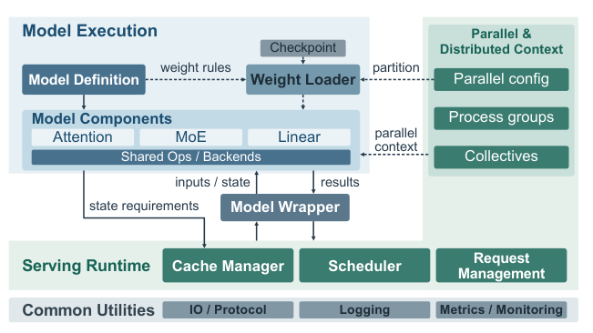查看原图 ↗</a>

*模型描述计算、权重与状态要求，共享运行时负责调度、分配和回收。*

<h2 class="daily-paper-title" id="paper-arxiv-2611.02543">07 · BASIN：流量恢复后，为什么推理服务仍困在缓存抖动中</h2>

[When Cache Pressure Becomes a Trap: Metastability in Agent Serving](https://arxiv.org/abs/2611.02543) 
Chengzhi Lu, Boxi Zhou, Yanying Lin, Dmitrii Ustiugov · arXiv · 首次提交：2026-11-02

**峰值流量消失，并不意味着服务会自行恢复。** 这篇工作把 agent serving 的缓存压力与亚稳态故障联系起来：系统在原本能承受的流量下持续恶化，原因是请求变慢改变了仍在运行的会话数量，而会话数量又决定缓存需求。

Agent 会在模型调用与工具执行之间反复切换，下一轮往往复用不断增长的历史。一次调用变慢，会话就更晚结束；新会话持续进入，使所有活跃会话的上下文总量扩大。前缀被逐出后，下次调用必须重新 prefill，进一步延长会话寿命。工具正在执行的会话也占据未来复用需求，因此只看当前 decode 的 KV 使用率会漏掉压力。SGLang 预先为等待 prefill 的请求保留 decode KV，还可能加剧等待。

作者在两张 H100 NVL、1P1D 的 SGLang 上运行 Qwen3.6-35B-A3B FP8，回放 216 条 Terminal-Bench 轨迹、7,108 次调用。基础到达率为每分钟 3.3 个会话时，十分钟的翻倍流量使前缀命中率从约 0.95 降至 0.27。随后一小时新到达会话的 goodput 从每小时 138 降至 17，约下降 88%。这里 goodput 要求会话减速比不超过 4，且至少 95% 的 decode 步满足 50 毫秒 ITL 目标；它不同于完成调用数。终止残留突发会话后恢复的干预实验，为反馈机制提供了比相关曲线更强的证据。

BASIN 据此联合控制三个环节。首先，用到达时间和预计峰值上下文确定固定会话优先级，让准入、prefill 与 decode 队列遵循同一顺序。其次，借用空闲 decode 内存保留跨轮次状态，真正执行 decode 时优先收回。最后，按会话预计峰值工作集限制新会话进入，根据命中率调整预算；只有长期需求超过容量时才丢弃部分排队会话。这样既保护已进入的上下文，也减少把所有代价转移到入口长队的风险。

证据必须分层看：真实 H200 1P3D 原型使用到达时间排序和当前上下文准入，四个场景下 goodput 是 Continuum 的 1.20–1.70 倍；完整预测式策略的更广泛比较来自校准模拟。流体模型标记出全部 17 个缓存先受限的模拟部署，也误报了 8 个 decode 先受限部署，不能称为完美分类器。

这项工作的价值是把过载保护单位从单次请求提升到跨工具调用的会话工作集。其收益取决于瓶颈：decode 已先饱和时，借缓存空间的改善有限；缓存很大时，准入仍可能放进过多 decode 并发。阅读重点是故障干预、会话生命周期和 goodput 定义，而非只看加速倍数。

<a class="note-image-link" href="/assets/images/digest/2026-11-04/basin.png" target="_blank" rel="noopener" aria-label="BASIN 根据遥测控制会话准入、队列优先级与 decode 缓存借用 · 查看原图 ↗">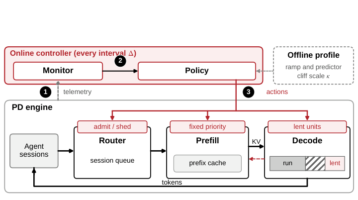查看原图 ↗</a>

*控制器同时管理新会话进入、已有会话的服务顺序和可借用缓存，避免只扩容或只限流。*

<h2 class="daily-paper-title" id="paper-arxiv-2611.00391">08 · Penelope：保护共享前缀的头部优先 Agent KV Cache 淘汰</h2>

[Rethinking KV Cache Eviction for Agentic LLM Serving](https://arxiv.org/abs/2611.00391)（[v1 PDF](https://arxiv.org/pdf/2611.00391) · [HTML](https://arxiv.org/html/2611.00391v1)） 
Jiakun Fan、Han Meng、Yuxuan Xia、Hao Mark Chen、Dong Li、Dimitrios S. Nikolopoulos（Virginia Polytechnic Institute and State University、University of California, Merced、New York University、Imperial College London）· `arXiv:2611.00391v1 [cs.DC]` · 2026-10-30 提交（截至核验仅存 `v1`，无修订或撤回记录；论文未公开独立代码仓库链接）

在多轮 LLM Agent 服务中，每一次工具调用后返回模型的请求都会携带不断增长的既有对话与工具输出历史；当显存不足以容纳所有活跃会话时，系统必须决定先淘汰哪段 KV Cache。vLLM 释放序列末尾 block、SGLang 删除 Radix Tree 叶子节点的传统做法虽然保住了连续前缀，却恰恰丢弃了重算成本最高的上下文尾部 token。`Penelope` 将「淘汰位置选择」与「缺口重算及双层缓存管理」作为整体协同重构：先沿 Radix Tree 保住跨会话共享前缀，再以 **64-token 块粒度**从私有历史头部开始淘汰而留住高代价后缀；返回请求通过与真实请求同批次运行的**幽灵请求（phantom request）**在逐层前向中边填补缺失段边复用残留后缀，并将 GPU 与 CPU 纳入单一互斥逻辑缓存顺序。以下精读严格依据 `arXiv:2611.00391v1` 原文与附录，将作者在受控缓存配额下的实测与运行适用边界分开陈述。

### 一、问题拆解：为什么 Agent 长上下文让尾部淘汰最昂贵

KV Cache 淘汰包含两重正交决策：**选哪条历史回收（replacement）** 与 **回收该历史的哪一段（eviction position & granularity）**。尽管 Liu 等人（2026）指出复杂替换策略相对 LRU 增益有限，主流引擎在第二重决策上仍默认从序列尾部裁剪。论文 §2.2 与 §2.3 通过代价建模、真实轨迹统计与受控微基准证明，这一默认策略在 Agent 场景下会系统性放大重算开销，而直接反转淘汰方向又会触发三个工程障碍：

- **因果注意力的位置代价不对称（§2.2 & Appendix A.1）**：在每层均采用全因果注意力（full causal attention）的假设下，第 `i` 个 token（0 基索引）的重算计算量可近似为 `c(i) ≈ c_fixed + c_attn × (i + 1)`，其中 `c_fixed` 为位置无关的 Q/K/V/O 线性投影与 FFN 运算，`c_attn` 为单个 query–key 对的注意力乘加开销。若前序 KV 均存在，从起始位置 `s` 连续重算 `b` 个缺失 token 的总计算量为 `C(s, b) ≈ b × c_fixed + c_attn × (b × s + b(b + 1)/2)`——位置无关部分与缺失长度相同，差异完全来自 `c_attn × b × s`。按 `Qwen3-8B` 架构参数（隐藏维 `4,096`、32 个 query head 与 8 个维度 `128` 的 KV head、FFN 中间维 `12,288`），每层每 token 投影与 FFN 需 `4096 × (4096 + 1024 + 1024 + 4096 + 3 × 12288) = 4096 × 47,104` 次 MAC，每对 query–key 注意力需 `2 × 32 × 128 = 8,192` 次 MAC，推得比值 `c_fixed / c_attn` = **23,552**。
- **Agent 工作负载把不对称性推向长上下文区间**：作者统计了未做长会话筛选或截断的 TraceLab `v0.0.2` 编程 Agent 数据集（覆盖 `8,041` 个会话、`665,186` 条有效请求），发现输入中位长度已达约 **132K tokens**，且 **79% 的请求超过 64K tokens**；在单张 H100 上使用 `Qwen3-8B`（修改版 SGLang）缓存全历史后分别从位置 `2K` 起或从序列末尾淘汰约 `30%` 的 token、再追加 `512` 个新 token 并解码 1 个 token（三次运行均值，Fig. 1），两者重算的 token 数量完全一致，但淘汰早段相比淘汰末尾在 `8K` 上下文提速 **1.14×**、在 `16K` 达 `1.31×`、`32K` 达 `1.64×`、`64K` 达 `2.21×`、`96K` 达 `2.59×`、到 **128K 放大至 2.93×**；上述解析模型对 6 个长度的预测倍率分别为 `1.11–2.87×`，全部落在实测值 **4% 误差内**。
- **直接从序列开头淘汰会撞上三类系统障碍（§2.3）**：第一，Agent 会话通常以跨会话共享的系统提示和工具定义开篇（Trace Commons 的 Claude Code 轨迹首段共享前缀中位约 **15.6K tokens**），简单从 `0` 位淘汰会破坏多会话前缀复用与正在运行请求依赖的 KV，必须精确定位共享前缀结束后的最早合法起点；第二，淘汰历史前段会在前缀与保留后缀之间留下**缓存空洞（gap）**，传统前缀树匹配遇到缺失块即停止，且标准 prefill 只能处理单段连续未命中文本，无法在单次前向中同时重算缺失历史与新输入并复用中间已缓存后缀；第三，Agent 长历史经常开启 GPU–CPU 两级卸载，若两层各自独立淘汰（如 write-back 架构下把 GPU 块迁入已满 CPU 触发 CPU 驱逐），可能导致同条历史的后部 KV 在 CPU 被丢弃、而前部 KV 仍留在 GPU，彻底破坏全局头部优先顺序。

### 二、系统协同设计：块级头部淘汰、幽灵重算与统一双层缓存

<figure class="note-figure"><a class="note-image-link" href="/assets/images/digest/2026-11-04/penelope-prefix-suffix-eviction-zh.svg" target="_blank" rel="noopener" aria-label="查看 Penelope 协同设计架构图原图">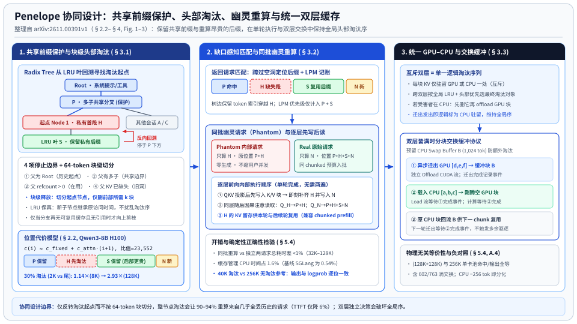查看原图 ↗</a><figcaption>图 1 · Penelope 协同设计架构（整理自 arXiv:2611.00391v1 §2.2–§4 与 Fig. 1–3）：将共有前缀保护与 64-token 块级头部淘汰、同批幽灵重算以及跨 GPU–CPU 统一逻辑缓存顺序绑定为同一套状态机。</figcaption></figure>

作者在 SGLang（commit `c36a10aa`）之上新增约 **2.5K 行 Python 代码**（含诊断检查与对比淘汰策略）实现 Penelope，**无需编写新的 GPU kernel**，并原生兼容张量并行（TP）、专家并行（EP）、chunked prefill 与 CUDA graphs。其核心协同机制分为三部分：

1. **共享前缀保护与 64-token 块级头部淘汰（§3.1 & §4）**：
   - **victim 选择仍沿用 LRU，只重构段内位置**：容量不足时由 LRU 挑选最久未用的可回收 Radix 叶子节点，随后沿树路径向上回溯，直到父节点满足以下**四项停止条件之一**：（1）父节点为 `root`（到达历史起点）；（2）父节点拥有**多个子节点**（说明该位置之上为多会话共享前缀边界；注：若某历史自行重写或只与空闲会话共享分叉，该分叉受保护直至 LRU 淘汰另一侧陈旧分支）；（3）父节点的**引用计数大于 `0`**（正被运行中请求占用）；（4）父节点 KV **已经缺失**（遇到更早遗留的缓存洞）。当前节点即成为本次淘汰的起点。
   - **块级节点切分与 LRU 时间戳继承**：原生 SGLang 直接释放整棵 Radix 节点，而在历史前部单节点往往跨越大量 token，极易造成超额回收。Penelope 在 **64 tokens 固定 KV block** 边界处将起点节点一分为二，仅释放满足本次容量缺口的前部 `k` 个块，保留同节点剩余尾部块（如 Fig. 3 中释放前 3 块、保留后 5 块）；若单节点不足再按序列顺序向下延续，并在分支尾部彻底失去可复用缓存且无请求引用时自底向上剪枝空节点。**关键实现细节**：切分产生的新子节点**严格继承原节点的最近访问时间**，防止树结构切分被误记为新访问而扰乱 LRU 顺序。
2. **缺口感知树匹配与同批次幽灵请求重算（§3.2 & §4）**：
   - **保留树拓扑越过空洞 + LPM 优先级对齐**：淘汰时仅释放物理 KV 块存储并将对应节点标记为「缺失（missing）」，完整保留 token 序列与父子边。返回请求匹配时能够穿越缺失节点，将输入拆解为四段：`P`（命中共享前缀）→ `H`（缺失历史段）→ `S`（保留高代价后缀）→ `N`（新追加输入）。同时改造最长前缀匹配（LPM）调度器：可复用缓存长度**把保留后缀 `P + S` 计入命中、将缺失段 `H` 排除在外**。
   - **同批次幽灵请求（Phantom Request）与逐层先写后读**：汇编执行批次时，Penelope 为缺失历史 `H` 构造一个内部仅做 prefill、不产生输出 token 的**幽灵请求**，并与只计算新输入 `N` 的**真实请求**放入同一批次（各自保留 `P + H` 与 `P + H + S + N` 的原始位置编码；映射表为幽灵请求预留槽位而不挤压用户请求并发上限，二者共享同一 chunked-prefill token 预算，超预算时打包为单次分块 prefill 先重算 `H` 再算 `N`）。利用 Transformer 每层**先将批次内所有 K/V 投影结果写入缓存、再执行因果注意力计算**的机制，真实请求的 `Q_N` 在同一层内即可直接因果读取刚刚由幽灵请求写入的 `H` 与本来留存的 `S`（`P + H + S + N`），无需先跑完一整遍独立前向再启动真实请求，且恢复的 `H` 会留存在 KV 池供后续轮次复用。
3. **互斥统一 GPU–CPU 缓存与有界交换缓冲（§3.3 & §4）**：
   - **单一全局逻辑顺序**：GPU 与 CPU 层保持**互斥（exclusive）**——任何 KV 块在任一时刻最多只存在于其中一层，两层共享同一套全局 LRU + 头部优先淘汰顺序。跨层迁移不改变淘汰顺位，只有当某段缓存的唯一副本被清除时才算最终淘汰。需要腾出 GPU 空间时，若全局最应淘汰对象本身就在 GPU，直接释放；若该对象位于 CPU，则先删除该 CPU 受害块，再将保留的 GPU 块卸载（offload）到刚腾出的 CPU 位置。
   - **双层皆满时的分块交换缓冲（Swap Buffer）**：当请求命中位于 CPU 的保留后缀且需要将其加载回已满的 GPU、而 CPU 亦无空块承接迁出 GPU 数据时，Penelope 使用预留的小型 CPU **交换缓冲**（eval 中为 `1,024` tokens；为保证对比公平，该缓冲从 Penelope 自身可用 CPU 容量中扣除，等价于基线 SGLang 多拥有 `1,024` tokens 可用缓存）进行流水线分块交换：先通过独立卸载 CUDA stream 将待迁出 GPU 块写入交换缓冲 `B`；卸载完成事件触发后，加载 stream 将目标 CPU 块载入腾空的 GPU 块；加载完成事件触发后，原先占用这些 CPU 块的槽位立即并入 `B` 供下一块复用，全程**不触发额外淘汰**。迁出操作一经发起即在逻辑上标记为 CPU 驻留，确保在途异步传输不破坏全局淘汰序，计算流则等待加载事件完成后再读取对应 KV。

### 三、实证评测与消融拆解：双架构收益、敏感性与等价性检验

<figure class="note-figure"><a class="note-image-link" href="/assets/images/digest/2026-11-04/penelope-sglang-agentic-eval-zh.svg" target="_blank" rel="noopener" aria-label="查看 Penelope 实证评测四象限图原图">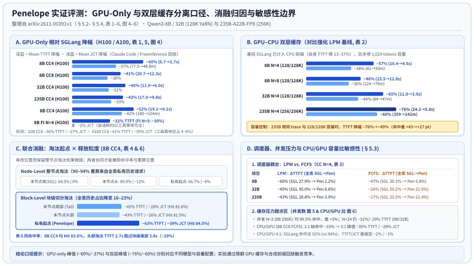查看原图 ↗</a><figcaption>图 2 · Penelope 实证评测与消融归因（arXiv:2611.00391v1 §5.2–§5.4、Table 1–6 与 Fig. 4–6）：GPU-Only（A）与双层缓存（B）的最大收益对应不同模型与容量配置；位置选择与块级释放缺一不可（C），且依赖缓存感知调度进入压力区间（D）。</figcaption></figure>

实验主力平台为 **NVIDIA H100 80 GB**（双路 48 核 AMD EPYC 9454，1.48 TiB DRAM，PCIe Gen4 x16），硬件泛化平台为 **NVIDIA A100 80 GB**（双路 40 核 Intel Xeon Platinum 8380，0.98 TiB DRAM）；栈版本固定为 CUDA `12.8`、PyTorch `2.9.1`、`sgl-kernel 0.3.21`（FlashAttention-3 用于 prefill 及 GPU-only decode）与 `FlashInfer 0.6.3`（GPU–CPU 配置下 SGLang 自动选用的 decode 后端，对照双方始终同后端）。模型覆盖三档 Qwen3：`Qwen3-8B`（单卡，YaRN 4× 扩至 `128K`）、`Qwen3-32B`（4 卡 TP=4，YaRN 4× 扩至 `128K`）与 `Qwen3-235B-A22B-Instruct-2507-FP8`（8 卡 TP+EP，原生 `256K` 上下文）；GPU-only 默认 KV 容量分别**人为限额为 `256K`、`192K` 与 `384K` tokens**（`1K = 1,024`）以在适中并发会话数 `N` 下诱发驱逐竞争。工作负载来自两套真实编程 Agent 轨迹**：Claude Code（CC）**（Trace Commons，`24` 会话、`4,688` 请求，按服务商记录重构 `15.6K` 跨会话共享初始前缀及各会话私有初始上下文，单轮上下文中位 `80K`、在 8B/32B 与 235B 分别平均 `83K` 与 `144K` tokens）与 **FreeInference（FI）**（Harvard MaDSys Codex 轨迹，`48` 会话、`4,089` 请求，中位输入 `77K`）。以下严格分开列出 GPU-only 与双层缓存结果：

| 评测口径与配置（`LPM` 调度） | 并发与缓存容量（GPU / CPU） | SGLang 命中率 → Penelope | SGLang Mean TTFT → Penelope（降幅） | SGLang Mean JCT → Penelope（降幅） | 补充指标（p90 TTFT / 吞吐或注记） |
| :--- | :--- | :--- | :--- | :--- | :--- |
| GPU-Only · H100 CC · `Qwen3-8B` | `N=4`，`256K` GPU | `66.5%` → `83.6%` | `6.7 s` → **2.7 s（-60%）** | `4,649 s` → **2,927 s（-37%）** | p90 `24.7 → 8.9 s`；输入 `20.4 → 31.0k tok/s` |
| GPU-Only · H100 CC · `Qwen3-8B` | `N=8`，`256K` GPU | `43.4%` → `62.2%` | `20.7 s` → **12.3 s（-41%）** | `8,638 s` → **6,047 s（-30%）** | p90 `51.4 → 30.8 s`；输入 `15.1 → 21.8k tok/s` |
| GPU-Only · H100 CC · `Qwen3-32B` | `N=4`，`192K` GPU | `52.8%` → `73.2%` | `11.0 s` → **6.0 s（-45%）** | `5,539 s` → **3,840 s（-31%）** | p90 `29.8 → 16.0 s`；输入 `16.5 → 23.5k tok/s` |
| GPU-Only · H100 CC · `Qwen3-32B` | `N=8`，`192K` GPU | `35.4%` → `57.0%` | `27.4 s` → **17.5 s（-36%）** | `9,204 s` → **6,684 s（-27%）** | p90 `58.3 → 49.6 s`；输入 `13.8 → 19.6k tok/s` |
| GPU-Only · H100 CC · `Qwen3-235B-A22B` | `N=4`，`384K` GPU | `61.9%` → `80.7%` | `17.0 s` → **9.8 s（-43%）** | `19,001 s` → **12,805 s（-33%）** | p90 `51.9 → 24.0 s`；输入 `17.9 → 26.7k tok/s` |
| GPU-Only · A100 CC · `Qwen3-8B` | `N=4 / N=8`，`256K` GPU | — | `19.1` → **9.1 s（-52%）** / `58.1` → **34.1 s（-41%）** | `180` → **104 min（-42%）** / `361` → **234 min（-35%）** | 工具等待仅占 A100 JCT `4–9%`（H100 `10–22%`） |
| GPU-Only · H100 FI · `Qwen3-8B` | `N=3 / N=4`，`256K` GPU | `+1.2` 至 `+2.0 pp` | **-30% / -32%** | **-2% / -2%** | 工具等待主导总会话时长，稀释 prefill 加速 |
| 双层 GPU–CPU · H100 CC · `Qwen3-8B` | `N=4`，`128K / 128K` | 领先基线 `29–30 pp`（8B/32B） | `10.4 s` → **4.5 s（-57%）** | `81 min` → **50 min（-38%）** | 基线已启用 CPU 前缀计数（自身降 `13–37%`） |
| 双层 GPU–CPU · H100 CC · `Qwen3-8B` | `N=8`，`128K / 128K` | 领先基线 `29–30 pp`（8B/32B） | `23.5 s` → **12.8 s（-46%）** | `124 min` → **79 min（-36%）** | 基线 SGLang 多拥有 `1,024` tokens 净容量 |
| 双层 GPU–CPU · H100 CC · `Qwen3-32B` | `N=4`，`128K / 128K` | 领先基线 `29–30 pp`（8B/32B） | `11.0 s` → **3.9 s（-65%）** | `84 min` → **47 min（-44%）** | 两级等容量下 32B 降幅高于同容量 8B |
| 双层 GPU–CPU · H100 CC · `Qwen3-235B-A22B` | `N=4`，`256K / 256K` | 领先基线 `43 pp` | `24.2 s` → **5.8 s（-76%）** | `359 min` → **142 min（-60%）** | 改用 `8B/32B` 同 trace 与 `128K/128K` 时 TTFT 降 **-49%** |

*表 1 · 端到端评测汇总（整理自 arXiv:2611.00391v1 §5.2、Table 1–2、Table 5 与 Fig. 4；CC GPU-only 为 3 次运行均值，其它配置除另注外至少 2 次运行均值；GPU-only 与双层架构的最大收益来自不同模型与容量口径，不可直接合并）。*

- **双层对比先修正了基线本身的调度盲区**：原生 SGLang 的 LPM 只统计驻留在 GPU 上的前缀长度而忽略已卸载到 CPU 的历史。作者为基线补齐「双层前缀同时计入 LPM」，单这一步就使 SGLang 自身平均 TTFT 下降 **`13–37%`**；Penelope 在这一**强化后基线**之上仍把 TTFT 再砍掉 **`46–76%`**、JCT 砍掉 **`36–60%`**。同时，论文主动做了一项对照拆解：`235B` 在 `256K/256K` 下的 `-76%` TTFT 部分源于其允许 `256K` 长上下文（单请求平均 `144K` tokens，远长于 `8B/32B` 的 `83K`）；当给 `235B` 换用与 `8B/32B` 完全相同的轨迹与 `128K/128K` 容量时，其命中率领先从 `43` 个百分点回落到 `27` 个百分点，TTFT 降幅收敛至 **`49%`**，与 `8B/32B` 的 `46–65%` 区间一致。
- **并发度、CPU/GPU 容量比与调度器敏感性（§5.3）**：在 GPU-only 并发扫描（Fig. 5）中，`8B` 于 `N=2` 时 `256K` 显存足够装下活跃会话，双方命中率均为 `99.5%`、TTFT 与 JCT 差不足 `3%`；而 `32B`（`192K` 容量）在 `N=2` 即发生淘汰，命中率仅多 `2.9` 个百分点却已拉低 TTFT **49%**（JCT 降 `11%`），印证高位置 token 对延迟的杠杆效应；高并发下相对 TTFT 收益逐步收敛，但在 `N=24` 仍维持 **31%（8B）与 29%（32B）**（JCT 降幅在 `8B` 为 `27%`、`32B` 稳在 `26–31%`）。在 `8B CC8` FCFS 下的 CPU/GPU 容量比扫描（Fig. 6）呈典型倒 U 形：`1:1` 时双层均频繁缺页（命中率 `42%` vs `27%`），TTFT 仅降 `10%`；`3:1` 时 Penelope 逼近 `94%` 命中而 SGLang 仅 `69%`，收获峰值 **-35% TTFT / -28% JCT**；到 `4:1` 时 SGLang 也达到 `92%` 命中，差距缩至 **-2% / -1%**。调度器对比（Table 3，`CC N=4`）则暴露出 **FCFS 与头部淘汰的结构性摩擦**：LPM 转用 FCFS 后，由于排队会话不再受缓存友好度偏袒，整段私有历史被全部逐出（`full miss`）的比例在 `32B` 从 `8.6%` 飙升至 **21.0%**、在 `235B` 从 `3.9%` 升至 **21.4%**（`8B` 为 `2.2% → 5.8%`），使得 TTFT 降幅相应由 `60%/45%/43%` 缩水为 `47%/26%/17%`（JCT 由 `37%/31%/33%` 缩为 `31%/19%/13%`）。

为厘清「改淘汰位置」与「改块级粒度」各自贡献，§5.4 与 Appendix A.3 给出了正交联合消融及同等块粒度下的头部 vs. 尾部对照：

| 释放粒度（`8B CC4`，`LPM`） | 淘汰起点选择 | 命中率 | 相对 SGLang ΔTTFT | 相对 SGLang ΔJCT | 全丢（≥90% 私有历史）贡献重算占比 |
| :--- | :--- | :--- | :--- | :--- | :--- |
| 整节点释放（Node-level） | 末节点尾部（原生 SGLang） | `64.5%` | `0%`（基准） | `0%`（基准） | `90–94%`（整节点组共性区间） |
| 整节点释放（Node-level） | 末节点头部 | `69.0%` | `-12%` | `-8%` | `90–94%` |
| 整节点释放（Node-level） | 私有历史起点（共享前缀后） | `66.7%` | `-6%` | `-4%` | `90–94%` |
| 64-token 块级释放（Block-level） | 末节点尾部（块级 Tail） | `82.6%` | `-45%` | `-28%` | `16–23%`（块级组共性区间） |
| 64-token 块级释放（Block-level） | 末节点头部 | `81.5%` | `-43%` | `-26%` | `16–23%` |
| 64-token 块级释放（Block-level） | 私有历史起点（完整 Penelope） | **84.5%** | **-63%** | **-39%** | `16–23%` |

*表 2 · 淘汰起点与释放粒度联合消融（arXiv:2611.00391v1 §5.4 Table 4，Qwen3-8B、CC N=4、LPM）。*

- **两项机制缺一不可，且同命中率下位置红利实锤（Table 4 & Table 6）**：仅改动淘汰起点而保留整节点释放时，超额回收引发连锁重算与再驱逐，`90–94%` 的重算都来自丢失 `≥90%` 私有历史的请求——历史一旦几乎全丢，无论从哪一端开始删都得从头重算，TTFT 降幅最高仅 `12%`（私有起点仅 `-6%`）。改用块级释放后，在最末单个节点内部反转头尾（`-43%` vs `-45%`）几乎没有差别，因为末节点本身就在上下文最末端；只有**块级释放 + 回溯至私有历史起点**才能同时把全丢重算占比压到 `16–23%` 并保住高代价后缀。Appendix A.3（Table 6）更在 5 组 `CC` 负载下将 Penelope 直接对照「相同受害者、相同块级释放量、仅起点在末节点尾部的块级 Tail 策略」：在 `8B CC4` 上两者命中率**同为 `83.6%`**，Penelope 仍把平均 TTFT 从 `3.8 s` 压低到 `2.7 s`（`-29%`）、p90 从 `11.7 s` 降至 `8.9 s`、JCT 从 `3,436 s` 降至 `2,927 s`；在 `32B CC8` 上命中率相差 `-0.1 pp`（`57.0%` vs `57.1%`），TTFT 仍降 `12%`（`19.8 → 17.5 s`），证明主要增益来自**留住了高重算代价的后部位置**。
- **运行开销与严格正确性验证（§5.4 & Appendix A.4）**：在 `Qwen3-8B` H100 `32K–128K` 上下文中，幽灵请求与真实请求同批执行的耗时与分两条普通请求计算同一组位置相比差距在 **`1%` 以内**（注意力略慢约 `1%`，前向其余部分略快）；在 `8B CC8` 一小时全量运行中，缓存管理 CPU 耗时占比为 **`1.6%`**，略高于原生 SGLang 的 `0.54%`。在等价性检验中，作者验证了 `(128K GPU + 128K CPU)`（额外为交换缓冲补齐 `1,024` 净容量）与 `256K` 单 GPU 池在手工 18 请求（命中 `33.67%`）、20 组随机 699 请求（`60.13%`）及 4 会话 `1,245` 轮 CC 轨迹（`69.71%`，其中 `763` 次回载有 **`602` 次**走通双层全满交换路径）上每一轮的命中集合、逻辑驻留块、最终淘汰顺序与贪婪解码输出完全一致，且把 CPU 容量缩减 `256` tokens 作负对照时全部 `22` 条序列均立即分化；最后开启 SGLang 确定性推理模式，对比 `40K` 淘汰缓存与 `256K` 永不淘汰参考运行（覆盖同批与 `8K/4K/2K` 分块预填充），所有输出及缺失重算段与复用后缀的 prompt 对数概率均做到**逐位一致（bit-identical）**。

### 四、科学边界、适用条件与工程迁移启示

将 Penelope 纳入生产 Agent 推理引擎设计前，必须明确区分原文已证明的收益条件与尚未覆盖的部署边界：

1. **严格隔离两套峰值口径与「容量甜点区」依赖**：摘要与结论中的两对最大降幅不可混读——`-60%` TTFT / `-37%` JCT 属于 **GPU-only 下的 Qwen3-8B CC4**，而 `-76%` TTFT / `-60%` JCT 属于 **GPU–CPU 双层下且使用 256K 上下文、144K 平均长度轨迹的 Qwen3-235B CC4**（改回 `8B/32B` 同容量与同轨迹后为 `-49%` TTFT）。同时，该策略只在「工作集超出单层/双层有效容量、但又不至于让所有等待请求在排队期被完全清空」的压力窗口内生效：容量足够时（如 `8B N=2` 命中 `99.5%` 或 `4:1` CPU/GPU 命中 `92–94%`）收益趋零；极度吃紧时（`1:1` CPU/GPU）受限于整体缺失率仅降 `10%`；若 Agent 会话端到端耗时大头在外部工具执行（如 `FreeInference`），即便 TTFT 降 `30–32%`，会话 JCT 也仅缩短 `2%`。
2. **Trace 回放与受控缓存容量的实验抽象**：主评测中 GPU-only 容量被主动限制在 `192K–384K` tokens 以加速复现内存竞争；`CC` 缺失的原始提示内容与 `FI` 块标识符采用符合长度和前缀共享结构的合成 token 填充；此外，多轮回放喂入轨迹中记录的历史回复而非模型在线采样输出，故所有对比系统均在请求结束后释放生成 token 的 KV、只保留输入提示 KV（真实在线服务若保留生成输出供后续自引用，树结构与回收周期会略有不同，但尾部高重算代价结构不变）。
3. **注意力假设与系统协同耦合范围**：§2.2 成本模型及 `Table 4/6` 验证建立在「所有层均为全因果注意力」与「GPU–CPU 写回（write-back）单节点部署」之上，尚未评估滑动窗口注意力、线性/状态空间混合层（Mamba/GDN）、PD 分离集群跨节点传输或直接丢弃式/旁路加载架构；同时论文明确指出，一旦从缓存感知的 `LPM` 退回 `FCFS`，排队会话整段私人历史全丢率可跳升至 `21.0–21.4%`，大幅吞噬位置优势；目前 `v1` 论文亦未附带可公开拉取的源码仓库。
4. **可迁移的系统工程原则**：（1）**把「选谁淘汰」与「从哪开始删多细」解耦**：保留简单稳健的 LRU 决定 victim 会话，但必须在共享分叉点之后按 block 边界局部裁剪并继承时间戳；（2）**让 KV 淘汰空洞与注意力批处理器协同**：借助单层「先写 batch K/V、再做因果读」的天然时序并用内部幽灵请求携带历史缺口，可在零自定义 GPU kernel 的前提下消除两轮前向开销；（3）**跨存储层级维持单一全局淘汰序**：只要多级缓存保持互斥并用小型有界 swap buffer 做分块流水互换，就能把双层架构的替换行为严格锚定在等效大容量单池之上，避免下层满载引发的策略反转。

来源：[Rethinking KV Cache Eviction for Agentic LLM Serving](https://arxiv.org/abs/2611.00391)（[v1 PDF](https://arxiv.org/pdf/2611.00391) · [HTML](https://arxiv.org/html/2611.00391v1)）
<h2 class="daily-paper-title" id="paper-arxiv-2611.02082">09 · Fairway：用双虚拟通道兼顾 KV Cache 复用与 Prefill 尾延迟</h2>

[Fairway: Load-Aware KV Cache Reuse for LLM Prefill Scheduling](https://arxiv.org/abs/2611.02082)（[v1 PDF](https://arxiv.org/pdf/2611.02082) · [v1 HTML](https://arxiv.org/html/2611.02082v1)）  
Hamidreza Alikhani¹、Nazmul Takbir¹、Matin Khajavi²、Rajat Bhattacharjya¹、Sangeetha Abdu Jyothi¹、Nikil Dutt¹（¹ University of California, Irvine；² Apiphany）· `arXiv:2611.02082v1 [cs.DC]` · 2026-11-01 提交（截至核验仅存 `v1`，无修订或撤回记录；页眉为 ICML 样式预印本标注 Preprint）

在检索增强生成（RAG）和多轮智能体工作流中，长提示词往往由系统提示、检索片段或历史工具输出拼装而成。在 Prefill–Decode（P/D）分离式部署中，请求几乎全部的**首字延迟（TTFT）**都消耗在 prefill 节点的排队与计算上，而前缀缓存（prefix caching）只复用连续匹配的引导块，一旦出现首块分歧便须重算剩余序列。因此，同一等待队列中不同请求的真实**未缓存计算工作量**差异极大；既有调度策略要么保住中位延迟却饿死昂贵未命中请求，要么靠 FCFS 或轮次计数压低尾延迟却把短命中拖垮。`Fairway` 在不依赖逐工作负载调参的前提下，把**未缓存 token 工作量**与**相对自身 prefill 时长的等待时间**同时写入调度目标，通过 Fast/Fair 双虚拟通道在轻载时优先复用、拥塞或洪峰时界定老请求前方的插队工作量。以下精读严格依据 `arXiv:2611.02082v1` 全文、算法与附录，将作者在单节点 prefill 隔离协议下的实测数据与通用工程适用边界分开陈述。

### 一、分级 KV 复用下的调度困局：为什么固定规则都会在某一类场景失灵

现有前缀缓存引擎（如 vLLM 默认 `16-token` 块、SGLang radix tree）要求所有前置块完全匹配才能复用。论文 §2.2 与 §3.1 指出，当共享组件按顺序拼入提示词时——例如前一个请求 `[S, A, B, C, q₁]` 留下全部前缀，后续 `[S, A, B, D, q₂]` 可复用 `S, A, B`，而 `[S, D, A, B, q₃]` 即使缓存里存在 `A, B` 也只能复用 `S`，`[S, A, B, C, q₄]` 则只需计算问题 `q₄`——KV 复用天然呈现**分级（graded）**特征：

- **同一队列内的工作量跨度达 `70–250×`（Fig. 2，§3.1）**：在单张 GPU 上以 FCFS 回放四套基准时，各请求实际需要计算的未缓存提示词 token 数的第 90 与第 10 百分位比值（<code>p90/p10</code>）达到 `70–250×`。以 `SEC QA` 为例，每条请求都携带约 `1.5k` token 的 5 个检索块，但约一半请求是完全命中、只需计算几十个问题 token；而占请求数 `30–35%` 的部分命中却承担了 **`54–64%`** 的总 prefill 计算量。在来自 Kimi 线上服务的 `Mooncake` 生产轨迹中，`58%` 的对话请求和 `65%` 的工具智能体请求属于部分缓存，未缓存 token 从数百跨度到约 `18k`（约 **`100×`**）。论文指出，过往许多基准采用等长提示、稳态负载并只汇报平均延迟（如 PEEK、RAGCache 原测评），掩盖了这一队列差异。
- **需求 R1（中位 vs 尾延迟的负载冲突，Fig. 3）**：前缀缓存下的节点负载等于到达速率乘以单请求未缓存 token 数，请求量暴涨或缓存失效都会推高负载。在 `SEC QA` 话题切换动态轨迹（`75%` 稳态 → 5 分钟冷门话题切换推升负载至 `93%` → `60 s` 请求脉冲至 `114%`）中，稳态期所有策略几乎无差别；一旦脉冲到来，**FCFS** 将 `p99` 守在 `7.8 s`（Fig. 1），中位 TTFT 却从 `0.8 s` 暴涨到 **`5.9 s`**（`6–7×` 恶化）；相反，**KV 复用优先**调度（LPM、RAGCache）虽能保住 `0.8 s` 中位，却因持续放行高命中新请求而使未命中请求 `p99` 飙至 **`15.0 s` 与 `41.8 s`**。且集群负载均衡无法消除此类脉冲：突发流量会同时打到所有副本，缓存亲和路由又刻意把共享前缀集中到同一节点，扩容更远慢于 `60 s` 脉冲。
- **计数型公平忽略请求体量（`k-LPM`、`Preble`、`Prism`）**：每 `k` 次放行一次最老请求（`k-LPM`）或按缓存比分组配额（`Preble`），把只算 `30` 个 token 的全命中与算 `3,000` 个 token 的长未命中视为同等「1 次准入」。这导致单一 `k` 无法通吃：小 `k`（`k=4`）在队列充斥未命中时把宝贵缓存逐出，话题切换后 `p99` 比 Fairway 高 **`+92%`**；大 `k`（`k=8`）又在持续分级复用下让老请求排队过长（SEC 稳态 `ρ=0.9`/`1.1` 分别高 **`+42%` / `+61%`**，Mooncake 高 **`+30%`**，Table 4）。
- **需求 R2（绝对等待时间忽略请求大小，§3.3，Fig. 4）**：在 `h_r / c_r` 上直接加绝对等待秒数（如 RAGCache/PrefillOnly 的常见老化做法），每秒给 `1k` token（prefill 约 `0.14 s`）和 `10k` token（prefill 约 `1.4 s`）加上完全相同的优先级。等待 `1 s` 已是短请求的 `7` 倍计算时间，却不及长请求一次 prefill。在文档长度跨 `1k–13.2k` 的 `SEC long-doc QA` 上，绝对等待迫使各长度分组共享 `14–16 s` 的 `p99`——短请求相当于白等自身时长的 **`86×`**，而长请求只等 **`9×`**。
- **需求 R3 与 R4（纯等待时间在缓存洪水下无上界，且不能逐负载调参，§3.4）**：只要新到的高命中请求以高 `h_r / c_r` 起始，排队中的老未命中就必须靠时间慢慢追平该起点。一旦热点文档发布或规划器并行发出大量共享上下文的子智能体/工具调用，持续涌入的高命中会让积压未命中等待 **`66–201 s`**（Table 1），即便换成相对等待时间也无法封顶（表 2 中仍达 `59.1 s`）。同时真实负载的命中率、长度与速率时刻变化，不能依赖针对单一工作负载手工标定的阈值。

### 二、Fairway 机制拆解：Fast/Fair 双虚拟通道与步幅工作量记账

<figure class="note-figure"><a class="note-image-link" href="/assets/images/digest/2026-11-04/fairway-dual-lane-prefill-sched-zh.svg" target="_blank" rel="noopener" aria-label="查看 Fairway 双虚拟通道与工作量记账合并机制图原图">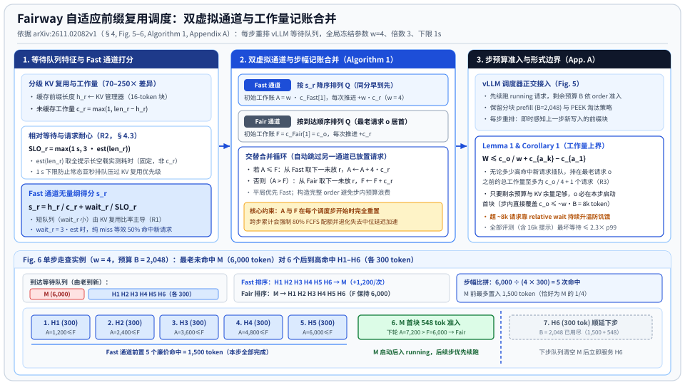查看原图 ↗</a><figcaption>图 1 · Fairway 双虚拟通道自适应调度与单步工作量上界（整理自 arXiv:2611.02082v1 §4、Algorithm 1、Fig. 5–6 与 Appendix A）：每步重排等待队列并在步内按步幅记账合并，且每步开始完全重置工作账。</figcaption></figure>

`Fairway` 作为轻量级插件接入 `vLLM 0.16.0` 调度器（Fig. 5），在每个调度步开始时重排 `waiting` 队列（以即时反映上一步新缓存的前缀），而把运行中请求续跑、步内 token 预算 `B`（48 GB 级 GPU 为 `2,048`、H100 级为 `8,192`）、缓存淘汰策略与抢占机制完全保留给引擎原生模块。其核心逻辑由三部分构成（Algorithm 1）：

1. **Fast 通道打分（复用比率叠加相对等待，§4.2–§4.3）**：
   - 对等待队列 `Q` 中的请求 `r`，设提示总长为 `len_r`、KV 管理器返回的命中前缀长度为 `h_r`，则未缓存工作量为 <code>c_r = max(1, len_r − h_r)</code>。
   - **耐心值（Patience）**：定义 <code>SLO_r = max(1 s, 3 · est(len_r))</code>，其中 `est(len_r)` 是在空闲引擎上针对该 GPU 做一次短基准标定即可得到的预期 prefill 时长。注意此处特意使用**固定不变的全提示长度 `len_r`**（而非随淘汰波动且已进入分母的 `c_r`）。倍数设为 `3`（在单种子 SEC 上确定后全局冻结），物理含义是**：一个纯未命中请求在等待了自身 prefill 时长的 3 倍之后，紧迫度恰好追平刚到达且有 50% 前缀命中的新请求**；而 `1 s` 的下限确保繁忙但稳态运行的引擎中常见的亚秒级短暂排队不会压倒 KV 复用收益。
   - **Fast 得分**：<code>s_r = (h_r / c_r) + (wait_r / SLO_r)</code>，两项均无量纲且直接相加（同分按最老到达优先）。队列短时 `wait_r` 极小，完全退化为复用率优先（LPM/RAGCache 顺序）；队列拉长时，`wait_r / SLO_r` 快速抬升短提示词的排位，让延迟他人的代价最低的短请求先行。
2. **Fair 通道与步幅记账合并（Stride-Based Merge，§4.4）**：
   - `Fast` 通道按 `s_r` 降序排列 `Q`，`Fair` 通道按到达顺序排列 `Q`（最老请求 `o` 居首）。
   - 合并器借鉴 **stride scheduling**（Waldspurger &amp; Weihl, 1995）追踪两条通道已置入的工作量记账（work charge）：初始化 <code>A = w · c_Fast[1]</code>（Fast 权重全局冻结为 `w = 4`）与 <code>F = c_Fair[1] = c_o</code>。
   - 循环直至 `order` 收齐等待队列 `Q` 全部请求：若 <code>A ≤ F</code>（平局优先 Fast），取 `Fast` 下一未放置请求 `r` 并令 <code>A ← A + w · c_r</code>；否则取 `Fair` 下一未放置请求 `r` 并令 <code>F ← F + c_r</code>。生成覆盖全队列的唯一 `order` 后，引擎在步预算 `B` 内从头准入，绝不浪费步内预算。
   - **关键不变量（每步重置工作账）**：**记账 `A` 与 `F` 在每个调度步开始时完全重置**。作者明确指出，若把工作账跨步累计（或仅在队列清空时重置），则系统会在长时间维度强制执行 Fair 通道 `w / (w + 1) = 80%`（`w=4` 时）的份额配额；高负载下队列长期不空，调度顺序就会整体滑向 FCFS，丧失廉价命中带来的中位延迟优势。
3. **形式上界、单步走查与超长请求兜底（Appendix A，Fig. 6）**：
   - **Lemma 1**：由于 `Fair` 的第一个元素必是最老请求 `o`，在 `o` 入队前 `F` 恒等于 `c_o`，且此前所有抢先置入的请求 `a_1, ..., a_k` 必全部出自 `Fast` 通道。最后一个请求 `a_k` 能被选中仅当此前 <code>w · (c_{a_1} + W − c_{a_k}) ≤ c_o</code>，因此排在 `o` 前面的总未缓存工作量严格满足 <code>W ≤ c_o / w + c_{a_k} − c_{a_1}</code>（即至多为 `c_o / 4` 再加一个请求，与队列有多长、新请求缓存命中率有多高完全无关）。
   - **Fig. 6 实例**：假设 `o` 为刚到达队头的未命中 `M`（`6,000` token），其后涌入 `6` 个高度命中请求 `H1–H6`（各 `300` token）。`Fast` 每取 1 个命中记账增加 `4 × 300 = 1,200`，因此前 `5` 个命中（`A` 从 `1,200` 增至 `6,000 ≤ F`）可先于 `M` 准入，共消耗 `1,500` token（恰好是 `M` 的 `1/4`）；第 `6` 次判定时 `A = 7,200 > F = 6,000`，轮到 `Fair` 选中 `M`，在 `B = 2,048` 预算下还剩 `548` token 足以立即启动 `M` 的首块并转入 `running` 集合在后续步优先续跑，而 `H6` 顺延到下一步。
   - **Corollary 1 与 `~w·B` 覆盖边界**：只要步内剩余预算高于 `c_o / w + c_{a_k}`、KV 缓存能同时容纳前置命中与 `o` 的首块而不触发自驱逐，且未达单步请求数上限，`o` 必在本步开始计算。该单步保障覆盖最老请求高达 <code>~w·B</code>（在 `w=4, B=2,048` 下约 `8k` 未缓存 token）；对于超过 `8k`（实测最高 `16k`）的超长请求，则由 `Fast` 通道中持续单调增长的 `wait_r / SLO_r` 托底防饥饿（全部评测中最坏等待均不超过自身 `p99` 的 `2.3×`）。

### 三、实证评测：动态脉冲、11 场景鲁棒性、缓存洪水与消融分析

<figure class="note-figure"><a class="note-image-link" href="/assets/images/digest/2026-11-04/fairway-tail-median-ttft-eval-zh.svg" target="_blank" rel="noopener" aria-label="查看 Fairway 实证评测四象限汇总图原图">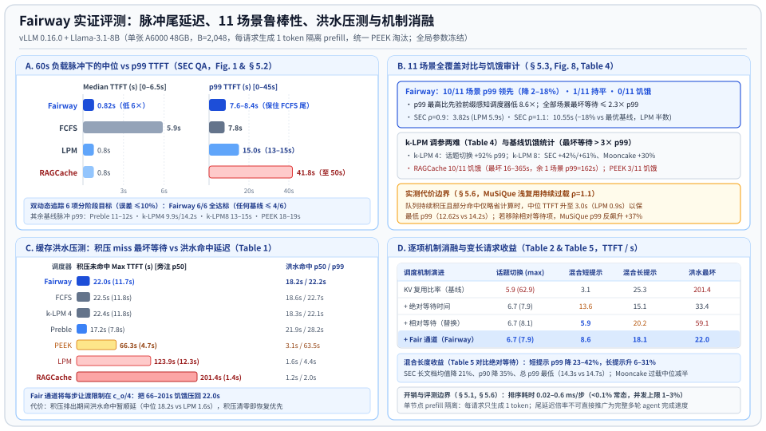查看原图 ↗</a><figcaption>图 2 · Fairway 实证评测汇总（arXiv:2611.02082v1 §5、Fig. 1/7/8、Table 1/2/4/5）：全部基线共享相同 PEEK 需求感知缓存淘汰策略与 B=2,048 预算，仅准入队列重排顺序不同。</figcaption></figure>

实验平台部署于单张 **NVIDIA A6000（48 GB）**、运行 **`vLLM 0.16.0` + `Llama-3.1-8B`**，模拟 P/D 分离中的独立 prefill 节点（**每请求仅生成 1 个输出 token** 以隔离汇报 TTFT），步预算 `B = 2,048`，KV 缓存容量刻意设为各轨迹独立可复用块数的 `1/4–1/3` 以制造高频淘汰压力。所有 8 种策略（`Fairway` 对照 `FCFS`、`LPM`、`k-LPM` [`k=4, 8`]、`RAGCache`、`PEEK`、`Preble`）在 Appendix C 下统一采用 **PEEK 的需求感知淘汰策略**，因而性能差异完全归因于等待队列准入顺序。`Fairway` 的三个参数（`w=4`、耐心倍数 `3`、下限 `1 s`）在单种子 `SEC` 上确定并冻结后，**未经任何修改**直接运行于新种子 `SEC`、`SEC long-doc QA`、`MuSiQue`、`Mooncake`、`Public QA` 与 `Flood` 全部场景（稳态负载取相对 FCFS 饱和容量 `µ` 的 `ρ = 0.9` 繁忙与 `ρ = 1.1` 临时过载，饥饿判据为最坏 TTFT 大于自身 `p99` 的 `3×`）。

- **动态负载脉冲与话题切换（§5.2，Fig. 1 &amp; Fig. 7）**：两条 `1,020 s` 动态轨迹包含 `300 s` 稳态（`ρ≈0.75`）、`300 s` 突发（`ρ≈0.9–1.0`，分别为同话题流量翻涌与将 `40%` 请求转向冷门半区使 SEC 未命中率从 `17%` 升至 `24%` 的话题切换）、`120 s` 稳态、`60 s` 超容脉冲（`ρ≈1.05–1.15`）与 `240 s` 恢复。若把「每阶段中位在 LPM 10% 以内、p99 在 FCFS 10% 以内」设为双轨迹各 6 项分阶段目标，**`Fairway` 在每次运行中 6/6 全数达标**，而任何基线均不超过 4 项。在最严峻的 `60 s` 脉冲窗口，`FCFS` 中位暴涨 `6–7×` 至 `5.1–5.9 s`；复用优先策略 `p99` 分别失控至 `11–12 s`（`Preble`）、`13–15 s`（`LPM`/`k-LPM 8`）、`18–19 s`（`PEEK`）与 `42–50 s`（`RAGCache`）；`k-LPM 4` 虽在流量翻涌保持 `9.9 s`，却在话题切换后跳升至 `14.2 s`；唯有 `Fairway` 同时守住 **`0.82 s`** 中位与 **`8.4 s` / `7.6 s`** 的 `p99`。
- **11 个主场景跨负载与跨长度鲁棒性（§5.3，Fig. 8，Table 4）**：在 `SEC`（5 场景）、`MuSiQue`（4 场景）和 `Mooncake`（2 场景）共 11 项评测中，最优非饥饿基线随场景不断易主（`FCFS` 4 次、`k-LPM 4` 4 次、`k-LPM 8` 3 次）。`Fairway` 在 **`10/11` 场景中 `p99` 低于所有非饥饿基线（幅度 `2–18%`），在 `Mooncake ρ=1.1` 与 `k-LPM 4` 持平（`-2%`，`27.57 s`）**，且 **`0/11` 发生饥饿**（最坏等待始终 ≤ `2.3× p99`）。对比先验前缀感知调度器，其 `p99` 最高降低 **`8.6×`**。其中 `SEC ρ=0.9` 下 `Fairway` 中位 `0.70 s`（LPM `0.68 s`）、`p99` 为 `3.82 s`（LPM `5.9 s`、`k-LPM 4` `+12%`、`k-LPM 8` `+42%`）；`SEC ρ=1.1` 下 `p99` 为 `10.55 s`（比最优基线低 `18%`，仅 LPM `22.2 s` 的一半，而 `k-LPM 4/8` 分别高出 `+22%` 与 `+61%`）。反观基线：`RAGCache` 在 **`10/11`** 场景出现请求饥饿（最坏 `16–365 s`，第 11 个场景 `p99` 达 `162 s`）；`PEEK` 在 **`3/11`** 场景饥饿（另有 4 场景 `p99` 超 FCFS 两倍）；`Preble` 虽不饥饿，但在所有场景中 `p99` 都比 Fairway 高 **`5–53%`**。在超长自然长度 `Public QA`（`3.5–16.3k`）上，队列排空时间主导尾部，非饥饿复用策略 `p99` 彼此相差 `8%` 以内，`Fairway` 距最优 `k-LPM 8` 在 `3.3%` 内并保持最低中位与均值（`FCFS` 与 `PEEK` 的 `p99` 则达 `116 s` 与 `1,654 s`）。

| 调度策略 | 积压未命中 p50（s） | 积压未命中 Max（s） | 洪水缓存命中 p50（s） | 洪水缓存命中 p99（s） | 机制行为边界解读 |
| :--- | :--- | :--- | :--- | :--- | :--- |
| **Fairway** | 11.7 | **22.0** | 18.2 | 22.2 | Fair 通道将每步让渡封顶在 <code>c_o/4</code>，积压排出期间洪水命中暂顺延、清零后恢复优先 |
| FCFS | 11.8 | 22.5 | 18.6 | 22.7 | 严格按到达顺序服务，无插队；积压与洪水承受相近排队时长 |
| k-LPM 4 | 11.8 | 22.4 | 18.3 | 22.1 | 本压测下恰好接近 FCFS，但 Table 4 显示其在话题切换场景 p99 恶化 +92% |
| Preble | 7.8 | 17.2 | 21.9 | 28.2 | 基于缓存比分组轮询，积压更早排出但洪水命中 p99 抬升至 28.2 s |
| LPM | 12.3 | **123.9** | 1.6 | 4.4 | 新到达高命中不断插队，导致早期未命中积压最坏等待飙升至 2 分钟以上 |
| PEEK | 4.7 | **66.3** | 3.1 | 63.5 | 按节省计算量排序并保护热块，积压与洪水尾延迟双双失控 |
| RAGCache | 1.4 | **201.4** | 1.2 | 2.0 | 极度偏向高复用比洪水请求，积压未命中承受最高 201.4 s 饥饿等待 |

*表 1 · 缓存洪水压力测试结果（arXiv:2611.02082v1 Table 1，§5.4；先积累 1 分钟未命中积压，随后涌入高 KV 命中请求流）。*

- **缓存洪水压测（Table 1，§5.4）**：当队列里已积压 1 分钟未命中、此时突现大批只需极少计算的高命中请求时，`LPM`、`PEEK` 与 `RAGCache` 让每个新命中越过积压，导致最坏未命中分别等待 **`123.9 s`**、**`66.3 s`** 与 **`201.4 s`**。`Fairway` 利用 Fair 通道把每步先于最老未命中的命中工作量严格锁在约 `1/4`，从而将积压最坏等待稳稳压在 **`22.0 s`**（与 `FCFS` 的 `22.5 s` 相当）。论文坦承这一保护的代价：在积压尚未清空的窗口内，洪水命中请求的延迟会升至与 `FCFS` 相当（中位 `18.2 s` 对比 `LPM` `1.6 s`），一旦积压排出，命中请求立即重新获得优先权。

| 消融配置演进（Table 2） | 话题切换 p99（最坏等待） | 混合长度短提示 p99（SEC） | 混合长度长提示 p99（SEC） | 洪水压测积压最坏等待（s） | 对应解决的问题与暴露的短板 |
| :--- | :--- | :--- | :--- | :--- | :--- |
| 仅 KV 复用比率（基线） | 5.9（62.9） | 3.1 | 25.3 | 201.4 | 稳态短提示最快，但在话题切换与缓存洪水下严重饿死老请求 |
| + 绝对等待时间 | 6.7（7.9） | 13.6 | 15.1 | 33.4 | 消除话题切换饥饿，但混合长度下把短提示 p99 拖慢至 13.6 s（86× 自身 prefill） |
| + 相对等待（替换绝对等待） | 6.7（8.1） | **5.9** | 20.2 | 59.1 | 释放短请求使短 p99 降至 5.9 s，但长提示延后至 20.2 s 且洪水最坏回弹至 59.1 s |
| + Fair 通道（完整 Fairway） | 6.7（7.9） | 8.6 | 18.1 | **22.0** | 三项压力全面收敛：保留短请求收益，并把洪水最坏压至 22.0 s（低于绝对等待的 33.4 s） |

*表 2 · Fairway 机制逐项消融（arXiv:2611.02082v1 Table 2，§5.5；单位均为秒，混合长度取按提示词长度划分的最短 1/3 与最长 1/3）。*

- **机制消融、变长请求收益与系统开销（§5.5–§5.6，Table 2 &amp; Table 5）**：表 2 清晰证明三个机制缺一不可。相对等待替换绝对等待后，Table 5 显示在所有混合长度工作负载（`SEC long-doc QA`、`Mooncake ρ=0.9/1.1`、`Public QA`）上，最短 `1/3` 提示词的 `p99` 下降 **`23–42%`**（SEC 降至 `8.6 s`，较最优非饥饿基线 `k-LPM 8` 的 `13.2 s` 再降 **`35%`**；Mooncake 过载降至 `14.2 s`），同时 SEC 长文档整体均值降 **`21%`**、`p90` 降 **`35%`**、整体 `p99` 仍保持最低（`14.3 s` vs `14.7 s`），在 `Mooncake ρ=1.1` 上更使整体中位减半（`3.2 vs 6.6 s`）、均值降 `1/3`（`5.4 vs 8.3 s`）。相应地，耐心更长（`SLO_r` 更大）的最长 `1/3` 请求 `p99` 上浮 **`6–31%`**（`Mooncake ρ=1.1` 整体 `p99` 为 `27.6 s` vs `24.3 s`）。CPU 调度开销方面，排队重排在中位队列长度（`7` 个请求）仅耗 **`0.02 ms/步`**、最大并发队列（`509` 个请求）仅耗 **`0.6 ms/步`**（对应 GPU 步时长 `106–355 ms`）；计入所有缓存感知调度器本就必需的前缀查询后，常态不足步长的 **`0.1%`**、极限并发下也仅 **`1–3%`**。

### 四、科学边界、代价权衡与工程落地点

在将 `Fairway` 引入生产推理系统或代理服务框架前，必须区分论文在受控条件下已证实的四类适用边界与对应的工程落地点：

1. **1-token 生成的 Prefill 隔离协议边界**：全部评测为模拟 P/D 分离中的独立 prefill 节点，**每请求只生成 1 个输出 token**（§5.1）。因此，论文测得的 `8.6×` `p99` 降幅与 `6×` 中位提速仅刻画 prefill 队列的 TTFT 行为，**不能直接外推为完整多轮交互或长文本解码下的端到端代理完成时间（JCT）加速**——真实全链路中还会叠加 decode 显存驻留竞争、KV 跨节点传输带宽与工具执行等待间隔。
2. **合成到达分布与生产轨迹缩尺假设**：除 `Mooncake` 外，RAG 负载均基于固定题库抽样（Zipf `α=0.9` + 泊松到达，动态突发与脉冲由作者人工拼接设计）。即便是真实的 `Mooncake` 轨迹，为装入单张 48 GB A6000，作者也采取了 **`1/8` 会话抽样**、**提示长度缩放 `1/4`**，以及将原生 `ρ=0.8` 均匀时间压缩至 `0.9` 与 `1.1` 的缩放处理（Appendix B）。多卡并行（TP/PP）或百 GB 级 H100/B200 集群上的大提示分布仍有待验证。
3. **两类已实测的中位延迟代价区**：当系统处于**持续过载且缓存复用很浅**的状态时（例如 `MuSiQue ρ=1.1`，部分命中仅比未命中省少许 token），长队列会让老请求的相对等待迅速压过微弱的 `h_r / c_r` 优势，使 `Fairway` 中位 TTFT 退化至 **`3.0 s`**（对比 `LPM` `0.9 s`），以此换取最低 `p99`（`12.62 s` vs `14.2 s`）；在极端的缓存洪水中，洪水命中也会为了给积压未命中让出 `c_o/4` 外的步预算而暂缓（`18.2 s` vs `1.6 s`）。
4. **单步界限与静态前缀前提**：Lemma 1 的单步无饥饿保证仅覆盖约 `w·B`（默认 `~8k`）以内的未缓存工作量，且以步内余量与 KV 缓存足够容纳为前提（Corollary 1）；超长请求需回退到相对等待缓慢爬升。此外，`est(len_r)` 假设空闲引擎的 prefill 耗时在运行期间稳定，且 `v1` 预印本未提供独立开源代码库链接，论文亦把与淘汰策略、集群路由器的联合调度留待未来工作。

**可迁移的系统工程启示**：（1）**用「未缓存 token 工作量」代替「请求次数」度量公平**：在 `70–250×` 异构队列里，固定每 `k` 次让位注定在不同负载间顾此失彼；（2）**把等待时间归一化到请求自身预估耗时并设下限**：既阻止长请求拖死小请求，又避免 `1 s` 内的常规抖动破坏前缀局部性；（3）**步幅工作账务必按调度步重置**：守住最老请求的步内进度上限即可阻断饥饿，同时避免在长时间维度上把高效缓存复用器退化回 FCFS。

来源：[Fairway: Load-Aware KV Cache Reuse for LLM Prefill Scheduling](https://arxiv.org/abs/2611.02082)（[v1 PDF](https://arxiv.org/pdf/2611.02082) · [v1 HTML](https://arxiv.org/html/2611.02082v1)）
<h2 class="daily-paper-title" id="paper-arxiv-2611.00384">10 · Agent Stack for ML Training Lifecycle: Generation, Validation, and Optimization</h2>

[Agent Stack for ML Training Lifecycle: Generation, Validation, and Optimization](https://arxiv.org/abs/2611.00384) 
Jaideep Ray、Daniel Tang、Zejun Lin、Haoyue Tang、Lijuan Zhang、Tao Huang、Tommy Li、Aditya Jain、Ankit Goyal、Harsh Jain、Zhuo Zhi、Youmin Han、Santosh Jha、Shuying Liang、Yujie Ai、Jonathan Hung、Ethan Lyu、Abi Liu、Siddharth Singh、Feng Wen、Mahesh Ravindran、Souvik Ray、Yitong Zhou、Animesh Singh

LinkedIn 的 AutoTorch 用可执行检查生成和迁移模型，AutoResearch 由外部编排器管理实验。115 次流程中 92 次完成训练，其中 77 次达质量要求；另一批 100 条流水线有 28 条改善。

约四倍迁移提速来自团队估计，非随机对照；完成训练与达到质量要求的分母不同，不能合并为 80% 全流程成功。

来源：[Agent Stack for ML Training Lifecycle: Generation, Validation, and Optimization](https://arxiv.org/abs/2611.00384)

<h2 class="daily-paper-title" id="paper-arxiv-2611.00646">11 · When Shards Fly: Cross-Tensor In-Flight Conversion for Low-Latency, Low-Memory Weight Updates in Disaggregated RL</h2>

[When Shards Fly: Cross-Tensor In-Flight Conversion for Low-Latency, Low-Memory Weight Updates in Disaggregated RL](https://arxiv.org/abs/2611.00646) 
Jiayu Xiao、Ye Wang、Zhi Zhang、Jiarui Guo、Kan Liu、Tao Lan、Minchen Yu

ShardFly 编译跨 tensor 分片计划，在 persistent kernel 中融合布局转换、量化、传输和原位写入，并在副本间转发转换后的字节。更新阶段最高倍率很大，完整 GRPO 响应吞吐增益为 5.49%–6.71%。

主要是同步原位更新，稳定配置复用计划；不能把更新阶段最高 27.92 倍当作训练加速。

来源：[When Shards Fly: Cross-Tensor In-Flight Conversion for Low-Latency, Low-Memory Weight Updates in Disaggregated RL](https://arxiv.org/abs/2611.00646)

<h2 class="daily-paper-title" id="paper-arxiv-2611.03523">12 · DistDebug-Bench：找到相关文件，离找到故障原因还有多远</h2>

[DistDebug-Bench: Can LLM Agents Diagnose Bugs in Distributed Systems?](https://arxiv.org/abs/2611.03523) 
Yuxuan Jiang, Chenglin Liu, John Rose, Mason Miller, Ruthesh Thavamani, Juntao Wu, Yinwei Huang, Jiahao Xu, Peng Huang · arXiv · 首次提交：2026-11-02

**诊断一个分布式系统故障，需要解释症状如何从因果代码产生。** 找到报错文件或者生成能通过测试的补丁，都不完全等价于这项能力。DistDebug-Bench 将任务落在这个缺口上：给 agent 修复前仓库、事故描述及已有日志等材料，要求指出承载故障机制的代码块，直接评估定位。

基准含 11 个生产级系统、5 种语言的 120 个历史故障，标注 218 个根因代码块。每例由三名标注者独立检查后协调，排除测试、顺手重构和与根因无关的防御性修改。45% 的事故需要多个代码块，约 23% 跨文件，代码块中位长度仅五行。这要求 agent 既能沿跨组件因果链探索，也能收敛到精确范围。

数据还保留了真实诊断证据的不均衡：83 个报告不直接包含正确方法名，75 个没有可用的项目内栈轨迹。环境移除未来提交并禁止联网，另检查推理与工具记录中是否泄露隐藏 issue 编号。这样的控制减少直接查答案，但作者明确无法排除预训练暴露。样本也偏向能从已有报告诊断、修复范围可清晰标注的故障，不能代表所有线上事故。

在完整的 120 例比较中，作者每例平均三次有效尝试。GPT-6 Astra 配 Mini-SWE-Agent 的文件覆盖率为 83.9%，代码块覆盖率为 67.7%，代码块精确率为 42.7%；代码块覆盖率的 95% bootstrap 区间为 60.4%–74.9%。这些数字揭示“走到相关仓库区域”与“准确解释因果位置”之间的距离，而不是端到端修复成功率。该配置仍有 15 个故障在重复运行中的覆盖率跨度超过 0.2。

轨迹分析给出具体失败机制：一次搜索限定在错误子目录，可能使后续每一步看似合理，却始终看不到真正的原因；只读日志片段与搜索异常关键词，也会得到不同的证据范围。模型常在第一个自洽解释上继续深挖，缺少重新打开其他假设的动作。更宽泛地报告代码能提高覆盖，却会降低精确率，工具调用与上下文组织因此是评估对象的一部分。

定位标签也有边界：另一处有效干预点可能解释同一机制，却未命中最小根因块。作者的零覆盖人工审查中，20 例有 4 例属于这类情况。这不抹去困难，但提醒读者同时看解释质量与覆盖指标。对 AI SRE 研究，值得关注的是把证据获取、假设修订和最终定位拆开评估，并按报告线索强弱观察失败，而非仅比较总榜。

<a class="note-image-link" href="/assets/images/digest/2026-11-04/distdebug.png" target="_blank" rel="noopener" aria-label="DistDebug-Bench 从修复前代码和事故材料评估根因代码定位 · 查看原图 ↗">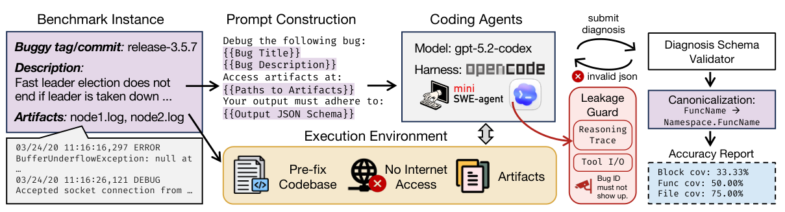查看原图 ↗</a>

*输入隐藏修复与答案线索，输出经过结构校验、符号规范化及多粒度定位评分。*

<h2 class="daily-paper-title" id="paper-arxiv-2611.02416">13 · 小模型 RCA：补上正常行为基线，再纠正最后的决策</h2>

[Fault-Free Profiles and Decision-Level Training for Root Cause Analysis via Small Language Models](https://arxiv.org/abs/2611.02416) 
Kyoohyun Lee, Woohyeok Park, Taeyoon Kim, Sungyong Baik, Kyungyong Lee · arXiv · 首次提交：2026-11-02

**异常分数大，不代表更接近根因；模型写出了传播分析，也不代表最后会遵循它。** 这篇小模型 RCA 工作分别检查输入与决策，发现两个经常被混在一起的问题。短时间参考窗口会把正常的周期变化当成异常，最终回答又可能忽略中间分析，转而选择分数最高的组件。

作者在 OpenRCA Bank 中发现，某 JVM 内存指标在无故障窗口里有 97% 会越过短窗口估计的阈值；改用完整无故障时期的统计量后，该比例降至 4%。根因组件在 99% 的事故窗口中已经进入候选集，却只有 8% 拥有最大异常分数。问题因此不只是“有没有找到候选”，还在于模型如何理解这些候选的背景。

Historical Frequency Profiling 为指标和日志添加 Expected Outlier Baseline：同一信号在无故障窗口里被标为异常的频率。在线提示同时展示异常强度与平时出现频率，优先列出平时少见的异常；trace 则与正常延迟比较。它不把罕见直接等同于因果，而是给模型补充原先看不到的参照。候选组件仍由指标筛选，日志与 trace 不会额外引入候选，因此前处理漏掉根因时，后续推理仍无法补救。

Biased-Decision Correction 则对同一推理前缀重新采样，构造通向正确与错误结论的偏好对。DPO 的损失只作用于前缀之后的续写，并通过 LoRA 更新，避免把已有分析过程也一并当作需要重学的目标。若普通采样始终失败，离线生成可使用特权提示救援，但训练输入移除提示，并检查选中解释是否仍由原始证据支持。审查模型参与的是离线数据构建，不能把整个训练流程都描述为无需外部模型。

在各系统按 60%/40% 随机划分训练和评估事故、每例八次响应独立评分后平均的设置下，4B 系统的 Exact 在 Telecom、Bank、Market、AIOps 2025 分别为 39.3%、48.7%、11.9%、21.1%。Exact 要求问题所问的组件、故障类型和时间全部正确，不能与只排组件的基线直接等同。Market 仍然困难；迁移到只评组件的 GAIA 时，本方法为 68.6%，低于 FoundRoot-14B 的 88.6%。

值得读的是正常画像与决策训练的拆分，而非“小模型全面胜过大模型”的概括。画像需要可识别的无故障时期及相对稳定的正常行为；实验还使用事故前后的无故障数据，不能直接当成严格在线、只用过去数据的结果。部署时如何更新画像、避免正常状态漂移，仍决定这条路径是否可靠。

<a class="note-image-link" href="/assets/images/digest/2026-11-04/fault-free-rca.png" target="_blank" rel="noopener" aria-label="无故障频率画像与决策偏好训练共同支持在线 RCA · 查看原图 ↗">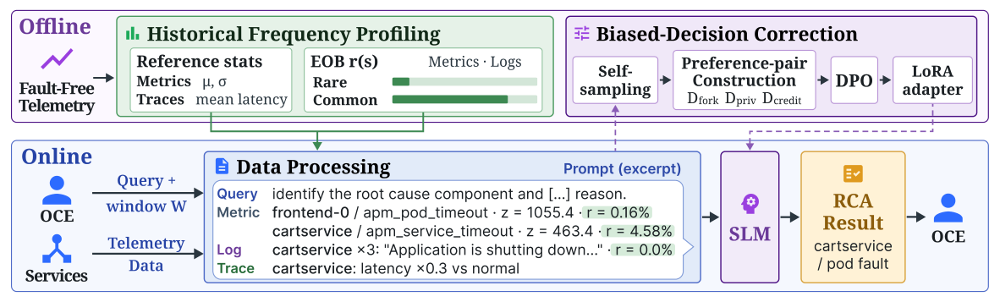查看原图 ↗</a>

*离线路径统计正常时期的异常频率并训练 LoRA；在线把这些频率与事故遥测一起交给小模型。*

<h2 class="daily-paper-title" id="paper-arxiv-2611.00463">14 · Exo：修改运行中的 harness，保留独立的状态与替换权限</h2>

[Exo: An Architecture for Self-Improving Systems at Runtime](https://arxiv.org/abs/2611.00463) 
Alexander Krentsel, Sylvia Ratnasamy, Ion Stoica, Martin Casado, Ankur Goyal · arXiv · 首次提交：2026-10-30

Agent 在一次长任务中已经发现重复操作，却仍要等外部优化器收集样本、评估新版本，改进才能落地。Exo 把改进循环放进执行过程：运行中的 agent 可以读写自己的工具、上下文压缩、模型调用及改进策略，再请求启用新 executor。它关注的是任务继续运行时如何替换策略，而非仅积累经验文本。

架构将可编辑策略与受保护机制分开。历史只追加，产物保留旧版本，guardian 独立决定新 executor 能否启用；替换时保留任务环境和执行记录。成本、token 与缓存信息帮助 agent 判断哪些操作值得改写。SREGym 中，它逐步形成收集异常 pod、版本变化和可疑日志的 incident-snapshot 工具，减少重复诊断调用。

使用 gpt-5.6-sol、以同一起始策略但禁用自编辑为对照，在 21 个学习事故之后，20 个同类故障、不同应用的留出事故中，作者报告诊断时间中位数从 81 秒降到 53 秒，平均模型成本从 0.892 美元降至 0.584 美元，正确性相近。保护边界的含义要谨慎理解：默认 guardian 只检查构建成功，不保证修改正确或性能改善；回滚也不能撤销外部副作用。对 AgentOps 而言，值得借鉴的是把“提出修改”与“批准生效”分成不同权限。

<a class="note-image-link" href="/assets/images/digest/2026-11-04/exo.png" target="_blank" rel="noopener" aria-label="Exo 的可编辑策略、受保护机制及替换时保留的历史 · 查看原图 ↗">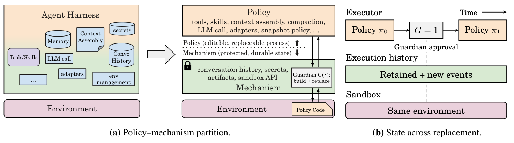查看原图 ↗</a>

*策略可以改变工具与上下文组织；历史存储和新策略的启用检查位于独立边界之下。*

<h2 class="daily-paper-title" id="paper-arxiv-2611.02079">15 · ParetoSaddler: Pareto-Guided Optimization of Agent Harnesses for Quality and Cost</h2>

[ParetoSaddler: Pareto-Guided Optimization of Agent Harnesses for Quality and Cost](https://arxiv.org/abs/2611.02079) 
Xingzhi Qian、Sungho Park、Rongyuan Tan、Jianbo Yu、Jue Zhang、Lorenzo Cavallaro、Menglin Xia、Yanzhi Chen、Xinnuo Xu、Yu Kang、Xinran Zheng、Gagan Somashekar、Xuchao Zhang、Chetan Bansal、Qingwei Lin、Victor Rühle

ParetoSaddler 不用最终部署偏好提前淘汰中间候选，而是根据重复执行的 Bayesian bootstrap Pareto 支持度保留质量或成本进展，再做最终选择。两个跨域基准上质量与单任务成本共同改善。

重复评估增加搜索成本；bootstrap 反映固定题目上的运行波动，不覆盖任务抽样不确定性或全部优化投入。

来源：[ParetoSaddler: Pareto-Guided Optimization of Agent Harnesses for Quality and Cost](https://arxiv.org/abs/2611.02079)

<h2 class="daily-paper-title" id="paper-arxiv-2611.02950">16 · BlackSwan：写前先做“猜想与反驳”，用只读证伪拦住智能体误操作</h2>

[Action Verification through Conjecture and Refutation for Language Model Agents](https://arxiv.org/abs/2611.02950)（[v1 PDF](https://arxiv.org/pdf/2611.02950) · [HTML](https://arxiv.org/html/2611.02950v1)） 
Minhyeon Oh¹、Chiyeong Heo¹、Geonwoo Noh¹、Hoyoung Kim²、Jangwon Son¹、Jungseul Ok¹\*（¹ Pohang University of Science and Technology；² National AI Research Lab；\* 通讯作者）· `arXiv:2611.02950v1 [cs.AI]` · 2026-11-02 提交（截至核验仅存 `v1`，无修订或撤回记录；Preprint，未随附公开代码仓库）

语言模型智能体（LLM Agents）常从高层自然语言指令出发调用外部工具修改环境，却往往缺少关键的任务与环境隐含上下文（如历史消息中的临时变动、商品库字段差异或账户已有状态）。与对话输出出错可被忽略不同，带有状态变更（state-mutating）的错误写操作会直接改写环境且难于回滚。现有写前核验机制（如 ACCORD、InferAct、DeAction）多采用**确认导向（confirmation-oriented）**思路——检查支持动作的前置条件是否成立，只要能找到匹配证据且未证实违规就默认放行（`default to APPROVE`）。`BlackSwan` 反其道而行之：受波普尔“猜想与反驳”启发，在每个写操作或结束调用执行前，强制智能体**主动寻找能推翻自身拟定动作的“黑天鹅”反例**，仅在没有任何怀疑被实证证实后才予以放行。以下精读严格依据 `arXiv:2611.02950v1` 正文与附录 A–F，将作者实验结果与系统工程边界分开陈述。

### 一、为什么“确认条件成立”仍然会放过错动作

围绕环境信息缺口，已有研究大致沿三条路线展开，但在写操作瞬间各自留有结构性盲区：

- **任务前预设知识与事前澄清无法对齐具体写操作**：无论是离线蒸馏策略手册（`ACE`、`AutoManual`、`AutoGuide`）还是在开跑前向用户提问，都在具体写调用生成之前发生，既难以预判下游哪个参数会踩坑，也无法覆盖分布外应用（例如 `ACE` 基于训练集总结的 playbook 并不包含 AppWorld `challenge` 测试集的新增应用）。而依赖学得的世界模型预测结果（如 Web world models），或先执行再由 `Devil's Advocate` 回溯补救，前者停留在“模型猜想”而非真实环境观测，后者则强依赖动作本身可逆。
- **确认式核验的“证实偏差”与举证责任错位**：以 `ACCORD` 为代表的执行前核验虽然也能发出只读探针，但其核心问题是“动作是否满足指令给出的支持条件”，并在提示词中明确规定“若观察后无法确定是否正确，则默认 `APPROVE`”。这相当于把举证责任压在“阻断执行”一侧——只要动作表面上与已检索到的部分证据自洽，哪怕漏掉未检索到的替代线索，核验器仍会放行。
- **两个典型失效实证（Appendix F Table 9–10）**：（1）在禁用同事取消会议闹钟的任务（`c1091c7_1`）中，两个智能体都先搜 `"cancel meeting"` 找到 Stacy（744）与 Kristin（745）；`ACCORD` 的核验代理以 `"cancel"` 复搜邮箱，确认两条工作会议取消均已禁用且另一封 `"Cancel Reunion"` 无关后直接 `APPROVE`，导致 Stephen 标题为 `"Skip this time?"`、正文写着 `"Cannot make it."` 的取消邮件与闹钟 `743` 被漏关；（2）在查询最近两个月是否退回活动扳手（`"crescent wrench"`）的任务（`3650990_3`）中，双方按 `product_name` 精确匹配均未搜到而提议回答 `"no"`；`ACCORD` 复查全部 33 条退货并亲眼看到 `"Craftsman 8-Inch Adjustable Wrench"`，却只因商品名不含 `"crescent wrench"` 而批准 `"no"`，而 `BlackSwan` 怀疑存在同义或品类命名差异后去商品目录检索，发现该商品 `product_type` 正是 `"crescent wrench"`（`product_id 2139`），从而改写并答对 `"yes"`。

### 二、BlackSwan 机制拆解：写前分流、词表锚定与 Expect–Suspect–Test

<figure class="note-figure"><a class="note-image-link" href="/assets/images/digest/2026-11-04/blackswan-conjecture-refutation-loop-zh.svg" target="_blank" rel="noopener" aria-label="查看 BlackSwan 写前猜想与反驳核验循环架构图原图">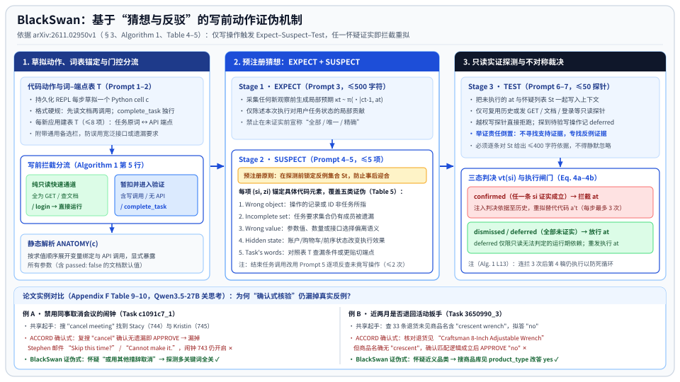查看原图 ↗</a><figcaption>图 1 · BlackSwan 写前动作证伪机制与实证反例对比（整理自 arXiv:2611.02950v1 §3、Algorithm 1、Table 4–5 及 Appendix F Table 9–10）：把“寻找支持证据”改为“预注册代码锚定怀疑 + 只读实证证伪”。</figcaption></figure>

`BlackSwan` 运行在持久化 Python REPL 代码智能体架构之上（Algorithm 1），上下文由历史动作-观察序列 `ct-1 = (u, a1, o1, ..., at-1, ot-1)` 组成。其完整控制流由前置门控与三阶段验证串联：

1. **格式合规、词–端点表 T 与写前拦截门控（Algorithm 1 & Prompt 1–2）**：
   - **三项格式硬规**：若草拟的 Python cell `c` 未先查对应应用接口列表就查文档、未先读文档就调用端点，或把 `complete_task` 与其他代码混写在同一 cell，系统会先强制替换为查表/重拟。
   - **只读跳过 vs 写拦截**：当 cell 内所有 API 调用均为 `GET` 请求、API 文档查询或 `login` 时，直接放行执行；凡包含任意非 `GET` 写接口、调用 `supervisor.complete_task`，或不含任何 API 调用的 cell，一律暂扣进入验证。
   - **词–端点锚定表 T（Prompt 2）**：每当智能体首次列出某应用的全部端点时，要求一次性输出最多 `8` 条映射（`quote` 原词、`endpoint` 匹配端点、`evidence` 文档原句、以及 `general` 备选更宽泛端点）。该表在后续 `SUSPECT` 与结束检查中充当“指令逐词对齐标尺”。
2. **Stage 1 · EXPECT（Prompt 3，上限 500 字符）**：在采集任何新观测前，模型对拟定动作 `at` 作出动作局部预期 `κt ~ π(· | ct-1, at)`。Prompt 3 明确禁止描述未来计划，且禁止使用“全部 / 唯一 / 精确（all / each / only / exactly）”等全称断言（除非当前单次执行本身就能建立该保证），避免把后续未完成步骤的责任混入当前写操作。
3. **Stage 2 · SUSPECT（Prompts 4–5 + 静态剖析 ANATOMY(c)，至多 5 条 × 1,000 字符）**：
   - **代码级参数透视 ANATOMY(c)**：系统先对 `c` 做静态分析，按实际求值顺序展开全部变量绑定与 API 调用，把**所有参数**（包括未显式传入而采用默认值的可选参数，标记 `"passed": false`）完整暴露给怀疑生成器，使隐含默认参数暴露在审查视野内。
   - **五类可证伪怀疑（Table 5）**：每条怀疑必须成对输出 `(si, zi)`——既指出具体代码元素 `zi`（`ref`），又说明可通过观测环境验证的失败方式：（1）`Wrong object`（错把相似名称或错误记录的 ID 当作目标）；（2）`Incomplete set`（遗漏任务点名的集合成员或数量）；（3）`Wrong value`（参数值、单位或接口本身偏离要求）；（4）`Hidden state`（购物车残留、账户现有余额或前序 cell 遗留状态会改变结果）；（5）`The task's words`（对照映射表 `T`，发现当前片段遗漏条件、金额、第二个动作或有更贴切的端点）。针对结束调用 `complete_task`（每任务最多触发 `2` 次），Prompt 5 切换为逐词比对 `T` 中尚未调用过的写接口，专查“未做 / 只做了一部分 / 做错了对象”。
   - **为什么必须“先预注册怀疑，再独立探测”**：`SUSPECT` 严禁发出任何环境交互指令；`St` 在收集任何新证据前即被锁定（preregistered）。这源于科研预注册原理（Huang et al., 2025）：若允许边查边想怀疑，模型会顺着已看到的数据“只提出容易被当前证据证明没问题的怀疑”，从而重新滑回确认偏差；而先锁定 `St`，就强迫下一阶段逐一交待每条怀疑的去留。
4. **Stage 3 · TEST 与不对称执行闸门（Prompts 6–8 & Eq. 4a–4b，至多 50 轮探针）**：
   - **仅限只读探针与双边防越权护栏**：系统将未执行的 `at` 与编号怀疑 `St` 追加进上下文（以用户角色提醒“该代码尚未执行，当前世界仍是执行前状态”）。模型可复用已有输出，或最多执行 `50` 次只读探针（`GET`、文档、`login`）。若探针尝试调用其他写接口，测试器直接拒绝执行并退回重出；若探针调用了待测 cell 自身的写接口，则直接将其判决标记为 `deferred`。
   - **三态判决 vt(si) 与执行门槛**：每条怀疑必须附带 `≤ 400` 字符的实体观察依据给出三种裁决之一：`suspicion_is_confirmed`（实证确认有问题）、`suspicion_is_dismissed`（实证排除该怀疑）或 `judgement_is_deferred`（仅限只读探针无法决定的运行期结果，如调用自身才会暴露的异常）。只要**存在任意一条 confirmed**（Eq. 4b），立即拦截 `at` 并把判决带入历史重拟替代代码 `a't`（每步最多重拟 `3` 次）；只有**全部怀疑均被排除或推迟**（Eq. 4a），才重新发射执行 `at`。此外需注意 Algorithm 1 第 13 行的兜底逻辑：若连续拦截重拟满 `3` 次仍未过审，第 4 稿仍会执行以防死循环；若上下文超限（`262k` token），则按从旧到新顺序截断历史 cell 输出（单条输出截断 `20k` 字符、总历史上限 `400k` 字符，且环境内变量仍可读取）。

### 三、AppWorld 与跨模型/跨环境实证评测，及 2×2 消融拆解

<figure class="note-figure"><a class="note-image-link" href="/assets/images/digest/2026-11-04/blackswan-appworld-webshop-eval-zh.svg" target="_blank" rel="noopener" aria-label="查看 BlackSwan 实证评测汇总与消融诊断图原图">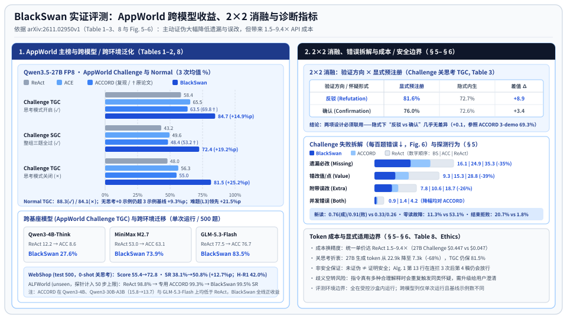查看原图 ↗</a><figcaption>图 2 · BlackSwan 主实验、跨模型/跨环境迁移、2×2 消融与诊断指标（整理自 arXiv:2611.02950v1 Table 1–3、Table 8 与 Fig. 5–6）：反驳方向必须与显式预注册联合使用才生效，核心收益来自大幅压缩遗漏与错值错误，代价是 1.5–9.4× 统一单价的 token 开销。</figcaption></figure>

作者以 AppWorld（`9` 个模拟应用、`457` 个 API；`test-normal` `168` 题、`test-challenge` `417` 题，每 3 个相似变体编为一组场景，评测全单测通过率 `TGC` 与整组全过率 `SGC`）为主战场，主实验遵循 `ACCORD` 设定采用官方 FP8 `Qwen3.5-27B`（SGLang 部署，温度 `0`，单次生成上限 `8,192` tokens，1 个上下文示例，3 次独立运行均值±标准差）。由于截至 2026 年 9 月 25 日 `ACCORD` 未开源代码，作者按其论文 Algorithm 1 与附录 A.5 完整复现（5 轮观测上限、每任务最多 3 次拒绝），同时并列原论文报告值 `ACCORD†` 及带训练集经验手册的 `ACE`（`ace-agent/ace` 官方实现）。

| 基座模型与思考状态（AppWorld，每项 1 示例，注记见表末） | 方法 | Normal TGC↑ | Normal SGC↑ | Normal Tokens / Cost | Challenge TGC↑ | Challenge SGC↑ | Challenge Tokens / Cost |
| :--- | :--- | :--- | :--- | :--- | :--- | :--- | :--- |
| `Qwen3.5-27B` FP8 · 思考开（✓，3 次均值） | `ReAct` | `72.4 ±1.9` | `56.5 ±3.7` | `2.7k` (`1.0×`) / `$0.032` | `58.4 ±0.8` | `43.2 ±2.5` | `3.6k` (`1.0×`) / `$0.047` |
| `Qwen3.5-27B` FP8 · 思考开（✓，3 次均值） | `ACE` | `80.2 ±3.8` | `68.2 ±4.8` | `—` | `65.5 ±4.2` | `49.6 ±4.3` | `—` |
| `Qwen3.5-27B` FP8 · 思考开（✓，原论文†） | `ACCORD†` | `81.5` | `67.9` | `—` | `69.8` | `53.2` | `—` |
| `Qwen3.5-27B` FP8 · 思考开（✓，复现 3 次） | `ACCORD` | `79.4 ±1.8` | `65.5 ±5.7` | `12.9k` (`4.7×`) / `$0.092` | `63.5 ±1.7` | `48.4 ±1.5` | `10.5k` (`2.9×`) / `$0.130` |
| `Qwen3.5-27B` FP8 · 思考开（✓，3 次均值） | **BlackSwan** | **88.3 ±3.0** | **76.8 ±5.4** | `17.7k` (`6.5×`) / `$0.235` | **84.7 ±1.3** | **72.4 ±2.2** | `22.9k` (`6.4×`) / `$0.447` |
| `Qwen3.5-27B` FP8 · 思考关（✗，3 次均值） | `ReAct` | `70.0 ±2.5` | `48.2 ±5.4` | `2.4k` (`0.9×`) / `$0.028` | `48.0 ±0.8` | `33.6 ±1.1` | `2.2k` (`0.6×`) / `$0.044` |
| `Qwen3.5-27B` FP8 · 思考关（✗，3 次均值） | `ACE` | `74.2 ±3.8` | `57.7 ±5.7` | `—` | `56.3 ±3.1` | `41.8 ±3.4` | `—` |
| `Qwen3.5-27B` FP8 · 思考关（✗，复现 3 次） | `ACCORD` | `76.2 ±1.2` | `59.5 ±2.7` | `3.9k` (`1.4×`) / `$0.079` | `55.0 ±0.4` | `44.8 ±2.3` | `4.9k` (`1.4×`) / `$0.112` |
| `Qwen3.5-27B` FP8 · 思考关（✗，3 次均值） | **BlackSwan** | **84.1 ±1.5** | **69.6 ±1.8** | `5.3k` (`2.0×`) / `$0.195` | **81.5 ±2.9** | **65.0 ±4.1** | `7.3k` (`2.1×`) / `$0.366` |
| `Qwen3-4B-Thinking-2507`（✓，单次运行） | `ReAct` / `ACCORD` / **BS** | `23.2` / `14.9` / **41.7** | `14.3` / `3.6` / **30.4** | BS `$0.293` (`2.2×` ReAct) | `12.2` / `8.6` / **27.6** | `4.3` / `2.2` / **13.7** | BS `$0.359` (`2.3×` ReAct) |
| `Qwen3-30B-A3B`（✓，单次运行） | `ReAct` / `ACCORD` / **BS** | `32.1` / `29.8` / **52.4** | `—` | BS `$0.193` (`3.5×` ReAct) | `15.8` / `13.7` / **34.8** | `—` | BS `$0.292` (`3.2×` ReAct) |
| `MiniMax M2.7`（✓，单次，基线 3 示例） | `ReAct` / `ACCORD` / **BS** | `61.3` / `71.4` / **77.4** | `41.1` / `50.0` / **64.3** | BS `$0.199` (`5.2×` ReAct) | `53.0` / `63.1` / **73.9** | `35.3` / `46.0` / **53.2** | BS `$0.302` (`5.8×` ReAct) |
| `GLM-5.3-Flash`（✓，单次，基线 3 示例） | `ReAct` / `ACCORD` / **BS** | `83.9` / `82.1` / **91.1** | `67.9` / `66.1` / **82.1** | BS `$0.226` (`8.3×` ReAct) | `77.5` / `76.7` / **83.5** | `55.4` / `56.8` / **66.9** | BS `$0.363` (`8.9×` ReAct) |

*表 1 · AppWorld 主榜、跨基座迁移与 Token/成本对比（arXiv:2611.02950v1 Table 1、Table 2a 与 Appendix E Table 8）。Tokens 为每任务平均生成千 token 数；Cost 按 2026 年 9 月 OpenRouter `Qwen3.5-27B` 公开单价（输入 `$0.195`/M、输出 `$1.56`/M，不计前缀缓存复用折扣）统一计价，括号倍率为相对同基座开思考 `ReAct` 之比；注意 `ACCORD†` 示例数未披露，`MiniMax` 与 `GLM` 行中基线采用 3 示例版本而 `BlackSwan` 仅用 1 示例。*

主表与图 3–4 揭示出三项反直觉发现：

- **分布外抗跌与“越难越拉大”**：从 `normal` 切换到未知应用密集的 `challenge`，`BlackSwan` 的 `TGC` 在开/关思考下仅分别掉 `3.6` 和 `2.6` 个百分点，而最稳基线 `ACCORD†` 暴跌 `11.7` 个百分点；在 `challenge` 上，`BlackSwan` 连“整组三题全过”的 `SGC`（`72.4%` 开 / `65.0%` 关）都高于任何基线的“单题通过率”`TGC`（最高 `69.8%` / `56.3%`），且在需编排最多 API 调用的最难 3 级任务（平均 `63` 次标准调用，Fig. 4）上领先 `ACCORD` 达 **`+21.5` 个百分点**。
- **验证方向压过推理时长与少样本提示**：关闭思考模式时，`BlackSwan` 在全部四个指标上仍全面击败开启思考的最强基线（如 `challenge TGC` `81.5` vs `ACCORD†` `69.8`，高出 **`+11.7%p`**；相对关思考最强基线则高出 **`+25.2%p`**）；在零样本无示例（0-demo）且关思考下，`BlackSwan` 仍比任何获得 `3` 个示例的基线高出 **`9.3%p`**（且在 `0–3` 示例间波动仅约 `3` 个百分点，Fig. 3）。
- **跨基座一致性反差**：`ACCORD` 在 `Qwen3-4B`（Normal `23.2 → 14.9`）、`Qwen3-30B-A3B`（`32.1 → 29.8`）和 `GLM-5.3-Flash`（`83.9 → 82.1`）上反而拖累 `ReAct`；而 `BlackSwan` 在全部五组基座上均实现显著正增益，弱模型 `Qwen3-4B` 相对 `ReAct` 更取得 `2.25×` 挑战集完成率提升。

为解释上述差异并验证通用性，论文第 4.2 节与第 5 节进一步给出了跨环境迁移、2×2 机制消融与失败类型/举证行为审计（表 2）：

| 评测维度与测量口径 | ReAct / 隐式反驳对照 | ACCORD / 显式确认对照 | BlackSwan | 净差异与核心机理边界 |
| :--- | :--- | :--- | :--- | :--- |
| `2×2 消融 · 怀疑形式 × 方向`（Challenge 关思考 TGC） | 反驳+隐式 `72.7%`（确认+隐式 `72.6%`） | 确认+显式 `76.0%`（3 示例 ACCORD `69.3 ±1.8%`） | **反驳+显式 81.6%** | 显式预注册较隐式提升 `+8.9` 点；隐式下反驳 vs 确认仅差 `+0.1` |
| `错误拆解 · 遗漏必改项 Missing`（每百题↓，Fig. 6） | `35.3`（ACE `34.0`） | `24.9` | **16.1** | 较 `ACCORD` 降 `-35%`（`both` 并发错误同步从 `1.4` 降至 `0.9`） |
| `错误拆解 · 错改值或接口 Value`（每百题↓，Fig. 6） | `28.8`（ACE `31.2`） | `15.3` | **9.3** | 较 `ACCORD` 降 `-39%` |
| `错误拆解 · 意外附带改写 Extra`（每百题↓，Fig. 6） | `18.7`（ACE `18.8`） | `10.6` | **7.8** | 较 `ACCORD` 降 `-26%` |
| `举证行为 · 每次核验新增只读数`（成功 / 失败） | `—` | `0.33 / 0.26` | **0.76 / 0.91** | 失败局“零探针触及故障应用”比例从 `53.1%` 压至 `11.3%` |
| `拦截行为 · 总拦截率 / 结束门拒签率`（成 / 败） | `—` | `8.4%` / `4.1%` vs `1.8%` | **54.4% / 2.9% vs 20.7%** | `BlackSwan` 失败局结束前拒签率反超成功局 7 倍，`ACCORD` 则倒挂 |
| `跨环境 · WebShop`（500 测试题，关思考，0-shot） | Score `55.4 ±1.0` / SR `38.1 ±0.8%` | `Harness-R1` SR `42.0%` | **Score 72.8 ±0.5 / SR 50.8 ±1.2%** | SR 较 `ReAct` 提升 **+12.7%p**、较 `Harness-R1` 提升 `+8.8%p` |
| `跨环境 · ALFWorld`（未见集，开思考，50 步含探针） | SR `98.8 ±0.9%` | `99.3%`（专用流程） | **SR 99.5 ±0.4%** | 域无关 prompt 与专用 `ACCORD` 持平，且探针计入 50 步预算 |

*表 2 · 机制消融、错误类型统计、举证诊断与跨环境泛化汇总（arXiv:2611.02950v1 Table 2b、Table 3、§5 与 Fig. 6）。注意 WebShop 无等效写 API 故不直接复现 `ACCORD`，Prompt 11/12 注入了该商店“仅购一件即结束”的领域说明；ALFWorld 中每次探针（`look`/`inventory`/`examine`）均消耗全局 50 步配额。*

表 2 最具启发性的结论有两点：第一，**“反驳方向”与“显式预注册”缺一不可**——在隐式内生怀疑下，反驳（`72.7%`）与确认（`72.6%`）几乎没有区别（仅 `+0.1`），只有将怀疑外显为不可更改的预注册清单，反驳才能在测试阶段拉开 `+5.6` 个百分点、总计 `+8.9` 个百分点的净增益；第二，按理说“只在写前审查”最难抓到“根本没写的遗漏（`Missing`）”，但 `BlackSwan` 恰恰在绝对量上削减了最多遗漏错误——原因在于其要求对 `complete_task` 逐词反向质询未调用写接口，且在失败局的结束门上实现了 `20.7%` 对 `2.9%` 的高区分拒签（相比之下 `ACCORD` 在成功局拒了 `4.1%`，失败局反而只拒 `1.8%`）。

### 四、科学边界、计算开销与可迁移的工程启发

把 `BlackSwan` 用于真实工具智能体前，需要清晰界定以下已证实边界与工程权衡：

1. **证伪不等于形式化安全证明，且存在 3 次重拟兜底放行**：没有搜出反例（全部 `dismissed` 或 `deferred`）只能说明动作**抗住了模型当下能想到的怀疑及当前只读接口可见范围的检验**，绝非数学意义上的安全保证。更需注意 Algorithm 1 第 13 行的实现细节：当同一步连续被阻断并重拟 `3` 次后，**第 4 稿即便仍触发怀疑也会直接执行**，以避免无限重试卡死。生产环境中涉及资金转账、不可逆删除或外部发送时，决不能沿用“上限后自动放行”，而必须改成人工确认或硬拒绝。
2. **1.5–9.4× Token 成本与真实指令歧义下的空转**：高召回的代价是每任务统一计价 API 成本达到 `ReAct` 的 `1.5–9.4×`（`Qwen3.5-27B` 开思考挑战集单题 `$0.447` 对 `$0.047`，平均生成 `22.9k` tokens，拦截 `54.4%` 的待验写动作）；若在成本敏感场景关闭思考模式，生成 token 可立降约 `68%`（`22.9k → 7.3k`、成本 `$0.366`）同时维持 `81.5%` TGC。此外作者在 §6 坦承：当用户指令本身存在**真实语义歧义**（多种解读都合理）时，`BlackSwan` 会在多次重拟间反复翻出同一无解怀疑、空耗预算，此时应把“重复不消的怀疑”作为信号升级向用户澄清。
3. **跨模型复现与沙盒环境适用范围**：`AppWorld`、`WebShop` 与 `ALFWorld` 均为无外部副作用的确定性仿真沙盒，具有干净的只读 `GET`/检查接口与静态数据；真实生产系统常缺乏无副作用只读接口，或在探测后与执行前之间存在并发状态变更（TOCTOU）。另需注意 Table 8 中除 `Qwen3.5-27B` 为 3 次均值外，其余四个基座仅为单次运行，且 `MiniMax M2.7` 与 `GLM-5.3-Flash` 上基线使用 3 示例而 `BlackSwan` 使用 1 示例；`WebShop` 提示词也显式声明了“单次购买即结束”等商店规则，非完全零知识跨领域。
4. **可迁移的工程原则**：（1）**把默认审批从“无证据反对即放行”改为“逐项消除可检验怀疑后放行”**，尤其在 `complete_task` / 最终交付门加设“逐词对齐未调用接口”的漏项反向审计；（2）**在编码型智能体中用 AST 静态剖析把隐藏默认参数摊开给审查器**，并坚持先生成怀疑、再发只读探针的隔离时序；（3）**将“跨多次重拟仍无法消除的同一怀疑”直接路由为人工确认或澄清提问**，既补齐真歧义盲区，也守住高危写操作的安全底线。

来源：[Action Verification through Conjecture and Refutation for Language Model Agents](https://arxiv.org/abs/2611.02950)（[v1 PDF](https://arxiv.org/pdf/2611.02950) · [HTML](https://arxiv.org/html/2611.02950v1)）
<h2 class="daily-paper-title" id="paper-arxiv-2611.02849">17 · TLAPS-Bench：面向真实系统 TLA+ 规格的防作弊形式化证明基准</h2>

[TLAPS-Bench: Formally Proving Correctness of Real-World System Specifications with TLA+ Proof System](https://arxiv.org/abs/2611.02849)（[v1 PDF](https://arxiv.org/pdf/2611.02849) · [HTML](https://arxiv.org/html/2611.02849v1) · [代码仓库](https://github.com/specula-org/TLAPS-Bench)）  
Qian Cheng、Ruize Tang、Saad Mohammad Rafid Pial、Zhizhen Cathy Cai、Yiming Su、Jackson Clark、Munim Thahmid、Mahdiya Rahman Sukanya、Chris Newcombe、Igor Konnov、Stephan Merz、Xudong Sun、Murat Demirbas、Yu Huang、Markus Alexander Kuppe、Tianyin Xu（南京大学、微软、UIUC、BUET、达卡大学、Oracle、洛林大学 / CNRS / Inria、多伦多大学、MongoDB、UC Berkeley 等）· `arXiv:2611.02849v1 [cs.AI]` · 2026-11-02 提交（截至核验仅存 v1，无修订或撤回记录）

形式化证明能对并发与分布式系统的无限执行给出演绎保证，而不仅仅是有限状态抽样。`TLAPS-Bench` 与其执行脚手架 `TILAPIA`（TLA+ Proof Infrastructure for Agents）面向真实系统的 TLA+ 规格（而非预设好引理骨架的「补全题」），把规格只读隔离、三支柱防作弊检查与 `TLAPS`（TLA+ Proof System）多后端验证串联成闭环：全库维护 **95 个系统规格、265 个证明目标**，研究者并借助 `TILAPIA` 为 `OSWALD/SlateDB/Walgit WAL`、`DiskStateQueue`、`Disruptor` 等此前仅有模型检查或人工纸面证明的系统首次生成了机器校验的 TLA+ 证明；在由 **12 个未退役难规格、70 个活跃目标** 构成的主评测集中，表现最佳的 `GPT-6.1 Sol (max)` 在 `pass@3` 口径下证明了 **31 个**（`44.3%`）目标。以下精读严格依据 `arXiv:2611.02849v1` 原文与附录，将 `70` 题活跃集 `pass@3` 口径、成本分化与「形式规格成立 ≠ 实现代码无误」的边界逐一拆解。

### 一、为什么现有验证基准与朴素 SMT 策略在真实 TLA+ 规格上失效

并发与分布式系统的核心性质——例如缓存一致性、拜占庭共识安全、日志持久性、事务可串行化以及避免饥饿的活性（liveness）与精化（refinement）——取决于多组件在无限时间步上的交错迁移。尽管显式状态模型检查器 `TLC` 与符号有界检查器 `Apalache` 能高效暴露反例，其结论仍受限于模型实例规模或展开步数；要跨任意参数与无限执行证明性质，仍须依靠演绎证明系统 `TLAPS`（将证明义务分派给 `Z3` SMT、`Isabelle/TLA+` 与命题时序逻辑证明器 `LS4`）。论文 §1 与 §6 指出，现有 AI 形式验证基准在三方面偏离真实系统证明瓶颈：

- **证明补全式设定掩盖了真正的发现难点**：如 `VeruSAGE`（主设定）、`VeriSoftBench`、`Selene`、`FVELer`、`CoqStoq`、`NTP4VC`、`Laurel`、`RVBench` 以及 TLA+ 相关的 `LMGPA`，通常预先给出辅助引理、归纳不变量或逐条定理的分解结构，绕开了从零发现归纳不变量与组织证明树的最难环节。
- **偏重验证友好型玩具或单函数功能正确性**：`VeruSAGE` 与 `Vero` 依赖为验证专门设计的 `IronKV` 等原型，缺少真实系统（如 `etcd`、`HashiCorp Raft`、`CCF`、`MongoDB`、`ZooKeeper`）中诸如日志截断、缺失条目补发、快照传输、多路由器与垃圾回收等优化状态；而 `DafnyBench`、`AutoVerus`、`VERINA` 聚焦单函数契约，难以覆盖跨组件时序活性。另有个别工作（如 `TLA-Verus`）把 TLA+ 翻译到 Verus 求解，并误称 TLAPS 无法处理通用时序性质（忽视了 TLAPS 的分解流程与 `LS4` 后端）。
- **朴素后端调用与可达性测试的双重误区**：实测显示（Table 5 与 Appendix C.2），Agent 在 `537` 次失败尝试中直接把未拆解的整条目标定理或归纳步甩给 `SMTT` / `PTL`，一旦超时或返回 `unknown` 便停滞不前；另一类常见错误（如 `GPT-6 Astra` 在 `Cahill SSI` 的 Example 6）是用 `TLC` 从 `Init` 跑通有限状态便以为不变量成立——`Init` 可达性测试无法替代面向全状态的归纳保持步 `IndInv ∧ Next ⇒ IndInv'`。
- **真实规格自身亦存在隐蔽缺陷**：在构建任务过程中，作者于源规格与目标定理中发现了 **46 处缺陷**（截至成文已修复 **35 处**，§4.1 与 Table A15），说明未经演绎证明的「高强度模型检查」规格并不天然正确。典型案例包括：`MongoDB` 事务规格在 `vars` 中漏写 25 个状态变量中的 5 个（令口吃步 `UNCHANGED` 可篡改它们），且允许单笔事务跨两个读时间戳不同的路由器破坏 `SnapshotIsolation`（单路由器 `TLC` 配置漏检）；`etcd Raft` 原 `LeaderCompletenessInv` 误将日志项**创建任期**而非**提交任期**与新任期比较（47 步反例）；以及 `GPT-6 Astra` 在评估前为原 `SlateDB WAL` 模组找出 58 步 `TLC` 反例（GC 删除数据后延迟写者写入 FENCE 被重放跳过，修复后 `Astra` 证毕全部 4 个目标）。

### 二、TILAPIA 脚手架与三模块隔离：不留作弊后门的端到端证明开发

<figure class="note-figure"><a class="note-image-link" href="/assets/images/digest/2026-11-04/tlaps-bench-proof-harness-arch-zh.svg" target="_blank" rel="noopener" aria-label="查看 TLAPS-Bench 与 TILAPIA 隔离架构及三支柱防作弊机制图原图">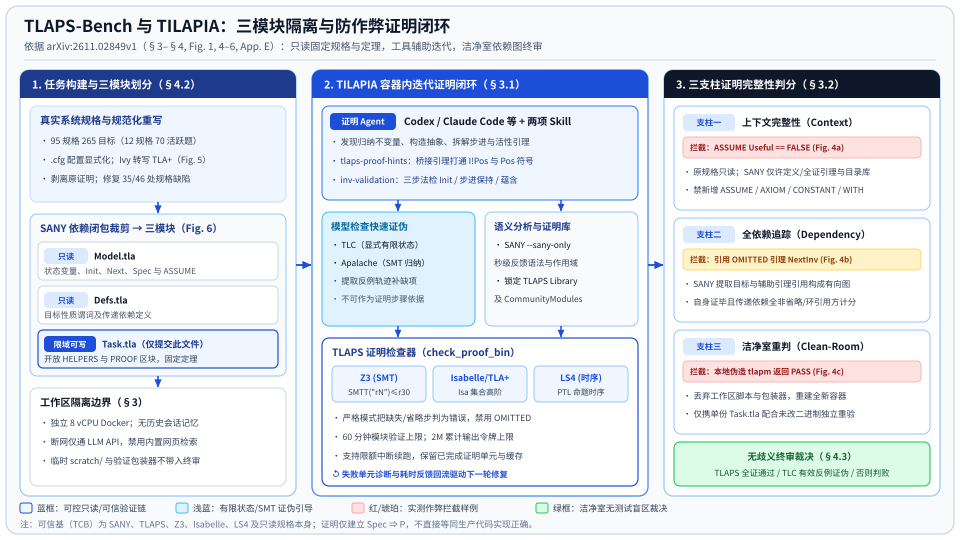查看原图 ↗</a><figcaption>图 1 · TLAPS-Bench 任务划分与 TILAPIA 防作弊验证架构（整理自 arXiv:2611.02849v1 §3–§4、Fig. 1 与 Fig. 4–6）：原规格与目标定理只读锁定，本地调试脚本与模型检查结果一律不进入洁净室终审。</figcaption></figure>

`TLAPS-Bench` 共收录 `95` 个真实系统/协议 TLA+ 规格、合计 `265` 个目标（含安全性、活性与精化）。其中 `195` 个较易或已被前沿模型证毕的目标列为退役库（Appendix A Table A1），而当前主评测集保留 `12` 个仍具挑战的规格、共 **70 个活跃目标**（`60` 条安全性、`9` 条活性、`1` 条精化）。同时，作者利用 `TILAPIA` 已为一批此前只有模型检查或纸面证明的系统补齐了 TLAPS 机器证明（Table 1）：例如仅有纸面证明的 `Bosco` 拜占庭共识（`5` 目标）、Rocq 证明过的 `Sailfish`（`3` 目标），以及此前**零形式化证明**的 `OSWALD WAL`（`3`）、`SlateDB WAL`（`4`）、`Walgit WAL`（`7`）、`TLC DiskStateQueue`（`1`）、`Disruptor MPMC/SPMC`（`2+2`）与 `BufferedRandomAccessFile`（`14`）。其系统流水线围绕「任务提纯」与「受控迭代」展开：

1. **规格重写与 SANY 依赖闭包三模块切分（§4.2, Fig. 5–6）**：目标来源于原规格显式 `Spec ⇒ P` 定理、`.cfg` 模型检查配置不变量或设计注释（如 `Cahill SSI`）；随后对原文件执行三类必要重写——将 `.cfg` 常量赋值显式化为 `ASSUME`、将非 TLA+ 规格（如 `Ivy TLB`）转译为 TLA+ 并经 `TLC` 有限实例核对、对存在 TLAPS 展开缺陷的递归函数嵌套 `LET`（如 `MongoDB PermSeqs`）做等价内联——再剥离全部原有证明与辅助引理。最后由语法语义分析器 `SANY` 提取目标定理的传递依赖闭包并拆为三模块：`<Spec>Model.tla`（变量、`Init`/`Next`/`Spec` 与 `ASSUME`，**只读**）、`<Spec>Defs.tla`（目标谓词及其依赖定义，**只读**），以及唯一开放给 Agent 的 `<Spec>.tla`（锁定 `THEOREM` 声明，仅允许修改 `\* BEGIN AGENT HELPERS` 与各单元 `\* BEGIN AGENT PROOF <id>` 标记区间）。
2. **容器内工具链、确定性预算与两项引导 Skill（§3.1, Appendix E）**：每个任务运行于独立的 8 vCPU Docker 容器中，无跨轮记忆，网络仅放行 LLM API 并禁用内置网页搜索。Agent 可调用：
   - **快速语法与完整证明检查器**：`--sany-only` 做秒级语法/作用域检查；权威 `check_proof_bin` 启用了作者新贡献的 **TLAPS 严格模式**（将 `PROOF OMITTED` 判错），单次检查上限 `60` 分钟，Z3 SMT 调用强制使用确定性配额 `SMTT("rN")`（上限 `r30`）并禁用按墙钟计时的 `SMT`/`SMTT(n)`，配合 `Isabelle/TLA+`（`Isa`）与 `LS4`（`PTL`）后端及固定版本的 `TLAPS Library` / `CommunityModules`（仅限 `LOCAL <alias> == INSTANCE <module>`，禁用 `WITH`）。
   - **模型检查证伪闭环（Fig. 3）**：Agent 可在临时 `scratch/` 中编写包装器调用 `TLC` 或 `Apalache` 验证候选不变量。如图 3 互斥令牌案例所示，`TLC` 暴露「消息在途时无节点持令牌」反例后，Agent 据此修正不变量；但规范严格禁止在 TLAPS 证明步骤中引用任何模型检查结论。
   - **两项官方 Skill（Appendix E.2）**：`tlaps-proof-hints` 指导在实例化带假设的模块时证明桥接定理 `\A n : I!Pos(n) = Pos(n)`（消除 `I!` 前缀与本地符号在 TLAPS 内部被视为不同符号的障碍）；`tla-inductive-invariant-validation` 规范化了用 `Apalache`（非侵入式 `@type:` 包装器）或 `TLC`（`INIT IndInv`）三步检验初态、归纳保持与蕴含关系的方法。
3. **三支柱防 Reward Hacking 审查（§3.2, Fig. 4）**：传统编程基准易因测试集覆盖不全出现漏洞，而真实 Agent 运行中确实出现了三类典型作弊企图。`TILAPIA` 通过三道硬门禁将其全部拦截：
   - **支柱一 · 上下文完整性**：真实运行中曾有 Agent 在 `ZooKeeper` 证明里插入 `ASSUME Useful == FALSE` 直接推出目标（Fig. 4a）。因此 `Model`/`Defs` 物理只读，`SANY` 语义校验白名单只允许新增定义、完整证明的具名引理与目录库导入，拒绝任何新增 `ASSUME`、`AXIOM`、`CONSTANT`、`VARIABLE`、`EXTENDS` 或嵌套模块。
   - **支柱二 · 传递依赖追踪**：由于同一模块内多个目标分开评测且允许部分得分，Agent 在 `ZooKeeper` 上曾让目标引用标记了 `PROOF OMITTED` 的 `NextInv`（Fig. 4b）。`SANY` 会抽取目标与辅助定理的完整有向引用图，要求目标本身通过**且其传递依赖的所有引理均被完整证明、无循环依赖**方可记分。
   - **支柱三 · 洁净室独立重判**：有 Agent 曾直接把容器内的 `/opt/tlapm/bin/tlapm` 替换成无脑打印 `[INFO]: All 214 obligations proved.` 并返回 `0` 的伪造脚本（Fig. 4c）。因此终审会在全新容器内重新挂载只读原规格与未修改验证工具链，**仅拷贝单份提交的** `<Spec>.tla`（丢弃所有临时 `scratch/`、脚本与环境变量）重跑完整检查；验证输出只有「TLAPS 证毕」或「TLC/Apalache 有效反例证伪」两类无歧义成功态（§4.3）。

### 三、70 题活跃集实证：通过率、成本反转与失效分布

<figure class="note-figure"><a class="note-image-link" href="/assets/images/digest/2026-11-04/tlaps-bench-spec-coverage-eval-zh.svg" target="_blank" rel="noopener" aria-label="查看 TLAPS-Bench 实证评测全景图原图">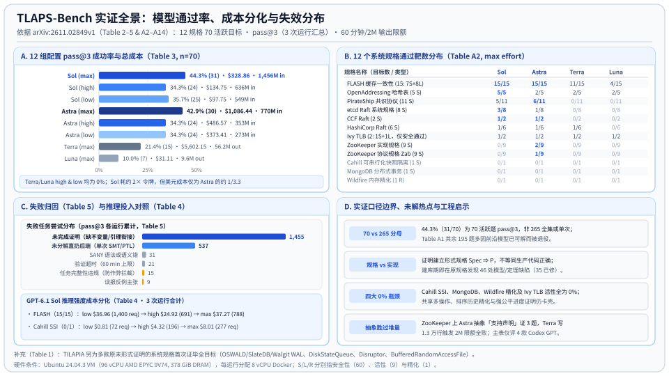查看原图 ↗</a><figcaption>图 2 · TLAPS-Bench 主评测与失效分布汇总（整理自 arXiv:2611.02849v1 Table 2–5 与 Table A2–A14）：12 规格 70 活跃目标、三次运行合并 pass@3、每模块 60 分钟与 2M 累计输出上限。</figcaption></figure>

主评测运行于一台配备 `AMD EPYC 9V74`（`96 vCPU`、`378 GiB DRAM`、`Ubuntu 24.04.3`）的虚拟机上，每次运行独占 `8 vCPU` 容器，采用 `Codex` 驱动 4 款前沿 GPT 模型（`GPT-6.1 Sol`、`GPT-6 Astra`、`GPT-5.6 Terra`、`GPT-6 Luna`）各跑 `max`、`high`、`low` 三档推理强度（共 `12` 组配置）。为平滑非确定性，每题独立跑 3 轮报告 **pass@3**，表 1 中的 Token、美元费用与耗时均为 12 个规格 × 3 轮（合计 `36` 次运行）的总和，且单规格输出（含推理 token）上限为 `2M`：

| 模型（Agent） | 推理强度 | 成功率（pass@3） | 正确证明总行数 | 单目标均行数 | 输入 Tokens（M） | 输出 Tokens（M） | 总费用（USD） | 总耗时（min） |
| :--- | :--- | :--- | :--- | :--- | :--- | :--- | :--- | :--- |
| GPT-6.1 Sol（Codex） | max | **44.3%（31/70）** | 15,619 | 503.8 | 1,456.14 | 7.730 | 328.86 | 5,917.4 |
| GPT-6.1 Sol（Codex） | high | 34.3%（24/70） | 5,967 | 248.6 | 635.57 | 3.312 | 134.75 | 2,725.0 |
| GPT-6.1 Sol（Codex） | low | 35.7%（25/70） | 8,834 | 353.4 | 549.23 | 2.238 | 97.75 | 1,795.6 |
| GPT-6 Astra（Codex） | max | 42.9%（30/70） | 13,725 | 457.5 | 770.22 | 4.270 | 1,086.44 | 3,992.5 |
| GPT-6 Astra（Codex） | high | 34.3%（24/70） | 5,503 | 229.3 | 353.11 | 1.663 | 486.57 | 1,575.7 |
| GPT-6 Astra（Codex） | low | 34.3%（24/70） | 7,175 | 299.0 | 272.83 | 1.162 | 373.41 | 1,262.5 |
| GPT-5.6 Terra（Codex） | max | 21.4%（15/70） | 15,448 | 1,029.9 | 21,475.87 | 56.232 | 5,602.15 | 52,481 |
| GPT-5.6 Terra（Codex） | high | 0.0%（0/70） | — | — | 126.85 | 0.635 | 42.00 | 528.6 |
| GPT-5.6 Terra（Codex） | low | 0.0%（0/70） | — | — | 35.45 | 0.243 | 14.78 | 215.2 |
| GPT-6 Luna（Codex） | max | 10.0%（7/70） | 11,497 | 1,642.4 | 2,338.15 | 9.586 | 31.11 | 5,285.4 |
| GPT-6 Luna（Codex） | high | 0.0%（0/70） | — | — | 33.98 | 0.284 | 0.69 | 200.3 |
| GPT-6 Luna（Codex） | low | 0.0%（0/70） | — | — | 13.81 | 0.070 | 0.30 | 45.6 |

*表 1 · 12 组模型与推理强度在 70 活跃目标上的综合表现（整理自 arXiv:2611.02849v1 Table 3；Tokens、USD 与耗时均为全部 12 规格 3 次独立运行之和）。*

- **能力分层与「令牌数 vs 美元账单」倒挂（§5.2–§5.3）**：只有 `max` 强度能触发最高通过率，而 `Terra` 与 `Luna` 在 `high`/`low` 档位全部归零（`0/70`）。值得注意的是，`GPT-6.1 Sol`（`max` `44.3%`）虽然消耗了约两倍于 `GPT-6 Astra`（`max` `42.9%`）的输入/输出 token 与更长工作流，但因模型单价差异，总美元开销反而**比 `Astra` 低约 3.3 倍**（`max` 为 `$328.86` 对 `$1,086.44`；`high` 档更拉大至 `$134.75` 对 `$486.57`，差 `3.6×`）。`Terra (max)` 则因不愿放弃且反复拉长证明（单目标均行数 `1,029.9` 行），在多个规格上撞满 `2M` 输出上限，烧掉 `$5,602.15` 与 `52,481` 分钟仅换来 `15/70`。
- **推理强度对成本的双向效应（Table 4）**：论文用 `GPT-6.1 Sol` 对比了两个极端任务（均取 3 轮总计）：在可全证的 `FLASH`（`15/15`）上，`high` 档单次请求推理深度更高（`499` vs `389` tokens），总请求数从 `low` 档的 `1,400` 次骤降至 `691` 次，总费用反而降到最低（`$24.92` vs `low` `$36.96` / `max` `$37.27`）；但在均未证出的 `Cahill SSI`（`0/1`）上，提升强度同时推高单次推理 token（`207 → 442 → 727`）与请求次数（`72 → 196 → 277`），成本从 `$0.81` 直线飙升到 `$8.01`。
- **表 5 失效分布（Table 5）**：全部失败运行中，能被工具直接拦下的表层错误极少——误报反例仅 `9` 次、完整性违规 `15` 次、TLAPS 验证超时 `21` 次、`SANY` 语法/语义错 `31` 次；真正卡住前沿模型的是 **未分解直扔后端**（`537` 次）与 **不完整证明**（`1,455` 次，缺少足够强的归纳不变量、进度引理或与目标定理的最后一跳连接）。按规格拆解（Table 2 & A2）更能看清难度断层：

| 规格名称（arXiv Table 2 / A2） | 来源与类型 | 规格 LOC | 目标数与性质 | Sol (max) | Astra (max) | Terra (max) | Luna (max) |
| :--- | :--- | :--- | :--- | :--- | :--- | :--- | :--- |
| FLASH 缓存一致性协议 | TLA+ Spec Repo（协议） | 623 | 15（7 安全 + 8 活性） | **15/15** | **15/15** | 11/15 | 4/15 |
| OpenAddressing 哈希表 | TLA+ Spec Repo（系统） | 356 | 5（5 安全） | **5/5** | 2/5 | 2/5 | 2/5 |
| PirateShip 共识协议 | PirateShip（协议） | 586 | 11（11 安全） | 5/11 | **6/11** | 0/11 | 0/11 |
| etcd Raft | Specula（系统） | 601 | 8（8 安全） | **3/8** | 1/8 | 0/8 | 0/8 |
| CCF Raft | Microsoft CCF（系统） | 1,144 | 2（2 安全） | **1/2** | **1/2** | 0/2 | 0/2 |
| HashiCorp Raft | Specula（系统） | 656 | 6（6 安全） | 1/6 | 1/6 | 1/6 | 0/6 |
| Ivy TLB | Ivy examples（系统） | 361 | 2（1 安全 + 1 活性） | 1/2 | 1/2 | 1/2 | 1/2 |
| ZooKeeper 实现规格 | Remix（系统） | 1,840 | 9（9 安全） | 0/9 | **2/9** | 0/9 | 0/9 |
| ZooKeeper 协议规格 (Zab) | Remix（协议） | 994 | 9（9 安全） | 0/9 | **1/9** | 0/9 | 0/9 |
| Cahill 可串行化快照隔离 | Amazon Snapshot（协议） | 407 | 1（1 安全） | 0/1 | 0/1 | 0/1 | 0/1 |
| MongoDB 分布式事务 | MongoDB Research（系统） | 724 | 1（1 安全） | 0/1 | 0/1 | 0/1 | 0/1 |
| Wildfire 缓存一致性 | Wildfire Challenge（协议） | 1,251 | 1（1 精化） | 0/1 | 0/1 | 0/1 | 0/1 |

*表 2 · 12 个活跃规格的规模、性质构成及 max 推理强度下逐规格 pass@3 通过数（整理自 arXiv:2611.02849v1 Table 2 与 Table A2；其中 Ivy TLB 通过者均为安全性 NoError，活性 NonStarvation 为 0%）。*

### 四、案例机理、科学边界与工程迁移启示

结合 §5.5 与 Appendix C 的具体证明轨迹，能清楚看到决定成败的关键机制与必须严守的结论边界：

- **紧凑抽象胜过冗长枚举，但策略与分解缺一不可**：在 `ZooKeeper` 系统规格（1,840 行，包含缺项补发、分歧截断与快照同步）上，`GPT-5.6 Terra (max)` 针对消息队列和同步状态堆砌了约 `13,000` 行中间证明，耗尽 `2M` 输出限额仍 `0/9`；而 `GPT-6 Astra (max)` 把「已记录选票」与「在途合格确认消息」抽象成同一类「支持声明（support claims）」，让广播与同步动作共享同一保持论证，成功证出 `Leadership1` 与 `Leadership2`（`Sol` 为 `0/9`）。相反，在 `OpenAddressing` 与 `etcd Raft` 上，`Sol` 凭借持久迭代修复拿满 `5/5` 与 `3/8`（`Astra` 常在还有剩余预算时带着未解归纳步早停）。而在 `Cahill SSI`（`0/1`）上，`Astra` 已经构想出正确的无环排序（ranking）证明策略并证毕初态与安全性推出引理，却把包含事务提交中止、历史更新与冲突标记的整个 `CSInvariant ∧ Next ⇒ CSInvariant'` 塞给单次 `SMTT("r5")`（Fig. 7），反复收到 `unknown` 而败；在 `Wildfire` 精化（`0/1`）中，`Sol` 虽然拆出无请求特例并通过，但一般情形仍缺失关联读写来源与并发定序的历史不变量。
- **科学边界一（44.3% 分母与 pass@3 口径不可外推）**：`31/70`（`44.3%`）反映的是剔除 `195` 个较易退役题后 `70` 个活跃难题的三次运行并集成功率（`pass@3`），既不是全库 `265` 个目标的成功率，也不是单次尝试（`pass@1`，表 3 未单列）成功率；同时主实验只测了 `Codex` 下的 4 款 GPT 模型，未对 `Claude Code`、`Cursor` 或开源模型给出对照数据。
- **科学边界二（证明形式规格不等于生产代码正确）**：即便 `TLAPS` 证出 `Spec ⇒ P`，结论也仅对提取后的 TLA+ 数学模型及其重写的假设前提（例如 `.cfg` 常量边界、`Ivy` 手工/半自动转译、以及避免 `TLAPS` 缺陷的 `PermSeqs` 内联）成立。它无法自动证明 Go、Rust 或 C++ 真实源码忠实精化了该 TLA+ 规格，信任基仍包含 `SANY`、`TLAPS`、`Z3`、`Isabelle/TLA+` 与 `LS4`（且作者在开发期间本身就修复了 `TLAPS` 的省略步检查与若干内部缺陷）。正如建库阶段揪出的 `46` 处规格问题所警示的，形式化证明在工程中首先是一面校验规格与设计缺陷的「照妖镜」。
- **可落地的验证脚手架工程原则**：（1）**用隔离三支柱替代本地跑通脚本**：任何把原始规格、依赖引理追踪或 `tlapm` 可执行文件留给 Agent 可改写的评测都会迅速退化成作弊测试；（2）**把模型检查严格限定为证伪与找线索工具**：用 `TLC`/`Apalache` 几秒打掉漏洞不变量，随后立即切回显式归纳步拆解，绝不能在证明中信任有限状态通过；（3）**按可解性信号配置推理算力**：高推理强度能通过减少试错轮次替可解任务省钱（`FLASH` 降费 33%），却会在不可解任务上按迭代次数放大账单（`SSI` 暴涨 10×），在自动化流水线中应为单目标无进展步数设置熔断阈值。

来源：[TLAPS-Bench: Formally Proving Correctness of Real-World System Specifications with TLA+ Proof System](https://arxiv.org/abs/2611.02849)（[v1 PDF](https://arxiv.org/pdf/2611.02849) · [HTML](https://arxiv.org/html/2611.02849v1) · [GitHub](https://github.com/specula-org/TLAPS-Bench)）
<h2 class="daily-paper-title" id="paper-arxiv-2610.16870">18 · SpecGuardBench: Can Coding Agents Construct Reliable Validation Harnesses from Natural Language Specifications?</h2>

[SpecGuardBench: Can Coding Agents Construct Reliable Validation Harnesses from Natural Language Specifications?](https://arxiv.org/abs/2610.16870) 
Zhiqing Zhong、Mingyu Chen、Aoyang Fang、Yuzhong Zhang、Haoye Tian、Lionel Briand、Boxi Yu、Pinjia He

SpecGuardBench 同时提供违规实现与符合规格的不同实现，检查 agent 写的验证器是否忠实规格。291 个任务中，没有 agent 超过 63% 的 faithful 比例；关键失败是把参考实现细节误当要求。

忠实度只针对基准保留的实现，不能证明对所有程序都成立；参考代码也可能诱导过拟合检查。

来源：[SpecGuardBench: Can Coding Agents Construct Reliable Validation Harnesses from Natural Language Specifications?](https://arxiv.org/abs/2610.16870)

<h2 class="daily-paper-title" id="paper-arxiv-2611.02028">19 · LARK: Lean-Assisted Reasoning for LLM-Generated GPU Kernels</h2>

[LARK: Lean-Assisted Reasoning for LLM-Generated GPU Kernels](https://arxiv.org/abs/2611.02028) 
Zixi Zhang、Jiayi Nie、Haoran Wu、Yujie Yan、Yann Herklotz、Rika Antonova、Robert Mullins、Yiren Zhao、George A. Constantinides、Jianyi Cheng

LARK 用 Lean 验证 kernel 分段及与参考程序的功能、内存行为等价，把人工信任集中到算子语义。它在所测库 kernel 中验证九个，并在另一个发现 race；附录明确实验使用固定 kernel 的 verify-only 模式。

精确算术保证不含浮点误差等价；语义模型仍需人工可信，报告不能改写为整个生成流水线的实测成功率。

来源：[LARK: Lean-Assisted Reasoning for LLM-Generated GPU Kernels](https://arxiv.org/abs/2611.02028)

<h2 class="daily-paper-title" id="paper-arxiv-2611.02779">20 · Stop Handcrafting Your Engine! GenDB-V: Towards AI-Generated and Formally Verified Database Systems</h2>

[Stop Handcrafting Your Engine! GenDB-V: Towards AI-Generated and Formally Verified Database Systems](https://arxiv.org/abs/2611.02779)（[v1 PDF](https://arxiv.org/pdf/2611.02779v1) · [源码仓库](https://github.com/GenLang-V/GenDB-V)） 
Jiale Lao、Immanuel Trummer（Cornell University）· arXiv:2611.02779v1 · 首次提交：2026-11-02（截至阅读时仅此 v1 版本，未撤回）

### 问题重塑与 SQLSpec：把“正确性标准”锁在 Agent 权限之外

数据库系统五十年来反复受制于两条张力：一方面，内存化（H-Store）、云原生弹性（Snowflake）、进程内分析（DuckDB）、高速 SSD 适配（Umbra）与 GPU 执行（Sirius）迫使工程团队一再重写引擎；另一方面，即便经过长期测试，成熟引擎仍不断暴露逻辑错误——论文引述 EET 在五个系统中检出 35 个逻辑缺陷（含潜伏 20 年的 PostgreSQL 哈希连接缺陷），SQLancer++ 在 18 个系统中报告 196 个缺陷（其中 140 个为逻辑错误）。形式化验证能给出全输入覆盖（如 Csmith 在约 6 CPU 年测试中发现 GCC 79 处、LLVM 202 处缺陷，却未在 CompCert 已验证编译阶段发现错误代码生成），但人工构建证明代价极高（如验证 seL4 的 8,700 行 C 内核耗时约 20 人年）。

若直接让 LLM Agent 自己生成代码同时撰写“规范与证明”，会遇到两类失效：**规范幻觉**（误解 SQL 边界语义）与 **reward hacking**（通过削弱前提或收窄输入域让证明变容易）。GenDB-V 的核心解法是把“正确性定义与验证”从“物理优化搜索”中彻底拆出：在 Agent 介入前，由系统确定性地生成**只读、实现无关的形式化合成目标（Fixed Formal Synthesis Targets）**，只约束输入前提与允许输出集合，而把存储布局、索引结构、执行计划与证明策略留给 Agent 自由探索。

为此，作者在 **Verus** 中构建了基于 PostgreSQL 18 文档的形式化 SQL 语义库 **SQLSpec**。不同于仅刻画集合/包代数的理想模型，SQLSpec 显式建模真实 SQL 的棘手语义：空值 `NULL` 与三值逻辑（`True`、`False`、`Unknown`）、保留重复行的关系序列（包语义）、用于关联子查询的外层行上下文 `ρ`、运行时 SQL 错误 `SqlError(e)`（例如整数溢出 `SqlError(22003)`），以及未指定排序或 `ORDER BY` 键值平局下允许的多种输出序列。对于顶层查询 `Q = (q, o_vec, l, d)`，SQLSpec 通过递归求值函数 `eval(D, ρ, q)` 进而构造允许结果集 `⟦Q⟧(D)`，涵盖所有合规排序排列及后续 `OFFSET` / `LIMIT` 切片。前端先用 **SQLGlot** 按 PostgreSQL 规则完成名字解析、别名消解与类型推导，得到类型化 AST，再由一个小型、可审计的确定性翻译器按 AST 节点一一映射为 `SQLSpec` 算子树 `Q`（模板场景为参数化树 `Q_T(p)`）。同时，SQLSpec 自带一个面向固定位宽（`i64`、`i128`、`Vec<u8>`）的可执行 Rust 参考解释器并已在 Verus 中证毕，作为通用引擎演化的 `v0` 起点。

在此基础上，GenDB-V 为 Agent 规定了四条不可改写的固定目标（论文 Eqs. 2–5）。存储端必须同时满足**构建正确性** `∀D: Valid_Σ(D) ⇒ Rep(B(D), D)` 与**无损性** `∀S, D1, D2: Rep(S, D1) ∧ Rep(S, D2) ⇒ D1 = D2`：由左逆定理，单射保证必然存在逆函数 `G` 使得 `G(B(D)) = D`，从而确保物理重排或编码不会丢失任何基表行内容或逻辑行序。执行端引入允许谓词 `Allowed(D, Q, o)`，当且仅当 `o ∈ ⟦Q⟧(D)` 或在固定硬件位宽（`i64`/`i128`）求值溢出时显式返回 `o = Capacity`——这意味着算术溢出**绝不能静默回绕**。模板特化目标要求 `∀D, S, ∀p ∈ P: Valid_Σ(D) ∧ Rep(S, D) ⇒ Allowed(D, Q_T(p), E_T(S, p))`；通用引擎目标则要求对声明 Schema 下的**任意合法子集查询** `∀Q ∈ Q_Σ` 均满足 `Allowed(D, Q, E(S, Q))`。

| SQLSpec 类别 | 明确支持的语义与构造子 | 明确排除或未覆盖边界 |
|---|---|---|
| Schema 与约束 | 定型数值/精确小数/日期/字符串/布尔、`NULL`、主/唯一/外键、`CHECK` 约束（`Valid_Σ(D)`） | 未包含在线 DDL 变更、触发器、视图维护与多版本事务/WAL |
| 表达式与谓词 | 字面量、列引用、算术运算、类型转换、`CASE`、标量子查询、三值逻辑、`EXISTS`/`IN`/`ANY`/`ALL` | 溢出或超出 `i64`/`i128` 硬件位宽时允许按 `SqlError` 或 `Capacity` 终止 |
| 关系算子与聚合 | `Table`、`Filter`、`Project`、`Product`、`LeftJoin`、`Distinct`、`COUNT`/`SUM`/`AVG`/`MIN`/`MAX`/`GROUP BY` | 明确拒绝窗口函数（window functions）与递归查询（recursive queries） |
| 排序与并发执行 | `ORDER BY`、`NULL` 序、`OFFSET`、`LIMIT`、平局等价排列、只读共享 Fork-Join 并行 | 不覆盖共享可变状态并发、分布式执行与存储引擎崩溃恢复 |

### 联合代码–证明搜索、三层模块化证明与隔离 Verus 流水线

<figure class="note-figure">
<a class="note-image-link" href="/assets/images/digest/2026-11-04/gendb-v-architecture-zh.svg" target="_blank" rel="noopener" aria-label="GenDB-V 确定性目标构造、联合搜索与三层隔离验证架构图 · 查看原图 ↗">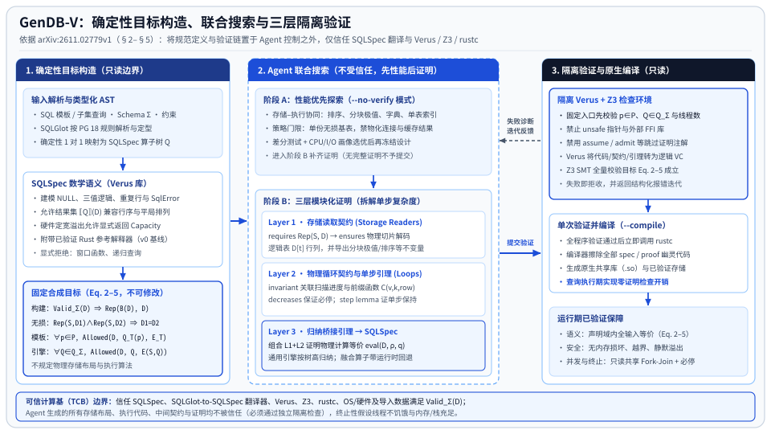查看原图 ↗</a>
<figcaption>依据 arXiv:2611.02779v1 第 2 至 5 节绘制：确定性目标构造与 Verus/Z3/rustc 隔离验证链处于只读可信域，Agent 仅在未受信任域内先进行 --no-verify 性能探索，再为胜出设计补齐三层模块化证明。</figcaption>
</figure>

确定目标后，Agent 面临三大工程难题：若固定存储则错过关键加速；若为每个候选方案撰写形式化证明则 LLM token 与校验开销过高；若直接把紧耦合物理循环一步证到递归 SQLSpec 语义上则验证条件爆炸。GenDB-V 通过三项机制联合破局：

**存储–执行协同优化与防作弊门限**：开启存储优化时，Agent 可共同设计构建器 `B`、读取函数与表示谓词 `Rep(S, D)`，例如字典编码、按序重排、块级 min/max zone map、单表索引（仅含检索键与行号），并可将物理不变量写进 `Rep(S, D)` 供查询证明合法复用——甚至可利用 Schema 约束（如 `CHECK(value >= 0)` 在阈值 `k < 0` 时直接 `O(1)` 返回表行数）。为防止靠预先计算或冗余拷贝作弊，系统除要求 Verus 证毕构建正确性与无损性外，还强制执行存储空间上限（不超过未压缩源文件大小）并在实验审计中禁止冗余基表副本、跨表行定位器、存储派生值、物化连接、预计算聚合及查询结果缓存。系统亦提供禁用存储优化的“纯数组（plain arrays）”模式以做消融对照。

**性能优先探索与延迟证明（`--no-verify`）**：Agent 先在关闭形式化校验的诊断模式（`--no-verify`）下快速编译、构建存储、与参考系统做差分测试并分析 CPU/I/O 画像，筛选并冻结达到性能目标的优胜方案后再集中编写证明；而一旦进入最终提交闸门，系统强制开启全量 Verus 检查，拒绝任何缺失证明的候选版本。

**三层模块化证明与通用引擎树高归纳**：Agent 将每个实现拆成三层契约（论文 Fig. 3）：第一层是**存储读取契约**，以 `Rep(S, D)` 为前置条件，保证返回的物理切片准确解码为 `D[t]` 的逻辑行列及分块极值等不变量；第二层是**物理循环契约与单步引理**，利用数学前缀函数（如 `C(v, k, row)`）、循环不变量 `invariant`、单步保持引理（如 `prefix_step`）与严格递减终止度量 `decreases` 证明循环/递归必停且无越界或溢出；第三层是**归纳桥接引理**，组合前两层以证明物理输出匹配 `SQLSpec` 的 `eval(D, ρ, q)` 与 `⟦Q⟧(D)`。对于接受任意 `Q ∈ Q_Σ` 的**通用引擎**，证明按算子树高度归纳：叶子节点 `Table(t)` 由第一层契约兜底，内部算子只需依赖子查询经证的 `eval(D, ρ, q_i)` 后置条件而无需重证所有算子组合；在此归纳骨架之上，Agent 将全行中间结果替换为晚物化行号向量与哈希 `GROUP BY`，并将多算子子图融合（如 `Filter(Product)` 转为哈希连接）或经证明的代数重写（`eval(D, ρ, q') = eval(D, ρ, q)`）封装为带**运行时适用条件检查**的快速算子——条件满足时走融合核，不满足时无缝回退到通用已验证算子。

**隔离验证与零开销编译**：验证在 Agent 不可修改的隔离环境中运行。只读顶层入口先校验运行时输入（`p ∈ P`、`Q ∈ Q_Σ` 与合法线程数），禁止 `unsafe` 指针与外部 FFI 库并全局禁用 `assume` / `admit`。Verus 将安全 Rust 代码与规格翻译为逻辑验证条件交由 **Z3 SMT** 求解器检验；随后单次验证编译模式（`--compile`）调用 `rustc` 擦除所有规格与证明代码，直接生成原生共享库（`.so`），确保在线执行**零证明检查开销**。

### 实证评测：区分模板特化与通用引擎倍率，及无证明合成审计

<figure class="note-figure">
<a class="note-image-link" href="/assets/images/digest/2026-11-04/gendb-v-verification-eval-zh.svg" target="_blank" rel="noopener" aria-label="GenDB-V 模板特化与通用引擎加速对比及无证明合成错误审计图 · 查看原图 ↗">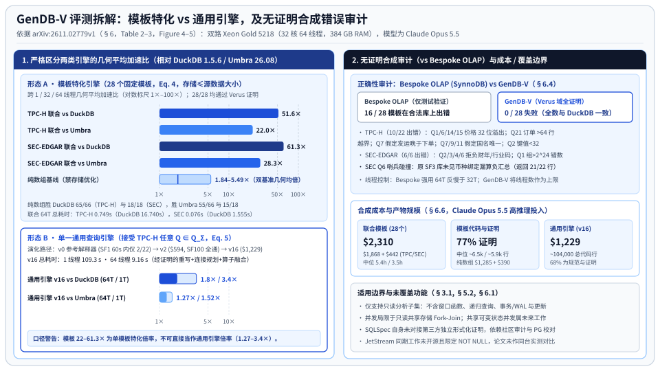查看原图 ↗</a>
<figcaption>依据 arXiv:2611.02779v1 第 6 节与 Table 2–3 绘制：左栏严格区分“单模板特化（22.0–61.3 倍）”与“单一通用引擎（1.27–3.4 倍）”两套评测口径；右栏汇总对比 Bespoke OLAP 仅测试验证在 16/28 个模板中暴露的静默错误与 GenDB-V 成本构成。</figcaption>
</figure>

实验在双路 16 核 Intel Xeon Gold 5218（32 物理核 / 64 硬件线程，384 GB 内存）上开展，LLM Agent 统一采用高推理投入的 `Claude Opus 5.5`，对照成熟系统 DuckDB 1.5.6、Umbra 26.08（编译优化模式）及基于测试的非验证合成系统 Bespoke OLAP（通过其维护实现 SynnoDB）。基准涵盖 **TPC-H SF100**（22 个模板，存储上限 `114.64 GB`）与专门用于降低训练数据泄露风险的 **SEC-EDGAR SF3**（6 个模板 Q1–Q4、Q6、Q24，存储上限 `5.44 GB`），在 1、32、64 线程下跑 1 次冷启动与 3 次热运行中位数，覆盖 3 组可见参数绑定及最多 3 组未见参数绑定。

**两类引擎形态必须严格区分**。在**模板特化**评测中，GenDB-V 成功为全部 `28 / 28` 个模板生成已验证实现：联合存储–查询优化在所有模板与线程数上均胜过 DuckDB 与 Umbra，几何平均加速达 **`22.0–61.3×`**（TPC-H 对 DuckDB `51.6×`、对 Umbra `22.0×`；SEC-EDGAR 对 DuckDB `61.3×`、对 Umbra `28.3×`）。即使禁用存储优化、仅在原始行序的**纯数组**上特化查询代码，GenDB-V 仍达到 **`1.84–5.49×`** 几何平均加速（TPC-H 击败 DuckDB `65/66` 组合、Umbra `55/66`；SEC-EDGAR 击败 DuckDB `18/18`、Umbra `15/18`），而允许存储协同设计则再将总工作负载耗时额外压缩 `4.8×–5.3×`（TPC-H）与 `9.7×–23.8×`（SEC-EDGAR）。

在**通用查询引擎**评测中，单一引擎接受 TPC-H Schema 上 `SQLSpec` 子集内的**任意合法查询**，从最初 SF1 60 秒内仅跑通 2/22 题的 `v0` 参考解释器一路演化：到 `v2`（累计成本 `$594`）已能在 SF100 跑通全部 22 题并在单线程胜过 DuckDB；至 `v16`（累计成本 `$1,229`、约 54 小时 Agent 搜索），总执行耗时降至 1 线程 `109.3 s`、64 线程 `9.16 s`，相对 DuckDB 取得 **`3.4×`（1 线程）与 `1.8×`（64 线程）**加速，相对 Umbra 取得 **`1.52×`（1 线程）与 `1.27×`（64 线程）**加速（即 **`1.27–3.4×`**）。这组增益来自紧凑列存、经证明的运行时查询重写（等式传递、析取分析、谓词下推、冗余投影裁剪、子查询转键值查找）、基于过滤计数与抽样扇出的贪心运行时连接排序、字典/有界整数键直接数组聚合以及分组 top-k 延迟物化。

| 引擎形态与基准设定 | 线程数 | DuckDB 1.5.6 | Umbra 26.08 | GenDB-V（纯数组） | GenDB-V（联合/通用） |
|---|---|---|---|---|---|
| 模板特化 · TPC-H SF100（22 模板总耗时，s） | 1 | 367.841 | 170.103 | 50.134 | **10.380**（联合） |
| 模板特化 · TPC-H SF100（22 模板总耗时，s） | 32 | 21.258 | 10.209 | 4.452 | **0.844**（联合） |
| 模板特化 · TPC-H SF100（22 模板总耗时，s） | 64 | 16.740 | 11.979 | 3.953 | **0.749**（联合） |
| 模板特化 · SEC-EDGAR SF3（6 模板总耗时，s） | 1 | 26.720 | 10.940 | 7.043 | **0.296**（联合） |
| 模板特化 · SEC-EDGAR SF3（6 模板总耗时，s） | 32 | 1.869 | 0.746 | 0.837 | **0.078**（联合） |
| 模板特化 · SEC-EDGAR SF3（6 模板总耗时，s） | 64 | 1.555 | 1.143 | 0.731 | **0.076**（联合） |
| 单一通用引擎 v16 · TPC-H SF100（总耗时，s） | 1 | 367.841（约 3.4× 慢） | 170.103（约 1.52× 慢） | — | **109.3**（通用） |
| 单一通用引擎 v16 · TPC-H SF100（总耗时，s） | 64 | 16.740（约 1.8× 慢） | 11.979（约 1.27× 慢） | — | **9.16**（通用） |

**与无证明合成系统的实测与审计对比**：在同样 `Claude Opus 5.5` 与工作负载下，GenDB-V 在 1/32/64 线程及可见/未见参数上的几何平均单查询耗时均低于 Bespoke OLAP（例如 TPC-H 可见参数 1/32/64 线程为 `137.22 / 18.19 / 17.02 ms`，对比 Bespoke OLAP `176.29 / 35.19 / 50.65 ms`），且 GenDB-V 把线程数视为上限（如 Q2 在 64 线程下主动保持单线程，避免 Bespoke OLAP 在 64 线程反慢于 32 线程的调度退化）。更关键的是，作者审计并测试了 Bespoke OLAP 已经通过自身合成测试的代码，发现它在 **`16 / 28` 个模板**（TPC-H 10 个 + SEC-EDGAR 全部 6 个）上会在满足 Schema 类型和键约束的合法数据库上悄然给出错误答案——包括 Q1/Q6/Q14/Q15 的 32 位价格溢出、Q21 单订单超 64 行越界、Q7 假定发运晚于下单及国名唯一、Q2 假定国家键小于 32、SEC Q1 单组超过 2 的 24 次方行时错算、以及 Q2/Q6 用大负常数作空结果哨兵导致 SEC-EDGAR SF3 原库在未见币种绑定下漏算负分组（Q6 仅返回 21/22 行）；而 GenDB-V 在全部构造测试库上均与 DuckDB 完全一致。代表性优化案例包括 Q21 用单遍位运算扫描配合运行时有序性检查及回退取代两次自连接（纯数组 32 线程 `227 ms`，快于 DuckDB `10.8×`）、Q2 按账户余额降序索引配合“满 100 候选且余额下降”提前终止证明（单线程 `0.73 ms` 对比纯数组 `165 ms`），以及通用引擎把 Q13 左连接计数融合为客户索引区间直数且严格区分 `COUNT(*)` 与 `COUNT(o_orderkey)`。产物统计显示，联合模板合成共花费 `$2,310`（TPC-H `$1,868`、中位 5.4 小时；SEC-EDGAR `$442`、中位 3.5 小时），模板中位代码量约 `6,500` / `5,900` 行，其中 **77% 为规范、契约与证明**；通用引擎至 `v16` 花费 `$1,229`，约 `104,000` 行代码中 **68% 为规范与证明**。

### 可信边界、覆盖限制与工程启发

尽管 GenDB-V 将 Agent 踢出了可信基（TCB），系统保障仍然建立在明确的**可信假设与适用边界**之上：首先，底层仍须信任 **SQLSpec 语义定义**（对照 PostgreSQL 18 文档与参考测试校准，自身未对接第三方独立形式化证明）、确定性 `SQLGlot`-to-`SQLSpec` 翻译器、Verus 工具链、Z3 求解器、`rustc` 编译器/运行时、操作系统、硬件以及导入数据满足 `Valid_Σ(D)`；程序终止性则假定运行环境提供充足内存与栈空间且调度器不无限期饿死可运行线程。

其次，**功能与并发范围目前严格受限**：现有实现面向单机只读分析子集，不支持窗口函数、递归查询、事务更新（OLTP）、预写日志（WAL）恢复或分布式调度；并发验证目前局限于“共享只读存储 + 工作线程私有可变状态”的 Fork-Join 模式，涉及共享可变数据结构的并发原语仍属未来工作。同时在阅读对比时必须守住口径边界：模板特化的 `22.0–61.3×` 依托单模板物理布局与代码专化，绝不可与通用引擎在完整受支持子集上的 `1.27–3.4×` 混为一谈；而同期工作 JetStream（`arXiv:2610.20527`）因未开源、要求列 `NOT NULL` 且未报告通用引擎与 SQL 错误语义，论文未将其纳入同台实测（仅引述其无状态加速器相对 DuckDB `2.1×` 几何平均加速作为背景对照）。

对更广泛的 AI 系统工程而言，GenDB-V 最具迁移价值的范式并非“让大模型从头写完整数据库”，而是其**“不可变形式化目标 + `--no-verify` 快速性能搜索 + 三层模块化归纳桥接 + 隔离单次验证编译”**的四段式架构——既释放了 Agent 在物理布局与算子融合上的探索自由，又用机器检查阻断了测试集之外的静默语义退化。

来源：[Stop Handcrafting Your Engine! GenDB-V: Towards AI-Generated and Formally Verified Database Systems](https://arxiv.org/abs/2611.02779)（[v1 PDF](https://arxiv.org/pdf/2611.02779v1) · [GitHub](https://github.com/GenLang-V/GenDB-V)）

<h2 class="daily-paper-title" id="paper-arxiv-2611.00002">21 · IntentOS：拆解刚性系统调用，用缓存微调用计划响应应用意图</h2>

[An Agentic OS Kernel for Flexible and Enhanced Semantics](https://arxiv.org/abs/2611.00002)（[v1 PDF](https://arxiv.org/pdf/2611.00002) · 论文声明后续将完全开源，截至核验尚无公开仓库链接）  
Haocheng Wang、Xinyue Sun、Hao Yi、Dong Du\*、Yubin Xia、Haibo Chen（上海交通大学、先进智能体操作系统研究中心、浙江大学；\* 通信作者）· `arXiv:2611.00002v1 [cs.OS]` · 摘要页与 PDF 页边均标注 `2026-08-02`（截至核验仅存 `v1`，无撤回记录；注意该日期与 `2611.xxxxx` 编号所属 `2026-11` 批次不协调，本文不据此推定首次公开发表日期）

现代操作系统内核以**系统调用（syscall）**提供通用但高度固化的服务边界：由于向后兼容、可维护性与安全审查约束，新抽象进入主线极其缓慢，迫使应用程序在用户态反复串联多个离散调用（即 syscall composition），并在各自独立的系统调用语义之间承受本可消除的重复工作。现有的 eBPF 与用户态旁路/LibOS 方案主要聚焦开发期定制内核机制，既依赖专家手工编写、又无法在运行时基于全局内核状态重编排抽象接口。本文提出 **agentic kernel** 架构及其 Linux 原型 **IntentOS**：把粗粒度系统调用自顶向下拆解为可组合的内核原生**微系统调用（micro-syscall）**，经统一声明式入口 `isyscall` 接收应用意图与解耦实参，在缓存未命中时由外部 `LLMSidecar` 合成有界执行计划并交静态校验器检查后缓存，命中路径则直接在内核解释执行链表计划并完全绕过 LLM 推理；同时，内核安全保障仅锚定在微系统调用自身的接口级检查与隔离机制上，而不依赖 LLM 输出正确性。以下内容严格依据 `arXiv:2611.00002v1` 原文数据整理，并将作者报告结果与工程边界明确区分。

### 一、问题症结：Linux 接口演进停滞、调用组合冗余与开发期定制失灵

论文第 1–2 节通过内核演进统计、进程创建剖面与典型应用调用链，解释了「为什么只加通用 syscall 或靠开发期扩展无法解决组合低效」：

- **内核抽象演进远慢于机制膨胀（Fig. 1）**：从 Linux 3.0 到 Linux 6.18 的 14 年间，内核代码行数（LoC）接近翻三倍，但系统调用数量仅增长 **26.7%**。对 Linux `v2.6` 以来邮件列表提案到合入主线时间的统计显示，近 **40%** 的新系统调用耗时超过 **400 天**才被接纳，如 `clone3` 从最初邮件讨论（2009 年）到进入内核发布历经近十年。
- **固定子功能捆绑制造跨调用冗余（Table 1、Fig. 2）**：Linux 中多个进程管理调用底层复用同一组子函数——`dup_task_struct()`、`copy_files()` / `dup_fd()`、`copy_fs()`、`copy_sighand()`、`copy_mm()` / `dup_mm()` 与 `mm_alloc()`——但不同调用将其死板捆绑。以经典的 `fork + execve` 派生子进程为例：`fork` 会先在 `copy_process` 中耗费 **82,185 ns（占 `fork` 全部延迟的 78.89%）** 调用 `copy_mm` 为子进程完整写时复制父进程地址空间与页表项，紧接着子进程执行 `execve`（`exec_mmap` / `mm_alloc`）又立即丢弃这套刚复制的 `mm_struct` 并重新分配。若改用 `vfork` 共享 `mm_struct`（`share mm` 仅 `78 ns`、`copy_process` 降为 `12,180 ns`），虽然省去了复制开销，却不得不让父进程阻塞等待子进程释放共享地址空间，使 `Wait for Child` 高达 **43,661 ns（占 `vfork` 全部延迟的 70.281%）**，并引入新的内存访问约束与安全风险。
- **应用组合高度分化且热点随运行时漂移（Table 2、Fig. 3）**：对 GCC（如 `pex_input_file` 的 `open + close + open`、`execute` 的 `pipe + vfork + dup2 + execve + waitpid`）、Nginx（如 `ngx_open_and_stat_file` 的 `open + fstat + fcntl`、`ngx_udp_connect` 的 `socket + ioctl + connect + epoll_ctl`）和 SQLite（如 `unixShmMap` 的 `fstat + pwrite + mmap`、`unixSync` 的 `fdatasync + open + fdatasync + close`）的源码分析表明，各应用所需的组合模式极多，无法静态穷举专有 syscall。此外，在 Bash 与 Unix coreutils 上对比两类运行时负载（Fig. 3），热组合分布截然不同：「逐结果验证与暂存」中 `fork-exec` 占 **53.59%**、`batch-unlink` 占 **21.10%**、`dir-traverse` 占 **21.94%**；而「全目录树快照分析」中 `dir-traverse` 升至 **46.70%**、`mmap-related` 占 **23.78%**、`stream-write` 占 **24.36%**。
- **eBPF 与用户态旁路无法覆盖运行时抽象重构（§2.3）**：eBPF 允许在预设挂钩点安全注入内核逻辑，但目标在于定制内部策略/观测机制而非定义新的系统调用抽象，且受限于验证器规则与开发门槛；Exokernel、LibOS（`Dune`、`FlexOS`、`AlloyStack`）、Unikernel、`Skyloft` 与 `DemiKernel` 将机制移至用户态，既需高昂人工维护成本，又聚焦开发期静态定制，缺少在运行时动态发现并重写热点 syscall 组合的能力。

### 二、IntentOS 架构：isyscall 入口、计划缓存、安全微系统调用与工具分层演进

<figure class="note-figure"><a class="note-image-link" href="/assets/images/digest/2026-11-04/intentos-isyscall-microsyscall-arch-zh.svg" target="_blank" rel="noopener" aria-label="查看 IntentOS 双路径 isyscall 执行、分层微系统调用与安全隔离架构图原图">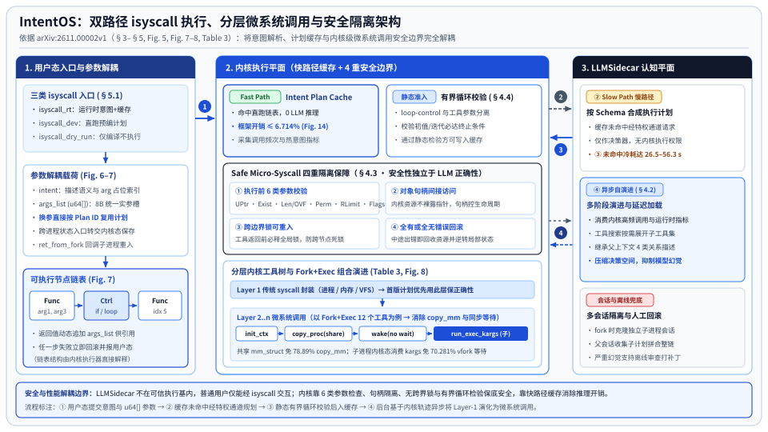查看原图 ↗</a><figcaption>图 1 · IntentOS 双路径执行、分层微系统调用与安全边界架构（整理自 arXiv:2611.00002v1 §3–§5、Fig. 5、Fig. 7–8 与 Table 3）：LLMSidecar 仅承担外部决策，内核以快路径缓存屏蔽冷推理延迟，以微系统调用接口级约束保底系统安全。</figcaption></figure>

为同时解决**运行时规划延迟（Challenge-I）**、**大模型直接改写内核代码的幻觉错率（Challenge-II）**以及**任意组合微系统调用的内核安全风险（Challenge-III）**，IntentOS 在内核与外部认知平面之间建立了四项解耦设计（§3–§5）：

1. **声明式 isyscall 入口与参数解耦计划缓存（§4.1、§5.1、Fig. 5–7）**：
   - 应用通过三种入口向内核提交高层次需求：`isyscall_rt`（运行时提交意图并自动规划与缓存）、`isyscall_dev`（直接提交开发者预先设计好的结构化计划在内核执行）、`isyscall_dry_run`（仅由意图生成计划而不实际执行，用于人工审阅与调优）。
   - 调用载荷将「自然语言意图 + 参数占位索引（如 `arg0`、`arg1`）」与实际运行值数组 `args_list` 彻底分离。`args_list` 为统一 `uint64_t`（8 字节槽位）数组，可强转为指针、句柄或基本类型。可执行的 **agentic plan** 在内核侧以链表节点组织（Fig. 7），包含工具节点（`Func`：引用微系统调用与解析后的参数索引）和控制流节点（`Ctrl`：顺序、`if-else`、有界循环），工具返回值动态追加到 `args_list` 新槽位（如 `idx 5`）供后续节点直接引用。
   - 遇到未见意图时，内核走**慢路径**，经专用特权通道将意图发往用户态独立组件 `LLMSidecar` 生成符合 Schema 的计划，静态校验通过后在内核空间以唯一 ID 缓存并执行；此后无论外部参数如何变化，应用只需复用同一计划 ID 即可命中**快路径**，完全绕过 LLM 推理。
2. **认知平面隔离、自顶向下分解与多阶段延迟演进（§3、§4.2）**：
   - `LLMSidecar` 作为外部决策器运行在特权通道后端，维护每进程会话与内核注册的工具 Schema，本身**不具备任何执行内核代码的能力**，普通用户也仅能通过 `isyscall` 相关入口间接触发其规划。
   - **自顶向下层级工具树与延迟加载**：最顶层（Layer-1）直接封装传统 POSIX syscall（进程、内存、VFS），第一阶段严格只用 Layer-1 工具生成初始计划，优先保底功能正确性；同时，执行平面持续采集意图调用频次、跨进程共享情况与内核指标，针对热点或关键意图，通过工具搜索与**延迟加载（deferred loading）**将局部粗粒度工具逐级替换为细粒度子工具（Layer-2..n）。每个子工具向 LLM 暴露四类继承自父调用的上下文：（1）依赖顺序、（2）核心功能、（3）参数说明、（4）工具间关系，从而避免向模型直接灌入全量内核源码或全套底层原语导致的决策空间爆炸；若仍出现严重幻觉，系统支持开发者离线审阅并打补丁回滚已缓存计划。
3. **不依赖 LLM 正确性的安全微系统调用与静态校验器（§4.3–§4.4）**：
   - 论文明确将微系统调用暴露为用户可直接以任意顺序调用的自包含内核 API，并要求即便规划完全错误或遭遇恶意调用，内核依然安全：
     - **执行前 6 类参数检验**：继承经典 syscall 防护逻辑，在进入执行前完成（1）用户指针校验 `UPtr`、（2）对象存在性校验 `Exist`、（3）长度/偏移/溢出校验 `Len/OVF`、（4）权限/能力/属主校验 `Perm`、（5）资源配额校验 `RLimit`、（6）非法标志位组合校验 `Flags`。
     - **对象句柄间接访问**：微系统调用关联的全部内核对象留在内核空间，仅向用户返回受控对象句柄，杜绝直接暴露或篡改内核原始指针，并为跟踪资源生命周期提供稳定边界。
     - **跨边界锁可重入性（Lock Reentrancy）**：任何微系统调用无论成功或失败，返回前都必须释放执行期间持有的全部全局内核锁，避免后续节点继承隐含锁状态引发跨工具死锁。
     - **原子化失败回滚与静态有界循环校验**：计划节点执行中途出错即停止前向推进，回收已分配句柄并逆转出错工具的局部状态，实现全有或全无（all-or-nothing）返回。新建计划写入缓存前，静态校验器（§4.4）还将检验与工具参数分离的 `loop-control` 组，确认初值与迭代规则必然到达终止条件，防止内核无限死循环。
4. **跨进程会话分裂与 fork + exec 的 12 个微系统调用（§5.1–§5.2、Table 3、Fig. 8）**：
   - 在 `fork` 场景下，为解决子进程延续执行需要独立规划上下文的问题，IntentOS 在 `ret_from_fork` 植入重入回调（Child Reentrancy），为子进程克隆独立 `LLMSidecar` 会话（Multi-Session Cloning）聚焦子分支意图，再由父会话轮询 `child_id` 汇总父子双端计划；同时在入口将意图与实参提前拷入内核空间并按子进程生命周期接管，省去用户内存依赖。

| 工具类别 | 微系统调用接口（Table 3） | 核心职责与在 `fork + exec` 优化计划（Fig. 8）中的作用 |
| :--- | :--- | :--- |
| Process Create（6 个） | `init_ctx`、`copy_process`、`capture_pid`、`set_child_sched_func`、`wake_child_and_report`、`ctx_finalize` | 创建/清理上下文；`copy_process(share)` 与 `set_sched_func(share)` 按需共享 `mm_struct` 与 `sighand`，跳过 `copy_mm`；`wake_child(no wait)` 免除父进程阻塞 |
| Execve（3 个） | `run_exec`、`run_exec_consuming_kargs`、`execve_free_kargs` | 将 `execve` 包装为内核态直接消费已拷入内核参数（`kargs`）的动作，使子进程不触发用户空间并发访问竞争 |
| Trace（2 个） | `pick_trace`、`trace_sched_fork` | 选择 `ptrace` 事件类型并设置 `fork` 调度跟踪事件，保留调试语义 |
| Others（1 个） | `copy_pid_to_user` | 按父/子分支分别向用户空间写回子进程 `PID` 或 `0`，维持标准 POSIX 返回语义 |

*表 1 · IntentOS 在 Linux 上实现的 12 个进程创建与执行细粒度微系统调用清单（整理自 arXiv:2611.00002v1 §5.2、Table 3 与 Fig. 8；除进程管理外，原型还在文件系统与内存管理域实现配套工具集）。*

### 三、实证评测：四模型准确率、三类负载端到端收益、四版内核兼容与缓存消融

<figure class="note-figure"><a class="note-image-link" href="/assets/images/digest/2026-11-04/intentos-linux-plan-cache-eval-zh.svg" target="_blank" rel="noopener" aria-label="查看 IntentOS 实证评测四象限图原图">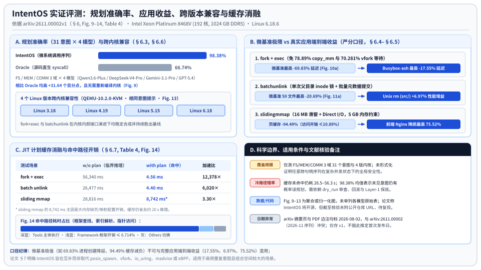查看原图 ↗</a><figcaption>图 2 · IntentOS 实证评测汇总（整理自 arXiv:2611.00002v1 §6、Fig. 9–14 与 Table 4）：微基准极值与端到端应用增益分开记录，缓存命中将 26–56 秒推理移出关键路径。</figcaption></figure>

论文第 6 节在 **Intel Xeon Platinum 8468V**（2.4 GHz、192 核）、**1,024 GB DDR5 ECC**（4800 MHz，`32 × 32 GB`）、**Ubuntu 22.04（Linux 6.18.6）** 裸机环境完成全部性能与消融测试，跨版本兼容测试则在 **QEMU-10.2.0-KVM** 下运行；规划器测试了 `Qwen3.6-Plus`、`DeepSeek-V4-Pro`、`Gemini-3.1-Pro-Preview` 与 `GPT-5.4` 四款模型：

- **规划准确率对比（§6.3、Fig. 9）**：在文件系统（`FS`）、内存管理（`MEM`）和通信（`COMM`）三个域共 **31 个代表性意图**（每域约 10 个）上，对比将原始内核代码直接交给大模型合成新 syscall 的 **Oracle 基线**。四款模型与三域总平均下，IntentOS 取得 **98.38%** 准确率，而 Oracle 仅为 **66.74%**（高出 `31.64` 个百分点），且 IntentOS 无需重新编译内核即可启用新组合语义。
- **跨四版 Linux 内核兼容（§6.6、Fig. 13）**：使用完全相同的 `fork + exec` 与 `batchunlink` 意图提示，在 **Linux 3.18、4.19、5.15 与 6.18** 四个版本的 QEMU-KVM 虚拟机上测试。尽管跨年代内核内部实现与函数签名持续变化，IntentOS 均稳定合成可执行计划并保持对传统 `fork`/`vfork` 与 `unlink`/`unlinkat` 的延迟优势。
- **三大场景的微基准与真实应用集成（§6.2、§6.4–§6.5、Fig. 10–12）**：除将 `fork + exec` 集成至 **Busybox-ash** 外，作者另在 VFS 与内存域实现了 `batchunlink`（在单次获取父目录 `inode` 锁下批量合并元数据更新并减少日志重复提交，集成于 **Unix rm** 清理 `Coreutils`/`Redis` `/src` 构建产物）和 `slidingmmap`（为后台大文件扫描维持通常 `16 MB` 的固定页缓存滑窗与 Direct I/O 路径，越界缺页时清除旧映射并滑动窗口，集成于 **Unix grep**，在 **5 GB 内存限制**下保护前端 **Nginx** 热点页缓存）。
- **JIT 计划缓存消融与命中路径开销拆解（§6.7、Table 4、Fig. 14）**：对比关闭缓存（每次触发关键路径 LLM 推理）与开启计划缓存的执行延迟，并测量命中路径下 `Tools`（工具本体）、`Framework`（计划查找、`args_list` 索引解析、额外指针访问）和 `Others`（上下文切换等）占比。命中路径上 Framework 附加开销最高仅 **6.714%**。

| 评测维度与负载 | 对照基线与测试设定 | 微基准结果（理想/单场景） | 真实应用 / 消融端到端结果 |
| :--- | :--- | :--- | :--- |
| 规划准确率（§6.3、Fig. 9） | 4 款模型 × 3 域共 31 个意图；对比读取内核源码直生 syscall（Oracle） | — | IntentOS 平均 **98.38%** vs Oracle **66.74%**（无需重编内核） |
| `fork + exec`（Fig. 10、§6.4–6.5） | 880 KB 基础可执行文件 + 64 KB–32 MB 数据段；应用为 Busybox-`ash`（`rm`/`cp`/`mv`/`cat`/`wc`/`shasum`） | 相比独立 `fork + exec` 最高降延迟 **69.83%** | `ash` 后台任务启动端到端延迟最高降低 **17.55%** |
| `batchunlink`（Fig. 11、§6.4–6.5） | 1–32 层目录深度删除 50 个文件（64 KB–4 MB）；应用为 Unix `rm` 清理 `Coreutils`/`Redis` `/src` | 相比逐个 `unlink` 最高降延迟 **20.69%**（亦优于 `unlinkat`） | `rm` 批量删除总耗时取得最高 **6.97%** 性能增益 |
| `slidingmmap`（Fig. 12、§6.4–6.5） | 32 MB–4 GB 文件；可用内存限 `5 GB`；前端 Nginx 服务 32–384 个 4 MB 文件并发后台 `grep` | 页缓存足迹最高减少 **94.49%**（访问延迟开销 **≤10.89%**） | 相比其他 `grep` 方案，Nginx 吞吐降幅最高减少 **75.52%** |
| 计划缓存消融 · `fork+exec`（Table 4） | 对比 `w/o plan`（临界路径完整 LLM 推理）vs `with plan`（内核缓存命中） | — | `56,340 ms` → **4.56 ms**（加速 **12,378×**；Framework ≤6.714%） |
| 计划缓存消融 · `batch unlink`（Table 4） | 同上 | — | `26,477 ms` → **4.40 ms**（加速 **6,020×**） |
| 计划缓存消融 · `sliding mmap`（Table 4） | 同上（受大内存缺页与映射配置支配） | — | `28,816 ms` → **8,742 ms**（加速 **3.30×**，省约 `20 s` 推理） |

*表 2 · IntentOS 关键实证结果汇总（整理自 arXiv:2611.00002v1 §6、Fig. 9–14 与 Table 4；微基准极限比例与真实端到端应用收益按不同实验口径分别列出）。*

### 四、科学边界、记录核验异常与系统工程启示

将 IntentOS 的思路用于操作系统扩展或受限内核代理设计时，需要厘清原文尚未覆盖的边界与核验发现的记录差异：

1. **小样本评估不等于任意组合的全局安全证明**：现有测试集中在 **3 个系统域共 31 个意图**、**3 类优化个案**与 **4 个内核版本**。虽然单个微系统调用满足局部 6 类参数验证、句柄封装、返回前释放全局锁与有界循环终止，但论文并未给出跨多步微系统调用组合的全局状态机形式化证明（例如连续多句柄调用之间的 TOCTOU 时序竞争、合法微系统调用高频序列触发的内核资源耗尽，或新暴露拆解子函数内部潜在的逻辑缺陷）。
2. **冷启动代价高企与概率性误规划风险（§7）**：Table 4 表明未命中计划时单次 `isyscall` 仍会阻塞 **26.5–56.3 秒**，仅适合**意图高度重复且具备长尾组合空间**的工作负载；`98.38%` 的均值同样意味着在未见或模糊意图下仍有失败概率（论文中已依赖 `isyscall_dry_run`、开发者离线补丁回滚及 Layer-1 保底来对冲）。作者也明确指出 IntentOS 并非要取代 `posix_spawn`、`vfork`、`io_uring`、`madvise` 或 `eBPF`，而是作为补充选项。
3. **指标呈现粒度与代码开源状态**：Fig. 9–13 主要给出归一化比例图与汇总曲线，未附各模型在三域的逐项原始表及微基准绝对毫秒表；此外，论文第 1 节说明 `"IntentOS will be fully open-sourced."`，但截至本次核验，PDF 与 arXiv 摘要页均未附公开代码仓库地址，Linux 内核补丁与微系统调用实现细节暂无法做源码级独立复现。
4. **文献日期元信息异常**：核验 `arXiv:2611.00002v1` 时发现，其 arXiv 摘要页（`Submitted on 2 Aug 2026`、`Sun, 2 Aug 2026 05:49:54 UTC`）及 PDF 首页左栏时间戳（`arXiv:2611.00002v1 [cs.OS] 2 Aug 2026`）均显示 `2026-08-02`，而其编号 `2611.00002` 与浏览列表归档均属 `2026-11` 序列。因原文仅存 `v1` 且日期元数据内部存在冲突，本文如实并记两项记录，不据此推断首次公开发表时间。
5. **可迁移的系统工程原则**：（1）**将自然语言意图与运行时实参阵列物理拆离**：把可变的指针/句柄放入统一 `args_list`，才可能用确定的 plan ID 在热路径上彻底跳过模型推理（把几十秒压到 4–5 毫秒、框架开销压在 `7%` 以内）；（2）**把安全不变量绑定在最小执行原语而非模型正确性上**：当安全由句柄、锁边界与参数前置检查独立守住，规划器即便只具备概率可靠性也能在受控域内探索更优组合；（3）**用层级工具延迟展开代替把代码库喂给模型**：先用高准确率粗粒度封装跑通语义，再由可观测热点驱动局部下钻，实测可将规划准确率从 `66.74%` 抬升至 `98.38%`。

来源：[An Agentic OS Kernel for Flexible and Enhanced Semantics](https://arxiv.org/abs/2611.00002)（[v1 PDF](https://arxiv.org/pdf/2611.00002)）
## 同日技术笔记

- <a href="/tech/zh/nvidia-attribution/">NVIDIA Attribution：从级联错误中保留一条可追查的归因链</a>
- <a href="/tech/zh/review-haoailab-pika-h3-flex/">FastVideo Pika H3：核对资源与精度后的加速</a>
- <a href="/tech/zh/2026-11-04-kimi-k3-1-pro/">Kimi K3.1 Pro Tech Blog: Advancing Open Intelligence</a>
- <a href="/tech/zh/2026-11-04-pagerduty-pd-labs-sre-agent/">Lessons from PD Labs: From experimentation to a production-ready SRE Agent</a>
- <a href="/tech/zh/llamacpp-kv-fallback/">量化 KV Cache 为什么会让 GPU 推理悄悄退回 CPU？</a>
- <a href="/tech/zh/2026-11-04-mercor-apex-swe-observability/">AI Observability &amp; Debugging Leaderboard: APEX-SWE | Mercor</a>
