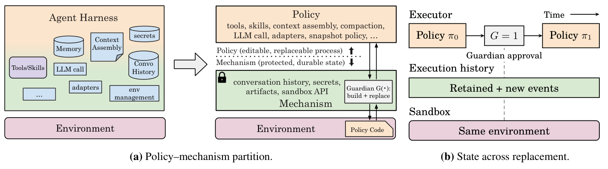
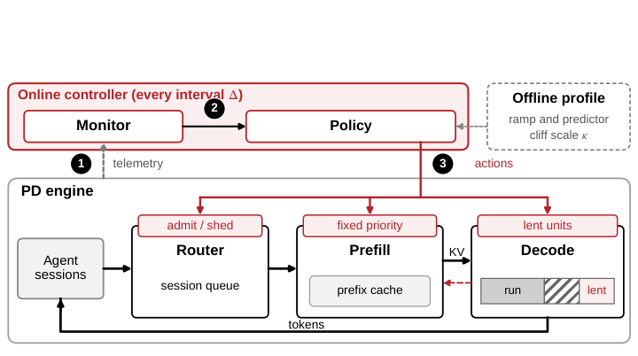
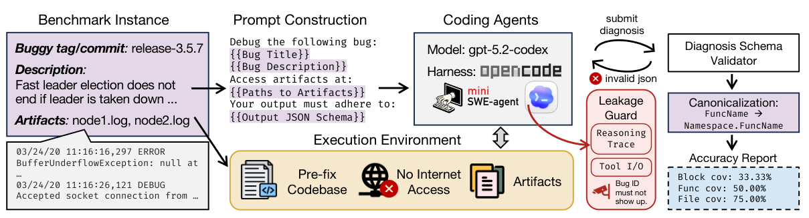
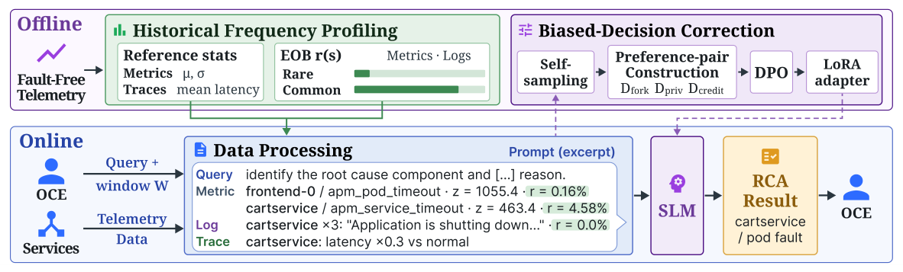
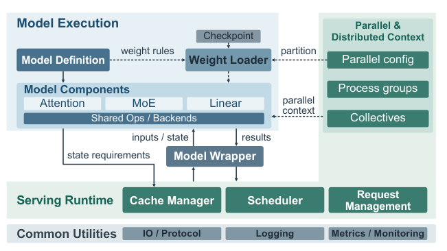
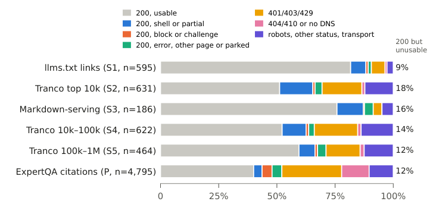

本期几项工作把 Agent 的可靠性问题落到了可检查的系统边界上。BASIN 解释短暂流量峰值如何经由会话与缓存反馈留下持久故障；DistDebug-Bench 则显示，找到相关代码仍不足以完成可信诊断。小模型 RCA 工作进一步追问：模型已经分析过传播关系，为何最终仍会选错组件？

Exo 与 RTP-LLM 分别讨论运行策略变化和模型接入变化时，哪些状态与权限应由稳定机制管理。网页抓取测量提醒我们，成功状态码也不保证拿到正文。它们共同值得关注的，是把性能或能力结果连接到状态生命周期、证据质量与失败边界。

<h2 class="daily-paper-title" id="paper-arxiv-2611.00463">Exo：修改运行中的 harness，保留独立的状态与替换权限</h2>

[Exo: An Architecture for Self-Improving Systems at Runtime](https://arxiv.org/abs/2611.00463)  
Alexander Krentsel, Sylvia Ratnasamy, Ion Stoica, Martin Casado, Ankur Goyal · arXiv · 首次提交：2026-10-30

Agent 在一次长任务中已经发现重复操作，却仍要等外部优化器收集样本、评估新版本，改进才能落地。Exo 把改进循环放进执行过程：运行中的 agent 可以读写自己的工具、上下文压缩、模型调用及改进策略，再请求启用新 executor。它关注的是任务继续运行时如何替换策略，而非仅积累经验文本。

架构将可编辑策略与受保护机制分开。历史只追加，产物保留旧版本，guardian 独立决定新 executor 能否启用；替换时保留任务环境和执行记录。成本、token 与缓存信息帮助 agent 判断哪些操作值得改写。SREGym 中，它逐步形成收集异常 pod、版本变化和可疑日志的 incident-snapshot 工具，减少重复诊断调用。

使用 gpt-5.6-sol、以同一起始策略但禁用自编辑为对照，在 21 个学习事故之后，20 个同类故障、不同应用的留出事故中，作者报告诊断时间中位数从 81 秒降到 53 秒，平均模型成本从 0.892 美元降至 0.584 美元，正确性相近。保护边界的含义要谨慎理解：默认 guardian 只检查构建成功，不保证修改正确或性能改善；回滚也不能撤销外部副作用。对 AgentOps 而言，值得借鉴的是把“提出修改”与“批准生效”分成不同权限。

<a class="note-image-link" href="/assets/images/digest/2026-11-04/exo.png" target="_blank" rel="noopener" aria-label="Exo 的可编辑策略、受保护机制及替换时保留的历史 · 查看原图 ↗">查看原图 ↗</a>

*策略可以改变工具与上下文组织；历史存储和新策略的启用检查位于独立边界之下。*

<h2 class="daily-paper-title" id="paper-arxiv-2611.02543">BASIN：流量恢复后，为什么推理服务仍困在缓存抖动中</h2>

[When Cache Pressure Becomes a Trap: Metastability in Agent Serving](https://arxiv.org/abs/2611.02543)  
Chengzhi Lu, Boxi Zhou, Yanying Lin, Dmitrii Ustiugov · arXiv · 首次提交：2026-11-02

**峰值流量消失，并不意味着服务会自行恢复。** 这篇工作把 agent serving 的缓存压力与亚稳态故障联系起来：系统在原本能承受的流量下持续恶化，原因是请求变慢改变了仍在运行的会话数量，而会话数量又决定缓存需求。

Agent 会在模型调用与工具执行之间反复切换，下一轮往往复用不断增长的历史。一次调用变慢，会话就更晚结束；新会话持续进入，使所有活跃会话的上下文总量扩大。前缀被逐出后，下次调用必须重新 prefill，进一步延长会话寿命。工具正在执行的会话也占据未来复用需求，因此只看当前 decode 的 KV 使用率会漏掉压力。SGLang 预先为等待 prefill 的请求保留 decode KV，还可能加剧等待。

作者在两张 H100 NVL、1P1D 的 SGLang 上运行 Qwen3.6-35B-A3B FP8，回放 216 条 Terminal-Bench 轨迹、7,108 次调用。基础到达率为每分钟 3.3 个会话时，十分钟的翻倍流量使前缀命中率从约 0.95 降至 0.27。随后一小时新到达会话的 goodput 从每小时 138 降至 17，约下降 88%。这里 goodput 要求会话减速比不超过 4，且至少 95% 的 decode 步满足 50 毫秒 ITL 目标；它不同于完成调用数。终止残留突发会话后恢复的干预实验，为反馈机制提供了比相关曲线更强的证据。

BASIN 据此联合控制三个环节。首先，用到达时间和预计峰值上下文确定固定会话优先级，让准入、prefill 与 decode 队列遵循同一顺序。其次，借用空闲 decode 内存保留跨轮次状态，真正执行 decode 时优先收回。最后，按会话预计峰值工作集限制新会话进入，根据命中率调整预算；只有长期需求超过容量时才丢弃部分排队会话。这样既保护已进入的上下文，也减少把所有代价转移到入口长队的风险。

证据必须分层看：真实 H200 1P3D 原型使用到达时间排序和当前上下文准入，四个场景下 goodput 是 Continuum 的 1.20–1.70 倍；完整预测式策略的更广泛比较来自校准模拟。流体模型标记出全部 17 个缓存先受限的模拟部署，也误报了 8 个 decode 先受限部署，不能称为完美分类器。

这项工作的价值是把过载保护单位从单次请求提升到跨工具调用的会话工作集。其收益取决于瓶颈：decode 已先饱和时，借缓存空间的改善有限；缓存很大时，准入仍可能放进过多 decode 并发。阅读重点是故障干预、会话生命周期和 goodput 定义，而非只看加速倍数。

<a class="note-image-link" href="/assets/images/digest/2026-11-04/basin.png" target="_blank" rel="noopener" aria-label="BASIN 根据遥测控制会话准入、队列优先级与 decode 缓存借用 · 查看原图 ↗">查看原图 ↗</a>

*控制器同时管理新会话进入、已有会话的服务顺序和可借用缓存，避免只扩容或只限流。*

<h2 class="daily-paper-title" id="paper-arxiv-2611.03523">DistDebug-Bench：找到相关文件，离找到故障原因还有多远</h2>

[DistDebug-Bench: Can LLM Agents Diagnose Bugs in Distributed Systems?](https://arxiv.org/abs/2611.03523)  
Yuxuan Jiang, Chenglin Liu, John Rose, Mason Miller, Ruthesh Thavamani, Juntao Wu, Yinwei Huang, Jiahao Xu, Peng Huang · arXiv · 首次提交：2026-11-02

**诊断一个分布式系统故障，需要解释症状如何从因果代码产生。** 找到报错文件或者生成能通过测试的补丁，都不完全等价于这项能力。DistDebug-Bench 将任务落在这个缺口上：给 agent 修复前仓库、事故描述及已有日志等材料，要求指出承载故障机制的代码块，直接评估定位。

基准含 11 个生产级系统、5 种语言的 120 个历史故障，标注 218 个根因代码块。每例由三名标注者独立检查后协调，排除测试、顺手重构和与根因无关的防御性修改。45% 的事故需要多个代码块，约 23% 跨文件，代码块中位长度仅五行。这要求 agent 既能沿跨组件因果链探索，也能收敛到精确范围。

数据还保留了真实诊断证据的不均衡：83 个报告不直接包含正确方法名，75 个没有可用的项目内栈轨迹。环境移除未来提交并禁止联网，另检查推理与工具记录中是否泄露隐藏 issue 编号。这样的控制减少直接查答案，但作者明确无法排除预训练暴露。样本也偏向能从已有报告诊断、修复范围可清晰标注的故障，不能代表所有线上事故。

在完整的 120 例比较中，作者每例平均三次有效尝试。GPT-6 Astra 配 Mini-SWE-Agent 的文件覆盖率为 83.9%，代码块覆盖率为 67.7%，代码块精确率为 42.7%；代码块覆盖率的 95% bootstrap 区间为 60.4%–74.9%。这些数字揭示“走到相关仓库区域”与“准确解释因果位置”之间的距离，而不是端到端修复成功率。该配置仍有 15 个故障在重复运行中的覆盖率跨度超过 0.2。

轨迹分析给出具体失败机制：一次搜索限定在错误子目录，可能使后续每一步看似合理，却始终看不到真正的原因；只读日志片段与搜索异常关键词，也会得到不同的证据范围。模型常在第一个自洽解释上继续深挖，缺少重新打开其他假设的动作。更宽泛地报告代码能提高覆盖，却会降低精确率，工具调用与上下文组织因此是评估对象的一部分。

定位标签也有边界：另一处有效干预点可能解释同一机制，却未命中最小根因块。作者的零覆盖人工审查中，20 例有 4 例属于这类情况。这不抹去困难，但提醒读者同时看解释质量与覆盖指标。对 AI SRE 研究，值得关注的是把证据获取、假设修订和最终定位拆开评估，并按报告线索强弱观察失败，而非仅比较总榜。

<a class="note-image-link" href="/assets/images/digest/2026-11-04/distdebug.png" target="_blank" rel="noopener" aria-label="DistDebug-Bench 从修复前代码和事故材料评估根因代码定位 · 查看原图 ↗">查看原图 ↗</a>

*输入隐藏修复与答案线索，输出经过结构校验、符号规范化及多粒度定位评分。*

<h2 class="daily-paper-title" id="paper-arxiv-2611.02416">小模型 RCA：补上正常行为基线，再纠正最后的决策</h2>

[Fault-Free Profiles and Decision-Level Training for Root Cause Analysis via Small Language Models](https://arxiv.org/abs/2611.02416)  
Kyoohyun Lee, Woohyeok Park, Taeyoon Kim, Sungyong Baik, Kyungyong Lee · arXiv · 首次提交：2026-11-02

**异常分数大，不代表更接近根因；模型写出了传播分析，也不代表最后会遵循它。** 这篇小模型 RCA 工作分别检查输入与决策，发现两个经常被混在一起的问题。短时间参考窗口会把正常的周期变化当成异常，最终回答又可能忽略中间分析，转而选择分数最高的组件。

作者在 OpenRCA Bank 中发现，某 JVM 内存指标在无故障窗口里有 97% 会越过短窗口估计的阈值；改用完整无故障时期的统计量后，该比例降至 4%。根因组件在 99% 的事故窗口中已经进入候选集，却只有 8% 拥有最大异常分数。问题因此不只是“有没有找到候选”，还在于模型如何理解这些候选的背景。

Historical Frequency Profiling 为指标和日志添加 Expected Outlier Baseline：同一信号在无故障窗口里被标为异常的频率。在线提示同时展示异常强度与平时出现频率，优先列出平时少见的异常；trace 则与正常延迟比较。它不把罕见直接等同于因果，而是给模型补充原先看不到的参照。候选组件仍由指标筛选，日志与 trace 不会额外引入候选，因此前处理漏掉根因时，后续推理仍无法补救。

Biased-Decision Correction 则对同一推理前缀重新采样，构造通向正确与错误结论的偏好对。DPO 的损失只作用于前缀之后的续写，并通过 LoRA 更新，避免把已有分析过程也一并当作需要重学的目标。若普通采样始终失败，离线生成可使用特权提示救援，但训练输入移除提示，并检查选中解释是否仍由原始证据支持。审查模型参与的是离线数据构建，不能把整个训练流程都描述为无需外部模型。

在各系统按 60%/40% 随机划分训练和评估事故、每例八次响应独立评分后平均的设置下，4B 系统的 Exact 在 Telecom、Bank、Market、AIOps 2025 分别为 39.3%、48.7%、11.9%、21.1%。Exact 要求问题所问的组件、故障类型和时间全部正确，不能与只排组件的基线直接等同。Market 仍然困难；迁移到只评组件的 GAIA 时，本方法为 68.6%，低于 FoundRoot-14B 的 88.6%。

值得读的是正常画像与决策训练的拆分，而非“小模型全面胜过大模型”的概括。画像需要可识别的无故障时期及相对稳定的正常行为；实验还使用事故前后的无故障数据，不能直接当成严格在线、只用过去数据的结果。部署时如何更新画像、避免正常状态漂移，仍决定这条路径是否可靠。

<a class="note-image-link" href="/assets/images/digest/2026-11-04/fault-free-rca.png" target="_blank" rel="noopener" aria-label="无故障频率画像与决策偏好训练共同支持在线 RCA · 查看原图 ↗">查看原图 ↗</a>

*离线路径统计正常时期的异常频率并训练 LoRA；在线把这些频率与事故遥测一起交给小模型。*

<h2 class="daily-paper-title" id="paper-arxiv-2611.00967">RTP-LLM：把模型变化与状态生命周期分开管理</h2>

[RTP-LLM: Building an Evolvable and Reliable LLM Inference Engine at Alibaba Scale](https://arxiv.org/abs/2611.00967)  
Jiarui Guo, Zhi Zhang, Boyu Tan 等 · arXiv · 首次提交：2026-10-31

RTP-LLM 记录了阿里推理引擎从 Python 服务层到 C++ 优先、再到模型与 serving 分离的演化。当前模型语义放在 Python/PyTorch，调度、KV 管理和资源协调保留在 C++，以减少每次新模型接入都重新翻译参考实现的成本。

可靠性细节比部署规模更值得读：异步缓存传输“已提交”不等于数据“可复用”；请求、传输与保留缓存分别持有引用，全部释放后块才可重新分配；超时停止响应也不意味着可以立即回收仍被异步任务使用的 KV。新状态类型仍可能要求同时修改模型层与共享运行时，接口并不能自动吸收所有变化。

作者给出的四个模型接入案例中，三个 serving 层改动不足 100 行，DeepSeek-V4 则需 5,207 行，体现了复用的边界。生产性能来自三个应用各自单集群的七天观测，报告的小时均值 TTFT 小于 2 秒、TPOT 小于 20 毫秒，不能读成每次请求或尾延迟保证。这是一份维护与运行经验报告，适合关注取消、缓存一致性和回归覆盖的 Ops4LLM 团队。

<a class="note-image-link" href="/assets/images/digest/2026-11-04/rtp-llm.png" target="_blank" rel="noopener" aria-label="RTP-LLM 的模型执行层、共享 serving runtime 与状态接口 · 查看原图 ↗">查看原图 ↗</a>

*模型描述计算、权重与状态要求，共享运行时负责调度、分配和回收。*

<h2 class="daily-paper-title" id="paper-arxiv-2611.00884">静默抓取失败：HTTP 200 也可能没有正文</h2>

[When 200 OK Is Not an Answer: Silent Fetch Failures in Agentic Web Content Acquisition](https://arxiv.org/abs/2611.00884)  
Shuyang Zhang · arXiv · 首次提交：2026-10-31

网页 agent 若把 HTTP 200 当成“读到了资料”，可能实际拿到应用空壳、验证页或替代首页。作者在三天内用静态与渲染客户端抓取 10,307 个 URL，包含普通页面、随机不存在路径和 ExpertQA 引用，并区分正文、阻断、挑战、空壳、替代页等结果。

自动标签判断，静态返回 200 的页面中 20.9% 不可用；对留出测试集的复核重加权后，估计从自动标签的 25.5% 降至 20.0%。复核主要由另一 LLM 辅助完成，人工盲审子集的可判定项一致率为 82.5%，不能说全部标签经人工独立确认。只按状态码计算，还会把引用内容漂移从 5.8% 放大到 21.9%。

文本长度、随机路径相似度与跳转首页检查的组合，在复核样本中召回约 86% 的不可用响应、误报约 6%。这些值来自单一访问位置和有限时间窗口，渲染浏览器本身也会失败。可迁移的结论是让抓取工具报告“拿到了什么”，并把缺正文与内容真的变化分开计量。

<a class="note-image-link" href="/assets/images/digest/2026-11-04/fetch-outcomes.png" target="_blank" rel="noopener" aria-label="不同网页样本中静态抓取的正文、空壳、阻断和显式错误占比 · 查看原图 ↗">查看原图 ↗</a>

*图中比例以全部页面为分母；正文中的 20.9% 则只统计返回 200 的页面，两者不可直接混用。*

<h2 class="daily-paper-title" id="paper-arxiv-2611.02079">07 · ParetoSaddler: Pareto-Guided Optimization of Agent Harnesses for Quality and Cost</h2>

[ParetoSaddler: Pareto-Guided Optimization of Agent Harnesses for Quality and Cost](https://arxiv.org/abs/2611.02079) 
Xingzhi Qian、Sungho Park、Rongyuan Tan、Jianbo Yu、Jue Zhang、Lorenzo Cavallaro、Menglin Xia、Yanzhi Chen、Xinnuo Xu、Yu Kang、Xinran Zheng、Gagan Somashekar、Xuchao Zhang、Chetan Bansal、Qingwei Lin、Victor Rühle

ParetoSaddler 不用最终部署偏好提前淘汰中间候选，而是根据重复执行的 Bayesian bootstrap Pareto 支持度保留质量或成本进展，再做最终选择。两个跨域基准上质量与单任务成本共同改善。

重复评估增加搜索成本；bootstrap 反映固定题目上的运行波动，不覆盖任务抽样不确定性或全部优化投入。

来源：[ParetoSaddler: Pareto-Guided Optimization of Agent Harnesses for Quality and Cost](https://arxiv.org/abs/2611.02079)

<h2 class="daily-paper-title" id="paper-arxiv-2611.02849">08 · TLAPS-Bench: Formally Proving Correctness of Real-World System Specifications with TLA+ Proof System</h2>

[TLAPS-Bench: Formally Proving Correctness of Real-World System Specifications with TLA+ Proof System](https://arxiv.org/abs/2611.02849) 
Qian Cheng、Ruize Tang、Saad Mohammad Rafid Pial、Zhizhen Cathy Cai、Yiming Su、Jackson Clark、Munim Thahmid、Mahdiya Rahman Sukanya、Chris Newcombe、Igor Konnov、Stephan Merz、Xudong Sun、Murat Demirbas、Yu Huang、Markus Alexander Kuppe、Tianyin Xu

TLAPS-Bench 提供系统 TLA+ 规格的证明开发环境，包含 95 个规格的 265 个目标。实际评估是 12 个规格的 70 个目标，最佳配置在 pass@3 口径下证明 31 个。

不是全部 265 个目标的单次成功率；证明针对形式规格与目标，不能推出实现完全正确。

来源：[TLAPS-Bench: Formally Proving Correctness of Real-World System Specifications with TLA+ Proof System](https://arxiv.org/abs/2611.02849)

<h2 class="daily-paper-title" id="paper-arxiv-2610.16870">09 · SpecGuardBench: Can Coding Agents Construct Reliable Validation Harnesses from Natural Language Specifications?</h2>

[SpecGuardBench: Can Coding Agents Construct Reliable Validation Harnesses from Natural Language Specifications?](https://arxiv.org/abs/2610.16870) 
Zhiqing Zhong、Mingyu Chen、Aoyang Fang、Yuzhong Zhang、Haoye Tian、Lionel Briand、Boxi Yu、Pinjia He

SpecGuardBench 同时提供违规实现与符合规格的不同实现，检查 agent 写的验证器是否忠实规格。291 个任务中，没有 agent 超过 63% 的 faithful 比例；关键失败是把参考实现细节误当要求。

忠实度只针对基准保留的实现，不能证明对所有程序都成立；参考代码也可能诱导过拟合检查。

来源：[SpecGuardBench: Can Coding Agents Construct Reliable Validation Harnesses from Natural Language Specifications?](https://arxiv.org/abs/2610.16870)

<h2 class="daily-paper-title" id="paper-arxiv-2611.02028">10 · LARK: Lean-Assisted Reasoning for LLM-Generated GPU Kernels</h2>

[LARK: Lean-Assisted Reasoning for LLM-Generated GPU Kernels](https://arxiv.org/abs/2611.02028) 
Zixi Zhang、Jiayi Nie、Haoran Wu、Yujie Yan、Yann Herklotz、Rika Antonova、Robert Mullins、Yiren Zhao、George A. Constantinides、Jianyi Cheng

LARK 用 Lean 验证 kernel 分段及与参考程序的功能、内存行为等价，把人工信任集中到算子语义。它在所测库 kernel 中验证九个，并在另一个发现 race；附录明确实验使用固定 kernel 的 verify-only 模式。

精确算术保证不含浮点误差等价；语义模型仍需人工可信，报告不能改写为整个生成流水线的实测成功率。

来源：[LARK: Lean-Assisted Reasoning for LLM-Generated GPU Kernels](https://arxiv.org/abs/2611.02028)

<h2 class="daily-paper-title" id="paper-arxiv-2611.03517">11 · Ask, Don&#x27;t Equip: Question-Driven Coding Agents for Deep Kernel Optimization</h2>

[Ask, Don't Equip: Question-Driven Coding Agents for Deep Kernel Optimization](https://arxiv.org/abs/2611.03517) 
Gabriele Oliaro、Jaeseong Lee、Zhaoyuan Su、Sreeram Vennam、Zhihao Jia、Samyam Rajbhandari

KernelSeek 在最小验证 harness 中用问题推动 agent 改变优化假设，后来将问题整理为可自行调用的 bank。Hopper 与 Blackwell attention kernel 均检查 182 个场景；作者保留人工消息与工具轨迹。

大收益发生在提问后是观察性归因，非随机因果证明；人工投入不可忽略，有限测试也不是全输入正确性。

来源：[Ask, Don't Equip: Question-Driven Coding Agents for Deep Kernel Optimization](https://arxiv.org/abs/2611.03517)

<h2 class="daily-paper-title" id="paper-arxiv-2611.02501">12 · SpecPilot: Autonomous Algorithm Discovery and Systems Optimization for Speculative Decoding</h2>

[SpecPilot: Autonomous Algorithm Discovery and Systems Optimization for Speculative Decoding](https://arxiv.org/abs/2611.02501) 
Kunjun Li、Wenhao Chai、Yihao Liang、Yuezhou Hu、Shuyao Xu、Yi Pan、William X. Zheng、Kannan Ramchandran、Kurt Keutzer、Jiantao Jiao

SpecPilot 用成本上限定位部署瓶颈，让 agent 探索并集成优化，逐 token 对照 stock 的 token forcing 防止性能“作弊”。其结果强调单请求与 batching 需要不同优化。

报告的 10.87 倍是相对 AR 而非相对 stock；有限对照验证不替代所有输入的分布等价证明，搜索开销也需计入。

来源：[SpecPilot: Autonomous Algorithm Discovery and Systems Optimization for Speculative Decoding](https://arxiv.org/abs/2611.02501)

<h2 class="daily-paper-title" id="paper-arxiv-2611.02846">13 · SpecOPD: Branch-Parallel On-Policy Distillation for Speculative Decoding</h2>

[SpecOPD: Branch-Parallel On-Policy Distillation for Speculative Decoding](https://arxiv.org/abs/2611.02846) 
Tianyu Liu、Jun Zhang、Wenjie Huang、Yuhao Shen、Tianqi Xu、Xinyue Hao、Hongyaoxing Gu、Xuyang Liu、Baolin Zhang、Yating Zhu、Shuang Ge、Jun Dai、Lei Chen、Yue Li、Mingchen Wan

SpecOPD 在固定参考前缀后采样当前 drafter 分支，复用主干计算并保持分支历史独立。16.09 倍监督 token 吞吐由更新速度和每次监督量共同构成，与推理最高 3.56 倍 AR 加速是不同指标。

原生配置不同且不含离线参考准备；监督吞吐不等于达到相同质量时间缩短 16 倍，架构和任务增益差异较大。

来源：[SpecOPD: Branch-Parallel On-Policy Distillation for Speculative Decoding](https://arxiv.org/abs/2611.02846)

<h2 class="daily-paper-title" id="paper-arxiv-2611.00628">14 · AgentPRO: Coordinating Compiler Optimizations for LLM Agent Workflows</h2>

[AgentPRO: Coordinating Compiler Optimizations for LLM Agent Workflows](https://arxiv.org/abs/2611.00628) 
Jie Ren、Zheng Wang

AgentPRO 区分工具执行依赖与模型生成所需观察，合并兼容生成区域并删除冗余上下文，配合运行时 guard 回退。优化后 115 个任务完成 110 个，平均 token 减少 41.85%。

115 任务先按基线成功筛选，基线满分是构造结果；每任务一次，且 component time 不是完整用户耗时。

来源：[AgentPRO: Coordinating Compiler Optimizations for LLM Agent Workflows](https://arxiv.org/abs/2611.00628)

<h2 class="daily-paper-title" id="paper-arxiv-2611.00944">15 · SNAPPerf: Software-Aware Tabular Foundation Model for Retraining-Free Performance Prediction of Configurable Systems</h2>

[SNAPPerf: Software-Aware Tabular Foundation Model for Retraining-Free Performance Prediction of Configurable Systems](https://arxiv.org/abs/2611.00944) 
Amine Lbath、Massih-Reza Amini、Vadim Okun

SNAPPerf 在合成可配置系统上预训练，再用少量新测量作上下文，无需每系统重新训练。12 个真实系统上，同测量预算误差比前沿基线平均低 38%。

无需重训练不等于无需测量；跨版本即时可用是研究愿景，误差和省样本比例依赖系统与预算。

来源：[SNAPPerf: Software-Aware Tabular Foundation Model for Retraining-Free Performance Prediction of Configurable Systems](https://arxiv.org/abs/2611.00944)

<h2 class="daily-paper-title" id="paper-arxiv-2611.00384">16 · Agent Stack for ML Training Lifecycle: Generation, Validation, and Optimization</h2>

[Agent Stack for ML Training Lifecycle: Generation, Validation, and Optimization](https://arxiv.org/abs/2611.00384) 
Jaideep Ray、Daniel Tang、Zejun Lin、Haoyue Tang、Lijuan Zhang、Tao Huang、Tommy Li、Aditya Jain、Ankit Goyal、Harsh Jain、Zhuo Zhi、Youmin Han、Santosh Jha、Shuying Liang、Yujie Ai、Jonathan Hung、Ethan Lyu、Abi Liu、Siddharth Singh、Feng Wen、Mahesh Ravindran、Souvik Ray、Yitong Zhou、Animesh Singh

LinkedIn 的 AutoTorch 用可执行检查生成和迁移模型，AutoResearch 由外部编排器管理实验。115 次流程中 92 次完成训练，其中 77 次达质量要求；另一批 100 条流水线有 28 条改善。

约四倍迁移提速来自团队估计，非随机对照；完成训练与达到质量要求的分母不同，不能合并为 80% 全流程成功。

来源：[Agent Stack for ML Training Lifecycle: Generation, Validation, and Optimization](https://arxiv.org/abs/2611.00384)

<h2 class="daily-paper-title" id="paper-arxiv-2611.00667">17 · Characterizing and Predicting the Longest CI Builds in Machine Learning Projects</h2>

[Characterizing and Predicting the Longest CI Builds in Machine Learning Projects](https://arxiv.org/abs/2611.00667) 
Yonghui Huang、Daniel Alencar da Costa、Mohamed Sami Rakha、Grant Dick

该研究发现所测 ML 项目中最长 18% 构建消耗 80.30% 时间，且 39.09% 最终失败。近期构建历史与工作流结构可帮助执行前识别长任务，时间顺序评估的 XGBoost F1 为 .775。

这些阈值来自该数据集，关联不证明复杂结构导致耗时；不应自动删除测试或按失败概率取消构建。

来源：[Characterizing and Predicting the Longest CI Builds in Machine Learning Projects](https://arxiv.org/abs/2611.00667)

<h2 class="daily-paper-title" id="paper-arxiv-2611.00495">18 · Understanding GPU Megakernels: Why Residency Can Mislead</h2>

[Understanding GPU Megakernels: Why Residency Can Mislead](https://arxiv.org/abs/2611.00495) 
Xinwei Qiang、Ziyi Xu、Chang Chen、Zaifeng Pan、Zhongkai Yu、Yue Guan、Yufei Ding

该 megakernel 研究用相同算子代码拆回独立 kernel，并控制启动、预取和内存次序。PDL 可使 TK decode step 快 5.7%；驻留 CTA 不等于瓶颈资源仍有可用重叠空间。

主要针对两个实现与 H100；不能据此断言 megakernel 普遍更差，内存顺序不一致的比较无效。

来源：[Understanding GPU Megakernels: Why Residency Can Mislead](https://arxiv.org/abs/2611.00495)

<h2 class="daily-paper-title" id="paper-arxiv-2611.00506">19 · Weights That Stay: On-Chip Megakernels for Serial Heads in Speculative Decoding</h2>

[Weights That Stay: On-Chip Megakernels for Serial Heads in Speculative Decoding](https://arxiv.org/abs/2611.00506) 
Xinwei Qiang、Ziyi Xu、Zaifeng Pan、Chang Chen、Yufei Ding

Weights That Stay 在串行 draft walk 全程把投影权重分片留在片上，由 GPU 推进 token 与状态。head 最高加速 11.6 倍，但完整 SGLang 吞吐最高增益为 12.3%。

B200 只测 head，端到端 serving 在 H100；不能把微 kernel 倍率当作整个模型的提升。

来源：[Weights That Stay: On-Chip Megakernels for Serial Heads in Speculative Decoding](https://arxiv.org/abs/2611.00506)

<h2 class="daily-paper-title" id="paper-arxiv-2611.00391">20 · Rethinking KV Cache Eviction for Agentic LLM Serving</h2>

[Rethinking KV Cache Eviction for Agentic LLM Serving](https://arxiv.org/abs/2611.00391) 
Jiakun Fan、Han Meng、Yuxuan Xia、Hao Mark Chen、Dong Li、Dimitrios S. Nikolopoulos

Penelope 保留共享前缀和私有历史后缀，从中间缺失段重算，避免优先丢弃重算更贵的后部 token。它联合修改淘汰、重算与 GPU/CPU 管理，而非直接把缓存洞交给原有前缀逻辑。

依赖配套正确性和索引实现；GPU-only 与两级缓存的最大收益采用不同条件，不能合并。

来源：[Rethinking KV Cache Eviction for Agentic LLM Serving](https://arxiv.org/abs/2611.00391)

<h2 class="daily-paper-title" id="paper-arxiv-2611.02082">21 · Fairway: Load-Aware KV Cache Reuse for LLM Prefill Scheduling</h2>

[Fairway: Load-Aware KV Cache Reuse for LLM Prefill Scheduling](https://arxiv.org/abs/2611.02082) 
Hamidreza Alikhani、Nazmul Takbir、Matin Khajavi、Rajat Bhattacharjya、Sangeetha Abdu Jyothi、Nikil Dutt

Fairway 在虚拟 Fast/Fair 双通道中按 KV 复用与相对等待时间调整顺序，短队列优先廉价命中，拥塞时保护昂贵请求。它把低中位 TTFT 与防饥饿作为联合目标。

实验每请求只生成一个 token，隔离 prefill；尾延迟倍率不能推广为完整多轮 agent 完成速度。

来源：[Fairway: Load-Aware KV Cache Reuse for LLM Prefill Scheduling](https://arxiv.org/abs/2611.02082)

<h2 class="daily-paper-title" id="paper-arxiv-2611.00881">22 · LADS: Lease-Aware Delivery Scheduling of Tool Results for Language Model Agents</h2>

[LADS: Lease-Aware Delivery Scheduling of Tool Results for Language Model Agents](https://arxiv.org/abs/2611.00881) 
Yuxuan Hou、Linshan Jiang

LADS 根据 prefix lease 归属和恢复延迟安排工具结果回传，让已恢复请求及时释放额外缓存保护额度。受限回传通道的突发负载中，它减少完整工作流等待。

依赖回传带宽、并发与 cache lease 条件；不能将人工突发和 web replay 的收益推断到所有 agent 网络。

来源：[LADS: Lease-Aware Delivery Scheduling of Tool Results for Language Model Agents](https://arxiv.org/abs/2611.00881)

<h2 class="daily-paper-title" id="paper-arxiv-2611.00646">23 · When Shards Fly: Cross-Tensor In-Flight Conversion for Low-Latency, Low-Memory Weight Updates in Disaggregated RL</h2>

[When Shards Fly: Cross-Tensor In-Flight Conversion for Low-Latency, Low-Memory Weight Updates in Disaggregated RL](https://arxiv.org/abs/2611.00646) 
Jiayu Xiao、Ye Wang、Zhi Zhang、Jiarui Guo、Kan Liu、Tao Lan、Minchen Yu

ShardFly 编译跨 tensor 分片计划，在 persistent kernel 中融合布局转换、量化、传输和原位写入，并在副本间转发转换后的字节。更新阶段最高倍率很大，完整 GRPO 响应吞吐增益为 5.49%–6.71%。

主要是同步原位更新，稳定配置复用计划；不能把更新阶段最高 27.92 倍当作训练加速。

来源：[When Shards Fly: Cross-Tensor In-Flight Conversion for Low-Latency, Low-Memory Weight Updates in Disaggregated RL](https://arxiv.org/abs/2611.00646)

<h2 class="daily-paper-title" id="paper-arxiv-2611.02975">24 · Introducing Cluster Efficiency to LLM Serving: Pooling Economical Accelerators over Fast Interconnects</h2>

[Introducing Cluster Efficiency to LLM Serving: Pooling Economical Accelerators over Fast Interconnects](https://arxiv.org/abs/2611.02975) 
Youhe Jiang、Pavle Glušac、Binhang Yuan、Eiko Yoneki

该研究把经济型加速器的计算与内存优势放到集群层评估：高速互联使 Blackhole Galaxy 在三年购置加电费模型下达到对照的 1.07–2.24 倍 token/美元；较慢通信仿真消除优势。

成本模型不是完整 TCO，且 TCP 级通信为仿真；吞吐优势需与延迟、精度和软件覆盖一起解释。

来源：[Introducing Cluster Efficiency to LLM Serving: Pooling Economical Accelerators over Fast Interconnects](https://arxiv.org/abs/2611.02975)

<h2 class="daily-paper-title" id="paper-arxiv-2611.01256">25 · LoRAForge: Co-Designing Post-Hoc Compression and Execution for Efficient Multi-LoRA Serving</h2>

[LoRAForge: Co-Designing Post-Hoc Compression and Execution for Efficient Multi-LoRA Serving](https://arxiv.org/abs/2611.01256) 
Shenghui Li、Thiemo Voigt

LoRAForge 用批量因子构建和显式保留 rank 的专用执行连接压缩与 serving。85 个 adapter 的谱分配配置保留约 7.7% 参数，平均分数损失不超过 1.2 分。

压缩有损，平均损失掩盖单 adapter 退化；因子构建、后端收益与压缩策略收益需分开核算。

来源：[LoRAForge: Co-Designing Post-Hoc Compression and Execution for Efficient Multi-LoRA Serving](https://arxiv.org/abs/2611.01256)

<h2 class="daily-paper-title" id="paper-arxiv-2611.01089">26 · Scute: Exact Batched Serving for PEFT Adapters Beyond LoRA</h2>

[Scute: Exact Batched Serving for PEFT Adapters Beyond LoRA](https://arxiv.org/abs/2611.01089) 
Thomas Walker、Richard Baraniuk

Scute 用统一六槽正规形式把 DoRA、IA3、VeRA、OFT 等接入修改后的 batched LoRA kernel，避免先近似转换成 LoRA。不同方法可在同一 batch 中执行。

数学表示精确不等于浮点逐位一致；实测误差以 adapter 效应归一化，混合方法相对纯 LoRA 仍有开销。

来源：[Scute: Exact Batched Serving for PEFT Adapters Beyond LoRA](https://arxiv.org/abs/2611.01089)

<h2 class="daily-paper-title" id="paper-arxiv-2611.00652">27 · Inference First, Training Underneath: Layer-Granular LoRA Co-Serving with LayerLoom</h2>

[Inference First, Training Underneath: Layer-Granular LoRA Co-Serving with LayerLoom](https://arxiv.org/abs/2611.00652) 
Zongpu Zhang、Yishu Yin、Xuehai Qian

LayerLoom 把 LoRA backward 拆到层级，依据推理剩余延迟预算附着执行，以错层 microbatch 波前保持可用任务，并把激活状态卸载到主机。它让突发推理优先于后台训练。

仅一张 4090、一个模型及 down_proj rank-16 设置；SLO 达标点数变化依赖指定阈值，不是通用延迟倍率。

来源：[Inference First, Training Underneath: Layer-Granular LoRA Co-Serving with LayerLoom](https://arxiv.org/abs/2611.00652)

<h2 class="daily-paper-title" id="paper-arxiv-2611.01022">28 · Jet-QSparse: Accelerating Agentic LLM Inference with 4-Bit Sparse Attention</h2>

[Jet-QSparse: Accelerating Agentic LLM Inference with 4-Bit Sparse Attention](https://arxiv.org/abs/2611.01022) 
Haozhan Tang、Hao Kang、Meng Lu、Yecheng Wu、Zerui Wang、Seokho Han、Haocheng Xi、Shuo Yang、Song Han、Han Cai

Jet-QSparse 用 FP4 扫描全 key 历史，选块后以更高精度聚合 value。必须区分 128-block 的质量测试与 64-block 的最高 1.94 倍 decode 加速，二者不是同一工作点。

没有检测到质量损失不等于无损；较小预算已有退化，依赖 Blackwell 和特定模型/context。

来源：[Jet-QSparse: Accelerating Agentic LLM Inference with 4-Bit Sparse Attention](https://arxiv.org/abs/2611.01022)

<h2 class="daily-paper-title" id="paper-arxiv-2611.03173">29 · PagedMoE: Cross-Precision Expert Caching for Token-Level Dynamic Precision in SSD-Resident MoE Inference</h2>

[PagedMoE: Cross-Precision Expert Caching for Token-Level Dynamic Precision in SSD-Resident MoE Inference](https://arxiv.org/abs/2611.03173) 
Yutong Lin、Yingdi Shan、Shaoyuan Chen、Yuanyong Chen、Yongwei Wu、Mingxing Zhang

PagedMoE 把各精度表示做成同一专家状态的可扩展 bitplane 前缀，升精度时只补缺失部分，直接执行紧凑表示。专家在 CPU 执行；相同动态精度请求下共享缓存比独立对象快 1.33 倍。

2.5-bit 是平均专家精度且有损；接近 INT4 的质量并非所有任务等价，不能误写成 GPU 专家执行。

来源：[PagedMoE: Cross-Precision Expert Caching for Token-Level Dynamic Precision in SSD-Resident MoE Inference](https://arxiv.org/abs/2611.03173)

<h2 class="daily-paper-title" id="paper-arxiv-2611.01859">30 · Apto: Self-Adaptive CPU-GPU Hybrid MoE Inference on Shared PCs</h2>

[Apto: Self-Adaptive CPU-GPU Hybrid MoE Inference on Shared PCs](https://arxiv.org/abs/2611.01859) 
Zihang Zhong、Jiali Wang、Rong Chen

Apto 让 CPU/GPU 从双端队列分别领取专家，以实际进度自适应分工，并用亲和排序和可取消尾部竞争处理拖尾。它针对共享 PC 的动态 CPU 争用，而非固定离线切分。

收益取决于争用类型、核心限制和模型；并发负载下更大倍率不意味着每台 PC 都有同等独立性能。

来源：[Apto: Self-Adaptive CPU-GPU Hybrid MoE Inference on Shared PCs](https://arxiv.org/abs/2611.01859)

<h2 class="daily-paper-title" id="paper-arxiv-2611.01393">31 · Layer-wise CPU-GPU Scheduling for LLM Inference on Memory-Limited Consumer GPUs</h2>

[Layer-wise CPU-GPU Scheduling for LLM Inference on Memory-Limited Consumer GPUs](https://arxiv.org/abs/2611.01393) 
Naoto Sugiura、Yuta Tokusashi、Hiroki Matsutani

该调度方法在部分层由 CPU 计算时异步传下一层 GPU 权重，利用 CPU 计算短于 PCIe 搬运的情况隐藏传输。消费桌面 OPT-30B 测试相对 Accelerate 和 ZeRO-Inference 明显加速。

输出仅 32 token，主要评估性能；不用压缩不等于已验证 CPU/GPU 浮点路径完全一致，不能声称质量已充分检验。

来源：[Layer-wise CPU-GPU Scheduling for LLM Inference on Memory-Limited Consumer GPUs](https://arxiv.org/abs/2611.01393)

<h2 class="daily-paper-title" id="paper-arxiv-2611.02401">32 · Accelerating LLM Decoding with In-DRAM Parallelism</h2>

[Accelerating LLM Decoding with In-DRAM Parallelism](https://arxiv.org/abs/2611.02401) 
Kevin Xu、Tatsuya Kubo、Daichi Tokuda、Shinya Takamaeda-Yamazaki、Issei Sato

PUD-LLM 用残差状态改写投影，将跨层工作打包，改善 DRAM 内 SIMD/MIMD 利用率，并以减少 bit-serial 步数近似修正。性能仿真最高为 PUD 基线的 1.41 倍。

并非实体芯片端到端实测；近似修正有质量—效率折中，不能宣称无损替代 GPU。

来源：[Accelerating LLM Decoding with In-DRAM Parallelism](https://arxiv.org/abs/2611.02401)

<h2 class="daily-paper-title" id="paper-arxiv-2611.00421">33 · RankLane: Efficient MoE Prefill on Accelerators with Ranked Expert Capacities</h2>

[RankLane: Efficient MoE Prefill on Accelerators with Ranked Expert Capacities](https://arxiv.org/abs/2611.00421) 
Wentao Ni、Chihao Yu、Hong Cai、Mingu Lee、Hejia Zhang、Fatih Porikli、Jishen Zhao

RankLane 根据当前专家负载排序，把专家分配到固定容量 lane，保持编译形状与设备归属不变；溢出 chunk 以完整容量重跑。它在静态执行加速器上减少 MoE padding。

结果针对一张四 SoC 卡的 batch-1 prefill；需要校准与恢复支持，不能将 prefill 倍率推广到 decode。

来源：[RankLane: Efficient MoE Prefill on Accelerators with Ranked Expert Capacities](https://arxiv.org/abs/2611.00421)

<h2 class="daily-paper-title" id="paper-arxiv-2611.03577">34 · Sonar-MoE: In-Backward Expert Updates for Memory-Efficient Mixture-of-Experts Training</h2>

[Sonar-MoE: In-Backward Expert Updates for Memory-Efficient Mixture-of-Experts Training](https://arxiv.org/abs/2611.03577) 
Avni Mittal、Avinash Anand、Ashutosh Kumar、Dikshant Kukreja、Kritarth Prasad、Chaitanya Lakhchaura、Rishitej Reddy Vyalla、Erik Cambria、Zhengkui Wang、Rajiv Ratn Shah

Sonar-MoE 在 backward 完成一个专家 tensor 后立即更新并释放梯度，峰值内存降低 19%–22%。批量 tensor 更新避免逐专家 hook 的额外开销。

逐位一致仅相对不裁剪专家梯度的基线；全局梯度裁剪与多步梯度累积不能直接保持原语义。

来源：[Sonar-MoE: In-Backward Expert Updates for Memory-Efficient Mixture-of-Experts Training](https://arxiv.org/abs/2611.03577)

<h2 class="daily-paper-title" id="paper-arxiv-2611.02688">35 · Accelerating LLM Pretraining with Zeroth-Order Curvature on Idle Serving Compute</h2>

[Accelerating LLM Pretraining with Zeroth-Order Curvature on Idle Serving Compute](https://arxiv.org/abs/2611.02688) 
Mingchuan Ma、Dongqi Cai、Daqian Yang、Zhenyan Lu、Chen Chen、Teresa Lv、Yan Gao、Shangguang Wang、Mengwei Xu、Nicholas D. Lane、Yu Huang

ZO-Curv 将空闲 forward-only 设备用于估计曲率，辅助一阶预训练，而不直接依赖高噪声零阶梯度。770M 实验到达 AdamW 指定验证 loss 的时间从 7.5 小时降为 3.9 小时。

使用额外设备计算，不能视为同资源成本减半；模型规模和空闲时段假设限制生产外推。

来源：[Accelerating LLM Pretraining with Zeroth-Order Curvature on Idle Serving Compute](https://arxiv.org/abs/2611.02688)

<h2 class="daily-paper-title" id="paper-arxiv-2611.01426">36 · FlyWheel: Attention Kernels Built for the TPU</h2>

[FlyWheel: Attention Kernels Built for the TPU](https://arxiv.org/abs/2611.01426) 
Zishuo Bao、Zeshen Zhang、Linkun Chen、Yucheng Lu

FlyWheel 面向 TPU 重构 softmax 与线性 attention，减少向量工作、复用矩阵操作数并重叠独立计算。kernel 最大倍率明显高于接入 vLLM 后最高 1.56 倍的 prefill 吞吐收益。

v6e/v7x 的 chip 与 TensorCore 计数不同；不是全部请求端到端同倍加速，近似数值路径仍需质量检查。

来源：[FlyWheel: Attention Kernels Built for the TPU](https://arxiv.org/abs/2611.01426)

<h2 class="daily-paper-title" id="paper-arxiv-2611.01077">37 · Multi-Turn Semantic Caching for Low-Cost LLM Serving</h2>

[Multi-Turn Semantic Caching for Low-Cost LLM Serving](https://arxiv.org/abs/2611.01077) 
Baran Atalar、Selly Beyene、Xutong Liu、Carlee Joe-Wong

该多轮语义缓存方法从 judge 反馈学习复用风险，把省下的生成成本与不可接受回答代价一起优化。结构化辅导和订票对话中收益明显，但开放聊天可安全复用的后续轮仅约 1%–2%。

判断依赖 judge 与状态复现假设；延迟改善是估算，不能外推到所有开放对话或将语义相似当作有效复用。

来源：[Multi-Turn Semantic Caching for Low-Cost LLM Serving](https://arxiv.org/abs/2611.01077)

<h2 class="daily-paper-title" id="paper-arxiv-2611.01617">38 · Seeing What Matters, Verifying What Pays: Load-Adaptive Speculative Decoding for Vision-Language Models</h2>

[Seeing What Matters, Verifying What Pays: Load-Adaptive Speculative Decoding for Vision-Language Models](https://arxiv.org/abs/2611.01617) 
Hong Nie、Zhangchi Gao、Yuqian Liang、Jun Yu、Bo Wang、Jianqing Sun、Shengping Liu

Uni-LaSpec 用上轮 verifier attention 选择少量视觉 token，并按 GPU 负载切换树验证与截短线性验证。八个视觉 token 保留至少 98.6% 全图草稿接受量，是接受率指标而非图像质量分数。

123/144 配置达到最佳固定策略仍有例外；峰值吞吐来自 greedy/单并发，不能与突发延迟结果合并。

来源：[Seeing What Matters, Verifying What Pays: Load-Adaptive Speculative Decoding for Vision-Language Models](https://arxiv.org/abs/2611.01617)

<h2 class="daily-paper-title" id="paper-arxiv-2611.02297">39 · FactorSpec: Serving Exact Relational Constraints as Speculative Drafts</h2>

[FactorSpec: Serving Exact Relational Constraints as Speculative Drafts](https://arxiv.org/abs/2611.02297) 
Jianchang Su、Dawei Xiang、Wei Zhang

FactorSpec 把 JSON Schema 和字段关系编译为可精确检查的因子图，将约束唯一确定的 token 作为草稿，并异步计算 mask。它同时优化解码与有效记录产率。

最高 13.9 倍指有效记录/GPU秒，纯解码最高为 1.43 倍；保证仅覆盖可表达关系和实现的约束模型。

来源：[FactorSpec: Serving Exact Relational Constraints as Speculative Drafts](https://arxiv.org/abs/2611.02297)

<h2 class="daily-paper-title" id="paper-arxiv-2611.00779">40 · Who Schedules Agent Memory? A Sidecar Approach to Long-Horizon Tasks</h2>

[Who Schedules Agent Memory? A Sidecar Approach to Long-Horizon Tasks](https://arxiv.org/abs/2611.00779) 
Qijia Zhuang、Rui Liu、Yuxiang Ren

MemSidecar 提供事件触发直接注入的 Hooks，以及独立预测、并行检索的 Foresight，让主 agent 少花时间安排记忆访问。预取结果须匹配实际请求且仍有效才交付。

额外预测模型也有成本；两个模式、两个基准需分别比较，预测命中不保证记忆内容正确。

来源：[Who Schedules Agent Memory? A Sidecar Approach to Long-Horizon Tasks](https://arxiv.org/abs/2611.00779)

<h2 class="daily-paper-title" id="paper-arxiv-2611.01152">41 · Capacity Planning for Resource-Constrained Clinical LLM Serving</h2>

[Capacity Planning for Resource-Constrained Clinical LLM Serving](https://arxiv.org/abs/2611.01152) 
Yi Tang、Geoffrey Martin、Yiye Zhang、Yifan Peng

该四 GPU 对照研究固定硬件与工作流，改变大小模型配比和路由。配置组成对延迟与长上下文覆盖的观测影响大于所测路由变化；容量感知路由只能在既有资源内缓解瓶颈。

是 24 配置的描述性系统结果；长上下文覆盖不是临床正确性，也不足以指导实际临床使用。

来源：[Capacity Planning for Resource-Constrained Clinical LLM Serving](https://arxiv.org/abs/2611.01152)

<h2 class="daily-paper-title" id="paper-arxiv-2611.01174">42 · TRIAGE: Reliability- and Load-Conditioned Escalation for Two-Tier LLM Serving with a Semantic Evidence Judge</h2>

[TRIAGE: Reliability- and Load-Conditioned Escalation for Two-Tier LLM Serving with a Semantic Evidence Judge](https://arxiv.org/abs/2611.01174) 
Basavaraj R M、Aryan Bharat Kumar

此 TRIAGE 研究保留失败主张：预注册可靠性状态检测损坏证据仅 AUROC .571，语义 judge 的改善是事后分析。实际 7B→32B 质量差距很小，分配器最终拒绝升级，是主要负面结果。

与已刊 miniTE 的同名训练控制不同；API 成本收益取决于价格比，不能套用到开放模型对或当作预注册结论。

来源：[TRIAGE: Reliability- and Load-Conditioned Escalation for Two-Tier LLM Serving with a Semantic Evidence Judge](https://arxiv.org/abs/2611.01174)

<h2 class="daily-paper-title" id="paper-arxiv-2611.01233">43 · STLT: A Novel System for Energy-Aware Distributed Inference in the Edge-Cloud-Space Continuum</h2>

[STLT: A Novel System for Energy-Aware Distributed Inference in the Edge-Cloud-Space Continuum](https://arxiv.org/abs/2611.01233) 
Andrija Stanisic、Milos Gravara、Juan Luis Herrera、Stefan Nastic

STLT 先离线筛选 DNN 的有利切分点，再按卫星能量与环境状态轻量选择星地分工。它把计算与下传能耗一起考虑，避免每轮搜索全部切分。

真实遥测数据不等于在轨执行验证；决策模块能耗下降与总系统能耗下降采用不同口径。

来源：[STLT: A Novel System for Energy-Aware Distributed Inference in the Edge-Cloud-Space Continuum](https://arxiv.org/abs/2611.01233)

<h2 class="daily-paper-title" id="paper-arxiv-2611.02601">44 · Parallelism-Aligned Pruning and Round-Aware Context Reuse for On-Device Multimodal Agents</h2>

[Parallelism-Aligned Pruning and Round-Aware Context Reuse for On-Device Multimodal Agents](https://arxiv.org/abs/2611.02601) 
Peipei Jiao、Mingkang Liu、Weiming Meng、Lichen Pang、Tianyuan Liu、Junyan Li

PARC 将 attention head 数剪到七核可整分的形状，再按生命周期分离持久文本与临时图像 KV。参数量匹配对照表明主要速度收益来自核对齐，而非仅减少参数。

需要任务恢复训练，图像历史被移出持久缓存；2062 动作无回退不能证明所有依赖旧图的任务都保持语义。

来源：[Parallelism-Aligned Pruning and Round-Aware Context Reuse for On-Device Multimodal Agents](https://arxiv.org/abs/2611.02601)

<h2 class="daily-paper-title" id="paper-arxiv-2611.01377">45 · A Self-Exploring and Self-Evolving Paradigm for Adaptive Edge AI Development</h2>

[A Self-Exploring and Self-Evolving Paradigm for Adaptive Edge AI Development](https://arxiv.org/abs/2611.01377) 
Leming Shen、Qiang Yang、Xinyu Huang、Zijing Ma、Yuanqing Zheng、Chris Xiaoxuan Lu

SE2 让 agent 在检索、推理、编码与测试四种操作间动态选择，并持续调整模型。除扩展 IoTBench 外，作者在笔记本、Jetson Nano 和树莓派部署生成程序，分析缺失模态等变化。

代码 embedding 相似度不代表功能正确；模型调优与工作流变化混合，所测案例不能证明任意未知边缘任务都适用。

来源：[A Self-Exploring and Self-Evolving Paradigm for Adaptive Edge AI Development](https://arxiv.org/abs/2611.01377)

<h2 class="daily-paper-title" id="paper-arxiv-2611.02950">46 · Action Verification through Conjecture and Refutation for Language Model Agents</h2>

[Action Verification through Conjecture and Refutation for Language Model Agents](https://arxiv.org/abs/2611.02950) 
Minhyeon Oh、Chiyeong Heo、Geonwoo Noh、Hoyoung Kim、Jangwon Son、Jungseul Ok

BlackSwan 在写操作前先预测效果、提出可检验的反例怀疑，再用已有观察或只读动作反驳，仍有怀疑就不执行。AppWorld 与 WebShop 实验显示该流程可减少误行动。

没有发现反例不等于证明安全；额外测试有成本，模拟应用与购物环境不能覆盖真实系统的所有副作用。

来源：[Action Verification through Conjecture and Refutation for Language Model Agents](https://arxiv.org/abs/2611.02950)

<h2 class="daily-paper-title" id="paper-arxiv-2611.00291">47 · When AI Agents Act on Our Behalf: A Taxonomy of Human-Agent Interaction Failure</h2>

[When AI Agents Act on Our Behalf: A Taxonomy of Human-Agent Interaction Failure](https://arxiv.org/abs/2611.00291) 
Canwen Wang、Qing Xiao、Haiyi Zhu、Hong Shen

该研究从两个公开库的 695 条事件提炼 12 种交互失败，分析用户何时能看见、阻止和撤销 agent 行为。所有模式在高低自主性都出现，自主性改变的是失败呈现与干预窗口。

公开事件有报告与选择偏差，不能推断发生率或证明配置比模型能力更重要的普遍因果关系。

来源：[When AI Agents Act on Our Behalf: A Taxonomy of Human-Agent Interaction Failure](https://arxiv.org/abs/2611.00291)

<h2 class="daily-paper-title" id="paper-arxiv-2611.02644">48 · Coati: Host-Grounded Execution for Installable Mobile GUI Agents</h2>

[Coati: Host-Grounded Execution for Installable Mobile GUI Agents](https://arxiv.org/abs/2611.02644) 
Yudou Ying、Pu Shi、Hanlei Shi、Yuhua Zheng

Coati 在手机宿主记录动作效果与跨 app 状态，VerifyLoop 将无法审计的完成声明标为未验证。AndroidWorld 的同模型对比成功率为 86.5%，另有真实手机快速执行实验。

AndroidWorld 使用 Android 13 模拟器，不能写成 116 项均在真实手机测试；较少推理调用不等于本地模型无网络依赖。

来源：[Coati: Host-Grounded Execution for Installable Mobile GUI Agents](https://arxiv.org/abs/2611.02644)

<h2 class="daily-paper-title" id="paper-arxiv-2611.01415">49 · Latent Harness: Compiling Agent Behaviors into Post-Block Activation Shifts</h2>

[Latent Harness: Compiling Agent Behaviors into Post-Block Activation Shifts](https://arxiv.org/abs/2611.01415) 
Ran Li、Shimin Di、Zeyu Ren、Ling Yue、Jiachuan Wang、Lei Chen

Latent Harness 把外部行为条件蒸馏成冻结模型各 decoder block 后的低秩激活偏移，推理不再重复输入 harness 文本，并可调强度、阶段及混合。十个预注册设置中八个恢复原收益。

仍需训练并运行额外参数，非免费编译；跨任务仅五组正向，不能替代动态工具权限或任意 harness 控制。

来源：[Latent Harness: Compiling Agent Behaviors into Post-Block Activation Shifts](https://arxiv.org/abs/2611.01415)

<h2 class="daily-paper-title" id="paper-arxiv-2611.01292">50 · Causality-Based Fault Localization</h2>

[Causality-Based Fault Localization](https://arxiv.org/abs/2611.01292) 
Melane Navaratnarajah、Aidan Dakhama、Tom Yaacov、David A. Kelly、Karine Even-Mendoza、Hana Chockler

SoftReX 用实际因果责任和修改距离排序故障位置，并惩罚破坏通过测试的候选。同一 mutant 集下排名改善与结构化搜索减少 mutant 数量，是两个独立贡献。

因果结论相对于程序模型、测试和可用变异；定位高分不是自动正确修复，2.6 倍不是完整调试耗时倍率。

来源：[Causality-Based Fault Localization](https://arxiv.org/abs/2611.01292)

<h2 class="daily-paper-title" id="paper-arxiv-2611.02779">51 · Stop Handcrafting Your Engine! GenDB-V: Towards AI-Generated and Formally Verified Database Systems</h2>

[Stop Handcrafting Your Engine! GenDB-V: Towards AI-Generated and Formally Verified Database Systems](https://arxiv.org/abs/2611.02779) 
Jiale Lao、Immanuel Trummer

GenDB-V 先确定实现无关 SQLSpec 目标，再联合搜索执行代码与证明，并在隔离流程检查。模板专用实现与可接收受支持 SQL 子集的通用引擎分别评估，后者加速为 1.27–3.4 倍。

模板的 22–61.3 倍不能当作完整数据库倍率；保证取决于 SQLSpec、验证链和支持子集，不覆盖所有 SQL 语义及数据库功能。

来源：[Stop Handcrafting Your Engine! GenDB-V: Towards AI-Generated and Formally Verified Database Systems](https://arxiv.org/abs/2611.02779)

<h2 class="daily-paper-title" id="paper-arxiv-2611.01255">52 · AdapBench: Adaptive Early-Stopping and Prioritization for Efficient Microbenchmarking in Cloud-based CI/CD</h2>

[AdapBench: Adaptive Early-Stopping and Prioritization for Efficient Microbenchmarking in Cloud-based CI/CD](https://arxiv.org/abs/2611.01255) 
Sebastian Koch、Jonas Heisterberg、Nils Japke、Trever Schirmer、David Bermbach

AdapBench 根据接近统计判定的程度优先运行微基准，并在证据足够时提前停止。记录数据回放中，Java 在匹配检测率和假阳性条件下节省 42% 总时长，Go 节省 85%。

原型回放不是新线上 CI 部署；Go 的零观测假阳性不等于零风险，匹配 90% 检出率仍保留漏检。

来源：[AdapBench: Adaptive Early-Stopping and Prioritization for Efficient Microbenchmarking in Cloud-based CI/CD](https://arxiv.org/abs/2611.01255)

## 社区动态：确定性模拟进入验证流程

[Workers IO 的发布帖](https://x.com/chaaai/status/2117331381206516115)提出在确定性 hypervisor 中运行包含依赖的系统，注入网络延迟、磁盘错误、时钟偏移和进程故障，并复现失败。发布者将目标放在代码生成之后的系统验证瓶颈。值得跟踪的是整系统状态探索与重放能力；“数百万场景”与加固效率属于发布方陈述，短帖尚未给出覆盖度、开销或独立实测。原帖发布于 2026-11-02（UTC）。

## 社区动态：Paige 把调查过程留在共享证据空间

[PagerDuty 原帖](https://x.com/pagerduty/status/2117708427682074967)链接的[完整工程文章](https://www.pagerduty.com/eng/lessons-from-pd-labs-from-experimentation-to-a-production-ready-sre-agent/)发布于 2026-11-03，介绍 SRE Workbench、Deep Investigation 与代码驱动的拓扑。调查保留多个假设、直接和间接证据及被否定的解释，并随新日志、值班记录和人工引导更新。拓扑主要由静态提取与跨仓库事实连接生成，AI 用于离线补充新框架的提取规则。这与只给 agent 更多工具不同：重点是让证据来源与假设修订可追查。文章也承认历史事故回放不完整，现场基准尚不能重现人工输入的全部价值；这些仍是厂商工程报告，不能据此推断跨产品胜负。

## 社区动态：可观测性任务仍需看失败发生在哪一步

[这条关于 APEX-SWE 的讨论](https://x.com/laduramvishnoi/status/2117733057184911567)提醒，AI SRE 应分别检查证据遗漏、误诊和修复失败。[Mercor 官方榜单](https://www.mercor.com/apex/apex-swe-leaderboard/)的 Observability 分项列出 Opus 5.5 为 69.8%，与帖中“约三成未通过”的描述一致。该分项考查生产式遥测下的诊断与修复，不能与 DistDebug-Bench 的代码块覆盖率直接比较，也不能把未通过任务解释成同一种根因分析错误。榜单成绩之外，分阶段失败记录更有助于判断下一步应该改善检索、推理还是验证。原帖发布于 2026-11-03（UTC）。

## 同日技术笔记

- [FlashProve：模型来源证明的性能与信任边界](/tech/zh/review-anthropic-provable-inference/)
- [FastVideo Pika H3：核对资源与精度后的加速](/tech/zh/review-haoailab-pika-h3-flex/)
- [TensorRT 全局调优：构建路线与准确率约束](/tech/zh/review-nvidia-tensorrt-global-performance-tuner-1/)
- [开放 megakernel 复现：同时运行与强基线](/tech/zh/review-github-open-flapping-airplanes/)
- [F3 Lightning：独立发布与共享执行](/tech/zh/review-meta-f3-lightning/)
- [Trace linkage：具体 SQL 执行与查询上下文](/tech/zh/review-grafana-trace-linkage/)
