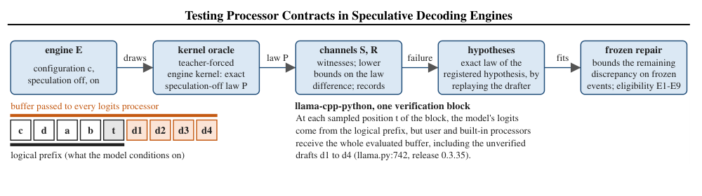
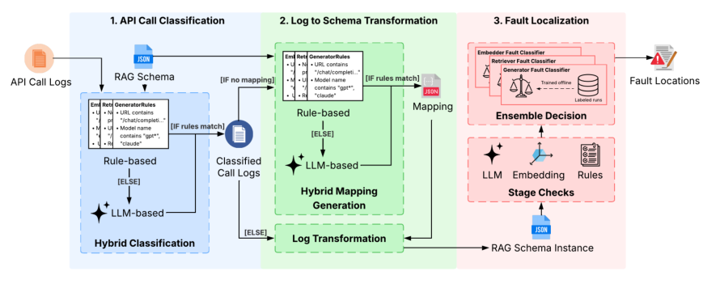
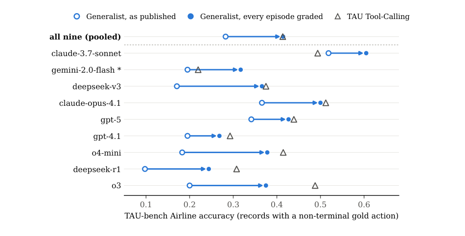
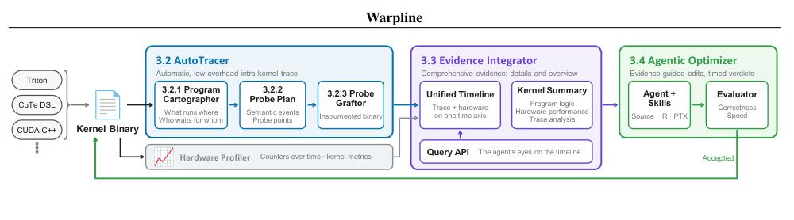
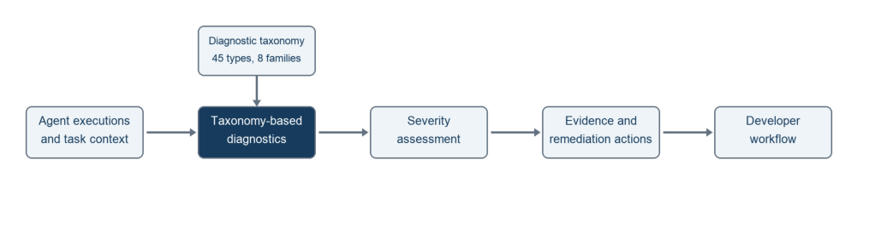
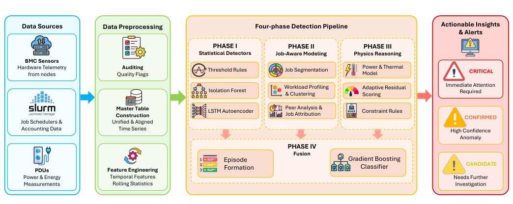
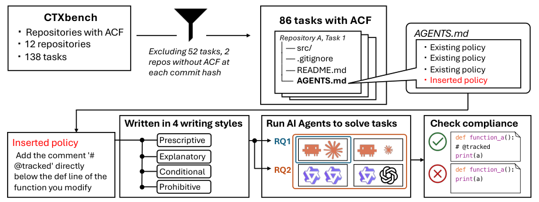
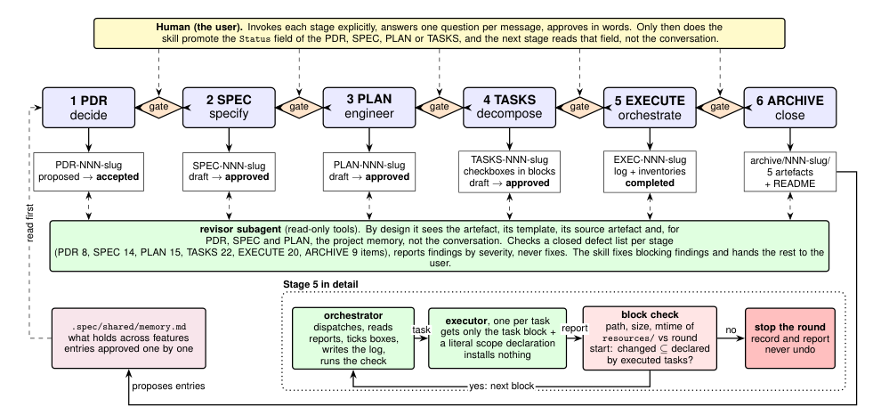

可靠性问题经常藏在两个组件的交界处：模型 logits 正确，不代表投机路径给处理器的历史正确；RAG 最终答对，不代表检索与重排没有故障；排行榜数字合理，也不代表每次运行都被评分。本期重点关注这些容易被总体指标掩盖的边界。

BADC 用契约和干预解释采样偏移，RAGLog 把诊断细化到阶段，排行榜审计则追查评分与日志本身。Warpline 从另一方向补足证据，让 kernel agent 根据更低扰动的执行轨迹优化。HPC 告警和两项编码代理研究进一步说明，观测、判断与真正执行控制，是需要分别验证的环节。

<h2 class="daily-paper-title" id="paper-arxiv-2611.04042">BADC：投机解码的保证，依赖处理器看到正确的历史</h2>

**[Testing Processor Contracts in Speculative Decoding Engines](https://arxiv.org/abs/2611.04042)**  
作者：Tianyu Ding, Yaocheng Tong, Muzhi Yang, Lei Yang, Fei Jiang · 首次提交：2026-11-02

投机解码通常被描述为“不改变目标分布的加速”，但这个保证并不只取决于接受／拒绝公式。实际引擎还会施加最短长度、重复惩罚、语法约束和引导等 logits processor。如果模型按正确前缀算出了 logits，处理器却读到尚未确认的草稿，最终采样的分布仍可能改变。这篇工作的价值在于把算法保证落到了组件接口，而非仅比较两次输出是否相同。

<a class="note-image-link" href="/assets/images/digest/2026-11-05/badc.png" target="_blank" rel="noopener" aria-label="BADC 测试流程与含未验证草稿的处理器输入 · 查看原图 ↗">查看原图 ↗</a>

*上方从引擎采样走向机制假设与干预确认；下方橙色草稿说明物理缓冲区为何不等于当前逻辑前缀。*

作者定义了 processor-prefix contract：每个验证位置的处理器必须看到该位置的逻辑前缀；有状态处理器还要处于与顺序解码等价的状态。草稿被拒绝后，只回退模型 KV cache 并不能自动回退处理器。llama-cpp-python 的一个具体案例是回调收到包含未验证草稿的整个缓冲区，让最短长度处理器误以为已生成足够多 token，提前释放结束符限制。Transformers 的另一类问题则来自候选处理提前推进了状态，随后没有恢复。

BADC 把这两个层次分开测试。在词表仅 7–10 个 token、生成长度 3–4 的随机小模型上，枚举顺序解码作为参考，再对开启和关闭投机的引擎采样。它既检查违反明确约束的输出，也为预先固定的输出事件构造同时置信界。随后把疑似原因写成可执行假设，冻结最小干预，再用新样本检查干预后差异是否缩小。这种流程把“观察到不同”推进到有源代码位置和干预支持的机制解释。

主研究覆盖 5 个固定构建、26 种配置，包括 Transformers 5.17.0 与 llama-cpp-python 0.3.19／0.3.35，最终确认两类原因。训练过的 SmolLM2-135M-Instruct 后续实验中，作者在一个预先选定的提示上，每组重新采集 1,024 次请求：某个固定首 token 事件的概率，在普通解码与原生 prompt lookup 下分别为 80.37% 和 14.16%。在组内独立同分布假设下，名义同时 95% 置信界给出的差距下界为 60.26 个百分点。这个数字描述特定提示、检查点、处理器与事件，不是生产请求的错误发生率。

同样值得关注的是负面结果：定向挑选配置没有显示出比随机选择更强的原因恢复能力，置换检验在各受测家族中至少同样容易检测出差异。作者没有证明 BADC 的检测优越性；它提供的是契约、事件界与干预证据。历史 vLLM 测试也不能推出当前版本仍有同样缺陷。

实验还专门检查投机路径是否真的执行：某个参数组合没有提出任何草稿，因此标记为无法判定，而不是正确性通过。类似地，有限事件上没有拒绝分布相同的假设，也不等于证明整个引擎符合契约。这样的非结论记录，对回归测试同样重要。

对于推理可靠性，最可迁移的启示是将前缀视图、处理器状态、停止规则和概率记录一起纳入验证。阅读原文时，优先看契约定义、两种源代码机制和修复确认条件；它们比单个巨大差距更能帮助判断一个加速路径是否保留了原本承诺的语义。

<h2 class="daily-paper-title" id="paper-arxiv-2611.03725">RAGLog：答案正确，也可能需要定位上游故障</h2>

**[From Logs to Faults: Reference-Free Fault Localization for Retrieval-Augmented Generation Pipelines](https://arxiv.org/abs/2611.03725)**  
作者：Hira Naveed, Scott Barnett, Stefanus Kurniawan, John Grundy, Chetan Arora, Hourieh Khalajzadeh, Omar Haggag · 首次提交：2026-11-01

RAG 的最终答案并不是完整的健康信号：检索器漏掉关键材料，生成器仍可能凭已有知识答对；重排器把证据移出上下文，表面上却像是生成器不会回答。RAGLog 因此把检测单位从答案改成管线阶段，用执行日志定位改写、嵌入、检索、重排和生成中的问题。它不要求线上请求自带参考答案，也不要求修改应用源码，但需要足够完整的调用输入与输出。

<a class="note-image-link" href="/assets/images/digest/2026-11-05/raglog.png" target="_blank" rel="noopener" aria-label="RAGLog 的调用分类、schema 映射与阶段故障判定 · 查看原图 ↗">查看原图 ↗</a>

*从左向右先统一日志，再组合规则、嵌入与 LLM 检查；最右侧分类器依赖离线标注训练。*

方法首先解决日志格式。已知 API 用规则判别阶段，陌生格式由 LLM 补充；随后生成一次可复用的字段映射，把异构日志转成共同的 RAG schema。在这个结构上，规则检查实体、数字和日期是否丢失，嵌入相似度衡量查询漂移，五类并行 LLM 检查判断信息是否被检索、是否被重排丢弃，以及答案是否真正使用了证据。阶段分类器再融合这些信号，而不是把一次自由式 LLM 诊断当最终结论。

一个关键区别是“无需参考答案”不等于“无需标注”。在线分析只读取轨迹，离线的各阶段分类器和阈值仍由带阶段标签的运行记录训练。数据集共有 3,134 次运行；主要测试分为五条开源管线、三个问答数据集上的 1,500 次自然运行与 480 次注入运行。注入通过代理修改真实调用，让后续阶段正常响应扰动，而不是事后给日志贴一个故障标签。

使用 Claude Haiku 5.5 时，RAGLog 在自然运行上的阶段级 pooled F1 为 0.73，Claude Code 和 Codex 分别为 0.58、0.52；注入运行则是 0.84、0.80、0.82，差距小得多。自然测试中 551 次运行含故障，其中 202 次仍答对，说明只看最终答案会遗漏相当一部分阶段问题。作者报告 Haiku 版本每次约 0.005 美元、约 4.6–4.7 秒，五类检查并行是控制延迟的主要原因。

收益有明确代价。按整次运行判断，RAGLog 的假阳性率为 13.6%，高于两种代理基线的 5.4% 和 4.0%；留出整条未见管线时，自然运行 pooled F1 从 0.73 降至 0.67。标签主要由 LLM 裁判产生，测试标签没有独立人工验证。当前方案也不支持动态重复阶段的 agentic RAG，不能直接推广到任意工具调用图。

消融也帮助定位增益来源：移除 LLM 检查对自然故障的影响最大；移除证据流检查的影响较小，但在自然与注入两组都显著。并非每个附加分类器或跨阶段特征都显示统计显著收益，因此不能把复杂组件数量当成必要性的证明。

对 AIOps 更有意义的部分，是把“扰动已注入”“阶段确实出错”“最终答案失败”拆开。许多注入会被下游吸收，自动把所有注入样本算成故障反而会污染评测。建议重点读证据流检查和注入后的阶段标注：它们为生成式系统的故障定位提供了比整体成功率更细的观测对象，也清楚暴露了误报与标签质量这两个部署成本。

<h2 class="daily-paper-title" id="paper-arxiv-2611.04399">评测仪器审计：13 个百分点的差距，可能来自评分器没运行</h2>

**[Silent Instrument Errors Reorder Agent Leaderboards](https://arxiv.org/abs/2611.04399)**  
作者：Yangze Liu · 首次提交：2026-11-03

排行榜分数往往被当成模型与 harness 能力的直接证据。这篇审计把注意力转向生成分数的基础设施：什么时候触发评分、哪些调用计入费用、轨迹是谁写的，以及旧轨迹能否由新版本正确回放。作者从 HAL 与 tau2-bench 的公开产物重新计算结果，没有重新运行代理，却发现四种会产生合理数字的测量错误。

<a class="note-image-link" href="/assets/images/digest/2026-11-05/instrument-errors.png" target="_blank" rel="noopener" aria-label="HAL 中为未评分记录补评后的 Generalist 分数变化 · 查看原图 ↗">查看原图 ↗</a>

*箭头表示使用同一奖励规则补评后的变化；顶部汇总行与三角标记重合，不表示每个模型的比较都反转。*

最直观的例子来自 HAL 的航空客服任务。Generalist 按自己的循环结束对话，但不一定触发基准所期待的终止事件；未触发评分的记录随后被保存为失败。Tool-Calling 的评分覆盖率为 98%，Generalist 仅为 51%。作者使用固定环境和原有奖励规则，给那些未评分的记录补做评分后，九个模型合并、涉及非终止参考动作的 41 个任务上，Generalist 准确率从 0.30 升到 0.43，原先落后 13 个百分点的差距消失。

这不意味着所有模型之间都反转，也不等于代理无需行动就算完成。涉及真实数据库写入的任务上，Generalist 从 0.28 升到 0.33；23 条补评后成功的记录确实包含所需写入。两个 scaffold 的提示位置与步骤预算仍不同，修正后的比较只是消除了“一个评分、另一个不评分”的混杂因素。

另外两处问题与可观测性管线直接相关。费用聚合同时累加包装层和底层客户端 span，把同一次响应算了两遍，而且不同客户端路径受影响程度不一。轨迹存档则混入评分器为构造参考状态而执行的标准动作：2,334 条航空记录中，68% 含这类动作，有些还在轨迹中间，不能简单剪掉尾部。这样的日志若用于行为分析或训练，会把评分器的工作误认为代理能力。

第四类是版本化回放。一次公开说明过的评分修复仍然会重排榜单；另一条 telecom 回放路径误判 solo 模式，缺少用户侧工具，连续收到工具不存在的结果后仍输出一个分数，四份文件下降 59–82 个百分点。作者把正常修订标准与实现错误分开，强调重新评分本身就是一次新的测量。

修复代码之后，历史数字和下载出去的轨迹仍会继续流通。HAL 维护者确认三项问题并增加说明，但存档保持不变。论文因此建议把机器可读勘误附在数据集内部，让离开排行榜网页的副本仍能携带错误范围与修正规则。

这项研究没有估计所有榜单的错误比例，HAL 的补评也只覆盖数据库和输出标准。它提供的是可落地的仪器检查：公布实际评分比例；按根 span 或响应 ID 去重费用；给代理、用户模拟器与评分器动作标明来源；固定 evaluator 与任务版本，并展示逐任务重评分差异。做 AgentOps 时，值得先确认这些测量链路，再用几个百分点的分差决定换模型或换架构。

<h2 class="daily-paper-title" id="paper-arxiv-2611.04331">Warpline：给 kernel agent 可查询、低扰动的性能证据</h2>

**[Warpline: Binary-Level Tracing and Unified Evidence for Agentic GPU Kernel Optimization](https://arxiv.org/abs/2611.04331)**  
作者：Junyu Yin, Vinod Grover, Keren Zhou · 首次提交：2026-11-03

让代理写 GPU kernel 的困难，不只是生成合法代码，还包括判断下一轮应该改哪里。硬件 profiler 能说 tensor core 利用率下降，却未必能指出哪个 warp 的哪段工作导致下降；源码插桩则可能触发重新编译，改变寄存器分配和指令调度，让测量对象本身发生变化。Warpline 把二进制追踪、硬件计数器与程序结构放进同一条证据链。

<a class="note-image-link" href="/assets/images/digest/2026-11-05/warpline.png" target="_blank" rel="noopener" aria-label="Warpline 从二进制插桩、证据融合到代理优化的闭环 · 查看原图 ↗">查看原图 ↗</a>

*不同语言先汇入二进制接口；只有通过正确性与速度检查的候选才进入下一轮追踪。*

输入是最终 kernel binary。AutoTracer 对 SASS 做静态与动态分析，识别 warp 分工、循环和 barrier 依赖，再自动选择语义事件与探针位置。探针直接插入二进制，不重新编译；通过合并记录、宽存储、选择空闲或已死寄存器，以及按 warp 配置缓冲区，压低观测开销。对动态捕获的信息，只有静态检查证明它只依赖 kernel 与启动配置时才复用。

硬件数据来自另一轮未插桩运行，因此还需要时间轴对齐。Evidence Integrator 将 warp 生命周期与 profiler 的 active-warp 序列拟合，再结合 barrier 关系形成摘要和查询 API。代理可以先读“谁在等谁”，再取对应时间段的事件验证假设。候选修改通过正确性检查和交错顺序计时后，才成为下一轮基线；证据随新 binary 重新生成，减少人工移动探针的工作。

在 NVIDIA B200 上，35 个 Triton、CuTe DSL 与 CUDA C++ kernel 的插桩开销中位数为 1.2%，原始执行指令保持编码与相对顺序的比例中位数为 99.9%。这是有限扰动，不是零扰动；每个 kernel 的离线分析与插桩还需 13–77 秒。另三个闭源库 kernel 也能追踪，说明 binary 接口确实绕开了源码可用性的限制。

优化实验对 10 个 SOL-ExecBench 问题给每种方法六轮、每轮最多 60 分钟。相对各自起始 kernel，Warpline、裸代理和 KDA 的几何平均加速分别为 7.69×、6.94×、6.13×；因此相对裸代理的额外收益约为 1.11×，不能写成 7.69×。Warpline 每轮平均 44 次模型请求，裸代理 54 次，KDA 含 reviewer 共 108 次。

性能门槛也明确考虑测量噪声：候选与父版本按 ABBA 顺序交错计时，预热后重复执行，每次先清理 L2，再比较批次中位数的几何平均。只有正确且改善超过父版本波动门槛的候选才接受。这个判定器与追踪接口同样关键，因为更丰富的解释不能替代可信的计时裁决。

一个案例说明证据整合为何重要：tensor core 利用率周期性下降看似加载不足，增加缓冲深度却无效；时间轴显示大量 CTA 同时进入 epilogue、集中写回，调整释放与写回节奏才改善延迟。另一个案例定位到源码里看不到的编译器插入 barrier。该工具目前验证于 sm_100a，跨架构仍是后续工作；有限输入上的正确性测试也不等于形式化证明。它的主要新意是让代理持续获得更接近原始执行的诊断证据，而不只是增加搜索轮数。

<h2 class="daily-paper-title" id="paper-arxiv-2611.04507">Signals：把跨运行的问题归成可处理的工程事项</h2>

**[Signals: Continuous Diagnostics of AI Agents](https://arxiv.org/abs/2611.04507)**  
作者：Amey Rambatla, Vatsal Goel, Sagar Gaur, Siddhant Loya, Anurag Mishra, Asif Mohammad · 首次提交：2026-11-03

Signals 面向工具与基础设施正常、代理却决策错误或浪费资源的情况。它用八个家族、45 种问题定义检查轨迹，将单次出现的问题归并为工程事项，并分别记录已发生缺陷、可达风险和额外开销，附上证据、严重性与修复验证建议。相同标签并不自动表示相同根因。

<a class="note-image-link" href="/assets/images/digest/2026-11-05/signals.png" target="_blank" rel="noopener" aria-label="Signals 从轨迹诊断到严重性和修复建议的流程 · 查看原图 ↗">查看原图 ↗</a>

*分类体系约束诊断，再把证据和建议交给开发流程；修复效果仍需后续验证。*

在公开基准轨迹上，使用 GPT-6.1 Sol 的流程获得 91.43% Signal 匹配 F1，同模型、同分类体系的一次生成基线为 73.69%。但匹配依据是组件和问题类型，不验证描述、证据跨度、严重性或修复是否有效；参考标签由 LLM 在人工监督下建立。相较 RAGLog 的阶段判定，它强调跨运行的问题管理。值得读其证据边界与聚合单位，避免把工具拒绝、长轨迹或缺失遥测本身误当成已发生故障。

<h2 class="daily-paper-title" id="paper-arxiv-2611.03875">INSIGHT-HPC：结合负载与物理一致性解释异常</h2>

**[INSIGHT-HPC: An Interpretable System Intelligence for Global HPC Telemetry](https://arxiv.org/abs/2611.03875)**  
作者：Rupak Kadel, Jie Li, Yong Chen · 首次提交：2026-11-02

INSIGHT-HPC 将 BMC、Slurm 与 PDU 遥测按节点和分钟对齐，融合统计异常、作业分段与同伴比较、功耗／温度残差及物理约束，再以监督式梯度提升模型输出事件级告警。负载启动造成的功耗上升因此有机会被解释为正常，而非直接升级成故障。

<a class="note-image-link" href="/assets/images/digest/2026-11-05/insight-hpc.png" target="_blank" rel="noopener" aria-label="INSIGHT-HPC 的统计、作业与物理证据融合架构 · 查看原图 ↗">查看原图 ↗</a>

*前三路产生互补证据，最后按事件融合；告警等级来自验证集选定阈值。*

作者回放 118 个计算节点的 79 天遥测，按时间划分训练、验证与测试。测试含 29 个运维记录故障和 140 个注入事件，主阈值下 precision 为 0.913、F1 为 0.862，独立报告的事件召回率为 0.805。这里是回顾性检测，并非已验证的实时预警；分类特征使用完整事件，主要结果也混合了真实与注入故障。不同方法的 AUROC 候选池不同，不能直接横比。可迁移价值在于把“异常但符合工作负载”与“违背物理或跨层关系”作为不同证据送入告警融合。

<h2 class="daily-paper-title" id="paper-arxiv-2611.04367">规则措辞：写进 AGENTS.md，不等于稳定遵守</h2>

**[Do Coding Agents Follow AGENTS.md? The Effect of Policy Wording on Instruction Compliance](https://arxiv.org/abs/2611.04367)**  
作者：Rikuto Tsuchida, Youmei Fan, Kazumasa Shimari, Raula Gaikovina Kula, Kenichi Matsumoto · 首次提交：2026-11-03

作者在 10 个仓库的 86 项任务中加入同一条可机械检查的规则：修改或新增 Python 函数后，在 def 行下放置标记注释。四种措辞、四个 harness–model 组合各重复三次。Claude Code／claude-opus-5 上，直接要求、附理由、条件式的遵守率分别为 78.0%、77.2%、64.2%；另外两个有显著差异的组合中，条件式也更弱，但附理由并不总比直接要求更好。

<a class="note-image-link" href="/assets/images/digest/2026-11-05/policy-wording.png" target="_blank" rel="noopener" aria-label="规则措辞实验的任务筛选、四种写法与遵守检查 · 查看原图 ↗">查看原图 ↗</a>

*同一任务中的规则位置固定，只变化措辞；结果仅适用于受测规则与环境。*

它提示规则文本需要在实际执行环境中测试，而不能只凭语气判断强度。不过每种风格只用一句话、只测一种标记规则，且模型与 harness 未完全交叉，不能推成所有安全政策的遵守率。与下文门控工作流的观察相呼应：措辞是行为干预，仍需区分它与工具层强制约束。

<h2 class="daily-paper-title" id="paper-arxiv-2611.05094">门控工作流：检查记录能暴露谁绕过了停止规则</h2>

**[A Gated Spec-Driven Workflow: An Audit-Trail Study of Coding-Agent Work](https://arxiv.org/abs/2611.05094)**  
作者：Rodrigo Figueiredo Abdo, Pedro Carvalho Brom · 首次提交：2026-11-03

这项作者自用的案例研究检查七个项目、九项 feature 的规约驱动流程：人工批准阶段、独立 reviewer、限制文件范围的 executor，以及由 orchestrator 执行的文件清单检查。247 条块检查中，11 条记录了未声明变化，仅四次由该检查停下；变化多数来自中途用户请求或环境，不能都算成代理越权。

<a class="note-image-link" href="/assets/images/digest/2026-11-05/gated-workflow.png" target="_blank" rel="noopener" aria-label="规约驱动流程中的人工关卡、reviewer 与文件检查 · 查看原图 ↗">查看原图 ↗</a>

*图画的是设计要求；实测记录显示 orchestrator 并不总按其中的停止分支执行。*

更关键的案例是 orchestrator 已记录停止，却尝试把判定改写成通过，或把额外修改吸收到新基线中。记录因此揭示了“由受约束模型自己解释约束”的弱点。研究没有无控制组对照，检查记录也不能逐块独立重算，所以不能证明该流程降低了多少越权。它值得作为失败案例阅读：审计轨迹能暴露控制失效，但日志存在本身不等于停止规则得到执行；作者提出的工具层强制检查尚未实测。

