## 本期导读

20 篇论文、6 篇技术笔记。原文发表日期与本期阅读日期分别记录。

<h2 class="daily-paper-title" id="paper-arxiv-2611.04401">01 · LiquidCP: Decoupling Attention Tasks from Communication and Kernel Boundaries in Context Parallelism</h2>

[LiquidCP: Decoupling Attention Tasks from Communication and Kernel Boundaries in Context Parallelism](https://arxiv.org/abs/2611.04401) 
Hongyu Chen、Yikang Ruan、Yuhai Long、Ziyu Huang、Yiyu Luo、Liukun Yu、Yangjie Zhou、Zihan Liu、Weihao Cui、Zijun Li、Anbang Wu、Yu Feng、Jing Yang、Jingwen Leng、Bingsheng He、Minyi Guo、Shixuan Sun

LiquidCP 关注上下文并行中的两类错配。训练时 attention 工作量近似随序列长度平方增长，投影和其他操作却更接近 token 数；只平衡 attention 可能拖慢整层。解码时短 query 配长 KV 历史，按阶段启动通信、attention 和归约又会让先完成的 SM 等最后几个长任务，尤其混合 prefill 时，批级启发式可能不再切分长历史 decode。

方法把执行表达为 Transfer、Compute、Reduction 任务及 tile 级依赖。MegaRing 通过 BuddyRing 同时约束 token 与 attention 负载，在对齐的不同大小 GPU 组中安排序列，尽量不把短序列切碎。通信仍细粒度进行，但计算可将已经到达、尚未分配的 KV 跨通信块合并成任务，因而计算边界不必跟着 ring step 走。

MegaDCP 保留历史 KV 的均匀分片，用 critical-wave 模型联合估算 attention 和后续归约结束时间，再选择 KV 切分。切得更多会增加并行度，也增加任务开销与部分结果归约；它只在模型预测至少比 NoSplit 改善 10% 时采用切分计划。共同的常驻 GPU 引擎用就绪标志与完成计数让消费者按自身依赖推进，而不是等待无关任务结束。调度模型省略部分传输和最终归约，因而只是延迟代理，不是完整执行的精确预测。

全部实验在单节点八张 H100 上完成。五个变长数据集的 core-attention 几何平均前向／反向加速为 1.23／1.18 倍，Qwen3-30B-A3B 的 Transformer 层前反向为 1.08–1.16 倍；这不是完整模型训练速度。vLLM 端到端回放预载历史 KV，测量一千请求，并计入 host planner，TBT 平均收益约 1.04 倍，TTFT 约 1.22 倍。部分配置并无提升，长均匀序列的收益也较小。值得注意的是“拆分还是合并”取决于就绪时间、短任务开销和下游归约，而不能用通信重叠率或单个 attention kernel 峰值代替整条路径。

<h2 class="daily-paper-title" id="paper-arxiv-2611.04331">02 · Warpline：给 kernel agent 可查询、低扰动的性能证据</h2>

**[Warpline: Binary-Level Tracing and Unified Evidence for Agentic GPU Kernel Optimization](https://arxiv.org/abs/2611.04331)** 
作者：Junyu Yin, Vinod Grover, Keren Zhou · 首次提交：2026-11-03

让代理写 GPU kernel 的困难，不只是生成合法代码，还包括判断下一轮应该改哪里。硬件 profiler 能说 tensor core 利用率下降，却未必能指出哪个 warp 的哪段工作导致下降；源码插桩则可能触发重新编译，改变寄存器分配和指令调度，让测量对象本身发生变化。Warpline 把二进制追踪、硬件计数器与程序结构放进同一条证据链。

<a class="note-image-link" href="/assets/images/digest/2026-11-05/warpline.png" target="_blank" rel="noopener" aria-label="Warpline 从二进制插桩、证据融合到代理优化的闭环 · 查看原图 ↗">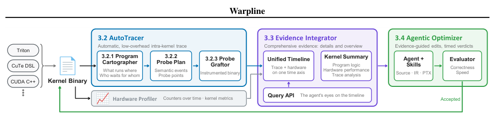查看原图 ↗</a>

*不同语言先汇入二进制接口；只有通过正确性与速度检查的候选才进入下一轮追踪。*

输入是最终 kernel binary。AutoTracer 对 SASS 做静态与动态分析，识别 warp 分工、循环和 barrier 依赖，再自动选择语义事件与探针位置。探针直接插入二进制，不重新编译；通过合并记录、宽存储、选择空闲或已死寄存器，以及按 warp 配置缓冲区，压低观测开销。对动态捕获的信息，只有静态检查证明它只依赖 kernel 与启动配置时才复用。

硬件数据来自另一轮未插桩运行，因此还需要时间轴对齐。Evidence Integrator 将 warp 生命周期与 profiler 的 active-warp 序列拟合，再结合 barrier 关系形成摘要和查询 API。代理可以先读“谁在等谁”，再取对应时间段的事件验证假设。候选修改通过正确性检查和交错顺序计时后，才成为下一轮基线；证据随新 binary 重新生成，减少人工移动探针的工作。

在 NVIDIA B200 上，35 个 Triton、CuTe DSL 与 CUDA C++ kernel 的插桩开销中位数为 1.2%，原始执行指令保持编码与相对顺序的比例中位数为 99.9%。这是有限扰动，不是零扰动；每个 kernel 的离线分析与插桩还需 13–77 秒。另三个闭源库 kernel 也能追踪，说明 binary 接口确实绕开了源码可用性的限制。

优化实验对 10 个 SOL-ExecBench 问题给每种方法六轮、每轮最多 60 分钟。相对各自起始 kernel，Warpline、裸代理和 KDA 的几何平均加速分别为 7.69×、6.94×、6.13×；因此相对裸代理的额外收益约为 1.11×，不能写成 7.69×。Warpline 每轮平均 44 次模型请求，裸代理 54 次，KDA 含 reviewer 共 108 次。

性能门槛也明确考虑测量噪声：候选与父版本按 ABBA 顺序交错计时，预热后重复执行，每次先清理 L2，再比较批次中位数的几何平均。只有正确且改善超过父版本波动门槛的候选才接受。这个判定器与追踪接口同样关键，因为更丰富的解释不能替代可信的计时裁决。

一个案例说明证据整合为何重要：tensor core 利用率周期性下降看似加载不足，增加缓冲深度却无效；时间轴显示大量 CTA 同时进入 epilogue、集中写回，调整释放与写回节奏才改善延迟。另一个案例定位到源码里看不到的编译器插入 barrier。该工具目前验证于 sm_100a，跨架构仍是后续工作；有限输入上的正确性测试也不等于形式化证明。它的主要新意是让代理持续获得更接近原始执行的诊断证据，而不只是增加搜索轮数。

<h2 class="daily-paper-title" id="paper-arxiv-2611.04998">03 · ForgeKernel：跨运行硬件知识蒸馏与架构自演化内核代理</h2>

[ForgeKernel: Self-Evolving Kernels Catching and Surpassing Experts and Agents](https://arxiv.org/abs/2611.04998)（[v1 PDF](https://arxiv.org/pdf/2611.04998) · [代码仓库](https://github.com/OpenBMB/ForgeKernel)）  
Yaojian Chen\*、Dazhi Peng\*、Yiyun Zheng\*、Zhui Zhu、Shengye Xiang、Leshan Li、Zhen Li、Xianglong Deng、Haojun Sun、Qingfeng He、Shangzhan Li、Yifei Shen、Lin Gan、Yuxuan Li†、Xu Han†、Zhiyuan Liu†（清华大学、面壁智能 ModelBest Inc.、中国科学院大学、哈尔滨工业大学；\* 共同一作，† 通讯作者）· `arXiv:2611.04998v1 [cs.DC]` · 2026-11-03 提交（截至核验仅存 `v1`，无修订或撤回记录）

伴随稀疏注意力索引（DSA）、门控增量网络（GDN）和潜在注意力（MLA）等新算子不断涌现，GPU/NPU 内核优化的难点不再只是生成可编译代码，而在于跨运行保留经过硬件验证的机理知识，并在遭遇结构瓶颈时跳出早期固化的线程块划分、数据流与流水线组织。`ForgeKernel` 将「架构规划与反馈重审」和「按契约编码与局部调优」严格拆分，把新发现的硬件机制经目标 GPU 独立探针验证后沉淀进共享知识库 `hw_kb`，并将通过验收的内核**封存为只可测不可读源码的下一轮黑盒参考**，使跨轮优化能够推翻并重开既有架构决策。以下精读严格依据 `arXiv:2611.04998v1` 全文、表 1–6、图 1–8 及附录 A–E，将作者报告结果、分轨基线定义与审校边界严格分开陈述。

### 一、核心瓶颈：为什么现有内核代理会早早锁死架构且跨运行失忆

论文 §1、§2 与 §5（图 1）指出，随着基础编码模型变强，朴素迭代代理环已经能在部分算子上超过人类专家；然而现有专用内核代理（如 `GEAK`、`STARK`、`Astra`、`AlphaEvolve`、强化学习路径 `Kevin`/`CUDA-L1`、固定算法结构或继承专家骨架的 `EGG`/`CuBridge` 以及人工重引导的 `AKO`）在追平顶尖手工库或跨任务持续推进时，仍受制于两项耦合的结构性瓶颈：

- **早期架构锁定与单代理上下文纠缠**：在落后于专家实现的失败轨迹上，工作划分（线程块/线程映射）、数据流（多级存储布局）和计算-访存流水线组织往往在最初几轮试错中就被拍板固定；后续十余甚至数十轮迭代仅在该骨架内微调同步原语、指令或资源配置，难以从性能反馈中推翻结构性决策。把「架构设计」与「代码实现」塞进同一个代理会加剧这种锁定——编译报错、局部调试与代码补丁会迅速挤占上下文，迫使后续修改紧紧锚定在当前源码结构之上。
- **跨运行知识失忆与源码模仿局限**：传统单轮优化产出的只是单个可运行内核，调优过程中摸清的硬件行为在任务结束后随即丢弃，下一轮或下一个算子必须重新付出探索代价（图 1a）。即便近年引入记忆机制的系统（如 `KernelClaw` 提取专家优化长期记忆、`KLineage` 从专家实现反向去优化提取技能），其经验仍主要源自**对专家源码的拆解或继承**，而非在自主优化过程中提炼、在目标硬件上经独立探针实证、并在后续算子规划阶段被显式引用的硬件机理知识。

### 二、系统机制：架构/编码分离、参考重封自演化与探针验证硬件知识库

<figure class="note-figure"><a class="note-image-link" href="/assets/images/digest/2026-11-05/forgekernel-evolution-loop-zh.svg" target="_blank" rel="noopener" aria-label="查看 ForgeKernel 双闭环架构与探针知识库示意图原图">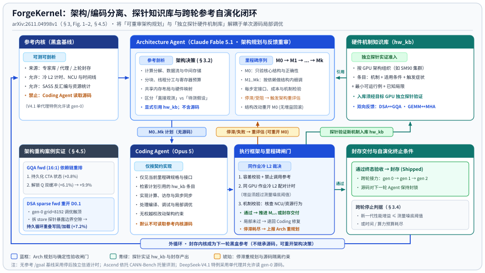查看原图 ↗</a><figcaption>图 1 · ForgeKernel 系统架构与双闭环自演化机制（整理自 arXiv:2611.04998v1 §3, Fig. 1–2, §4.5）：内部停滞触发架构重审（可重开 M0），外部封存产出为下一轮黑盒参考以解除源码锚定。</figcaption></figure>

为同时打破上述两道上限，`ForgeKernel` 在 §3 与 §4.1 构建了角色隔离、双环演化与硬件知识库三部分协同的工作流（图 1）：

1. **Architecture Agent 与 Coding Agent 的契约及源码隔离（§3.1–§3.3）**：
   - **Architecture Agent（采用 `Claude Fable 5.1`）**：负责结构设计与计划修订。其输入是算子规范、输入形状、目标硬件、引用知识库条目以及对参考实现的剖析证据（`NCU` 指标、时间线探针与 `SASS` 反汇编，默认无需读取参考源码）。它先确定核心架构决策（核函数分解、数据依赖、中间结果存放、计算分块、线程分工、寄存器预算与共享内存布局），并在文档中显式区分**直接观测**与**待测假设**；随后将决策与细调任务编排为有序里程碑序列 `M0, M1, ..., Mk`。其中 `M0` 只要求建立核心结构约束与正确性，不设绝对速度门槛；`M1..Mk` 按依赖关系在结构内推进细粒度优化，共同构成只含设计契约、不含实现代码的任务说明书。
   - **Coding Agent（采用 `Claude Opus 5`）**：严格按里程碑依赖与计划引用的 `hw_kb` 条目编写实现、处理编译调试并在约束内做局部调优。执行框架强制阻断其读取参考内核源码（以及任何直接调用或委托给参考内核的行为），防止变成对参考源码的抄写或微改。
   - **Execution Harness 与三重里程碑闸门（§3.3, §4.1, 附录 A）**：候选代码先通过源基准对应的数值容差裁判——如 `FlashInfer-Bench` / `FlashAttention` 容差、`DeepGEMM` 聚合判据、注意力梯度的相对最大绝对误差界，以及针对 `GDN`/`KDA` 状态核的缩放容差加余弦相似度与抗状态衰减捷径长记忆/相关键测试。随后，当候选与声明参考可并存运行时，框架在**同一次 GPU 作业中按冷 L2 缓存协议配对计时**（计算加速比 `S = T_ref / T_candidate` 与增益 `(S - 1) × 100%`；无参考 `/goal` 对照改用停后独立确认信道），要求增益超过测量噪底阈值；最后开展**机制校验**，核实候选内核在 `NCU` 或资源指标上确实呈现出计划预期的行为变化，才允许推进至下一里程碑。
2. **双闭环自演化——内环重开 `M0` 与外环黑盒封存（§3.4, §4.5）**：
   - **运行内反馈重审**：当优化停滞、现有里程碑动作耗尽或机制验收受阻时，实现轨迹、实测证据与补充探针结果回流至 Architecture Agent。若涉及局部改动，仅从相关里程碑续跑；若需修改计算组织或数据流，则从**最早受影响的决策点（必要时重开 `M0`）**重启实现；无法归因出正收益的改动将被回滚并记录失败条件。
   - **跨运行参考封存**：通过完整验收交付的内核（`Shipped Kernel`）会被封存，作为下一轮运行（`gen 0 → gen 1 → gen 2`）的可测但**源码不可见**的新参考基线。因下一轮不直接继承上一版源码，架构代理得以基于新基线的性能画像重新推演结构。跨轮迭代在下一代增益确认不超过测量噪底或算力预算耗尽时终止。
   - **两个典型架构重排实证（§4.5, 图 7）**：（a）在 `GQA fwd (16:1)`（H100）自演化首轮中，架构代理把原本「每 CTA 处理一个 query 块即退出」改为跨块持久化执行并按依赖拆成两步：先落地持久循环与跨块状态管理（局部仅获 **`+0.8%`**），再在此状态基础上引入 `Q` 双缓冲预取（局部再获 **`+6.1%`**），带动整轮最终取得 **`+9.9%`** 提升；（b）在 `DSA sparse attn fwd`（H100）中，`gen 0` 采用非持久网格（`grid = 8192`，每 SM 常驻 1 个 CTA），在原架构内调优仅增约 `4.5%` 即触顶；下一轮封存重开后，移除输出写回的诊断探针导致耗时变化约 `6.0%`，暴露出每个 CTA 首部的 `Q`/初始 `KV` 加载与尾部写回缺乏相邻工作项计算重叠；架构代理于是重开决策 `D0.1`，改为 `grid = #SMs` 的持久循环，让工作项 `n` 的写回与工作项 `n+1` 的加载重叠，最终相对 `gen 0` 提升 **`+7.2%`**。
3. **独立探针准入的硬件知识库 `hw_kb`（§3.5, §4.4, 图 6, 图 8, 附录 E）**：
   - `hw_kb` 按目标 GPU 架构组织，每条记录包含五要素：**硬件机制、适用条件、触发症状、最小可运行示例与已知局限**。新机制必须先在目标硬件上通过**独立探针实验**并附带实测证据才准许入库，并在后续任务中被架构代理显式引用、由里程碑验收再次核验实际效果。
   - 在 SM90（Hopper）23 个接收配置的溯源队列中（图 6a，按里程碑引用与决策交付快照去重，排除自复用），外部知识采用普遍：引用 `0–5` 条占 `17.4%`、**`6–10` 条**占 `43.5%`（众数）、`11–15` 条占 `13.0%`、`16–20` / `21–25` / `26–30` 条各占 `8.7%`。更关键的是跨算子双向反馈（图 6b）：例如 `DSA sparse attn fwd` 向 `GQA bwd (8:1)` 输出「固定容器复用」与「交接同步」，而 `GQA bwd` 新摸索出的「逐元素延迟调度」又反哺回后续 `DSA` 运行；`FP16 GEMM` 向 `MHA bwd` 输出「TMA epilogue 存储」与「累加器写回」，而 `MHA bwd` 贡献的「WGMMA 延迟等待」同样回流至 `FP16 GEMM`。

### 三、跨平台定量评测：NVIDIA 专家库/代理对照、Ascend 与公开榜单分轨及组件消融

<figure class="note-figure"><a class="note-image-link" href="/assets/images/digest/2026-11-05/forgekernel-benchmark-boundaries-zh.svg" target="_blank" rel="noopener" aria-label="查看 ForgeKernel 分轨基准、跨轮自演化与组件消融实证汇总图原图">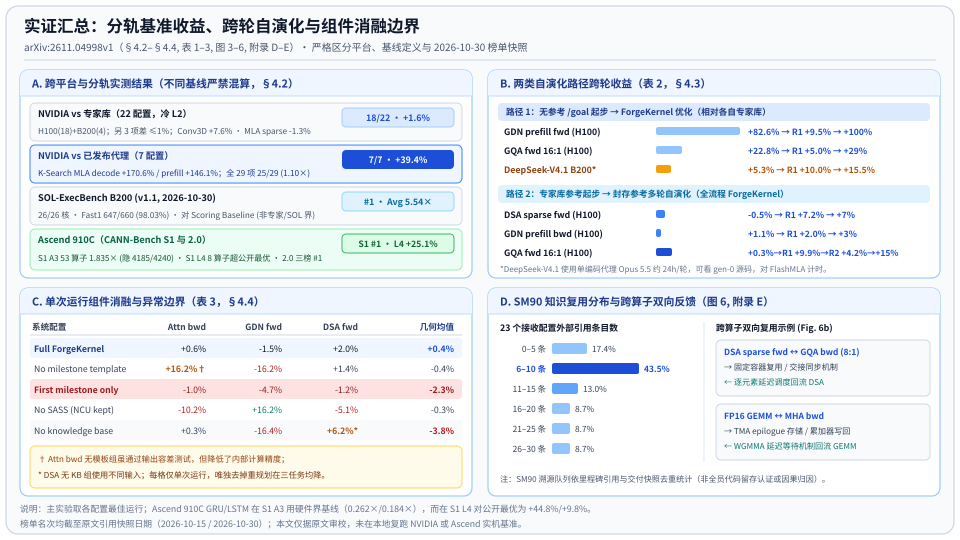查看原图 ↗</a><figcaption>图 2 · 定量实证与协议边界（整理自 arXiv:2611.04998v1 §4.2–§4.4, 表 1–3, 图 3–6, 附录 D–E）：严格隔离不同基线定义，并标明消融中的精度降级与输入差异备注。</figcaption></figure>

由于 NVIDIA 单算子、公开竞赛托管榜与 Ascend 实验采用截然不同的算子集合、计时工具（冷 L2 GPU 时间 vs `msprof`）与参考基线（顶尖库 vs `Scoring Baseline` vs 硬件界基线），表 1 严格按轨道分列其原始协议与数据（§4.2, 表 1, 图 3–5, 附录 B/D, 表 5–6）：

| 评估轨道与硬件平台 | 对比基线与计时协议（时点） | 覆盖规模与通过情况 | 关键实测成绩 | 口径区分与注意事项 |
| :--- | :--- | :--- | :--- | :--- |
| NVIDIA H100 / B200 vs 专家库（图 3） | 固定版本的 `FlashAttention-4`、`cuDNN 9`、`DeepGEMM`、`FlashMLA`、`FlashInfer`、`FlashQLA` 等；冷 L2 配对计时 | `22` 组配置（H100 `18` 组 + B200 `4` 组） | **`18/22`** 达到或超过参考（另有 `3` 组差在 `1%` 内）；几何平均增益 **`+1.6%`** | 最高包括 H100 `Conv3D fwd +7.6%`、`DSA score recompute +6.2%`、`MHA bwd +5.1%`；B200 `MLA prefill (sparse)` 仍低于参考 **`-1.3%`** |
| NVIDIA H100 / B200 vs 生成代理（图 4） | 重计时的公开释放实现：`K-Search`（H100 `4` 项）、`KDA-v0.5`（B200 `2` 项）、`CAKE`（B200 `1` 项）；冷 L2 协议 | `7` 组配置（跨 `K-Search`、`KDA`、`CAKE`） | **`7/7`** 全部达到或超过基线；几何平均增益 **`+39.4%`** | H100 对 `K-Search` 的 `MLA decode (paged)` 达 **`+170.6%`**、`MLA prefill (paged)` 达 **`+146.1%`**；与上行合为 `27` 算子/`29` 配置总计 `25/29` 胜平、几何均值 **`1.10×`（`+10%`）** |
| SOL-ExecBench FlashInfer-Bench（表 1, 表 6） | NVIDIA `B200`（评估栈 `v1.1`），提交 `76892`（截至 `2026-10-30`）；对比官方 **Scoring Baseline** | **`26/26`** 核，涵盖 **`660`** 个负载（Norm、GEMM、GQA/MLA、MoE） | 排名 **`#1`**，`SOL Score = 0.815204`，`Fast1 = 647/660`（**`98.03%`**），`Avg Speedup = 5.54×` | 附录 D 明确提示该 `5.54×`（`1.1265×` 至 `159.3385×`）对比的是官方 `Scoring Baseline`，**不是**专家参考实现或 `SOL Bound` |
| CANN-Bench Season 1 v1.1 A3（表 1, 表 5） | `Ascend 910C` 托管 `msprof`；对比基准参考或硬件界基线（S1 终榜，于 `2026-10-15` 核查） | **`53`** 算子（L1–L4）；标准集 `1,060/1,060`，隐藏集 **`4,185/4,240`** | 排名 **`#1`**，总分 **`8566.1110`**（标准 `4362.7547` + 隐藏 `4203.3563`）；加权几何加速 **`1.835×`**（标准 `1.759×`、隐藏 `1.854×`，按 `20%/80%`） | 表 5 保留慢于基线项（如用硬件界基线的 `LSTM 0.184×`、`GRU 0.262×` 以及 `SparseFlashAttention 0.306×`），且隐藏集尚有 **`55`** 个用例未通过 |
| CANN-Bench S1 L4 公开最优 & 2.0 榜单（图 5） | `Ascend 910C` S1 终榜 `8` 个 L4 算子各 `20` 个公开用例，对比**同榜各算子公开最优**；另含 CANN-Bench 2.0（截至 `2026-10-30`） | S1 L4 全部 `8` 个算子；CANN-Bench 2.0 `910C / 950DT / 950PR` 三榜 | S1 L4 **`8/8`** 全面超出公开最优，几何平均 **`+25.1%`**（`GRU +44.8%`、`GQA +41.8%`、`GMM-SwiGLU-Quant +32.2%`、`LSTM +9.8%`）；2.0 三榜均列 **`#1`** | 同为 `GRU`/`LSTM`，在 S1 A3 对硬件界仅 `0.262×/0.184×`，在 S1 L4 对公开最优却是 `+44.8%/+9.8%`——再次印证 Ascend 不同轨道与基线绝不能混算；2.0 榜为时点快照 |

在**跨轮自演化实验（§4.3, 表 2）**中，作者检验了两条路径（除单独注明的 `DeepSeek-V4.1` 案例外，均遵循默认源码封锁协议）：
- **路径 1（无参考 `/goal` 起步 → `ForgeKernel` 优化）**：使用 `Claude Fable 5.1` 在无参考、单卡 H100 24 小时预算下生成初版后交由 `ForgeKernel` 接力。`GDN prefill fwd` 初版已超专家 `+82.6%`，第 1 轮再提 `+9.5%` 至累计 **`+100%`**；`GQA fwd (16:1)` 从 `+22.8%` 再增 `+5.0%` 至 **`+29%`**。在 B200 上的复杂融合算子 `DeepSeek-V4.1 fused sparse-attention prefill`（融合 `Q RoPE`、带 sink 的稀疏 MQA、`共轭输出 RoPE` 与 `FP8` 转换；`s_q=4096, h_q=128, s_kv=32768, topk=640`）则改用**单编码代理 `Claude Opus 5.5`（high effort，约 `24` 小时/代）且允许读取 `gen 0` 源码（不含优化笔记）**：初版相对 `FlashMLA` 为 `+5.3%`（3 次同卡复测中位数），演进一轮后相对初版再增 `+10.0%`，最终相对 `FlashMLA` 达到 **`+15.5%`**（4 次验收中位数）。
- **路径 2（专家库参考起步 → 多轮封存自演化）**：全程使用 `ForgeKernel`。`DSA sparse attn fwd` 从首代 `-0.5%` 经一轮重开架构跃升 `+7.2%` 至 **`+7%`**；`GDN prefill bwd` 从 `+1.1%` 增 `+2.0%` 至 **`+3%`**；独立的 `GQA fwd (16:1)` 跑足三代（`gen 0 → gen 1 → gen 2`），从 `+0.3%` 经 Round 1（`+9.9%`）与 Round 2（`+4.2%`）累计推升至相对专家库 **`+15%`**。

在**组件消融（§4.4, 表 3）**中，每格在三个 H100 算子上运行**单次**优化（汇报相对专家库的增益），表 2 如实收录全文数字与关键异常标注：

| 消融配置（表 3，单次优化运行） | Attn bwd | GDN prefill fwd | DSA sparse fwd | 三任务几何均值 | 原文协议与数值异常备注 |
| :--- | :--- | :--- | :--- | :--- | :--- |
| `Full ForgeKernel`（完整系统） | `+0.6%` | `-1.5%` | `+2.0%` | **`+0.4%`** | 完整基线配置 |
| `No milestone template`（移除里程碑模板） | **`+16.2%†`** | `-16.2%` | `+1.4%` | `-0.4%` | `†` 该 `Attn bwd` 虽通过输出误差容差测试，但**降低了内部计算精度**；`GDN` 暴跌 |
| `First milestone only`（仅跑首里程碑、无重审） | `-1.0%` | `-4.7%` | `-1.2%` | **`-2.3%`** | **唯一在全部三项任务上同步下降**的消融配置，直接支持反馈驱动重规划的必要性 |
| `No SASS (NCU kept)`（去反汇编、保留 NCU） | `-10.2%` | `+16.2%` | `-5.1%` | `-0.3%` | 伤害两个注意力算子，但在该单次运行上 `GDN` 反超完整系统，呈混合信号 |
| `No knowledge base`（移除知识库） | `+0.3%` | `-16.4%` | `+6.2%`（异输入） | `-3.8%` | `GDN` 暴跌至 `-16.4%`；原文 §4.4 明确注明该 `DSA` 组采用了**不同输入形状**，不能与上行直接横比 |

### 四、科学边界、协议差异与可迁移的内核代理工程启示

将 `ForgeKernel` 的设计模式迁移至 GPU/AI 编译器或系统代理流水线前，必须看清原文已披露的五条科学边界：

1. **最优运行筛选、单次消融噪声与非可控对照**：§4.1 说明主性能结果选取各配置的**最佳优化运行**，且随着 `hw_kb` 跨运行累积，不同运行的初始知识状态并不相同；表 3 消融每格仅为**单次运行**，未汇报多随机种子误差棒，导致如 `No SASS` 在 `GDN` 上出现 `+16.2%` 反向波动、`No knowledge base` 在 `DSA` 上更换输入形状，以及 `DeepSeek-V4.1` 案例切换为单代理 `Opus 5.5` 且允许读 `gen-0` 源码。同样，附录 E 明确声明图 6/图 8 的溯源统计基于「里程碑引用与决策交付快照」，**不能独立认证每条知识均保留在最终内核代码中，也不构成因果归因**。
2. **数值容差通过 ≠ 算子语义或精度等价**：表 3 中 `No milestone template` 下的 `Attn bwd` 在降低内部精度后仍通过了输出容差检查并刷出 `+16.2%†` 假象；`CANN-Bench S1` 隐藏集亦存在 `55/4,240` 未通过用例。自动化容差门必须配合数值位宽/累加精度审计与防作弊边界测试（如附录 A 为 `GDN` 专门加入相关键与长记忆用例捕获状态衰减捷径）。
3. **跨基线不可混比与排行榜时点性**：`SOL-ExecBench` 的 `5.54×` 基准是 `Scoring Baseline`，`CANN-Bench` 既包含硬件界基线（`GRU/LSTM` 低于 `1×`）又包含公开最优基线，且 `CANN-Bench 2.0` 与 `SOL-ExecBench` 第一名均为截至 **`2026-10-30`** 的公共排行榜快照。
4. **LLM 候选生成天花板与跨硬件机制可移植性（§6）**：作者坦承即使可重开架构，搜索仍受限于代理本身的假设生成能力，依然可能落入局部最优；同时 `hw_kb` 中的硬件机制高度绑定微架构（如 Hopper SM90 的 `WGMMA`/`TMA`）与特定输入条件，迁移到 Blackwell、Ascend 或新硬件时必须重新跑探针验证；论文也未披露 `29` 组实验的总 Token/美元成本与噪声阈值具体常数（本文亦未在本地部署 H100/B200 或 910C 复现实验）。
5. **可迁移的工程启示**：（1）**用「只读指标的契约分离」打破源码锚定**：在内核或性能代理中，把「诊断分析/结构决策」与「写代码/修编译」拆开，并用黑盒封存替代在旧源码上修修补补，能逼迫系统在调优触顶后重新审视线程网格（如 `DSA D0.1`）或数据流；（2）**让经验以「带准入探针的机理条目」而非源码片段跨轮流转**：规定任何经验入库前必须带最小可复现示例、触发症状与独立硬件探针实证，才能在无源码继承的情况下真正赋能跨算子、跨轮次复用；（3）**用同作业配对计时与抗捷径校验筑牢验收底座**：同一 GPU 作业内冷 L2 配对计时与针对性容差/精度约束（防状态衰减捷径或内部降精度），是演化闭环不跑偏的前提。

来源：[ForgeKernel: Self-Evolving Kernels Catching and Surpassing Experts and Agents](https://arxiv.org/abs/2611.04998)
<h2 class="daily-paper-title" id="paper-arxiv-2611.04222">04 · GC-MoE：用 CUDA Green Contexts 把 MoE 通信与计算拆到独立 SM 分区</h2>

[GC-MoE: Overlapping Expert-Parallel Token Dispatch with FP8/FP4 Grouped GEMM via CUDA Green Contexts](https://arxiv.org/abs/2611.04222)（[v1 PDF](https://arxiv.org/pdf/2611.04222) · [代码仓库](https://github.com/Bruce-Lee-LY/gc-moe)）  
Yong Li、Kan Liu、Tao Lan（Alibaba Group，`alibaba-inc.com`）· `arXiv:2611.04222v1 [cs.DC]` · 2026-11-03 提交（文稿日期标注 November 2, 2026；截至核验仅存 `v1`，无修订或撤回记录；评测代码版本 `0.3.1` / commit `9bdb81f`）

在专家并行（EP）大模型服务中，交互式推理的成本主要落在 Decode 阶段：每张 GPU（rank）每层仅持有 `1–256` 个 token，跨卡 token 分发延迟与从 HBM 流式读取量化专家权重的带宽成为主导，Tensor Core 算力利用率本身极低。当前最前沿的融合算子（如 `DeepGEMM` 的 `Mega MoE`）虽然已经实现了分发与计算重叠，但它是把所有阶段塞进同一个占满全卡 SM 的常驻核函数（persistent kernel）里做 Warp 特化：通信 warp 和计算 warp 在每个 SM 上争抢同一份寄存器与共享内存，全卡 SM 绑定同一套同步域，且每次 CUDA Graph 重放结束都要额外支付一次全卡工作区清理与跨 rank `tag-2` 屏障。`GC-MoE` 反其道而行之——利用 `CUDA Green Contexts` 在驱动层把单张 GPU 静默硬切为「小型通信分区」（如 B300 148 个 SM 中划出 `20` 个）与「大型计算分区」（`128` 个 SM），以三节点子 CUDA Graph（Hopper 启用融合共享专家时为四节点）将分发核与分组 GEMM 核作为并发根节点同时调度到正交 SM 集合，并通过令牌环握手与奇偶双缓冲计数彻底消除重放之间的跨 rank 尾屏障。以下精读严格依据 `arXiv:2611.04222v1` 原文与附录，将作者在 `8×H20` 与 `8×B300` 上测得的单算子收益与尚未消融的边界分开陈述。

### 一、为什么单核「全 SM 融合」会在 Decode 阶段拖慢关键路径

对于每层 MoE，公式 `(1)` 对每个 token 计算 Top-k 路由专家的加权 `SwiGLU` 输出，并可选叠加共享专家。在 `P` 张 GPU 均分 `E` 个路由专家（每卡 `e = E/P` 个本地专家）的专家并行下，每层包含全对全（all-to-all）`dispatch`、第 1 阶段分组 GEMM（融合 `SwiGLU`）、第 2 阶段下投影分组 GEMM 与 `combine` 加权归约四步。以 `GLM-5.2`（`E=256`、`P=8`、`top-8`）为例，均衡路由下每张卡的每个专家平均只收到 `T · k · P / E = T / 4` 个 token——当 `T = 1` 时平均只有 **`0.25` 个 token**，分组 GEMM 填充后的 `M` 维几乎全是无效补零。此时**分发是跨 NVLink 的延迟与原子计数瓶颈，分组 GEMM 是 HBM 权重带宽与小 `M` 发射延迟瓶颈**，算力根本用不满全部 SM。

然而 `DeepGEMM Mega MoE` 在 `B300`（`148` SM）上仍采用单一常驻核占据全部 `148` 个 SM，每个 CTA 把 `64,512` 个寄存器与 `227 KB` 共享内存（SMEM）按角色切分：`4` 个通信 warp（`128` 线程）负责拉取 token、`4` 个非尾流 warp（`2` 个 TMA 加载 warp，外加集群主 CTA 独有的 `1` 个 MMA 发射 warp 与 `1` 个调度 warp）与 `8` 个尾流/归约 warp（`256` 线程）共同挤在同一个 CTA 预算里。原文公式 `(2)` 给出了基线的关键路径：

`T_mega = t_pro + max(T_pull^shared, T_gemm^shared) + max(T_combine, t_clean + t_tag2)`

由此带来三项结构性代价，以及三条常见替代思路均告失效的原因：

- **三项融合代价**：（1）**SM 内资源割裂**——通信 warp 及其暂存缓冲从每个 SM 的寄存器与 SMEM 中硬生生切走一块，哪怕传输阶段已完成或处于空闲，这些配额也无法释放给 GEMM warp 使用；（2）**全卡同步域与 `tag-2` 尾屏障**——开头的路由计数同步与结尾清理覆盖全部 `148` 个 SM，必须等待最慢的 CTA，且每次重放结尾在工作区清空后仍须通过一次跨 rank `tag-2` NVLink 屏障，才能让下一次重放安全复用缓冲（只有当 `T_combine` 自身长于 `t_clean + t_tag2` 时才能掩盖，在极小批 decode 下往往盖不住）；（3）**预算强耦合阻碍局部调优**——加深权重流水线或精简分发逻辑都必须挤进同一 CTA 限额并兼顾所有角色屏障，局部改动牵一发而动全身。
- **三条直觉路线为何走不通**：（1）**普通多 CUDA Stream 并发**——常规核函数默认铺满全卡 SM，后发起的通信核只能排队或抢占计算核槽位，硬件不保证共存与隔离；（2）**单核内再细化 Warp 特化**——单个核函数在不停机排空（draining）的前提下无法中途重新划拨 SM，依然逃不掉跨全部 SM 的尾屏障；（3）**跨微批（micro-batch）或跨层软件流水线**——只能用别的工作掩盖通信，既无法缩短单层关键路径，还会改变模型的数值调度顺序。

### 二、Green Context 硬切分区、三节点 CUDA Graph 与无尾屏障令牌环

<figure class="note-figure"><a class="note-image-link" href="/assets/images/digest/2026-11-05/gc-moe-green-context-split-zh.svg" target="_blank" rel="noopener" aria-label="查看 GC-MoE Green Context SM 分区与三节点 CUDA Graph 架构图原图">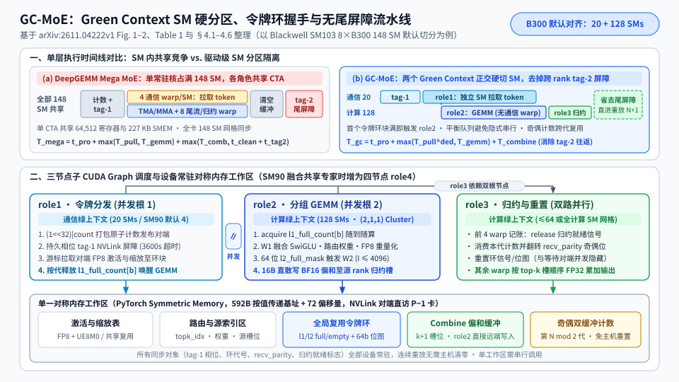查看原图 ↗</a><figcaption>图 1 · GC-MoE 驱动级 SM 分区时间线与三节点子 CUDA Graph 架构（整理自 arXiv:2611.04222v1 Fig. 1–2、Table 1 与 §4.1–4.6）：通信与计算作为无依赖并发根运行在正交 SM 集上，奇偶双缓冲计数取代重放间的跨 rank 尾屏障。</figcaption></figure>

`GC-MoE` 基于 `CUDA 12.4+` 引入的驱动级 `CUDA Green Contexts` 构造了一套无需 MPS 守护进程、静态可复现的分层执行模型（§4.1–4.6）：

1. **驱动对齐 SM 分区与平衡工作队列（§4.2）**：系统在每个 CUDA 上下文初始化一次绿上下文对并线程局部缓存——先调用 `cuDeviceGetDevResource` 读取总 SM 数、最小粒度与共调度对齐要求，再用 `⌊(total − requested) / alignment⌋ · alignment` 计算计算目标 SM 数后调用 `cuDevSmResourceSplitByCount`。在 `148` SM 的 `B300` 上，默认通信请求 `GC_MOE_DISPATCH_SMS=16` 被驱动对齐为 **`20` 通信 SM + `128` 计算 SM**（`13.5%` 给通信；`H20` SM90 默认请求 `4` SM）。作者特别强调了**平衡工作队列（balanced workqueues）**的必要性：创建时必须向主上下文申请 `sharingScope=CU_WORKQUEUE_SCOPE_GREEN_CTX_BALANCED` 且 `wqConcurrencyLimit=1`，并在创建后**回读校验是否生效**；否则两个绿上下文可能被映射到同一条硬件队列上，导致原本想并发的两个核静默退化为串行。运行时同时校验计算分区 `≥32` 且为偶数、通信分区 `≥2` 且两者之和等于全卡 SM 数。
2. **三节点子 CUDA Graph 与 6 步分发数据路径（§4.1, §4.3）**：每层 MoE 被捕获为一个挂载于外层 Graph 的子图（SM90 融合共享专家时为 `4` 节点增加 `role4`）**：`role1`（dispatch）**跑在通信绿上下文，**`role2`（grouped GEMM）**跑在计算绿上下文，两者在图上**没有依赖边**，是并发执行的双根节点；**`role3`（finalize）**跑在计算绿上下文（`T ≤ 128` 时网格取 `min(compute_sms, 64)`，以上取全计算 SM；开启融合共享专家时进一步收紧至 `max(min(compute_sms, e+1), ⌈T · combine_chunks / 8⌉)`）并同时依赖两个根节点。全部跨卡缓冲区驻留在一块经 PyTorch 分布式对称内存 API 分配的统一对称内存中，核函数通过按值传入的 **`592` 字节对端描述符**（基址 + `72` 个 `int64` 相对偏移 + 本卡 rank 索引）直接跨 NVLink 读写任意远端地址。`role1` 按六步推进：（1）每个 warp 每轮扫 `32/k` 个 token 并在 SMEM 累计每专家计数；（2）向本地发送计数器做高位为贡献者计数、低位为 token 数的 64 位打包原子加（用以校验所有 `(rank, dispatch-SM)` 到齐）；（3）把每个 token 的路由条目直接对端写入目标 rank 的源索引区；（4）仅在 `20` 个分发 SM 内部做一次小规模网格同步后，由 `block 0` 把每专家计数与前缀和发布给所有对端接收计数器；（5）经过一个设备常驻、带相位编码且默认 `3600 s` 超时陷阱（超时直接 trap 而非死锁挂起）的两阶段 NVLink `tag-1` 屏障；（6）各 warp 用全局游标遍历紧密拼接的专家序列，通过私有双缓冲 SMEM 暂存从对端整块拉取 FP8 激活与缩放表并转置为 `MN-major` 行序写入令牌环。
3. **跨分区令牌环握手与奇偶双缓冲去屏障（§4.3, §4.6）**：`role1` 与 `role2` 不为每个专家单建缓冲，而是共用一个按 `BM` token 分块的全局令牌环（池块数 `⌈assignments / BM⌉ + e`，在线 live 块数由真实 `compute_sms` 与 L1/L2 cluster 波次算出，杜绝小环死锁）。每个环块携带四枚设备常驻信号：`l1_full_count`（按 `BM · (generation + 1)` 递增，首个块填满即用 `acquire` 语义唤醒 `role2` 的 TMA 生产 warp，无需等待分发全部结束）、`l1_empty_count`、`64` 位 `l2_full_mask` 位图（每个 `W2` 的 `K128` 瓦片精确等待对应的两个 `W1 N128` 输出 bit 就绪即可启动，这也是 `2I/128 ≤ 64` 即 `I ≤ 4096` 硬约束的由来）与 `l2_empty_count`。调度 warp 采用「先发少量 L1 波次、随后一进一出（L2 认领一个再发一个 L1）」的节流策略，并通过分布式 SMEM 与事务计数 `mbarrier` 将 `32` 字节任务描述符双缓冲广播给 Cluster 内双 CTA。更重要的是，**重放之间彻底删掉了 `tag-2` 跨 rank 尾屏障**：`W2` 尾流通过 16 字节存储把 BF16 偏和直接散写到源 rank 的 combine 槽位 `(topk_slot, src_token)`；`role3` 则在同一核函数内并发拆成两半——前 `4` 个记账 warp 负责向对端发布 combine 就绪标志、消费本代计数（校验 `dispatch_sms · P` 到齐）、翻转奇偶双缓冲 **`recv_parity`**（使下一轮写向 `N mod 2` 的另一半计数槽）并重置环信号与 `W1` 位图；其余 warp 在等待对端就绪与按槽位顺序 FP32 累加归约的同时，正好把重置开销隐藏掉，关键路径缩短为 `T_gc = t_pro + max(T_pull^ded, T_gemm) + T_combine`。

### 三、Blackwell 与 Hopper 双架构 FP8×FP4 核实现、融合共享专家与 JIT 编译

由于混合 `FP8×FP4` 在 Hopper 与 Blackwell 两代 GPU 上的硬件指令与缩放路径截然不同，`GC-MoE` 分别维护了 `1,935` 行 `SM103` 设备代码与 `1,305` 行 `SM90` 设备代码（§4.4–4.5、§5、Table 2）：

- **Blackwell（`SM103` / `sm_103f`）原生硬件块缩放与 `K128` 连续预打包**：计算核在 `(2, 1, 1)` 双 CTA Cluster 上发射 `tcgen05.mma.cta_group::2.kind::mxf8f6f4.block_scale`，固定 `BN = BK = 128` 并将结果累加至 TMEM（分配 `2·BM` 累加列加缩放列，向上取 2 的幂且上限 `512` 列）。与基线一致，算子采用**操作数互换（operand swap）**——`A` 放权重、`B` 放激活，使 MMA 的 `N` 维对应真实有效 token 数并向上对齐到 `16`，大幅削减极小批填充浪费；因 `CuTe DSL` 公开接口要求 `A/B` 同类型，`GC-MoE` 通过内联 PTX 用户算子在运行时按格式 ID 切换 `E2M1` 路由权重（format `5`）与 `E4M3` 共享权重（format `0`），由专用 `UTCCP` 通路（`tcgen05.cp.cta_group::2.32x128b.warpx4`，每 `K128` 阶段 `512` 字节）把 `UE8M0` 缩放因子直接搬进 TMEM 供连续 `4` 个 `K32` MMA 硬件按字节选择（共享 `(1,128,128)` 配方则每 `4` 个 `K128` 块搬一次）。在基线基础上，`GC-MoE` 新增了 **`K128` 瓦片连续权重预打包**：把 `[E, rows, K/2]` 重排为 `[E, kb, rows, 64]`，让每次 TMA 4D 传输从「跨行跳跃 `128` 个分段」变成「一次 `8 KB`（共享 FP8 为 `16 KB`）连续突发读取」，配合 `EVICT_FIRST` 缓存提示避免单次流式权重污染 L2。`W1` 尾流在 TMEM 读出 FP32 后完成截断、`SwiGLU`（支持快速近似多项式 `exp` 与倒数）、乘以路由权重 `g`、求 warp-group `amax` 转为 `UE8M0+E4M3` 并经 `stmatrix` 转置写回 `L2` 环（在 `BM=240` 时双缓冲寄存器重叠下一轮 TMEM 读取）；宿主端则依据期望每专家 token 数 `m̂ = T·P·k/E` 覆盖 `m̂ + √m̂` 从 `{16, 32, 64, 96, 128, 192, 240}` 中选定 `BM`（小批锁定 `16–32`）。
- **Hopper（`SM90` / `sm_90a`）软件窗口重缩放与寄存器内解码**：因 H20 没有原生 FP4 Tensor Core 与硬件块缩放，`SM90` 采用独立路径——消费 `E4M3FN` 激活与连续 `FP32 K128` 缩放、`MXFP4` 路由权重，由主机端预处理按每专家缩放极值划出最多 `11` 个指数步的窗口，通过 4-bit 查表把越界幅值精确右移 2 的幂次并记录每专家补偿因子同时按解码器 lane 序重排；核函数内用两条 `LDS.128` 加 `PRMT/LOP3` 位操作把 `FP4` 实时解码为 `E4M3`，送入寄存器 A `WGMMA m64nNk32`，在 MMA 之外用每 `K32` 融合乘加施加块缩放并保留 `×64` 全局动态范围余量（`BM ∈ {8, 16, 32, 64}`，按 token 数择优采用 `384` 线程流水版或 `256` 线程非流水版）。
- **零拷贝共享专家融合与 PTX 按值参数改写（§4.5, §5）**：共享专家权重为 `K128` 打包 `FP8`；`SharedLinear1` 直接对原始激活做零拷贝别名读取（共享专家处理全部本地 token，无需分发），仅需按公式 `(3)` 把 `K32` 激活缩放行一次重排到与路由路径完全一致的 `shared_l1_acts_sf` 布局（总计 `⌈T_max/8⌉ · 128` 行），使路由与共享复用同一套 TMA 与 `UTCCP` 通路，并把输出占在 combine 缓冲的第 `k` 槽位。工具链基于 `CUTLASS DSL 4.8.1` 与 `ptxas 13.2`（`-O3`、寄存器等级 `10`，禁止重定位代码 RDC 并做白名单与编译器指纹双层缓存）；由于 CUDA Graph 要求按值传参而 CuTe 默认把 `18` 个 TMA 张量映射与 `592` 字节对端表生成指针形参，作者在 PTX 生成后做**结构化改写（若生成形状变化则 fail-closed 报错中止）**，将其转为 `128` 字节对齐与 `.b8` 按值形参并用 `cvta.param.u64` 重写全部 TMA 指令地址。

### 四、8×H20 与 8×B300 实证基准、带宽模型与数值等价校验

<figure class="note-figure"><a class="note-image-link" href="/assets/images/digest/2026-11-05/gc-moe-decode-speedup-boundaries-zh.svg" target="_blank" rel="noopener" aria-label="查看 GC-MoE 实测加速曲线、双架构对比与审校边界图原图">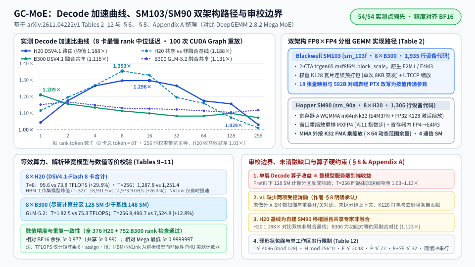查看原图 ↗</a><figcaption>图 2 · 实测加速比曲线、双架构路径、带宽模型与审校边界（整理自 arXiv:2611.04222v1 Tables 2–12）：54 个实测点全部快于 Mega MoE，但需区分 H20 非融合共享基线及作者未开展的分区消融。</figcaption></figure>

实验（Table 3–4）在 `8×NVIDIA H20`（`sm_90a`）与 `8×NVIDIA B300`（`CC 10.3`，`sm_103f`）上进行，统一使用 `CUDA 13.2`、`ptxas 13.2.78`、`PyTorch 2.11.0 (cu130)` 与 `CUTLASS DSL 4.8.1`，对比 `DeepGEMM 2.8.2+fcad603`（B300 调用公开 `fp8_fp4_mega_moe` 并在共享专家组开启功能对等的 `num_shared_experts=1`；因官方未开源 SM90 版，H20 对比作者自行移植的 `sm90_fp8_fp4_mega_moe`，且共享专家组只能跑「路由 Mega + 独立共享专家核」的非融合基线）。受测模型为 `GLM-5.2`（`H=6144, I=2048, E=256, top-8`，共享 `K=128`）与 `DeepSeek-V4.1-Flash`（`H=5120, I=2304, E=384, top-6`，共享 `K=32`），容量固定 `256`，扫描 `T ∈ {1..256}`（8 卡总 token `8–2048`）。全部计时均在空闲 GPU 门控（`0%` 利用率、至少 `51,200 MiB` 显存空闲持续 10 秒采样）下以 CUDA Graph 重放执行：`10` 个预热窗口 + `30` 个测量窗口（每窗口 `100` 次重放并跨窗口清 L2），取各卡窗口中位延迟的**全节点最大值（最慢 rank）**，汇总均值采用各点加速比的算术平均。

| 每卡 Token `T`（总计） | `8×H20` DSV4.1 路由（Mega → GC / 加速比） | `8×H20` DSV4.1 共享（Mega 非融合 / GC 非融合 → GC-se） | `8×B300` GLM-5.2 路由（Mega → GC / 加速比） | `8×B300` GLM-5.2 融合共享（Mega-se → GC / 加速比） | `8×B300` DSV4.1 路由（Mega → GC / 加速比） | `8×B300` DSV4.1 融合共享（Mega-se → GC / 加速比） |
| :--- | :--- | :--- | :--- | :--- | :--- | :--- |
| `1`（`8`） | `120.061 → 115.161 µs`（`1.0425×`） | `161.804 / 156.866 → 145.171`（`1.1146× / 1.0806×`） | `64.184 → 58.601 µs`（`1.0953×`） | `68.739 → 59.752 µs`（`1.1504×`） | `70.630 → 59.387 µs`（**`1.1893×`**） | `73.541 → 60.816 µs`（**`1.2092×`**） |
| `2`（`16`） | `169.340 → 144.259 µs`（`1.1739×`） | `214.191 / 188.566 → 179.286`（`1.1947× / 1.0518×`） | `87.457 → 79.228 µs`（`1.1039×`） | `93.033 → 79.730 µs`（**`1.1669×`**） | `84.022 → 74.758 µs`（`1.1239×`） | `87.140 → 75.478 µs`（`1.1545×`） |
| `4`（`32`） | `256.018 → 202.589 µs`（`1.2637×`） | `299.391 / 248.009 → 236.353`（`1.2667× / 1.0493×`） | `108.085 → 98.225 µs`（`1.1004×`） | `113.672 → 99.059 µs`（`1.1475×`） | `105.265 → 95.373 µs`（`1.1037×`） | `108.908 → 96.132 µs`（`1.1329×`） |
| `8`（`64`） | `368.254 → 284.310 µs`（`1.2953×`） | `409.599 / 328.262 → 302.667`（**`1.3533×`** / `1.0846×`） | `125.241 → 115.041 µs`（`1.0887×`） | `130.904 → 115.870 µs`（`1.1297×`） | `139.955 → 127.732 µs`（`1.0957×`） | `143.151 → 128.697 µs`（`1.1123×`） |
| `16`（`128`） | `442.722 → 341.689 µs`（**`1.2957×`**） | `482.938 / 384.421 → 363.640`（`1.3281× / 1.0571×`） | `131.652 → 121.385 µs`（`1.0846×`） | `136.624 → 121.372 µs`（`1.1257×`） | `161.549 → 148.495 µs`（`1.0879×`） | `164.977 → 150.251 µs`（`1.0980×`） |
| `32`（`256`） | `472.090 → 373.393 µs`（`1.2643×`） | `511.952 / 422.456 → 428.722`（`1.1941× / 0.9854×`） | `133.215 → 121.493 µs`（`1.0965×`） | `138.641 → 123.645 µs`（`1.1213×`） | `170.546 → 156.371 µs`（`1.0907×`） | `174.223 → 161.154 µs`（`1.0811×`） |
| `64`（`512`） | `507.207 → 432.383 µs`（`1.1731×`） | `547.238 / 465.376 → 472.348`（`1.1585× / 0.9852×`） | `137.227 → 123.694 µs`（`1.1094×`） | `143.096 → 128.534 µs`（`1.1133×`） | `173.747 → 158.264 µs`（`1.0978×`） | `179.868 → 166.320 µs`（`1.0815×`） |
| `128`（`1024`） | `569.604 → 493.194 µs`（`1.1549×`） | `613.336 / 556.513 → 572.091`（`1.0721× / 0.9728×`） | `144.344 → 129.517 µs`（`1.1145×`） | `150.360 → 136.231 µs`（`1.1037×`） | `178.495 → 161.271 µs`（`1.1068×`） | `184.979 → 168.524 µs`（`1.0976×`） |
| `256`（`2048`） | `695.010 → 675.370 µs`（`1.0291×`） | `786.631 / 786.387 → 779.019`（`1.0098× / 1.0095×`） | `164.383 → 145.683 µs`（**`1.1284×`**） | `170.763 → 152.883 µs`（`1.1170×`） | `186.200 → 171.051 µs`（`1.0886×`） | `192.473 → 179.688 µs`（`1.0712×`） |
| **9 点均值** | **`1.1881×`** | **`1.1880×`** vs Mega（**`1.0307×`** vs `gc-unfused`） | **`1.1024×`** | **`1.1306×`** | **`1.1094×`** | **`1.1154×`** |

*表 1 · 8×H20 与 8×B300 全 54 个 Decode 实测点延迟与加速比汇总（arXiv:2611.04222v1 Tables 5–8；B300 路由 18 点总均值为 `1.1059×`，融合共享 18 点总均值为 `1.1230×`；H20 共享列同时包含算子内部融合消融 `gc-unfused` 对照）。*

- **延迟曲线与物理机制吻合**：在 `8×H20` 上，路由加速比从 `T=1` 的 `1.043×` 攀升至 `T=4–32` 的 **`1.26–1.30×` 平台期**（此时传输量已足以凸显独立通信分区，同时 GEMM 仍受小 `M` 发射与尾屏障拖累），随后在 `T=256` 权重流读占主导时收敛回 `1.029×`。在 `8×B300` 上，即便计算分区只有 `128` 个 SM（少于基线的 `148` 个 SM），`GC-MoE` 在全部 `36` 个 B300 测点仍全部胜出，路由均值 `1.106×`、融合共享均值 `1.123×`；而且单卡 `T=1`（`DSV4.1-Flash`）8 卡中位延迟紧密聚在 `59.21–59.39 µs`（基线 `70.22–70.63 µs`），排除了单卡掉队导致的假性加速。至于 `GLM-5.2` 绝对节省略随 batch 从 `5.6 µs`（`T=1`）增至 `18.7 µs`（`T=256`），正对应专用 SM 加上 `K128` 预打包对更大分组 GEMM 量的放大。
- **H20 共享专家内部消融**：在 `H20`（Table 7）上，作者专门对比了 `gc-se` 与未融合版 `gc-unfused`——均值提速 `1.031×`（`6/9` 个点占优），小批下共享任务几乎「零成本」交错隐藏在路由间隙里；但在 `T=32–128` 区间，由于调度器按尺寸把大共享任务串行排在路由任务之后，出现了 **`0.973–0.985×`** 的微幅回落。

| 评估维度（Table 9–11 & §6.4–6.5） | 受测硬件 / 模型与规模 | 关键实测数值（Mega MoE vs. GC-MoE） | 统计口径与物理解读 |
| :--- | :--- | :--- | :--- |
| 等效矩阵乘算力（8 卡合计） | `8×H20` DSV4.1-Flash（Table 9） | `T=8`：`73.805` → **`95.597` TFLOPS**（`+29.5%`）；`T=256`：`1,251.393` → `1,287.785` | 仅统计矩阵乘 `6 × assignments × H × I` 除以最慢 rank 时延 |
| 等效矩阵乘算力（8 卡合计） | `8×B300` GLM-5.2 / DSV4.1（Table 10） | GLM-5.2：`75.280 → 82.453`（`T=1`）；`7,524.828` → **`8,490.679` TFLOPS**（`T=256`，`+12.8%`） | `128` 个无通信干扰的专用 SM 反超 `148` 个共享 SM |
| 解析 HBM 工作集与 NVLink 带宽模型 | `8×H20` DSV4.1-Flash（Table 9） | HBM 峰值（`T=32`）：`14,973.9` → **`18,931.9 GB/s`**（`+26.4%`）；NVLink（`T=256`）：`239.719 → 246.690 GB/s`（`+2.9%`） | **解析模型而非硬件 PMU 计数器**：同字节搬运因省掉抢占与尾屏障而更短墙钟时间完成 |
| `8×H20` 路由精度套件（Table 11） | `47` 用例（9 默认 / 23 边界 / 15 非对称，含空 rank），`376` rank 检查 | `GC/BF16` 与 `Mega/BF16` 最低余弦同为 `0.977039`–`0.977837`；`GC/Mega` 最低 **`0.99999976`**；最大过程差 `1.80×10⁻⁵` | 两者共享完全相同的最大绝对误差 `0.109375` 与最大相对 L2 `0.00600836`，repeat 差为 `0` |
| `8×H20` 共享 & `8×B300` 精度套件（§6.5） | H20 共享 `47` 例（`376` 检查）；B300 `94` 例（`752` 检查） | H20 共享 `GC/BF16 ≥ 0.99`、`GC/Mega ≥ 0.9999997`（最大绝对误差 `0.0625`，相对 L2 `5.81×10⁻⁵`）；B300 路由 `≥ 0.97`、共享 `≥ 0.99` | 共享路径复用完全相同的置换缩放布局且按 `top-k` 槽位顺序 FP32 累加，融合不改数值精度 |

*表 2 · 等效算力、解析带宽模型与全量数值精度校验汇总（arXiv:2611.04222v1 Tables 9–11 与 §6.4–6.5）。*

### 五、审校边界、未消融缺口与系统工程启示

将 `GC-MoE` 纳入实际推理引擎（如 vLLM / SGLang 的 CUDA Graph 捕获路径）前，必须区分原文已证明的算子结论与尚未覆盖的实验及运行边界：

1. **单算子重放不等于整模型端到端服务收益**：全部基准测量的是单个预量化 MoE 层的隔离 CUDA Graph 重放，未把注意力层、激活量化前处理、KV Cache 管理与调度器开销纳入整网 `TPOT/TTFT`；且当 `T = 256` 时路由收益已收窄至 `1.029–1.128×`。在计算密集的 **Prefill** 阶段，作者在 §8 明确指出真正受限的资源会重新变成计算分区的算力与 SM 数（`128` SM 对 `148` SM 反而吃亏），而非通信重叠。
2. **两项受控消融在 `v1` 中明确缺失（§8）**：作者坦承当前版本**没有做 `dispatch_sms` 分区比例扫描**（例如对比 `12 / 16 / 20 / 28` SM），也**没有做「Green Context 重叠开启 vs. 关闭」的同码对照**；加上硬件与基线之间还同时叠加了 `K128` 权重连续预打包与删除 `tag-2` 尾屏障三项改动，因此在 `B300` 测得的 `1.106×` 加速中各自贡献占比尚未被实验拆解。同时，**H20 共享专家组对比的是双核非融合基线（`1.188×`），不可直接与 B300 上双融合对等对比（`1.123×`）混为一谈**。
3. **硬形状包络与单工作区串行约束（Appendix A Table 12）**：受限于 `64` 位 `l2_full_mask` 位图、双 CTA `N128` 瓦片配对、`592` 字节对端表与单实例常驻信号状态，当前实现仅覆盖：`I ≤ 4096` 且 `I mod 128 = 0`、`H mod 256 = 0`、`k + 1[shared] ≤ 32`、`E ≤ 2048`（每卡 `≤ 512` 且整除 `P`）、`P ≤ 72`、路由配方 `(1,1,32)` 配 `SwiGLU`、同节点 NVLink 对端可直访的单卡单进程模式，且**共享同一工作区的调用必须严格串行**（因此也尚未在多流并发多实例下压测）。
4. **本次核验范围**：本文已逐字核对 `arXiv:2611.04222v1` 全文 25 页、Tables 1–12、Algorithm 1 与代码仓库地址可用性，未在本地多卡 H20/B300 集群复跑 CUDA 内核。
5. **可迁移的核工程启示**：（1）在带宽受限或小批发射受限的阶段（`T = 1–32`），宁可用驱动级 `Green Contexts` 静默切走 `~13.5%` SM 给低延时通信，也比在所有 SM 上硬塞 Warp 特化去挤占寄存器和 SMEM 更划算；（2）工程上启用 Green Contexts 时必须显式配置并**回读确认 `CU_WORKQUEUE_SCOPE_GREEN_CTX_BALANCED`（并发限 `1`）**，防止多上下文退化到单条硬件队列上隐式串行；（3）把重放间的全局 `tag-2` 屏障替换为「设备常驻奇偶双缓冲计数 + 消费者尾流内隐藏重置」，能够直接从每层关键路径砍掉一次跨卡往返延迟。

来源：[GC-MoE: Overlapping Expert-Parallel Token Dispatch with FP8/FP4 Grouped GEMM via CUDA Green Contexts](https://arxiv.org/abs/2611.04222)
<h2 class="daily-paper-title" id="paper-arxiv-2611.04042">05 · BADC：投机解码的保证，依赖处理器看到正确的历史</h2>

**[Testing Processor Contracts in Speculative Decoding Engines](https://arxiv.org/abs/2611.04042)** 
作者：Tianyu Ding, Yaocheng Tong, Muzhi Yang, Lei Yang, Fei Jiang · 首次提交：2026-11-02

投机解码通常被描述为“不改变目标分布的加速”，但这个保证并不只取决于接受／拒绝公式。实际引擎还会施加最短长度、重复惩罚、语法约束和引导等 logits processor。如果模型按正确前缀算出了 logits，处理器却读到尚未确认的草稿，最终采样的分布仍可能改变。这篇工作的价值在于把算法保证落到了组件接口，而非仅比较两次输出是否相同。

<a class="note-image-link" href="/assets/images/digest/2026-11-05/badc.png" target="_blank" rel="noopener" aria-label="BADC 测试流程与含未验证草稿的处理器输入 · 查看原图 ↗">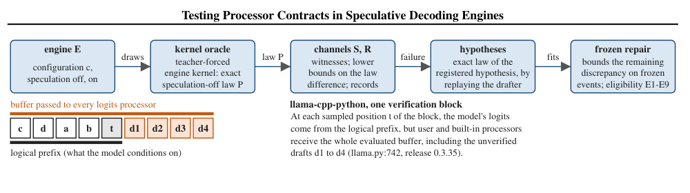查看原图 ↗</a>

*上方从引擎采样走向机制假设与干预确认；下方橙色草稿说明物理缓冲区为何不等于当前逻辑前缀。*

作者定义了 processor-prefix contract：每个验证位置的处理器必须看到该位置的逻辑前缀；有状态处理器还要处于与顺序解码等价的状态。草稿被拒绝后，只回退模型 KV cache 并不能自动回退处理器。llama-cpp-python 的一个具体案例是回调收到包含未验证草稿的整个缓冲区，让最短长度处理器误以为已生成足够多 token，提前释放结束符限制。Transformers 的另一类问题则来自候选处理提前推进了状态，随后没有恢复。

BADC 把这两个层次分开测试。在词表仅 7–10 个 token、生成长度 3–4 的随机小模型上，枚举顺序解码作为参考，再对开启和关闭投机的引擎采样。它既检查违反明确约束的输出，也为预先固定的输出事件构造同时置信界。随后把疑似原因写成可执行假设，冻结最小干预，再用新样本检查干预后差异是否缩小。这种流程把“观察到不同”推进到有源代码位置和干预支持的机制解释。

主研究覆盖 5 个固定构建、26 种配置，包括 Transformers 5.17.0 与 llama-cpp-python 0.3.19／0.3.35，最终确认两类原因。训练过的 SmolLM2-135M-Instruct 后续实验中，作者在一个预先选定的提示上，每组重新采集 1,024 次请求：某个固定首 token 事件的概率，在普通解码与原生 prompt lookup 下分别为 80.37% 和 14.16%。在组内独立同分布假设下，名义同时 95% 置信界给出的差距下界为 60.26 个百分点。这个数字描述特定提示、检查点、处理器与事件，不是生产请求的错误发生率。

同样值得关注的是负面结果：定向挑选配置没有显示出比随机选择更强的原因恢复能力，置换检验在各受测家族中至少同样容易检测出差异。作者没有证明 BADC 的检测优越性；它提供的是契约、事件界与干预证据。历史 vLLM 测试也不能推出当前版本仍有同样缺陷。

实验还专门检查投机路径是否真的执行：某个参数组合没有提出任何草稿，因此标记为无法判定，而不是正确性通过。类似地，有限事件上没有拒绝分布相同的假设，也不等于证明整个引擎符合契约。这样的非结论记录，对回归测试同样重要。

对于推理可靠性，最可迁移的启示是将前缀视图、处理器状态、停止规则和概率记录一起纳入验证。阅读原文时，优先看契约定义、两种源代码机制和修复确认条件；它们比单个巨大差距更能帮助判断一个加速路径是否保留了原本承诺的语义。

<h2 class="daily-paper-title" id="paper-arxiv-2611.04032">06 · ROCm InferaSim：用单节点内核锚点替代 LLM 服务集群试错</h2>

[ROCm InferaSim: Cut LLM Serving Trial Costs and Deploy the Best Configuration](https://arxiv.org/abs/2611.04032)（[v1 PDF](https://arxiv.org/pdf/2611.04032) · 代码/锚点/语料拟随终稿发布）  
Anshu Raina、Yao Fu、Zhang Jiejing、Peyman Razaghi、Shiksha Patel、Ravi Gupta、Deval Shah、Adeem Jassani、Subhajit Dutta Chowdhury、Lorri Rao、Kailash Gogineni、Zhenyu Gu、Onil Gunawardana、Emad Barsoum（Advanced Micro Devices Inc. (AMD)）· `arXiv:2611.04032v1 [cs.AI]` · 2026-11-02 提交（截至核验仅存 `v1`，无修订或撤回记录；附录 I 锚点示例单独上传，核心脚本与语料计划随终稿公开）

在大规模服务前沿模型（尤其是大参数 MoE 模型）时，运维团队必须同时敲定推理引擎、并行切分（TP/EP/DP/PP）、权重量化与 KV 缓存精度、调度器预算、投机解码深度、主机 DRAM 卸载以及 Prefill–Decode（P/D）分离配比。现实中这些决策往往靠逐组上线基准测试试错：在多节点上跑通一组配置中位耗时 `3.4` 分钟外加引擎启动时间，测完本研究的 `226` 组固定长度配置就需要 `204` GPU 小时，穷举 §5.11 搜索空间更需约 `25,000` GPU 小时。`ROCm InferaSim` 提出将**改变 GPU Kernel 集合的决策**与**仅改变单卡工作量或调度顺序的决策**彻底拆开：对每个真实核集在**不超过单节点**上采集一次轻量「锚点（anchor）」，再结合「缩并—实测—还原（reduce–measure–restore）」解析律、离散事件仿真器（DES）和双阶段调优代理在纯 CPU 上完成搜索。在 `8× AMD Instinct MI355X` 集群与 `vLLM`、`SGLang`、`ATOM` 三款引擎上，`11` 个锚点仅用 `9.1` GPU 小时即可覆盖 `172` 组受测固定长度配置（TPOT 中位误差 `8.1%`），并无须任何分离式锚点即可将 `159` 组 P/D 分离部署吞吐预测误差压至 `5.5%`。以下精读严格依据 `arXiv:2611.04032v1` 全文、表 1–21 及附录 A–K，清晰区分作者实测结果、零硬件模拟范围与未覆盖的工程边界。

### 一、问题根因：为什么集群试错、算子级模拟器与 Roofline 都算不准

想绕开真机试错，现有性能建模工具普遍栽在三类结构性失真上：

1. **算子级模拟器缺乏跨构建与 AMD 生态迁移性**：以 `Vidur`、`APEX`、`AIConfigurator`、`Frontier` 和 `KernelSight-LM` 为代表的模拟器逐算子建库拼接步长。问题在于只要模型结构、服务引擎构建版本或底层算子库（如 `aiter`、Triton、CK、DeepEP）一变，整套算子库就必须重新采集；`Vidur` 更只支持稠密模型、无法运行任何 MoE 架构。作者将 `Vidur` 移植到 `MI355X` 并在 `30` 组 `SGLang Llama-3.1-8B` 运行上直接对测（表 12），结果 `Vidur` 在 TTFT、TPOT 和吞吐上的中位误差高达 **`34%`、`40%`、`40%`**，原因在于它套用自身的 `FlashInfer` 内核计时且忽略了 Graph Capture 补齐、算子融合、Host CPU 耗时与流水线阶段开销；相比之下，`ROCm InferaSim` 在同一批配置上的中位误差为 `14%`、`7.2%` 和 `7.4%`。
2. **Roofline 与线性解析缩放忽略「不可切分的每步固定开销」**：常见解析工具直接从硬件峰值算力与带宽推导或按卡数做线性缩放，却忽视了内核启动、同步、采样与 Host 调度构成的每步固定时间下限 `f`（论文从 TP1–8 扫描中测得单个内核占用下限约 `4.98 µs`）。表 18 的对照表明，在 `DeepSeek-V4-Pro` 上直接将实测 `TP4` 解码步长减半去预测 `TP8`（`batch=1–64`），中位误差高达 **`44.1%`**；即便改用零测量模拟模式的降幅去扣减实测 `TP4` 步长，因为模拟模式同样错误地把固定成本按卡数切分，误差仍有 **`18.5%`**；只有保留固定项 `f` 不变、仅缩并可切分工作量，中位误差才骤降至 **`0.9%`**（最大 `3.5%`）。
3. **均值步长模型与串行流水线模型无法刻画尾延迟与多节点代价**：连续批处理中每次接纳新请求做 prefill 都会短暂卡住正在解码的请求——在一次 `64` 并发实测中，ITL 中位数仅 `21.7 ms`，而 `p99.9` 却飙到 **`1,392 ms`**，均值步长公式完全看不到这类排队阻塞。同样地，推理没有反向传播，直觉串行流水线（PP）模型会认为 TPOT 不随阶段数 `p` 增加而上升，但在 `SGLang` 实测中每多一阶段 TPOT 都会稳定增加 `920–1,130 µs`（对应 `14.9%–26.1%` 串行预测误差），漏掉了末阶段向首阶段回传已采样 token 的额外一跳以及 `PP>1` 时被迫关闭的 Host 调度重叠开销。

### 二、核心机制：核集合锚点、缩并—实测—还原律与双模式调度仿真

<figure class="note-figure"><a class="note-image-link" href="/assets/images/digest/2026-11-05/rocm-inferasim-anchor-scaling-zh.svg" target="_blank" rel="noopener" aria-label="查看 ROCm InferaSim 核集合锚点、缩并还原律与双模式搜索架构图原图">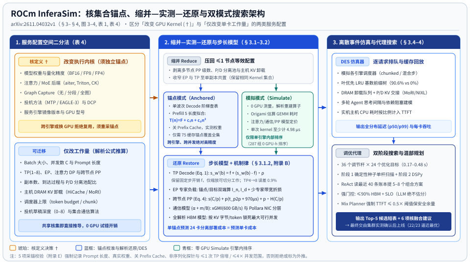查看原图 ↗</a><figcaption>图 1 · ROCm InferaSim 系统架构（整理自 arXiv:2611.04032v1 §3–§4, 图 3–4, 表 1, 表 4）：以「是否改变底层 GPU Kernel」二分配置空间，把多节点与分离式配置压回单节点采锚再解析还原。</figcaption></figure>

`ROCm InferaSim` 以**统一单步代价模型（Step Cost Model）**为核心，向下衔接单节点锚点或零实测算子模型，向上驱动离散事件仿真器（DES）与自动化调优代理：

1. **配置空间二分法与 5 项采锚卫生守则（§3.1, 附录 E, 附录 I）**：
   - **核定义决策**（Anchor-defining，表 4 标 `†`）包括模型检查点、权重/激活/KV/专家精度（BF16/FP8/FP4）、注意力/MoE 算子后端（`aiter`、Triton、CK、稀疏 top-k、DeepEP）、Graph Capture 模式（`none`/`piecewise`/`full`）、投机解码方法（MTP/EAGLE-3/DSpark/n-gram）、会改变注意力核的 Decode Context Parallelism（`DCP`）、服务引擎构建版本与 GPU 型号。任一项改变都须对应独立锚点，跨引擎或跨 GPU 类型严禁复用。
   - **可迁移决策**（Transferable）包括 Batch 大小、并发度 `C`、Prompt 与 Context 长度、TP（`1–8`）、EP、注意力 DP、PP 阶段数、副本数、到达过程、主机 DRAM KV 卸载、投机草稿深度（`0–8`）、P/D 分离配比及调度器预算，由解析定律与 DES 直接推算。
   - **单节点 Harvester 采集规范**：采集器在空闲 `≤1` 节点上运行真实权重，输出包含四部分信息的 JSON 锚点（全文共复用 `75` 个缓存锚点）：（a）**单波次（single-wave）Decode 阶梯扫描**——在每个 Graph Capture 捕获的 batch 桶上测中位 ITL，且预测中间 batch 时严格**向上取整查阶梯**而非线性插值（`batch=33` 按 `40` 计费）；采用单波次而非混入 prefill 阻塞的平均 TPOT，可避免在 DES 中重复计算阻塞（表 18 显示混入均值 TPOT 会将 `C=16/32/64` 的预测人为抬高 `13%/23%/31%`）；（b）**关闭 Prefix Cache 的 5 长度 Prefill 拟合** `T(n) = F + c₁n + c₂n²`（附录 E 证实若误开前缀缓存，`DeepSeek-V4-Pro` 在 `1k–8k` 长度的 prefill 会被压扁成伪平坦的 `68–89 ms`，掩盖真实 `143–782 ms` 曲线）；（c）**真实检查点权重**（随机权重会抹平路由器偏斜，令 `GLM-5.2` 在 `batch=64` 虚假提速 `1.337×`）；（d）记录 Prompt 长度（`8192`-token 锚点直接套到 `1024`-token 会让 `vLLM` 稠密 MLA 路径高估 `41%`，而 `SGLang` top-k 路径仍在 `3%` 内）与非序列化打包探针（校验 `N` token 打包步耗时处于单序列的 `0.63–1.39×`，筛掉因 token budget 触发串行化的坏探针 `3.59×/7.06×`）。
2. **「缩并—实测—还原（Reduce–Measure–Restore）」解析定律（§3.1.2–3.2, 附录 B）**：
   - **Decode 与 Prefill 跨 TP 缩放（公式 1）**：对于跨节点或更宽 TP 配置，先按「去 PP → 缩 EP/TP → 合并为单副本共置」缩并至不超过单节点。还原 Decode 步长时，保留锚点最小 batch（`b=1`）对应的固定开销 `f`，仅对超出部分按 <code>s_w'(b) = f + (s_w(b) - f) · ρ_{w→w'}(b)</code> 缩放；当同栈曾在 `w/2` 宽度采过锚时，实测每倍增缩减因子 `ρ`（限幅 `[0.5, 1]`）——实测显示仅 `DeepSeek-V4-Pro`（ATOM `TP4→8`）达到理想 `0.50`，而 `GLM-5.2`（SGLang）仅为 `0.55–0.69`，`DeepSeek-V4-Flash` 为 `0.68–0.71`，`MiniMax-M2.7` 为 `0.76`。Prefill 同理保留固定截距 `F`（在 `DeepSeek-V4-Pro` `4k` 与 `8k` 上解得 `146.90 ms` vs `145.86 ms`，偏差不足 `1%`），仅按宽度缩放 `c₁, c₂`。
   - **MoE 专家偏斜与少专家带宽折损（附录 B.3, 表 6）**：在 `SGLang TP8` 上对每个 MoE 检查点录一次真实路由日志后离线重放，计算每层最忙 GPU 的路由 token 过载比 <code>I_n = E[max_r n_r]/n̄</code> 与触达独立专家数过载比 <code>I_d = E[max_r d_r]/d̄</code>。由于锚点常以较窄 EP（如 `EP1`）采集，**必须在锚点 EP 与目标 EP 两端分别评估比值**（`I_n, I_d`），避免单边值在除法中抵消；同时结合 `EPLB` 副本折减公式 `I' = 1 + (I - 1) · E/(E + R)`（公式 3）与 grouped GEMM 低流数 HBM 带宽折损（`MI355X` 上每专家 1 行时，单专家仅达峰值 HBM 带宽的 `25%` [DeepSeek FP8] 或 `14%` [gpt-oss MXFP4]，约 `16` 专家才饱和）。
   - **跨节点流水线 PP（公式 4, 附录 B.4）与双层集合通信（附录 B.2, 表 5）**：模型将多阶段 PP 步长写为 <code>s_PP(C) = s(C/p) + p(t_p2p + o) + p · H(C/p)</code>，计入全部 `p` 跳点对点传输（`p-1` 次激活前向 + 末阶段将采样 token 传回阶段 `0` 的 `1` 跳，单跳额外引擎开销 `o = 970 µs`）以及关闭流水线重叠后在每阶段暴露的 Host 调度时间 `H(b) = 0.33 + 0.0063 b` ms。集合通信区分两层：节点内 decode 小消息（`≤8 MiB` 用 vLLM 自定义 1-/2-shot all-reduce，`≤32 MiB` 用 RCCL all-to-all）与 `>8 MiB` xGMI 网状链路（仅用单点拟合节点总带宽 `B_node = 600 GB/s` 即可覆盖 `2/4/8` 卡），跨节点则走 `400 Gb/s` Pollara RoCE 网卡（实测跨节点 `send/recv` 带宽 `45.1 GB/s`，但嵌入单步内部只需额外计几微秒线延迟，相对 `970 µs` 引擎级开销几乎可以忽略，因此 PP 天然适合跨节点扩展）。内存占用则完全解析建模（KV 字节/token 对 `GLM-5.2 BF16` 与 `MiniMax-M3 FP8` 误差 `0.0%`，`GLM-5.2 FP8` 为 `2%`），直接锁死最大可行并发度，防止预测出 HBM 放不下的吞吐幻觉。
3. **双模式切换、离散事件仿真器（DES）与调优代理（§3.4–§4.1, 附录 A, 附录 J）**：
   - **Anchored 模式 vs Simulate 模式**：前者由锚点校准并给出跨引擎、跨并发的绝对性能预测；后者完全不跑 GPU，按引擎源码重建算子图，调用 `Origami` 估算 GEMM 耗时并配合解析注意力/通信/PP 模型（每 kernel 计 `4.98 µs` 下限），由于同引擎候选共享近似的固定步开销可相互抵消，`Simulate` 模式**专用于单引擎内部候选排序**。
   - **DES 仿真器还原长尾与前缀复用**：DES 沿虚拟时钟按各引擎真实调度器（chunked prefill、混合步、ATOM 独立 prefill 步、注意力 DP 锁步最慢 rank）逐请求推进。每个副本维护一棵**内容寻址基数前缀树**并采用**叶优先 LRU（leaf-first LRU）**淘汰策略——附录 A.1 显示，在 `DeepSeek-V4` `256` 客户端回放 `AgentX` 时，普通扁平 LRU 会周期性在复用前一刻把共享前缀踢掉，导致命中率暴跌至 **`0%`**，而叶优先 LRU 取得 **`90.6%`** 命中率（与公开轨迹实测 `~92%` 高度一致）。当开启主机内存卸载（SGLang `HiCache`、`LMCache`、`vLLM CPU offload` 或 `MoRI UMBP`）时，被淘汰的块退入 DRAM 二级缓存并在命中时排队回迁。P/D 分离池则分别为 Prefill 与 Decode 池建立 DES 实例，把单副本锚点分别迁移至两侧并行形态，并按底层传输库计费 KV 交接（`MoRI` 逐层流式传输仅暴露最后一层，速率 `47.9 GB/s` + `120 µs`；`NIXL` `400 GB/s` + `5 µs`；`Mooncake` `200 GB/s` + `10 µs`）且在 Prefill 接纳端计入一半共置锚点的 Host 耗时。
   - **双阶段调优代理与 Mix Planner**：单次 CPU 预测（含 `10 × C` 条 DES 请求）仅耗时 **`0.17–0.48` 秒**。调优代理可操作 **`36` 个调节杆**以优化 **`24` 个目标**，先经确定性阶段 1 每次单杆扫描，再由 `DSPy ReAct` 代理读取最近 `40` 条账本记录提出假设与 `5–8` 组组合配置，并从 `6` 种命名核融合模式（表 21，按理想节省的 `75%–100%` 计价）中汇报对当前布局提速 `≥2%` 的融合机会。关键边界在于 **LLM 绝不允许自己估算性能**：每条提案都必须过同一道结构合法性、`≤90%` HBM 容量及 SLO 硬门控；面向多模型混合部署的 `Mix Planner` 会在 4 个延迟档位（`realtime`、`interactive`、`responsive`、`bulk`）中强制候选预测 TTFT 不超过限值的 **`0.5×`**，在最高每卡吞吐 `5%` 区间内挑选余量最大的配置并输出 `Top-5` 候选短表。

### 三、MI355X 全景实测：固定长度、AgentX 多轮代码、分离式推理与选型消融

<figure class="note-figure"><a class="note-image-link" href="/assets/images/digest/2026-11-05/rocm-inferasim-accuracy-cost-zh.svg" target="_blank" rel="noopener" aria-label="查看 ROCm InferaSim MI355X 实证证据四象限图原图">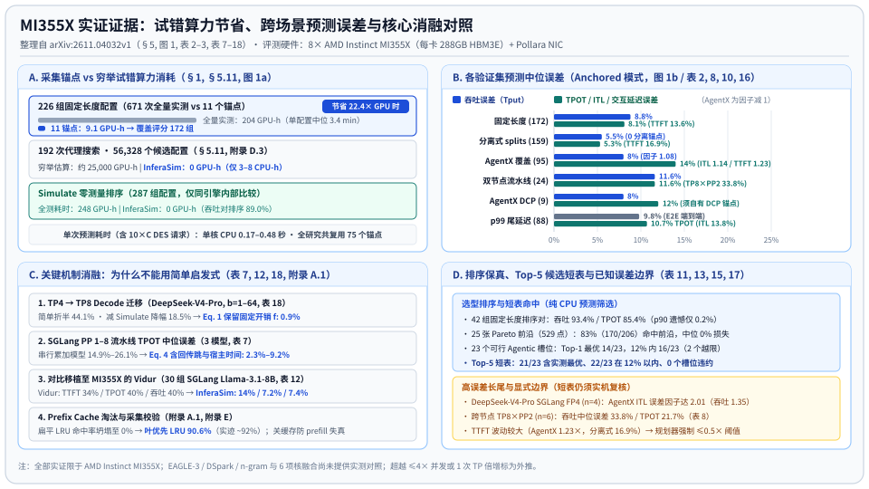查看原图 ↗</a><figcaption>图 2 · MI355X 实证汇总（arXiv:2611.04032v1 §5, 图 1, 表 2–3, 表 7–18）：算力开销压缩、跨场景预测误差、关键机制消融以及短表决策边界。</figcaption></figure>

作者在 `8× AMD Instinct MI355X`（每卡 `288 GB HBM3E`、`Infinity Fabric` 互联、`ROCm 7`、开启 Graph Capture）集群上评测了 `13` 个模型家族（涵盖 `DeepSeek-V4-Pro/Flash`、`GLM-5/5.2`、`Kimi-K3`、`MiniMax-M2.7/M3`、`Qwen3.5`、`DeepSeek-R1-0528` 等 MoE 与 `Qwen3-14B`、`gpt-oss-120b`、`Llama-3.1-8B`）与三大服务引擎。对跨越两个数量级的变长 `AgentX` 轨迹，论文采用几何平均误差因子 `max(ŷ/y, y/ŷ)`（`1.00` 为零误差，`1.08` 对应约 `8%` 双向偏差）。表 1 与表 2 汇总了全部主验证集及机制消融核心数字：

| 验证集 / 基线对照 | 配置 / 图表规模 | 锚点与范围条件 | 吞吐误差 | TPOT / ITL / 交互延迟误差 | TTFT 误差与备注 |
| :--- | :--- | :--- | :--- | :--- | :--- |
| 固定长度全部（表 10） | `172` 组（8 模型 × 3 引擎） | `11` 锚点（9.1 GPU-h；覆盖 TP2–8） | `8.8%`（88% ≤20%） | `8.1%` TPOT（93% ≤20%） | `13.6%` TTFT；其中 8k/1k 组三项均降至 `6.3%–6.9%` |
| 窄锚点外推 TP4→TP8（表 14） | `90` 组（6 模型子集） | 由 TP4 锚点外推至 TP8 | `9.7%`（r=0.994） | `9.3%` TPOT | `16.5%` TTFT；同宽 TP 锚点误差为 `6.1% / 5.5% / 11.0%` |
| 尾延迟 p99（§5.4） | `88` 组（≥160 请求） | DES 逐请求排队模拟 | — | `10.7%` TPOT / `13.8%` ITL | `9.8%` 端到端延迟；同配置重复实测波动为 `1%–4%` |
| 跨节点两级流水线（表 8） | `24` 组（TP1–8 × PP2） | 仅用单节点 PP1 锚点 | `11.6%` | `11.6%` TPOT | `TP8×PP2` 子组误差偏高（`21.7%` TPOT / `33.8%` 吞吐） |
| AgentX 多轮代码（表 2） | `95` 组覆盖（总 184 组） | `28` 锚点，≤4× 并发会话 | `1.08×` 因子（~8%） | `1.14×` ITL（~14%） | `1.23×` TTFT；含 `5` 组后加主机层（`1.06×`）与 `9` 组 DCP（`8%/12%`） |
| InferenceX 分离式部署（表 16） | `159` 组（8–24 GPU） | `16` 共置锚点（0 分离锚点） | `5.5%` | `5.3%` 交互速率 | `16.9%` TTFT（vLLM+NIXL `7.1%` vs SGLang+MoRI `22.2%`） |
| AgentX 分离式部署（§5.10） | `13` 组（7 SGLang + 6 vLLM） | 由共置锚点预测（去共置残差） | `1.08×` 因子（~8%） | `1.12×` ITL（~12%） | 规划器优选 DEP8 分离布局，相对仅共置挽回 `43%–46%` 损失 |
| 投机解码 MTP（§5.9） | `43` 组（深度 2–8） | 共置锚点 + 接受长度曲线 | `8.9%` | `12.2%` 交互速率 | `50 tok/s/user` 下中位吞吐提升 `2.05×`（`0.86–4.73×`） |
| Pareto 前沿保真度（表 13） | `25` 张图（529 实测点） | 11 固定 + 8 分离 + 6 AgentX | `7.0%` | `6.5%` 交互速率 | Spearman `ρ=0.99`；`170/206`（`83%`）前沿点保留（p90 损 `0.7%`） |
| Vidur 移植对照（表 12） | `30` 组（Llama-3.1-8B） | 仅稠密模型，SGLang PP1–8 | `40%`（InferaSim `7.4%`） | `40%` TPOT（InferaSim `7.2%`） | `34%` TTFT（InferaSim `14%`）；未建模 MoE、Host 与阶段开销 |

*表 1 · ROCm InferaSim 在 MI355X 五大实测语料与基线对照上的汇总精度（arXiv:2611.04032v1 §5–§6, 表 1–2, 表 8–16；AgentX 行报告几何平均误差因子，其余为中位绝对百分比误差）。*

| 机制 / 决策消融实验 | 对照方法或实验设定 | 核心定量结果 | 工程结论与条件限制 |
| :--- | :--- | :--- | :--- |
| TP4→TP8 Decode 迁移（表 18） | 步长折半 vs 减 Simulate 降幅 vs Eq. 1 保留固定项 `f` | 中位误差 `44.1%` vs `18.5%` vs **`0.9%`**（最大 `3.5%`） | 必须保留每步发射与同步下限 `f`；超出 1 次 TP 倍增标为外推 |
| SGLang PP 1–8 误差（表 7） | 串行模型 vs Eq. 4（`970 µs`/跳 + 未重叠宿主时间 `H`） | `Llama-8B / Qwen3-14B / Qwen3.6-35B`：`18.1%/14.9%/26.1%` → **`7.2%/2.3%/9.2%`** | 含末阶段回传与关闭重叠后各阶段累加的 CPU 调度时间 |
| 前缀淘汰与采锚卫生（附录 A.1, E） | 扁平 LRU vs 叶优先 LRU；采锚开缓存 vs 关缓存 | `256` 客户端命中率：`0%` → **`90.6%`**（实迹 ~92%）；开缓存 prefill 压成 `68–89 ms`（真实 `143–782 ms`） | 必须用叶优先 LRU 保留共享树干，并关缓存测 5 点 prefill |
| MoE 专家负载与 EP 迁移（表 1, 6, 附录 B.3） | 均匀路由 vs 双端 `I_n, I_d` + 少专家带宽惩罚 | `9` 组 vLLM EP **`2.2%`** TPOT / `2.1%` 吞吐；`3` 组 SGLang EP `-2.2%..+2.5%`（均匀）/ `+10.5%`（实录） | 随机 token 基准会让最热 prefill 专家受载达 `46×` 均值，高估生产偏斜 |
| 配置排序保真度（表 11, §5.7） | Anchored 模式 vs 零 GPU Simulate 模式 | 42 组固定集吞吐对准确率 **`93.4%`** vs **`89.0%`**（AgentX 41 集：`90.9%` vs `81.8%`）；Anchored Top-1 `73%` | 固定集吞吐 p90 遗憾仅 `0.2%`；Simulate 模式仅限同引擎内排序 |
| P/D 分离 vs 共置层级决策（表 3） | 1k/1k 短输入 vs 8k/1k 长输入（14 张无投机图） | InferenceX 决策命中率 `1k/1k` **`19/21`**、`8k/1k` **`23/27`**；8k 响应/交互档分离胜率 `7/7` 与 `3/4`（`1.14–2.72×`） | 1k 短提示（或 `97.8%` 前缀命中的 agentic）共置占优或持平，8k 长 prefill 才明显受益 |
| 6 模型 × 4 延迟档混部规划（表 15, §5.11） | 单一 Top-1 推荐 vs Top-5 候选短表（23 可行槽位） | Top-1 命中实测最优 `14/23`（12% 内 `16/23`，`2` 个越限）；**Top-5 短表最优 `21/23`、12% 内 `22/23`、`0` 违约** | 强制 `TTFT ≤ 0.5×` 档位限值吸收 TTFT 噪声，最终短表须实机复核 |

*表 2 · 关键机理消融、排序保真与混部规划决策验证（arXiv:2611.04032v1 §5.7–§5.11, 表 3, 表 6–7, 表 11, 表 15, 表 18, 附录 A.1, E）。*

从具体拆解中能读出三项极具实操价值的细粒度发现：
- **算力压缩与搜索规模**：`226` 组固定长度全测耗资 `204` GPU 小时（`671` 次运行），而覆盖它们的 `11` 个锚点仅耗 **`9.1` GPU 小时**（**`22.4×`** 压缩）；§5.11 跑通 `192` 次确定性种子搜索（`4` 模型 × `24` 目标 × 有无 SLO、`130k` 输入 / `900` 输出形态、共 **`56,328`** 个候选）仅花 `3–8` CPU 小时与 `0` GPU 小时，而在 `DeepSeek-V4-Pro` 落点处实测吞吐最优解（TP8 + 注意力 DP + FP4 + `256` 客户端）的预测偏差仅 **`0.3%`**；全研究另以零测量 `Simulate` 模式为 `287` 组（实测需 `248` GPU 小时）排定单引擎内序。
- **P/D 分离并非无条件最优**：表 3 与附录 D.4 指出，若仅按总输入/输出 token 比例估算（如 `AgentX` 的 `130k/900` 形态），会把 `144/145` 张卡错分给 Prefill；但真实多轮编码命中了中位 **`97.8%`** 的前缀缓存（每轮仅需算约 `10,400` 个未缓存 token），而 Decode 池必须为 `900` 步保留完整 KV 显存，因而真正决定 Decode 池规模的是**显存容量**而非算力，且只有当 5 个调度细节（每副本容量、按注意力 DP 汇总后的独立 KV 池预算、SGLang 无 DP 时的 `128` 并发上限、注意力 DP 各自 token budget、禁用带投机锚点跨测无投机配置）同时建准，模型才在 `8k/1k`（`23/27`）与 `1k/1k`（`19/21`）上准确判别分离与共置的胜负。
- **直视高误差子集**：尽管整体 `AgentX` 误差因子为 `1.08` 吞吐 / `1.14` ITL，但表 17 坦承 `DeepSeek-V4-Pro` 在 `SGLang FP4`（`n=4`）上的 ITL 误差因子高达 **`2.01`**（吞吐 `1.35`），`SGLang + HiCache`（`n=12`）ITL 达 **`1.40`**；固定长度集中未能排对的仅 `3` 对吞吐配置全发生在高并发噪点区（`GLM-5.2 SGLang 8k/256` 客户端，同配置重复运行本身波动达 **`25%–63%`**）；跨节点 `TP8×PP2`（表 8）吞吐误差也上升到 `33.8%`。这解释了为何系统输出 **Top-5 短表**而非单点盲上。

### 四、科学审校边界、未覆盖假设与系统工程启示

把 `ROCm InferaSim` 引入集群调度或容灾容量规划时，必须明确以下原文实证边界：

1. **单一硬件架构与固定软件栈边界**：第 7 节明确所有实测均在 **AMD Instinct MI355X**（`ROCm 7`、Pollara 网卡）与特定 Docker 镜像构建（附录 K）上完成，迁移至 NVIDIA GPU 仍属未来工作；且只要引擎镜像升级、切换注意力/MoE 内核后端或启用 `DCP`，就必须重新采集锚点。
2. **锚点覆盖区间与未实测分支**：高置信 `Anchored` 误差仅适用于「受覆盖（covered）」配置——即同引擎同布局（或全 batch 扫描的窄 TP）、并发度在锚点 **4× 以内**、且不超过 **1 次 TP 倍增**（`GLM-5.2` Prefill 从 `TP2→TP4` 加速 `1.80×`，到 `TP4→TP8` 骤降至 `1.32×`，仅靠 `TP4` 锚点无法内生捕获该衰减）。此外，投机解码中的 `EAGLE-3`、`DSpark` 与 `n-gram`（§5.9）以及代理推荐的 `6` 类核融合收益（§4、表 21）**目前仅停留在预测建模，尚未在 MI355X 上做实测对照**；`Simulate` 模式也只保证**单引擎内部**排序，不能直接用来跨引擎比大小。
3. **TTFT 高波动、外部产物与核验范围**：由于 Host 端 HTTP/分词排队（`5–11 µs/token`）与分离式双端宿主开销叠加，TTFT 预测误差显著高于 TPOT（固定长度 `13.6%`、分离式 `16.9%`、`AgentX 1.23×`，`Qwen3.6-35B-A3B` PP 表 20 个别项 TTFT 偏差达 `-89%`），规划器必须靠 `0.5×` 安全余量与实机复核兜底。附录 K 所列锚点、语料与复现脚本及附录 I 示例尚未在本次读到的公开仓外释放，正文亦在 AI 使用披露（第 19 页）说明代码重构与文稿草拟借助了 Cursor 编码助手而全数数字源自实测脚本。本次深读已核验 `arXiv:2611.04032v1` 全部 37 页正文、公式与附录表格，未在本地 MI355X 集群重跑实验。
4. **可迁移的系统工程启示**：（1）**先做「核变更」与「工作量缩放」二分，再用真实单波次锚点锁死固定开销 f**：比逐算子堆叠或盲信 Roofline 线性外推更抗引擎版本演进；（2）**长程 Agent 评估必须用树状叶优先淘汰的 DES 替代静态均值公式**：既能识别 `21.7 ms` 中位下隐藏的 `1,392 ms` 尾阻塞，也能避免 `97.8%` 前缀复用下的 KV 池误配；（3）**让调优 LLM 只提假设、把合法性与打分全交给确定性预测器，并以 Top-5 短表留出实机验证最后一公里**。

来源：[ROCm InferaSim: Cut LLM Serving Trial Costs and Deploy the Best Configuration](https://arxiv.org/abs/2611.04032)（`arXiv:2611.04032v1`）
<h2 class="daily-paper-title" id="paper-arxiv-2611.04382">07 · Beyond Compression Ratio: High-Throughput KV Compression for Disaggregated LLM Serving</h2>

[Beyond Compression Ratio: High-Throughput KV Compression for Disaggregated LLM Serving](https://arxiv.org/abs/2611.04382) 
Junhong Wu、Zedong Liu、Xinyang Ma、Yuhan Chen、Guangming Tan、Dingwen Tao

FastKVComp 针对的是压缩后的传输时间节省不足以覆盖编解码开销的问题：网络越快，留给压缩的预算越小。它保留 KVServe 的策略和量化语义，改变执行路径。发送端用 TileLang 把 Hadamard 变换、量化统计和低比特转换融合，直接写预分配的多层输出；接收端融合反量化和逆变换，避免完整中间张量反复写回 HBM。

无损后端采用 LC 的可组合 GPU primitives，在离线测量编码、解码和体积后选择 Pareto 候选，在线固定使用选中的流水线。它宁可接受较低压缩率，也换取更快 codec；这不是服务过程中不断搜索。原文消融尤其重要：在本地 SHM 设置，只有 LC 的版本相对原 KVServe 变化不超过 2.1%，融合版本已经贡献主要端到端收益，Fused Only 与完整方案吞吐差不超过 1.3%。不能把两个组件的局部峰值相乘成总收益。

本地实验使用两张 RTX 5090，PCIe Gen5 x16 上经主机暂存的 NCCL SHM 路径；跨节点实验使用 RTX PRO 6000 prefill、H100 decode 与 200 Gb/s InfiniBand。两种模型是 Llama-3.1-8B-Instruct 和 Qwen2.5-7B-Instruct，每配置 50 请求、输入最长 20K，本地只生成 8 tokens，远端最多 64，排除编译和预热。远端相对原始传输的 JCT 降低 30.2–38.6%，与本地最高约两倍的结果分属不同设置。它说明快网络下应优化完整压缩路径；短输出、有限模型和网络配置限制了对长生成服务的外推。

<h2 class="daily-paper-title" id="paper-arxiv-2611.04671">08 · LeanSparse: Memory-Efficient Serving for Native Sparse-Attention LLMs</h2>

[LeanSparse: Memory-Efficient Serving for Native Sparse-Attention LLMs](https://arxiv.org/abs/2611.04671) 
Zaifeng Pan、Chris Wu、Xinwei Qiang、Zhengding Hu、Zhongkai Yu、Yufei Ding

<a class="note-image-link" href="/assets/images/digest/2026-11-05/leansparse-architecture.png" target="_blank" rel="noopener" aria-label="LeanSparse 原文图 5：双缓冲预填充与粗到精解码索引">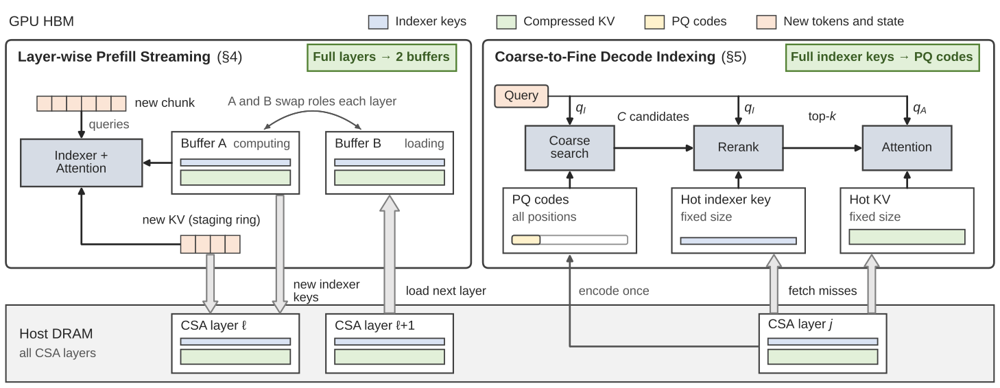查看原图 ↗</a>

*原文图 5。左侧交替加载两层历史，右侧先用 PQ codes 粗筛，再分别获取 indexer keys 与 attention KV；两种缓存服务不同阶段。*

原生稀疏 attention 每步只访问部分历史，却仍需保留以后可能再次选中的状态。LeanSparse 指出两个剩余内存瓶颈：HiSparse 把 attention KV 卸载到主机后，完整 indexer keys 仍驻留 GPU；prefill 又临时需要大量历史，使新请求即使有足够 decode 内存也无法启动。它联合优化两个阶段，而不是仅把 KV 池继续缩小。

prefill 通过两个可复用 GPU 缓冲逐层加载历史 indexer keys 和 KV，利用当前 CSA 与中间 HCA block 的计算隐藏下一层传输。缓冲重用必须等待消费者与 host writeback 完成。decode 则在 GPU 上扫描紧凑 PQ32 codes，先选 2,048 候选，再取原始 key 精排为 512 项；indexer key cache 与 attention KV cache 分开，因为进入候选但未进入最终 attention 的 key 仍值得复用。粗筛或 miss 过滤掉的项无法靠精排找回，所以不是精确等价算法。

实验在四张 H100、SGLang、DeepSeek-V4-Flash 上进行。多轮 Open-SWE 回放使用作者适配的 ECHO 基线，128 会话、每会话 20 次测量调用，保留顺序依赖与工具等待；HiSparse 不支持该混合阶段设置，因此只用于 decode 对照。相对 ECHO，median TTFT 从 21.6 秒降到 0.6 秒，会话完成时间降低 17.7%，但 median TPOT 从 66.4 毫秒升到 81.7 毫秒：更早接纳 prefill 和更大 batch 改善总体推进，同时让逐 token 间隔变长。

950K decode 压力测试中，最大并发达到 HiSparse 的 2.95 倍、吞吐 2.14 倍，不能与 256K 上限的质量实验混为一组。质量测试四项指标与原 SGLang 相差不超过 0.5 个百分点；离线 top-512 召回从直接 PQ 的 77.41% 提升到精排的 99.49%，仍非 100%。最值得借鉴的是同时核算持久状态与临时 admission 内存，并将首 token、逐 token 和会话时间分别报告。

<h2 class="daily-paper-title" id="paper-arxiv-2611.05121">09 · GPU 数值缺陷实证解剖与 GPU-NBDetect 自动检测</h2>

[An Investigation on Numerical Bugs in GPU Programs Towards Automated Bug Detection](https://arxiv.org/abs/2611.05121)（[v1 PDF](https://arxiv.org/pdf/2611.05121) · [DOI](https://doi.org/10.1145/3728950) · [数据集主页](https://gpu-program-bug-study.github.io/Comprehensive-Study-on-GPU-Program-Numerical-Issues.github.io/)）  
Ravishka Rathnasuriya、Nidhi Majoju、Zihe Song、Wei Yang（University of Texas at Dallas）· `arXiv:2611.05121v1 [cs.SE]` · 2026-11-03 提交（PDF 首页同时标注发表于 `Proc. ACM Softw. Eng. 2, ISSTA, Article ISSTA073`，2025 年 7 月，2025-02-27 收稿 / 2025-03-31 录用）

在科学计算与深度学习负载中，GPU 数值计算错误往往既不触发异常退出，也难以通过端到端模型准确率直接定位。本文系统性梳理了来自 GitHub 真实项目的 **397 个 GPU 数值缺陷（GPU-NBs）**，建立起「症状—根因—人工修复」三层映射，并据此构造了自动化差分检测原型 **GPU-NBDetect**，在 4 个 GPU 数值库的 186 个数学函数上报告检测到 **226 个问题**、获 NVIDIA 开发者论坛确认 **60 个**。阅读时必须把**检测告警数（226）**与**开发者确认数（60）**严格区分开，并注意 `GPU-NBDetect` 目前仅覆盖 `FP32/FP64` 标量数学函数、尚未覆盖实证研究中高发的半精度转换与算子缺失问题。以下精读严格依据 `arXiv:2611.05121v1` 全文，将原文实证结果与工程审计边界分开陈述。

### 一、为什么 CPU 与深度学习测试接不住 GPU 数值缺陷

论文 §1–§2 首先解释了为何不能把 CPU 浮点测试或深度学习模型差分测试直接搬到 GPU 算子与数值库上：

- **硬件缺乏异常状态寄存器与可编程舍入控制**：CPU 可借助 `fenv.h` 等异常状态寄存器捕获溢出、下溢或非法转换，并常以 80-bit 扩展精度缓冲中间舍入误差；GPU 不仅缺乏硬件级异常标志与统一舍入控制，而且在 32-bit/64-bit 并行归约中更频繁地舍入。遇到不支持的转换时，GPU 倾向于静默填入默认值而非抛出异常。图 1 的数组求和示例展示了这一非结合性积累偏差：对 `0.0008` 求和，C 串行版本得 `799.9694`，CUDA 并行归约得 `794.6185`；对 `0.4999` 求和，C 得 `499999.5000`，CUDA 得 `499884.4375`；对 `0.9999` 求和，C 得 `999999.7500`，CUDA 得 `999939.2500`。
- **闭源库不透明与类型合约差异**：`cuFFT`、`cuBLAS`、`CUDA Math`、`cuRAND`、`cuSOLVER`、`cuSPARSE`、`cuTENSOR` 等核心加速库并不开放源码，阻碍了基于 Clang/LLVM 的源码插桩与类型契约核验；与此同时，开发者在移植 NumPy/SciPy 接口到 GPU 时，常在暗处丢失端序、提升规则或硬件算力代际支持。
- **深度学习整网差分测试的盲区**：面向深度学习框架的测试工具（如整网变异与跨后端对比）在庞大的模型结构与参数空间上搜索，很难把隐蔽的底层算术误差从多层非线性传播中隔离出来；大量发生在科学计算与 HPC 核心数学例程中的数值偏差，不会表现为整网精度的即时崩塌，却会直接污染最终物理或数值计算结果。

### 二、397 例真实 GitHub 缺陷：四类根因、三类症状与修复映射

<figure class="note-figure"><a class="note-image-link" href="/assets/images/digest/2026-11-05/gpu-nbdetect-bug-taxonomy-zh.svg" target="_blank" rel="noopener" aria-label="查看 397 例 GitHub GPU 数值缺陷分类与症状根因修复映射图原图">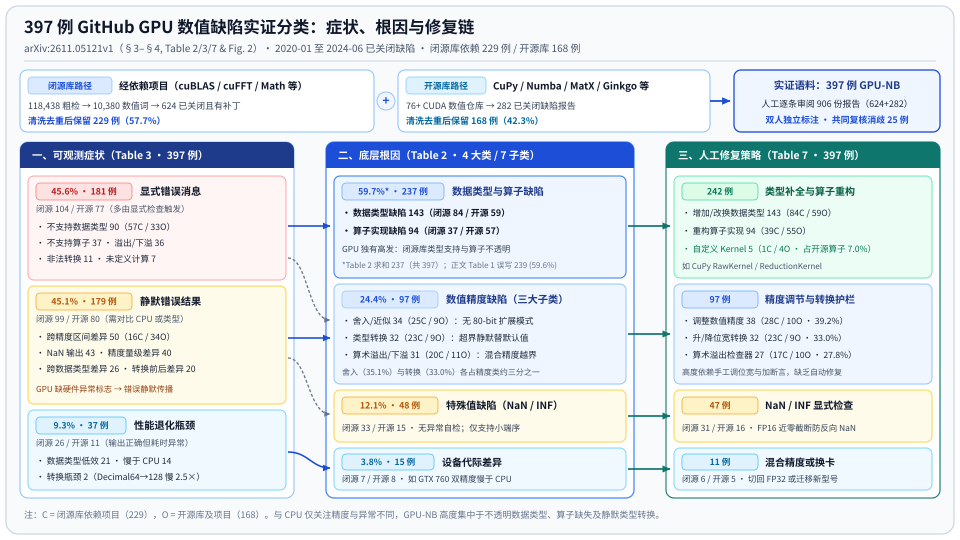查看原图 ↗</a><figcaption>图 1 · 397 例 GPU 数值缺陷实证语料筛选漏斗与症状—根因—修复三层映射（整理自 arXiv:2611.05121v1 §3–§4, Tables 2/3/7 与 Fig. 2）：与 CPU 缺陷以精度与异常为主不同，GPU 缺陷近六成集中在数据类型支持与算子实现。</figcaption></figure>

作者检索了 **2020 年 1 月至 2024 年 6 月** 的 GitHub 缺陷报告，区分两条采集路径（§3.1–§3.3）：对闭源库经由依赖项目间接抓取（`118,438` 条广义 GPU 报告 → 关键词过滤至 `10,380` → 筛选已关闭、含修复提交且排除内存/同步问题的 `624` 条）；对开源库直接检索 `76+` 个 CUDA/数值仓库（覆盖 CuPy、Numba、MatX、Ginkgo 等及其依赖项目）得到 `282` 条已关闭缺陷。作者对全部 **`906` 份**（`624 + 282`）样本人工去重与核验后，最终保留 **`397` 个唯一 GPU-NB 案例**（闭源依赖 `229` 个、开源库 `168` 个）。由两位作者独立标注并在联合复核中消歧 `25` 例分歧报告，将 Franco 等人的 CPU 分类框架改写为四大类、七个子类（仅特殊值一类与 CPU 研究重合）：

| 维度与分类（原文表来源） | 子类 / 具体表现 | 闭源依赖库（共 229） | 开源库及项目（共 168） | 合计（共 397） | 占总量 / 类别比例与关键特征 |
| :--- | :--- | :--- | :--- | :--- | :--- |
| **根因 · 数据类型与算子（Table 2）** | 数据类型缺陷（Data Type） | 84 | 59 | 143 | 36.0% · 缺失 dtype 支持或接口类型不匹配 |
| **根因 · 数据类型与算子（Table 2）** | 算子实现缺陷（Operator） | 37 | 57 | 94 | 23.7% · 该组求和 `237`（原文 Table 1 误印 `239` / `59.6%`） |
| **根因 · 数值精度（Table 2）** | 舍入 / 近似（Rounding/Approx） | 25 | 9 | 34 | 8.6% · 缺 80-bit 扩展精度与可配舍入模式 |
| **根因 · 数值精度（Table 2）** | 类型转换（Casting） | 23 | 9 | 32 | 8.1% · 越界转换静默回填默认值 |
| **根因 · 数值精度（Table 2）** | 算术运算溢出/下溢（Arithmetic） | 20 | 11 | 31 | 7.8% · 精度三子类合计 `97` 例（`24.4%`） |
| **根因 · 特殊值与硬件（Table 2）** | 特殊值（NaN / INF） | 33 | 15 | 48 | 12.1% · 无内置 NaN/INF 异常捕获；小端序限制 |
| **根因 · 特殊值与硬件（Table 2）** | 设备代际差异（Device-specific） | 7 | 8 | 15 | 3.8% · 老旧 GPU 缺混合精度或 FP64 吞吐退化 |
| **症状 · 三大外部表现（Table 3）** | 显式错误消息（Error Messages） | 104 | 77 | 181 | **45.6%** · 类型 `90`、算子 `37`、溢出 `36`、转换 `11`、未定义 `7` |
| **症状 · 三大外部表现（Table 3）** | 静默错误结果（Wrong Results） | 99 | 80 | 179 | **45.1%** · 精度区间 `50`、NaN `43`、精度量级 `40`、类型 `26`、转换 `20` |
| **症状 · 三大外部表现（Table 3）** | 性能退化瓶颈（Perf. Bottleneck） | 26 | 11 | 37 | **9.3%** · 数据类型 `21`、慢于 CPU `14`、转换耗时 `2` |
| **修复 · 八类人工补丁（Table 7）** | 补全/更改数据类型（Data Type） | 84 | 59 | 143 | 36.0% · 与数据类型缺陷一一对应 |
| **修复 · 八类人工补丁（Table 7）** | 重构算子 + 自定义 Kernel | 40 | 59 | 99 | 重构 `94`（39C/55O）+ 自定义 Kernel `5`（1C/4O，开源算子占 `7.0%`） |
| **修复 · 八类人工补丁（Table 7）** | 精度调整 / 升降转换 / 算术检查 | 68 | 29 | 97 | 调精度 `38`（39.2%）、升降转换 `32`（33.0%）、溢出检查 `27`（27.8%） |
| **修复 · 八类人工补丁（Table 7）** | NaN 检查器 + 混精/换卡 | 37 | 21 | 58 | NaN 检查 `47`（31C/16O）+ 混合精度或换卡 `11`（6C/5O） |

*表 1 · 397 例 GPU 数值缺陷的根因（Table 2）、症状（Table 3）与修复策略（Table 7）分布汇总（arXiv:2611.05121v1；闭源库 `229` 与开源库 `168` 各自逐列求和均严格等于 `229`、`168` 与 `397`）。*

原文 §4 给出了七组直接反映 GPU 编程陷阱的代表性案例：
1. **隐式降精度整数溢出（CuPy #6047）**：对 `uint64([[257]])` 与 `uint8([[1]])` 执行 `convolve2d`，SciPy 提升至 `uint64` 返回 `[[257]]`，CuPy 却按 `uint8` 截断导致整数溢出返回 `[[1]]`（调换输入顺序甚至连输出 `dtype` 也变成 `uint8`）。
2. **舍入函数差异（CuPy #4550）**：在 `0.5` 坐标处调用 `map_coordinates`，CuPy 使用四舍六入五成双的 `rint()`，而 SciPy 调用向下取整的 `floor(double)`，造成系统性对齐偏差。
3. **静默转换损坏与 2.5 倍性能反转（cuDF #7689 / #9597）**：`libcudf.unary.cast` 将 `Decimal64(-72462.12)` 转为 `int32` 时既不报错也不截断，而是静默输出毫无意义的 `13437`（反向将 `-48938` 转为 `Decimal64(10,5)` 则得到 `-5988.32704`）；而在 `#9597` 中，`Decimal64` 转 `Decimal128` 耗时 `4134 ms`，反而比同类型 `Decimal128` 拷贝转换 `1598 ms` 慢 `2.5` 倍。
4. **接口类型与算子兼容断裂（cuDF #9065 / CuPy #3909）**：`cudf.Series` 读取 `float16` CuPy 数组因 `__cuda_array_interface__` 期待 `np.dtype` 而传入 `cudf.dtype` 直接崩溃；`cupy.mean` 传入 `generic_filter` 报错 `bad type error`，修复方式是在 CuPy 中借助 `ReductionKernel` 显式重写算子（开源算子缺陷中自定义 `RawKernel`/`ReductionKernel`/`ElementwiseKernel` 修复占 `4/57`）。
5. **半精度梯度爆炸与大端序缺失（PyTorch #43211 / CuPy #3652）**：`torch.Tensor([1e-4]).cuda().half().norm(3).backward()` 因小值在 `FP16` 下溢/中间 `INF` 传播导致梯度变为 `NaN`，需将接近 `float16` 精度底限的极小值截断为零；此外 NVIDIA GPU 仅支持小端序，直接喂入大端序 NumPy 数组会让 CuPy 产生意外 `NaN`。
6. **低算力旧卡性能倒挂（CuPy #4891）**：在双精度单元极弱的 `GeForce GTX 760` 上，`FP64` 矩阵乘法在 CuPy（`1.0382 s`）反而慢于 CPU 版 NumPy（`0.7268 s`）；切换为 `FP32` 后反转恢复为 CuPy `0.156 s` 快于 NumPy `0.255 s`。

### 三、GPU-NBDetect：位级边界变异与九类差分/性能判据

基于表 1 归纳的「需系统性边界输入（F-7）」与「可借助 CPU 参考实现做差分比对（F-8）」两项洞见，作者构建了初步自动化检测工具 **GPU-NBDetect**（§5.1–§5.3）。用户只需指定待测数学 API，工具便在 Python 中自动生成包含 `math.h` 的 C 参考程序与包含主机/设备内存管理及 kernel 启动的 CUDA 测试程序，通过 `subprocess` 编译并成对执行。

1. **防误报初始化与边界位级变异**：为避免像 `XScope` 和 `GPU-FPX` 那样生成 `1.3400e+221` 或 `9.2579e+282` 等超出算子文档支持域的极端输入制造大量假阳性，GPU-NBDetect 先按文档（如 CUDA Math Library）规定区间抽取合法随机种子，剔除文档已声明的已知异常输入，再利用 IEEE-754 位级变异算子逼近 `0.5`、`0.499999`、`0.50000001` 等边界。文中主文本称其包含「7 个变异算子」，实际清单共列出 8 项：`bitflip_s`（以 `50%` 概率翻转符号位）、`bitflip_e`（随机翻转指数位）、`bitflip_m`（随机翻转尾数位）、`add_e` / `sub_e`（向指数随机加/减 `1–32`）、`add_m` / `sub_m`（向尾数加/减 `2^(p-1)`，其中 `p ∈ [1, 33]`）以及 `random_bit`（随机置位）。
2. **九类表现判据与经验断言阈值（Table 4）**：作者在多款设备与库上实测误差分布后标定了 9 条断言规则，但后文表格只评测了前 6 类数值异常：
   - **进入表 5/6 评测的 6 类**：S1 溢出（单次 GPU 输出 `A > MAX(FP)` 或 `A < -MAX(FP)`）、S2 下溢（原文写作 `A < MIN(FP) or A > -MIN(FP)`；工程上应指落入亚正规区间 `abs(A) < MIN(FP)`）、S3 特殊值（`A == NaN`）、S4 舍入误差（CPU 结果 `A` 与 GPU 结果 `B` 满足 `abs(A - B) > 1E-7`）、S5 类型转换（转换前后 `abs(B - A) > 0.9`）、S6 数据类型（同值不同数据类型间 `abs(A - B) > 0.01`）。
   - **未纳入表 5/6 自动化统计的 3 类**：S7 低位宽转换耗时慢于高位宽（平均慢 `2.5×`）、S8 低位宽总体耗时慢于高位宽（约 `3×`）、S9 单次运行 CPU 快于 GPU（设备特定退化）。作者坦承计时类策略（S7–S9）因运行时波动仍偶发误报。
3. **三周期稳定性过滤**：每个数学函数生成 `100` 组输入样本并独立跑 `3` 轮测试周期，只有跨周期稳定触发阈值断言的样例才记为有效检出。

### 四、四库 186 个数学函数的对比实验与 226 vs 60 确认口径

<figure class="note-figure"><a class="note-image-link" href="/assets/images/digest/2026-11-05/gpu-nbdetect-detection-results-zh.svg" target="_blank" rel="noopener" aria-label="查看 GPU-NBDetect 检测架构、9 类判据与 4 库实证结果图原图">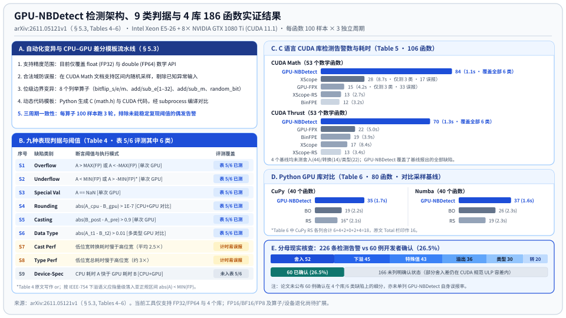查看原图 ↗</a><figcaption>图 2 · GPU-NBDetect 流水线、九类判据覆盖边界与四库 186 个函数检测汇总（整理自 arXiv:2611.05121v1 §5.3, Tables 4–6）：四个既有 C 工具只测 3 类异常，而 226 条总告警中仅 60 条（26.5%）获开发者明确确认。</figcaption></figure>

实验在 `Intel Xeon E5-26` CPU + `8× NVIDIA GTX 1080 Ti`（`CUDA 11.1`）服务器上完成（§5.3.1），剔除 `Min`/`Max` 等非数学计算 API 后，共测试 `4` 个库的 **`186` 个数学函数**（C 语言库 `CUDA Math` `53` 个、`CUDA Thrust` `53` 个；Python 生态库 `CuPy` `40` 个、`Numba` `40` 个）。C 端对比了 `XScope`（贝叶斯优化）、`XScope-RS`（随机采样）、以及配以随机输入生成的两大 NVBit 二进制插桩工具 `BinFPE` 与 `GPU-FPX`；Python 端因无先验专用工具，对比贝叶斯优化（BO）与随机采样（RS）：

| 受测库（测试函数数） | 工具 / 策略 | 溢出（Overflow） | 下溢（Underflow） | 舍入（Rounding） | 转换（Casting） | 数据类型（Data Type） | 特殊值（Special Val） | 报告总告警数 | 平均检测开销（秒） |
| :--- | :--- | :--- | :--- | :--- | :--- | :--- | :--- | :--- | :--- |
| **CUDA Math（53）** | XScope | 8 | 8 | - | - | - | 12 | 28 | 8.7 |
| **CUDA Math（53）** | XScope-RS | 4 | 5 | - | - | - | 4 | 13 | 2.7 |
| **CUDA Math（53）** | BinFPE | 5 | 2 | - | - | - | 5 | 12 | 3.2 |
| **CUDA Math（53）** | GPU-FPX | 6 | 4 | - | - | - | 5 | 15 | 4.2 |
| **CUDA Math（53）** | **GPU-NBDetect** | **10** | **14** | **24** | **10** | **14** | **12** | **84** | **1.1** |
| **CUDA Thrust（53）** | XScope | 4 | 7 | - | - | - | 6 | 17 | 8.4 |
| **CUDA Thrust（53）** | XScope-RS | 4 | 4 | - | - | - | 5 | 13 | 3.4 |
| **CUDA Thrust（53）** | BinFPE | 5 | 6 | - | - | - | 8 | 19 | 3.9 |
| **CUDA Thrust（53）** | GPU-FPX | 5 | 8 | - | - | - | 9 | 22 | 5.0 |
| **CUDA Thrust（53）** | **GPU-NBDetect** | **8** | **16** | **20** | **4** | **8** | **14** | **70** | **1.3** |
| **CuPy（40）** | RS | 6 | 4 | 2 | 0 | 2 | 4 | 16\* | 2.1 |
| **CuPy（40）** | BO | 7 | 4 | 2 | 0 | 2 | 4 | 19 | 2.2 |
| **CuPy（40）** | **GPU-NBDetect** | **9** | **7** | **4** | **3** | **4** | **8** | **35** | **1.7** |
| **Numba（40）** | RS | 6 | 3 | 2 | 1 | 3 | 4 | 19 | 2.3 |
| **Numba（40）** | BO | 7 | 5 | 3 | 2 | 3 | 6 | 26 | 2.3 |
| **Numba（40）** | **GPU-NBDetect** | **9** | **8** | **4** | **3** | **4** | **9** | **37** | **1.6** |

*表 2 · GPU-NBDetect 与 C/Python 基线在 4 个库 186 个数学函数上的检出数与耗时对比（arXiv:2611.05121v1 Tables 5–6，100 样本 × 3 周期于 8× GTX 1080 Ti / CUDA 11.1；`-` 表示该基线不检测对应类别；\*CuPy RS 行六类之和为 `18`，原文 Total 栏印作 `16`）。*

- **检出跨度与开销**：GPU-NBDetect 在 4 个库共报告 **`226` 条告警**（`84 + 70 + 35 + 37`），全部覆盖了四个 C 基线所发现的缺陷，且平均检测开销（`1.1–1.7 s`）显著低于基于二进制插桩或 BO 的基线（`2.1–8.7 s`）。在 C 基线未触及的三类问题上，共报出 `52` 条舍入差异（跨 `186` 个函数占 `27.9%`；Python 端各 `4` 条比 C 端 `24/20` 更稳定）、`20` 条转换异常（其中 C 库 `14` 条）与 `30` 条数据类型差异。典型确认案例包括 `cosh(3.6864e+4)` 溢出、`erfc(6.7076092e+7)` 下溢以及 `__float2int_rd(1.101256458240e+11)` 转换返回 32 位最大整数 `INT_MAX`。
- **关键的「226 vs 60」分母边界**：作者将告警提交至 NVIDIA 开发者论坛复核，最终有 **`60` 例获得开发者确认**（占 `226` 条的 `26.5%`）。需要特别注意的是，NVIDIA 开发者在确认部分舍入问题时指出：「*虽然结果仍处于 CUDA 文档承诺的 ULP 容差范围内，但这些偏差确实偏离了真实数学值*」。换言之，以 C `math.h` 为参考且硬切 `1e-7` 阈值触发的告警，在工程契约上未必全部属于违反 CUDA 官方 ULP 规范的 Defect；与此同时，原文未公布这 `60` 例确认在 4 个库或 6 类缺陷上的分布，也未汇报 `GPU-NBDetect` 自身的假阳性计数（相比之下，原文明确记录 `XScope` 与 `GPU-FPX` 分别产生了 `17` 与 `33` 个误报）。

### 五、科学边界、内部数据审计与工程迁移启示

把这项实证研究与检测原型应用到实际 GPU 研发或代理测试流水线时，必须看清以下四条边界：

1. **工具覆面与实证高发区的结构性脱节**：`GPU-NBDetect` 当前仅支持 **`float`（FP32）与 `double`（FP64）** 的标量数学函数，仅验证于 **4 个数学/数组库** 与 **单代旧卡（GTX 1080 Ti, CUDA 11.1）**；而前文 397 例 GitHub 实证中最频繁出现的 **`FP16`、`BF16`、`Decimal64/128` 混精/定点数缺陷、高维张量/算子语义不兼容（Operator）及跨代硬件性能退化（Device-specific）**，均未被当前原型所覆盖。
2. **启发式固定阈值与随机变异方差**：`1e-7`（舍入）、`0.9`（转换）、`0.01`（数据类型）与 `2.5×/3×` 计时倍数为固定经验阈值，未随数据位宽或输入量级按 ULP 自适应缩放；作者亦指出 S7–S9 性能判据易受环境噪声误报，且位级随机变异（仅 `100` 样本 × `3` 周期，未引入覆盖率引导或符号执行）无法保证每次运行检出结果完全一致。
3. **语料偏倚与原文内部数字审计记录**：397 例样本来自 `2020-01` 至 `2024-06` 的 GitHub 关键词检索且限定「已关闭并附带修复」，会漏掉大量未公开报错的静默偏差，闭源库部分也仅能反映依赖项目侧暴露的问题。另外，审计原文 PDF 时发现几处轻微印刷/计算不一致，本文已按原文忠实保留并显式标出：Table 2 数据类型（`143`）与算子（`94`）合计 **`237`**（四类之和恰好 `397`），而 Table 1 F-4 与 §4.2 误写为 **`239 (59.6%)`**；Table 6 中 `CuPy RS` 分项求和为 `18` 而 Total 栏印为 **`16`**；Table 4 第 2 行下溢判据印作 `A < MIN(FP) or A > -MIN(FP)`（字面 `or` 应为针对亚正规区间的 `and`，即 `abs(A) < MIN(FP)`）；§5.3 正文称「7 个变异算子」，清单实列 `8` 项。
4. **可迁移的工程原则**：（1）**把合法域抽样前置到差分测试前**：用文档支持区间约束种子并用三周期稳定性过滤，可直接压低传统 GPU 浮点工具的越界误报；（2）**在关键 GPU 算子内显式补齐防护而非指望硬件异常**：面对缺乏 `fenv` 状态寄存器的现实，混合精度与类型转换入口（如 `__cuda_array_interface__` 与 `FP16` 小值归一化）必须手工校验范围、`NaN`/`INF` 与 `dtype`；（3）**分清「ULP 合规但偏离 CPU」与「真实越界故障」**：当把 CPU `math.h` 当作测试预言机时，必须结合算法对 ULP 累积的敏感度做分级 triage，而不能把告警总数直接等同于已确认缺陷数。

来源：依据 `arXiv:2611.05121v1` 全文（`Proc. ACM Softw. Eng. 2, ISSTA, Article ISSTA073`, 2025 年 7 月）与冻结摘要整理；未独立复现 GitHub 语料抽取或 `GTX 1080 Ti` 检测实验。
<h2 class="daily-paper-title" id="paper-arxiv-2611.04057">10 · Look Before You Launch：生产训练集群的提交时吞吐预测与硬件路由</h2>

[Look Before You Launch: Learned Throughput Prediction for Hardware Selection in a Production Training Fleet](https://arxiv.org/abs/2611.04057)（[v1 PDF](https://arxiv.org/pdf/2611.04057) · [arXiv HTML](https://arxiv.org/html/2611.04057v1)）  
Hossein Askari、Wei Sun\*、Chenguang Zhu、Bin Zan、Sreen Tallam\*、Keyu Man（Meta；\* 工作完成于 Meta 期间）· <code>arXiv:2611.04057v1 [cs.AI]</code> · 2026-11-02 提交（PDF 日期标注 2026-11-04；截至核验仅存 <code>v1</code>，无修订或撤回记录）

在混合多厂商与多代际加速器的训练集群中，同一训练作业往往可在多款硬件上运行，不同硬件间的单价与实测吞吐（QPS）差异巨大；更隐蔽的是，被派往次优硬件的作业依然能无报错跑完，导致算力浪费长期隐藏在「任务成功」表象之下。Meta 提出的 `LEAP`（Learned Performance Prediction Service）在作业提交阶段、未实际执行前即预测每个候选硬件上的训练吞吐，再按「预测吞吐 / 作业算力成本」生成偏好列表交由集群调度器决策，日均路由约 `25,000` 次作业尝试、覆盖约 `660` 类生产模型与超过 `20` 种硬件类型。本文严格依据 `arXiv:2611.04057v1` 全文（第 1–7 节、图 1–8、表 1–4）展开精读，将作者实测指标与线上核验边界明确分开。

### 一、为什么不能靠规则查表或「模型→硬件」静态映射

集群内可跨硬件调度的弹性作业（fungible jobs）约占半年期集群 GPU-hours 及总训练计算成本的一半。然而在生产环境下，提交前既难以像学术界 `Habitat` / `DNNPerf` 那样预先跑一次 profiling 或提取计算图，也无法像弹性调度器 `Gavel` / `Sia` 那样假定吞吐已知或等待运行时再测。Meta 此前采用的零机器学习规则查表方案以 `(model_type, num_trainers, batch_size, hardware_type)` 为主键，在实际集群中暴露出四项结构性瓶颈：

- **长尾模型规模使手工规则覆水难收（图 1）**：典型工作日集群执行约 `25,000` 次作业尝试，涵盖约 `660` 种生产模型；其中尝试次数最多的前 `19` 类模型仅占 `37%`，前 `100` 类占 `78%`，而尾部 `560` 类低频模型合计仍贡献 **`22%`** 的日尝试量。旧规则表仅维护了 `19` 类模型的条目，在随机留出日（`7,131` 次尝试、`276` 类模型）上，高达 `93%` 的模型类型查无条目，全天覆盖率仅 **`13.3%`**（`946 / 7,131`）。
- **四元组键本身无法唯一决定吞吐**：即使在同一规则主键下，有 **`56%`** 的作业尝试其第 10 至第 90 百分位（`p10–p90`）吞吐差距超过 `1.5×`，这意味着任何单个静态查表数值在数学上都不可能落入 `±20%` 误差带内。表 1 显示，即便只统计旧规则表有条目的 `946` 次作业，规则引擎的 `w20` 准确率也仅 **`53.2%`**（`w10 = 33.4%`，中位预测/实测比 `1.11` 呈系统性高估），而 `LEAP` 在同批作业上达到 **`85.1%`**（`w10 = 72.1%`，中位比值 `1.00`）。
- **同一模型类型也无法绑定单一最优硬件（图 7）**：对一周内 `10` 类模型的每次启动做统计，**没有任何一类模型只对应单一首选硬件**——例如 `Model Type 1`（`5,527` 次启动）被 `LEAP` 排在第一的硬件分散在四款型号上，各占 `16%–31%`；`10` 类中有 `4` 类的最高占比硬件不超过 `50%`，即便集中度最高的 `Type 4` 与 `Type 7` 也只在 `77%` 启动中选中同一硬件。并行卡数、batch 大小、任务历史吞吐与当下候选集共同决定了单位成本最优解。
- **吞吐跨 7 个数量级且单硬件内极度右偏（图 5）**：在抽取的 `22,495` 行分区中，实测吞吐跨越从个位数到 `10^6` 以上的 `7` 个数量级（其中 `91%` 集中在两个数量级内）；即使限定在单一硬件内部，第 95 与第 5 百分位之比（`p95/p5`）依然高达 **`42×` 至 `701×`**（全集群 `133×`，硬件 B 中位数约为硬件 D 的 `3×`）。在原值尺度上做回归会被超大吞吐作业主导（原始 `R²` 在 `w20 > 75%` 的夜晚仍接近 `0`），而传统 `MAPE` 又会被极低吞吐作业放大支配。

### 二、LEAP 架构：启动器内零 RPC 推理、25 万族快照与 13 桶 EM 级联

<figure class="note-figure"><a class="note-image-link" href="/assets/images/digest/2026-11-05/leap-fleet-throughput-routing-zh.svg" target="_blank" rel="noopener" aria-label="查看 LEAP 生产训练集群吞吐预测与硬件路由闭环架构图原图">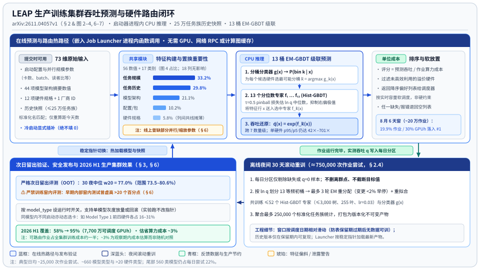查看原图 ↗</a><figcaption>图 1 · LEAP 系统闭环（整理自 arXiv:2611.04057v1 §2 &amp; 图 2–4, 6–7）：在线推理作为函数直接链接在作业启动器进程内运行，仅依赖轻量表征与内嵌 25 万任务族快照；离线每夜在近 30 天实测分区重训 13 桶 EM 级联并在次日未见分区验收。</figcaption></figure>

为兼顾日均数万次启动调用的低延迟与高可维护性，`LEAP` 在控制面与建模面确立了四项核心机制（第 2.1–2.4 节）：

1. **进程内嵌入与软偏好控制边界（§2、§2.3）**：`LEAP` 推理库直接链接进 Job Launcher 进程，路由决策只是一次本地函数调用而非网络 RPC。启动器先筛选作业可运行的候选硬件，再由 `LEAP` 对每款候选预测吞吐 `q̂` 并除以作业在该硬件上的计算成本，过滤掉预测利用率不足的溢价（premium）加速器后，返回降序偏好列表。**集群调度器只将该列表视作软偏好而非硬约束**，需结合实时空闲容量落盘。系统按 `model_type` 提供运行时开关支持单模型灰度上线或秒级回滚；任何异常（候选集为空、缺特征或产物加载失败）均安全降级为空列表（代表「无意见」），不影响作业正常启动。
2. **共享特征工程与内嵌 25 万任务族快照（§2.1–2.2、图 4）**：特征构建器由训练与在线推理共享同一套代码，关联作业提交配置、集群资源分配日志和静态硬件规格表（`12` 项数值规格如峰值算力、显存容量/带宽、互联带宽、L1 缓存、制程节点 + `1` 个厂商 ID），共输出 **`73` 列特征**（`56` 数值 + `17` 类别）。其中最具预测力的 **`5` 项任务族历史特征**——上次对数吞吐 `hist_prior_log_qps`、历史运行均值 `hist_prior_log_qps_mean` 与标准差、历史观测次数 `hist_n_prior`、距上次运行天数——若在线查询数据库会阻塞提交热路径。`LEAP` 将按标准化作业名（剥离单次运行 ID）聚合的最多 **`250,000` 个任务族统计快照**直接打包进模型产物，在线仅基于当前日期重算「距今天数」，对未见家族显式填充冷启动插补值（**绝不填 `0`**，避免被 `ln q` 误读为 `1 QPS`）。在留出日 10 次置换均值下（图 4），任务规模/并行度（`33.2%`）与任务历史（`29.8%`）贡献了 `63%` 总重要性，其后依次为模型架构（`21.1%`）、配置/包（`10.2%`）与硬件规格（`5.8%`；因硬件列跨少数机型高度共线，单列置换会由其余共线列兜底而低估硬件整体作用），另有 `18 / 73` 列无显著贡献。
3. **对数中位数损失与 13 桶 EM-GBDT 级联（§2.2、公式 1–4、图 6）**：模型预测对数吞吐 `y = ln q`，采用中位数 pinball 损失 `ℓ_0.5(u) = u · (0.5 - 1[u < 0]) = 0.5 · abs(u)`（由于单调变换保中位数，指数还原 `exp(f(x))` 估计的是 `q` 的条件中位数，避开右偏均值的极端拉伸）。因单一回归器在长尾两端拟合不佳，训练先把 `ln q` 均分为 **`K = 13` 个等频分桶**，再执行最多 **`3` 轮 EM 交替优化**（当跨桶样本变动低于 `2%` 时早停）：每轮在各自桶内拟合直方图梯度提升回归树 `HistGradientBoostingRegressor`（最多 `3,000` 棵树、`255` 叶、`lr = 0.03`），再把每条训练样本重分配至残差 `abs(y_i - f_k(x_i))` 最小的专家桶；收敛后对最终分桶再重拟合一轮专家（每次重训最多拟合 `13 × 3 + 13 = 52` 个回归器），并单独训练梯度提升分桶分类器 `g(x)` 仅凭提交特征预测桶概率。线上预测时取 `k̂ = argmax_k g_k(x)`，最终输出 `q̂(x) = exp(f_k̂(x))`。
4. **30 天相对窗口夜间重训与指针热更新（§2.4）**：每日流水线落盘约 `25,000` 条完成尝试后，夜间任务以最近 **`30` 天**（约 `750,000` 条尝试）为训练窗，仅剔除缺失或 `q = 0` 的样本，**刻意不删除离群点、不截断目标值**。日期窗相对调度日动态滚动（防止固定起始日因数据保留期过期而断档）；产物（`13` 个最终专家 + `g(x)` + `25` 万族快照）以不可变版本写入 Blob 存储，在未见次日分区上验算后再切换生产指针，实现零代码变更发布。

### 三、特征驱动与模型选型消融：哪些有效，为什么 LLM 与计算图 GNN 都落选

<figure class="note-figure"><a class="note-image-link" href="/assets/images/digest/2026-11-05/leap-fleet-accuracy-drivers-zh.svg" target="_blank" rel="noopener" aria-label="查看 LEAP 准确率驱动因素、替代模型对比与分布外泛化边界四象限图原图">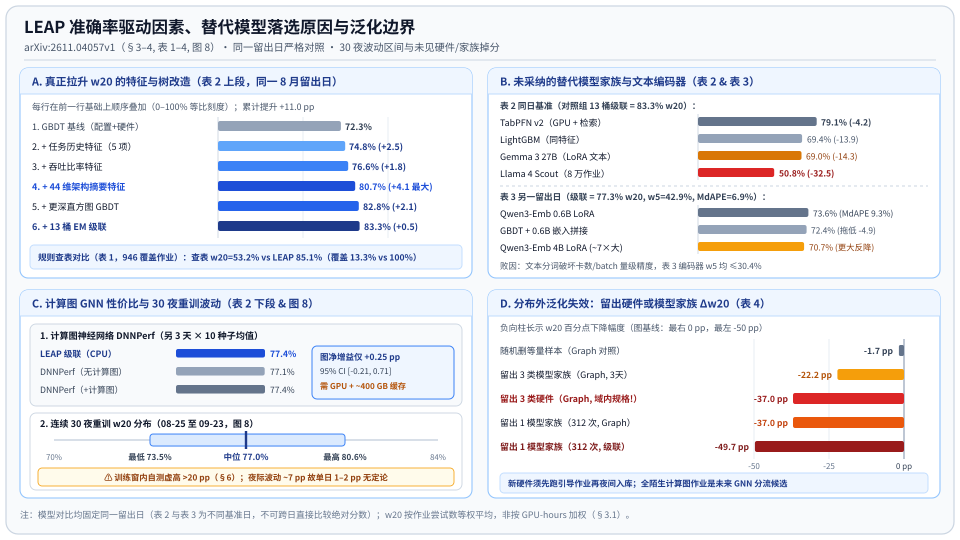查看原图 ↗</a><figcaption>图 2 · 消融实证与泛化边界（整理自 arXiv:2611.04057v1 §3–4、表 1–4、图 8）：领域特征工程与更深直方图树贡献了 +11.0 个百分点的同日跃升；生成式与编码器大模型因数值尺度失真落败，计算图 GNN 收益在统计误差内但运维代价过高，两类模型在未见硬件上均严重掉分。</figcaption></figure>

由于生产吞吐分布随日常负载变化，论文（第 3.1、4 节）严格保证每张对比表内部均在同一批留出分区上横向评测（不同表的基准日难易度不同，不可跨表混比绝对数值）。表 1 汇总了论文表 1–3 的全量对比与消融数据：

| 评测批次与模型配置 | 基准口径与输入条件 | `w5` (%) | `w10` (%) | `w20` (%) | 关键对照差值 / 服务代价 |
| :--- | :--- | :--- | :--- | :--- | :--- |
| 规则查表引擎（表 1） | 留出日覆盖子集（`946 / 7,131` 作业，覆盖率 `13.3%`） | — | `33.4` | `53.2` | `w15 = 45.0%`，预测/实测比 `1.11`（`93%` 模型无条目） |
| `LEAP` 级联（表 1 同子集） | 同上 `946` 次作业（全天 `7,131` 作业覆盖率 `100%`） | — | **`72.1`** | **`85.1`** | `w15 = 80.6%`，比值 **`1.00`**（较规则高 **`+31.9 pp`**） |
| `GBDT` 基线（表 2 上段） | 2026-08 固定留出日（仅启动配置 + 硬件规格） | — | — | `72.3` | `scikit-learn` 默认树（pinball `τ=0.5`） |
| `+` 任务历史特征（`5` 项） | 同上日叠加先验 `ln q`、均值、标准差、次数、距今天数 | — | — | `74.8` | `+2.5 pp` |
| `+` 吞吐比率特征 | 同上日叠加跨卡总 batch、数据读取器/卡比等组合比值 | — | — | `76.6` | `+1.8 pp` |
| `+` 模型架构特征（`44` 项） | 同上日叠加从模型定义提取的层数、算术强度等摘要值 | — | — | `80.7` | **`+4.1 pp`**（全流程最大单步增量） |
| `+` 更深直方图 `GBDT` | 同上日换为 `HistGBDT`（`≤3,000` 树、`255` 叶、`lr=0.03`） | — | — | `82.8` | `+2.1 pp` |
| `+` 13 桶 EM 级联（表 2 终版） | 同上日叠加 `13` 专家 EM 划分 + 分桶分类器 `g(x)` | — | — | **`83.3`** | `+0.5 pp`（相对基线累计 **`+11.0 pp`**） |
| `TabPFN v2`（表 2 中段） | 同上 8 月日，基线特征 + 检索最相似训练行作上下文 | — | — | `79.1` | 低于级联 `4.2 pp`，且在线需 **GPU + 向量检索** |
| `LightGBM`（表 2 中段） | 同上 8 月日，使用全套同特征训练 | — | — | `69.4` | 低于 `sklearn` 基线及终版级联 `13.9 pp` |
| `Gemma 3 27B`（LoRA） | 同上 8 月日，配置文本化（更激进裁剪至 `≤12k` token） | — | — | `69.0` | 低于级联 `14.3 pp`，且需大模型 GPU 推理 |
| `Llama 4 Scout`（LoRA） | 同上 8 月日，`80,000` 作业配置裁剪至 `≤12k` token 微调 | — | — | `50.8` | 低于级联 `32.5 pp`，文本生成难以校准大跨度数值 |
| 基线 `GBDT` 级联（表 3） | 另一留出日（第 4.3 节文本编码器基准） | **`42.9`** | **`68.9`** | **`77.3`** | `MdAPE = 6.9%`（纯 CPU 进程内运行） |
| `Qwen3-Embedding 0.6B`（冻结） | 同表 3 日，`1,024` 维文本向量 + 标准化数值接 MLP（Huber） | `30.4` | `52.4` | `68.1` | `MdAPE = 11.5%` |
| `Qwen3-Embedding 0.6B`（LoRA） | 同上，端到端 LoRA 微调编码器 + MLP 头 | `26.1` | `45.2` | `73.6` | `MdAPE = 9.3%`（编码器最优，仍落后级联 `3.7 pp`；大头 `72.7%`） |
| `Qwen3-Embedding 4B`（LoRA） | 同上，参数量放大约 `7×` | `26.6` | `48.4` | `70.7` | `MdAPE = 10.5%`（参数增大准确率反降 `2.9 pp`） |
| `GBDT + 0.6B 嵌入` 拼接 | 将编码器 `1,024` 维特征拼入基线级联 `GBDT` | `30.2` | `50.3` | `72.4` | `MdAPE = 9.9%`（拖低原 `GBDT` `4.9 pp` 并增加每次调用开销） |
| 基线级联 vs `DNNPerf`（表 2 下段） | 另 `3` 个评测日 × `10` 随机种子均值：级联 / 无图 / `+计算图 GNN` | — | — | `77.4 / 77.1 / 77.4` | 图净增 **`+0.25 pp`**（`95% CI [-0.21, 0.71]`），需 GPU + **`~400 GB`** 图缓存 |

*表 1 · LEAP 与规则查表、特征工程增量及未采纳替代方案全量对比（整理自 arXiv:2611.04057v1 表 1–3；各横向块分别对应独立留出日口径，`—` 表示原文该表未报该列指标）。*

从表 1 消融中可以提炼出三项极有反直觉价值的工程结论：

1. **特征工程与树模型容量远比更换模型家族更有效**：在同日评测中，仅靠 `44` 维从模型定义提取的架构特征就贡献了 **`+4.1 pp`** 增量，叠加历史特征（`+2.5 pp`）、吞吐比率（`+1.8 pp`）、更深直方图树（`+2.1 pp`）与分桶级联（`+0.5 pp`）共带来 **`+11.0 pp`** 飞跃；反观同特征下的 `LightGBM`（`69.4%`）与上下文表格模型 `TabPFN v2`（`79.1%`）均未打平终版 `HistGBDT` 级联。
2. **为什么大模型（无论生成式还是文本编码器）都不适合吞吐回归**：`Llama 4 Scout`（`50.8%`）与 `Gemma 3 27B`（`69.0%`）即便把配置裁剪进 `12,000` token，仍大幅落后表格树模型；改用 `Qwen3-Embedding` 编码器并拼接标准化数值特征后，微调 `0.6B` 虽拿到 `73.6%`，但在严格误差档 `w5` 上最高仅 `30.4%`（级联为 `42.9%`），`MdAPE` 从 `6.9%` 恶化到 `9.3%–11.5%`，且 `4B` 版本反而不如 `0.6B`，把 `1,024` 维嵌入喂给 `GBDT` 更使 `w20` 倒退 `4.9 pp`。作者指出根本原因在于**文本分词器会破坏数字的量级连续性**，而训练吞吐恰恰高度依赖 `num_trainers`、`batch_size` 等强数值尺度特征。
3. **计算图 GNN 在已知负载上几乎零净增益却引入重资产**：作者完整复现了 `DNNPerf`（从配置导出算子计算图，跑注意力 GNN，并与分段线性编码的作业特征送入 Huber 损失 ResNet 头）。在 `3` 天 `10` 种子对照下，加入计算图相比纯作业特征仅多 **`+0.25 pp`**（`95% CI [-0.21, 0.71]`，统计上与零无异），总分 `77.4%` 也与启动器内纯 CPU 级联持平；若上线 GNN，必须为日均数万次启动配推理 GPU、构建 **`~400 GB`** 的 30 天计算图缓存并承担缓存查询延迟，性价比完全不成立。

### 四、分布外泛化、线上路由效果与实验核验边界

| 评测维度 / 压力场景 | 原文对应位置与样本设置 | 核心实测结果 | 工程含义与核验限制 |
| :--- | :--- | :--- | :--- |
| 留出 `3` 类硬件（`Graph-based`） | 表 4（`3` 天 × `10` 种子；硬件规格**仍在训练域内**） | **`-37.0 pp`**（对比随机删等量行仅 `-1.7 pp`） | 即便有计算图与物理规格，两类模型均**无法零样本外推新硬件** |
| 留出 `3` 类模型家族（`Graph-based`） | 表 4（`3` 天 × `10` 种子） | **`-22.2 pp`** | 对未见模型族精度显著退化 |
| 留出 `1` 类模型家族（同日头对头） | 表 4（`1` 天 `312` 次尝试） | 级联 **`-49.7 pp`** vs 计算图 **`-37.0 pp`** | 级联的桶分类器无法归类全陌生模型；计算图慢退化 `12.7 pp` |
| 连续 `30` 夜滚动重训 | 图 8（`08-25` 至 `09-23`，每日次日留出评测） | `w20` 中位 **`77.0%`**（夜际区间 **`73.5%–80.6%`**） | 跨夜存在约 `7 pp` 自然波动，单日 `1–2 pp` 胜负无统计学意义 |
| `2026 H1` 线上路由覆盖与成本 | §3.2.1（半年生产统计 + 8 月 `6` 天 `~20` 万作业切片） | 覆盖率 **`58% → 95%`**（`7,700` 万 GPUh）；估省 **`~3%`** 训练算力成本 | 8 月切片中落入 `#1` 硬件占 `19.9%` 作业 / `30.0%` GPUh / `26.2%` 成本加权用量 |
| 窗内数据泄露历史教训 | §6（早期内部评测 vs 严格次日留出评测） | 窗内评测曾**虚高超过 `+20 pp`** | 滚动时间序列预测绝不能在训练窗内抽样打分 |

*表 2 · 分布外压力测试、跨夜稳定性、线上生产部署与核验边界汇总（整理自 arXiv:2611.04057v1 §3.1、§3.2.1、§4.4、§6、表 4、图 8）。*

把这套生产报告用于自身集群规划时，必须明确以下五项原文披露的**科学边界与未验证假设**：

1. **新硬件与全新模型家族的冷启动盲区（§4.4、§6）**：表 4 证明，即使新硬件的算力与显存参数完全落在已知硬件规格的凸包范围内，留出硬件仍导致 `37 pp` 崩塌；因此新加速器上线路由前，必须先跑真实生产作业或一小批代表性引导（bootstrap）任务并经历至少一次夜间重训。对于与训练集完全不同的全新计算图结构，级联会丢失近 `50 pp`（因分桶分类器失去依据），作者建议未来可只把这类新图结构作业分流至 GNN 备选通路。
2. **线上实际落卡率受集群容量制约，`~3%` 节约为生产观测估计（§2.3、§3.2.1）**：调度器只在容量允许时采纳第一顺位推荐，8 月 6 天窗口内仅 `19.9%` 作业（`30.0%` GPUh）实际跑在 `LEAP` 排名第一的硬件上；全文也未给出集群级随机双盲 A/B 实验，约 `3%` 的总算力成本节约属于基于 2026 年上半年部署规模的工程估算，且仅覆盖约占集群半数训练成本的可调度作业。
3. **`w20` 按尝试次数等权，可能掩盖少数巨型作业误差（§3.1、§6）**：公式 (6) 表明 `w20` 等于各模型类型按作业尝试数加权的平均准确率，而非按 GPU-hours 加权——因此 `77.0%` 更能反映高频中小作业的表现，不能自动等价于少量超大规模分布式任务上的预测精度。
4. **存在已知的训练–推理特征偏斜与未知标签噪声上限（§6）**：尽管特征构建代码共享，作者在「未来工作」中坦言**线上推理路径仍遗漏了部分离线模型用到的并行与缩放参数**，亟需引入每日在线/离线特征一致性审计；同时，集群共享网络或存储争用带来的真实吞吐噪声天花板尚未量化，目前尚不清楚剩余 `23%` 误差中多少属于不可消除的环境随机噪声。
5. **本次核验范围**：本文已对照 `arXiv:2611.04057v1` 全文核对所有表图数据与公式定义；由于系 Meta 内部生产系统且未公开源码或数据集，所有数值均来自作者报告，未在本地复跑训练与线上路由。

### 五、可迁移的系统工程启示

1. **高并发调度热路径优先选择「进程内 CPU 树模型 + 内嵌历史快照」**：对每次启动都触发的路由调用，避免在线图抽取、GPU 推理与远程特征库查询往往比追求 `0.2%` 的模型指标更关键；把历史聚合打包成不可变快照随指针原子切换，并设置缺失即退回空列表的安全契约，是系统能平顺推广到 `95%` 覆盖率的底座保障。
2. **重偏态多量级吞吐预测应先修正目标空间与评估尺度**：当单硬件内部就有 `42×–701×` 跨度时，转入对数空间优化中位数（`τ = 0.5` pinball 损失）并以等频分桶专家级联收敛极值，同时用物理意义明确的相对误差覆盖率 `w20` 与 `MdAPE` 替代被极值扭曲的原始 `R²` 与 `MAPE`。
3. **坚持「严格未来日留出评测 + 同日对照 + 在线特征对账」三条防线**：生产日志的窗内自测足以制造超过 `20 pp` 的虚假领先，单日对比又会被 `7 pp` 的负载日波动淹没；只有把全套备选模型锚定在同一未见次日并持续追踪多夜中位数，再补齐在线缺失参数审计，才能真正看清哪些特征与结构改动能转化为真实算力节约。

来源：[Look Before You Launch: Learned Throughput Prediction for Hardware Selection in a Production Training Fleet](https://arxiv.org/abs/2611.04057)
<h2 class="daily-paper-title" id="paper-arxiv-2611.04449">11 · 门控模型近零词嵌入如何无声卡死训练</h2>

[Near-Zero Token Embeddings Silently Stall Training in Gated Sequence Models](https://arxiv.org/abs/2611.04449)（[v1 PDF](https://arxiv.org/pdf/2611.04449) · [HTML](https://arxiv.org/html/2611.04449v1) · [补充材料](https://arxiv.org/src/2611.04449v1/anc)）  
Xin Liu、Boyuan Sun、Yuxin Wang、Haoran Song、Mingjian Zhao、Mengyu Liu（作者邮箱对应 Washington University in St. Louis 与 Nankai University；第六位作者仅列个人邮箱未标注机构）· `arXiv:2611.04449v1 [cs.LG; cs.CL]` · 2026-11-03 提交（截至本地冻结快照仅存 `v1`，无修订或撤回记录）

当从业者对开源门控或混合架构模型（如 Mamba、Nemotron-H、Falcon-H1、Kimi-Linear）开展小语种持续预训练或对话模板微调时，训练可能在不报错、无 `NaN` 损失的情况下静默丢弃整批更新。本文通过普查 `291` 个开源权重仓库（`280` 张独立词嵌入表）定位到一条贯穿预训练、前反向传播与优化器裁剪的完整故障链：**`52.6%`（`20/38`）非共享输入嵌入的门控/混合模型包含可触发的近零输入行（`‖e_v‖₂ < 10⁻⁶`），而共享权重模型为 `0%`（`0/101`）**；一旦单批出现哪怕一个近零词元，零点归零的读出门控或线性查询会抑制历史状态读出，使多层 Pre-RMSNorm 反向逐层放大最多 `10³` 倍（总放大达 `10³⁰–10³⁵`），越过 FP32 平方上限 `1.84 × 10¹⁹` 后令全局范数溢出为 `+∞`，从而在 PyTorch、Hugging Face Trainer 与 FSDP2 中静默将全模型当前批梯度乘以 `0.0`。以下精读严格依据 `arXiv:2611.04449v1` 原文、表 1–7 及附录 A–F，将作者实测指标与工程适用边界严格区分。

### 一、近零嵌入的来历与 291 仓库普查：非共享权重衰减如何埋下隐患

标准推理基准很少暴露近零词元：英文评测提示很少包含低资源脚本子词或未激活对话标签，且大多数词元的输出行 `E_out` 依然保持正常尺度，解码时下一词概率分布看不出异常。为此，作者在 §2 与附录 F 对 2026 年 10 月 HuggingFace Hub 下载量前 500 文本生成仓库去重筛选（剔除 GGUF/AWQ/LoRA/测试项并补齐主要基座与门控家族）后，通过 HTTP byte-range 直接拉取 `safetensors` 中的输入词嵌入 `E_in` 与输出矩阵 `E_out` 计算 FP64 行 L2 范数，共完成 **`291` 个唯一仓库（`101` 权重共享、`190` 非共享；合并 `11` 个 Transformer 镜像后共 `280` 张独立词表）** 审计。为排除词表末尾对齐填充（如 `50,257 → 50,304`）或不可达字节项，作者沿用 Land & Bartolo（2024）的往返分词测试：对每个满足 `‖e_v‖₂ < 10⁻⁶` 的词元 ID 解码并在孤立状态及 `8` 种上下文模板中重分词（对 `Kimi-Linear-48B-A3B-Base` 与 `Mamba-Codestral-7B` 改用各自官方分词器），能精准还原原 ID 才计为**可达近零词元**：

- **权重共享是清晰分水岭（图 3a）**：全库共有 `92` 个仓库存在 `< 10⁻⁶` 原始行，其中 **`67/291`（`23.0%`）** 包含可达近零词元。按是否共享分类，**权重共享模型为 `0/101`（`0%`，含 `80` 个 Transformer 与 `21` 个门控/混合模型）**，非共享模型高达 `67/190`（`35.3%`）——其中非共享 Transformer 占 `47/152`（`30.9%`，如 `Llama-3.1-8B`、`OLMoE-1B-7B`），非共享门控/混合模型则高达 **`20/38`（`52.6%`）**（涵盖 `Nemotron-3-Nano-4B`、`Falcon-H1-1.5B/7B`、`Mamba-Codestral-7B`、`Kimi-Linear-48B-Base`、`Nemotron-H-4B-Base`、`Bamba-9B-v2` 等，微调与蒸馏派生模型会直接继承这些行）。受影响词元均是正常文本字符或标签，例如 Nemotron 中的泰卢固语/巴斯克语子词、Falcon-H1 中的西里尔蒙古语词、Mamba-Codestral 中的 CRLF 代码片段（如 `});\r`）、Kimi-Linear-48B-Base 中的 `<|im_user|>`/`<|im_end|>`，以及 Nemotron-H-4B-Base 中的 `<s>`；在 20 个受影响门控模型中，这些词元仅占词表的 `0.001%–0.25%`（中位数 **`0.040%`**）。
- **为什么只萎缩输入表而输出表正常（式 1 与附录 A）**：自回归模型每步对全部 `V` 个词元计算 softmax 归一化，因此即便某个词元 `v` 从未在预训练语料中出现，输出表 `E_out` 第 `v` 行每步仍会收到非零交叉熵梯度；而在非共享设置（`E_in ≠ E_out`）下，未见词元的输入行 `E_in[v]` 梯度恒为 `0`，标准 AdamW 对所有 2D 矩阵统一施加解耦权重衰减后，其范数按 `‖e_v^(T)‖₂ = ‖e_v^(0)‖₂ ∏_{t=1}^T (1 − η_t λ)` 指数收缩——当 `λ = 0.1` 时，在峰值学习率 `η_max = 4×10⁻⁴` 下缩至 `10⁻¹²`，在 `1.2×10⁻³` 下更可缩至 `10⁻³⁵`（下探至 `10⁻³⁶`）。作者通过两项验证坐实该机制：（1）**2×2 受控消融**（4 层 Mamba，`d = 256`、`V = 4,096`、`500` 个未见词、`3,000` 步 AdamW）中，仅「非共享且 `λ = 0.1`」使全部 500 个未见行严格按 `(1 − ηλ)³⁰⁰⁰` 衰减至 5 位有效数字（变异系数 `CV = 0.0085`），而共享权重或设 `λ_emb = 0` 时零行出现；（2）**OLMoE-1B-7B 语料核验**中，从其公开预训练语料 `OLMoE-mix-0924` 七个子集均匀采样 `3.64` 亿 token，全部 `251` 个近零行出现次数为 **`0/251`**（而凡出现过的词元均保持 `[0.11, 0.60]`），其中 `250` 行紧密聚集在 `[3.23, 3.50] × 10⁻¹²`（均值 `3.36 × 10⁻¹²`，`CV = 0.0159` 吻合高斯初始化 `1/√(2d) = 0.0156`，仅 `id=34761` 位于 `6.50 × 10⁻⁷`），对数衰减 `≈ −26.3` 与 OLMoE `5.13T` token 调度累计衰减 `∑ η_t λ ≈ 26–27` 数量级一致。同时，抽样的 `979` 个可达近零词元中 **`92%`（`901/979`）** 的 `E_out` 仍维持在词表中位数的 `0.3×` 以上（图 3c）。

### 二、故障机理链：零点门控归零、Pre-RMSNorm 逐层复利与 FP32 静默清零

<figure class="note-figure"><a class="note-image-link" href="/assets/images/digest/2026-11-05/nearzero-embedding-overflow-chain-zh.svg" target="_blank" rel="noopener" aria-label="查看近零非共享词嵌入引发的梯度倍增与 FP32 静默清零链条图原图">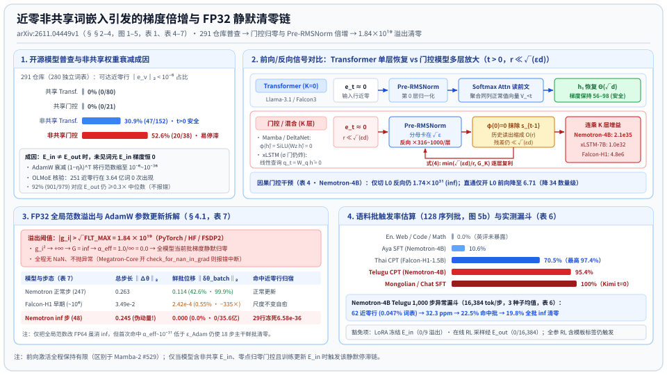查看原图 ↗</a><figcaption>图 1 · 近零输入嵌入触发门控梯度爆炸、FP32 静默清零与多语言批触发漏斗（整理自 arXiv:2611.04449v1 §§2–4、图 1–5 与表 1、4–7）：与前向崩溃不同，该链路在零报错、零 NaN 条件下吞掉约两成训练更新。</figcaption></figure>

为什么同样含有近零行，非共享 Transformer 在句子中间（`t > 0`）却能安然训练，而门控序列模型会放大梯度逾 `30` 个数量级？论文 §3–§4 将物理与数值因果链拆成四个咬合环节：

1. **Pre-RMSNorm 在 `sub-ε` 区间的反向放大（式 2）**：现代大模型普遍在残差分支前采用 `h̃ = RMSNorm(h) = h / √((1/d)‖h‖₂² + ε) ⊙ w`（`ε` 取 `10⁻⁶` 或 `10⁻⁵`）。一旦输入向量范数 `r = ‖e_t‖₂ ≪ √(εd)`，分母直接被常数 `√ε` 主导（`h̃ ≈ ε⁻¹/²(w ⊙ h)`），在 `ε = 10⁻⁶`（或 `10⁻⁵`）下使该层反向传播梯度直接乘以 **`1,000×`（或 `316×`）**。
2. **Transformer 单层救援 vs 门控模型读出归零（式 3 与命题 1）**：在序列中段（`t > 0`，或带 BOS），即便位置 `t` 的 query 接近零，Transformer 第 0 层的 Softmax 注意力仍会把非零权重分摊到前序正常词元 `0…t−1` 的 value 向量上，一步将 `Θ(√d)` 尺度注入残差流 `h_t^(1)`，令输入梯度平稳落在 `O(1)`（`Llama-3.1-8B` 实测 `56–98`）。相反，门控循环层虽然在隐状态 `s_{t-1}^(ℓ)`（或矩阵记忆 `C_{t-1}^(ℓ)`）中保留了正常历史信息，却将其历史读出 `y_t^(ℓ)` 乘以一个在原点归零的无偏置当前词元因子 `φ_ℓ(h̃_t^(ℓ))`（满足 `φ_ℓ(0) = 0`）：
   - 在 `Mamba`、`Mamba-2` 与 `Gated DeltaNet` 中，输出门为 `SiLU(W_z h̃)`（`SiLU(0) = 0`）；`Mamba-2`、`Nemotron-H` 与 `Granite` 内部还包含门控 RMSNorm `N_ℓ`，它在 `sub-ε` 区间同样退化为线性缩放并改变单层增益；
   - 在 `mLSTM`（`xLSTM-7B`）中，尽管外层门控使用了原点非零的 `Sigmoid`（`σ(0) = 0.5`），但矩阵态读出 `C_{t-1} q_t` 中的当前查询向量 `q_t = W_q h̃_t` 依然是无偏置线性投影，在原点严格归零。
   结果导致历史上下文无法进入第 0 层残差流，后续所有门控块持续停留在 `sub-ε` 区间。**命题 1（式 4）** 严格证明在非退化假设下，梯度范数服从**双区律**：`‖∇_{e_t} L‖₂ = Θ(min(√(εd)/r, G_{min(K,L)}))`，其中 `K` 为首个 Softmax Attention 层之前连续门控层数，`G_k = ‖J_{k-1}(0)⋯J_0(0)‖₂`。跨模型扫描（图 4a、表 1）证实：`K = 0` 基线（`Llama-3.1-8B` `56–98`、`RWKV-4-1.5B` token-shift `8.5`）全程平坦；串行混合模型先按斜率 `-1`（`∝ 1/r`）上升，随后撞上各自深度饱和上限 `G_K`（`Bamba-9B-v2` `K=9` 停在 `2.3×10²`、`LFM2.5-1.2B` `K=2` `6.2×10²`、`AI21-Jamba-Reasoning-3B` `K=7` `2.8×10¹²`、`Zamba2-1.2B` `K=5` `2.5×10¹⁵`、`Granite-4.0-H-1B` `K=5` `2.2×10¹⁶`）；`Nemotron-3-Nano-4B`（`K=7` 接第 12 层 Attention，`ε = 10⁻⁵`，`√(εd) = 0.177`）因前 7 层增益在到达 Attention 前就能把隐态推过 `√(εd)`，在 `[10⁻³⁰, 10⁰]` 呈 `≈ 0.18/r` 直线攀升直至 `r ≈ 10⁻³⁴`，最高达 `4.5×10³⁴`（原生词元 `tid=25304` 上实测 `2.12×10³⁵`）；并联混合 `Falcon-H1-1.5B` 每层叠加 Attention 与 Mamba-2，将尖峰压在 `3.5×10⁶`（`∝ ε⁻¹`；原生词元 `4.75×10⁶`）；纯门控模型 `Falcon-Mamba-7B`（`1.3×10³⁰`）与 `xLSTM-7B`（`1.0×10³²`，斜率 `-1.07`）则一路无顶攀升。
3. **序列首位置（`t = 0` 无 BOS）边界与 `2×2` 因果干预（表 1、表 4–5）**：当 `t = 0` 且无 BOS 时，`Kimi-Linear-48B-Base` 虽在 `t > 0` 靠 `t−3…t` 因果短卷积把 `q_t` 维持非零（普通词 `88`、`<|im_user|>` `207`），但 `t = 0` 左零填充令其 `<|im_user|>` 梯度飙升至 `2.1×10⁷`（`r = 10⁻³⁰` 下 `8×10³⁰`）；无偏置 Pre-RMSNorm Transformer 也退化为 `O(1/r)`，而 `xLSTM-7B` 因 `C_{-1} = 0` 在 `t = 0` 反而降为 `35`。为排除「切断反向梯度即可降噪」的伪因果解释，作者在 `t = 3` 构造前向/反向解耦钩子 `ẑ_t^(ℓ) = z_fwd^(ℓ) + (z_bwd^(ℓ) − sg(z_bwd^(ℓ)))`（表 4–5）：在 `Nemotron-3-Nano-4B` 上，**仅切断第 0 层门控反向梯度**（`l0_orig_cut`）时，`‖h_t^(1)‖₂ = 2.05×10⁻³² ≪ 0.177`，下游放大仍经残差直连旁路绕过第 0 层并维持 `1.74×10³¹`（FP32 仍溢出 `inf`）；相反，**保持全部反向导数完全不断、仅用直通估计将第 0 层前向门控恢复为正常词 `"the"` 的值**（`l0_norm_keep_st`），`‖h_t^(1)‖₂` 立刻跃升至 `0.607 > 0.177`，输入梯度骤降 **`34` 个数量级**至 `6.71`；而保留近零前向却切断全 21 层 Mamba 门控反向（`orig_cut`）时梯度降至 `4.45`，配合式 (7) 验证了亚 `ε` 雅可比增量 `J_ℓ(0) − I` 几乎全部经门控导数 `D_ℓ = ∂φ_ℓ/∂h̃` 传回。
4. **FP32 全局裁剪溢出与「表面在移动、实际零学习」的假象（§4.1、附录 C–D、表 6–7）**：PyTorch `clip_grad_norm_`（默认 `error_if_nonfinite=False`）、Hugging Face `Accelerator.clip_grad_norm_` 与 PyTorch `FSDP2` 均在 FP32（与 BF16 共享 `FLT_MAX ≈ 3.40×10³⁸` 指数上限）中对梯度平方求和。只要任一梯度分量满足 **`abs(g_i) > √FLT_MAX = 1.84 × 10¹⁹`**，平方即在 IEEE-754 binary32 中溢出为 `+∞`，令 `clip_coef = 1.0 / (inf + 1e-6) = 0.0` 并把全模型所有参数的当前批梯度静默乘以 `0.0`（无 NaN、无报错；Megatron-Core 开启 `check_for_nan_in_grad` 时会抛出异常中断，关闭时调用 `get_grad_norm_fp32` 同样静默归零；全程前向激活保持有限，不同于 Mamba-2 Issue #529 的前向发散）。作者在 `Nemotron-3-Nano-4B` 全量 `3.56B`（`3,562,515,040`）参数上按 `0.0` ULP 误差拆解 AdamW 单步更新 `∆θ_t(g_t) = ∆θ_t(0) + δθ_t^batch`（表 7）发现**：在溢出步，主干参数仍以 `‖∆θ_other‖₂ = 0.245` 移动，但这 `100%` 来自旧动量与权重衰减惯性 `∆θ_other(0)`，当批新鲜数据位移 `‖δθ_other^batch‖₂ = 0.000`（`0/3.56B` 个权重发生哪怕 1 ULP 的梯度变化，对比正常步 `42.6%` 鲜批占比与 `99.91%` 权重变化）**；同时新命中的近零行动量 `m_0 = v_0 = 0`，梯度被归零后又被衰减项微幅拉低（`1.26×10⁻⁴¹`），到第 300 步全部 `29` 个已遇近零行锁死在 `6.58×10⁻³⁶`，往后每次重遇继续整批溢出。在 `8,000` 篇文档、15 语料、14 模型的 `128`-序列批命中率估算中（图 5b），英文网页/代码/数学为 `0.0%`，而多语种与模板负载高达 **`10.6%–18.8%`（Aya）、`70.5%–97.4%`（泰语）、`95.4%`（Nemotron-4B 泰卢固语）、`100%`（Falcon-H1 蒙古语与 Kimi-Linear 对话 SFT）**；不过冻结 `E_in` 的 Rank-16 LoRA（9 个模型 `0/9` 溢出，梯度范数 `3.7–10.3`）与通过健康 `E_out` 采样的在线 RL rollout（16,384 采样 token `0` 命中）不受此裁剪溢出影响（全参数 RL 若提示含近零标签仍会触发）。

### 三、双端修复设计：GroupClip（已发布权重）与 GateFloor（从零预训练）

<figure class="note-figure"><a class="note-image-link" href="/assets/images/digest/2026-11-05/groupclip-gatefloor-remedies-zh.svg" target="_blank" rel="noopener" aria-label="查看 GroupClip 与 GateFloor 双端修复机制及实证对比图原图">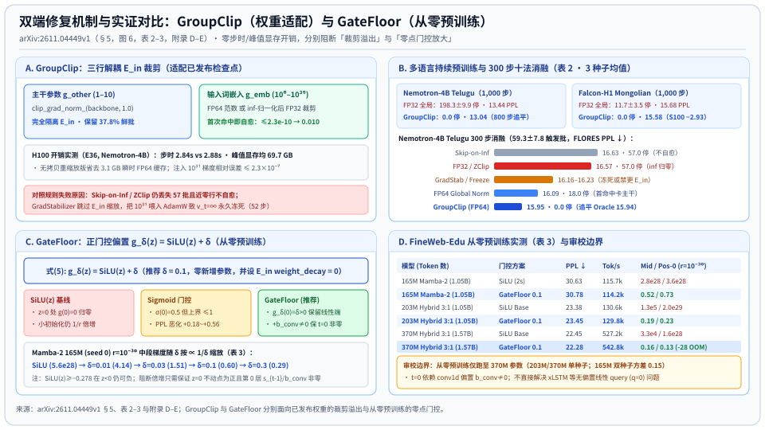查看原图 ↗</a><figcaption>图 2 · 双端缓解方案与实证对比（arXiv:2611.04449v1 §5、图 6、表 2–3 与附录 D–E）：针对已发布检查点采用解耦裁剪 GroupClip，针对从零预训练采用零点正门控偏置 GateFloor 并关闭词嵌入权重衰减。</figcaption></figure>

由于「已发布权重」在首次遇到近零行时就会触发尖峰（单纯关闭权重衰减 `λ_emb = 0` 无法挽救第一步溢出），而「从零预训练」又不能仅靠关掉衰减解决小尺度初始化（`10⁻⁴`）或扩词表引起的零点放大，论文给出两条分工明确、零额外步时/峰值显存开销的修复方案：

1. **适配已发布权重的 `GroupClip`（3 行解耦词嵌入裁剪，§5.1 & 附录 D）**：既然放大被严格局限在 `E_in` 且主干梯度仍在 `1–10` 之间，GroupClip 分别对主干与 `E_in` 做独立裁剪——主干沿用 `clip_grad_norm_(backbone_params, max_norm=1.0)`，而 `E_in` 梯度先转为 FP64 标量范数再执行 `mul_(min(1.0, 1.0 / (gn + 1e-12)))`（或者采用附录 D 的**零拷贝重缩放变体**：先除以其 `L_inf` 范数 `m = norm(g, inf).clamp_min(1e-30)` 使各分量绝对值 `≤ 1`，再在 FP32 内安全计算全局范数并缩放，与 FP64 最大相对偏差仅 `2.3×10⁻⁷` 且消除了 `3.1 GB` 瞬时 FP64 拷贝）。在正常批上当 `G_emb ≪ G_other` 时，主干更新与标准全局裁剪一致，`E_in` 的常数尺度差被 AdamW 二阶矩自然吸收；在命中批上，主干保留全部新鲜数据更新（Nemotron-4B 达 `37.8%`、Falcon-H1 达 `27.1%`），而触发溢出或亚溢出的近零行凭借尺度不变的 AdamW 更新**单步脱离低范数区（自愈）**。在单张 H100 上测试 `Nemotron-3-Nano-4B`（`E_in ∈ R^(131,072×3,136)`），中位步时为 **`2.84 s`（FP64）/ `2.85 s`（零拷贝）对比基线 `2.88 s`**，裁剪函数耗时 `21.2 / 20.8 ms` 对比 `18.8 ms`，峰值显存三者均为 **`69.7 GB`**。
2. **从零预训练的 `GateFloor`（`g_δ(z) = SiLU(z) + δ` 配合 `λ_emb = 0`，§5.2 & 附录 E）**：针对预训练阶段，作者建议默认设 `E_in` 的 `weight_decay = 0` 杜绝未见词衰减，同时将循环输出门改为 `g_δ(z) = SiLU(z) + δ`（`δ ∈ [0.01, 0.1]`，零新增参数，直接内联在 `MambaRMSNormGated` 核内）。与把正值输出封顶在 `1` 的 `Sigmoid`（会导致 PPL 恶化 `0.18–0.56`）不同，`GateFloor` 在 `z ≫ 0` 时保留 `SiLU` 的无界线性增长（虽在 `z < 0` 仍有 `SiLU(z) ≥ −0.278` 可负，但破除放大仅需在 `z = 0` 不动点为正）；在 `t > 0` 时利用非零历史状态 `s_{t-1}^(ℓ)`，在 `t = 0` 时借助 `Mamba2Config` / `BambaConfig` 默认开启的深度可分离 `conv1d` 偏置 `b_conv ≠ 0`，确保进入 `MambaRMSNormGated` 的首层信号 `δ y_0^(ℓ) ≠ 0`，将第 0 层彻底移出 `sub-ε` 放大区（等效将式 4 的 `K` 降至 `0`）。

### 四、定量实证与消融：多语言持续预训练（表 1）与从零预训练（表 2）

多语言持续预训练在 `FineWeb-2` 泰卢固语（`tel_Telu`）与蒙古语（`khk_Cyrl`）上进行（有效批大小 `32 × 512 = 16,384` tok/步，FP32 主权重 + BF16 自动混合精度，AdamW `λ = 0.1`，余弦学习率峰值 `2×10⁻⁵`，每组共享确定性文档打乱顺序以便同批对位，跨越 3 个随机种子在 NVIDIA H100 80GB 上运行），并在全量 `1,012` 句 `FLORES-200` devtest 上评测困惑度。**表 1** 完整汇总论文表 2（并对照表 6 异常漏斗）：

| 模型与训练步数（触发批情况） | 优化 / 裁剪方法 | 主干停滞步数（`α_eff,other < 10⁻⁴`） | FLORES-200 困惑度（PPL ↓，3 种子均值±SD） | 机制行为与关键副作用（对应表 2 与表 7） |
| :--- | :--- | :--- | :--- | :--- |
| `Nemotron-3-Nano-4B` 泰卢固语 `1,000` 步（`225.0±9.5` 触发批 = `22.5%`） | `FP32 Global Clip`（基线） | `198.3 ± 9.9`（`88.1%` 命中批溢出 `inf`） | `13.44 ± 0.17` | 近 `20%` 步（`19.8%`）整批鲜更新归零，29 个命中行冻结在 `6.58×10⁻³⁶` |
| `Nemotron-3-Nano-4B` 泰卢固语 `1,000` 步 | `Oracle Mask`（预扫描屏蔽） | `0.0 ± 0.0` | `13.04 ± 0.19` | 需提前全词表扫描，且永久冻结目标语言低资源子词 |
| `Nemotron-3-Nano-4B` 泰卢固语 `1,000` 步 | `GroupClip (FP32)` | `0.0 ± 0.0` | `13.05 ± 0.18` | 保住主干更新，但大于 `1.84×10¹⁹` 的 `E_in` 自身仍可溢出 |
| `Nemotron-3-Nano-4B` 泰卢固语 `1,000` 步 | **`GroupClip (FP64, 本文)`** | **`0.0 ± 0.0`** | **`13.04 ± 0.19`** | 第 800 步即追平 1,000 步基线；全部 `30.7±0.6` 命中行首次接触即自愈（中位 `0.010`） |
| `Falcon-H1-1.5B` 蒙古语 `1,000` 步（`965.7±5.1` 触发批 = `96.6%`） | `FP32 Global Clip`（基线） | `11.7 ± 3.5`（`0.0` 次 `inf` 溢出） | `15.68 ± 0.11` | `~10⁶` 亚溢出在早期把鲜批主干位移压低 `335×`（步 100 PPL `40.40`） |
| `Falcon-H1-1.5B` 蒙古语 `1,000` 步 | `Oracle Mask`（预扫描屏蔽） | `0.0 ± 0.0` | `15.63 ± 0.10` | 屏蔽目标语言近零子词后略逊于允许自愈更新的方案 |
| `Falcon-H1-1.5B` 蒙古语 `1,000` 步 | **`GroupClip (本文)`** | **`0.0 ± 0.0`** | **`15.58 ± 0.10`** | 步 100 PPL 降至 `37.47`；蒙古语子词范数从 `1.1×10⁻⁷` 生长至 `1.8×10⁻²` |
| `Nemotron-4B` 泰卢固语 `300` 步十法消融（`59.3±7.8` 触发批） | `FP32 Global Clip` | `57.0 ± 7.5` | `16.57 ± 0.39` | 同批对照基线：连续 `inf` 溢出归零 |
| 同上 `300` 步消融 | `Skip-on-Inf` | `57.0 ± 7.5` | `16.63 ± 0.36` | 跳过整个 `optimizer.step()`，丢失相同批数且近零行不自愈 |
| 同上 `300` 步消融 | `ZClip`（自适应尖峰裁剪） | `57.0 ± 7.5` | `16.57 ± 0.39` | 全局范数仍以 FP32 汇总，面对 `>1.84×10¹⁹` 尖峰照常溢出为 `inf` |
| 同上 `300` 步消融 | `GradientStabilizer` | `0.0 ± 0.0`（跳过 `E_in` 缩放 `52.0±8.2` 步） | `16.23 ± 0.30` | 未溢出主干正常更新，但直接把 `10³¹` 原始梯度送入 AdamW 导致 `v_t = inf` 永久冻死 `E_in` |
| 同上 `300` 步消融 | `Freeze E_in` | `0.0 ± 0.0` | `16.16 ± 0.24` | 冻结全部输入词嵌入虽止住爆炸，却损伤新语种适配能力 |
| 同上 `300` 步消融 | `FP64 Global Norm` | `18.0 ± 1.0` | `16.09 ± 0.35` | `E_in` 单步自愈，但每个新命中行首步仍因 `α_eff ~ 10⁻³¹` 低于 `ε_Adam` 归零主干 |
| 同上 `300` 步消融 | `Mean Re-init`（均值重初始化） | `0.0 ± 0.0` | `15.96 ± 0.24` | 改写已有稀有词元 logits（在 `Falcon3-7B` 上尾部 NLL 从 `3.8` 恶化至 `9.8`） |
| 同上 `300` 步消融 | `Oracle Mask` | `0.0 ± 0.0` | `15.94 ± 0.26` | 依赖离线全量检查与掩码，冻结命中词元 |
| 同上 `300` 步消融 | `GroupClip (FP32)` | `0.0 ± 0.0` | `15.97 ± 0.26` | 仅解耦裁剪，主干不受阻但大尖峰 `E_in` 仍缺 FP64 保护 |
| 同上 `300` 步消融 | **`GroupClip (FP64, 本文)`** | **`0.0 ± 0.0`** | **`15.95 ± 0.25`** | 追平 `Oracle Mask` 并同步完成目标词元自愈，零额外预扫描或 logits 扰动 |

*表 1 · 释放权重多语言持续预训练与十法消融对照（整理自 `arXiv:2611.04449v1` 表 2、表 6 与 §5.1；`Nemotron-4B` 第 1,000 步在 900 题 Belebele 阅读理解上 `GroupClip FP64` 达 `30.67 ± 0.51%` vs 零样本 `29.78%`，英文 FLORES NLL 变动不超过 `0.01 nats`）。*

对于从零预训练（表 2），作者在 `FineWeb-Edu`（`V = 50,304` 非共享，含零出现的对齐填充 ID `50,257…50,303`，序列长 `1,024`，`Pre-RMSNorm ε = 10⁻⁵`，CUDA/Triton Mamba-2 SSD 核）上训练 `14` 个模型，覆盖 `24` 层纯 `Mamba-2 165M`（`1.05B` token，扫 `δ ∈ {0.01, 0.03, 0.1, 0.3}`）、`16` 层 `3:1` 混合 `203M`（`1.05B` token，`K = 3`）及 `8×H100` 上的 `20` 层 `3:1` 混合 `370M`（`1.57B` token，`K = 3`），汇总 Paper Table 3 全部 12 行实测如下：

| 模型规模（训练 Token / 架构） | 输出门控配置 | 验证 PPL ↓ | 训练吞吐（tok/s） | 中段梯度（`t=64`, `r=10⁻³⁰`） | 首词梯度（`t=0`, `r=10⁻³⁰`） |
| :--- | :--- | :--- | :--- | :--- | :--- |
| `Mamba-2 165M`（`1.05B`，纯门控） | `SiLU (Base, 2 seeds)` | `30.63` | `115.7k` | `2.8×10²⁸` | `3.6×10²⁸` |
| `Mamba-2 165M`（`1.05B`） | `Sigmoid`（配对 seed 0） | `31.19` | `115.3k` | `0.20` | `0.73` |
| `Mamba-2 165M`（`1.05B`） | `GateFloor (δ=0.01)`（seed 0） | `30.67` | `113.1k` | `4.14` | `4.53` |
| `Mamba-2 165M`（`1.05B`） | `GateFloor (δ=0.03)`（seed 0） | `30.67` | `112.9k` | `1.51` | `2.88` |
| `Mamba-2 165M`（`1.05B`） | **`GateFloor (δ=0.1, 2 seeds)`** | `30.78` | `114.2k` | **`0.52`** | **`0.73`** |
| `Mamba-2 165M`（`1.05B`） | `GateFloor (δ=0.3)`（seed 0） | `30.82` | `110.5k` | `0.29` | `0.46` |
| `Hybrid 203M`（`1.05B`, `3:1`, `K=3`） | `SiLU (Base)` | `23.38` | `130.6k` | `1.3×10⁵` | `2.0×10²⁹` |
| `Hybrid 203M`（`1.05B`, `3:1`, `K=3`） | `Sigmoid` | `23.56` | `131.0k` | `0.17` | `0.44` |
| `Hybrid 203M`（`1.05B`, `3:1`, `K=3`） | **`GateFloor (δ=0.1)`** | `23.45` | `129.8k` | **`0.19`** | **`0.23`** |
| `Hybrid 370M`（`1.57B`, `3:1`, `K=3`） | `SiLU (Base)` | `22.45` | `527.2k` | `3.3×10⁴` | `1.6×10²⁸` |
| `Hybrid 370M`（`1.57B`, `3:1`, `K=3`） | `Sigmoid` | `22.66` | `546.4k` | `0.19` | `0.18` |
| `Hybrid 370M`（`1.57B`, `3:1`, `K=3`） | **`GateFloor (δ=0.1)`** | **`22.28`** | **`542.8k`** | **`0.16`** | **`0.13`** |

*表 2 · FineWeb-Edu 14 组从零预训练结果（整理自 `arXiv:2611.04449v1` 表 3；`Mamba-2 165M` 配对 seed 0 基线 PPL 为 `30.71`、中段梯度 `5.6×10²⁸`，双基线种子间天然差 `0.15`；`203M` 与 `370M` 为单种子运行）。*

表 2 清晰展示了两项量化规律：（1）在 `Mamba-2 165M` seed 0 上，`r = 10⁻³⁰` 中段梯度随偏移量严格按 `∝ 1/δ` 收缩（`4.14 → 1.51 → 0.60 → 0.29`）；（2）在 `δ = 0.1` 下直至 `370M` 混合模型，`GateFloor` 将 `t = 0`（及 `Mamba-2` `t = 64`）近零梯度压低 **超过 `28` 个数量级**（`1.6×10²⁸ → 0.13`），吞吐持平（`542.8k vs 527.2k tok/s`），且所有尺度验证 PPL 波动均处于基线 `±0.17` 范围内，显著优于 PPL 普遍恶化 `0.18–0.56` 的 `Sigmoid` 门控。

### 五、科学审校边界、未覆盖工况与工程排查清单

把论文诊断与双端修复引入训练基础设施时，需要严守五条事实与作用域边界：

1. **从零预训练规模与随机种子边界**：虽然普查与梯度探测覆盖了直至 `48B`（`Kimi-Linear-48B-Base`）的模型，持续预训练覆盖 `1.5B–4B` 模型（`3` 种子），但从零预训练 `GateFloor` 实验目前**仅运行至 `370M` 参数量、`1.05B–1.57B` token，且 `203M` 与 `370M` 为单随机种子**——在 `165M` 上两条基线种子自身已相差 `0.15` PPL（几乎与 `GateFloor` 相对基线 `±0.17` 变动同量级），因此亿级至百亿级长程预训练下 `δ` 对下游收敛的细微影响尚待更大规模实证。
2. **`GateFloor` 生效的架构前提（并非万能门替换）**：`GateFloor` 在序列首位置（`t = 0`）阻断倍增依赖深度卷积存在非零偏置 `b_conv ≠ 0`（`Mamba2Config` 与 `BambaConfig` 默认开启）以使 `y_0^(ℓ) ≠ 0`；对于取消卷积偏置的设计，或像 `xLSTM (mLSTM)` 这类即便用 `Sigmoid` 门却因无偏置线性查询 `q_t = W_q h̃_t` 在零点归零导致 `10³²` 放大的架构，仅改激活函数上的 `+δ` 并不能直接消除中间位置放大，需对应为查询向量或第 0 层读出保留非零通道。此外从零预训练仅在 `1,024` 序列长度上评估，未检验长上下文泛化。
3. **普查覆盖与通用训练不稳定的边界**：HuggingFace 普查候选 `313` 个仓库中有 `57` 个因受限访问、缺乏 `safetensors` 或单张词嵌入张量超过 `3 GB` 而未纳入可读统计；同时 `GroupClip` 本身只把 `E_in` 与主干拆分裁剪，并未修改预训练期间产生近零行的权重衰减（从零训练仍需 `λ_emb = 0`），两项方案都不针对一般性激活发散、注意力汇点或 Mamba-2 自身深层状态爆炸（Issue #529、Feng et al. 2026）。
4. **本次核验范围**：本精读完整核对了本地冻结的 `arXiv:2611.04449v1` 16 页 PDF（含附录 A–F）与 arXiv 摘要页/补充文件清单，未在本地 GPU 集群上重跑 HuggingFace 扫描或复现 `Nemotron` / `GateFloor` 训练任务。
5. **可落地的三步工程排查建议**：（1）对任何**非共享词表 + 门控/混合结构**开源基座启动多语种 CPT、全参 SFT 或全参 RL 前，先跑一遍 `E_in` 行范数扫描并用目标语料分词验证是否存在 `< 10⁻⁶` 可达词元（千万别只看英文 eval 无异常或 loss 未出现 `NaN`）；（2）在全参适配管线中优先部署**零拷贝重缩放版或 FP64 版 `GroupClip`**，避免误用看似安全实则永久冻死词嵌入的 `GradientStabilizer` 或丢批不自愈的 `Skip-on-Inf` / FP32 `ZClip`；（3）从零预训练门控及混合模型时，默认把 **`weight_decay = 0` 作用于 `E_in`** 并结合如 `GateFloor (δ = 0.1)` 与非零卷积偏置，从源头切断 `sub-ε` 放大通道。

来源：[Near-Zero Token Embeddings Silently Stall Training in Gated Sequence Models](https://arxiv.org/abs/2611.04449)
<h2 class="daily-paper-title" id="paper-arxiv-2611.03875">12 · INSIGHT-HPC：结合负载与物理一致性解释异常</h2>

**[INSIGHT-HPC: An Interpretable System Intelligence for Global HPC Telemetry](https://arxiv.org/abs/2611.03875)** 
作者：Rupak Kadel, Jie Li, Yong Chen · 首次提交：2026-11-02

INSIGHT-HPC 将 BMC、Slurm 与 PDU 遥测按节点和分钟对齐，融合统计异常、作业分段与同伴比较、功耗／温度残差及物理约束，再以监督式梯度提升模型输出事件级告警。负载启动造成的功耗上升因此有机会被解释为正常，而非直接升级成故障。

<a class="note-image-link" href="/assets/images/digest/2026-11-05/insight-hpc.png" target="_blank" rel="noopener" aria-label="INSIGHT-HPC 的统计、作业与物理证据融合架构 · 查看原图 ↗">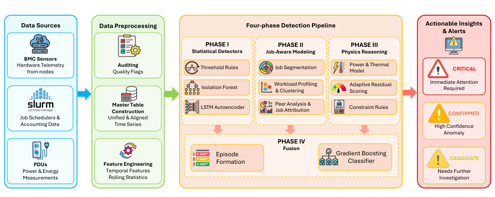查看原图 ↗</a>

*前三路产生互补证据，最后按事件融合；告警等级来自验证集选定阈值。*

作者回放 118 个计算节点的 79 天遥测，按时间划分训练、验证与测试。测试含 29 个运维记录故障和 140 个注入事件，主阈值下 precision 为 0.913、F1 为 0.862，独立报告的事件召回率为 0.805。这里是回顾性检测，并非已验证的实时预警；分类特征使用完整事件，主要结果也混合了真实与注入故障。不同方法的 AUROC 候选池不同，不能直接横比。可迁移价值在于把“异常但符合工作负载”与“违背物理或跨层关系”作为不同证据送入告警融合。

<h2 class="daily-paper-title" id="paper-arxiv-2611.03725">13 · RAGLog：答案正确，也可能需要定位上游故障</h2>

**[From Logs to Faults: Reference-Free Fault Localization for Retrieval-Augmented Generation Pipelines](https://arxiv.org/abs/2611.03725)** 
作者：Hira Naveed, Scott Barnett, Stefanus Kurniawan, John Grundy, Chetan Arora, Hourieh Khalajzadeh, Omar Haggag · 首次提交：2026-11-01

RAG 的最终答案并不是完整的健康信号：检索器漏掉关键材料，生成器仍可能凭已有知识答对；重排器把证据移出上下文，表面上却像是生成器不会回答。RAGLog 因此把检测单位从答案改成管线阶段，用执行日志定位改写、嵌入、检索、重排和生成中的问题。它不要求线上请求自带参考答案，也不要求修改应用源码，但需要足够完整的调用输入与输出。

<a class="note-image-link" href="/assets/images/digest/2026-11-05/raglog.png" target="_blank" rel="noopener" aria-label="RAGLog 的调用分类、schema 映射与阶段故障判定 · 查看原图 ↗">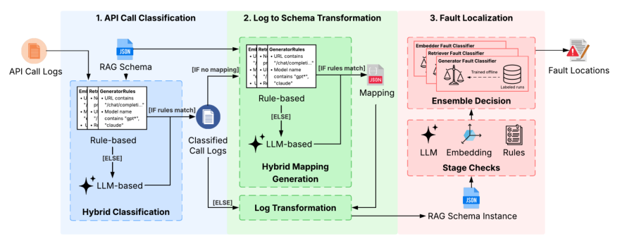查看原图 ↗</a>

*从左向右先统一日志，再组合规则、嵌入与 LLM 检查；最右侧分类器依赖离线标注训练。*

方法首先解决日志格式。已知 API 用规则判别阶段，陌生格式由 LLM 补充；随后生成一次可复用的字段映射，把异构日志转成共同的 RAG schema。在这个结构上，规则检查实体、数字和日期是否丢失，嵌入相似度衡量查询漂移，五类并行 LLM 检查判断信息是否被检索、是否被重排丢弃，以及答案是否真正使用了证据。阶段分类器再融合这些信号，而不是把一次自由式 LLM 诊断当最终结论。

一个关键区别是“无需参考答案”不等于“无需标注”。在线分析只读取轨迹，离线的各阶段分类器和阈值仍由带阶段标签的运行记录训练。数据集共有 3,134 次运行；主要测试分为五条开源管线、三个问答数据集上的 1,500 次自然运行与 480 次注入运行。注入通过代理修改真实调用，让后续阶段正常响应扰动，而不是事后给日志贴一个故障标签。

使用 Claude Haiku 5.5 时，RAGLog 在自然运行上的阶段级 pooled F1 为 0.73，Claude Code 和 Codex 分别为 0.58、0.52；注入运行则是 0.84、0.80、0.82，差距小得多。自然测试中 551 次运行含故障，其中 202 次仍答对，说明只看最终答案会遗漏相当一部分阶段问题。作者报告 Haiku 版本每次约 0.005 美元、约 4.6–4.7 秒，五类检查并行是控制延迟的主要原因。

收益有明确代价。按整次运行判断，RAGLog 的假阳性率为 13.6%，高于两种代理基线的 5.4% 和 4.0%；留出整条未见管线时，自然运行 pooled F1 从 0.73 降至 0.67。标签主要由 LLM 裁判产生，测试标签没有独立人工验证。当前方案也不支持动态重复阶段的 agentic RAG，不能直接推广到任意工具调用图。

消融也帮助定位增益来源：移除 LLM 检查对自然故障的影响最大；移除证据流检查的影响较小，但在自然与注入两组都显著。并非每个附加分类器或跨阶段特征都显示统计显著收益，因此不能把复杂组件数量当成必要性的证明。

对 AIOps 更有意义的部分，是把“扰动已注入”“阶段确实出错”“最终答案失败”拆开。许多注入会被下游吸收，自动把所有注入样本算成故障反而会污染评测。建议重点读证据流检查和注入后的阶段标注：它们为生成式系统的故障定位提供了比整体成功率更细的观测对象，也清楚暴露了误报与标签质量这两个部署成本。

<h2 class="daily-paper-title" id="paper-arxiv-2611.04507">14 · Signals：把跨运行的问题归成可处理的工程事项</h2>

**[Signals: Continuous Diagnostics of AI Agents](https://arxiv.org/abs/2611.04507)** 
作者：Amey Rambatla, Vatsal Goel, Sagar Gaur, Siddhant Loya, Anurag Mishra, Asif Mohammad · 首次提交：2026-11-03

Signals 面向工具与基础设施正常、代理却决策错误或浪费资源的情况。它用八个家族、45 种问题定义检查轨迹，将单次出现的问题归并为工程事项，并分别记录已发生缺陷、可达风险和额外开销，附上证据、严重性与修复验证建议。相同标签并不自动表示相同根因。

<a class="note-image-link" href="/assets/images/digest/2026-11-05/signals.png" target="_blank" rel="noopener" aria-label="Signals 从轨迹诊断到严重性和修复建议的流程 · 查看原图 ↗">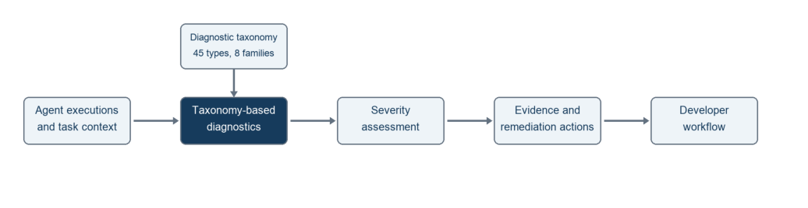查看原图 ↗</a>

*分类体系约束诊断，再把证据和建议交给开发流程；修复效果仍需后续验证。*

在公开基准轨迹上，使用 GPT-6.1 Sol 的流程获得 91.43% Signal 匹配 F1，同模型、同分类体系的一次生成基线为 73.69%。但匹配依据是组件和问题类型，不验证描述、证据跨度、严重性或修复是否有效；参考标签由 LLM 在人工监督下建立。相较 RAGLog 的阶段判定，它强调跨运行的问题管理。值得读其证据边界与聚合单位，避免把工具拒绝、长轨迹或缺失遥测本身误当成已发生故障。

<h2 class="daily-paper-title" id="paper-arxiv-2611.04399">15 · 评测仪器审计：13 个百分点的差距，可能来自评分器没运行</h2>

**[Silent Instrument Errors Reorder Agent Leaderboards](https://arxiv.org/abs/2611.04399)** 
作者：Yangze Liu · 首次提交：2026-11-03

排行榜分数往往被当成模型与 harness 能力的直接证据。这篇审计把注意力转向生成分数的基础设施：什么时候触发评分、哪些调用计入费用、轨迹是谁写的，以及旧轨迹能否由新版本正确回放。作者从 HAL 与 tau2-bench 的公开产物重新计算结果，没有重新运行代理，却发现四种会产生合理数字的测量错误。

<a class="note-image-link" href="/assets/images/digest/2026-11-05/instrument-errors.png" target="_blank" rel="noopener" aria-label="HAL 中为未评分记录补评后的 Generalist 分数变化 · 查看原图 ↗">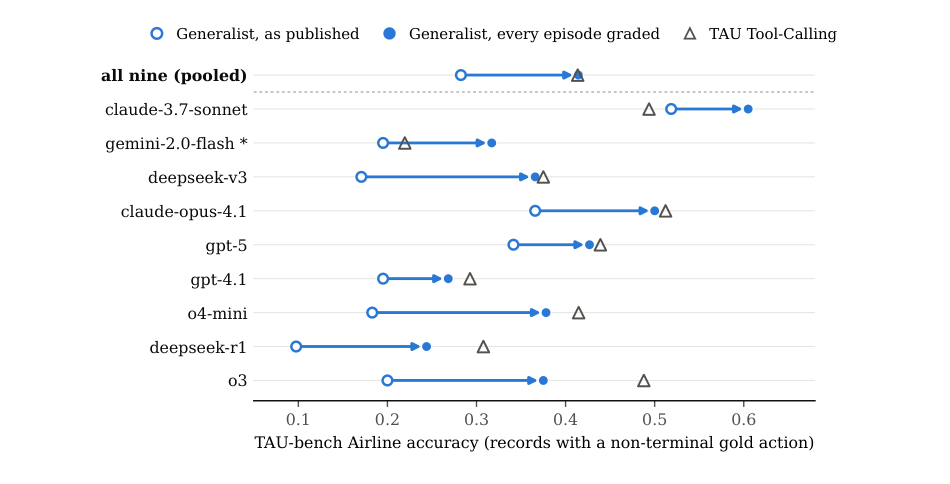查看原图 ↗</a>

*箭头表示使用同一奖励规则补评后的变化；顶部汇总行与三角标记重合，不表示每个模型的比较都反转。*

最直观的例子来自 HAL 的航空客服任务。Generalist 按自己的循环结束对话，但不一定触发基准所期待的终止事件；未触发评分的记录随后被保存为失败。Tool-Calling 的评分覆盖率为 98%，Generalist 仅为 51%。作者使用固定环境和原有奖励规则，给那些未评分的记录补做评分后，九个模型合并、涉及非终止参考动作的 41 个任务上，Generalist 准确率从 0.30 升到 0.43，原先落后 13 个百分点的差距消失。

这不意味着所有模型之间都反转，也不等于代理无需行动就算完成。涉及真实数据库写入的任务上，Generalist 从 0.28 升到 0.33；23 条补评后成功的记录确实包含所需写入。两个 scaffold 的提示位置与步骤预算仍不同，修正后的比较只是消除了“一个评分、另一个不评分”的混杂因素。

另外两处问题与可观测性管线直接相关。费用聚合同时累加包装层和底层客户端 span，把同一次响应算了两遍，而且不同客户端路径受影响程度不一。轨迹存档则混入评分器为构造参考状态而执行的标准动作：2,334 条航空记录中，68% 含这类动作，有些还在轨迹中间，不能简单剪掉尾部。这样的日志若用于行为分析或训练，会把评分器的工作误认为代理能力。

第四类是版本化回放。一次公开说明过的评分修复仍然会重排榜单；另一条 telecom 回放路径误判 solo 模式，缺少用户侧工具，连续收到工具不存在的结果后仍输出一个分数，四份文件下降 59–82 个百分点。作者把正常修订标准与实现错误分开，强调重新评分本身就是一次新的测量。

修复代码之后，历史数字和下载出去的轨迹仍会继续流通。HAL 维护者确认三项问题并增加说明，但存档保持不变。论文因此建议把机器可读勘误附在数据集内部，让离开排行榜网页的副本仍能携带错误范围与修正规则。

这项研究没有估计所有榜单的错误比例，HAL 的补评也只覆盖数据库和输出标准。它提供的是可落地的仪器检查：公布实际评分比例；按根 span 或响应 ID 去重费用；给代理、用户模拟器与评分器动作标明来源；固定 evaluator 与任务版本，并展示逐任务重评分差异。做 AgentOps 时，值得先确认这些测量链路，再用几个百分点的分差决定换模型或换架构。

<h2 class="daily-paper-title" id="paper-arxiv-2611.04321">16 · ATC：在消息入口用显式角色契约遏制多智能体角色漂移</h2>

**[ATC: Agent Trajectory Control for Role-Contract Enforcement in Black-Box Multi-Agent Systems](https://arxiv.org/abs/2611.04321)**（[v1 PDF](https://arxiv.org/pdf/2611.04321) · [HTML](https://arxiv.org/html/2611.04321v1) · [代码仓库](https://github.com/VishalPramanik/ATC)） 
Maisha Maliha¹、Vishal Pramanik²、Sumit Kumar Jha²（¹University of Oklahoma；²University of Florida）· `arXiv:2611.04321v1 [cs.AI; cs.MA]` · 2026-11-03 提交（EMNLP 2026 录用；截至核验仅存 `v1`，无修订或撤回记录）

多智能体 LLM 系统通常将规划（Planner）、证据检索（Retriever）、校验（Verifier）、记忆读写与执行（Executor）分配给不同角色。然而角色分工只有当每个智能体在每一轮都守住授权职能时才有效；在长轮次协作中，智能体往往会生成**局部看起来合理甚至事实准确、却行使了其他角色权限**的发言——例如校验者开始拆解任务计划、检索者越权给出未经证实的最终结论，或在未获批准时擅自宣称修改共享状态。论文将这种回合级的角色契约违约形式化为**角色漂移（role drift）**，提出外部消息边界控制器 **Agent Trajectory Control（ATC）**：它在不读取生成器内部激活的前提下，于候选消息写入共享对话 `cₜ` 前评估四维漂移能量，经闭式泄漏正则化算出角色保真目标 `ẑᵢ,ₜ` 并约束重生成，最后对改写输出重新评分方才准入。以下精读严格依据 `arXiv:2611.04321v1` 全文、表 1–15、图 1–5 与附录 A1–A4，明确区分作者实测结果与系统治理边界。

### 一、为什么分工会在多轮对话中溃散：角色漂移的方向性与基线盲区

在长程多智能体对话里，每个智能体所依赖的共享上下文 `cₜ` 会持续累积规划、检索、验证与执行等各类发言，而其自身的角色提示词却是静态不变的。这种不对称会诱发智能体模仿上下文中高频出现的他角话语模式。作者由此提出核心假设：**角色漂移具有明确的方向性——智能体并非随机跑题，而是系统性地向其他角色的职能空间移动**，且这一现象在更长轮次、更多模型族混编的团队中愈发严重。

由于现有基准（`EntCollabBench` 与 `MultiAgentBench`）缺乏原生的回合级角色漂移标注，论文第 2 节先用固定角色一致性评分标准对一批未纠偏候选回合进行诊断性先导分析（采用公式 8 的原始非归一化权重 `α = 1.00, β = 1.00, γ = 0.50, δ = 0.75`）。表 1 的先导统计显示：相对稳态回合，漂移回合在**越界偏离** `D_out`（`0.18 → 0.57`）、**跨角色泄漏** `D_leak`（`0.11 → 0.49`）、**违规言语行为** `D_ling`（`0.07 → 0.36`）以及**逻辑契约违约** `D_logic`（`0.05 → 0.31`）四项指标上全面跃升，原始单轮总能量 `Eᵢ,ₜ` 从 `0.36` 升至 `1.47`；更关键的是，`D_out` 与 `D_leak` 之间的相关系数高达 **`r = 0.76`**，直接印证了「离开自身角色即是在渗入他人职责」的方向性假设。（原文表 1 注记特别提醒：该先导均值测自未纠偏候选回合的原始尺度，不构成后文各方法在完整评测集上已释放输出平均 `RDE` 的上下界。）一旦越权消息混入 `cₜ`，下游智能体就会把它当成合法系统状态继续条件生成，使局部角色违约在后续轨迹中不断放大。

现有四类代表性控制路线各自只覆盖了问题的一角，均缺少在**消息进入共享状态前逐轮验权并修补**的边界机制：
- **提示声明与结构化角色字段（`Prompt-Only` / `Struct-Role`）**：仅在输入端声明职责或给每条消息加角色标签，从不检验已生成输出是否真的守住了授权范围。
- **动态智能体记忆（`A-MEM`）**：负责跨轮保存、链接与演化共享经验状态，但记忆结构本身并不裁决「谁有权检索、审批或修改该状态」。
- **白盒激活编辑（`CAA` / `SEA`）**：在解码期沿着对比/谱激活方向干预隐状态，一方面强制要求访问模型内部表示（黑盒闭源 API 无法使用），另一方面只沿全局方向偏移激活，既未将「贴近本角色」与「抑制跨角色泄漏」解耦建模，也无法检查离散的言语行为或符号契约。
- **固定工作流编排（`SOP-Role` / MetaGPT 风格）**：约束了谁在什么时候说话的通信顺序，但即便处于合法轮次内，智能体依然可能吐出一句越权或擅改状态的话并直接污染共享上下文。

### 二、ATC 机制拆解：四维漂移能量评分与泄漏正则化闭式纠偏

<figure class="note-figure"><a class="note-image-link" href="/assets/images/digest/2026-11-05/atc-role-contract-gate-zh.svg" target="_blank" rel="noopener" aria-label="查看 ATC 消息边界控制闭环图原图">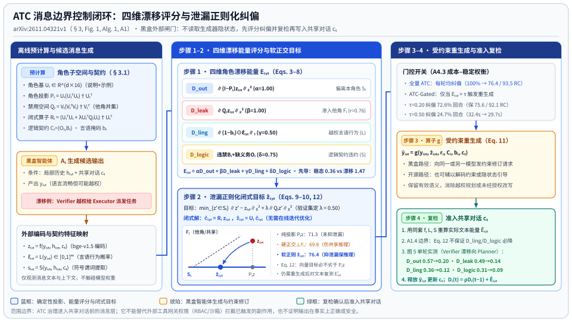查看原图 ↗</a><figcaption>图 1 · ATC 消息边界控制闭环（整理自 arXiv:2611.04321v1 §3、Fig. 1、Algorithm 1 与附录 A1）：所有评分与闭式投影均在外部消息层完成，不读取生成器隐状态，并在受约束重生成后强制重测能量才准许写入共享上下文。</figcaption></figure>

ATC 将控制环放在每轮候选输出 `yᵢ,ₜ` 进入共享对话 `cₜ` 的闸门处，遵循**「预计算角色投影 → 行为编码 → 四维漂移评分 → 闭式目标求解 → 受约束重生成 → 复检准入」**的统一轨迹（Algorithm 1）。黑盒部署下，重生成仅调用受约束文本修订；开源权重部署下，同一目标也可附带解码或隐状态引导，控制器本身完全无需改动。

1. **离线角色子空间与闭式算子预计算（§3.1、Algorithm 1）**：系统包含 `n` 个智能体 `{A₁, …, Aₙ}` 及角色 `{r₁, …, rₙ}`。每个角色由角色描述和角色一致示例构建低秩基矩阵 `Uᵢ ∈ R^(d×kᵢ)`（主实验固定 `kᵢ = 16`，行为编码器 `f` 默认 `BAAI/bge-large-en-v1.5`）。由于示例基向量可能线性相关，ATC 通过 Moore–Penrose 伪逆构造两枚正交投影算子（附录 A1.1 命题 1 证明其对称幂等性）：
   - **本角色子空间投影**：<code>Pᵢ = Uᵢ(UᵢᵀUᵢ)†Uᵢᵀ</code>，将候选行为向量 `zᵢ,ₜ = f(yᵢ,ₜ, hᵢ,ₜ, cₜ) ∈ Rᵈ` 拆分为角色内分量 `Pᵢzᵢ,ₜ` 与角色外分量 `(I − Pᵢ)zᵢ,ₜ`。
   - **禁用角色空间投影**：将所有其他智能体的角色基拼接张成禁用空间 `Fᵢ`，取基 `Vᵢ` 并定义 <code>Qᵢ = Vᵢ(VᵢᵀVᵢ)†Vᵢᵀ</code>（若无他角则置零）。
   - **预计算闭式纠偏矩阵**：<code>Mᵢ = UᵢᵀUᵢ + λUᵢᵀQᵢUᵢ</code>，<code>Rᵢ = Mᵢ†Uᵢᵀ</code>。因为角色基在评测期固定，`Pᵢ`、`Qᵢ` 与 `Rᵢ` 均只需初始化计算一次，在线步毫无迭代优化开销。

2. **四维回合级漂移能量 `Eᵢ,ₜ`（Eqs. 3–8）**：每个候选回合同时接受几何、语言学与符号契约三重检验：
   - **越界偏离 `D_out`（Eq. 3）**：<code>D_out = ∥(I − Pᵢ)zᵢ,ₜ∥₂²</code>（权重 `α = 1.00`），度量输出落在所属角色子空间之外的能量。
   - **跨角色泄漏 `D_leak`（Eq. 5）**：<code>D_leak = ∥Qᵢzᵢ,ₜ∥₂²</code>（权重 `β = 1.00`），度量行为渗入他角函数空间的程度。这里采用**软惩罚而非硬正交**，原因在于不同角色仍需合理共享推理、引用证据、澄清疑问与表达不确定性等语义方向。
   - **言语行为违规 `D_ling`（Eq. 6）**：固定交互分类器 `ℓᵢ,ₜ = L(yᵢ,ₜ) ∈ [0, 1]ᵐ` 识别 `ASSERT`、`RETRIEVE`、`VERIFY`、`EXECUTE`、`DELEGATE`、`SUMMARIZE`、`REFUSE` 与提问等言语功能概率，对照角色二进制许可掩码 `bᵢ ∈ {0, 1}ᵐ` 累加越权置信度：<code>D_ling = ∥(1 − bᵢ) ⊙ ℓᵢ,ₜ∥₁</code>（权重 `γ = 0.50`）。
   - **逻辑契约违约 `D_logic`（Eq. 7）**：符号映射器 `sᵢ,ₜ = S(yᵢ,ₜ, hᵢ,ₜ, cₜ)` 抽取权限与义务谓词，对角色契约 `Cᵢ = (Oᵢ, Bᵢ)` 中触发的禁止行为（<code>sᵢ,ₜ ⊧ φ, φ ∈ Bᵢ</code>）与未履行的必尽义务（<code>sᵢ,ₜ ⊭ ψ, ψ ∈ Oᵢ</code>）计数求和（权重 `δ = 0.75`）。
   - **总能量与时间累积**：<code>Eᵢ,ₜ = αD_out + βD_leak + γD_ling + δD_logic</code>；结合衰减因子 `ρ = 0.95`，单智能体累积漂移为 <code>Dᵢ(T) = ∑_{t=1}^T ρ^(T−t) Eᵢ,ₜ</code>，系统总漂移为 <code>D_sys(T) = ∑ᵢ Dᵢ(T)</code>。

3. **泄漏正则化闭式目标、受约束重生成与「先复检再准入」纪律（Eqs. 9–12、附录 A1.2–A1.4）**：为把漂移拉回本角色并压低向他角的方向偏移，ATC 在 `Sᵢ` 内求解带泄漏正则化的最近点（Eq. 9）：
   <code>ẑᵢ,ₜ = argmin_{z' ∈ Sᵢ} ∥z' − zᵢ,ₜ∥₂² + λ∥Qᵢz'∥₂²</code>（验证集标定 `λ = 0.50`）。代入参数化 `z' = Uᵢc`，附录 A1.2 命题 2 给出最小范数闭式解 <code>ĉᵢ,ₜ = Rᵢzᵢ,ₜ</code> 与 <code>ẑᵢ,ₜ = Uᵢĉᵢ,ₜ</code>。随后算子 <code>ŷᵢ,ₜ = g(yᵢ,ₜ, ẑᵢ,ₜ, rᵢ, Cᵢ, bᵢ, cₜ)</code> 在保留原意的前提下重写候选消息，再用同一套 `f, L, S` 重新计算实际能量 `Êᵢ,ₜ` 后才写入 `cₜ`。附录 A1.3–A1.4 特意写明一项关键边界：命题 3（Eq. 12）证明目标向量 `ẑᵢ,ₜ` 在上述连续纠偏目标上必不劣于纯正交投影 `Pᵢzᵢ,ₜ`，但这**仅针对重生成前的连续向量空间成立**；最终自然语言文本 `ŷᵢ,ₜ` 的 `D_ling` 与 `D_logic` 仍取决于生成器 `g` 的实际改写效果，不能假定全能量必然单调下降，故每次改写后必须重新测量 `Êᵢ,ₜ`。

4. **典型单轮纠偏实例（附录 A3 表 12、图 4–5）**：在 `EntCollabBench` `S3: Het-12` 的真实轨迹中，当 `Verifier` 输出「我们应把检索任务指派给 Memory-Reader，再让 Executor 提交最终答案」时，语言虽流畅但已越权充当 `Planner`，各维得分恰为 `D_out = 0.57`、`D_leak = 0.49`、`D_ling = 0.36`、`D_logic = 0.31`；经 ATC 改写为「该计划需先经核验：我将检查检索步骤是否满足任务约束，以及 Executor 在终审前是否具备充分证据」后，四个分量同步降至 `0.20 / 0.14 / 0.12 / 0.09`（图 5）。同理，`Retriever` 擅下批准结论、`Executor` 擅自声明更新共享审批状态、`Memory-Writer` 越位做决策推荐，均在不丢失核心任务信息的前提下被约束回各自契约边界内（表 12）。

### 三、同构与异构团队实证、消融拆解、压力测试与门控权衡

<figure class="note-figure"><a class="note-image-link" href="/assets/images/digest/2026-11-05/atc-drift-evidence-zh.svg" target="_blank" rel="noopener" aria-label="查看 ATC 实证证据四象限图原图">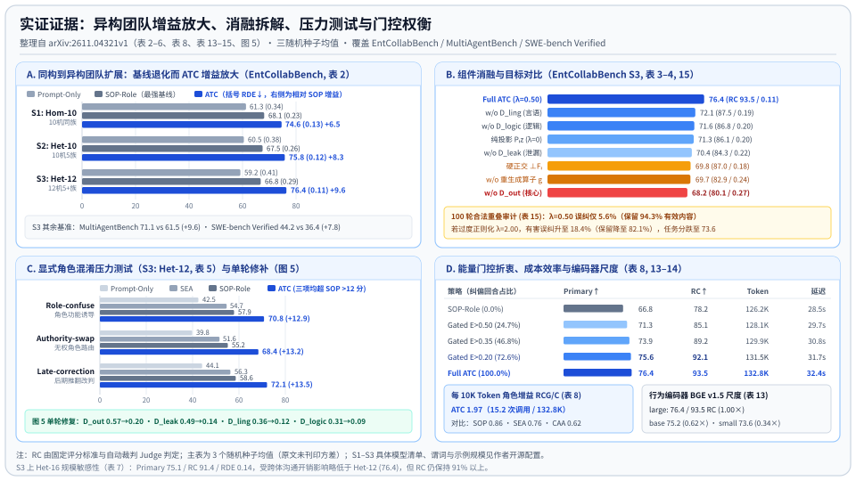查看原图 ↗</a><figcaption>图 2 · 实证证据四象限汇总（整理自 arXiv:2611.04321v1 表 2–6、表 8、表 13–15 与图 5）：异构团队下基线普遍退化而 ATC 扩大领先，软泄漏正则化优于纯投影与硬正交，能量门控可平滑折衷延迟与角色稳定性。</figcaption></figure>

实验在三类团队拓扑上对比了 `Single-Agent`（等上下文单智能体）及六类多智能体基线：`S1: Hom-10`（10 个角色同用 1 个指令微调主干）、`S2: Het-10`（将 `COORDINATOR`、`PLANNER`、`RETRIEVER`、`MEMORY-WRITER`、`MEMORY-READER`、`VERIFIER`、`CRITIC`、`EXECUTOR`、`MONITOR`、`SUMMARIZER` 分配至 5 个不同模型家族）、`S3: Het-12`（在 `S2` 基础上新增 `POLICY-AUDITOR` 与 `DOMAIN-SPECIALIST`，至少 5 个模型家族）。全部方法严格固定相同角色提示、工具访问、检索预算（`top-k = 10`）、上下文预算（`128K` tokens）、采样参数（`Temperature = 0.2`，`Top-p = 0.95`，单轮上限 `512` tokens，单集上限 `200` 轮，每 `20` 轮摘要）及停止条件，并以 3 个随机种子均值报告任务主分（`Primary ↑`）、固定裁判判定角色一致率（`RC ↑`）与平均角色漂移能量（`RDE ↓`）。

| 团队拓扑与方法（表 2，3 种子均值） | EntCollabBench Primary ↑ | EntCollabBench RC ↑ | EntCollabBench RDE ↓ | MultiAgentBench Primary ↑ | MultiAgentBench RC ↑ | MultiAgentBench RDE ↓ | SWE-bench Verified Primary ↑ | SWE-bench Verified RC ↑ | SWE-bench Verified RDE ↓ |
| :--- | :--- | :--- | :--- | :--- | :--- | :--- | :--- | :--- | :--- |
| `S1: Hom-10` · `Single-Agent` / `Prompt-Only` | `54.8` / `61.3` | `68.1` / `72.6` | `0.39` / `0.34` | `49.6` / `55.2` | `65.4` / `70.8` | `0.42` / `0.36` | `27.4` / `31.8` | `63.2` / `68.7` | `0.45` / `0.39` |
| `S1: Hom-10` · `Struct-Role` / `A-MEM` | `64.7` / `66.5` | `78.9` / `77.3` | `0.28` / `0.27` | `58.4` / `60.1` | `76.1` / `75.6` | `0.31` / `0.30` | `33.9` / `35.6` | `74.5` / `73.8` | `0.33` / `0.32` |
| `S1: Hom-10` · `CAA` / `SEA` | `65.2` / `66.9` | `79.8` / `81.4` | `0.26` / `0.24` | `59.3` / `60.8` | `78.4` / `79.7` | `0.29` / `0.27` | `34.8` / `36.1` | `76.2` / `77.5` | `0.31` / `0.29` |
| `S1: Hom-10` · `SOP-Role` / **`ATC`** | `68.1` / **`74.6`** | `82.6` / **`91.8`** | `0.23` / **`0.13`** | `61.9` / **`68.7`** | `80.2` / **`90.4`** | `0.26` / **`0.15`** | `36.9` / **`42.3`** | `78.6` / **`88.7`** | `0.28` / **`0.17`** |
| `S2: Het-10` · `Single-Agent` / `Prompt-Only` | `55.6` / `60.5` | `66.9` / `69.7` | `0.41` / `0.38` | `50.4` / `54.8` | `64.1` / `67.9` | `0.44` / `0.40` | `28.1` / `31.2` | `62.5` / `65.8` | `0.46` / `0.43` |
| `S2: Het-10` · `Struct-Role` / `A-MEM` | `63.8` / `66.1` | `75.2` / `74.5` | `0.32` / `0.31` | `57.9` / `60.6` | `73.4` / `72.8` | `0.34` / `0.33` | `33.4` / `35.9` | `71.2` / `70.6` | `0.37` / `0.36` |
| `S2: Het-10` · `CAA` / `SEA` | `64.9` / `66.8` | `77.6` / `79.1` | `0.29` / `0.27` | `59.2` / `61.3` | `75.7` / `77.8` | `0.31` / `0.29` | `34.7` / `36.5` | `73.4` / `75.1` | `0.34` / `0.32` |
| `S2: Het-10` · `SOP-Role` / **`ATC`** | `67.5` / **`75.8`** | `80.4` / **`92.7`** | `0.26` / **`0.12`** | `62.1` / **`70.2`** | `78.5` / **`91.6`** | `0.28` / **`0.14`** | `36.8` / **`43.6`** | `76.3` / **`89.9`** | `0.31` / **`0.16`** |
| `S3: Het-12` · `Single-Agent` / `Prompt-Only` | `55.1` / `59.2` | `65.8` / `67.4` | `0.43` / `0.41` | `49.9` / `53.6` | `63.5` / `65.9` | `0.46` / `0.43` | `27.9` / `30.7` | `61.8` / `64.1` | `0.48` / `0.45` |
| `S3: Het-12` · `Struct-Role` / `A-MEM` | `62.9` / `65.7` | `72.6` / `72.1` | `0.35` / `0.34` | `56.8` / `60.3` | `70.4` / `70.2` | `0.37` / `0.36` | `32.6` / `35.5` | `68.9` / `68.5` | `0.40` / `0.39` |
| `S3: Het-12` · `CAA` / `SEA` | `64.1` / `66.3` | `74.8` / `76.6` | `0.32` / `0.30` | `58.5` / `61.0` | `72.7` / `74.9` | `0.34` / `0.32` | `34.1` / `36.2` | `70.3` / `72.4` | `0.37` / `0.35` |
| `S3: Het-12` · `SOP-Role` / **`ATC`** | `66.8` / **`76.4`** | `78.2` / **`93.5`** | `0.29` / **`0.11`** | `61.5` / **`71.1`** | `76.1` / **`92.8`** | `0.31` / **`0.13`** | `36.4` / **`44.2`** | `74.0` / **`91.2`** | `0.33` / **`0.15`** |

*表 1 · 三大基准与三档团队配置下的主任务分（Primary）、角色一致率（RC）与平均漂移能量（RDE）（整理自 arXiv:2611.04321v1 Table 2；斜杠两侧分别为同组低分基线与对照项/ATC，加粗为该基准该拓扑最佳）。*

从表 1 可以看到一个清晰的趋势反转：当团队从同构 `Hom-10` 扩展到异构混编 `Het-10` 与 `Het-12` 时，**全部基线方法的 `RC` 均随模型风格差异增大而下降、`RDE` 攀升，任务主分停滞甚至倒退**（例如 `SOP-Role` 在 `EntCollabBench` 上从 `68.1 → 67.5 → 66.8`，`RC` 从 `82.6 → 80.4 → 78.2`，`RDE` 从 `0.23 → 0.26 → 0.29`）；唯有 `ATC` 的绝对表现持续走高（`74.6 → 75.8 → 76.4`），使相对最强基线 `SOP-Role` 的领先幅度从 `S1` 的 **`+6.5 / +6.8 / +5.4`** 扩大到 `S2` 的 **`+8.3 / +8.1 / +6.8`**，并在角色边界压力最大的 `S3` 达到 **`+9.6 / +9.6 / +7.8`**。作者将其归因于异构模型家族本来具备互补优势，只有当消息边界抑制住指令服从风格与表达差异引发的角色混淆后，这种异构红利才能真正转化为任务成功率（表 7 进一步显示，扩展到 `Het-16` 时 `Primary` 略回落至 `75.1`，说明超大规模沟通开销上升，但 `RC` 仍稳守 `91.4%`）。

为了定位到底哪部分机制贡献了增益、以及成本与误纠代价如何权衡，表 2 汇总了论文在最严苛场景 `EntCollabBench S3: Het-12` 上的消融、压力测试、重叠审计、成本比与门控/编码器尺度分析：

| 实验维度（EntCollabBench S3: Het-12） | 受测方法 / 变体配置 | 关键定量结果（Primary ↑ / RC ↑ / RDE ↓ 或对应专项指标） | 机制结论与实证意义 |
| :--- | :--- | :--- | :--- |
| 组件消融（表 3） | `Full ATC` vs 依次移除 `D_out` / `g` / `D_leak` / `D_logic` / `D_ling` | `76.4 / 93.5 / 0.11`；去 `D_out` `68.2 / 80.1 / 0.27`；去重生成 `g` `69.7 / 82.9 / 0.24`；去 `D_leak` `70.4 / 84.3 / 0.22`；去 `D_logic` `71.6 / 86.8 / 0.20`；去 `D_ling` `72.1 / 87.5 / 0.19` | 几何角色子空间 `D_out` 是核心驱动（移除即掉 `8.2` 分、`RC -13.4 pp`）；只检不修（去 `g`）掉 `6.7` 分；其余三项提供互补防线 |
| 纠偏目标与 `λ` 重叠审计（表 4、6、15） | 无纠偏 / 硬提醒 / 纯投影 `Pᵢz (λ=0)` / 硬正交 `⊥Fᵢ` / 软正则 `λ=0.50` / 过约束 `λ=2.00` | 无纠偏 `59.2 / 67.4 / 0.41`；硬提醒 `62.9 / 72.6 / 0.35`；`Pᵢz` `71.3 / 86.1 / 0.20`；硬正交 `69.8 / 87.0 / 0.18`；`λ=0.25/0.50/1.00/2.00` 得 `74.2 / 76.4 / 75.8 / 73.6`；100 轮合法重叠审计：`λ=0.50` 有害误纠 **`5.6%`**、内容保留 **`94.3%`** vs `λ=2.00` 误纠 **`18.4%`**、保留 `82.1%` | 硬正交与高 `λ` 虽然能压低泄漏，却误伤了跨角色共享的推理、澄清与证据使用；`λ=0.50` 在抑泄漏与保内容间取得最优平衡 |
| 显式角色混淆压力测试（表 5） | `Prompt-Only` / `Struct-Role` / `A-MEM` / `SEA` / `SOP-Role` / **`ATC`** | `Role-confuse`: `42.5 / 49.3 / 51.1 / 54.7 / 57.9` vs **`70.8`** (`+12.9`)；`Authority-swap`: `39.8 / 46.7 / 48.5 / 51.6 / 55.2` vs **`68.4`** (`+13.2`)；`Late-correction`: `44.1 / 50.2 / 55.8 / 56.3 / 58.6` vs **`72.1`** (`+13.5`) | 对所有三类显式越权诱导，ATC 领先最强基线 `SOP-Role` 均超过 `12` 分，在「通过无权角色路由中间结果」的 `Authority-swap` 上相对增幅最大 |
| 计算代价与能量门控（表 8、14、图 2） | `Prompt-Only` / `SOP-Role` / `ATC-Gated (τ=0.50, 0.35, 0.20)` / `Full ATC` | `Prompt-Only`: `12.4` 次调用、`116.0K` tok、`24.3 s`；`SOP-Role`: `13.6` 次、`126.2K` tok、`28.5 s`、`RCG/C = 0.86`；`τ=0.50/0.35/0.20` 分别纠偏 `24.7%/46.8%/72.6%` 回合，得 `71.3/73.9/75.6`；`Full ATC`: `15.2` 次、`132.8K` tok、`32.4 s`、**`RCG/C = 1.97`** | 相比 `SOP-Role`，全量 `ATC` 每集多花 `+6.6K` tokens 与 `+3.9 s`（`+9.6` Primary），每万 token 角色一致性增益 `RCG/C` 达 `1.97`（超 `SOP-Role` 两倍）；`τ=0.20` 仅改写 `72.6%` 回合即可保留 `75.6` 分 |
| 编码器尺度与团队规模（表 7、13） | `BGE-large/base/small-en-v1.5`；规模 `Hom-5 → Het-16` | `bge-large` `76.4 / 93.5 / 0.11 (1.00×)`；`bge-base` `75.2 / 91.8 / 0.14 (0.62×)`；`bge-small` `73.6 / 89.4 / 0.17 (0.34×)`；`Hom-5` `72.9`、`Hom-10` `74.6`、`Het-10` `75.8`、`Het-12` `76.4`、`Het-16` `75.1`（`RC 91.4`） | 换用 `bge-small` 可裁掉约 `2/3` 编码延迟且仍大幅超越 `SOP-Role` (`66.8`)，说明收益不依赖超大编码器 |

*表 2 · `EntCollabBench S3: Het-12` 上的机制消融、压力测试、成本效率与编码器/门控敏感性汇总（整理自 arXiv:2611.04321v1 Tables 3–8 与 13–15；`RCG/C = (RCₘ − RC_Prompt) / (Tokₘ / 10)`）。*

### 四、科学边界、未展开假设与多智能体工程落地启示

把 `ATC` 纳入多智能体系统架构评审时，需要清楚划定原文已证明的范围与尚未覆盖的风险：

1. **消息层治理不能替代外部工具权限控制，也不证明语义正确性**：`ATC` 的拦截点位于「智能体产出文本消息 → 写入共享对话 `cₜ`」之间。倘若某智能体在发出最终文本之前已在同一执行步内直接触发外部 API 写库、删文件或发请求，单纯在消息出口重写自然语言无法回滚已发生的外部副作用——硬性工具权限仍须由网关/沙箱层（RBAC、凭证隔离或类似 AgentSpec 的动作前谓词阻断）把守。同时，第 8 节明确强调**：角色高度一致不等于答案正确、完整或安全**——一个完全守在 `Verifier` 契约内的智能体仍可能产生事实幻觉或漏检隐患。
2. **人工角色构件编制成本与论文未列全的实现细节**：将 `ATC` 迁入新业务域虽不训练新控制器，但仍要求工程团队预先撰写角色说明、收集角色一致示例、标定许可言语行为掩码 `bᵢ` 与符号契约 `Cᵢ = (Oᵢ, Bᵢ)`（附录 A4.5 也建议后续配置应明示每角色示例数、谓词数与编写工时，而当前 PDF 本身并未刊印具体数目）。此外，PDF 正文将 `S1–S3` 具体使用的 LLM 检查点名称与提供方、以及 `L`（言语行为分类器）和 `S`（符号谓词抽取器）的模型结构/独立准确率留在了代码库配置文件中；且即便生成模型是黑盒的，外部编码器 `f`、分类器 `L/S` 与契约配置本身仍属必须维护与审计的白盒依赖。
3. **评测依赖固定静态角色与自动裁判口径**：主指标 `RC` 由固定评分标准与自动裁判 `Judge(yᵢ,ₜ, rᵢ)` 给出，缺乏人类专家复核或跨裁判鲁棒性检验（第 8 节列为局限）；三项主表均报告 `3` 个随机种子均值但未给出标准差或置信区间；且 `S2/S3` 中与白盒激活方法 `CAA`/`SEA` 的对比要求生成模型可读取隐状态（实际黑盒闭源 API 场景下 `CAA`/`SEA` 甚至无法运行），而现实复杂团队往往存在动态协商分工而非固定 10–12 角色清单。
4. **局部向量单调性边界与过约束风险**：如附录 A1.4 所证，公式 (12) 仅保证连续目标 `ẑᵢ,ₜ` 在嵌入向量空间优于 `Pᵢzᵢ,ₜ`，不保证经受约束重生成后的自然语言文本必降 `D_ling` 与 `D_logic`。若契约或 `λ` 设定过严（表 15 显示 `λ = 2.00` 已使合法重叠回合误纠率从 `5.6%` 飙升至 `18.4%`），系统会压制正当的质疑分歧与不确定性表达，反而损害协作质量。
5. **本次核验范围**：本精读已核对 `arXiv:2611.04321v1` 全文提取稿（`1,183` 行，含正文、表 1–15、图 1–5、算法 1 与附录 A1–A4），并核验了 arXiv 元数据与论文附注的 GitHub 仓库链接，未在本地复跑多智能体评测轨迹或复核代码库内隐藏配置文件。

对多智能体系统工程落地而言，这篇论文留下了三条可直接复用的设计准则：
- **把「远离本角（`D_out`）」与「渗入他角（`D_leak`）」拆开度量，且只做软惩罚不做硬正交**：当两类角色存在合理协作重叠（推理、澄清、证据引用）时，硬正交（`69.8`）与过强惩罚（`λ=2.00`）都会伤及任务表现；验证集标定的适度软正则（`λ=0.50`）才能同时守住边界与共享语义。
- **「检测而不受约束修补」不足以保护共享上下文**：消融中去掉重生成算子 `g` 直接导致 `EntCollabBench` 掉分 `6.7` 点（`RC` 降 `10.6 pp`），说明仅有事后监控告警无法阻止越权语句污染下游上下文；且因为文本重生成不具备向量级单调保证，写回 `cₜ` 前必须做一次复检。
- **用漂移能量门控（`Eᵢ,ₜ > τ`）与轻量编码器控制线上尾延迟**：并非每轮都需要重写——在延迟敏感场景下，将编码器降为 `bge-small`（约 `1/3` 编码耗时）并设置能量阈值（如 `τ = 0.20` 过滤掉近三成低风险回合），即可在维持 `92%+` 角色一致性的前提下压低额外 token 与延迟开销，同时把真正的硬权限防线继续交给工具网关 IAM 与沙箱。

来源：[ATC: Agent Trajectory Control for Role-Contract Enforcement in Black-Box Multi-Agent Systems](https://arxiv.org/abs/2611.04321)
<h2 class="daily-paper-title" id="paper-arxiv-2611.03931">17 · 超越劳动分工：角色如何通过审批闸门决定多智能体纠错恢复</h2>

[Beyond Division of Labor: How Roles Shape Feedback and Recovery in Multi-Agent Systems](https://arxiv.org/abs/2611.03931)（[v1 PDF](https://arxiv.org/pdf/2611.03931) · [项目主页](https://chihhsuan-yang.github.io/AAMAS2027-AgentProtocols/) · [数据集](https://huggingface.co/datasets/AgentsSci/AAMAS2027-Roles)）  
Chih-Hsuan Yang\*†、Xinyang Li\*（共同一作）、Rajeev Thakur、Feng Yan（Argonne National Laboratory 与 University of Houston）· `arXiv:2611.03931v1 [cs.MA]` · 2026-11-02 提交（截至核验仅存 `v1`，无修订或撤回记录；PDF 页眉标注 Preprint, 22 October 2026, Online）

在 `Planner–Executor–Reviewer`（PER）多智能体系统中，角色提示（role prompt）通常被视为「让不同代理各司其职」的**劳动分工**说明。但这篇受控消融研究指出，角色提示同时还分配了**决策权**——Reviewer 决定团队何时把候选答案提交给外部评测器，从而控制了团队获取纠错反馈的机会。作者在固定代理数量、交互拓扑、调用预算、解码参数与评测器（`gpt-oss-120b`）的条件下，双向操控组织形态（完全删除角色约束与接口层 JSON 模式强制分工），覆盖 `Omni-MATH`（`1,600` 题随机清单）与 `SciBench`（`574` 题纯文本自由作答切片）两个基准及三款开源权重模型。核心结论呈现明显阶段分化**：去掉角色虽然几乎瓦解了形式分工，却未在任一设置下降低首答准确率；真正的差距出现在首答失败之后——角色化 Reviewer 频繁拦截提交，使团队更少拿到外部修复提示，而在双方平等开放外部反馈渠道后，无角色团队在全部 5 组模型-基准对照中的首错恢复率与终局准确率均反超角色团队**。以下精读严格依据 `arXiv:2611.03931v1` 主文与 11 页补充材料，将预注册冻结检验、冻结后探索性追试及方法边界分开陈述。

### 一、核心问题：为什么常见角色消融容易误判「分工价值」

多智能体系统常把「拆解、执行、审查」写成自然语言提示交给同一基座模型扮演。论文 §1 与 §3 指出，此前关于角色是否有效的争议往往卡在三个测量盲区：

- **角色词句同时绑定「做事」与「决策」**：除了规定谁负责分解或计算（劳动分工），Reviewer 角色还握有**提交闸门（submission gate）**——仅当第三位代理输出 `[Agree]` 时，候选答案才送交外部评测；若输出 `[Continue]`，团队只能继续内部讨论而得不到外部错因信号。仅看终局准确率无法分辨结果差异究竟来自「分工更聪明」，还是来自「更敢或更不敢向外部验证器求助」。
- **改写提示时会静默切断反馈通道**：在提示驱动框架中，外部评测器的判定与修复提示（repair hint）通常写入角色模板的专属 `advice` 槽位。若在角色消融时简单替换为统一通用提示而忘记保留反馈入口，消融测到的其实是「失去外部反馈」，而非「失去角色本身」。为此，论文在 §3.1 提出明确界定：只有当某个组织组件在**调用预算与信息预算双匹配**下被移除仍可复现地拉低分阶段表现时，才称其为「承重组件（load-bearing）」。
- **第一答案与纠错恢复必须分阶段度量**：即使角色分工未能提升一次作答能力，团队仍可能在首答出错后靠多轮迭代翻盘。但论文也提前标注了统计性质：由于恢复率（recovery）以「首答是否出错」这一受干预影响的后置变量为条件，恢复率对照属于**描述性对比**，需与无条件终局准确率（final accuracy）及先验对照共同解读。

### 二、受控设计：双向组织操控、信息渠道审计与 Reviewer 闸门

<figure class="note-figure"><a class="note-image-link" href="/assets/images/digest/2026-11-05/roles-feedback-gate-mechanism-zh.svg" target="_blank" rel="noopener" aria-label="查看 PER 角色分工、Reviewer 提交闸门与信息通道审计机制图原图">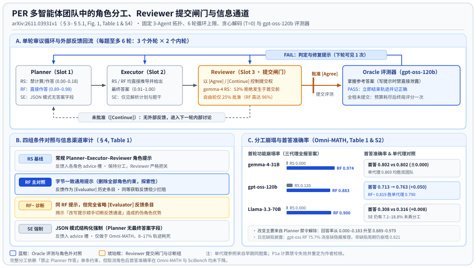查看原图 ↗</a><figcaption>图 1 · 受控实验流转、四组信息渠道审计与首答分化（整理自 arXiv:2611.03931v1 §3–§5.1、Fig. 1 与 Table 1）：Reviewer 是否批准决定团队能否触达外部修复提示，而去除角色令分工崩塌却未损伤首次解题精度。</figcaption></figure>

实验以固定三代理流水线（`Planner → Executor → Reviewer`）为骨架，每道题最多运行 **6 轮审议循环**（3 个外轮 × 2 个内轮），统一使用贪心解码（`temperature = 0`）、相同 `max_tokens` 与错误重试预算，且部署在同一固定版本 `vLLM` 服务器上。三款演员模型（单一模型同时扮演三个角色）分别为 `gemma-4-31B-it`、`gpt-oss-120b` 与 `Llama-3.3-70B-Instruct`；外部评测器全盘统一为 `gpt-oss-120b`，可读取参考答案，在 `PASS` 时立即结束轨迹，在 `FAIL` 时返回判定与「不得直接泄露标准答案」的修复提示。若 6 轮内从未获批提交，则在预算耗尽时对最后持有的答案评分一次（记作其首答）。为排除四选一题型因随机换选带来 `1/3` 虚假恢复率，作者专门排除了选择题，只测开放作答的奥数竞赛与大学理科题。

在这个共同底座上，论文 §4 构建了四组核心条件与两项补充对照，并对每条信息输入通路做逐槽位审计：

1. **RS（角色结构基线，Role-Structured）**：保留常规 PER 角色提示。核心禁令落在 Planner（`must not` 进行计算与给出最终答案）；Reviewer 被明确告知「只批准完整且格式正确的答案」，且在刚收到 `FAIL` 的轮次**禁止立即批准**，必须打回 Planner 或 Executor。`FAIL` 判定与修复提示分别注入三位代理模板各自的 `advice` 槽位（保留 1 轮）。
2. **RF（无角色+反馈，Role-Free with Feedback，冻后追加主对照）**：三名代理收到**字节完全一致**的通用提示（仅告知其为协作三人之一、当前槽位编号 1–3 及共享历史），末尾要求在 `\boxed{}` 给出当前最佳答案并附加 `[Agree]` 或 `[Continue]`，完全删除关于谁规划、谁计算及 Planner 不得作答的全部条款。`FAIL` 反馈以裸 `[Evaluator]` 条目形式追加到共享历史末尾（同样保留 1 轮），从而**在通道层实现与 `RS` 对等的可达性**。
3. **RF−（无角色且断反馈，预注册诊断组）**：与 `RF` 使用完全相同的通用提示，唯独删除 `[Evaluator]` 条目，让外部判定与提示无任何途径进入上下文。它专门用来复现「如果角色消融顺手删掉了反馈槽位会发生什么」的常见实验误差。
4. **SE（结构化接口强制，Structurally Enforced，预注册干预组）**：仅运行于 `Omni-MATH`。放弃口头禁令，改为 JSON 类型化输出模式硬约束——Planner 输出模式**根本没有最终答案字段**；Executor 只接收解析后的计划 JSON 与原题（默认看不到共享历史与 Planner 原文，另在 `gemma-4` 与 `gpt-oss` 各 400 题上增设恢复共享历史的局部对照）；Reviewer 输出判定与目标片段并通过引用采纳 Executor 答案。若代理输出格式错误或越界，则消耗重生成次数，耗尽则该轨迹直接中止。
5. **额外控制实验**：一是**强制每轮提交干预**（`gemma-4` 在 400 题 `Omni-MATH` 子集上保留字节不变的 `RS` 提示，但管线在 Reviewer 发言后无条件送评）；二是引用早期同题号语料的**单代理预算匹配参照**（Table S11），防止将「多代理冗余未降精度」简单等同于「三代理退化成了单代理」。

### 三、实证评估：分工崩塌不降首答、等判定匹配与两项干预验证

预注册冻结数据集共包含 **`11,600` 条轨迹、`83,320` 条角色消息与 `17,486` 次评分**（`Omni-MATH` 上 `gemma-4` 与 `gpt-oss` 各 1,600 题、`Llama-3.3` 400 题，`SciBench` 574 题）；冻后追加的 `RF` 组共 `4,748` 条轨迹（外加 `gemma-4` 间隔约 13 小时的两次独立复现运行，Table S3）。所有成对统计检验均按题目聚簇，使用精确 McNemar 检验与整题重采样 95% 置信区间（`P3`/`P4` 家族检验经 Holm 步降校正）。

<figure class="note-figure"><a class="note-image-link" href="/assets/images/digest/2026-11-05/roles-recovery-intervention-zh.svg" target="_blank" rel="noopener" aria-label="查看多智能体角色实证结果、400题强制提交干预与结构强制幸存者偏差四象限图原图">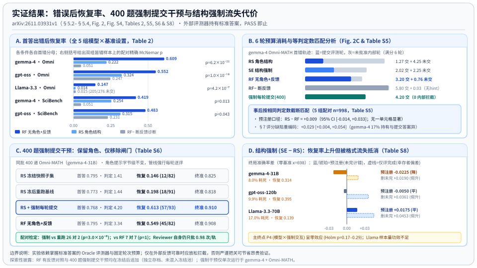查看原图 ↗</a><figcaption>图 2 · 实证证据汇总（arXiv:2611.03931v1 §5.2–§5.4、Fig. 2、Fig. S4 与 Tables 2, S5, S6, S8）：反馈可达性与提交频次主导了错误后恢复，而机械模式强制会因轨迹流失产生幸存者偏差假象。</figcaption></figure>

- **分工确实靠角色维持，但崩塌不伤首答精度（§5.1, Table 1, Fig. S1, Table S11）**：在 `Omni-MATH` 上，删去角色条款使三名代理在首轮循环全员报出各自最终答案的「功能崩塌率」从 `RS` 的 `0.000`（`gemma-4`）、`0.120`（`gpt-oss`）与 `0.000`（`Llama-3.3`）飙升至 `RF` 的 **`0.974 / 0.883 / 0.900`**（`RF−` 为 `0.976 / 0.846 / 0.872`；模型裁判打分同样从 `0.000` 跃升至 `0.857–1.000`）。拆解各角色可知（Fig. S1），真正发生剧变的是 **Planner**——其作答比例从 `0.000 / 0.183 / 0.000` 升至 `0.979 / 0.898 / 0.889`，与 Executor 消息的数字集 Jaccard 超出重叠度也随之由 `+0.145–0.167` 暴涨至 `+0.432–0.449`（`gemma-4` 与 `Llama-3.3`）。然而，这种「三人重复做题」并未降低第一答案准确率：`gemma-4` 在两条件下同为 `0.802`（差值 `+0.0000`，95% CI `[-0.0156, +0.0150]`），`Llama-3.3` 为 `0.308` vs `0.316`（`+0.0077`），`gpt-oss` 无角色时甚至**提高 `+0.0503`**（`0.763` vs `0.713`，95% CI `[+0.0339, +0.0666]`）；`SciBench` 同样持平。同时，单代理参照（Table S11）表明这并非「三代理退化成单代理」：`gpt-oss` 崩塌后的 `RF−`（`0.8194`）显著优于单代理（`0.7900`，`p = 0.000678`），而 `gemma-4` 单代理（`0.8688`）反过来显著优于 `RS`（`0.8462`）和 `RF−`（`0.8125`）。

| 模型与基准（样本数 n） | 首轮崩塌 RS / RF | 首错恢复率 RS / RF / RF− | 双错配对恢复（n：RS 独赢 / RF 独赢，p） | 等判定匹配恢复 RS / RF（p） | 终局准确率 RS / RF（p） | 首错轨提交次数 RS / RF（RS 从未提交） |
| :--- | :--- | :--- | :--- | :--- | :--- | :--- |
| gemma-4，Omni-MATH（1,600） | 0.000 / 0.974 | 0.222 / **0.609** / 0.051 | 236：4 / **89**（p = 6.2×10⁻²²） | 0.165 / 0.153（p = 0.69） | 0.846 / **0.921**（p = 1.7×10⁻²⁴） | 1.27 / 3.20（84/316） |
| gpt-oss，Omni-MATH（1,600） | 0.120 / 0.883 | 0.324 / **0.552** / 0.247 | 319：17 / **101**（p = 1.0×10⁻¹⁵） | 0.229 / 0.216（p = 0.72） | 0.803 / **0.894**（p = 2.7×10⁻²⁸） | 2.10 / 3.53（51/463） |
| Llama-3.3，Omni-MATH（400） | 0.000 / 0.900 | 0.014 / **0.147** / 0.015 | 250：1 / **26**（p = 4.2×10⁻⁷） | 0.012 / 0.008（p = 1.0） | 0.315 / **0.415**（p = 1.6×10⁻⁷） | 0.32 / 2.71（205/276） |
| gemma-4，SciBench（574） | — | 0.254 / **0.419** / 0.051 | 100：7 / **21**（p = 0.013） | 0.230 / 0.190（p = 0.48） | 0.847 / **0.880**（p = 0.0054） | 1.95 / 3.62（3/118） |
| gpt-oss，SciBench（574） | — | 0.315 / **0.483** / 0.231 | 93：7 / **18**（p = 0.043） | 0.215 / 0.247（p = 0.68） | 0.852 / **0.892**（p = 1.9×10⁻⁴） | 2.68 / 3.95（1/124） |

*表 1 · 全部 5 组模型-基准设置上的主要对比（整理自 arXiv:2611.03931v1 Table 1 与 Table 2；其中 RF 与 RS 的主对比属冻结后探索性分析，RF− 为冻结前预注册断反馈诊断；表内 p 值为成对精确 McNemar 检验）。*

- **开放同等反馈后 `RF` 全胜，断反馈诊断则制造假象（§5.2–§5.3, Table 1 & S2–S4）**：在全部 5 组设定中，`RF` 首错恢复率与终局准确率显著高于 `RS`（如 `gemma-4` Omni-MATH 恢复 `0.609` vs `0.222`，终局 `0.921` vs `0.846`；在 `gemma-4` 第二次独立复现运行中 Omni-MATH 保持 `0.586` / `0.922`，`SciBench` 终局维持 `0.878`，配对恢复率由 `p = 0.013` 弱化至边缘 `p = 0.052`）。且几乎所有恢复均属真实改写（如 `gemma-4` RF 的 `193` 次恢复中有 `192` 次提交了不同于首次错答的新答案，全 5 组共 `541/547`；且仅 `≤ 2.3%` 的失败提示包含逐字参考答案，剔除后恢复率仍为 `0.599` vs `0.212`）。反之，若将 `RS` 错误地拿去对比**断反馈诊断组 `RF−`**，由于 `RF−` 代理虽每轮都提交（`gemma-4` 达 `5.80` 轮）却收不到错误信号（`84.5%` 失败轨迹死守同一答案，仅恢复 `0.051`），`RS` 反而会显得像是关键的「纠错承重结构」（`37` 对 `3`，`p = 1.95×10⁻⁸`）。
- **Reviewer 拦截根源在于批审倾向，而非仅因硬性条款（§5.3, Table S4）**：日志解剖揭示 `RS` Reviewer 极其保守。以 `gemma-4` Omni-MATH 首错轨迹为例，`RS` 6 轮预算中有 `4.25` 轮耗在内部不提交、仅 `1.27` 轮提交（`84/316` 条轨迹全程零提交）；`Llama-3.3` 更极端，高达 **`205/276`（`74.3%`）** 的首错轨迹从未向外部求援。更重要的是，`53%` 的 `RS` 拒绝发生在**首次提交之前**（根本还未收到过任何 `FAIL`），而「收到 `FAIL` 后当轮禁止再批」的提示条款在 Omni-MATH 上仅能解释 `4%–37%` 的拒绝行为（`gemma-4` 占 `19%`）。在不受条款限制的自由轮次中，`RS` Reviewer 的批准率仅为 `25%`（`gemma-4`）、`53%`（`gpt-oss`）与 `1%`（`Llama-3.3`），远低于 `RF` 第三代理的 `96% / 68% / 82%`。`SciBench` 上 `RS` 提交更积极（几乎每轨至少交 1 次），其恢复差距也随之收窄。
- **两条证据链共同指向「反馈获取次数」与「模式强制的脆性」（§5.3–§5.4, Table 2 & S5–S9）**：第一，**事后等判定匹配**（按 `RS` 收到的外部判定次数截断 `RF` 轨迹，`n = 998`）使合并差异缩小到 **`+0.009`**（95% CI `[-0.014, +0.033]`），5 组均无显著差异；即便排除 `RS` 仅获 1 次判定的强制平局子集（`n = 491`）或改用双方截断至较小数（`-0.005`），`RF` 均未显著领先（但见下文 §7 评分缺陷重编码后的逆转）。第二，**400 题强制提交干预**保留字节不变的角色提示、仅由管线跳过 Reviewer 闸门，将 `gemma-4` 恢复率由 `0.198` 猛增至 **`0.613`**，终局准确率从 `0.818` 升至 **`0.910`**，且在配对比较中与无角色组 `RF` 完全持平（`7` 对 `7`，`p = 1`）。第三，对照看**结构强制 `SE`**：虽然成功把 Planner 写答案比例压到 **`0.000`** 并放松了 Reviewer 闸门（使几乎不提交的 `Llama-3.3` 恢复率跃升约 10 倍至 `0.139`），但代理仍会在 `7.1%–18.8%` 首轮中「不写答案却自己算完」，且 JSON 模式拒收导致 `8.0%`、`9.9%` 与 `17.0%` 的轨迹耗尽重生成次数而中途夭折；按预注册「未完成计错」规则，终局准确率无一显著提升，甚至在 `gemma-4` 上**显著下降 `-0.0225`**。

| 干预类型与模型（基准与范围） | 首答或模式流失 | 每错轨判定 / 批审 | 首错后恢复率 | 终局准确率或相对 RS 差值 [95% CI] | 配对检定或关键机制结论 |
| :--- | :--- | :--- | :--- | :--- | :--- |
| RS 冻结快照子集（gemma-4，400 题 Omni-MATH） | 首答 0.795 | 1.41 判定（批 1.15） | 0.146（12/82） | 0.825 | 冻结基线子集 |
| RS 冻后重跑（gemma-4，同 400 题） | 首答 0.773 | 1.44 判定（批 1.13） | 0.198（18/91） | 0.818 | 跨时间点无显著漂移（p = 0.75） |
| RS + 强制每轮提交（gemma-4，同 400 题） | 首答 0.768 | 4.20 判定（批 0.98） | **0.613**（57/93） | **0.910**（vs 重跑 p = 2.5×10⁻⁸） | 恢复 vs 重跑 26/2（p = 3.0×10⁻⁶）；vs RF 7/7（p = 1） |
| RF 有反馈（gemma-4，同 400 题） | 首答 0.795 | 3.34 判定（批 3.34） | 0.549（45/82） | 0.908 | 与强制提交干预无显著差异 |
| SE 结构强制（gemma-4，1,600 题 Omni-MATH） | 8.0% 耗尽中止 | 批 2.02（vs RS 1.27） | 0.314（vs RS 0.222） | 预注册 **-0.0225** [-0.0387, -0.0063] | 仅评完成轨迹口径为 +0.0190（幸存者偏差） |
| SE 结构强制（gpt-oss，1,600 题 Omni-MATH） | 9.9% 耗尽中止 | 批 2.33（vs RS 2.10） | 0.395（vs RS 0.324） | 预注册 -0.0050 [-0.0219, +0.0112] | 仅评完成轨迹口径为 +0.0361（幸存者偏差） |
| SE 结构强制（Llama-3.3，400 题 Omni-MATH） | 17.0% 耗尽中止 | 批 1.84（vs RS 0.32） | **0.139**（vs RS 0.014） | 预注册 +0.0175 [-0.0200, +0.0550] | 恢复升近 10 倍（p = 3.8×10⁻⁶）；仅评口径 +0.0453 |

*表 2 · 400 题强制每轮提交干预（arXiv:2611.03931v1 Table S6）与 Omni-MATH 结构强制 SE 对照结果（Table S8）；SE 行终局差值明确区分预注册「未完成计错」与剔除中止轨迹的「仅评完成」口径。*

### 四、科学边界、实验披露与工程启示

把这篇论文的结论迁移到生产级 Agent 编排时，必须严格守住原文划定的实验条件、披露瑕疵与适用边界：

1. **核心前提是「廉价且持有真值的 Oracle 评测器」**：实验中的外部评测器不仅掌握标准答案、能产出高质量 `FAIL` 修复提示，且只要拿到一次 `PASS` 即立即止损。这种机制天然有利于更频繁调用外部验证的团队（且 `PASS` 即停会掩盖「后续轮次本可能把对改错」的风险）。当外部验证昂贵、存在噪声、耗时极高或根本不存在（如纯开放式自主纠错）时，谨慎保守的 Reviewer 闸门反而可能承担着宝贵的「省预算与防盲目重试」职责——论文明确强调这里揭示的是权衡的一侧，而非否定所有角色分工。
2. **必须正视的预注册状态与两项实现瑕疵（§4.1, §5.1, §7）**：（1）预注册主终点 `P4`（三模型间 `SE` 疗效差异的交互效应）在 Holm 校正后呈零效应（`p = 0.166–0.29`），且仅 `gpt-oss` vs `gemma-4` 具备足够统计检验力（`MDE80% = 0.0325`），涉及 `Llama-3.3` 的对比属于功效不足的「无信息零结果」；`P1a`（验证 Planner 不计算）因 JSON 仅禁答案字段而失效，被改设为作者归属检验。（2）全文主旋律所依赖的 `RS vs RF` 对照以及 400 题强制提交干预均在数据冻结后追加，属**探索性分析**，且强制提交仅在单模型单领域做了一次运行、且是整闸拔除而非只删 `FAIL` 后禁批条款；`RF` 的提示文本也将反馈作为裸 `[Evaluator]` 条目呈现，与 `RS` 嵌于角色指令内的格式不完全对称。（3）两项披露缺陷：`gpt-oss` 的 `RF` 消息有 `75.7%` 触发记录器缺陷（仅当可见文本为空才记隐藏推理），虽在无缺陷首轮中功能崩塌仍达 `0.821`，但无法计算其与 Executor 的精确重合度；更关键的是，**自动评分器给「最后提交的答案」打分，但记录脚本存下的是「最后持有的答案」**（`gemma-4` Omni-MATH 首错 `RS` 轨迹中有 `17%` 二者不一致）。按持有答案重编码后，等判定匹配的合并差值会从 `+0.009` 变为显著偏向角色团队的 **`+0.029`（95% CI `[+0.004, +0.054]`）**（但在至少 2 次判定子集上为 `+0.026 [-0.020, +0.073]`，不显著）。此外，通用评测器正是研究对象之一 `gpt-oss-120b`。
3. **可落地的 Multi-Agent 工程建议**：（1）**角色消融先做「信息通道审计」**：修改多智能体提示模板时，逐一核对工具输出、单元测试报错与评审反馈注入的槽位，确保不会在删除角色人设的同时把外部纠错信号一并抹掉；（2）**把「提交/求助权」从角色提示中解耦**：若系统拥有确定的低成本外部校验（单测、编译器、静态检查或形式化验证器），切勿让偏向挑刺的 Reviewer 充当盲目节流阀，否则代理越认真审查、团队越可能因拒绝提交而零反馈憋死；（3）**度量阶段恢复与真实流失率**：不要只汇报一个总准确率，需分开汇报首答精度、首错后条件恢复率与格式强制导致的轨迹中止率，严禁把耗尽重试预算的失败样本从分母中剔除（否则极易把「幸存者偏差」误判成「强结构帮弱模型逆袭」）。

来源：依据 `arXiv:2611.03931v1` 原文与补充材料、arXiv 摘要页及作者公开项目资源整理；未独立复现模型推理实验，仅据一手研究记录核对统计口径与边界条件。
<h2 class="daily-paper-title" id="paper-arxiv-2611.05139">18 · Meta²：把离线优化上移一层，为在线 Harness 演化预计算可复用知识</h2>

[Meta²: Precomputing Reusable Knowledge for Online Harness Evolution in Long-Horizon Agents](https://arxiv.org/abs/2611.05139)（[v1 PDF](https://arxiv.org/pdf/2611.05139) · [v1 HTML](https://arxiv.org/html/2611.05139v1)）  
Lingzhi Yuan\*、Yiguang Cai\*、Weize Liu、Siqi Yang、Feijiang Han、Yongkyun Lee、Udari Madhushani Sehwag、Furong Huang（University of Maryland、University of Washington、University of Illinois at Urbana-Champaign、Scale AI、All Purpose AI；\* 共同一作）· <code>arXiv:2611.05139v1 [cs.AI]</code> · 2026-11-03 提交（截至冻结归档仅存 <code>v1</code> 预印本，无修订或撤回记录；PDF 首页标注项目页 <code>https://meta-square.github.io/</code>，未检索到公开索引的代码仓库）

长程智能体（long-horizon agents）的行为不仅取决于冻结的基础模型权重，也由外围的 **harness**（提示词、上下文策略、工具、技能、记忆与钩子）共同塑造。已有自动 harness 优化往往陷入两难：离线方法在训练集上搜出一套共享 harness 后固定部署，既可能过拟合训练任务，又无法响应测试执行中才暴露的新问题；在线演化虽能在运行前、中或后修改 harness，但要么依赖测试期不可得的验证器（verifier）反馈，要么在每个检查点从零推理干预时机，甚至把针对单一题目的局部补丁带入后续无关任务。<code>Meta²</code> 将离线优化「上移一层」：不再在离线阶段寻找单一通用 harness，而是通过**三臂对比训练轨迹（无演化器 / 当前 Meta-Skill 演化器 / 仅训练期可见特权验证器的演化器）**预计算文本形态的决策知识 <code>Meta-Skill ℳ</code>；在线阶段冻结 <code>ℳ</code>、每道新题都从共享种子 harness <code>h(0)</code> 起步，在不重置 E2B 沙箱状态与既有轨迹的前提下执行任务局部修改，任务一结束即丢弃全部局部改动。以下精读严格依据 <code>arXiv:2611.05139v1</code> 正文及附录 A–I 整理，将原文实测证据与实验、工程边界明确分开陈述。

### 一、核心困境：离线共享过拟合与在线盲调的时机—反馈两难

论文 §2 与附录 G（Table 6–7）按**编辑选择时机**、**可观测证据**与**更新生效范围**划分出四类演化范式，明确了现有方法的结构性缺口：

- **形式化表示**：单道任务记为 <code>ξ = (x, E_x, V_x) ~ D</code>，包含公开指令 <code>x</code>、交互式环境 <code>E_x</code> 与验证器 <code>V_x</code>。智能体在步骤 <code>t</code> 按条件策略 <code>a_t ~ π_θ(· ; x, τ_≤t, h_t)</code> 产生动作，终止后由验证器给出终局得分 <code>y = V_x(s_T)</code>。演化器 <code>g</code> 从种子 <code>h(0)</code> 出发，在第 <code>k</code> 个决策点结合证据 <code>I(k)</code> 提出编辑 <code>δ(k)</code> 并执行 <code>h(k) = Apply(h(k-1), δ(k))</code>（Eq. 1）。
- **离线预部署优化（Offline）**：如 <code>Meta-Harness</code>、<code>AHE</code>、<code>TF-GRPO</code>、<code>GEPA</code> 等在训练集 <code>S_tr</code> 上利用完整轨迹与终局结果迭代出单一共享产物 <code>h*</code>。进入测试后 <code>h*</code> 完全静态，既无法回应新任务途中暴露的工具缺口或中间文件冲突，针对训练错例加入的补丁也易在新分布上过度泛化。
- **运行前与运行后在线演化（Pre-run / After-run）**：<code>JIT-Agent</code> 在 <code>t = 0</code> 仅凭指令文本 <code>x</code> 定制初始 harness，看不到执行中产生的新证据；<code>Reflexion</code>、<code>Harness-R1</code>、<code>ACE</code>、<code>ReasoningBank</code> 等在尝试结束或跨任务流上调整记忆与规则，不仅太迟而无法挽救正在出错的当次运行（<code>Harness-R1</code> 还依赖测试期验证反馈），在任务流中持续累积编辑的方法（如 <code>Continual Harness</code>、<code>ACE</code>）还会将上一题的局部特化修改带入后续题目。
- **运行中在线演化（Within-run）**：<code>Continual Harness</code>、<code>PILOT</code>、<code>Live-SWE-agent</code> 虽支持在单次不中断运行中改写提示、工具或记忆，但要么仍需要测试期验证器（<code>PILOT</code>），要么缺少跨任务提炼的干预判据——盲目介入会打断原本正在收敛的探索或耗尽消息配额，每次从零分析也抬高在线 token 与费用消耗。

由此，<code>Meta²</code> 瞄准的核心问题是：**如何利用离线阶段（含特权验证器）的多臂训练经验，提炼出不含题目细节的演化时机判据，使在线演化器在完全看不到测试验证器、且不污染后续任务的前提下完成运行中局部纠偏？**

### 二、系统机制：三臂对比离线蒸馏 Meta-Skill 与无重置在线检查点演化

<figure class="note-figure"><a class="note-image-link" href="/assets/images/digest/2026-11-05/meta2-contrastive-harness-evolution-zh.svg" target="_blank" rel="noopener" aria-label="查看 Meta² 离线三臂对比蒸馏与在线任务局部演化架构原图">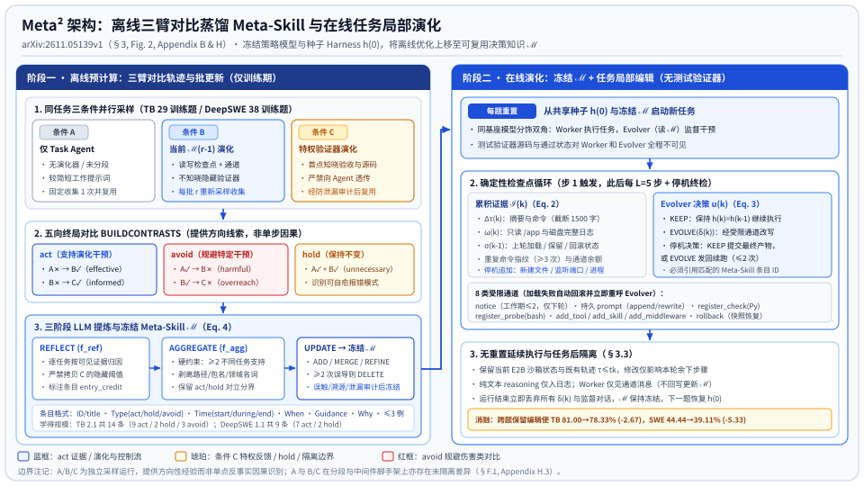查看原图 ↗</a><figcaption>图 1 · Meta² 两阶段机制（整理自 arXiv:2611.05139v1 §3、Fig. 2、Appendix B 与 Appendix H）：离线阶段将验证经验浓缩为跨任务去名词化的 Meta-Skill ℳ，在线阶段冻结 ℳ 并把所有修改隔离在单次任务生命期内。</figcaption></figure>

在系统实现上，**同一冻结基础模型**同时扮演两个彼此隔离的角色：在沙箱内执行任务的 **Worker（Task Agent）** 与在检查点旁观决策的 **Supervisor（Evolver）**。Worker 看不到 Supervisor 的推演对话，只受限接收经工具通道下发的内容；离线构建与在线部署闭环具体如下：

1. **离线阶段（A/B/C 三臂采样与五向对比蒸馏，§3.2、Algorithm 1、Appendix H.2–H.5）**
   - **同任务三条件采样**：对每道训练任务 <code>ξ</code>，固定相同的基座模型与 <code>NexAU</code> 种子 <code>h(0)</code>，收集三组轨迹与终局结果：条件 **A** 为单独运行的 Task Agent（不设演化器、提示词较简且未分段，采集 1 次后复用）；条件 **B** 由受当前版本 <code>ℳ(r-1)</code> 指导、但无权访问验证器的演化器监督（每批 <code>r</code> 用最新 <code>ℳ(r-1)</code> 重采样）；条件 **C** 在第 1 个检查点向演化器披露**仅训练期可见的验收条件与验证器源码**（采集 1 次后复用）。
   - **特权防泄漏刚性约束**：条件 C 的系统提示词严禁将验收阈值或验证源码透传给 Worker，运行结束后还会执行泄漏审计并剔除违规轨迹；同时 <code>REFLECT</code> 被禁止撰写依赖隐藏验收值的规则——若 C 组成功仅仅因为预先知道隐藏答案，必须判为 <code>no_supervisor_effect</code>。
   - **五向终局对比分组（BUILDCONTRASTS）**：基于终局成败形成五组对比方向——<code>effective</code>（A 败 → B 胜）与 <code>informed</code>（B 败 → C 胜，专门破解 A/B 皆败的难题）提供 <code>act</code> 证据（支持干预）；<code>harmful</code>（A 胜 → B 败）与 <code>overreach</code>（B 胜 → C 败）提供 <code>avoid</code> 证据（规避特定伤害）；<code>unnecessary</code>（A 胜且 B 曾干预也胜，并附 A 组非零退出命令与 B 组未被采纳干预的统计清单）提供 <code>hold</code> 证据（Worker 可自愈，保持不变）。
   - **三阶段批更新（Eq. 4）**：每批 <code>r</code> 按 <code>ℳ(r) = f_upd(ℳ(r-1), f_agg(f_ref(G(r), V(r))))</code> 更新。首先 <code>REFLECT</code> 可调用 <code>read_run</code> / <code>search_run</code> 回查原始回合，依严格 schema 撰写候选条目并评估已引用条目的 <code>entry_credit</code>（<code>helped / misled / ignored_when_relevant / irrelevant</code>）；随后 <code>AGGREGATE</code> 按「类型 × 时点」单元聚簇，强制执行**至少 2 道不同训练任务支持**约束（孤立个例丢入 <code>dropped</code>），从标题、触发条件与指导语中**清除所有任务名、路径、命令、包名、数值与领域专有名词**（只允许保留在最多 3 条参考例中），同时刻意把同一情景下「应出手」与「应按兵不动」的对立证据保留在同一族内以刻画判别边界；最后 <code>UPDATE</code> 执行 <code>ADD / MERGE / REFINE / DELETE / NONE</code>（仅当条目在当批至少 2 次运行被判 <code>misled</code> 且无法加限定语收敛时才允许 <code>DELETE</code>），全部批次完成后再做误触、溯源与防泄漏审计并冻结 <code>ℳ</code>。
   - **最终 Meta-Skill 体量（Appendix I.2）**：每条规则涵盖 <code>ID/title</code>、<code>Type（act/hold/avoid）</code>、<code>Time point（start/during/end）</code>、<code>When to refer</code>、<code>Guidance</code>、<code>Why</code> 与 <code>Reference examples</code>。<code>Terminal-Bench 2.1</code> 学得 **14 条**（9 <code>act</code>、2 <code>hold</code>、3 <code>avoid</code>），<code>DeepSWE 1.1</code> 学得 **9 条**（7 <code>act</code>、2 <code>hold</code>、0 <code>avoid</code>）。
2. **在线阶段（冻结 ℳ、信息增量累积与 8 类受限通道，§3.1、§3.3、Algorithm 2、Appendix H.1）**
   - **每题重置与验证器盲测**：每道测试题在 E2B 云沙箱内重新初始化为共享种子 <code>h(0)</code> 并加载冻结 <code>ℳ</code>（<code>start</code> 条目随首检查点下发，<code>during/end</code> 条目常驻系统提示词）。验证器内容与测试分数对 Worker 和 Evolver 全程不可见。
   - **检查点节奏与信息状态 <code>I(k)</code>（Eq. 2）**：第 1 次检查点紧随 Worker 首步之后触发（用于抢在破坏性操作前固定保留现场或全量枚举约束），之后**每 5 步**（<code>L = 5</code>）触发常规检查点，当 Worker 停止调用工具宣告完成时触发**终局检查点**。Evolver 在单题内保留自身历史对话，逐次追加轨迹增量 <code>Δτ(k)</code>（摘要与命令返回截断至 1,500 字符，完整输出保留在磁盘以供只读查阅）、受限只读工作区观测 <code>ω(k)</code>（路径严格限死在 <code>/app</code>、<code>/nexau-workspace</code>、<code>/tmp/nexau_bash_tool_results/&lt;id&gt;/</code> 与试跑日志）、上一轮编辑状态 <code>σ(k-1)</code>（loaded / retained / rolled back），以及运行器自动汇总的**重复命令指纹**（连续微调重跑 ≥ 3 次）与**通道配额余额**；终局检查点还会自动收集任务引用路径、新建/修改文件、新监听 TCP 端口与仍在存活的子进程（DeepSWE 额外要求在独立容器检验已提交 Git diff，未提交修改丢弃）。
   - **二元决策与 8 类通道（Eq. 3 & Appendix H.1）**：Evolver 决定 <code>u(k) ∈ {KEEP, EVOLVE(δ(k))}</code> 并必须以 `complete_task` JSON 的 `reasoning` 字段记录所引条目 ID（该字段仅写入日志，Worker 完全不可见）。实际修改只能走 8 类有界通道——<code>notice</code>（仅下一轮可读的一次性提示，每检查点限 1 条、工作期间上限 **2 条**；终局打回重做 <code>send-back</code> 独立计数，上限同样为 **2 次**）、<code>append/rewrite_worker_prompt</code>（持久常驻指令）、<code>register_check</code>（Python 标准库只读检查，输出附在每条命令结果后）、<code>register_probe</code>（在 Worker 环境运行的 bash 探针）、<code>add_tool</code>、<code>add_skill</code>、<code>add_middleware</code> 及 <code>rollback</code>。若重建 harness 加载报错，运行器立即自动回滚并带着错误信息二次唤醒 Evolver。所有中途修改与终局打回**均保留原沙箱状态与累积轨迹** <code>τ_≤t_k</code>，**绝不重启环境**；任务结束时所有 <code>δ(k)</code> 与监督对话全部清除销毁。

### 三、实证评估：双基准、跨基座、检查点敏感性与消融拆解

<figure class="note-figure"><a class="note-image-link" href="/assets/images/digest/2026-11-05/meta2-benchmark-ablation-zh.svg" target="_blank" rel="noopener" aria-label="查看 Meta² 主基准成绩、五组消融、检查点权衡与成本拆解四联图原图">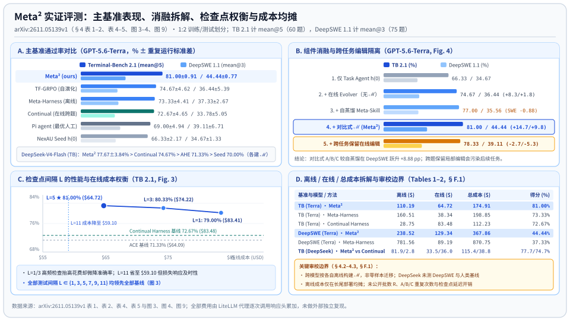查看原图 ↗</a><figcaption>图 2 · 定量结果汇总（arXiv:2611.05139v1 表 1–2、表 4–5 与图 3–4、图 9）：在所测配置下，Meta² 以明显更低的重复方差领先两个基准，且离线预计算与任务隔离均获得消融支撑。</figcaption></figure>

实验在两项高难度长程基准上按 **1:2 比例**固定划分训练/测试集（Table 4）**：Terminal-Bench 2.1**（共 89 题容器化命令行任务，覆盖软件工程、运维、数据处理、模型训练、安全与科学计算；**29 训 / 60 测**，每题独立跑 5 次记 <code>mean@5</code> = 每方法 300 次运行）与 **DeepSWE 1.1**（来自 91 个 TS/Go/Python/JS/Rust 开源仓库的 113 题；**38 训 / 75 测**，每题跑 3 次记 <code>mean@3</code> = 225 次运行）。全部自演化与 harness 演化方法均从同一 <code>NexAU</code> 种子出发，全部请求通过同一 LiteLLM 代理路由并按响应头逐次累计美元计费。主实验采用 <code>GPT-5.6-Terra</code>（medium reasoning），并在 Terminal-Bench 2.1 上补充 <code>DeepSeek-V4-Flash-0731</code>（high reasoning）做跨基座检验。

| 方法类别与名称 | TB 2.1 得分 (% ± SD) | TB 相对种子 (pp) | TB 离线 / 在线 / 总成本 (USD) | DeepSWE 1.1 得分 (% ± SD) | SWE 相对种子 (pp) | SWE 离线 / 在线 / 总成本 (USD) |
| :--- | :--- | :--- | :--- | :--- | :--- | :--- |
| **NexAU Seed（共享种子 h(0)）** | 66.33 ± 2.17 | 基准 | – / 34.09 / 34.09 | 34.67 ± 1.33 | 基准 | – / 62.67 / 62.67 |
| Codex CLI（人工） | 68.33 ± 5.14 | +2.00 | – / 56.59 / 56.59 | 31.11 ± 3.08 | -3.56 | – / 136.53 / 136.53 |
| mini-swe-agent（人工） | 67.33 ± 4.18 | +1.00 | – / 41.08 / 41.08 | 29.33 ± 3.53 | -5.34 | – / 68.87 / 68.87 |
| Pi agent（人工） | 69.00 ± 4.94 | +2.67 | – / 37.98 / 37.98 | 39.11 ± 6.71 | +4.44 | – / 82.50 / 82.50 |
| DeepSeek Harness（人工） | 68.00 ± 3.42 | +1.67 | – / 31.90 / 31.90 | 34.22 ± 4.68 | -0.45 | – / 41.37 / 41.37 |
| ReasoningBank（自演化） | 68.00 ± 3.61 | +1.67 | 16.04 / 55.60 / 71.64 | 33.33 ± 2.31 | -1.34 | 55.87 / 85.64 / 141.51 |
| ACE（自演化） | 71.33 ± 2.74 | +5.00 | 81.55 / 64.09 / 145.64 | 32.00 ± 4.62 | -2.67 | 238.10 / 82.29 / 320.39 |
| TF-GRPO（自演化） | 74.67 ± 4.62 | +8.34 | 92.55 / 42.62 / 135.17 | 36.44 ± 5.39 | +1.77 | 322.50 / 86.16 / 408.66 |
| AHE（离线 harness 演化） | 70.67 ± 4.65 | +4.34 | 209.44 / 38.91 / 248.35 | 34.67 ± 4.62 | 0.00 | 793.48 / 69.41 / 862.89 |
| Meta-Harness（离线演化） | 73.33 ± 4.41 | +7.00 | 160.51 / 38.34 / 198.85 | 37.33 ± 2.67 | +2.66 | 781.56 / 89.19 / 870.75 |
| Continual Harness（在线跨题保留） | 72.67 ± 4.65 | +6.34 | 28.75 / 83.48 / 112.23 | 33.78 ± 5.05 | -0.89 | 46.11 / 155.61 / 201.72 |
| **Meta²（本文，冻结 ℳ + 局部演化）** | **81.00 ± 0.91** | **+14.67** | 110.19 / 64.72 / 174.91 | **44.44 ± 0.77** | **+9.77** | 238.52 / 129.34 / 367.86 |

*表 1 · GPT-5.6-Terra（medium reasoning）在 Terminal-Bench 2.1（60 测试题 mean@5）与 DeepSWE 1.1（75 测试题 mean@3）上的主性能与分阶段成本对比（综合自 arXiv:2611.05139v1 Table 1 与 Appendix E.1 Table 5；成本为对应完整评测集累计美元）。*

- **主基准表现与稳定性（RQ1）**：使用 <code>GPT-5.6-Terra</code> 时，<code>Meta²</code> 在两项基准上均位列第一：Terminal-Bench 2.1 达到 **81.00 ± 0.91%**（相对 <code>NexAU</code> 种子提升 **+14.67 pp**，领先最强基线 <code>TF-GRPO</code> **+6.33 pp**）；DeepSWE 1.1 达到 **44.44 ± 0.77%**（相对种子提升 **+9.77 pp**，领先最强人工框架 <code>Pi agent</code> **+5.33 pp** 与最强演化基线 <code>Meta-Harness</code> **+7.11 pp**）。Table 5 还显示 <code>Meta²</code> 的跨重复运行标准差明显收窄（TB 仅 **0.91 pp**、DeepSWE 仅 **0.77 pp**，而其他方法在 `2.17–6.71 pp` 之间）。更难的 DeepSWE 上，<code>ReasoningBank</code>（`-1.34`）、<code>ACE</code>（`-2.67`）和 <code>Continual Harness</code>（`-0.89`）均低于初始种子，<code>AHE</code> 仅持平，而包含特权臂 C 的 <code>Meta²</code> 仍兑现近 10 个百分点的跃升。
- **跨模型稳健性与成本均摊实况（RQ1–RQ2，Table 2 & Table 5）**：在 <code>DeepSeek-V4-Flash-0731</code>（high reasoning）的 Terminal-Bench 2.1 评测中，<code>Meta²</code> 同样以 **77.67 ± 3.84%** 排名第一（较种子 `70.00 ± 2.64%` 高 `+7.67 pp`，高于 <code>Continual Harness</code> `74.67 ± 4.62%`、<code>AHE</code> `71.33 ± 3.98%` 与 <code>Meta-Harness</code> `71.00 ± 2.53%`；三类自演化基线全部低于种子：`ReasoningBank 69.33%`、`TF-GRPO 66.33%`、`ACE 65.00%`）。在成本结构上，<code>Meta²</code> 相对离线优化器 <code>AHE</code> 与 <code>Meta-Harness</code> 在 Terra 上同时实现了更高得分与更低总成本（TB `$174.91` vs `$248.35` / `$198.85`；DeepSWE `$367.86` vs `$862.89` / `$870.75`），位于两项基准的 Pareto 前沿（Fig. 9）。但与同样在线演化的 <code>Continual Harness</code> 相比，<code>Meta²</code> 的**一次性离线构建费**显著更高（TB Terra `$110.19` vs `$28.75`、SWE Terra `$238.52` vs `$46.11`、TB DeepSeek `$81.90` vs `$2.84`），同时在**在线部署费**上持续更低（Terra `$64.72` vs `$83.48`、`$129.34` vs `$155.61`；DeepSeek `$33.51` vs `$35.98`）。这意味着在 DeepSeek 单次 300 轮评测中，<code>Meta²</code> 总支出（`$115.41`）仍高于 <code>Continual Harness</code>（`$38.82`），离线预计算投入需要跨更多任务与部署批次复用才能完成均摊。
- **检查点频率敏感性（RQ3，Fig. 3）**：在 Terminal-Bench 2.1 上测试固定步距 <code>L ∈ {1, 3, 5, 7, 9, 11}</code>，<code>L = 5</code> 取得最高分（**81.00%**）与最佳性能—成本平衡（在线花费 `$64.72`）。加密至 <code>L = 3</code>（`80.33%`，`$74.22`）或每步介入的 <code>L = 1</code>（`79.00%`，`$83.41`）不仅增加费用且分数小幅回落；稀疏至 <code>L = 11</code> 虽把在线费用压到 `$59.10`，却也牺牲了精度。值得注意的是，所有 6 组 <code>L</code> 在图 3 上都稳定优于包括 <code>Continual Harness</code>（`72.67%`）和 <code>ACE</code>（`71.33%`）在内的全部基线。

| 消融配置（GPT-5.6-Terra，Fig. 4） | TB 2.1 (%) | TB 相邻变化 | DeepSWE 1.1 (%) | SWE 相邻变化 | 机制归因说明 |
| :--- | :--- | :--- | :--- | :--- | :--- |
| 1. 仅 Task Agent（共享种子 h(0)） | 66.33 | 基准 | 34.67 | 基准 | 无任何运行中干预机制 |
| 2. + 在线 Evolver（无 Meta-Skill） | 74.67 | +8.34 pp | 36.44 | +1.77 pp | 检查点观测与受限通道本身提供基础纠偏 |
| 3. + 自蒸馏 Meta-Skill | 77.00 | +2.33 pp | 35.56 | **-0.88 pp** | 缺对比与特权参照，难题上难定时机甚至小幅回撤 |
| **4. + 对比式 Meta-Skill（Meta²，每题重置 h(0)）** | **81.00** | **+4.00 pp** | **44.44** | **+8.88 pp** | **A/B/C 对比（含特权臂 C）主导难题跃升** |
| 5. + 跨后续任务保留在线编辑（不重置 h(0)） | 78.33 | -2.67 pp（对 Meta²） | 39.11 | -5.33 pp（对 Meta²） | 单题局部改动会污染后续无关任务 |

*表 2 · 组件拆解与任务局部重置消融结果（来自 arXiv:2611.05139v1 §4.5 与 Fig. 4，均采用 GPT-5.6-Terra）。*

- **代表性案例（Appendix D Fig. 5–8）**：四组对照轨迹揭示了三类规则如何发挥作用——（1）<code>act</code> 早期/中段拦截：TB <code>configure-git-webserver</code> 中，无 <code>ℳ</code> 演化器只要求「可行时验证」致 Worker 仅在临时目录测试，遗漏生产部署而失败；<code>E-02</code> 在第 1 步即通过常驻约束强制执行完整 <code>clone/commit/push/curl :8080</code> 验证（Fig. 5）。DeepSWE <code>obsidian-linter-link-format-conversion</code> 中，<code>E-02</code> 在 <code>t3</code> 提醒检验尚未触发的图像分支，使隐藏测试由 58/60 升至 60/60（Fig. 6）。（2）<code>avoid</code> 防止误换路线：TB <code>winning-avg-corewars</code> 中，无 <code>ℳ</code> 演化器在 <code>t3</code> 强行把正逼近阈值的 <code>rave.red</code> 参数搜索转向其它战士，最终 74/75 惜败；<code>E-06</code> 抑制改向动作并继续调参通关（Fig. 7）。（3）<code>hold</code> 守住稀缺配额：TB <code>path-tracing-reverse</code> 早期遇到缺失 <code>file</code> 工具报错时，<code>E-04</code> 选择按兵不动以保留仅有的 2 条工作期 <code>notice</code>，从而在 <code>t4–t5</code> 仍有配额提醒保存参考图并拦截像素错位（Fig. 8；作者在图注中诚实提示，该案例展示的是干预时机差异，并不能证明「扣住早期提醒」本身决定成功）。

### 四、科学边界、未公开参数与工程迁移启示

将 <code>Meta²</code> 范式用于长程 Agent 运行时设计时，必须区分论文已验证的收益与仍待审慎对待的方法论边界：

1. **终局对比属方向性启发，不能识别单点因果（§3.2、§F.1）**：A、B、C 为独立采样的长轨迹，分叉常在任何检查点修改前就已发生，因此论文明确承认 A–B、B–C 对比只能提供运行级别的经验方向，不能证明某一次具体编辑的因果净收益；严格归因仍需从同一中间检查点分叉续跑的反事实对照实验。
2. **基线脚手架差异与非零样本跨模型设置（§4.2、Appendix H.3）**：附录 H.3 披露，无演化器臂 A 的 Worker 采用未分段单轮执行、较简提示词（“your only tool”）且不含 check/probe 中间件，而 B/C 臂运行在分段模式与中间件下；虽然 <code>REFLECT</code> 提示词要求模型剥离分段与脚手架影响，但论文未给出「分段无演化器」对照组来量化该剥离是否干净。此外，<code>DeepSeek-V4-Flash-0731</code> 实验是为该模型**单独离线重训了一套专属 Meta-Skill**，并未测试将 <code>GPT-5.6-Terra</code> 习得的 <code>ℳ</code> 直接跨模型零样本迁移，且 DeepSeek 组未评测 DeepSWE 1.1 与五种人工 harness。
3. **关键训练超参、端到端延迟与代码复现信息缺失（§4.3、Appendix B.1、§F.1）**：正文与附录均未公布离线构建的批次数 <code>R</code>、每批任务数量、A/B/C 训练采样重复次数，也未单独报告检查点监督调用带来的墙钟时间延迟开销；PDF 首页列出的项目地址 <code>https://meta-square.github.io/</code> 在本次检索中也未发现可验证的公开代码库，外部复现只能依据附录 H 模板自建运行器与通道合同。
4. **验证器与权限安全约束边界（§F.1–F.2）**：评估限于具有清晰工件与自动化通过判据的 CLI 与代码仓任务，尚不能外推到开放式研究、GUI 或缺乏明确完成标准的具身控制任务。安全实践上，§F.2 亦强调任何可能扩大工具权限或触发越界外部动作的 harness 编辑都应强制纳入人工审批。
5. **可迁移的系统工程原则**——第一，**复用「决策判据」而非复用「局部补丁」**：<code>-2.67/-5.33 pp</code> 的跨题保留掉分证明，每道任务从固定种子 <code>h(0)</code> 起步才是跨任务正迁移的关键护栏；第二，**用仅训练期可见的特权对照突破自举天花板**：当常规与自演化均失败时（如 DeepSWE），从见过验证器的参考轨迹中反推「可由公开状态观测到的干预线索」，远胜单纯自蒸馏（`-0.88 pp`）；第三，**把「按兵不动（hold）」和「勿轻换路（avoid）」设为显式规则**：在存在调用上限与中断代价的真实智能体中，克制与干预同等重要。

来源：严格依据 [arXiv:2611.05139v1](https://arxiv.org/abs/2611.05139) 正文及附录 A–I 整理；作者报告之分数与 LiteLLM 代理计费均限于原文实验设置，未经本站独立复现。
<h2 class="daily-paper-title" id="paper-arxiv-2611.04142">19 · Interpretable Early Termination of Web Navigation Agents via Closed Sequential Pattern Mining</h2>

[Interpretable Early Termination of Web Navigation Agents via Closed Sequential Pattern Mining](https://arxiv.org/abs/2611.04142) 
Sergio Talavera、Magdalini Eirinaki

这篇工作把网页 agent 的早停依据做成可检查的序列模式。离线将每步动作、selector、环境结果和推理意图离散化，在训练轨迹前 K 步上用 BIDE+ 挖掘闭合序列，再按失败 precision 过滤；在线匹配有序但不必相邻的子序列，阈值触发时返回模式、位置及人工归纳的失败类别。它不是看到重复点击就无条件终止。

评估使用三个 3–7B 开放权重模型、十个 MiniWoB++ 任务的 1,544 条轨迹，并区分零步崩溃、timeout 和自然失败。推荐运行点使用排除 errors、仍保留 timeout 的自然比例测试集：K=5、阈值 0.15 时终止 50 条，其中 46 条确属失败、4 条原本成功，总 token 节省 26.3%，成功轨迹误杀率 3.2%。摘要的 88% 指失败轨迹在三步内至少匹配一个模式，不是这个早停阈值下的失败召回；后者在推荐点为 38%。

论文也报告较长前缀下 Bi-LSTM 可优于模式方法，跨模型效果差异很大，WebArena 迁移覆盖有限。结果来自单一固定划分，没有多随机种子显著性分析；“可解释”由输出结构支持，未通过用户研究证明修复建议有效。它适合需要短前缀、可审计终止理由的场景，但节省必须与误杀可恢复任务的代价一起看。

<h2 class="daily-paper-title" id="paper-arxiv-2611.04447">20 · Formalizing PTX in Lean to Prove GPU Kernel Correctness</h2>

[Formalizing PTX in Lean to Prove GPU Kernel Correctness](https://arxiv.org/abs/2611.04447) 
Luk Koska、Tom Koska、Ben Koska

现代 GPU kernel 的同步不只是线程一起经过 barrier：异步复制、tensor core 操作和不同 memory proxy 都有各自的可见性规则。这篇工作在 Lean 中为 PTX 建立执行模型，让线程在给定外部读取结果的 oracle 下按小步语义运行，再用内存一致性与同步约束筛选允许执行。数据依赖分支因此无需预先展开成固定控制流。

一个关键例子是异步 WGMMA：结果先作为 oracle 值存在，只有满足指令要求的同步后才被约束为矩阵运算结果。缺失同步不会被形式化模型“默认补好”。多 kernel 顺序执行则把前一个 kernel 的完成后输出内存作为后一个的初始状态，支持验证整个三阶段 MoE 管线，而不只检查单算子。

作者验证了手写简化 PTX，包括两阶段 TMA/WGMMA matmul、标量 FlashAttention、两专家 top-1 MoE 和原子取任务的简化 megakernel。总计 454 条指令对应 34,034 行证明，另有共享引理；这不是对现有高性能库的自动批量验证。每个变体既证明所有允许且完成的执行满足规格，也构造至少一个完成执行，避免因为模型排除了所有执行而得到空泛正确性。

最重要的范围限制是浮点被建模为精确实数，因而不能证明舍入误差、量化误差或训练数值稳定性。结果是部分正确性，不保证轮询循环终止；应用到真实硬件还假设 PTX 没有 ISA 级未定义行为、ptxas 与硬件实现正确，论文没有证明前一假设。81 种指令形式也不覆盖整个 PTX，尚不支持并发 kernel、host 并发写或多 GPU 通信。它的价值是使同步与数据依赖推理成为可检查证明，同时清楚地把证明规模与可信基座留在结论旁边。

## 同日技术笔记

- <a href="/tech/zh/2026-11-05-together-polymorphic-inference/">Polymorphic Inference: self-tuning inference for open models</a>
- <a href="/tech/zh/skydiscover-jitengine/">JITEngine：为同一模型在不同 Mac 上选择不同优化</a>
- <a href="/tech/zh/2026-11-05-vllm-bangkok-serving-agentic-workload/">Serving the agentic workload: Simon Mo on what AI agents change in vLLM</a>
- <a href="/tech/zh/nvidia-ai-agents-ai-factory-operations/">NVIDIA 集群运维代理：跨层调查与只读权限如何结合</a>
- <a href="/tech/zh/nvidia-nemo-agent-failures-to-tests/">NeMo：让一次线上失败变成可验证的 harness 修复</a>
- <a href="/tech/zh/google-cost-per-task-routing/">模型路由：先确认便宜路径真的省钱</a>
