本期值得关注的变化，是把 Agent 和推理系统中的“看起来成功”拆成可检查的运行证据。SWEOps-Bench 将云事故检测、源码修复和部署后恢复连起来；serving 对照实验显示，默认调度配置与队列增长会放大引擎差距；Harness Awareness 检验真实遥测能否改变动作选择；Airlock 则在坏数据已跨 Agent 传播后限制外部副作用。

这些工作分别推进评测、测量、决策输入和运行隔离，不能用一个榜单概括。其他研究动态继续追踪完整系统设计、行为审计、角色恢复、缓存修复和 MoE 加速的安全回归。独立技术笔记拆解 Kinference 控制面、Radar 事故修复、Sentry 观测工作流及 ERNIE 的部署边界。

<h2 class="daily-paper-title" id="paper-arxiv-2611.06099">01 · SWEOps-Bench：从发现异常走到部署后验证恢复</h2>

[SWEOps-Bench: Evaluating Agents for End-to-End Resolution of Software-Induced Cloud Incidents](https://arxiv.org/abs/2611.06099)  
Chen, Danwen, Yu, Guangba, Chen, Pengfei · 2026-11-04

### 为什么会诊断，还不等于会修复

云事故可能来自管理软件自身的缺陷：Pod 看似健康，operator 却因控制逻辑错误，无法让数据库集群进入 Ready。此时诊断需要连接日志、资源状态和控制器源码；修复也必须经过编译、镜像构建、部署及功能验证。只回答根因，或只在静态仓库中补一个 patch，都没有覆盖这条运行闭环。

SWEOps-Bench 将 16 个 Kubernetes operator 项目的 55 个历史缺陷重建为可交互任务。它保留原始仓库，并从健康环境出发用工作负载触发已有 bug。与以微服务故障注入和运行配置修复为主的 SREGym 相比，它增加了管理软件源码修复与重新部署的链路。两者的成功率因此不可直接横向排序。

### 任务怎样形成，怎样判定真的恢复

研究者从已确认的 issue-fix 对中筛选，固定代码版本、依赖、镜像和 Kubernetes 环境，用同一设置分别执行 buggy 与上游修复版本，确认前者出现故障、后者不再出现。参考 patch 和评估脚本对 Agent 隐藏；终端能读写源码并访问本地集群，不能查询外部网络。

<a class="note-image-link" href="/assets/images/digest/2026-11-06/06099.png" target="_blank" rel="noopener" aria-label="从缺陷收集到环境重建、独立 oracle 和终端任务封装，参考修复始终与 Agent 隔离。 · 查看原图 ↗">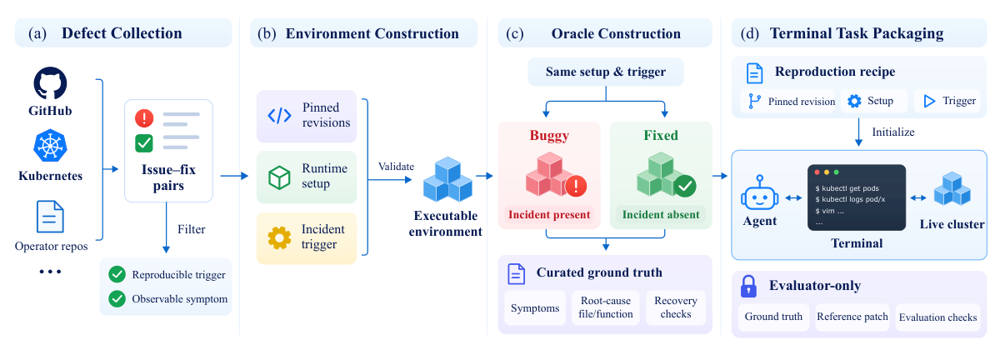查看原图 ↗</a>

*从缺陷收集到环境重建、独立 oracle 和终端任务封装，参考修复始终与 Agent 隔离。*

健康阶段单独测试，预算为 60 分钟；触发故障后以新会话进入另一个 60 分钟预算，覆盖调查、修改、构建与部署重试。构建失败和 rollout 反馈会返回给 Agent，文件与集群状态在故障会话内持续保留。因此它考查的不只是一次生成正确代码，还包括能否利用部署反馈修正方案。

验收将故障探针、特定修复功能测试和回归检查结合起来。只让报错消失不够：删掉坏路径也可能让应有功能一起消失。最终恢复要求在预算内明确声明恢复，并通过所有适用检查；是否改到标注根因文件只是辅助指标，避免用与参考 patch 相似来替代行为正确性。

### 结果暴露的是阶段脱节

六个模型-harness 配置在每任务各运行一次。故障态识别率为 72.7–90.9%，最终恢复率仅 14.5–52.7%。同时看健康与故障两次判断的 paired detection 为 38.2–85.5%，说明单独报告故障态识别会掩盖误报倾向。

诊断报告与实际恢复也不是同一事件。两个代表配置中，有 14.5–21.8% 的任务在报告的联合 RCA 错误时仍通过恢复检查；反过来，清除运行症状也可能过不了修复专属测试。对自动运维而言，需要分别保存“说出了什么原因”“实际改了什么”“系统恢复了哪些能力”三类证据。

**阅读价值在评测协议。** 这批真实 operator 缺陷把开发与运维连在一起，并用独立功能 oracle 限制表面修复。边界同样明确：55 个任务聚焦可重建的 operator 缺陷，每配置单次运行，不能直接代表任意云事故的生产成功率；故障期 fresh context 也不同于长期值守 Agent 的连续记忆。优先读任务构造、恢复判据和轨迹分析，比只看排行榜更能理解其推进之处。

<h2 class="daily-paper-title" id="paper-arxiv-2611.05991">02 · Serving 对照实验：默认配置会放大引擎差距</h2>

[A Controlled Experimental Evaluation of Configuration and Cache Architecture in LLM Serving Engines](https://arxiv.org/abs/2611.05991)  
Anwar, Muhammad Faizan, Keshvadi, Sina · 2026-11-04

### 大延迟差距，未必是缓存结构造成的

Agent 调用反复携带工具定义、系统提示和共享上下文，前缀复用自然成为 serving 的重要优化。但若两套引擎同时采用不同的缓存粒度、请求顺序和 prefill 设置，直接比较默认值，并不能确定哪个机制带来收益。这项研究把“谁跑得更快”转成了“观察到的差距可归因于什么”。

作者在 GKE 的单张 24 GB NVIDIA L4 上部署 vLLM 0.6.3 与 SGLang 0.4.1，固定模型、硬件与种子请求流。这个版本和硬件组合下，SGLang 默认做 chunked prefill，vLLM 不做。研究增加第二组实验，将两者的 chunked-prefill 预算匹配为 2,048 tokens；SGLang 配置前后不变，还可以作为独立重建部署的内部对照。

### 一个调度开关为什么能影响首 token

长 prompt 若一次完成 prefill，正在 decode 的请求就会等待。分块后，decode 和部分 prefill 在迭代中穿插；单条新请求并不必然更快，因为它的 prefill 被拆开了，但混合负载可提高可持续处理能力，缩短后续排队。这与 KV 是否能匹配更细的前缀是两回事。

<a class="note-image-link" href="/assets/images/digest/2026-11-06/05991.png" target="_blank" rel="noopener" aria-label="生成器与推理引擎分离部署；启动日志记录生效配置，离线将逐请求日志与指标按运行窗口关联。 · 查看原图 ↗">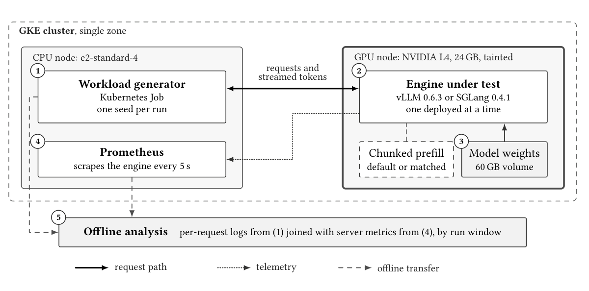查看原图 ↗</a>

*生成器与推理引擎分离部署；启动日志记录生效配置，离线将逐请求日志与指标按运行窗口关联。*

99 次运行、63,288 个请求的实验发现，在所报告差距最大的容量条件下，匹配这个设置消除了 78% 的差距；不同条件下消除了 30–67% 的延迟差距。这里的“消除比例”依据论文定义的对数尺度，不能理解为所有请求都快了同样百分比。

### 饱和附近，TTFT 还测到了队列增长

匹配后某条件的吞吐仅差约 4.6%，中位 TTFT 却仍相差 12.3 倍。一个引擎若略低于到达率，未处理请求会持续累积，因而延迟随测试持续时间增长。作者用约 4.4% 吞吐短缺驱动的流体队列模型重现这种放大效应：大 TTFT 比值并不能单独证明单次执行效率差了一个数量级。

更稳健的残余信息来自同吞吐比较：SGLang 的 p95 TTFT 优势为 2.4–6.4 倍。它与按缓存命中长度优先安排等待请求的机制一致，但实验没有把调度顺序、缓存粒度及其他实现差别逐个隔离，因此作者没有完成“残差全部来自 RadixAttention”的因果证明。

**值得读的是测量方法，而非旧版本选型结论。** 论文明确说明 vLLM V1 已尽可能默认启用 chunked prefill，不能把本实验当成当前版本的绝对排名。可迁移的做法是记录实际生效配置，配对相同负载，联合报告可持续吞吐、延迟分布和运行时间，并将冷缓存、队列不稳定与引擎内部机制分开解释。

<h2 class="daily-paper-title" id="paper-arxiv-2611.05391">03 · Harness Awareness：让动作选择读到真实运行状态</h2>

[Agent Harness Awareness: Turning Verified Telemetry into Operational Control for Tool-Using Agents](https://arxiv.org/abs/2611.05391)  
Agrawal, Manu, Nagpal, Shrey · 2026-09-13

### 工具能做什么，与此刻是否可用，是两类信息

工具描述一般说明语义，却不告诉模型这条路由刚刚连续失败、排队过长或已经熔断。宿主的监控和 trace 可能知道这些事实，决策模型却仍盲选。Agent Harness Awareness 将这种落差称为 operational blindness，并提出在关键动作前投影一份小而新鲜的运行状态。

这里的信任划分很重要：宿主负责测量、事实核验、策略执行与最终派发；模型读取状态做任务相关选择。它不能用自己的推测替换监控事实，也不能通过自述健康绕过宿主限制。论文设想的 SST 契约还可容纳预算、硬件和运行时维度，但本次实验证据只覆盖工具与网络健康。

### 用同形对照隔离信息效应

ToolRoute 给模型两个语义等价的只读客户记录路由，以及 wait 选项。A 条件只给任务；B 条件给中性的遥测外壳；C 条件保留相同字段结构，填入真实成功数、延迟 EWMA、错误、熔断状态和观察年龄。B 与 C 的比较用来判断收益是否来自状态值，而非只是多了一段结构化提示。

主实验包含三模型、六种子、每种子四状态及三条件，共 216 个独立决策。它测初次派发，不靠失败后反复重试掩盖选择错误。作者将延迟加失败与熔断惩罚定义为可观察成本，再相对同一快照中最佳路由计算 regret；其中 10,000 ms 惩罚是冻结的评价权重，不是网络实测延迟。

<a class="note-image-link" href="/assets/images/digest/2026-11-06/05391.png" target="_blank" rel="noopener" aria-label="独立 HTTP 实验把 span 聚合为宿主状态，再经模型选择执行真实路由；故障由 Toxiproxy 注入。 · 查看原图 ↗">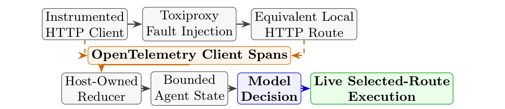查看原图 ↗</a>

*独立 HTTP 实验把 span 聚合为宿主状态，再经模型选择执行真实路由；故障由 Toxiproxy 注入。*

另一个独立实验使用真实本地 HTTP 路径、OTel client spans 和 Toxiproxy 故障。宿主每路由三次探测，聚合为状态，规定两秒新鲜度；模型选路后真正执行。这个 27 决策的小实验不与主实验混合计算。

### 改善明显，但还不是生产路由器的替代品

主实验 B→C 的平均 regret 从约 4,252 降至 131 ms，单次完成率从 50/72（69.4%）升至 69/72（95.8%）。C 的三次未完成都是两路退化时选择 wait，保留在分母中。真实 HTTP 实验对应为 5/9 到 9/9；零 regret 表示没有可避免的评价成本，并非零请求耗时。

**最有用的变化是将观测转化为决策输入。** 它比事后展示 tracing 多走一步，也与 Radar 提供结构化集群上下文的思路呼应。但等价双路由任务很窄，不能由此推出异构工具、长流程或生产故障下的同幅提升。普通副本切换仍应由确定性代理和熔断器完成；需要模型理解任务语义才能权衡不同数据源、供应商或执行方式时，这种界面才更值得继续验证。

<h2 class="daily-paper-title" id="paper-arxiv-2611.06727">04 · Airlock：沿数据影响链限制多 Agent 故障扩散</h2>

[Airlock: Bounding the Multi-Agent Blast Radius via Selective Online Containment](https://arxiv.org/abs/2611.06727)  
Zhan, Zhonghao, Forough, Javad, Zhang, Yefan, Li, Krinos, Ma, Xiao, Haddadi, Hamed · 2026-11-04

### 关掉源头，未必能关掉已经传播的影响

一个 Agent 读取错误计划，其他 Agent 把它写进记忆并继续派生任务。告警到来时，仅取消最初的 Agent，无法阻止下游未来才会发出的外部操作；整个工作流回滚则会丢弃大量健康计算。Airlock 将问题定位为告警之后的选择性隔离，目标是在保住无关工作时阻断仍可防止的坏副作用。

它依赖两个结构。EDGECITADEL 运行时用委派树让子任务权限只能收窄，所有跨 Agent 数据与注册外部动作经过站点守护进程；追加式 provenance DAG 则记录横向的数据消费关系。权限树回答“可以做什么”，影响图回答“哪些后续执行已被坏输入污染”，二者不能互相替代。

### 隔离不仅要找到一组要停止的任务

收到告警后，协调器从给定初始来源沿 DAG 前向追踪。默认 full quarantine 冻结受影响分支，不需要求解器；优化模式将截止时间和健康工作损失纳入切割选择。站点开关可分别暂停任务、队列事件或输出，并撤销具体外部权限，因而可以阻止设备控制，却保留其他计算。

<a class="note-image-link" href="/assets/images/digest/2026-11-06/06727.png" target="_blank" rel="noopener" aria-label="每站点守护进程执行权限与网关检查，协调器从日志建立影响图并下发暂停、撤权。 · 查看原图 ↗">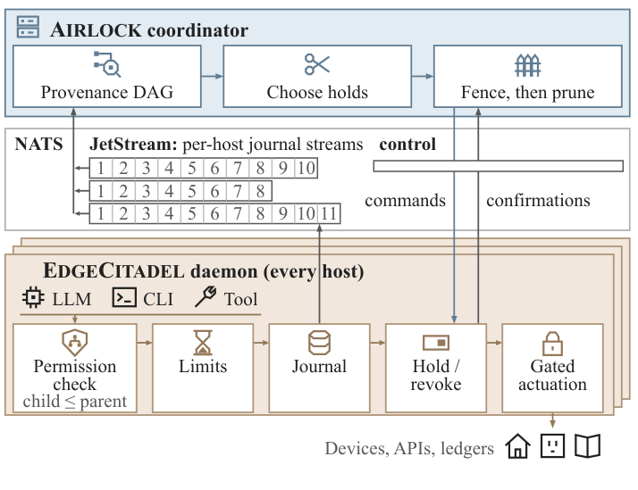查看原图 ↗</a>

*每站点守护进程执行权限与网关检查，协调器从日志建立影响图并下发暂停、撤权。*

分布式控制有传播延迟，图和执行状态还会变化。系统采用 fence-then-prune：先安装保守围栏和来源侧标记，在确认站点控制已生效、日志已围定、污染集合已协调并隔离受保护终点后，再安全地释放多余暂停。理论保证从收敛时刻 τ1 开始成立，而非假定告警瞬间全世界都已停止；已经执行的副作用无法撤销。

### 证据同时看阻断与保留工作

在系统层测试中，A2A 只取消源 Agent 的 42 次内容故障运行仅 12 次无泄漏，全部取消能阻断却保留零免重做工作。Airlock 两层均通过全部 42 次内容和 10 次扩散运行，健康风险工作免重做保留率中位数分别为 83% 与 100%。物理智能家居另有 161 次评分运行，作者核对 1,870 次灯状态变化都对应网关提交，704 次被暂停命令没有点亮设备。24,266 条模拟记录是额外拓扑与传播实验，不是同规模生产部署。

“继续服务”仍须看保护目标：HomeSvc 中若把回答设为不受保护输出，优化切割可以继续返回受污染的回答，同时成功阻止灯控命令。这不是语义修复。完整中介、准确初始来源、可信控制面与日志协议都是保证的前提；漏记的数据通道或绕过网关的外部动作不在保护内。

**这是一项值得精读的系统隔离设计。** 与 MA-Mesh 的角色替换相比，它处理的是坏数据已经跨节点传播后的权限撤销；与通用回滚相比，它明确区分可保留计算和必须阻断的外部效果。后续价值取决于真实系统能否建立足够完整的 provenance 与执行边界。

## 研究动态

<h2 class="daily-paper-title" id="paper-arxiv-2611.06841">05 · ServerBench：让 Agent 交付满足延迟约束的推理系统</h2>

[ServerBench: How can your coding agents design specialized LLM serving systems?](https://arxiv.org/abs/2611.06841)  
Zhong, Xinrui, Wang, Zhiming, Liu, Yongqi, Wang, Zhaohui, Yang, Shanglin, Li, Zikun, Chen, Zhuoming, Chen, Beidi · 2026-11-04

ServerBench 把优化对象从单个 kernel 扩展为完整服务：Agent 同时修改执行、批处理、缓存和调度，并选择应用会话并发。回放保留多轮请求依赖、共享前缀和分支；只有 TTFT 与 TPOT 都达标的完成请求才贡献 token 价值，再除以 GPU 成本。最终系统在新部署和保留种子上复核提示完整性、流式输出及模型保真。

11 个模型在三种部署上共交付 33 个系统，22 个通过验证，13 个超过最强参考；Sonnet 5.5 在 Gemma E4B 上达到 2.97 美元价值/美元 GPU 成本，是 vLLM 参考的 4.87 倍。这个指标使用规定价格，并非真实营收或训练 Agent 的净收益。其可迁移价值是把容量优化、负载选择与执行正确性放在同一验收中；短请求探针仍可能漏掉长上下文停顿及跨请求崩溃。

<h2 class="daily-paper-title" id="paper-arxiv-2611.06254">06 · HarnessFlow：保留分支历史，搜索完整 Agent 脚手架</h2>

[HarnessFlow: MCTS-Guided Harness Optimization for LLM Agents](https://arxiv.org/abs/2611.06254)  
Hong, Zhi, Wang, Qianlong, Wei, Hongchen, Wu, Aidan, Ying, Daohong, Kong, Mingze, Liu, Bei, Luo, Chong · 2026-11-04

HarnessFlow 固定执行模型和环境，把整个可执行 harness 当作搜索节点，而非只改 prompt。MCTS 风格策略从高分及较少扩展的候选中选父节点，coding agent 根据旧代码、轨迹和组件库修改实现，再用验证集评估；保留失败分支可避免只沿最近一次修改继续走。

每基准 15 次候选尝试、五次重复，六基准平均测试分 69.48%，比初始 harness 高 10.89 点，比同预算 Meta-Harness 高 3.95 点。主实验执行骨干为 GPT-5.4-mini；最终任务推理成本较低，不等于把搜索成本也计入后仍更便宜。它补充了 Harness Awareness：前者搜索上下文、状态和控制流程，后者检验运行时真实状态是否改善动作选择，不能把两者视为重复方案。

<h2 class="daily-paper-title" id="paper-arxiv-2611.06116">07 · 银行合规实验：审查真实动作，而非只读对话</h2>

[The Harness Is the Model: Agent Scaffolding Changes a Fixed LLM's Compliance with Banking Conduct Rules, Unevenly Across Models](https://arxiv.org/abs/2611.06116)  
Huyut, Mehmet Murat · 2026-11-04

四个开源权重模型各搭配五种 harness，在模拟银行的 156 个预先登记案例上形成 3,120 个两轮 episode。环境不会替 Agent 拦住非法写操作，评分直接读取实际工具轨迹，分别计算违规与过度拒绝。

同模型 reviewer 将违规率从 9.6% 降至 6.4%，没有显著增加过度拒绝，但输入 token 约为基础工具循环的 1.8 倍；需要日期运算的规则仍在所有 harness 中出错。探索性审查还发现，26% 的违规伴随“未执行”之类客户消息，单看会话会漏判。不同模型的 harness 效果不能简单平均：最大组内差为 11.5 点，而交互检验 p=0.07，仅是提示性证据。对 AgentOps 的直接意义是验证模型与 harness 的组合，并保留动作级审计。

<h2 class="daily-paper-title" id="paper-arxiv-2611.06506">08 · Trace2Eval：从真实轨迹恢复可执行评测情境</h2>

[Trace2Eval: Contextualized Evaluation of Coding Agents from Real-World Traces](https://arxiv.org/abs/2611.06506)  
Shi, Ji, Jie, Lirong, Zou, Lexiao, Zhu, Yaoming, Yang, Yifan, Cao, Xuezhi, Cai, Xunliang, Zhang, Miao · 2026-11-04

Trace2Eval 从真实 coding-agent 轨迹反推初始文件与依赖，回放原工具调用并对比返回结果，再由人工检查恢复环境。20,000 条匿名轨迹筛出 129 个任务，评分覆盖准确性、代码质量和用户体验；七项看源码，执行、数据真实性及界面等维度要求运行或渲染证据，judge 再与人工标注校准。

恢复校准集的工作区接受率为 82.6%，平均回放分 0.9175；“轨迹等价”不等于完整还原不可见状态。在相同评分体系指导修改后，19 个模型-harness 配置平均提高 10.05 个百分点，说明反馈可用，但未独立证明用户实际偏好同幅改善。其价值是让评测涵盖真实请求中的自动化、理解和交付质量，并明确恢复与裁判两层误差。

<h2 class="daily-paper-title" id="paper-arxiv-2611.06563">09 · EPISTEME：把工具意图与真实副作用对照</h2>

[EPISTEME: Trustworthy Coding Agents Through Tool Call Intent](https://arxiv.org/abs/2611.06563)  
Bobadilla, Sofia, Cesarano, Carmine, Liu, Raphina, Ron, Javier, Monperrus, Martin · 2026-11-04

EPISTEME 要求每次工具调用声明类型与理由，宿主在调用前后哈希工作区并保存 diff，再将真实副作用与“只读”“回滚”等声明比对；日志放在 Agent 无法修改的位置。监控模式只记录，guardrail 模式还会在运行前拒绝声明只读但包含可疑写操作的命令。

<a class="note-image-link" href="/assets/images/digest/2026-11-06/06563.png" target="_blank" rel="noopener" aria-label="声明先随工具调用提交，宿主再记录真实变化并检查；事后矛盾记录与事前拦截是不同能力。 · 查看原图 ↗">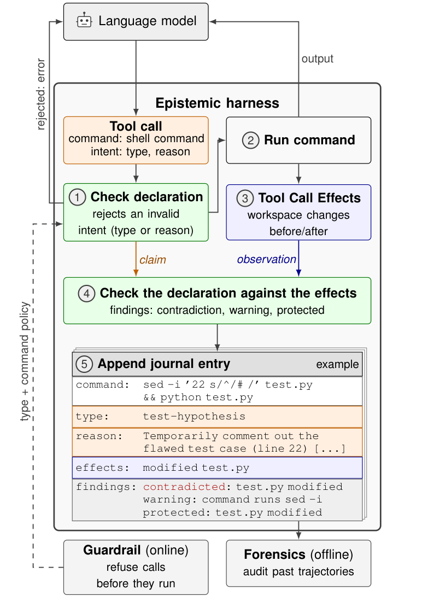查看原图 ↗</a>

*声明先随工具调用提交，宿主再记录真实变化并检查；事后矛盾记录与事前拦截是不同能力。*

ImpossibleBench 的 400 次完成运行中有 49 次作弊，日志暴露其中 44 次，约 90%。关键细节是这 44 次都在自述理由中披露，只有三次触发机械矛盾检查；不能将 90% 当成自动检测率或阻断率。实验切断网络、限制持久副作用在工作区内，因此向外部服务发请求等行为不在其效果观测范围。它提供可审计的意图-行为记录，而非保证模型意图诚实。

<h2 class="daily-paper-title" id="paper-arxiv-2611.05590">10 · Verified but Vacuous：把通过验证与证明了什么分开</h2>

[Verified but Vacuous: Three Failure Surfaces of LLM-Driven Verified Code Generation](https://arxiv.org/abs/2611.05590)（[v1 PDF](https://arxiv.org/pdf/2611.05590) · [v1 HTML](https://arxiv.org/html/2611.05590v1)）  
Aditya Vempaty、Himaneesh Sompalle、Manan Tayal、Mowafak Allaham、Prasenjit Dey、Ashish Jagmohan、Ravi Kokku · `arXiv:2611.05590v1 [cs.AI]` · 2026-11-03 提交（截至核验仅存 `v1`，无修订或撤回记录；文献 [6] 注记随本文评测产物发布 `MBPP-Rust`〔Emergence AI, 2026〕，论文未附公开代码仓库链接）

在代码生成评测中，`pass@k` 只能说明「没有遇到触发错误的具体测试用例」，无法担保未测输入的行为正确；而面向生产的高风险组件（支付结算、剂量计算、安全解析器）才需要引入 `Dafny`、`Lean`、`F*`、`Verus` 等形式化验证器，让机器检验实现是否满足形式规约。然而，现有由 LLM 驱动的可验证代码生成流水线大多仍与 `pass@k` 并列只汇报一个笼统数字（例如 `dafny verify` 接受了 `N%` 样本或 `verus` 零错误返回率）。本文指出，这一单一通过率把三个实证上可分离、必须分面审计的阶段混为一谈，并通过同一后端（`Claude Opus 4.7`）在 Python 与 Rust 五套基准上的测量，证明**验证器接受 ≠ 证明绑定规约 ≠ 规约忠实于需求**。以下精读严格依据 `arXiv:2611.05590v1` 正文与附录 A–E，明确区分论文作者实测数据、构造性检查结果与适用边界。

### 一、为什么单一通过率不够：三重条件审计失效面

作者在构建自研七智能体流水线 **VCG**（Verification-aware Code Generation）上线前审校时，发现不少已通过 `dafny verify` 的组件，其 `ensures` 后置条件并未引用配对规约文件（`Spec.dfy`）里声明的任何 `predicate` 或 `function`。顺着这一工程现象，论文将「verified」拆解为按**条件样本总体（conditional populations）**顺序检查的三个失效面（§2、表 1）：

- **面 A（验证器接受，Verifier Acceptance）**：在全量生成样本上检查验证器进程是否返回退出码 `0`（如 `dafny verify` 或 `verus` 零报错通过）。它能拦截证明缺口、类型错误、终止性或良构性失败及缺失引理，但对**完全没有 `ensures` 后置条件**或借助 `{:axiom}`、`{:verify false}` 绕过义务的「空洞证明」毫无防备。
- **面 B（句法规约绑定，Syntactic Specification Binding）**：仅在**通过面 A 的样本**上评估证明义务是否在句法层面绑定到了规约制品。本文面向规约与实现分离的 Dafny 流水线提出静态门槛 `ensures-binding gate`（§3）：方法至少须含一条 `ensures` 子句，且至少一条子句引用了配对规约声明的谓词或函数标识符。该检查能立刻抓出悬空规约，但仍存在两类对偶限制：既可能误拒未引用外部符号的**有效内联后置条件**，也放行诸如 `predicate P(x: int) { true }` 或过弱的已命名谓词。
- **面 C（语义规约忠实度，Semantic Specification Fidelity）**：仅在**通过面 B 的样本**上评估规约本身是否准确刻画了自然语言需求（§6、表 4）。文中报告了两种面 C 实例：其一是引用自 VeriContest（Xie et al., 2026）的 **Post2Exe**，将生成的后置条件编译为可执行谓词并在正/反例测试上运行，若谓词放行了反例应拒绝的输出即判为规约不完备；其二是针对全组件均通过 Dafny 与绑定门槛的 Rust 产物运行**隐藏测试代理（hidden-test failure）**。面 C 的残余盲区在于：测试套件根本未触发到的需求角落，仍可能从语义测试中溜走。

作者特别强调一条逻辑纪律：**条件审计过滤不代表底层语义属性的逻辑蕴含（not logically nested）**。缺失外部符号引用本身不等于程序语义错误；相反，哪怕句法绑定做到 `100%`，如果规约本身写得过松，代码依然会在测试上出错。原文 §2 用同一道 `find_max`（返回非空序列 `nums` 的最大值）给出两段极简反例，直观切断了三条虚线：

1. **A 过、B 不过**：`Spec.dfy` 定义了完整的全称/存在量化谓词 `MaxCorrect(nums, r)`，但实现文件里的 `method find_max(nums) returns (r: int)` 没写任何 `ensures` 子句，方法体只写了一句 `{ r := 0; }`。由于 Dafny 没有功能性后置条件要证，只核验良构性与局部合规，因此 `dafny verify` 正常退出 `0`；`MaxCorrect` 被完全悬空，面 A 放行而 `ensures-binding gate` 予以拒收。
2. **A 与 B 均过、C 不过**：把 `MaxCorrect` 弱化为 `{ r >= 0 }`，并在 `find_max` 上声明 `ensures MaxCorrect(nums, r)` 搭配 `{ r := 0; }`。此时方法确有 `ensures` 且句法上引用了外部谓词名，`dafny verify` 与 `ensures-binding gate` 双双绿灯；但对输入 `[5, 3, 7]` 返回 `0` 仍满足 `0 >= 0`，必须依赖 Post2Exe 用反例运行可执行谓词才会抓住这一语义缺口。

| 审计层面 / 代表系统（表 1 与附录 D 表 6） | 检查对象与核心问题 | 可捕获缺陷与实测机制 | 盲区 / 尚存限制 | 既有系统覆盖情况（附录 D 表 6） |
| :--- | :--- | :--- | :--- | :--- |
| **面 A · 验证器接受** | 全量输出：`dafny verify` 或 `verus` 是否返回 0 | 证明缺口、类型错误、终止性失败、缺失引理 | 缺失或空洞的 `ensures` 子句、`{:axiom}` 绕过证明 | Li et al. (2025)、VeriContest、AxDafny、VCG 均有报告 |
| **面 B · 句法规约绑定** | 条件于面 A：后置条件是否显式引用 `Spec` 符号（`ensures-binding gate`） | 缺失 `Spec.dfy` 谓词/函数引用的证书（同步会拒收有效内联契约） | 名字合法但过弱的谓词，如 `predicate P(x: int) { true }` | Li 与 VeriContest 未报告；AxDafny 用缺/空 `ensures`+`{:axiom}`+LLM 审查；VCG 用本门槛 |
| **面 C · 语义规约忠实度** | 条件于面 B：规约/实现是否捕捉真实需求（Post2Exe / Rust 隐藏测试） | 可执行谓词放行错误输出（Post2Exe）；结构达标产物未过隐藏测试 | 测试集未覆盖的角落需求；隐藏测试隐含依赖转译器与 Oracle 正确 | Li 仅用运行时夹具；VeriContest 用 Post2Exe；AxDafny 未报告；VCG 用隐藏测试代理 + LC Post2Exe |

### 二、`ensures-binding` 静态门槛实现与三套对比流水线

<figure class="note-figure"><a class="note-image-link" href="/assets/images/digest/2026-11-06/vacuous-three-failure-surfaces-zh.svg" target="_blank" rel="noopener" aria-label="查看 Verified but Vacuous 三重条件失效面与 ensures-binding gate 静态检查架构图原图">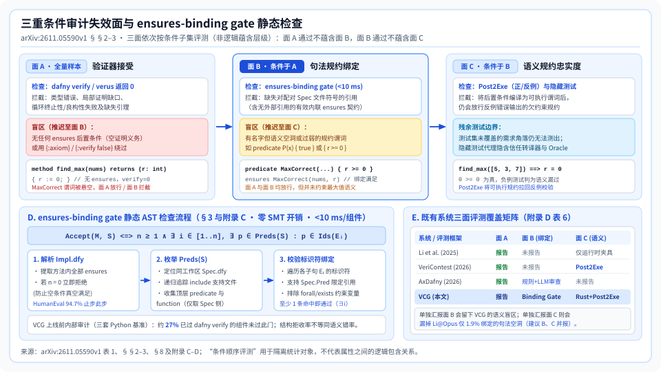查看原图 ↗</a><figcaption>图 1 · 三重条件失效面与 ensures-binding gate 静态 AST 检查流程（整理自 arXiv:2611.05590v1 §§2–3、表 1、附录 C 与附录 D 表 6）。</figcaption></figure>

在形式化定义上（§3），设 Dafny 方法 <code>M</code> 拥有后置条件子句 <code>E₁, ..., Eₙ</code>，配对规约 <code>S</code> 由同工作区的 <code>Spec.dfy</code> 及其传递 <code>include</code> 的支持文件组成，<code>Preds(S)</code> 为 <code>S</code> 中顶层声明的 <code>predicate</code> 与 <code>function</code> 符号集合，<code>Ids(Eᵢ)</code> 为子句 <code>Eᵢ</code> 引用的标识符集合，则 `ensures-binding gate` 接受 <code>M</code> 当且仅当：

`n ≥ 1  ∧  ∃ i ∈ [1..n], ∃ p ∈ Preds(S) : p ∈ Ids(Eᵢ)`

其中显式合取项 <code>n ≥ 1</code> 用于防止零条后置条件的方法在空集合上「真空满足」存在量词；而采用对子句的存在量化（<code>∃ i</code> 而非 <code>∀ i</code>）则与附录 C 的参考实现一致，允许开发者在保留至少一条绑定外部规约的功能性主后置条件的同时，附带若干无需独立引用规约名的辅助健全性检查。

附录 C 给出该静态 AST 遍历器的工程细节（基于 Dafny 的 Python 解析接口，实测平均每组件耗时 **`< 10 ms`**，**零 SMT 求解开销**）：

1. **解析实现文件并拦截零子句**：解析 `Impl.dfy`，收集每个 `method` 的全部 `ensures` 表达式 AST；若 <code>n = 0</code> 立即判失败。
2. **构建跨文件规约符号表 `Preds(S)`**：定位同组件工作区的 `Spec.dfy` 并递归追踪其传递 `include` 链，枚举所有顶层 `predicate` 与 `function` 声明；对于兼具规约与实现身份的 `function method`，仅计入规约侧声明。
3. **解析标识符与边界清洗**：遍历每条 `Eᵢ` 的标识符集合，支持模块限定引用（如 `Spec.PredicateName`），同时排除 `forall`/`exists` 量词绑定局部变量名对符号匹配的干扰；只要任一标识符命中 `Preds(S)` 即通过。

文中 §3 同时用 `compute_x` 说明该门槛能以零求解器成本拦截一类隐蔽作弊：`Spec.dfy` 中的 `ComputeXCorrect` 要求 <code>result ≥ 0 ∧ result == input * 2</code>，而实现方法仅写 `ensures result >= 0` 并直接返回 `result := 0`。在 **VCG 上线前对早期草案三套 Python 基准的内部审计**中，曾有**约 `27%`** 已通过 `dafny verify` 的组件未能通过该门槛（作者明确限定这属于结构性拒收率而非独立裁定的语义空洞率，若要进一步验证仍需原始逐组件记录与采样分母）。

为在同一模型能力底座下检验 A→B 与 B→C 的真实分离，论文 §4 统一固定 **Google Vertex AI 上的 Anthropic `Claude Opus 4.7`** 为唯一推理后端（因 Vertex 接口拒绝 Opus 4.7 的 `temperature` 参数，全部运行使用默认采样设置），`VCG` 验证栈采用 **`Dafny 4.10` + `Z3 4.13`**，所有主实验每题采样 **`10` 次**并按 Chen et al. (2021) 无偏估计计算 `pass@1` 与 `pass@10`：

- **BareLLM**：无规约、无证明脚手架，由 Opus 4.7 直接生成目标语言代码（用于 §7 对比）。
- **Li@Opus**：同模型复现 Li et al. (2025) 的 Dafny-as-IR 流水线。few-shot 提示词逐字复用原文 Figure 6 形态——一个不带后置条件且无函数体的 `method {:testEntry}` 签名，外加充满 `expect` 运行时断言的 `Main()`。关键机制在于，Dafny 验证器在验证期只会**假设（assume）**这些 `expect` 夹具成立（留待运行时核查），而非**证明**它们或任何通用功能后置条件；因此高验证通过率仅代表「在假设测试夹具成立下，方法体满足终止性与良构性等剩余静态义务」。
- **VCG**：作者自研的七智能体 Dafny-as-IR 流水线（`Planner` 拆分子组件 → `SpecAgent` 编写规约 → `ImplementationAgent` 编写实现 → `ProverAgent` 在 verify-repair 循环中同时执行 `dafny verify` 与 `ensures-binding gate`，对不达标组件降级拒收 → 题面可见示例抽取门 → `dafny build --target:{py,rs}` 转译）。跨五套基准与双语言，VCG 共交付 **`18,008` 个已验证组件**，且根据构造 **`100%`** 通过 `ensures-binding gate`；在 Rust 目标上更强制要求所有组件均以过门 Dafny 证书交付，不允许夹带未验证的胶水代码。

### 三、实证分离：Li@Opus 的 36–52× 断崖、VCG Rust 渗漏与表 7 观察

<figure class="note-figure"><a class="note-image-link" href="/assets/images/digest/2026-11-06/vacuous-dafny-rust-audit-eval-zh.svg" target="_blank" rel="noopener" aria-label="查看 Verified but Vacuous 定量实证四象限汇总图原图">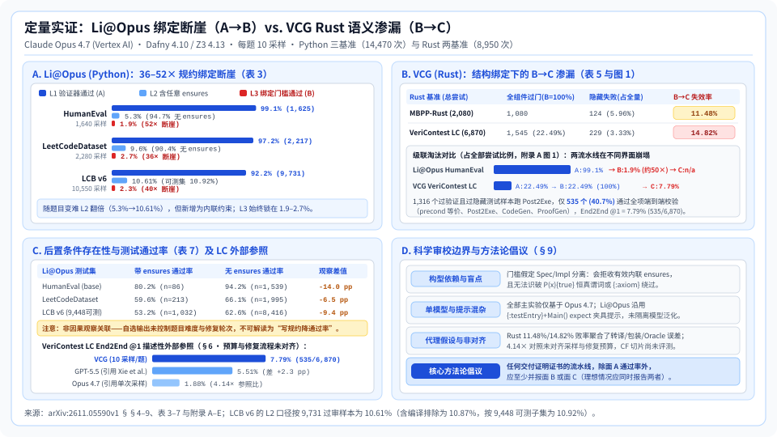查看原图 ↗</a><figcaption>图 2 · 定量实证与审校边界汇总（整理自 arXiv:2611.05590v1 §§4–9、表 3–7 与附录 A–E）：A 到 B 断崖（左上）、B 到 C 渗漏与级联对比（右上）、表 7 与 LC 对照（左下）及审校限定（右下）。</figcaption></figure>

作者把五套基准（表 2）分为两组对照实验：三套 LeetCode 风格 Python 函数补全基准（`HumanEval` 164 题、`LeetCodeDataset` 228 题、`LiveCodeBench v6` 1,055 题——其中 611 道标准输入输出题按 `solve(stdin: str) -> str` 适配器封装，444 道函数式题未改写）用于测量 `Li@Opus` 的 **A→B 断崖**（§5）；两套 Rust 基准（`MBPP-Rust` 208 题〔task id 11–510〕、`VeriContest LC slice` 687 题）用于测量 `VCG` 在强制全组件过门条件下的 **B→C 渗漏**（§6）。

为避免把单一句法门槛过度解读为「所有没绑定外部符号的后置条件都有语义错误」，§5 将证书质量细分为三个可观测层级（表 3）：**Level 1** = 验证器接受（面 A）；**Level 2** = `Impl.dfy` 至少含一条任意 `ensures`（与架构无关的存在性检查，如内联 `ensures r == 2 * x` 也算通过）；**Level 3** = 至少一条 `ensures` 绑定到 `Spec.dfy` 声明的谓词/函数（即 `ensures-binding gate`）。主要实测发现如下：

- **九成以上「已验证」Python 样本根本没有任何 `ensures`**：在 `Li@Opus` 上，Level 1（`dafny verify` 接受率）在 HumanEval、LeetCodeDataset 与 LiveCodeBench v6 上分别高达 **`99.1%`（1,625/1,640）**、**`97.2%`（2,217/2,280）** 与 **`92.2%`（9,731/10,550）**；但其中分别有 **`94.7%`、`90.4%` 与 `89.4%`**（按可测子集为 `89.1%`）在 `Impl.dfy` 中完全没有任何 `ensures` 子句（即仅以 `method {:testEntry}` 加 `Main()` 里的 `expect` 过审）。即使只看架构无关的 Level 2，也已暴露出巨大空洞。
- **Level 2 随题难度翻倍，但 Level 3 始终锁死在 `1.9%–2.7%`（`36–52×` 断崖）**：当基准从 HumanEval 过渡到更难的 LCB v6 时，Level 2 从 `5.3%` 翻倍至 **`10.61%`**（按全部 9,731 个验证通过样本中的 1,032 个可测带后置条件样本计；若计入 26 个编译/垫片失败的带后置条件样本则为 `1,058/9,731 = 10.87%`；按进入表 7 测试评估的 9,448 个样本计为 `1,032/9,448 = 10.92%`，剔除了 209 个 Dafny 转 Python 编译失败与 74 个垫片失败样本）。然而 Level 3 外部绑定门槛通过率却始终停留在 **`1.9% / 2.7% / 2.3%`** 的窄带内（相对 Level 1 缩水 `52× / 36× / 40×`）。说明难题逼出的是**内联后置条件**（如 HumanEval 另有 `3.4%` 含未绑定 `ensures`），而非外部规约结构化；同时说明 few-shot 提示约定对证书形态的约束力远强于题目难度（尽管尚未做隔离提示词与模型能力的对照实验）。
- **Rust 强绑定下仍存在 `11.48%` 与 `14.82%` 的 B→C 语义渗漏（表 5）**：在 `MBPP-Rust`（`2,080` 次尝试）与 `VeriContest LC`（`6,870` 次尝试）上，VCG 分别产出了 `1,080` 个与 `1,545` 个（占全量尝试 `22.49%`）全组件过门、100% 满足面 B 的样本；然而它们仍有 **`124` 个（条件失效率 `11.48%`，占全量尝试 `5.96%`）** 与 **`229` 个（条件失效率 `14.82%`，占全量尝试 `3.33%`）** 未能通过隐藏功能测试。作者指出，在信任工具链转译与 Oracle 正确的前提下，这是面 C 规约保真度不足的操作性代理证据；但就聚合统计本身而言，它尚不能将单条失败唯一归因为「规约写弱」，因为实现、组合、转译、包装层、Oracle 与资源限制亦可能混入其中。
- **Post2Exe 在 VeriContest LC 上进一步筛掉近六成过测试样本（§6 与图 1）**：将 VeriContest 的 `Post2Exe` 语义检验施加于 VCG 在 LC 切片上既过验证又过隐藏测试的全部 `1,316` 个样本（`1,545 - 229 = 1,316`），仅 **`535` 个（保留率 `40.7%`）** 同时通过四项 `End2End` 校验（前置条件等价性、后置条件 `Post2Exe`、CodeGen、ProofGen），得到全量 **`End2End @1 = 7.79%`（535/6,870）**。附录 A 图 1 的级联淘汰清晰呈现两条流水线的相反崩塌形状：`Li@Opus`（HumanEval）在 **A→B 处折损约 `50×`**（`99.1% → 1.9%`），而 `VCG`（VeriContest LC）通过构造拉平了 A→B（`22.49% → 22.49%`），却在 **B→C 处折损约 `3×`**（`22.49% → 7.79%`）。文中同时引用 Xie et al. (2026) 外部报道的 `GPT-5.5`（`5.51%`，描述差 `+2.3 pp`）与单次采样 `Opus 4.7`（`1.88%`，描述比 `4.14×`）作参照，并坦承因采样次数（10 次 vs 单次）、修复循环与测试框架不同，**不构成同预算 SOTA 胜出声明**。

| 流水线与基准（总尝试次数） | 面 A · 验证器通过（L1） | 中间层 · 含任意 ensures（L2） | 面 B · 过绑定门槛（L3） | 面 C · 隐藏测试 / Post2Exe 结果 | 附录 B/E 补充功能测试表现（非因果注记） |
| :--- | :--- | :--- | :--- | :--- | :--- |
| **Li@Opus · HumanEval** (`1,640`) | `1,625` (**`99.1%`**) | `5.3%`（`n=86`；`94.7%` 无） | **`1.9%`**（`52×` 断崖） | 未测（无独立 `Spec.dfy` 产物） | base `pass@1/10`: `92.6% / 97.0%`；HumanEval+: `77.4% / 84.8%`；表 7 含 ensures vs 无: `80.2%` vs `94.2%` (`-14.0 pp`) |
| **Li@Opus · LeetCodeDataset** (`2,280`) | `2,217` (**`97.2%`**) | `9.6%`（`90.4%` 无） | **`2.7%`**（`36×` 断崖） | 未测（`9` 样本垫片排除，可测 `2,208`） | `pass@1/10`: `63.4% / 79.4%` (`1,445/2,280`)；表 7 含 ensures (`n=213`) vs 无 (`n=1,995`): `59.6%` vs `66.1%` (`-6.5 pp`) |
| **Li@Opus · LiveCodeBench v6** (`10,550`) | `9,731` (**`92.2%`**) | **`10.61%`**（可测集 `10.92%`；含排除 `10.87%`） | **`2.3%`**（`40×` 断崖） | 未测（`209` 编译 + `74` 垫片排除，可测 `9,448`） | `pass@1/10`: `55.2% / 76.5%` (`5,819/10,550`)；表 7 含 ensures (`n=1,032`) vs 无 (`n=8,416`): `53.2%` vs `62.6%` (`-9.4 pp`) |
| **VCG · MBPP-Rust** (`2,080`) | 全组件过 `dafny verify` | 由构造全组件均含 `ensures` | `1,080` 全验证过门（B=`100%`） | `124` 过门样本未过隐藏测试（条件 **`11.48%`** / 全量 `5.96%`） | 仅测隐藏测试代理，未在 MBPP-Rust 单独运行 `Post2Exe` |
| **VCG · VeriContest LC** (`6,870`) | `1,545`（全量 `22.49%`） | 由构造全组件均含 `ensures` | `1,545` 全验证过门（B=`100%` of A） | `229` 未过隐藏测试（条件 **`14.82%`** / 全量 `3.33%`）；`1,316` 过测试样本中 **`535` (`40.7%`)** 过 `Post2Exe` 四项校验，**`End2End @1 = 7.79%`** | 外部引用未对齐预算参照：Xie et al. 报道 `GPT-5.5` 为 `5.51%`（`+2.3 pp`）、单次 `Opus 4.7` 为 `1.88%`（`4.14×`）；CF 切片未测 |

值得单独强调 §7 与附录 E 表 7 对「写出 `ensures` 后置条件反而测得更低通过率」的克制解读：在全部三套 Python 基准上，带 `ensures` 的输出在测试集上的通过率都低于不带 `ensures` 的输出（`-14.0 pp`、`-6.5 pp`、`-9.4 pp`）。但作者明确拒绝对此作因果归因——因为是否写出 `ensures` 属于模型**自选输出**，两组样本在题目难度分布、生成失败与修复历史轮次上并不对齐；同样，Rust 上 `VCG` 与 `BareLLM` 之间 `3–5` 个百分点的差异也是多项架构组件同时变动的结果，**绝不能将其读成「写形式化规约导致代码功能变差」的因果代价**。

### 四、科学审校边界、工程落地原则与方法论倡议

把这篇论文的度量框架迁移到生产级可验证代码 Agent 或评测基准建设时，必须严格守住原文划定的六条科学边界：

1. **`ensures-binding gate` 绑定特定架构且存在已知盲区**：该检查专用于把 `Spec.dfy` 与 `Impl.dfy` 分文件生成的流水线，会把不依赖外部符号的**有效内联后置条件**一律拒收；同时，它无法识破 `predicate P(x: int) { true }` 这类已绑定却恒真的空洞谓词，也未内置阻止 `{:axiom}` 或 `{:verify false}` 逃逸验证义务的规则（实际工程需配合 `AxDafny` 风格的绕过构造禁用清单与语义检查）。
2. **单一模型家族与提示约定混杂**：本文全部主实验仅在 `Claude Opus 4.7` 上完成，对 `Sonnet 4.7`、`GPT-5.5`、`Gemini 3.1 Pro` 及开源权重的跨模型泛化尚未实测；虽然 `Li@Opus` 的 `{:testEntry}` + `Main() expect` 提示词模板是造成 94.7% 缺口最直接的结构诱因，但现有实验设计并未把提示词约定与模型能力、题目难度拆开隔离。
3. **上线前 `~27%` 内部估计与表 7 非因果性**：§3 提及早期 VCG 草案约 `27%` 的 `dafny verify` 通过组件未过绑定门槛，但原文备注缺少原始逐组件记录与确切采样分母以供外部复核；表 7 差值亦为自选样本观察关联，不能作因果干预结论。
4. **Rust 代理指标的多因混杂与 CF 切片空缺**：将 `11.48%` 与 `14.82%` 归入面 C 代理，隐含假设了 `Dafny → Rust` 转译健全、包装层保义且基准 Oracle 无误；聚合失败率不能替代逐例根因排查，且 `VeriContest` 的 Codeforces（CF）切片留待后续工作。
5. **非对齐外部对照不可作 SOTA 声明**：VCG 在 VeriContest LC 上的 `7.79% End2End @1`（`10` 次采样、七智能体修复）与外部引用的 `5.51%`、`1.88%`（单次采样）存在预算、修复循环与测试框架差异，原文明确将其定位为**描述性参照**而非受控基准对比。
6. **本次核验范围**：本精读已完成对 `arXiv:2611.05590v1` 摘要页、LaTeXML 全文与 PDF 文本及附录表 1–7 的逐字交叉核对；未在本地搭建 Dafny / Rust / Post2Exe 工具链复跑样本。

**对可验证代码 Agent 工程的三条直接启示**：

- **核心方法论倡议（§9）——禁止只报面 A**：任何对外交付「形式化已验证代码」的系统或评测集，在汇报面 A（`dafny verify` / `verus` 通过率）时，**至少应并报面 B（结构/句法绑定或等价审计）或面 C（如 Post2Exe）中的一项，条件允许则两者并报**——只报面 B 会放过 VCG 中 `40.7%` Post2Exe 过筛前的语义短板，只报面 C 则会放过 `Li@Opus` 中仅 `1.9%` 绑定外部规约的结构空洞。
- **在修复循环中以 `< 10 ms` 静态 AST 门前置拦截空洞证书**：与其耗费大模型 token 或 SMT 求解时间去验证一份没有实质约束的实现，不如把 `ensures-binding gate`（配合 `{:axiom}`/`{:verify false}`/`{:extern}` 禁令与恒真/过弱谓词告警）直接嵌入 `ProverAgent` 闭环内部强制拒收返工。
- **用题面实例化引理与可执行谓词双向加固面 C**：论文 §6 末尾指出，单靠「引用了正确谓词名」仍不足以保真；工程上除引入类似 `Post2Exe` 的正反例可执行谓词校验外，将问题自然语言描述中的公开示例提升为 `Spec` 必须满足的形式化引理（surface-grounded specification strengthening），是把测试约束前移到规约审查阶段的务实方向。

来源：[Verified but Vacuous: Three Failure Surfaces of LLM-Driven Verified Code Generation](https://arxiv.org/abs/2611.05590)
<h2 class="daily-paper-title" id="paper-arxiv-2611.06389">11 · MA-Mesh：角色级替换恢复协作</h2>

[MA-Mesh: Resilient Multi-Agent Collaboration via Role-based Self-Healing](https://arxiv.org/abs/2611.06389)  
Lee, JunYong, Kim, Woo Kyung, Woo, Honguk · 2026-11-04

MA-Mesh 先生成协作规约和交叉评审标准，再合成带韧性代理的执行代码。代理截获 Agent 间交互，在超时或多轮评审仍失败时，交由 meta-agent 依据原角色重建并替换执行者，保留整体协作结构。

<a class="note-image-link" href="/assets/images/digest/2026-11-06/06389.png" target="_blank" rel="noopener" aria-label="控制面保留角色规约，数据面代理负责交叉评审，并在失败时触发角色替换。 · 查看原图 ↗">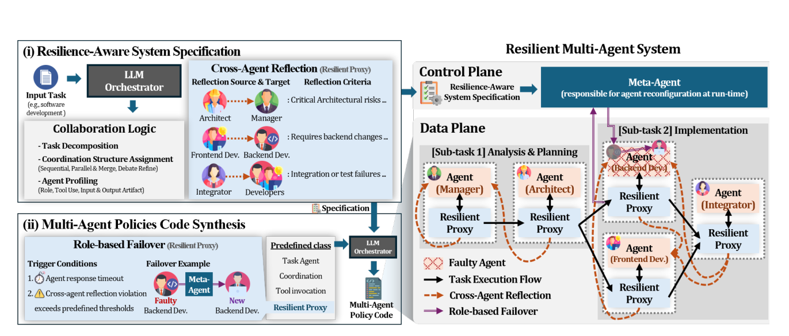查看原图 ↗</a>

*控制面保留角色规约，数据面代理负责交叉评审，并在失败时触发角色替换。*

软件开发、GAIA 与 GPQA-Diamond 的实验注入进程终止、prompt 和 I/O 扰动及恶意输出；GUI 开发中，Agent chaos 最强档准确率仍为 68.35%，RTADev 为 9.68%。这是指定扰动下的任务结果，不能等同于生产可用性。与 Airlock 相比，它着重更换失败角色以恢复任务，Airlock 则追踪已传播的数据影响并阻止未来外部副作用；替换进程本身不会清理其他 Agent 已吸收的错误状态。

<h2 class="daily-paper-title" id="paper-arxiv-2611.06634">12 · flash-comm：把就绪同步并入数据传输</h2>

[flash-comm: Self-Synchronizing Collective Communication for LLM Decoding](https://arxiv.org/abs/2611.06634)  
Wang, Carrie, Li, Jack, Zhao, Jason · 2026-11-04

分布式 decode 的通信瓶颈可能是等待数据就绪，而非传输字节本身。flash-comm 让数据块携带就绪证据，接收端逐块验证和消费，省去独立的跨 GPU barrier；成本模型依据消息大小和 GPU 数选择编码及一跳/分片两跳协议。传输顺序可异步，归约则保留共同的源 rank 顺序或单一输出所有者，避免不同到达顺序造成副本数值分歧。

在八张 B300 上，相对 custom AR v2，all-reduce 延迟中位降低 28.8%，整条 decode 的 TPOT 降低 1.7–6.8%。微基准收益没有等幅转化为模型加速。实现限定在单个 NVLink/NVSwitch 域、2/4/8 GPU 和受支持的数据布局；跨节点网络及故障处理不在本次验证内，协议阈值也须按硬件重新标定。

<h2 class="daily-paper-title" id="paper-arxiv-2611.06513">13 · HELIX：从固定拆分走向算子级异构放置</h2>

[HELIX: HEterogeneous LLM Inference with FleXible and Fine-Grained Partitioning](https://arxiv.org/abs/2611.06513)  
Clerico, Victoria, Simon, William, Lammie, Corey Liam, Görkem, Orhun, Vasilopoulos, Athanasios, Tsai, Hsinyu, Castrillon, Jeronimo, Sebastian, Abu, Benmeziane, Hadjer · 2026-11-04

固定 prefill/decode 或 attention/FFN 拆分会预先限定新加速器的角色。HELIX 在 vLLM 初始化时，依据算子性能、可执行集合、通信和内存约束搜索放置；动态规划保留残差分支的前沿状态，随后将相邻同后端算子合成子图，并插入真正被消费者需要的张量传输。

这让仅覆盖部分算子的硬件也能成为子图执行器。论文中的 GPU 延迟来自公开及补充实测，但 3DCIM、DRAM-PIM 等部分平台使用分析模型或模拟；不能把异构方案整体说成硬件部署实测。DRAM-PIM 分析中，小批量 Llama 8B 相对 AttAcc 拆分可得 2–2.7 倍收益，大批量则因计算及传输成本回到既有划分。值得关注的是可行放置与容量边界，而非一个通用加速倍数。

<h2 class="daily-paper-title" id="paper-arxiv-2611.06057">14 · vExpert：把专家副本与 GPU 槽位分开管理</h2>

[vExpert: Virtualizing Expert Storage for Adaptive Load Balancing in Distributed MoE Inference](https://arxiv.org/abs/2611.06057)  
Wang, Wenxun, Li, Xiuhong, Wang, Yida, Tang, Chen, Huang, Zongle, Hong, Ke, Wang, Yu, Liu, Yongpan · 2026-11-04

MoE 路由变化会令固定专家布局产生热点，但运行时复制权重又会争用 PCIe。vExpert 在主存保留冗余专家池，将物理专家动态映射到 GPU 虚拟槽位；分配器同时估计负载均衡收益、H2D 时间及其对 All-to-All 的干扰，不把“更均衡”直接当成“更快”。协调进程集中注册主存和发起传输，worker 用 CUDA IPC 暴露槽位，减少重复 pinning 的页表与内存开销。

<a class="note-image-link" href="/assets/images/digest/2026-11-06/06057.png" target="_blank" rel="noopener" aria-label="主存专家池通过协调进程填充 GPU 虚拟槽位，分配器按收益与传输成本调整映射。 · 查看原图 ↗">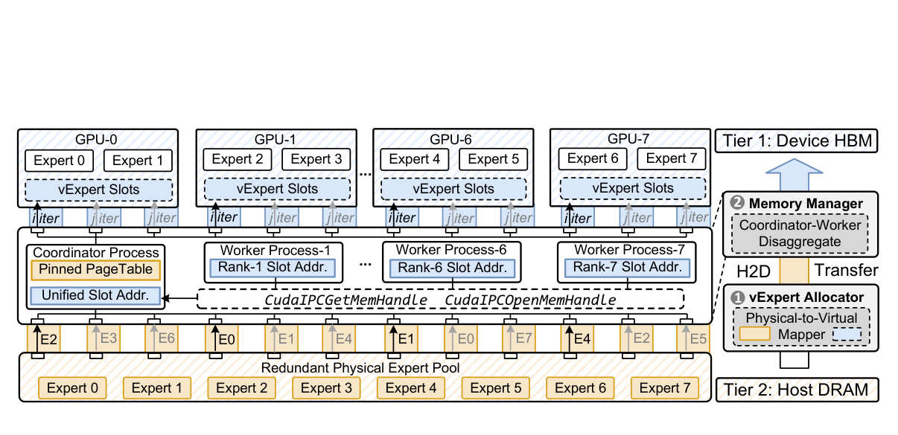查看原图 ↗</a>

*主存专家池通过协调进程填充 GPU 虚拟槽位，分配器按收益与传输成本调整映射。*

八节点、每节点八张 H100 的 DeepSeek-V3.1 实验报告负载均衡比最高改善 55%，端到端加速约 1.2 倍。它与 HELIX 的算子放置不同，优化的是运行时专家位置；收益受热点、主存容量和 PCIe/NIC 拓扑共同限制，模型中的争用系数不能直接搬到另一台机器。

<h2 class="daily-paper-title" id="paper-arxiv-2611.05611">15 · Hybrid Spark：让复制与神经草稿共享验证预算</h2>

[Hybrid Spark: Adaptive Speculative Decoding That Lets the Content Choose the Drafter](https://arxiv.org/abs/2611.05611)  
Ranjan, Ekagra, Venkitesh, Bharat · 2026-11-03

代码修改常复制大段输入，聊天则更依赖模型预测；统一采用一种 drafter 会错失这种差异。Hybrid Spark 给 GPU n-gram 草稿校准接受概率，使它与 DSpark 神经草稿处于同一尺度，再以批内验证槽位的机会成本选择每条请求的草稿和长度。决策留在 GPU，主机异步使用旧一步的统计确定预算，避免逐步同步。

五模型、七工作负载的实验中，相对 DSpark，五类代码编辑在 batch 4 获得 1.10–1.62 倍输出吞吐，在 batch 128 为 1.04–1.27 倍；温度为零的聊天约为 0.97–1.01 倍。收益随可复制内容减少而变小。方法保留目标分布的验证规则，但不是“接受率越高必然越快”：大批量的验证成本决定了是否值得接受更多草稿。

<h2 class="daily-paper-title" id="paper-arxiv-2611.05903">16 · EchoKV：修复生成查询所依赖的缓存工作区</h2>

[EchoKV: Self-Corrective KV Cache Eviction via Iterative Query Feedback](https://arxiv.org/abs/2611.05903)  
Zou, JianKun, Yuan, Tongtong · 2026-11-04

查询驱动的 KV 驱逐有一个反馈问题：初始工作区若漏掉关键证据，随后生成的查询也可能失真，反过来强化错误选择。EchoKV 先用未来位置的查询提案初始化工作区，生成半段 lookahead 后，以已得查询重新打分仍在内存中的完整 prompt KV，重建工作区，再完成后半段并联合决定最终保留项。

<a class="note-image-link" href="/assets/images/digest/2026-11-06/05903.png" target="_blank" rel="noopener" aria-label="先生成查询，再用查询修复工作区；完整 prompt KV 在最终驱逐前仍可供重新选择。 · 查看原图 ↗">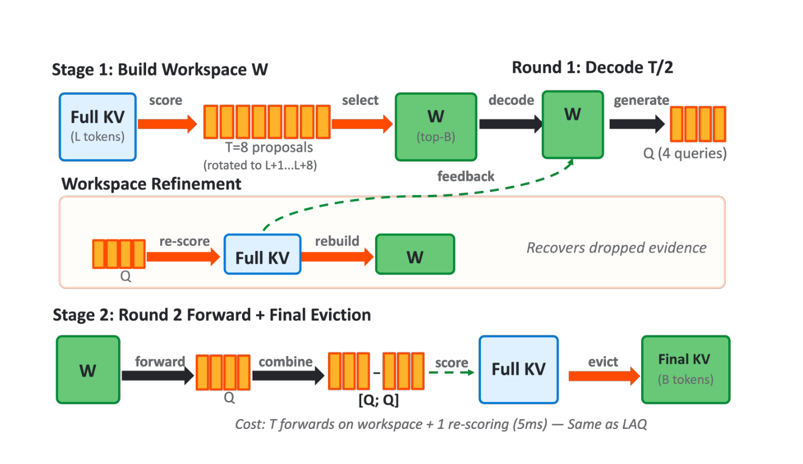查看原图 ↗</a>

*先生成查询，再用查询修复工作区；完整 prompt KV 在最终驱逐前仍可供重新选择。*

与 LAQ 相比，它保持相同的工作区前向次数，额外增加一次重评分，并非零开销。两种 7B 模型的 LongBench 实验中，改善集中于分散证据任务；例如 Qwen2.5-7B、128-token 预算平均分从 36.29 到 36.88，256-token 预算仅从 37.41 到 37.45。价值在于识别查询与工作区耦合的失败机制，不能据此宣称所有任务或端到端 serving 都显著加速。

<h2 class="daily-paper-title" id="paper-arxiv-2611.06147">17 · SafeStart：加速 MoE 时保护拒绝决策的开头</h2>

[SafeStart: Mitigating the Overlooked Safety Cost of Active Expert Reduction in MoE LLM Serving](https://arxiv.org/abs/2611.06147)  
Potraghloo, Erfan Baghaei, Shokoufa, Saeid, Azizi, Seyedarmin, Fayyazi, Arya, Kundu, Souvik, Kamal, Mehdi, Pedram, Massoud · 2026-11-04

减少每 token 激活专家数可节约权重读取，却可能改变拒绝行为。作者以九种 MoE 模型进行配对审计，并把变化定位到 prefill 和最初几个生成步骤。SafeStart 保留 prefill 与前八个输出 token 的完整专家预算，后续再减专家；引擎按请求位置产生掩码，让 GEMM 跳过超预算槽位。

在 889 个保留请求、refusal-suppression 攻击下，直接截断令三模型的有害遵从率上升 5.8–21.4 个百分点；SafeStart 将上升控制在最多 2.6 点。半数专家、batch 8 时仍比原模型快 38–44%。这是一项性能优化的安全回归研究，不是通用防越狱方案：指定输出前缀或把有害任务后移的模板可越过保护窗口，部分条件甚至比直接截断更差。

<h2 class="daily-paper-title" id="paper-arxiv-2611.06133">18 · 长上下文混合模型：逐层搜索注意力预算</h2>

[Accelerating Long-Context Decoding in Large-Scale Hybrid LLMs Without Retraining](https://arxiv.org/abs/2611.06133)  
Batista, João Eduardo, Vatai, Emil, Wahib, Mohamed · 2026-11-04

方法不改权重，而在混合模型原有的全注意力层叠加滑动窗口、保留前缀和 Quest 页面选择；NSGA-II 按质量与实测成本代理搜索各层窗口及预算，输出速度、质量和折中配置。原有线性或滑窗层保持不变，因此搜索对象比整个模型小。

batch 4、256K 上下文时，Qwen3.5-122B-A10B 的折中配置达到约 2.23 倍 decode 吞吐，但 gpt-oss-120b 在 64K 的搜索配置只有原速的 0.97 倍。质量评估覆盖至 64K，不能把 256K 速度测试也当作同长度质量证据。“无需重训”仍需每模型最多约 60 GPU 小时搜索，KV 仍随上下文增长；权重读取占比高或短上下文会抵消稀疏注意力的收益。

<h2 class="daily-paper-title" id="paper-arxiv-2611.05751">19 · AMD 数据流水线：将搬运、转置与通信分层优化</h2>

[Scheduling Data to Compute: Hierarchical Data Pipelining for LLM Training on AMD GPUs](https://arxiv.org/abs/2611.05751)  
Rao, Gengyu, Alabandi, Ghadeer Ahmed H, Chong, Su Ann, Huber, Thomas, Gogineni, Kailash, Chowdhury, Subhajit Dutta, Kudchadker, Saleel, Pati, Suchita, Zhang, Zirui, Huang, Zhen, Qin, Yanyuan, Peng, Xiaoming, Zhang, Lihuan, Hu, Botao, Huang, Wei, Bo, Yang, Xie, Wen, Zhao, Xiangyu, Zhang, Ruibin, Chen, Xiaobo, Goyal, Vidushi, Raina, Anshu, Lee, Claire Songhyun, Yan, Jiakun, Fu, Yao, Islam, Nusrat, Dwivedula, Ravi, Zhang, Jie, Garzaran, Maria, Gu, Zhenyu, Barsoum, Emad · 2026-11-03

这项硬件与软件协同工作把训练等待拆为 HBM 到片上存储、矩阵布局变换和跨 GPU 通信。稀疏注意力中，TDM 直接把选定 KV 行送入多级 LDS 环形缓冲；减少搬运所耗寄存器后，可用更大寄存器预算复用数据。transpose-load 则避免为矩阵乘额外做寄存器 shuffle，跨 GPU 路径利用 SDMA 推进通信。

同一 MI455X、18 种 CSA 配置对比最佳非 TDM 实现，前向加反向步骤几何平均加速 1.88 倍，最高 2.74 倍。这里的“步骤”是注意力 kernel 的前后向组合，不是整模型训练步；公司披露仅给相对性能。对系统优化的启发是先找计算单元等数据的具体层次，不能将某条异步加载指令的存在等同于收益——作者测试的另一条异步加载路径未超越非 TDM 基线。

<h2 class="daily-paper-title" id="paper-arxiv-2611.06876">20 · SpecCompact：压缩更快，仍须分别验证后续任务</h2>

[SpecCompact: Accelerating LLM Agent Context Compaction with Slot-Parallel Semantic Speculative Verification](https://arxiv.org/abs/2611.06876)  
An, Yulu, Feng, Yifei, Yin, Xiangyang · 2026-11-04

SpecCompact 将历史摘要拆为目标、约束、进展等六个槽位，用微调小模型并行起草；目标模型逐行检查语义、修补拒绝内容，后续草稿沿更新后的槽位前缀继续。共享历史缓存减少反复 prefill，语义接受则允许不同措辞，不具有 token 级投机解码的分布等价保证。

<a class="note-image-link" href="/assets/images/digest/2026-11-06/06876.png" target="_blank" rel="noopener" aria-label="六个槽位并行起草，逐行接受或修补，再汇合为下一段上下文。 · 查看原图 ↗">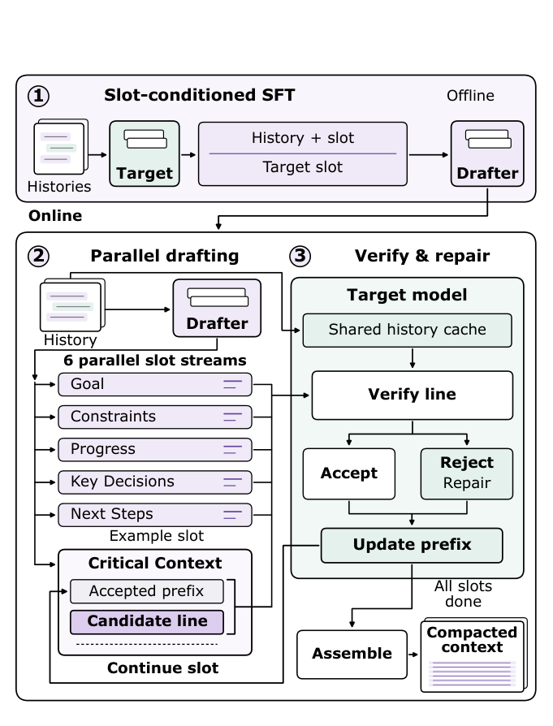查看原图 ↗</a>

*六个槽位并行起草，逐行接受或修补，再汇合为下一段上下文。*

两种目标模型在 AppWorld 与 τ3 上的压缩速度为 Hermes 风格摘要的 2.04–5.63 倍，后续任务表现另行测量：Gemma4-31B 的 AppWorld Normal TGC 为 54.76%，低于 Hermes 的 57.74%；Qwen3.5-122B 则从 28.57% 提至 33.33%。这些差异说明“更快摘要”与“任务更可靠”须分别评估，不能用一次摘要信息评分替代长期动作正确性。

<h2 class="daily-paper-title" id="paper-arxiv-2611.06858">21 · CompressionBench：压缩模型也要验收可执行能力</h2>

[CompressionBench: How can your coding agents compress LLMs?](https://arxiv.org/abs/2611.06858)  
Zhong, Xinrui, Li, Zhifeng, Wang, Zhiming, Liu, Yongqi, Yang, Shanglin, Zhou, Yang, Li, Zikun, Chen, Zhuoming, Chen, Beidi · 2026-11-04

与 ServerBench 优化服务容量不同，CompressionBench 让 Agent 联合交付压缩权重与运行代码。奖励使用源模型生成续文上的困惑度比值；最终还检查磁盘包与 GPU 常驻模型存储各自达标、三项任务平均准确率至少保留 BF16 的 80%，并审查测量捷径。decode 速度单列，不进入奖励。

六个 Agent、三模型、两种空间预算共 36 个产物，29 个通过验收，宽松预算下的 18 个全部通过。每任务选最低困惑度产物后，下游平均准确率为 77.33%，BF16 为 79.56%。完整模型反馈反转了 79 次局部排序中的 17 次，说明局部量化误差不足以指导系统选择。压缩质量、内存达标和实际推理速度是三个不同目标，不能从存储变小推定部署更快。

## 同日技术笔记

- [Kinference：把缓存、队列与租户策略放到推理控制面](/tech/zh/vllm-kinference/)

- [Radar 的 SREGym 实验：结构化上下文如何连接诊断与修复](/tech/zh/radar-sregym-leaderboard/)

- [Sentry Agent Tracing：把生产轨迹变成评测与分诊输入](/tech/zh/sentry-agent-tracing-five-things/)

- [ERNIE-5.5-Flash-Base：混合注意力与 ECHO 的部署边界](/tech/zh/ernie-5-5-flash-sglang/)
