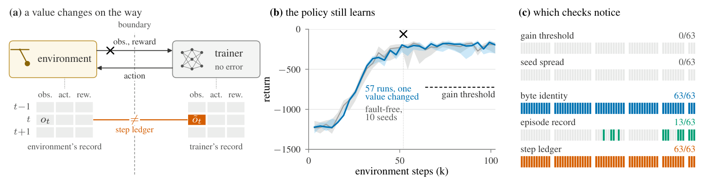
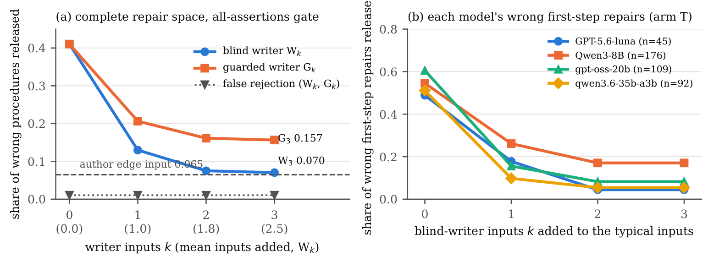
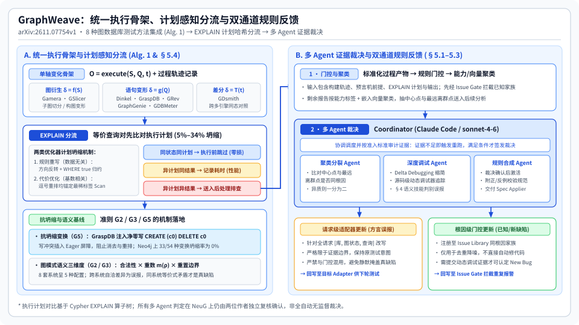
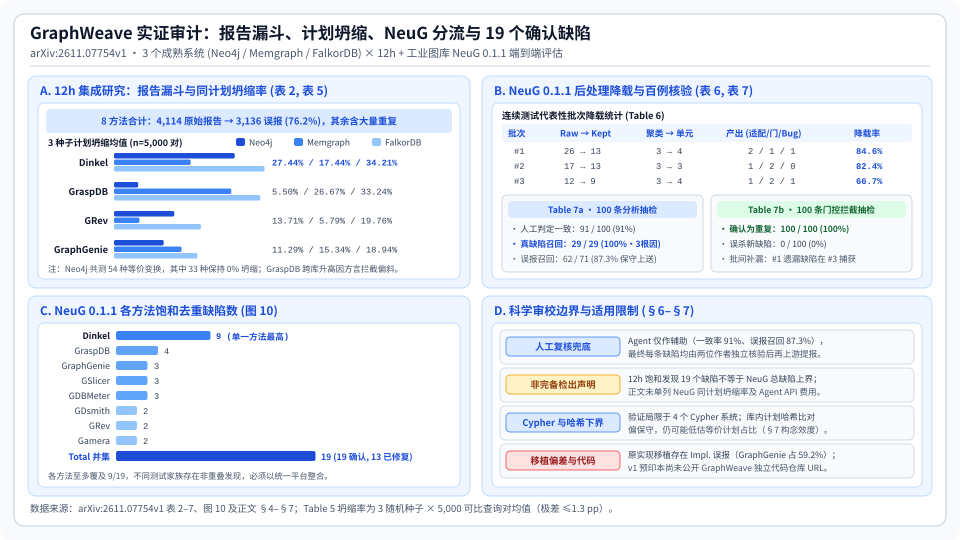

本期最值得注意的是两种“看起来成功”的失败：RL 策略仍在学习，边界数据却已改变；API 修复通过典型输入检查，却违反隐藏业务义务。两项工作分别把观察点放到协议两端和能揭示版本变化的测试输入上，提示可靠性证据需要贴近实际执行过程。推理效率方面，FastAFD 的实机结果与 SiliconForge 的部署建模回答不同问题：前者衡量饱和 decode，后者把 prefill、功率和 SLO 一起计入。其余研究把相似的证据意识带到数据库测试、日志检测、Agent 进化和长期编码，展示总体分数之外仍需保留的差异。

<h2 class="daily-paper-title" id="paper-arxiv-2611.08144">01 · RL 静默故障：学习曲线正常，协议也可能已错</h2>

[Detecting Silent Faults at the Environment-Trainer Boundary in Reinforcement Learning](https://arxiv.org/abs/2611.08144)  
Zuo Gou、Chenhao Lu · 2026-11-05

### 回报曲线为什么不是边界正确性的证据

机器人 RL 往往把环境放到另一进程、机器甚至语言中。训练器能持续收到形状正确的数据，也能学出看似正常的策略，但观测、动作、奖励或终止标记可能在途中被改写。论文把这个通常隐含在适配器里的边界显式定义为协议，检验的是“双方是否在训练同一次交互”，而不是单看最终分数是否下降。

协议用 infer 发送环境编号、step id 和观测，返回动作块，再用 feedback 传回累计奖励、结束标记和最终观测。环境端负责 reset，并明确区分终止与时间截断。结构性错误直接拒绝；缺失步骤不能用伪造反馈填补。这些约定使跨进程、跨语言接入中的语义差异变得可检查。

### 把观察点放在错误两侧

作者在 Pendulum、HalfCheetah、Hopper 和 Pusher 上，用 SB3 PPO 注入最多 23 类边界错误及两类训练器日志错误。故障从只改变一个值扩展到一定比例或所有值，包括零值、旧值、其他环境的数据、低精度舍入，以及错误的 episode-end 标记。

只要不是所有值都错，学习增益阈值最多发现一成运行；与十个无故障 seed 比较，最多发现 21%。进一步在干净环境评估全部 1,060 个最终策略时，通过两种曲线检查的 728 个边界故障运行里，723 个仍未低于无故障基线均值三个标准差。**没有明显性能损失，不等于实验过程正确**：权重和日志记录通常已经改变，足以污染方法比较。

<a class="note-image-link" href="/assets/images/digest/2026-11-07/rl-boundary.png" target="_blank" rel="noopener" aria-label="协议两端记录、正常学习曲线及各检查的检出情况 · 查看原图 ↗">查看原图 ↗</a>

*读图：左侧比较边界两端的同一步，中间的曲线仍正常上升，右侧显示过程对账能发现曲线检查遗漏的错误。*

step ledger 在环境外层和训练器接口各包一层记录器，逐步比较观测、执行动作和返回结果。只要错误发生在这两点之间，就会留下同一步、同一字段的不一致。作者在 Pendulum、Hopper、Pusher 的测试中捕获全部已注入边界错误，无故障运行没有差异；Pendulum 的训练时间中位增加 3%。环境侧独立 episode 账本则能检查训练器的奖励、长度与数量记录，但不足以覆盖动作或观测错误。

### 从“训练成功”转向“交互可对账”

这项工作的价值是提供可定位的执行证据，而非再训练一个异常检测器。它也展示了单机 byte identity 的边界：Hopper 有 12 次最终观测错误没有改变权重，因为该训练器根本没读取那个值；跨机器的数值差异又使最终权重不能直接逐字节比较。

结论仍受实验范围约束：四个状态型、稠密奖励仿真环境，一个训练算法，注入实验三个 seed；不能据此断言图像、稀疏奖励或真实机器人同样不受影响。账本比较发生在运行结束后，Hopper 每次约 150 MB，也还不是轻量在线检测服务；记录器更看不到环境内部自身算错。对可靠性研究最可迁移的部分，是让跨边界协议有明确语义，并从两端独立保留可对账证据。

<h2 class="daily-paper-title" id="paper-arxiv-2611.08269">02 · Accepted but Wrong：放行门槛取决于测试是否触及迁移语义</h2>

[Accepted but Wrong: Silent Failures of LLM Code Repairs after API Migrations](https://arxiv.org/abs/2611.08269)  
Xiaobo Chen、Genliang Zhu、Ziyuan Wang、Chu Wang · 2026-11-05

### 运行成功之后，还可能错在哪里

升级 runtime 或 API 后，代码不报错、输出类型正确，甚至通过典型输入上的全部业务断言，仍可能违反原来的业务义务。Accepted but Wrong 将研究对象放在发布门槛：不是模型有没有生成一个像样的补丁，而是怎样避免把已知有错的修复放行。

作者构造 73 个任务，覆盖 CPython、Node.js、SQLite 的 60 项文档化变更，包含七个未变化控制任务。程序由预先规定的代码片段组合而成，在真实新旧 runtime 上执行；隐藏契约同时检查业务输出与文件保留要求。这样可以穷举有限修复空间，区分门槛本身覆盖不足和模型恰好选错。它不是任意模型生成代码的自由修复实验。

### 用发布说明生成能揭示变化的输入

在 52 个受影响测试任务、49 个变更簇的完整有限修复空间上，只用典型输入，即便检查全部消费者断言，也平均放行 41.0% 的隐藏错误程序。加入一个由发布说明写出的边界输入后，该比例降至 6.5%，正确程序的误拒率仍为 1.0%。在后来新增的 15 个测试簇上，相同机制把错误放行比例降至 6.1%。这里的百分比以错误程序为分母，不能解释为所有模型调用的线上故障率。

另一条路径让一个盲测输入生成器只看到需求、发布说明与可见契约，看不到程序、候选片段或隐藏输入。它最多给出三个数据输入，预期输出由旧 runtime 的旧程序计算，模型不提供可信答案。GPT-5.6-luna 生成的输入使错误放行比例降至 7.0%；但其中三个输入恰与隐藏输入相同，去掉后为 9.0%，因此不能忽略重合对结果的贡献。

<a class="note-image-link" href="/assets/images/digest/2026-11-07/accepted-but-wrong-release-gates.png" target="_blank" rel="noopener" aria-label="查看原图">查看原图 ↗</a>

*原文图 1。左图覆盖作者构造的完整有限修复空间，右图分模型看首轮选错的修复。横轴是额外测试输入数，纵轴是错误程序的放行比例。*

### 看似保守的筛选也会丢掉关键证据

预注册的另一道保护措施让输入生成器判断哪些旧输出在升级后仍应保持，只保留被标为 legacy-binding 的输入。这个门槛结果反而较差：错误放行比例为 15.7%，没有减少误拒。它丢弃了恰能揭示变化的输入，说明判断“哪条旧行为仍是义务”本身就可能重演对迁移说明的误读。

后续冻结实验将菜单扩至 1,491 个片段，并加入 233 个在典型输入上模仿旧输出的困难干扰项。边界输入与强模型输入生成器仍有帮助，但对困难错误程序仍分别漏放 16.8% 和 15.3%。两种本地模型的输入生成器没有通过预注册检验，自测也没有稳定达到更强输入生成器的效果。

对编码智能体发布流程最有用的变化，是把测试生成锚定到版本变更的具体语义，再由真实 runtime 提供预期值。边界也很明确：任务、代码片段和隐藏契约都由作者构造；AI 审计对 34 个契约提出过严质疑，去掉争议检查虽未改变判定，但类别争议仍在，且没有人工契约复核。结果支持有限任务中的测试覆盖机制，尚不能当成开放式补丁自动发布的安全保证。

<h2 class="daily-paper-title" id="paper-arxiv-2611.07149">03 · FastAFD：宽 EP 基线让拆分收益回到可解释范围</h2>

[FastAFD: When Does Attention-FFN Disaggregation Pay on Rack-Scale NVLink?](https://arxiv.org/abs/2611.07149)  
Yichao Fu、Yuxuan Zhang、Minshen Zhang、Ruitian Wang、Junda Chen、Hao Zhang · 2026-11-04

FastAFD 在 GB200 NVL72 上把 Attention 与专家分池，用两个交替微批次重叠本地 Attention 和远端 MoE。GPU 发起单边通信、融合专家内核及整步 CUDA graph，减少了高速互连下可见的主机往返。

关键在基线：vLLM 按 4K–16K 上下文逐一调优 EP4–EP64，并把专家池 GPU 全部计入成本。相对 EP4 的 1.30–2.36 倍优势，换成最佳宽 EP 后收窄到 0.99–1.17 倍。论文把收益分成更大的 batch、更短的重叠执行步，以及专用专家 GPU 的成本三项，预测模型在作者测量中误差约 3%。这是饱和稳态 decode 测量，不含 prefill、排队和完整 SLO；推测解码还固定了模拟接受率。它与下文 SiliconForge 的整机部署分析互补，不能把不同分母的倍率直接对照。

<h2 class="daily-paper-title" id="paper-arxiv-2611.08299">04 · SiliconForge：decode 快一点，不一定整套服务更划算</h2>

[Should You Split Decode? Disaggregation Across Future Models and Accelerators](https://arxiv.org/abs/2611.08299)  
Ramyad Hadidi · 2026-11-05

SiliconForge 把服务拆分方式和硬件指派分开搜索，在共同功率预算下比较 P/D 与 P/D+AFD，并把 prefill 副本、KV 容量、跨池通信及排队纳入 SLO goodput/kW。四种模型方向、四类加速器、两类互连的主比较，没有得到稳健的 AFD 部署优势；最大名义领先来自多放下一个 prefill 副本。

它补充 FastAFD 的实机 decode 证据，而非重复它：更快的 FFN 可能被 Attention 遮住，省下的时间也可能被额外功率或池大小粒度吃掉。校准检查亦暴露 TTFT 和绝对吞吐预测问题，跨硬件类别还缺少配对实测。应把它读成容量规划与敏感性分析，不能当作未来硬件已证实的胜负；最有用的结论是保留映射和池大小的可调整空间。

<h2 class="daily-paper-title" id="paper-arxiv-2611.07754">05 · GraphWeave：看执行计划，才能识别无效的变形测试</h2>

[Uncovering Systematic Blind Spots in Graph Database Testing through Integration and Process-Level Analysis](https://arxiv.org/abs/2611.07754)（[v1 PDF](https://arxiv.org/pdf/2611.07754) · [HTML](https://arxiv.org/html/2611.07754v1) · [DOI](https://doi.org/10.48550/arXiv.2611.07754)）  
Tinghan Li、Aoyang Fang（The Chinese University of Hong Kong, Shenzhen）、Longbin Lai（Alibaba Group）、Zifan Xie（Chongqing University）、Hongbo Zhao（Beijing University of Posts and Telecommunications）、Yu Shao（Alibaba Group）、Ying Zhang（Zhejiang Gongshang University）、Pinjia He（The Chinese University of Hong Kong, Shenzhen）· `arXiv:2611.07754v1 [cs.SE]` · 2026-11-05 提交（截至核验仅存 `v1`，无修订或撤回记录；PDF 标注为投往 ACM TOSEM 的作者预印本，尚未经同行评审或录用；预印本正文未附 `GraphWeave` 独立开源仓库链接）

评价图数据库自动测试方法不能只看「跑了多少小时、触发了多少条报错」，更要追问这些报错有多少是真实缺陷、又有多少测试用例在优化器面前根本无法暴露错误。`GraphWeave` 将过去分散在差分测试、语句级变形测试与图衍生测试三类范式中的 **8 种代表性方法**整合到同一执行骨架之下，并把图状态、构建轨迹、语义前置前提、输出行与 `EXPLAIN` 执行计划作为一等产物完整落盘。过程级实证首先揭示了两条系统性盲点：成熟系统 12 小时集成测试产生的 `4,114` 份原始报告中有 **`76.2%`（`3,136` 份）为误报**，其余也充斥同因重复；同时，在 `Neo4j`、`Memgraph` 与 `FalkorDB` 上有 **`5.50%–34.21%`** 的等价变形查询对在同一图状态上编译出了**完全相同的执行计划**，从构造上丧失了检错能力。针对这两类盲点，系统构建了计划感知分流与多 Agent 证据裁决及双通道规则反馈流水线，并在此前未被任何自动测试工具系统检验过的工业嵌入式图库 `NeuG 0.1.1` 上发现 **19 个此前未知、均获开发者确认的缺陷**（其中 13 个已修复）。以下精读严格依据 `arXiv:2611.07754v1` 全文与表 1–7、图 1–10，将作者实测口径与审校适用边界清晰分开。

### 一、为什么盲目叠加测试方法会失效：4,114 份原始报告与计划坍缩

过往图数据库测试工具各自检验不同侧面的正确性，但在统一接口 `Algorithm 1` 下都可以抽象为围绕单次执行观测 <code>O = execute(S, Q, t)</code>（依次传入图快照状态 <code>S</code>、Cypher 查询 <code>Q</code> 与目标系统实例 <code>t</code>，收集返回行与执行计划并做结果归一化）展开的单轴派生过程：**图衍生测试**（`Gamera`、`GSlicer`）通过 <code>δ = f(S)</code> 切分或变换测试图；**语句变形测试**（`GDBMeter`、`Gamera`、`GraphGenie`、`GraspDB`、`GRev`、`Dinkel`，其中 `Gamera` 同时具备图衍生与语句变形两类能力）通过 <code>δ = g(Q)</code> 构造等价或分区查询；**差分测试**（`GDsmith`）则通过 <code>δ = T(t)</code> 在多个引擎间对照同一查询结果。作者在开启默认查询优化器的隔离容器内，对 `Neo4j 2026.03.1`（DB-Engines 排名第 1，16.8k stars）、`Memgraph 3.9.0`（排名第 13，4.2k stars）和 `FalkorDB 4.16.0`（排名第 22，4.7k stars）开展每组固定 **12 小时**的集成实测（`GDsmith` 执行三系统联合差分），过程数据直接暴露出两项此前被「只看缺陷数」掩盖的盲点：

- **盲点一（RQ1–RQ2）**：**海量误报与同因重复淹没真缺陷**。8 种方法共产生 `4,114` 份原始报告，人工全量逐条复核发现 `3,136` 份（`76.2%`）为误报。去除误报后，剩余报告仍高度集中在极少数缺陷上——例如 `GraphGenie` 在 `FalkorDB` 的 `527` 份报告中剔除 `249` 份误报后，剩下的 **`278` 份全部指向同 1 个根因缺陷**；`Gamera` 在 `Memgraph` 上剔除 `123` 份误报后，余下的 **`111` 份也只对应 1 个缺陷**；`GraspDB` 在 `Neo4j`（`40/40`）与 `FalkorDB`（`35/35`）上更是 `100%` 误报。表 3 按根因将误报分为四类：`Impl.`（参考实现与论文方法不一致，占 `GraphGenie` 误报 `59.2%`、`GDBMeter` `35.8%`）、`Graph Sem.`（图模式匹配语义约束失配，波及 8 种方法中的 5 种，占 `Gamera` `75.6%`、`Dinkel` `56.2%`、`GDsmith` `51.1%`）、`Null/Pipe`（空值与子句流水线假设偏差，占 `GSlicer` `41.1%`、`GraspDB` `34.7%`）以及 `Dialect`（方言语法不兼容，占 `GRev` `70.8%`、`GDBMeter` `64.2%`）。
- **图模式匹配的五类合法语义画像（§2.2 与表 4）**：针对 Cypher/GQL 规范未完全钉死的模式匹配细节，论文在唯一性作用域 <code>U</code> 内用可见关系序列 <code>ρ = ⟨e₁, …, eₖ⟩</code> 与遍历见证 <code>ω</code> 的袋语义重数 <code>m(ρ) = #{ω : vis(ω) = ρ}</code> 形式化出三个正交维度：（1）**合法性（Legality）**——作用域内是否允许同边重用（`Neo4j`、`Memgraph`、`ArcadeDB`、`Apache AGE`、`NebulaGraph` 禁止；`FalkorDB`、`NeuG`、`Kuzu` 允许）；（2）**重数（Multiplicity）**——单向单一输出（`Neo4j`、`Apache AGE`、`NebulaGraph`、`FalkorDB`）、变长遍历下按步长放大（`Memgraph`、`ArcadeDB`）或无向自环按双向输出 2 份见证（`NeuG`、`Kuzu`）；（3）**重置边界（Reset boundary）**——按 `MATCH` 子句刷新（`Neo4j`、`Memgraph`、`ArcadeDB`）或按逗号分隔模式刷新（`Apache AGE`、`NebulaGraph`；允许重用边的系统无此约束）。8 套 Cypher 系统实际形成了 **5 种不同的合法语义组合**。因此，跨系统对合法语义选择不同且各自自洽的差异属于误报（如图 2 中单节点单自环图上匿名两跳查询 `Neo4j` 返 0 行、`FalkorDB` 返 1 行；图 3 中两自环上 `[*2..2]` 拆成 `[*1..1]-()-[*1..1]` 后 `Memgraph` 因袋语义枚举从 4 行变 8 行）；唯有**同一系统在等价写法上自相矛盾**才是真缺陷（如图 4 发现的 `FalkorDB` 真实缺陷：定长 `[*2..2]` 排除重边只返 2 行，显式两跳与拆分形式却允许 `[r1, r1]` 与 `[r3, r3]` 而返回 5 行）。
- **盲点二（RQ3）**：**优化器把 5.50%–34.21% 等价变形对归约为同一执行计划**。作者在每种「等价变形方法 × 数据库」组合下运行 3 个随机种子，每次收集 `5,000` 组双方均成功执行并吐出执行计划的可比查询对（三轮极差均不超过 `1.3` 个百分点）。表 5 显示所有 4 种等价变形方法均出现大量**同状态同计划坍缩**，占比达 **`5.50%–34.21%`**。一旦两查询在同一图状态 <code>S</code> 上编译出完全相同的算子树，其结果在构造上必然相等——不仅空耗算力，若共享计划本身有错，预言机也会彻底失明。对 `Neo4j` 上 `54` 种等价变换（图 5）进一步拆解可见，**`33` 种变换坍缩率为 `0%`，其余 `21` 种出现不同程度乃至 `100%` 坍缩**，决定因素是变换结构本身而非来源工具。利用倾斜标签图（<code>card(A)=5, card(B)=500, card(C)=50</code>，含 `500` 条 `R` 边与 `500` 条 `S` 边）验证发现了两类坍缩与一类抗坍缩机制：（1）**规则重写坍缩（数据无关，图 6）**——反转边方向 `(b)<-[:R]-(a)` 并追加恒真谓词 `WHERE true` 被重写阶段直接消去，无论数据分布如何都归约为同一 `NodeByLabelScan` 算子树；（2）**代价优化坍缩（基数相关，图 7）**——逗号模式重排 `(b:B)-[:S]->(c:C), (a:A)-[:R]->(b)` 均锚定最小标签 `A` 展开，而当把 <code>card(Z)=5</code> 置于另一端做对照实验时，两查询则一齐坍缩到 `Z`；（3）**抗坍缩变换（发现 7，图 8）**——`GraspDB` 注入净零写序列 `CREATE (c0 {id:-1}) DELETE c0`，由于写算子不可作死代码消除，且读/写冲突迫使 `Neo4j` 插入 `Eager` 屏障阻止跨读算子重排，`Create → Eager → Delete` 得以在执行计划中存活（而 `GraspDB` 在 `Memgraph`/`FalkorDB` 上计划坍缩率分别升至 `26.67%` 和 `33.24%`，是因为这两个引擎拒绝了更多含写变换，导致可比对集中倾斜到易坍缩的只读形态）。

| 测试方法（年份与测试家族） | 原始报告数（N / M / F 合计） | 误报数与占比（表 2） | 确认独立缺陷数（N / M / F） | 误报主因分布（表 3：Impl. / Graph Sem. / Null-Pipe / Dialect） | 同计划坍缩率（表 5：Neo4j / Memgraph / FalkorDB） |
| :--- | :--- | :--- | :--- | :--- | :--- |
| `Gamera`（2023，图衍生 + 语句变形） | `510`（`98 / 234 / 178`） | `333`（`65.3%`） | `1 / 1 / 2` | `10.8% / 75.6% / 0% / 13.6%` | 不适用（非等价变形） |
| `GSlicer`（2025，图衍生切分） | `902`（`128 / 362 / 412`） | `647`（`71.7%`） | `1 / 1 / 1` | `11.9% / 43.0% / 41.1% / 4.0%` | 不适用（图切分重构） |
| `GDBMeter`（2023，语句变形·非等价） | `146`（`0 / 12 / 134`） | `134`（`91.8%`） | `0 / 1 / 0` | `35.8% / 0% / 0% / 64.2%` | 不适用（非等价变形） |
| `GraphGenie`（2024，等价语句变形） | `714`（`54 / 133 / 527`） | `436`（`61.1%`） | `0 / 0 / 1`（F 含 278 重复） | `59.2% / 0% / 24.5% / 16.3%` | `11.29% / 15.34% / 18.94%` |
| `GraspDB`（2024，等价 + 净零写变形） | `75`（`40 / 0 / 35`） | `75`（`100.0%`） | `0 / 0 / 0` | `32.0% / 18.7% / 34.7% / 14.6%` | `5.50% / 26.67% / 33.24%` |
| `GRev`（2024，等价语句变形） | `79`（`9 / 60 / 10`） | `24`（`30.4%`） | `0 / 1 / 1` | `29.2% / 0% / 0% / 70.8%` | `13.71% / 5.79% / 19.76%` |
| `Dinkel`（2026，等价语句变形） | `104`（`22 / 36 / 46`） | `48`（`46.2%`） | `3 / 3 / 1` | `0% / 56.2% / 0% / 43.8%` | `27.44% / 17.44% / 34.21%` |
| `GDsmith`（2023，三库联合差分） | `1,584`（联合测试） | `1,439`（`90.8%`） | `2`（联合） | `4.9% / 51.1% / 31.0% / 13.0%` | 不适用（跨引擎差分） |
| **研究汇总（12h × 3 成熟库）** | **`4,114`** | **`3,136`（`76.2%`）** | 见各行（按方法—系统去重） | 跨 5 方法受 `Graph Sem.` 显著影响 | **`5.50%–34.21%`**（3 种子均值） |

*表 1 · 8 种测试方法在 Neo4j 2026.03.1（N）、Memgraph 3.9.0（M）与 FalkorDB 4.16.0（F）上的 12 小时集成研究结果汇总（依据 `arXiv:2611.07754v1` 表 1–3 与表 5；注：各方法汇总原始/误报占比如 `65.3%` 系由表 2 分库数字直接加总核对，`4,114` 与 `3,136 (76.2%)` 原文直接给出；表 5 按 3 随机种子 × 5,000 对测算，极差 ≤1.3 个百分点）。*

### 二、GraphWeave 架构：计划感知分流、多 Agent 裁决与双通道规则反馈

<figure class="note-figure"><a class="note-image-link" href="/assets/images/digest/2026-11-07/graphweave-plan-aware-testing-zh.svg" target="_blank" rel="noopener" aria-label="查看 GraphWeave 统一执行骨架、计划感知分流与多 Agent 双通道规则反馈架构原图">查看原图 ↗</a><figcaption>图 1 · GraphWeave 架构与双通道反馈机制（整理自 arXiv:2611.07754v1 §3–§5 与 Fig. 9）：以 EXPLAIN 计划比对前置拦截失效变形对，再用证据准入驱动的多 Agent 系统分离方言适配与根因去重。</figcaption></figure>

作者将研究提炼为五条设计准则（`G1` 保留过程数据、`G2` 用系统内矛盾区分语义误报与真缺陷、`G3` 将图语义显式声明为预言机前提、`G4` 分流被优化器坍缩的等价查询对、`G5` 设计抗优化坍缩变形），并在 `GraphWeave` 中落地为相互配合的两套流水线：

1. **计划感知分流（Plan-Aware Triage，§5.4）**：在执行结果对比之前，系统先通过目标库的 `EXPLAIN` 获取等价查询对的物理执行计划树并进行比对，将输出严格划分为三类分支——（1）**同状态同计划**：两查询在同一图状态 `S` 下编译出相同计划，结果必定一致，直接在**结果执行前跳过**，无损回收 §4.4 测得的 `5%–34%` 冗余预算；（2）**异计划同结果**：结果虽通过预言机，但等价写法生成了不同物理计划，框架记录两者运行耗时，为后续定位优化器遗漏或性能回退保留线索；（3）**异计划异结果**：真正维持了测试判别力，作为候选逻辑缺陷送入后处理管线。由于该分流仅读取 §3 统一执行路径上已采集的计划与结果，所有集成的等价变形方法无需逐一改造即可共享收益。
2. **前级问题门控与能力感知聚类（§5.1）**：标准化产物（包含构建轨迹、预言机前提、`EXPLAIN` 计划与实测输出）首先通过基于规则的 **Issue Gate**，直接匹配并拦截已知问题家族；未命中的剩余报告先按所属**测试能力标签**分组，再结合报告文本嵌入（embedding）细化聚类，并以每簇的中心点（medoid，平均余弦距离最小）与最远离群点（farthest outlier）作为后续深度分析的代理样本，避免超长轨迹撑爆 LLM 上下文窗口。
3. **证据门控的多 Agent 裁决系统（§5.2）**：分析层运行在 `Claude Code`（后端固定为 `claude-sonnet-4-6` 快照、默认解码参数），由一个 **Coordinator Agent** 统筹调度三个共享后端、通过阶段提示词区分职责的子 Agent，并在裁决前强制审计证据完整性（缺证即触发重跑）：
   - **聚类分裂 Agent（Cluster-Splitting）**：比对簇中心点与最远离群点是否同属一类根因，一旦判定簇内异质即将其一分为二；
   - **深度调试 Agent（Deep-Analysis）**：集成两项经典调试手段及研究知识技能——其一是通过人类调试经验提炼的技能引导 **Delta Debugging**（文献 [43]）对见证图与查询做最小化缩简，剥离无关结构；其二是将源码级**动态调试器**挂载到被测数据库的调试构建版本（debug build）上抓取运行时状态。系统硬性规定**：只有同时提交动态调试结果、可复现运行时证据以及对应文档依据**，才能将报告定性为「已知问题」或「新缺陷」；若是语义误报，则须依据 §4 提炼的语义技能证明被测系统行为在自身配置下合法；
   - **规则合成与规则应用 Agent（Rules-Synthesis & Spec Applier）**：仅在裁决获得 Coordinator 放行后激活，合成必须附带**正例与反例校验用例**的规则规范。
4. **两条绝不互换的反馈通道（§5.3）**：为了防止误路由导致漏测或重复无效报错，`GraphWeave` 严格隔离两类反馈更新——（1）**请求级适配器更新（针对方言误报）**：把一条测试用例抽象为 `[目标数据库, 待建图状态, 查询序列]` 完整请求，确定性规则流水线在证据边界内改写语句、降级构图方式、标注预期报错或拒收不支持的请求形状，严禁盲目泛化或悄悄篡改原测试意图；（2）**根因级门控更新（针对已知/新缺陷）**：将同一根因的不同报错表征聚入一个 `Issue Family` 注册多条识别规则。作者特意强调**：多 Agent 提炼的根因描述不追求达到可直接自动修代码的高精度，仅用于安全降噪与重复归并**。若把真缺陷误送给适配器会篡改有效测试并掩盖后续缺陷；若把方言误报误送给门控则会让前端持续产出无效语法。

### 三、NeuG 0.1.1 实证评估：负载压缩、百例人工审计与 19 个确认缺陷

<figure class="note-figure"><a class="note-image-link" href="/assets/images/digest/2026-11-07/graphweave-neug-bug-triage-eval-zh.svg" target="_blank" rel="noopener" aria-label="查看 GraphWeave 在三套成熟系统与 NeuG 0.1.1 上的实证审计四象限图原图">查看原图 ↗</a><figcaption>图 2 · 实证审计汇总（整理自 arXiv:2611.07754v1 表 2–7、图 10 与 §4–§7）：研究期误报与计划坍缩基线、NeuG 批处理压缩比、百例抽检召回以及 8 方法互补检出分布。</figcaption></figure>

第六节将整套集成平台首次应用于阿里巴巴 GraphScope 团队刚开源的嵌入式工业图数据库 **`NeuG 0.1.1`**（2026 年 6 月快照时有 `118` 个 GitHub stars，默认优化器开启，此前未被任何图数据库测试研究覆盖）。每组 `(方法, NeuG)` 依然沿用 12 小时隔离容器配置，且所有自动分析结论只作为辅助参考，由**两位作者独立审查每一条报告并在分歧时讨论定案**，确认未曾上报的缺陷后提交上游开发者验证。

| 评估维度与批次（来源） | 过滤与聚类规模 | 核心实测指标 | 机制含义与边界说明 |
| :--- | :--- | :--- | :--- |
| 连续测试 `Batch #1`（表 6） | `26` 原始 → `13` 入组 → `3` 簇 → `4` 单元 | 输出 `2` 适配 / `1` 门控 / `1` 新缺陷；工作量降载 **`84.6%`** | 含超 2 个根因的混合簇，使 `1` 个遗漏缺陷滞后至 `Batch #3` 捕获 |
| 连续测试 `Batch #2`（表 6） | `17` 原始 → `13` 入组 → `3` 簇 → `3` 单元 | 输出 `1` 适配 / `2` 门控 / `0` 新缺陷；工作量降载 **`82.4%`** | 簇内均质直接 1:1 映射为分析单元，零真缺陷漏过 |
| 连续测试 `Batch #3`（表 6） | `12` 原始 → `9` 入组 → `3` 簇 → `4` 单元 | 输出 `1` 适配 / `2` 门控 / `1` 新缺陷；工作量降载 **`66.7%`** | 综合三批将人工审阅量压缩至原始报告数的约 **1/6 至 1/3** |
| Agent 分析 `100` 例抽检（表 7a） | 从已分析报告随机抽样 `100` 份对照双作者裁决 | 人机一致率 **`91%`**（`91/100`）；真缺陷召回 **`100%`**（`29/29`）；误报召回 **`87.3%`**（`62/71`） | `29` 份真缺陷报告去重归并为 **`3` 个唯一根因**；有意采用保守策略，把 `9` 份误报上送人工复核以换取零漏报 |
| Issue Gate 拦截 `100` 例抽检（表 7b） | 从被门控拦截的报告随机抽样 `100` 份 | 确认为已知重复 **`100%`**（`100/100`）；误拦新缺陷 **`0%`**（`0/100`） | 门控规则限定在触发条件作用域内收敛匹配，未观察到吞掉新根因缺陷 |
| `8` 方法在 `NeuG` 上饱和测试（图 10） | 各方法持续运行至独立缺陷数不再增长（新报均被拦截为重复） | 各方法独立检出：`Dinkel` `9`、`GraspDB` `4`、`GraphGenie` `3`、`GSlicer` `3`、`GDBMeter` `3`、`GDsmith` `2`、`GRev` `2`、`Gamera` `2`；联合去重总计 **`19` 个** | **19 个均获上游开发者确认**（其中 **13 个已修复**）；单一方法至多只覆及 `9/19`（不足半数），`Dinkel` 仍漏掉 `GSlicer` 等发现的缺陷 |

*表 2 · `GraphWeave` 在 `NeuG 0.1.1` 上的连续批次降载、百例人工审计与 8 方法饱和缺陷发现结果（严格取自 `arXiv:2611.07754v1` 表 6、表 7 与图 10）。*

值得注意的两处实验细节决定了这些数字的准确含义：第一，代表性聚类在单批次只检查中心点与最远离群点，当某个簇偶然混入超过两种根因时，第三个根因可能在本批被暂时漏看；由于 `GraphWeave` 并不主动扼杀未形成门控规则的其余样本，`Batch #1` 中未能展开的一个缺陷在 `Batch #3` 中作为异质簇离群点重新浮现并获确认，表明**多批连续滚动在工程上弥补了代表点抽样的局部盲区**。第二，多 Agent 分析有意选择「宁可错放误报供人工再看，也不丢掉真缺陷」的不对称偏差（`87.3%` 误报召回 vs. `100%` 真缺陷召回），因此工作量缩减与 `100%` 召回建立在**保守上送 + 人工最终兜底**的前提上。

### 四、科学边界、效度威胁与自动化测试工程启示

审视 §6 与 §7 的威胁分析与公开口径，将该体系迁移到更广泛的数据库与编译器测试流水线时，必须清晰划定四条边界：

1. **多 Agent 裁决仍属「人机协同辅助分诊」，而非全自动可信预言机**：`NeuG` 上的每项真缺陷计数与去重均经过两位作者独立人工核验与开发者确认；`claude-sonnet-4-6` 系统在 `100` 条抽样中仍有 `9` 条误报被升级为潜在缺陷，且深度调试 Agent 需要被测数据库提供可挂载源码级调试器的 `debug build`。在黑盒托管商业服务或无源码调试符号场景下，动态调试取证环节会直接受限。
2. **「19 个已确认缺陷」不代表完备检出率，且部分过程成本指标未单列**：`19` 个缺陷是 8 种方法在 `NeuG 0.1.1`、12 小时隔离预算下达到重复饱和后的实得发现，既不能用来推算该版本尚未暴露的潜在缺陷总量，也不能直接外推为跨方法通用检出率上界。同时，正文在 §4 表 5 详细测量了 `Neo4j`/`Memgraph`/`FalkorDB` 的计划坍缩率，但在 §6 `NeuG` 评估中并未单独报告 `NeuG` 自身的计划坍缩率消融节省比例，也未刊印 `claude-sonnet-4-6` 多 Agent 分析所消耗的 token 费用与单簇耗时分布。
3. **Cypher 范围约束与计划哈希的保守下界**：当前研究仅涵盖 `Neo4j`、`Memgraph`、`FalkorDB` 与 `NeuG 0.1.1` 四套支持 Cypher 的系统（表 4 补充覆盖了 8 套 Cypher 系统的静态语义画像），结论不能直接照搬到 GQL 多选项路径模式或 Gremlin/RDF 查询引擎。更重要的是，§7 明确指出库内计划哈希比对只能捕获字面完全重合的算子树，对于语义与执行完全等价但计划树表示略有差异的变体仍会放行，因此实测 **`5.50%–34.21%` 属于计划坍缩的保守下界**；此外，当两查询共享同一有错物理计划时，等价变形测试即便保留也无法检出该计划自身的执行缺陷。
4. **工具移植保真度与开源可用性现状**：表 3 暴露出部分方法的大量误报源自原始参考实现或移植偏差（例如 `GraphGenie` 有 `59.2%`、`GDBMeter` 有 `35.8%` 属于 `Impl.` 误报）；§4.3 误报归因属于单次 12 小时跑批的定性根因剖面而非多次重复的统计频率估计。截至本次核验，预印本正文未给出 `GraphWeave` 平台本身的公开代码仓库链接（仅引用了被测系统 `NeuG` 仓库）。

对**数据库/系统自动化测试与可靠性智能体工程**而言，本文最值得直接复用的三条实践是：（1）**把执行计划与构造轨迹升级为一等日志字段**——凡是基于等价重写做差分或变形测试的系统，都应在执行前或后置审计中比对优化后物理计划，立刻剔除同态无判别力的冗余对比；（2）**先建系统语义画像与系统内矛盾检测，再做跨系统裁判**——对 `legality × multiplicity × reset boundary` 等规范留白维度显式建表，把「跨库不一致」降级为弱信号，把「同库等价写法自相矛盾」确立为强证据；（3）**让多 Agent 专注「证据收敛与规则合成」而非「无约束写代码修复」**——用确定性门控强制要求最小复现用例与调试证据，并将方言适配通道与根因去重通道物理隔离，才能真正把人工精力从成千上万条重复报警解放到根因级规则审计上。

来源：[Uncovering Systematic Blind Spots in Graph Database Testing through Integration and Process-Level Analysis](https://arxiv.org/abs/2611.07754)
<h2 class="daily-paper-title" id="paper-arxiv-2611.07760">06 · 日志异常检测：数据与预处理比统一模型排名更值得看</h2>

[Fast Unsupervised Anomaly Detection Methods on Software Logs - An Empirical Study](https://arxiv.org/abs/2611.07760)  
Jesse Nyyssölä、Mika Mäntylä、Yuqing Wang · 2026-11-05

作者交叉比较七个数据集、四种无监督方法、词/三元组/解析事件三类表示，以及训练数据去异常、随机抽样和消息提取开关，再用回归分析各因素与 AUCROC、F1、耗时的关系。结果没有支持跨数据集统一的最佳配置：解析在一些数据上有益，在另一些上反而丢失信息；OOV 检测尤其依赖干净训练集。

对 AIOps 更有用的是负面发现与成本分解。随机抽取训练数据没有在所测无监督方法中稳定制造文献常警告的性能虚高，不能照搬监督模型的结论；这也不证明任意时间序列评估都可打乱。词表示搭配 OOV、KMeans 或 RarityModel 是较快选择，但事件级和序列级标签、各数据集采样比例不同，迁移时仍须匹配任务。

<h2 class="daily-paper-title" id="paper-arxiv-2611.07624">07 · Agent 自进化：新增成功不能掩盖旧能力回退</h2>

[Beneath the Surface: What We Overlook When We Talk About Agent Evolution](https://arxiv.org/abs/2611.07624)  
Xiaobo Wang、Zimu Wang、Siyu Ye、Jiaqi Li、Min Tang、Jun Bai、Yuling Shi、Ruobing Wang、Jingjing Zhang、Chaofan Wang、Kai Wu、Mengnan Qi、Kai Cai、Xiaodong Gu、Qi Liu、Zilong Zheng · 2026-11-05

Beneath the Surface 固定 GPT-5.4，比较四种 harness 进化方法、两种 harness，以及通用和编码任务，并对最终版本重复评估八次。十六条进化谱系全部同时获得新覆盖、丢失旧覆盖；某个通用任务配置平均可靠性提高 5.2 个百分点，仍失去十个原已覆盖任务。

研究还干预父版本选择、组件组合和准入门槛：最高分父版本未必提供最大的后续平均改进，更严格准入也可能扔掉有用候选。多数可靠性收益伴随部署成本上涨，跨任务迁移则有选择性。它与下文多步骤编码评估互补：这里检查进化版本的能力保留，后者检查同一代码库上的连续执行。结论依赖所测模型、harness 和基准，不能推出所有自进化都会退步。

<h2 class="daily-paper-title" id="paper-arxiv-2611.08417">08 · Terminal-Bench 2.1：基准本身也有维护债</h2>

[Benchmarks as Software: Terminal-Bench and the Case for Continuous Benchmarks](https://arxiv.org/abs/2611.08417)  
E. Kelly Buchanan、Crystal Zhou、Scott W. Linderman、Christopher Ré · 2026-11-05

论文把任务说明、环境、参考解、验证器和资源预算当成共同维护的软件。工作流先收集静态文件、历史轨迹与社区问题，再提出带证据的修复，运行参考解核验，最后由维护者裁决。Terminal-Bench 2.0 的 89 项任务中有 28 项修订，覆盖环境问题、说明—验证不一致与外部依赖漂移。

19 个 Agent 重测后，2.0/2.1 排名相关系数仍为 0.958，但个体分数与接近名次会移动；增加时间预算还消除了大部分所测 harness 差距。高相关不等于旧测量无偏。审计在最终发布集上的 57.1% precision、71.4% recall 是回顾性一致性，因为工作流参与了修复集构造；其价值是维护者辅助分诊，不能冒充独立缺陷检测验证。

<h2 class="daily-paper-title" id="paper-arxiv-2611.07166">09 · Multi-step SWE：让后续需求继承 Agent 自己留下的代码</h2>

[Multi-step SWE: Can Coding Agents Keep Building on Their Own Code Over Long Horizons?](https://arxiv.org/abs/2611.07166)  
Xiangkai Zeng、Zheng Liu、Zihao Lin · 2026-11-04

Multi-step SWE 的 69 个任务各串联 5–15 个依赖步骤，覆盖优化、功能实现、版本升级与迁移，使用九种语言。每一步从 Agent 上一步的累计工作区继续，早期设计和错误因此会传递；验证在独立容器进行，即使前一步失败也继续评分。

九个模型—harness 组合、每任务四次运行中，最佳全链 solve rate 为 18.5%，却有 56.8% 的单步骤通过率，四次内至少完整成功的任务比例为 31.9%。这些分母不能互换。38 个任务没有任何模型完成。它为长期编码可靠性提供了更贴近持续开发的测量对象；但尚缺每步从正确参考前缀开始的隔离基线，不能把所有后期失败都归因于错误累积，且 38/69 任务使用 C/C++。

## 同日笔记

- [Reshard：让 RL 权重刷新只搬目的分片需要的数据](/tech/zh/reshard-rl-refit/)
- [Zero Mismatch：先消除内核数值差异，再处理异步策略滞后](/tech/zh/zero-mismatch-async-rl/)
- [Agent Memory：把记忆写入、核验与检索分开设计](/tech/zh/components-agent-memory/)
- [XM-Sparse：稀疏读取之后，完整 KV 仍需要容量与带宽](/tech/zh/xm-sparse-xmem/)
- [Bits Investigation：简化调查循环，把数据处理移到工具侧](/tech/zh/bits-investigation-efficiency/)
