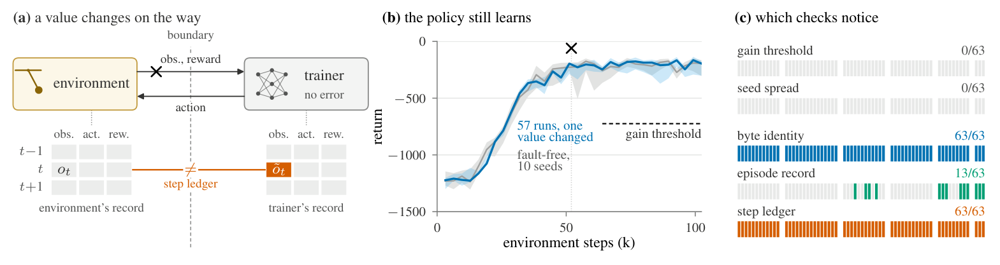

本期最值得注意的是两种“看起来成功”的失败：RL 策略仍在学习，边界数据却已改变；API 修复通过典型输入检查，却违反隐藏业务义务。两项工作分别把观察点放到协议两端和能揭示版本变化的测试输入上，提示可靠性证据需要贴近实际执行过程。推理效率方面，FastAFD 的实机结果与 SiliconForge 的部署建模回答不同问题：前者衡量饱和 decode，后者把 prefill、功率和 SLO 一起计入。其余研究把相似的证据意识带到数据库测试、日志检测、Agent 进化和长期编码，展示总体分数之外仍需保留的差异。

<h2 class="daily-paper-title" id="paper-arxiv-2611.08144">01 · RL 静默故障：学习曲线正常，协议也可能已错</h2>

[Detecting Silent Faults at the Environment-Trainer Boundary in Reinforcement Learning](https://arxiv.org/abs/2611.08144)  
Zuo Gou、Chenhao Lu · 2026-11-05

### 回报曲线为什么不是边界正确性的证据

机器人 RL 往往把环境放到另一进程、机器甚至语言中。训练器能持续收到形状正确的数据，也能学出看似正常的策略，但观测、动作、奖励或终止标记可能在途中被改写。论文把这个通常隐含在适配器里的边界显式定义为协议，检验的是“双方是否在训练同一次交互”，而不是单看最终分数是否下降。

协议用 infer 发送环境编号、step id 和观测，返回动作块，再用 feedback 传回累计奖励、结束标记和最终观测。环境端负责 reset，并明确区分终止与时间截断。结构性错误直接拒绝；缺失步骤不能用伪造反馈填补。这些约定使跨进程、跨语言接入中的语义差异变得可检查。

### 把观察点放在错误两侧

作者在 Pendulum、HalfCheetah、Hopper 和 Pusher 上，用 SB3 PPO 注入最多 23 类边界错误及两类训练器日志错误。故障从只改变一个值扩展到一定比例或所有值，包括零值、旧值、其他环境的数据、低精度舍入，以及错误的 episode-end 标记。

只要不是所有值都错，学习增益阈值最多发现一成运行；与十个无故障 seed 比较，最多发现 21%。进一步在干净环境评估全部 1,060 个最终策略时，通过两种曲线检查的 728 个边界故障运行里，723 个仍未低于无故障基线均值三个标准差。**没有明显性能损失，不等于实验过程正确**：权重和日志记录通常已经改变，足以污染方法比较。

<a class="note-image-link" href="/assets/images/digest/2026-11-07/rl-boundary.png" target="_blank" rel="noopener" aria-label="协议两端记录、正常学习曲线及各检查的检出情况 · 查看原图 ↗">查看原图 ↗</a>

*读图：左侧比较边界两端的同一步，中间的曲线仍正常上升，右侧显示过程对账能发现曲线检查遗漏的错误。*

step ledger 在环境外层和训练器接口各包一层记录器，逐步比较观测、执行动作和返回结果。只要错误发生在这两点之间，就会留下同一步、同一字段的不一致。作者在 Pendulum、Hopper、Pusher 的测试中捕获全部已注入边界错误，无故障运行没有差异；Pendulum 的训练时间中位增加 3%。环境侧独立 episode 账本则能检查训练器的奖励、长度与数量记录，但不足以覆盖动作或观测错误。

### 从“训练成功”转向“交互可对账”

这项工作的价值是提供可定位的执行证据，而非再训练一个异常检测器。它也展示了单机 byte identity 的边界：Hopper 有 12 次最终观测错误没有改变权重，因为该训练器根本没读取那个值；跨机器的数值差异又使最终权重不能直接逐字节比较。

结论仍受实验范围约束：四个状态型、稠密奖励仿真环境，一个训练算法，注入实验三个 seed；不能据此断言图像、稀疏奖励或真实机器人同样不受影响。账本比较发生在运行结束后，Hopper 每次约 150 MB，也还不是轻量在线检测服务；记录器更看不到环境内部自身算错。对可靠性研究最可迁移的部分，是让跨边界协议有明确语义，并从两端独立保留可对账证据。

<h2 class="daily-paper-title" id="paper-arxiv-2611.08269">02 · Accepted but Wrong：放行门槛取决于测试是否触及迁移语义</h2>

[Accepted but Wrong: Silent Failures of LLM Code Repairs after API Migrations](https://arxiv.org/abs/2611.08269)  
Xiaobo Chen、Genliang Zhu、Ziyuan Wang、Chu Wang · 2026-11-05

### 运行成功之后，还可能错在哪里

升级 runtime 或 API 后，代码不报错、输出类型正确，甚至通过典型输入上的全部业务断言，仍可能违反原来的业务义务。Accepted but Wrong 将研究对象放在发布门槛：不是模型有没有生成一个像样的补丁，而是怎样避免把已知有错的修复放行。

作者构造 73 个任务，覆盖 CPython、Node.js、SQLite 的 60 项文档化变更，包含七个未变化控制任务。程序由预先规定的代码片段组合而成，在真实新旧 runtime 上执行；隐藏契约同时检查业务输出与文件保留要求。这样可以穷举有限修复空间，区分门槛本身覆盖不足和模型恰好选错。它不是任意模型生成代码的自由修复实验。

### 用发布说明生成能揭示变化的输入

在 52 个受影响测试任务、49 个变更簇的完整有限修复空间上，只用典型输入，即便检查全部消费者断言，也平均放行 41.0% 的隐藏错误程序。加入一个由发布说明写出的边界输入后，该比例降至 6.5%，正确程序的误拒率仍为 1.0%。在后来新增的 15 个测试簇上，相同机制把错误放行比例降至 6.1%。这里的百分比以错误程序为分母，不能解释为所有模型调用的线上故障率。

另一条路径让一个盲测输入生成器只看到需求、发布说明与可见契约，看不到程序、候选片段或隐藏输入。它最多给出三个数据输入，预期输出由旧 runtime 的旧程序计算，模型不提供可信答案。GPT-5.6-luna 生成的输入使错误放行比例降至 7.0%；但其中三个输入恰与隐藏输入相同，去掉后为 9.0%，因此不能忽略重合对结果的贡献。

### 看似保守的筛选也会丢掉关键证据

预注册的另一道保护措施让输入生成器判断哪些旧输出在升级后仍应保持，只保留被标为 legacy-binding 的输入。这个门槛结果反而较差：错误放行比例为 15.7%，没有减少误拒。它丢弃了恰能揭示变化的输入，说明判断“哪条旧行为仍是义务”本身就可能重演对迁移说明的误读。

后续冻结实验将菜单扩至 1,491 个片段，并加入 233 个在典型输入上模仿旧输出的困难干扰项。边界输入与强模型输入生成器仍有帮助，但对困难错误程序仍分别漏放 16.8% 和 15.3%。两种本地模型的输入生成器没有通过预注册检验，自测也没有稳定达到更强输入生成器的效果。

对编码智能体发布流程最有用的变化，是把测试生成锚定到版本变更的具体语义，再由真实 runtime 提供预期值。边界也很明确：任务、代码片段和隐藏契约都由作者构造；AI 审计对 34 个契约提出过严质疑，去掉争议检查虽未改变判定，但类别争议仍在，且没有人工契约复核。结果支持有限任务中的测试覆盖机制，尚不能当成开放式补丁自动发布的安全保证。

<h2 class="daily-paper-title" id="paper-arxiv-2611.07149">03 · FastAFD：宽 EP 基线让拆分收益回到可解释范围</h2>

[FastAFD: When Does Attention-FFN Disaggregation Pay on Rack-Scale NVLink?](https://arxiv.org/abs/2611.07149)  
Yichao Fu、Yuxuan Zhang、Minshen Zhang、Ruitian Wang、Junda Chen、Hao Zhang · 2026-11-04

FastAFD 在 GB200 NVL72 上把 Attention 与专家分池，用两个交替微批次重叠本地 Attention 和远端 MoE。GPU 发起单边通信、融合专家内核及整步 CUDA graph，减少了高速互连下可见的主机往返。

关键在基线：vLLM 按 4K–16K 上下文逐一调优 EP4–EP64，并把专家池 GPU 全部计入成本。相对 EP4 的 1.30–2.36 倍优势，换成最佳宽 EP 后收窄到 0.99–1.17 倍。论文把收益分成更大的 batch、更短的重叠执行步，以及专用专家 GPU 的成本三项，预测模型在作者测量中误差约 3%。这是饱和稳态 decode 测量，不含 prefill、排队和完整 SLO；推测解码还固定了模拟接受率。它与下文 SiliconForge 的整机部署分析互补，不能把不同分母的倍率直接对照。

<h2 class="daily-paper-title" id="paper-arxiv-2611.08299">04 · SiliconForge：decode 快一点，不一定整套服务更划算</h2>

[Should You Split Decode? Disaggregation Across Future Models and Accelerators](https://arxiv.org/abs/2611.08299)  
Ramyad Hadidi · 2026-11-05

SiliconForge 把服务拆分方式和硬件指派分开搜索，在共同功率预算下比较 P/D 与 P/D+AFD，并把 prefill 副本、KV 容量、跨池通信及排队纳入 SLO goodput/kW。四种模型方向、四类加速器、两类互连的主比较，没有得到稳健的 AFD 部署优势；最大名义领先来自多放下一个 prefill 副本。

它补充 FastAFD 的实机 decode 证据，而非重复它：更快的 FFN 可能被 Attention 遮住，省下的时间也可能被额外功率或池大小粒度吃掉。校准检查亦暴露 TTFT 和绝对吞吐预测问题，跨硬件类别还缺少配对实测。应把它读成容量规划与敏感性分析，不能当作未来硬件已证实的胜负；最有用的结论是保留映射和池大小的可调整空间。

<h2 class="daily-paper-title" id="paper-arxiv-2611.07754">05 · GraphWeave：看执行计划，才能识别无效的变形测试</h2>

[Uncovering Systematic Blind Spots in Graph Database Testing through Integration and Process-Level Analysis](https://arxiv.org/abs/2611.07754)  
Tinghan Li、Aoyang Fang、Longbin Lai、Zifan Xie、Hongbo Zhao、Yu Shao、Ying Zhang、Pinjia He · 2026-11-05

整合八种图数据库测试方法后，GraphWeave 不只统计报错数量，还保存状态、查询、结果与执行计划。相同语义的变形查询可能被优化器归约为同一个计划，在同一图状态上根本没有形成有效对照；方言差异又会制造大量误报。

系统用规则门控、能力标签聚类和多 Agent 分析整理报告，将已知问题规则和方言适配反馈给测试器，并按计划筛查失效对照。在 NeuG 0.1.1 上发现 19 个此前未知、均获开发者确认的缺陷。每个方法—系统组合采用 12 小时测试，Agent 判定仍由两位作者独立复核。价值在于用过程证据评价测试能力，19 个缺陷不等于完整检出率；计划哈希分析也局限于本研究的 Cypher 系统。

<h2 class="daily-paper-title" id="paper-arxiv-2611.07760">06 · 日志异常检测：数据与预处理比统一模型排名更值得看</h2>

[Fast Unsupervised Anomaly Detection Methods on Software Logs - An Empirical Study](https://arxiv.org/abs/2611.07760)  
Jesse Nyyssölä、Mika Mäntylä、Yuqing Wang · 2026-11-05

作者交叉比较七个数据集、四种无监督方法、词/三元组/解析事件三类表示，以及训练数据去异常、随机抽样和消息提取开关，再用回归分析各因素与 AUCROC、F1、耗时的关系。结果没有支持跨数据集统一的最佳配置：解析在一些数据上有益，在另一些上反而丢失信息；OOV 检测尤其依赖干净训练集。

对 AIOps 更有用的是负面发现与成本分解。随机抽取训练数据没有在所测无监督方法中稳定制造文献常警告的性能虚高，不能照搬监督模型的结论；这也不证明任意时间序列评估都可打乱。词表示搭配 OOV、KMeans 或 RarityModel 是较快选择，但事件级和序列级标签、各数据集采样比例不同，迁移时仍须匹配任务。

<h2 class="daily-paper-title" id="paper-arxiv-2611.07140">07 · 多 Agent 可靠性：投票器和共同失效也要计入</h2>

[More Agents, More Reliable? System-Level Reliability of Multi-Agent LLMs under Operational-Profile Uncertainty](https://arxiv.org/abs/2611.07140)  
Burkay Tunçtürk、Koorosh Aslansefat、Yiannis Papadopoulos、Bao Nguyen · 2026-11-04

该研究把单 Agent 的失败概率区间接入系统失效逻辑的贝叶斯网络，同时显式表示任务分布、共同原因错误和投票器自身失败。在化学危险声明提取案例中，三模型多数投票保护了最弱模型，却未明确胜过最佳单模型；设定投票器在 5% 请求上失败时，对中间模型的优势也大幅消失。

独有价值在“组合之后如何作可靠性声明”，而非增加 Agent 数量。九种物质重复调用的有效独立样本很小，任务分布为声明值，相关失效和投票器概率主要是敏感性参数；实际两模型降级路径还引起唯一投票失败。结果支持把合并规则与回退分支纳入测试，不能把区间模型当作已验证的部署故障率。

<h2 class="daily-paper-title" id="paper-arxiv-2611.07624">08 · Agent 自进化：新增成功不能掩盖旧能力回退</h2>

[Beneath the Surface: What We Overlook When We Talk About Agent Evolution](https://arxiv.org/abs/2611.07624)  
Xiaobo Wang、Zimu Wang、Siyu Ye、Jiaqi Li、Min Tang、Jun Bai、Yuling Shi、Ruobing Wang、Jingjing Zhang、Chaofan Wang、Kai Wu、Mengnan Qi、Kai Cai、Xiaodong Gu、Qi Liu、Zilong Zheng · 2026-11-05

Beneath the Surface 固定 GPT-5.4，比较四种 harness 进化方法、两种 harness，以及通用和编码任务，并对最终版本重复评估八次。十六条进化谱系全部同时获得新覆盖、丢失旧覆盖；某个通用任务配置平均可靠性提高 5.2 个百分点，仍失去十个原已覆盖任务。

研究还干预父版本选择、组件组合和准入门槛：最高分父版本未必提供最大的后续平均改进，更严格准入也可能扔掉有用候选。多数可靠性收益伴随部署成本上涨，跨任务迁移则有选择性。它与下文多步骤编码评估互补：这里检查进化版本的能力保留，后者检查同一代码库上的连续执行。结论依赖所测模型、harness 和基准，不能推出所有自进化都会退步。

<h2 class="daily-paper-title" id="paper-arxiv-2611.08417">09 · Terminal-Bench 2.1：基准本身也有维护债</h2>

[Benchmarks as Software: Terminal-Bench and the Case for Continuous Benchmarks](https://arxiv.org/abs/2611.08417)  
E. Kelly Buchanan、Crystal Zhou、Scott W. Linderman、Christopher Ré · 2026-11-05

论文把任务说明、环境、参考解、验证器和资源预算当成共同维护的软件。工作流先收集静态文件、历史轨迹与社区问题，再提出带证据的修复，运行参考解核验，最后由维护者裁决。Terminal-Bench 2.0 的 89 项任务中有 28 项修订，覆盖环境问题、说明—验证不一致与外部依赖漂移。

19 个 Agent 重测后，2.0/2.1 排名相关系数仍为 0.958，但个体分数与接近名次会移动；增加时间预算还消除了大部分所测 harness 差距。高相关不等于旧测量无偏。审计在最终发布集上的 57.1% precision、71.4% recall 是回顾性一致性，因为工作流参与了修复集构造；其价值是维护者辅助分诊，不能冒充独立缺陷检测验证。

<h2 class="daily-paper-title" id="paper-arxiv-2611.07166">10 · Multi-step SWE：让后续需求继承 Agent 自己留下的代码</h2>

[Multi-step SWE: Can Coding Agents Keep Building on Their Own Code Over Long Horizons?](https://arxiv.org/abs/2611.07166)  
Xiangkai Zeng、Zheng Liu、Zihao Lin · 2026-11-04

Multi-step SWE 的 69 个任务各串联 5–15 个依赖步骤，覆盖优化、功能实现、版本升级与迁移，使用九种语言。每一步从 Agent 上一步的累计工作区继续，早期设计和错误因此会传递；验证在独立容器进行，即使前一步失败也继续评分。

九个模型—harness 组合、每任务四次运行中，最佳全链 solve rate 为 18.5%，却有 56.8% 的单步骤通过率，四次内至少完整成功的任务比例为 31.9%。这些分母不能互换。38 个任务没有任何模型完成。它为长期编码可靠性提供了更贴近持续开发的测量对象；但尚缺每步从正确参考前缀开始的隔离基线，不能把所有后期失败都归因于错误累积，且 38/69 任务使用 C/C++。

## 同日笔记

- [Reshard：让 RL 权重刷新只搬目的分片需要的数据](/tech/zh/reshard-rl-refit/)
- [Zero Mismatch：先消除内核数值差异，再处理异步策略滞后](/tech/zh/zero-mismatch-async-rl/)
- [Agent Memory：把记忆写入、核验与检索分开设计](/tech/zh/components-agent-memory/)
- [XM-Sparse：稀疏读取之后，完整 KV 仍需要容量与带宽](/tech/zh/xm-sparse-xmem/)
- [Bits Investigation：简化调查循环，把数据处理移到工具侧](/tech/zh/bits-investigation-efficiency/)
