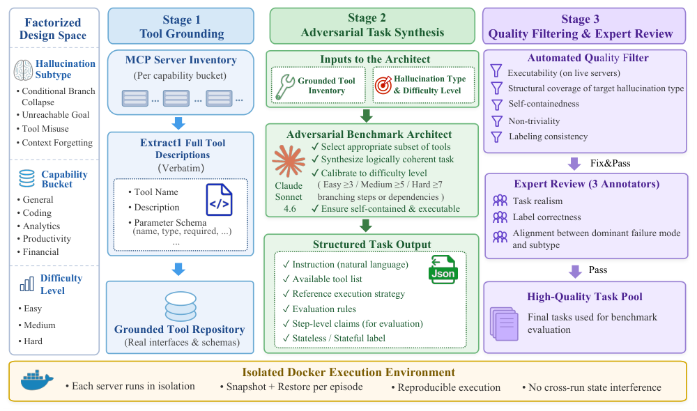
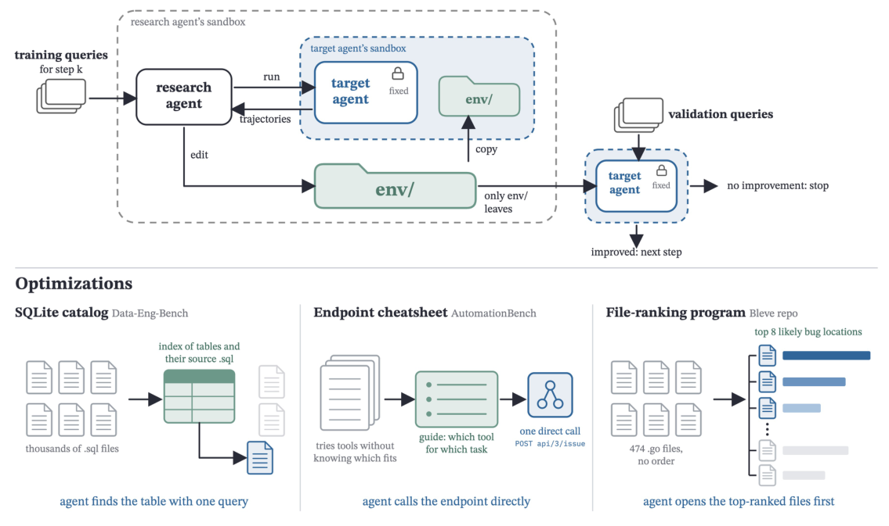
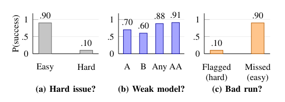
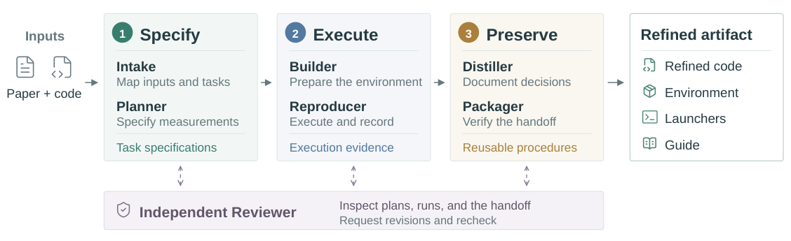
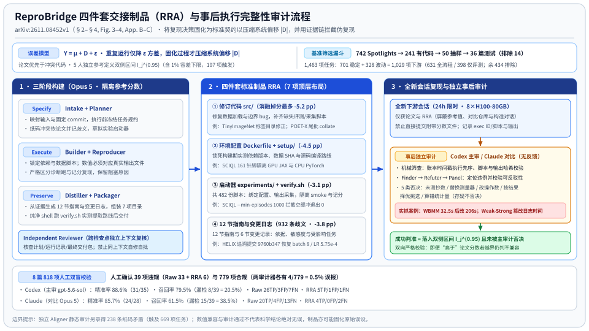
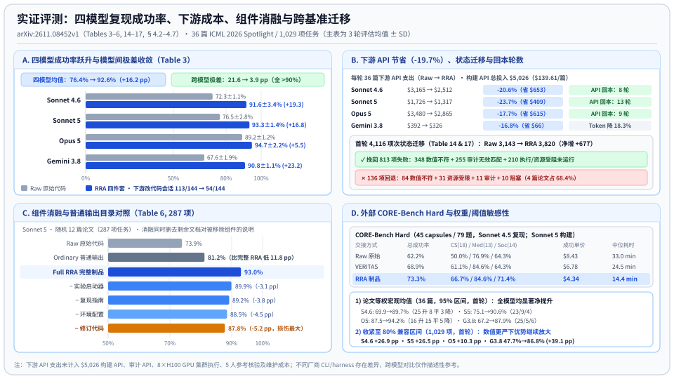
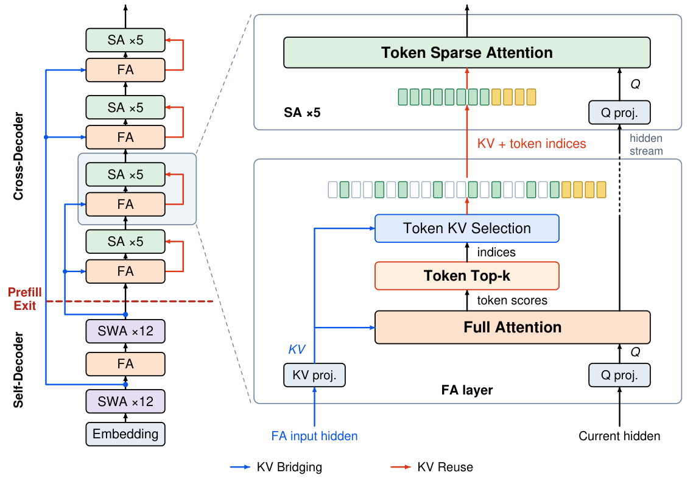
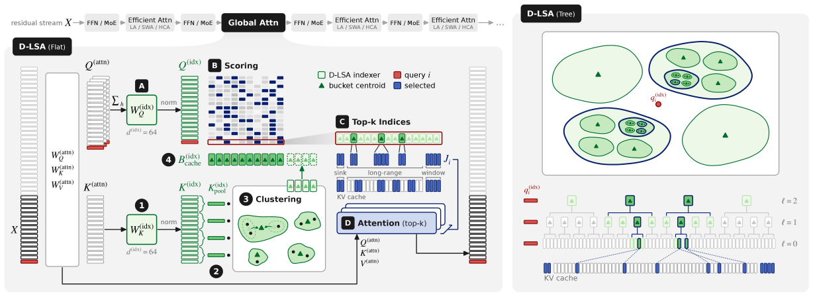

本期值得连起来看的是三个问题：Agent 是否知道自己做不到，失败告警能否指出值得干预的运行，以及共享环境能否减少反复探索。MCPHallu 把能力边界纳入评测，失败预测研究拆开题目难度、模型能力和运行波动，EnvOpt 则直接改造信息的访问方式。它们分别影响验收、监控和执行成本，不能靠单一成功率概括。

另外三篇论文关注复现知识的保存，以及长上下文的跨层状态共享和索引开销。独立技术笔记进一步连接到提示缓存、形式化监控、推理启动、二进制兼容和评测器修补；其中的加速数字和成本结果都需要放回各自工作负载与测量层级理解。

<h2 class="daily-paper-title" id="paper-arxiv-2611.07689">MCPHallu：把“做不到却继续做”变成可测故障</h2>

[MCPHallu: Benchmarking Reasoning, Execution, and Memory Hallucinations in MCP Agents](https://arxiv.org/abs/2611.07689)  
Yizhen Jiang, Haowei Guo, Tianyi Bai, Zengjie Hu, Lu Ma, Zhengyang Zhao, Haoze Sun, Peng Pei, Wentao Zhang · arXiv · 2026-11-05

MCP Agent 接入更多工具后，成功率仍然无法回答一个运维问题：它究竟不会规划、选错了工具，还是忘记了先前拿到的数据？MCPHallu 把这三类风险放进任务构造，而不是等任务失败后再给轨迹贴标签。它的价值在于让“承认目标不可达”成为正确行为，使虚报完成和无意义地继续调用工具受到直接检验。

<a class="note-image-link" href="/assets/images/digest/2026-11-08/arxiv-2611.07689.png" target="_blank" rel="noopener" aria-label="MCPHallu 从真实接口到任务合成、筛查和专家审核的流程 · 查看原图 ↗">查看原图 ↗</a>

*从左向右读：真实工具约束任务生成，自动检查和专家复核共同筛选任务；底部容器隔离用于避免跨运行状态污染。*

基准由 358 个任务、36 个真实 MCP 服务构成，覆盖搜索、分析、生产力、金融和编码五个领域。每个任务围绕一种主要触发条件：根据实时结果选择互斥分支；要求现有工具无法完成的目标；提供接口相似但语义不同的混淆工具；或者在关键观测和最终使用之间插入同领域干扰。它们分别对应 Branch Collapse、Unreachable Goal、Tool Misuse 和 Context Forgetting。这里的“幻觉”还包括把不符合任务、状态或工具能力的行动当成有效行动；正确报告失败不属于这个定义。

生成过程先从服务实现中提取接口与参数，再合成任务，经过可执行性筛查和三位标注者审阅。执行时每次从干净容器开始；只读任务用同期运行的参考脚本核对结果，写入任务直接检查最终状态。任务还有依赖图，用来区分“碰巧答对”和“按正确依赖完成”。这对 AgentOps 很实用：回答写得像成功，不代表外部系统真的发生了预期变化。

评分并不完全交给语言模型。分支和遗忘任务的结果检查占 60%、依赖检查占 20%；不可达目标和工具误用任务的结构检查占 70%，剩余才由模型裁判补充语义判断。不可达目标允许两次探测调用，之后才逐步惩罚迟迟不承认不可行的行为。因此，它并非要求 Agent 看到困难就立刻拒绝，而是衡量探测后能否停止错误行动。

14 个模型共形成 5,012 条轨迹，平均综合得分为 0.642；不可达目标子类只有 23.2% 的运行通过，平均分为 0.458。各模型在不同子类中的名次跨度平均达到 6.9 位，分支选择与不可达目标得分的相关系数为 −0.12。部署时只看总分，很容易漏掉某种特定失败风险。

这仍是定向压力测试。任务预设的主故障类型并不等于单次轨迹唯一的因果解释；人工审查的失败样本中，预期类型成为主故障的比例为 81%。工具清单在单个任务内固定，也未覆盖动态安装服务、跨会话记忆或鉴权状态混淆。值得优先读的是任务构造与评分规则：它们提供了把服务状态、调用依赖和停止条件一起纳入验收的方法。

<h2 class="daily-paper-title" id="paper-arxiv-2611.07372">EnvOpt：优化 Agent 反复读取的环境</h2>

[EnvOpt: Automated Optimization for Agent Environments](https://arxiv.org/abs/2611.07372)  
Mingxuan Li, Huanzhi Mao, Qiuyang Mang, Hanchen Li, Joseph E. Gonzalez, Alex Dimakis · arXiv · 2026-11-05

同一份企业信息可以放在远程工具后面，也可以变成可搜索的文本、索引或数据库。Agent 要花多少步找到它，不只取决于模型能力和 harness。EnvOpt 把跨任务反复使用的“静态环境”当作第三个优化对象：保持目标模型及执行框架不变，重新组织信息和访问路径，减少重复探索的成本。

<a class="note-image-link" href="/assets/images/digest/2026-11-08/arxiv-2611.07372.png" target="_blank" rel="noopener" aria-label="EnvOpt 环境编辑、目标 Agent 试跑与独立验证闭环 · 查看原图 ↗">查看原图 ↗</a>

*上方只把环境目录传给目标 Agent，下方展示数据库目录、端点速查表和文件排序三种具体改动。*

这里的静态并不意味着系统永远不更新，而是许多任务共享相同或相似的文件、代码库和业务数据。研究 Agent 拿到一个环境目录、一组训练任务和运行目标 Agent 的预算。它先读目标轨迹，找出昂贵的探索步骤，再编辑目录并重新试跑。能迁移出去的只有环境内容；对目标 harness 的修改会被丢弃。环境也可以包含转换程序，使相似的新实例能按同一规则整理。

改动相当具体：把邮件内容整理成直接可读的文本；把常见 API 端点做成速查表；为大量 SQL 文件建立 SQLite 目录；或为代码库生成最可能相关的文件排序。它们减少的是找入口、理解格式和重复查位置的工作，不能理解成把任务答案提前塞进上下文。论文也讨论了被拒绝的优化，说明压缩或整理必须保留任务所需信息。

一个关键边界是“无需训练任务答案”不等于完全无需验证器。训练阶段隐藏参考答案与验证器，研究 Agent 只能通过代理判断和答案一致性检查效果；每轮结束后，独立的验证任务仍用验证器测通过率与成本。成本变差或准确率下降超过容忍度时，回退到上一轮环境。不同轮使用不相交的训练任务，也在未见测试集上评估。

AutomationBench 的 600 个公开任务中，作者划出 200 个测试任务、96 个验证任务，其余进入训练池。正文表格中，官方 harness 下 Haiku 4.5 的通过率从 2.33% 到 16.67%，增加 14.34 个百分点，费用从 42.36 美元到 11.55 美元，下降 72.73%。这组数字既说明提升明显，也提醒读者绝对成功率仍低。迁移到 Opus 5 后，费用下降 68.13%，通过率从 33.83% 到 35.17%。

跨五个基准的结果支持环境表示有独立优化空间，但“可以迁移”不表示每个模型都同步变准：Workspace-Bench 和 Data-Eng-Bench 的部分非目标模型略有准确率回退。离线构造还要先付费，收益依赖足够多的后续任务来摊销；目录、端点或业务状态变化后，也需要维护这些派生材料。对 AgentOps，最值得关注的是把重复探索变成可维护的共享制品，以及把成本收益和任务正确性放在同一验证循环里。

<h2 class="daily-paper-title" id="paper-arxiv-2611.08285">失败预测：分清难题、弱模型与一次坏运行</h2>

[Hard Issue, Weak Model, or Bad Run? Rethinking Failure Prediction for Coding Agents](https://arxiv.org/abs/2611.08285)  
Xingyue Shi, Wesley K. G. Assunção · arXiv · 2026-11-05

Agent 发出失败预警后，系统该停止、换模型还是重试？这篇研究提醒我们：能预测失败，不代表知道哪种补救会有效。难题可能需要人介入，能力不足可能需要更强模型，而同一模型偶尔走错路径才是重试最直接的目标。把三者混成一个分数，会让预警看起来准确，却找错值得干预的运行。

<a class="note-image-link" href="/assets/images/digest/2026-11-08/arxiv-2611.08285.png" target="_blank" rel="noopener" aria-label="用示意概率区分题目难度、模型能力和重试收益 · 查看原图 ↗">查看原图 ↗</a>

*这是解释混杂因素的示意概率，不是实验数据；多一次尝试本身就能抬高“任一模型成功”的覆盖率。*

作者分析 SWE-bench Verified 上七个模型的 3,492 条已知结果轨迹，并用更大集合中另外 16 个模型的失败比例估计题目难度。预测器只读部分轨迹，不直接接收题目文本和模型名称；方法包括 TF-IDF 逻辑回归，以及一个交叉验证折上的小模型 LoRA 微调。用于估计难度的结果在实际部署时通常不可得，所以那个高分参照是诊断工具，不能直接当作上线方案。

在运行到第 20 步仍未结束的 2,840 条轨迹上，难度参照的整体 AUROC 是 0.924，轨迹预测器约为 0.624–0.630。原因并不神秘：用于整体 AUROC 的失败—成功配对中，99.66% 来自不同题目，只要识别难题就能获得较高分。固定题目后，模型身份参照的 AUROC 为 0.724，仍高于轨迹预测器约 0.60–0.61。预测器对“整体较弱模型反而成功”的反常配对尤其不擅长。

进一步控制题目难度和模型能力后，18 种配置加入轨迹得分所带来的整体 AUROC 增益都落在预设的 ±0.02 等效区间内。这里的结论是所测试方法没有测到额外增益，并非轨迹永远没有信息。它要求监控评测回答更具体的问题：同一道题、相近能力条件下，这次运行是否已经偏离可成功的路径？

路由也有类似陷阱。事后挑出任何成功模型的 oracle，比最佳单模型高 10 个百分点，并不自动证明按题换模型能赚到这些收益；多个随机尝试本身就会扩大覆盖。在两个 Llama 模型、522 道题的重复运行试验中，根据前一半运行挑模型，在后一半只增加 0.09 个百分点，95% 区间跨过零。作者仍发现少量可复现的专长，不能据此宣称模型专长不存在。

同一模型有时成功、有时失败的运行差异占该试验结果变异的 42%，说明重试有空间；问题是现有告警难以锁定这些可挽救的失败。证据主要来自一个基准与 scaffold，重复运行部分也使用较旧模型。最值得迁移的是评测方法：同时报告同题与总体判别能力，并在未见运行、相同尝试预算下检验告警触发的动作，避免把“预测正确”误当成“干预有效”。

<h2 class="daily-paper-title" id="paper-arxiv-2611.08452">ReproBridge：把复现中的隐性决策保存下来</h2>

[ReproBridge: Building Reproducibility into ML Research Artifacts](https://arxiv.org/abs/2611.08452)（[v1 PDF](https://arxiv.org/pdf/2611.08452) · [项目主页](https://wyyyb.github.io/reprobridge_website/)）  
Yubo Wang（University of Waterloo、Google）、Rui Meng（Google）、Jaehyun Nam（Google）、Tomas Pfister（Google）、Jinsung Yoon（Google）· `arXiv:2611.08452v1 [cs.AI]` · 2026-11-05 提交（截至核验仅存 `v1`，无修订或撤回记录；PDF 页眉标注 2026-11-06）

复现一篇机器学习论文时，真正耗费工时的往往不是再跑一遍脚本，而是把论文正文、仓库代码和零散附件里**未写明的执行决策**重新拼凑出来——例如依赖冲突怎么解、到底该用哪个隐藏提交的参数、静默损坏的数据加载器如何修补，以及原始日志怎样聚合成表格里的那个数字。即使某次尝试侥幸跑通，这些决定也常被埋在对话上下文或终端历史中，下一位研究者或 Agent 仍得从头踩坑。`ReproBridge` 将上述隐性过程固化为一套包含**修订代码、环境配置、实验启动器与复现指南**的四件套标准化交接制品（Refined Reproducible Artifact，简称 RRA），并在完全隔离构造过程与参考分数的**全新下游会话**中检验其复用价值，同时引入独立事后**执行完整性审计器（Auditor）**核对证据链，防止“抄写论文数值却未真实运行”的伪成功。以下精读严格依据 `arXiv:2611.08452v1` 正文与附录 Table 1–21，明确区分作者报告实证与工程适用边界。

### 一、为什么“跑通一次”不等于可复现：系统偏移 D 与基准筛选边界

论文在 §2.1 与附录 A.4 中提出了一个清晰的测量误差模型，用来区分**可重复随机波动**与**执行偏差**。对于任务 <code>j</code>，设按论文严格规定的理想程序 <code>π_j</code> 执行所得期望值为 <code>μ</code>，而一次具体复现中由重构执行流程 <code>Z</code> 产生观测值 <code>Y = μ + D + ε</code>，其中 <code>D = m(Z) − μ</code> 表示偏离规定实验方案引起的系统性均值偏移，<code>ε = Y − m(Z)</code> 为给定执行流程下的零均值随机波动（<code>E[ε&#124;Z] = 0</code>）。由均方误差分解（公式 A.2）<code>E[(Y − μ)²] = (E[D])² + Var(D) + E[ε²]</code> 可知，在固定流程下多次重复实验只能压低均值的方差（如 5 次独立参考取均值将参考方差降至 <code>σ²_{j,ref}/5</code>），却**无法消除由隐性误配引起的持续偏移 D**。与同日专注于优化静态信息访问路径的 `EnvOpt` 不同，`ReproBridge` 直接瞄准压缩 <code>&#124;D&#124;</code>——把“为什么这样跑、如何从输出算出指标”变成可核查、可重放的科研制品。

为量化评估制品复用价值，作者构建了 `ReproBridge-Bench`（§2.2–2.4，附录 A）：

- **论文筛选漏斗与开发/测试隔离**：从 `742` 篇 ICML 2026 Spotlight 论文出发，先机械筛选出 `241` 篇附带官方代码且非纯理论的论文，随机抽取 `50` 篇并按明确标准排除 `14` 篇（`6` 篇缺关键代码或产物、`4` 篇主实验半数以上超过 `100` H100 GPU-小时或需多台八卡节点、`4` 篇重度依赖闭源 API），最终保留 **`36` 篇测试论文**（`28` 篇 GPU 论文、`8` 篇纯 CPU 论文，涵盖 8 个主题大类）。另有 `10` 篇工作流开发集论文（`5` 篇 NeurIPS 2026 + `5` 篇 ICLR 2026）完全独立汇报于附录 D.7，不混入测试统计。
- **任务粒度与五人独立参考核验（Table 1）**：每项任务对应主表中的一个自研方法指标（排除基线、单独消融、插图及仅附录结果），`36` 篇论文共整理出 `502` 组实验下的 **`1,463` 项任务**。每项任务由五位人类复现者在互不共享脚本与目录的独立服务器上、从同一固定 raw commit 出发重新运行并人工核查代码与提取逻辑（且未见结果前先锁死未说明的随机种子与重复次数，严禁按分数反复试跑挑优）。随后使用双侧 Student-t 预测区间（公式 1）<code>I_j^(q) = [x̄_j − r_j^(q), x̄_j + r_j^(q)]</code> 评估数值相容性，其中半径 <code>r_j^(q) = max(t_{(1+q)/2,4} · s_j · sqrt(1 + 1/5), 0.01·&#124;x̄_j&#124;)</code>，默认取 `q = 0.95`（`t ≈ 2.78`；`1%` 容差下限在 `197` 项任务上触发）。相对极差 <code>V_j = 100·(max x_{ji} − min x_{ji})/&#124;p_j&#124;</code> 以 `10%` 划分稳定组与高波动组（`21` 个零目标任务按定义归入高波动组）。
- **1,463 项汇总分布与 1,029 项下游基准边界**：在全量 `1,463` 项任务中，有 `701` 项（`47.9%`）属于 Cat. 1 稳定兼容、`328` 项（`22.4%`）属于 Cat. 2 高波动兼容，两者合计 **`1,029` 项（`70.3%`，涵盖 `387` 组实验）**进入下游比较——其中包括 `631` 项全流程训练任务与 `398` 项明确允许使用官方检查点的仅评测任务（`730` GPU / `299` CPU；`586` 降序指标 / `443` 升序指标，且升序与降序任务均采用同一**双侧**区间，“超过论文分数过多”同样判为数值不兼容）。其余 `434` 项未进入下游对比，分别因**数值不符**（`183` 项，`12.5%`）、**执行受阻**（`186` 项，`12.7%`，缺产物/依赖/代码缺陷）以及**算力或访问受限**（`65` 项，`4.4%`）。这一比例清楚说明，`ReproBridge` 测量的是“在已知可兼容复现子集上保存流程能否提高独立再现率”，而非整个顶会的天然可复现率。

### 二、三阶段构建、四件套标准制品与独立执行审计

<figure class="note-figure"><a class="note-image-link" href="/assets/images/digest/2026-11-08/arxiv-2611.08452.png" target="_blank" rel="noopener" aria-label="ReproBridge 明确任务、执行与保存制品的三阶段流程 · 查看原图 ↗">查看原图 ↗</a><figcaption>图 1 · ReproBridge 三阶段构建与独立审核总览（对应 arXiv:2611.08452v1 Fig. 3）：由状态控制器编排六个角色分阶段沉淀计划、证据与交接包。</figcaption></figure>

在主实验中，作者使用 `Opus 5`（`claude-opus-5[1m]`，`max` 推理档）从论文与官方仓库构建 RRA，且构建全程**屏蔽五人参考观测值与后续评测记录**。人类仅事先规定流程与交付契约，具体调查、修复、审核与打包全部由 Agent 承担（§3.1，Table 2）：

1. **三阶段、七角色分工与持久化证据链**：阶段控制器（phase controller）按序调度三阶段角色并在节点间强制校验产出：（1）**Specify（明确规约）**：`Intake` 读完整篇论文与附录并映射任务，锁定原始 commit；`Planner` 在**实际跑分前**冻结每项任务的数据、模型、聚合规则、重复次数与歧义消解方案（若论文描述与代码冲突，严格**以论文为准**并标出代码位置），同时起草启动器；（2）**Execute（环境与执行）**：`Builder` 锁定依赖、数据/权重获取脚本与容器定义，要求最终交付环境必须与构造测量期环境完全一致；构造期 `Reproducer` 依计划运行并将每个分数连到真实输出文件，严格分离诊断性试跑与记分重复，受阻项须留存显式失败原因；（3）**Preserve（知识沉淀与校验）**：`Distiller` 依据前述规约与变更证据撰写指南与变更日志，严禁挑选好看的结果替代指定统计量；`Packager` 组装 7 项标准顶层目录并在纯净 shell 中实际运行 `verify.sh`（含低开销真实重复运行与输出解析检查）。贯穿三阶段的 **`Independent Reviewer`** 在独立上下文中介入计划、运行记录与最终交付检查，禁止同一上下文内“自修自批”。

<figure class="note-figure"><a class="note-image-link" href="/assets/images/digest/2026-11-08/reprobridge-artifact-auditor-workflow-zh.svg" target="_blank" rel="noopener" aria-label="ReproBridge 四件套交接制品与事后执行完整性审计流程图 · 查看原图 ↗">查看原图 ↗</a><figcaption>图 2 · 四件套交接契约、全新下游会话隔离与事后执行完整性审计流水线（整理自 arXiv:2611.08452v1 §2–§4 与 Appendix B–C）。</figcaption></figure>

2. **四件套标准制品（RRA）的 7 项目录布局与典型修复案例（§3.2，App. B.2 & D.5）**：交付仓库统一为 `src/`、`Dockerfile`、`setup/`、`experiments/`、`reproduction_guideline.md`、`change_log.md` 与 `verify.sh` 七个顶层入口，横跨 `36` 篇论文共沉淀 `482` 份启动器脚本与 `932` 条歧义记录：
   - **修订代码（`src/`）**：修补静默错误并补齐实验与统计模块。例如 `Effective Model Pruning` 原仓库用 `ImageFolder` 读取仅含 `images` 子目录的 TinyImageNet 验证集，导致 `10,000` 张图全部静默归为同一类，RRA 补入按 `val_annotations.txt` 分类整理脚本与校验回执，使 `Gemini 3.8 Flash` 在 ResNet-18 上的验证损失从 `8.898` 修正至 `2.288`（逼近论文 `2.303`）；`POET-X` 修复 `training_utils.py:222` 尾部残余 batch 未经 `collate_fn` 返回列表而触发 `batch.items()` 崩溃；`FlashOptim` 原仓库缺少表内 GPT-2 训练评测脚手架，RRA 补齐 `6,346` 行支撑代码使 18 项结果全部跑通；`ETTFS` 则独立封装 `Code/profile_ttfs.py` 使此前无法定位的推理时步数指标得以执行。
   - **环境配置（`Dockerfile`、`setup/`）**：锁死真实可复现依赖链并隔离冲突栈。典型如 `SCIQL` 在 `01_environment.sh` 中精确固定 `161` 个依赖版本，专门以 CPU 版 PyTorch 承担日志记录、与 GPU 版 `JAX 0.5.2` 隔离，绕开 cuDNN 冲突；`WBMM` 保留了在 H100 上通过 `Ninja` 从源码编译 `mmcv-full` 的完整路线，使下游会话零代码修改直接完成 6 项 COCO 检测/分割任务。
   - **实验启动器（`experiments/`、`verify.sh`）**：将任务 ID 显式绑定到参数配置、输出目录与后处理聚合，并内置防呆闸门（如 `SCIQL` 强制 `--min-episodes 1000` 拦截空缓冲仍以退出码 `0` 写假 CSV 的陷阱；`Mixture of Concept Bottleneck Experts` 为 4 专家树编辑距离补齐按表达式取均值收集器，纠正此前原始会话误用求和将 `15` 报成 `60` 的错误）。
   - **复现指南与变更日志**：标准化 **`12` 节 `reproduction_guideline.md`** 依次记录硬件、软件、安装、产物、实验、重复方差规则、输出键名、路径、歧义表（含源码位置、缺口、采纳方案、理由、敏感度与受影响任务）及未覆盖范围（如 `HELIX` 在 A6 歧义记录中溯源至历史提交 `9760b347`，找回与论文架构匹配的 `batch size = 8` 与学习率 `5.75e-4`，将两个任务的 MAE 从 `0.15265` / `0.50527` 拉回兼容区间内）；**`6` 节 `change_log.md`** 严格区分“运行必需改动”“正确性改动”“便利性改动”与“故意保持不变的行为”。
3. **全新会话评测与独立事后执行审计（§4.1，App. C）**：下游 4 个模型（`Sonnet 4.6`、`Sonnet 5`、`Opus 5` 运行于 Claude Code `max`，`Gemini 3.8 Flash` 运行于 Gemini CLI `high`）以每篇论文每条件一个**全新独立会话**、统一 `24` 小时墙钟上限和 `8× H100-80GB` 节点尝试全部 `1,029` 项任务，既看不到五人参考分数也看不到对照组仓库，且明确禁止直接提交仓库附带的分数文件。每次复现提交后，独立的**事后审计器（Auditor）**（主审 `Codex gpt-5.6-sol`，对比 `Claude Opus 5`；对 Reproducer 不返回反馈）运行三步验证：（1）**机械筛查**账本时间戳确认“先执行后提取”顺序及脚本/输出 SHA 哈希一致性；（2）**Finder** 审查执行代码、日志与数值，针对 **5 类违规**（未测直接抄数、替换测量工具、篡改公式操作数、依观测结果择优挑选、算错统计量）提出定位指控；（3）**Refuter** 尝试用证据和任务规约推翻指控，仍有争议则交 **Panel** 裁决；**存疑结论不判失效**。典型实抓案例包括：`WBMM` 下游提交日志在进程结束 `8–17` 分钟后被手动编辑，把实测 `32.5s / 53s / 92s` 乘以比例外推为全数据集耗时 `206s / 335s / 579s`，尽管原始实测和部分口径可能接近数值区间，审计依然基于“将推算值伪报为实测”予以否决；`Weak-and-Strong Verification` 则出现真实计算分数旁附带被回拨时间戳与 `FAIL` 改 `PASS` 的篡改审计日志，证明**“分数在区间内”与“执行记录可信”必须同时核验**。

### 三、四模型主评测、组件消融、外部迁移与审计人工校验

<figure class="note-figure"><a class="note-image-link" href="/assets/images/digest/2026-11-08/reprobridge-bench-4model-eval-zh.svg" target="_blank" rel="noopener" aria-label="ReproBridge-Bench 四模型复现成功率、下游 API 节省、组件消融与跨基准迁移结果图 · 查看原图 ↗">查看原图 ↗</a><figcaption>图 3 · ReproBridge-Bench 核心量化证据汇总（整理自 arXiv:2611.08452v1 Table 3–6 与 Table 14–17）：模型间差距收敛、API 降本、组件必要性及跨基准泛化。</figcaption></figure>

主实验在 `36` 篇论文、`1,029` 项兼容任务上进行 `3` 轮独立下游评估（Table 3），并补充第 1 轮评估下的论文等权宏观均值、严格 `80%` 兼容区间敏感性（Table 5）、任务状态迁移（Table 14–17）与首轮首次记分执行耗时（Fig. 6 / Table 15）：

| 模型（CLI 工具链） | Raw 3 轮成功率（%） | RRA 3 轮成功率（%） | 提升（pp） | 下游 Token 降幅 | 下游 API 支出（Raw → RRA / 降幅） | 论文等权 95%（Raw → RRA） | 80% 严区间增益（pp） | 首轮挽回 / 回退（净增） | 首次记分中位耗时（分） |
| :--- | :--- | :--- | :--- | :--- | :--- | :--- | :--- | :--- | :--- |
| Sonnet 4.6（Claude Code） | 72.3±1.1 | **91.6±3.4** | +19.3 | 8.48B → 6.80B（-19.8%） | $3,165 → $2,512（**-20.6%**） | 69.9% → 89.7%（+19.8 pp） | +26.9（61.3→88.2%） | 234 / 31（+203） | 30.0 → 16.2 |
| Sonnet 5（Claude Code） | 76.5±2.8 | **93.3±1.4** | +16.8 | 4.98B → 4.52B（-9.2%） | $1,726 → $1,317（**-23.7%**） | 75.1% → 90.6%（+15.5 pp） | +26.5（63.9→90.5%） | 208 / 33（+175） | 54.0 → 31.8 |
| Opus 5（Claude Code） | 89.2±1.2 | **94.7±2.2** | +5.5 | 3.01B → 2.82B（-6.3%） | $3,480 → $2,865（**-17.7%**） | 87.5% → 94.2%（+6.7 pp） | +10.3（82.0→92.3%） | 100 / 37（+63） | 32.4 → 19.2 |
| Gemini 3.8 Flash（Gemini CLI） | 67.6±1.9 | **90.8±1.1** | +23.2 | 2.24B → 1.83B（-18.3%） | $392 → $326（**-16.8%**） | 67.2% → 87.9%（+20.7 pp） | +39.1（47.7→86.8%） | 271 / 35（+236） | 43.8 → 15.6 |
| **四模型等权汇总** | **76.4** | **92.6** | **+16.2** | 降幅 6.3%–19.8% | 平均降幅 **-19.7%** | 全员均净提升 | 全员收益继续放大 | 813 / 136（**+677**） | 缩短 41%–64% |

*表 1 · 36 篇论文 1,029 项任务上的主评测、稳健性与首轮状态迁移汇总（整理自 arXiv:2611.08452v1 Table 3、Table 5、Table 14 与 Fig. 6；注意厂商 CLI harness 不同，跨模型对比仅为描述性参照）。*

- **“拉平”弱基线而非仅放大强模型**：四个模型的等权平均成功率从 **`76.4%` 跃升至 `92.6%`**，四模型间的成功率极差从 **`21.6` 个百分点剧烈收敛至 `3.9` 个百分点**，即便是原始代码表现最低的 `Gemini 3.8 Flash`（`67.6%`）借助 RRA 也跃升至 `90.8%`（`+23.2 pp`），所有模型均站上 `90%` 门槛；连同构建 RRA 自身的模型 `Opus 5` 在全新会话下也从 `89.2%` 提高到 `94.7%`（如在 `ETTFS` 上免去翻找 `6,377` 行 Python 查找缺失度量），下游修改仓库代码的会话比例由 `113/144` 降至 `54/144`。同时在 `10` 篇独立开发集上也复现了同向趋势（`Sonnet 5`：`75.6% → 92.2%`，API `-25.9%`；`Gemini 3.8 Flash`：`59.7% → 91.2%`，API `-18.6%`；表 20）。
- **稳健性与状态迁移结构**：按论文等权平均（排除大表任务数倾斜）时，四模型同样全部净提升 `+6.7` 至 `+20.7 pp`，在 `30–33/36` 篇论文上提高或打平（`3–6` 篇回落）；收紧到 `80%` 预测区间时，RRA 的领先优势反而扩大到 `+10.3` 至 `+39.1 pp`；稳定组（Cat. 1，`701` 项）与波动组（Cat. 2，`328` 项）均见正向增益（Cat. 1 `+8.0` 至 `+23.3 pp`，Cat. 2 `+2.1` 至 `+22.3 pp`，Table 13）。首轮共挽回 `813` 项原始失败（`348` 项数值不符、`255` 项审计无效匹配、`210` 项未运行），相对 `136` 项回退（`84` 项数值不符、`31` 项资源/权限、`11` 项审计违规、`10` 项阻塞；其中 `AuxiliaryMCMC 50`、`Manifold-Aware Perturbations 19`、`LiME 14`、`ExactFANOVA 10` 四篇合计占回退总数的 `68.4%`）。如 `LiME` 光数据与环境就消耗约 `83` 分钟，全量 `5,949` 步与 `47` 个划分评估推算耗时 `7–92` 小时，超出 `24` 小时会话限额；`AuxiliaryMCMC` 遇到高并发超时将 `100` 轮缩减为 `55` 轮被审计否决，另有链零接受率致 ESS 未定义。

为验证每个组件及标准化结构本身的必要性，作者在随机抽取的 `12` 篇论文（`287` 项任务）上以 `Sonnet 5` 进行单轮组件消融与普通目录对照（§4.5，Table 6）：

| 交接形态（Sonnet 5，12 篇共 287 项任务） | 复现成功率（%） | 相对完整 RRA 掉分（pp） | 消融操作说明（按原文 §4.5 与附录 D.4 协议） |
| :--- | :--- | :--- | :--- |
| Raw code（原始发布仓库） | 73.9 | — | 仅提供固定 commit 原始仓库与论文 |
| Ordinary outputs（普通上游运行目录） | 81.2 | —（比 RRA 低 11.8） | 保留 Opus 5 原始执行代码、脚本与日志，移除结果文件，无标准指南 |
| **Full RRA（完整四件套标准制品）** | **93.0** | **基准（0.0）** | 保留全部四件套（7 项顶层布局）与构造期决策文档 |
| 去除 Refined codebase（修订代码） | 87.8 | **−5.2** | 恢复原始源码，并同步删除其余文档与脚本中对代码修订的描述 |
| 去除 Environment setup（环境配置） | 88.5 | **−4.5** | 删除环境搭建路径，并同步删除其余文档与脚本中的环境配置描述 |
| 去除 Reproduction guide（复现指南） | 89.2 | **−3.8** | 移除 12 节指南与变更日志，保留修订代码、环境与启动器 |
| 去除 Experiment launchers（实验启动器） | 89.9 | **−3.1** | 删除实验入口脚本，并同步删除其余文档中关于启动器的描述 |

*表 2 · 制品组件消融与普通输出目录对照实验（整理自 arXiv:2611.08452v1 Table 6；前三种条件之外的四项移除实验均按剩余材料为条件测量相对完整 RRA 的损失）。*

- **结构化交接显著优于“留下历史运行目录”**：仅仅把先前成功跑过的目录去掉结果文件交给新会话（Ordinary outputs `81.2%`），虽明显好于原始仓库（`73.9%`），仍比完整 RRA（`93.0%`）低 **`11.8` 个百分点**。四项单组件消融中，去掉**修订代码**（`-5.2 pp`）和**环境配置**（`-4.5 pp`，例如 `WBMM` 失配后下游不得不现场重编 `PyTorch 2.0 / CUDA 11.8` 与源码编译算子）损失最大，而保留代码与环境但删去**指南**（`-3.8 pp`）或**启动器**（`-3.1 pp`）依然导致明显回落——可执行的代码并不等于自明的实验入口与指标定义。
- **外部基准迁移与审计跨工具验证（Table 4、Table 7、Table 12）**：在 `CORE-Bench Hard` 的 `45` 个 capsules（`79` 个问题，由 `Sonnet 5` 分别构造 VERITAS 与 RRA，由 `Sonnet 4.5` 独立复现）上，RRA 整体成功率达 **`73.3%`**（CS `66.7%`、Med `84.6%`、Soc `71.4%`），高于 `VERITAS`（`68.9%`）和 `Raw`（`62.2%`），单次成功 API 成本由 `$8.43` 降至 `$4.34`，中位耗时由 `33.0` 分钟缩至 `14.4` 分钟。换用 `Claude` 担任审计器做敏感度复核时，四模型 RRA 依然全线显著优于 Raw（`90.9%–96.3%` vs `72.9%–93.4%`，Table 7）。在随机 `8` 篇论文共 `409` 项任务（Raw + RRA 共 **`818` 项结果**）的**双人盲核**中，人工确认 `39` 项违规（Raw `33`、RRA `6`）与 `779` 项合规；`Codex` 取得 **`88.6%` 精准率（`31/35`）、`79.5%` 召回率**，而 `Claude` 为 `85.7%` 精准率（`24/28`）、`61.5%` 召回率，两者均仅误报 `4/779`（`0.5%`）。
- **构造期 API 成本与回本边界（§4.7，App. E）**：为全部 `36` 篇论文构建 RRA 共消耗 `$5,026` API（平均 `$139.61`/篇）。若仅按表 3 下游每轮节省（`Sonnet 4.6` `$653`、`Sonnet 5` `$409`、`Opus 5` `$615`）摊销全额构建 API，在固定价格且不计 GPU/审计/维护费的简化模型下，分别需要 **`8` 轮**（`7.70`）、**`13` 轮**（`12.29`）和 **`9` 轮**（`8.17`）完整复用才在 API 账面上回本（`Gemini 3.8 Flash` 每轮绝对节省 `$66`，故需更高复用频次）。

### 四、科学边界、漏检成本与可迁移工程启示

将 `ReproBridge` 的思路用于研究交付或 Agent 评测基建时，必须把原文明确指出的科学边界与工程未定价成本交代清楚：

1. **受样本过滤与兼容子集约束，不是全会议自然复现率**：`36` 篇测试论文从含代码的非纯理论子集中抽样，已预先剔除了高算力门槛与闭源 API 论文；且主评测的 `1,029` 项仅占全部整理任务的 `70.3%`，另外 `434` 项仍处于数值不符、缺产物/依赖报错或算力受限状态（Table 1）。此外，“5 次人类独立观测”是设计协议选择，并非严格统计学充分采样保证，在计算时间、并发敏感或极高方差任务（如 `AuxiliaryMCMC`）上仍可能出现新运行落出预测区间。
2. **数值相容与审计通过不等于“无纸码矛盾”或“绝对零作弊”**：一方面，作者在独立静态审计扩展 `Aligner` 中（§6.2，Table 19；未提供给下游模型且不代表因果误差率）记录了 `238` 条纸码矛盾发现，触及 `669` 个去重任务（含 `73` 条高严重度发现），例如 `Manifold-Aware Perturbations` 论文写明学习率 `10⁻⁴` 而仓库与 `171` 份清单实为 `10⁻³`；构建期若采纳错误假设也会被 RRA 一并固化。另一方面，人工双盲复核证明自动化审计器依然会漏掉 **`20.5%`（Codex，8/39）至 `38.5%`（Claude，15/39）** 的实际违规（Table 12）。
3. **下游 API 节省不等于全周期总成本下降，且部分对照存在方法学耦合**：报告的 `-19.7%` 成本降幅与 `8–13` 轮 API 回本均**排除了 `$5,026` 构建 API、Codex/Claude 审计 API、`8× H100` 集群 GPU 算力、5 名人类复现者参考核验工时与随依赖演进的长期维护成本**。此外，表 6 对 `Ordinary outputs` 与 `Full RRA` 的对比来自两条独立上游构造流水线，评估的是“完整规范流程及其交付物”的整体效果，并未隔离“同一组输出仅做目录格式重排”的纯收益；四款模型跨厂商 CLI harness 不同，跨模型排名不可作严格能力因果推断；人类科研人员直接阅读与复用 RRA 的省时效果也有待独立实证（§6.3）。
4. **三条可直接迁移的工程实践**：（1）**执行前先写清实验契约，再跑实验**：用类似 `Planner` 的步骤提前锁定输入拆分、种子策略、聚合分母（如 `SCIQL` 多准则多随机种子非加权均值）与论文优先原则，从源头减少事后按分数挑优导致的系统偏移 <code>&#124;D&#124;</code>；（2）**把“修环境与排雷理由”做成一等交付物**：仅仅留下曾经跑通的日志文件（`81.2%`）会丢失关键决策边界，唯有将修补代码、可重装版本锁、带防呆校验的启动器（如 `--min-episodes` 拦截静默空跑退出 0）和 `12` 节排雷指南打包，才能稳定支撑异构会话复用；（3）**以证据链审计取代单纯数值核对**：在自动评测与科学 Agent 平台中同时校验执行账本时间先序、脚本/输出文件哈希及原始日志输出，才能拦截诸如进程结束后篡改比例外推耗时与回拨审计时间戳的“虚假兼容”。

来源：严格依据 [arXiv:2611.08452v1](https://arxiv.org/abs/2611.08452)（[v1 PDF](https://arxiv.org/pdf/2611.08452)）全文、附录 Table 1–21 及 [项目主页](https://wyyyb.github.io/reprobridge_website/) 整理；作者实测数据与工程边界分析已明确区分。
<h2 class="daily-paper-title" id="paper-arxiv-2609.26368">HySparse2：缩短 prefill 的层间状态依赖</h2>

[HySparse2: Hybrid Sparse Attention with Two-Level KV Sharing](https://arxiv.org/abs/2609.26368)  
Jianyu Wei, Yizhao Gao, Qihao Zhang, Shimao Chen, Zhengju Tang, Yu Cheng, Shengjie Zhou, Zihan Jiang, Yifan Song, Hailin Zhang, Liang Zhao, Bo Yang, Gang Wang, Shijie Cao, Fuli Luo · arXiv · 2026-09-22

HySparse2 针对 Agent 长观测、短输出的模式，将网络分为 self-decoder 与 cross-decoder。外层 KV Bridging 用前半部隐状态经各层独立投影生成后半部全注意力层的 KV；内层让稀疏层复用这些 KV 和 token 选择索引。近期窗口直接进入稀疏选择，取消单独 SWA 分支，因此 prefill 缓存构建可在 self-decoder 后结束。

<a class="note-image-link" href="/assets/images/digest/2026-11-08/arxiv-2609.26368.png" target="_blank" rel="noopener" aria-label="HySparse2 的 KV Bridging、KV Reuse 与 prefill 退出点 · 查看原图 ↗">查看原图 ↗</a>

*蓝线由 self-decoder 提供 KV 源状态，红线在块内共享缓存与索引；虚线标出 prefill 可停止的位置。*

80B-A3B 模型比较中，1M token、FP8 KV 条件下，prefill FLOPs 相对 Hybrid SWA 降低 5.02 倍，KV 从 12.09 GB 降至 2.69 GB；这不是实测端到端延迟。256k 的 RULER-v2 得分为 58.45，HySparse 为 32.61。不同配置还使用不同 KV 头设计，不能把全部存储收益归因于单一模块。

它直接改变模型架构，需相应训练；AgentPPL 是轨迹似然指标，并非实际任务完成率。与下一篇 LSA 的索引器优化不同，本篇重点是让跨层缓存共享解除 prefill 依赖。

<h2 class="daily-paper-title" id="paper-arxiv-2610.42147">LSA：稀疏注意力也要避免扫描全部索引</h2>

[Latent Sparse Attention: Towards Subquadratic Ultra-Long Context Attention](https://arxiv.org/abs/2610.42147)  
Ales Kubicek, Andrea Caciolai, Liangzu Peng, Sukrit Sumant, Benjamin Hoover, Fraser Greenlee, Ruairidh M. Battleday, Radim Urban, Torsten Hoefler, James C. R. Whittington · arXiv · 2026-10-30

稀疏注意力只读取少数 key，但若索引器仍逐个扫描全部候选，超长上下文的成本瓶颈仍在。LSA 在学习到的潜空间聚类 key，再用簇中心筛选；树形版本沿层级做 beam search，使固定 beam 下的索引 prefill 达到 O(T log T)。D-LSA 蒸馏已有模型的索引，N-LSA 则通过下一 token 目标原生训练。

<a class="note-image-link" href="/assets/images/digest/2026-11-08/arxiv-2610.42147.png" target="_blank" rel="noopener" aria-label="LSA 平面聚类索引与树形搜索设计 · 查看原图 ↗">查看原图 ↗</a>

*左侧把 key 聚成桶，再将所选桶展开为注意力索引；右侧以层级搜索减少需要评分的簇中心。*

GLM-5.3-FLASH 在 10M token 下单层 prefill/decode 分别快 22.7 倍和 4.6 倍；单层计时包含投影、索引和注意力，但 prefill 只测该上下文末尾的 32,768-query chunk。正文还报告整模型服务，收益更小，不能互换数字。单请求 decode 的树形方案实际采用平面搜索。

精度大体接近基线，却并非全区间无损：GLM 在 2M–5M 的部分结果落后最多约 8 个百分点。实验保留完整 KV，主要节省索引和计算，并不解决所有显存压力；超过 10M 的性能曲线含外推，不能当实测吞吐。

## 同日技术笔记

- [vLLM Stable ABI：把推理引擎升级从重编译中解耦](/tech/zh/vllm-libtorch-stable-abi/)
- [提示缓存失效：从账单追到请求前缀和接口路径](/tech/zh/datadog-prompt-cache-investigation/)
- [FETCh：把形式化规约接到生产事件流](/tech/zh/datadog-continuous-formal-spec-validation/)
- [推理冷启动：权重复用、热实例与快照各保存什么](/tech/zh/cncf-faster-llm-inference-startup/)
- [缓存感知模型路由：切换模型也有状态成本](/tech/zh/openrouter-auto-router-next-gen/)
- [MaxxBench：熟悉的题目改一点，Agent 是否还听需求](/tech/zh/maxxbench-why/)
- [FrontierCS 2：让评测器重新拥有测量权](/tech/zh/frontiercs2-update-1106/)
- [Opus 5.5：成本曲线与实际服务模型都需要重新核对](/tech/zh/anthropic-claude-opus-5-5/)
