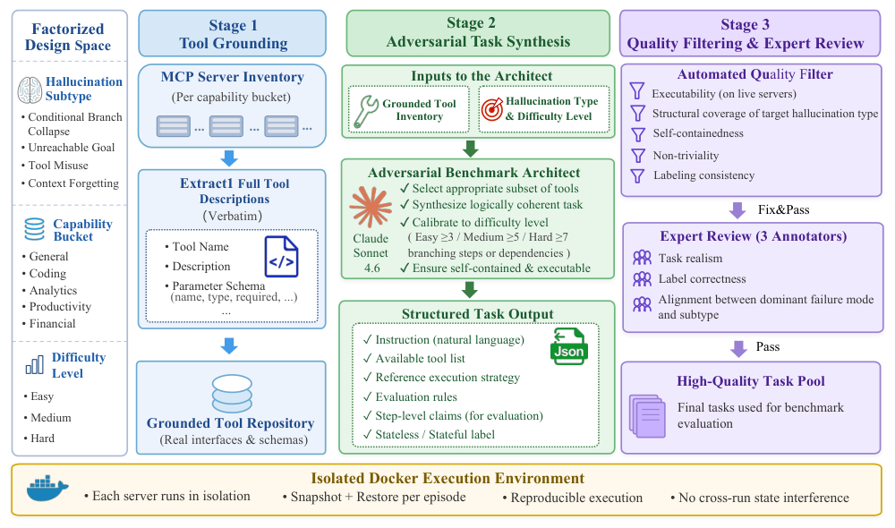
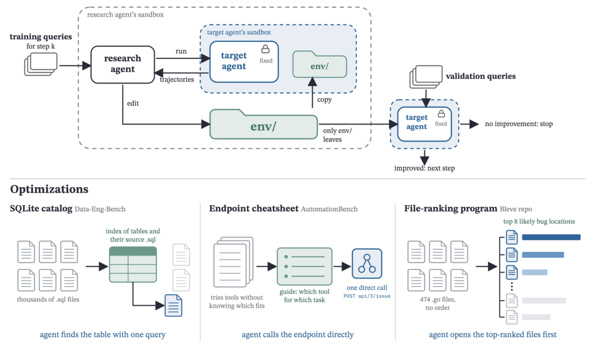
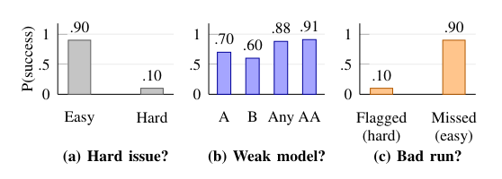
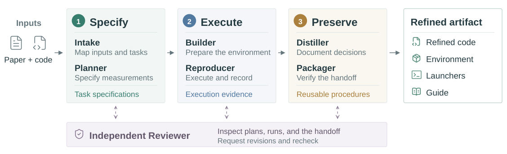
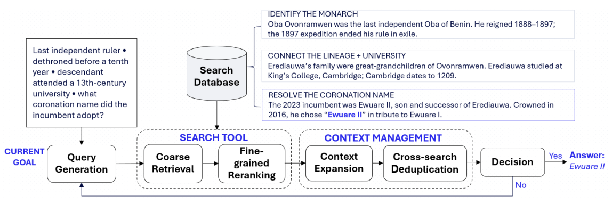
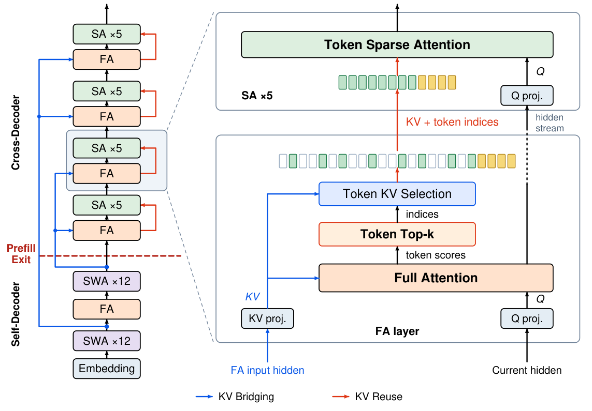
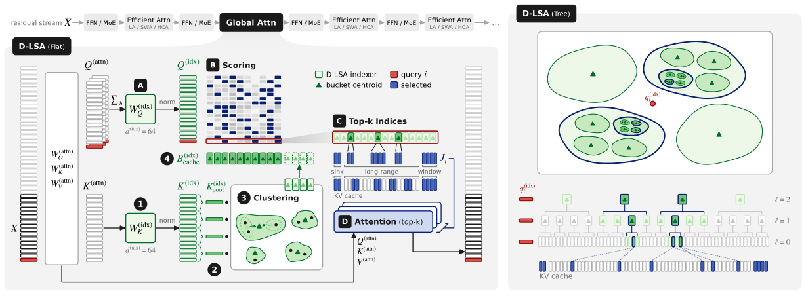

本期值得连起来看的是三个问题：Agent 是否知道自己做不到，失败告警能否指出值得干预的运行，以及共享环境能否减少反复探索。MCPHallu 把能力边界纳入评测，失败预测研究拆开题目难度、模型能力和运行波动，EnvOpt 则直接改造信息的访问方式。它们分别影响验收、监控和执行成本，不能靠单一成功率概括。

另外四篇论文关注复现知识的保存、检索证据进入上下文的粒度，以及长上下文的跨层状态共享和索引开销。独立技术笔记进一步连接到提示缓存、形式化监控、推理启动、二进制兼容和评测器修补；其中的加速数字和成本结果都需要放回各自工作负载与测量层级理解。

<h2 class="daily-paper-title" id="paper-arxiv-2611.07689">MCPHallu：把“做不到却继续做”变成可测故障</h2>

[MCPHallu: Benchmarking Reasoning, Execution, and Memory Hallucinations in MCP Agents](https://arxiv.org/abs/2611.07689)  
Yizhen Jiang, Haowei Guo, Tianyi Bai, Zengjie Hu, Lu Ma, Zhengyang Zhao, Haoze Sun, Peng Pei, Wentao Zhang · arXiv · 2026-11-05

MCP Agent 接入更多工具后，成功率仍然无法回答一个运维问题：它究竟不会规划、选错了工具，还是忘记了先前拿到的数据？MCPHallu 把这三类风险放进任务构造，而不是等任务失败后再给轨迹贴标签。它的价值在于让“承认目标不可达”成为正确行为，使虚报完成和无意义地继续调用工具受到直接检验。

<a class="note-image-link" href="/assets/images/digest/2026-11-08/arxiv-2611.07689.png" target="_blank" rel="noopener" aria-label="MCPHallu 从真实接口到任务合成、筛查和专家审核的流程 · 查看原图 ↗">查看原图 ↗</a>

*从左向右读：真实工具约束任务生成，自动检查和专家复核共同筛选任务；底部容器隔离用于避免跨运行状态污染。*

基准由 358 个任务、36 个真实 MCP 服务构成，覆盖搜索、分析、生产力、金融和编码五个领域。每个任务围绕一种主要触发条件：根据实时结果选择互斥分支；要求现有工具无法完成的目标；提供接口相似但语义不同的混淆工具；或者在关键观测和最终使用之间插入同领域干扰。它们分别对应 Branch Collapse、Unreachable Goal、Tool Misuse 和 Context Forgetting。这里的“幻觉”还包括把不符合任务、状态或工具能力的行动当成有效行动；正确报告失败不属于这个定义。

生成过程先从服务实现中提取接口与参数，再合成任务，经过可执行性筛查和三位标注者审阅。执行时每次从干净容器开始；只读任务用同期运行的参考脚本核对结果，写入任务直接检查最终状态。任务还有依赖图，用来区分“碰巧答对”和“按正确依赖完成”。这对 AgentOps 很实用：回答写得像成功，不代表外部系统真的发生了预期变化。

评分并不完全交给语言模型。分支和遗忘任务的结果检查占 60%、依赖检查占 20%；不可达目标和工具误用任务的结构检查占 70%，剩余才由模型裁判补充语义判断。不可达目标允许两次探测调用，之后才逐步惩罚迟迟不承认不可行的行为。因此，它并非要求 Agent 看到困难就立刻拒绝，而是衡量探测后能否停止错误行动。

14 个模型共形成 5,012 条轨迹，平均综合得分为 0.642；不可达目标子类只有 23.2% 的运行通过，平均分为 0.458。各模型在不同子类中的名次跨度平均达到 6.9 位，分支选择与不可达目标得分的相关系数为 −0.12。部署时只看总分，很容易漏掉某种特定失败风险。

这仍是定向压力测试。任务预设的主故障类型并不等于单次轨迹唯一的因果解释；人工审查的失败样本中，预期类型成为主故障的比例为 81%。工具清单在单个任务内固定，也未覆盖动态安装服务、跨会话记忆或鉴权状态混淆。值得优先读的是任务构造与评分规则：它们提供了把服务状态、调用依赖和停止条件一起纳入验收的方法。

<h2 class="daily-paper-title" id="paper-arxiv-2611.07372">EnvOpt：优化 Agent 反复读取的环境</h2>

[EnvOpt: Automated Optimization for Agent Environments](https://arxiv.org/abs/2611.07372)  
Mingxuan Li, Huanzhi Mao, Qiuyang Mang, Hanchen Li, Joseph E. Gonzalez, Alex Dimakis · arXiv · 2026-11-05

同一份企业信息可以放在远程工具后面，也可以变成可搜索的文本、索引或数据库。Agent 要花多少步找到它，不只取决于模型能力和 harness。EnvOpt 把跨任务反复使用的“静态环境”当作第三个优化对象：保持目标模型及执行框架不变，重新组织信息和访问路径，减少重复探索的成本。

<a class="note-image-link" href="/assets/images/digest/2026-11-08/arxiv-2611.07372.png" target="_blank" rel="noopener" aria-label="EnvOpt 环境编辑、目标 Agent 试跑与独立验证闭环 · 查看原图 ↗">查看原图 ↗</a>

*上方只把环境目录传给目标 Agent，下方展示数据库目录、端点速查表和文件排序三种具体改动。*

这里的静态并不意味着系统永远不更新，而是许多任务共享相同或相似的文件、代码库和业务数据。研究 Agent 拿到一个环境目录、一组训练任务和运行目标 Agent 的预算。它先读目标轨迹，找出昂贵的探索步骤，再编辑目录并重新试跑。能迁移出去的只有环境内容；对目标 harness 的修改会被丢弃。环境也可以包含转换程序，使相似的新实例能按同一规则整理。

改动相当具体：把邮件内容整理成直接可读的文本；把常见 API 端点做成速查表；为大量 SQL 文件建立 SQLite 目录；或为代码库生成最可能相关的文件排序。它们减少的是找入口、理解格式和重复查位置的工作，不能理解成把任务答案提前塞进上下文。论文也讨论了被拒绝的优化，说明压缩或整理必须保留任务所需信息。

一个关键边界是“无需训练任务答案”不等于完全无需验证器。训练阶段隐藏参考答案与验证器，研究 Agent 只能通过代理判断和答案一致性检查效果；每轮结束后，独立的验证任务仍用验证器测通过率与成本。成本变差或准确率下降超过容忍度时，回退到上一轮环境。不同轮使用不相交的训练任务，也在未见测试集上评估。

AutomationBench 的 600 个公开任务中，作者划出 200 个测试任务、96 个验证任务，其余进入训练池。正文表格中，官方 harness 下 Haiku 4.5 的通过率从 2.33% 到 16.67%，增加 14.34 个百分点，费用从 42.36 美元到 11.55 美元，下降 72.73%。这组数字既说明提升明显，也提醒读者绝对成功率仍低。迁移到 Opus 5 后，费用下降 68.13%，通过率从 33.83% 到 35.17%。

跨五个基准的结果支持环境表示有独立优化空间，但“可以迁移”不表示每个模型都同步变准：Workspace-Bench 和 Data-Eng-Bench 的部分非目标模型略有准确率回退。离线构造还要先付费，收益依赖足够多的后续任务来摊销；目录、端点或业务状态变化后，也需要维护这些派生材料。对 AgentOps，最值得关注的是把重复探索变成可维护的共享制品，以及把成本收益和任务正确性放在同一验证循环里。

<h2 class="daily-paper-title" id="paper-arxiv-2611.08285">失败预测：分清难题、弱模型与一次坏运行</h2>

[Hard Issue, Weak Model, or Bad Run? Rethinking Failure Prediction for Coding Agents](https://arxiv.org/abs/2611.08285)  
Xingyue Shi, Wesley K. G. Assunção · arXiv · 2026-11-05

Agent 发出失败预警后，系统该停止、换模型还是重试？这篇研究提醒我们：能预测失败，不代表知道哪种补救会有效。难题可能需要人介入，能力不足可能需要更强模型，而同一模型偶尔走错路径才是重试最直接的目标。把三者混成一个分数，会让预警看起来准确，却找错值得干预的运行。

<a class="note-image-link" href="/assets/images/digest/2026-11-08/arxiv-2611.08285.png" target="_blank" rel="noopener" aria-label="用示意概率区分题目难度、模型能力和重试收益 · 查看原图 ↗">查看原图 ↗</a>

*这是解释混杂因素的示意概率，不是实验数据；多一次尝试本身就能抬高“任一模型成功”的覆盖率。*

作者分析 SWE-bench Verified 上七个模型的 3,492 条已知结果轨迹，并用更大集合中另外 16 个模型的失败比例估计题目难度。预测器只读部分轨迹，不直接接收题目文本和模型名称；方法包括 TF-IDF 逻辑回归，以及一个交叉验证折上的小模型 LoRA 微调。用于估计难度的结果在实际部署时通常不可得，所以那个高分参照是诊断工具，不能直接当作上线方案。

在运行到第 20 步仍未结束的 2,840 条轨迹上，难度参照的整体 AUROC 是 0.924，轨迹预测器约为 0.624–0.630。原因并不神秘：用于整体 AUROC 的失败—成功配对中，99.66% 来自不同题目，只要识别难题就能获得较高分。固定题目后，模型身份参照的 AUROC 为 0.724，仍高于轨迹预测器约 0.60–0.61。预测器对“整体较弱模型反而成功”的反常配对尤其不擅长。

进一步控制题目难度和模型能力后，18 种配置加入轨迹得分所带来的整体 AUROC 增益都落在预设的 ±0.02 等效区间内。这里的结论是所测试方法没有测到额外增益，并非轨迹永远没有信息。它要求监控评测回答更具体的问题：同一道题、相近能力条件下，这次运行是否已经偏离可成功的路径？

路由也有类似陷阱。事后挑出任何成功模型的 oracle，比最佳单模型高 10 个百分点，并不自动证明按题换模型能赚到这些收益；多个随机尝试本身就会扩大覆盖。在两个 Llama 模型、522 道题的重复运行试验中，根据前一半运行挑模型，在后一半只增加 0.09 个百分点，95% 区间跨过零。作者仍发现少量可复现的专长，不能据此宣称模型专长不存在。

同一模型有时成功、有时失败的运行差异占该试验结果变异的 42%，说明重试有空间；问题是现有告警难以锁定这些可挽救的失败。证据主要来自一个基准与 scaffold，重复运行部分也使用较旧模型。最值得迁移的是评测方法：同时报告同题与总体判别能力，并在未见运行、相同尝试预算下检验告警触发的动作，避免把“预测正确”误当成“干预有效”。

<h2 class="daily-paper-title" id="paper-arxiv-2611.08452">ReproBridge：把复现中的隐性决策保存下来</h2>

[ReproBridge: Building Reproducibility into ML Research Artifacts](https://arxiv.org/abs/2611.08452)  
Yubo Wang, Rui Meng, Jaehyun Nam, Tomas Pfister, Jinsung Yoon · arXiv · 2026-11-05

一次成功复现往往留下修好的依赖，却没留下“为什么这样配置”。ReproBridge 将交接制品拆成修订代码、环境、启动器和复现指南，由明确任务、执行实验、保存流程三个阶段构建，并用独立审阅角色检查证据。后续 Agent 从全新会话开始，审计器追踪数值对应的输出、脚本和实际执行，避免只复制论文结果也算成功。

<a class="note-image-link" href="/assets/images/digest/2026-11-08/arxiv-2611.08452.png" target="_blank" rel="noopener" aria-label="ReproBridge 明确任务、执行与保存制品的三阶段流程 · 查看原图 ↗">查看原图 ↗</a>

*三阶段把任务定义和执行证据传给最终制品；独立审核贯穿交接，而后续复现另起会话。*

36 篇论文中，1,029 个具备相容参考结果的任务用于下游比较；每项有五个人工核验参考观测。四模型平均成功率从 76.4% 升至 92.6%，下游 API 支出平均下降 19.7%。数值相容还要结合执行审计，不能单凭分数接近判定复现。

它与 EnvOpt 的差别是保留实验程序和测量决策，而非只优化访问路径。结果不代表整个会议的复现率：原始整理的 1,463 项中，还有数值不符、执行受阻及资源受限项未进入这组比较；制品构造、GPU 和人工核验成本也不在下游 API 节省内。

<h2 class="daily-paper-title" id="paper-arxiv-2611.07859">CORE：先广泛检索，再让精确片段进入上下文</h2>

[CORE: Coarse-to-Fine Search with Context Management for Deep Research](https://arxiv.org/abs/2611.07859)  
Hoang Tran Vuong, Ngoc Quan Pham, Hung Bui, Fatih Porikli, Dat Quoc Nguyen · arXiv · 2026-11-05

长段落有利于检索，却会让多轮研究的上下文迅速膨胀。CORE 先用稠密检索选 300 个候选段落，再用 late-interaction 重排；直接复用 token 相似度定位片段，不另加摘要模型。Agent 可以按需扩展已见文档的邻近上下文，重复片段则换成短引用，旧历史不重写。

<a class="note-image-link" href="/assets/images/digest/2026-11-08/arxiv-2611.07859.png" target="_blank" rel="noopener" aria-label="CORE 检索、片段精排、扩展和去重流程 · 查看原图 ↗">查看原图 ↗</a>

*检索在较大段落上进行，返回时缩成相关片段；需要更多上下文时再扩展原来源。*

固定语料上的三模型、三基准比较中，CORE 的答案准确率和证据召回均领先所比较 harness。5.53 亿文档的 BrowseComp-PlusCM 上，GPT-5.4 准确率为 68.42%，OpenResearcher 为 56.14%；该组只有 57 个问题。消融中，粗检索、加入精细片段、再加入上下文管理的准确率依次为 62.61%、70.84%、80.12%。

其可迁移价值是控制“什么证据进入上下文”。但它未验证动态网页与开放式长报告；相对 OpenResearcher，也不是所有配置都减少搜索次数或峰值上下文，不能把片段更短等同于总成本必降。

<h2 class="daily-paper-title" id="paper-arxiv-2609.26368">HySparse2：缩短 prefill 的层间状态依赖</h2>

[HySparse2: Hybrid Sparse Attention with Two-Level KV Sharing](https://arxiv.org/abs/2609.26368)  
Jianyu Wei, Yizhao Gao, Qihao Zhang, Shimao Chen, Zhengju Tang, Yu Cheng, Shengjie Zhou, Zihan Jiang, Yifan Song, Hailin Zhang, Liang Zhao, Bo Yang, Gang Wang, Shijie Cao, Fuli Luo · arXiv · 2026-09-22

HySparse2 针对 Agent 长观测、短输出的模式，将网络分为 self-decoder 与 cross-decoder。外层 KV Bridging 用前半部隐状态经各层独立投影生成后半部全注意力层的 KV；内层让稀疏层复用这些 KV 和 token 选择索引。近期窗口直接进入稀疏选择，取消单独 SWA 分支，因此 prefill 缓存构建可在 self-decoder 后结束。

<a class="note-image-link" href="/assets/images/digest/2026-11-08/arxiv-2609.26368.png" target="_blank" rel="noopener" aria-label="HySparse2 的 KV Bridging、KV Reuse 与 prefill 退出点 · 查看原图 ↗">查看原图 ↗</a>

*蓝线由 self-decoder 提供 KV 源状态，红线在块内共享缓存与索引；虚线标出 prefill 可停止的位置。*

80B-A3B 模型比较中，1M token、FP8 KV 条件下，prefill FLOPs 相对 Hybrid SWA 降低 5.02 倍，KV 从 12.09 GB 降至 2.69 GB；这不是实测端到端延迟。256k 的 RULER-v2 得分为 58.45，HySparse 为 32.61。不同配置还使用不同 KV 头设计，不能把全部存储收益归因于单一模块。

它直接改变模型架构，需相应训练；AgentPPL 是轨迹似然指标，并非实际任务完成率。与下一篇 LSA 的索引器优化不同，本篇重点是让跨层缓存共享解除 prefill 依赖。

<h2 class="daily-paper-title" id="paper-arxiv-2610.42147">LSA：稀疏注意力也要避免扫描全部索引</h2>

[Latent Sparse Attention: Towards Subquadratic Ultra-Long Context Attention](https://arxiv.org/abs/2610.42147)  
Ales Kubicek, Andrea Caciolai, Liangzu Peng, Sukrit Sumant, Benjamin Hoover, Fraser Greenlee, Ruairidh M. Battleday, Radim Urban, Torsten Hoefler, James C. R. Whittington · arXiv · 2026-10-30

稀疏注意力只读取少数 key，但若索引器仍逐个扫描全部候选，超长上下文的成本瓶颈仍在。LSA 在学习到的潜空间聚类 key，再用簇中心筛选；树形版本沿层级做 beam search，使固定 beam 下的索引 prefill 达到 O(T log T)。D-LSA 蒸馏已有模型的索引，N-LSA 则通过下一 token 目标原生训练。

<a class="note-image-link" href="/assets/images/digest/2026-11-08/arxiv-2610.42147.png" target="_blank" rel="noopener" aria-label="LSA 平面聚类索引与树形搜索设计 · 查看原图 ↗">查看原图 ↗</a>

*左侧把 key 聚成桶，再将所选桶展开为注意力索引；右侧以层级搜索减少需要评分的簇中心。*

GLM-5.3-FLASH 在 10M token 下单层 prefill/decode 分别快 22.7 倍和 4.6 倍；单层计时包含投影、索引和注意力，但 prefill 只测该上下文末尾的 32,768-query chunk。正文还报告整模型服务，收益更小，不能互换数字。单请求 decode 的树形方案实际采用平面搜索。

精度大体接近基线，却并非全区间无损：GLM 在 2M–5M 的部分结果落后最多约 8 个百分点。实验保留完整 KV，主要节省索引和计算，并不解决所有显存压力；超过 10M 的性能曲线含外推，不能当实测吞吐。

## 同日技术笔记

- [vLLM Stable ABI：把推理引擎升级从重编译中解耦](/tech/zh/vllm-libtorch-stable-abi/)
- [提示缓存失效：从账单追到请求前缀和接口路径](/tech/zh/datadog-prompt-cache-investigation/)
- [FETCh：把形式化规约接到生产事件流](/tech/zh/datadog-continuous-formal-spec-validation/)
- [推理冷启动：权重复用、热实例与快照各保存什么](/tech/zh/cncf-faster-llm-inference-startup/)
- [缓存感知模型路由：切换模型也有状态成本](/tech/zh/openrouter-auto-router-next-gen/)
- [MaxxBench：熟悉的题目改一点，Agent 是否还听需求](/tech/zh/maxxbench-why/)
- [FrontierCS 2：让评测器重新拥有测量权](/tech/zh/frontiercs2-update-1106/)
- [Opus 5.5：成本曲线与实际服务模型都需要重新核对](/tech/zh/anthropic-claude-opus-5-5/)
