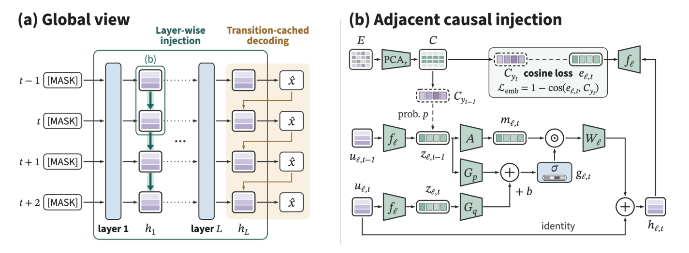
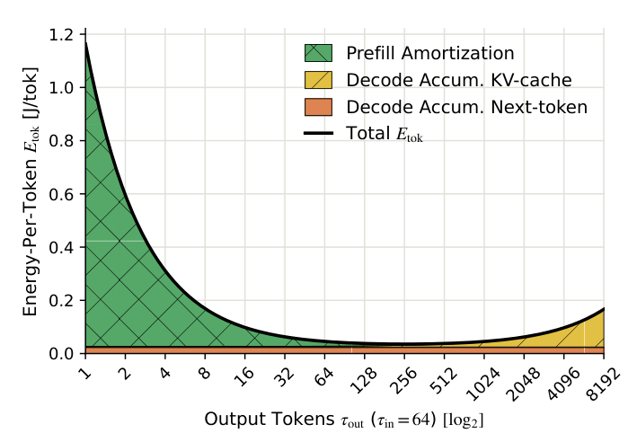

推理优化正在同时面对三个不同的成本：草稿 token 被拒绝造成的无效计算、上下文增长带来的 KV 读取，以及权重搬运占用的带宽。DSpine 把前驱信息提前送进并行草稿网络，提高一次验证能推进的长度；SIMPLE 用架构与序列长度解释能耗，提醒我们缓存命中后仍要付出注意力读取成本。独立笔记中的 nf12 则展示了无损压缩的另一面：权重更小，高并发服务却可能更慢。阅读这些工作时，最有用的线索是局部收益怎样传递到端到端指标，以及在哪些运行条件下停止奏效。

<h2 class="daily-paper-title" id="paper-arxiv-2609.36173">DSpine：让并行草稿沿网络深度建立依赖</h2>

[Draft in Parallel, Condition Through Depth: Adjacent Causal Injection for Speculative Decoding](https://arxiv.org/abs/2609.36173)  
Haohui Zhang, Keyu Chen, Haocheng Sun, Weibo Gu, Ruizhi Qiao, Xing Sun, Bo Jiang · 首发 2026-09-28；所读版本更新于 2026-10-10。

### 问题在于候选能否连成一个前缀

投机解码由小模型起草、大模型验证。并行起草省掉逐 token 调用，但各位置独立选择的候选可能互不相容；验证按前缀顺序进行，前面一次拒绝就会浪费后面的草稿。Domino、DSpark 等把条件选择主要放在骨干网络之后，DFlash2 还在内部混合相邻隐藏状态。DSpine 的区别是明确提取前驱的预测特征，从第一层起注入后继，让依赖在网络深度上逐步形成。

### 同层并行，跨层传递条件

每层先把各位置状态投影到共享传递空间，再由前驱和接收者共同计算门控，把前驱消息写入后继残差。所有消息读取更新前的状态，因此同层无需串行等待；下一层能继续传播上一层收到的信息。块内因果注意力与消息方向一致。传递空间由目标模型输出嵌入构造，逐层余弦监督帮助浅层预测接近正确 token 的嵌入，而不强迫每层都做完整词表分类。

<a class="note-image-link" href="/assets/images/digest/2026-11-09/dspine.png" target="_blank" rel="noopener" aria-label="DSpine 逐层相邻注入与门控结构 · 查看原图 ↗">查看原图 ↗</a>

*左侧看信息如何随层数向后继传播；右侧看接收者与前驱共同控制门控，决定写入多少预测信息。*

最后选择 token 时，模型又用已选前驱的嵌入修正末层写入。为避免逐位置重新执行矩阵运算，transition cache 先并行计算相邻位置 top-16 候选的两两转移分数，再依序查表选择。这用额外打分换取较短的串行计算链；融合 kernel 则压低逐层注入的启动与访存成本。

### 收益要同时看接受长度和服务时间

论文在 Qwen3-4B/8B 上关闭 thinking，统一训练数据、五层草稿网络与每轮 15 个候选。Qwen3-8B 在七项数学、代码和聊天基准、温度 0 下的平均推进长度由 DFlash 的 3.77 增至 4.82；这个指标包含额外的修正或目标 token。相对更强的 DFlash2（4.39），提升约 10.0%。在四项数学/代码服务测试、并发 2–32 下，作者报告吞吐平均领先 DFlash2 11.1%，领先 DFlash 23.3%。不要把后一个数字理解成相对最强基线的收益。

消融中，去掉最终修正使接受长度下降 6.6–7.1%；再去掉层内注入，降幅扩大至 8.8–10.7%。计时中验证占单轮时间的 72–76%，所以改善草稿必须抵消自己的开销。该工作值得读的是“何时传递预测信息”及其实现成本，而非仅把草稿块加长。

[27B 官方模型卡](https://huggingface.co/tencent/Qwen3.8-27B-DSpine-b16)还给出 WorkBuddy Office、low reasoning 的历史工具调用前缀回放：并发 8、SGLang 0.5.22、BF16 下，吞吐从 664.77 增至 805.53 tok/s。这里 DSpine 块长 16、DFlash2 块长 8，并启用动态验证与 ReplaySSM，不能把约 21.2% 的收益单独归因于层内注入，也不能当作真实交互 Agent 的任务成功率提升。

<h2 class="daily-paper-title" id="paper-arxiv-2611.03330">SIMPLE：把 token 能耗拆成可解释的成本</h2>

[The SIMPLE Law for Energy Cost of LLM Inference](https://arxiv.org/abs/2611.03330)  
Hiari Pizzini Cavagna, Andrea Proia, Daniele Cesarini, Zeynep Kiziltan, Andrea Bartolini · 首发 2026-11-02。

### 相同 token 数，不意味着相同成本

长上下文生成时，每个新 token 都会增加后续注意力读取的 KV 状态。只按 token 数或参数量估算能耗，容易掩盖输入长度、隐藏维度以及 MHA/GQA 的差异。SIMPLE 从计算量与访存量出发，经过项的筛选与合并，用四个拟合系数表示 prefill、KV 读取和下一 token 计算。其贡献是跨模型共享一个有架构解释的表达式，而非完全无需测量的硬件定律。

用 d 表示隐藏维度，L 表示层数，R 表示 KV 头与 Query 头之比，输入和输出长度分别为 I、O，总能耗为：

$$E=\theta_1d^2LI+\theta_2dLR(IO+O^2/2)+(\theta_0+\theta_3dL)O.$$

第一项是处理输入的成本；第二项体现生成过程中逐渐变长的 KV 读取；最后一项随生成长度线性累积。除以 O 后，prefill 被更多输出摊薄，KV 项却增长，于是出现每输出 token 能耗的低点。**这不是整个请求总能耗的最小值，更不意味着应该为省电刻意多生成文字。**

<a class="note-image-link" href="/assets/images/digest/2026-11-09/simple.png" target="_blank" rel="noopener" aria-label="SIMPLE 的 prefill 摊销和 decode 能耗分解 · 查看原图 ↗">查看原图 ↗</a>

*固定输入 64 token 的模型预测：绿色 prefill 摊销下降，黄色 KV 成本增长，黑线表示每输出 token 能耗，两者共同形成低点。*

### 跨模型预测与逐模型拟合要分开比较

作者使用 TensorRT-LLM、单张 H100、BF16 权重和 KV 的既有测量，覆盖六个家族的 13 个稠密模型。输入和输出各取 64–4096 token 的七档长度，共 49 种组合；每组 1,000 个请求，吞吐模式并发设置为 1,000，最大 batch 为 1,024。GPU 功率每 500 ms 采样，以整批能量分摊到请求。

全数据拟合得到 R²=0.969、MAPE=11.974%；更能说明跨模型迁移的是留出模型的验证，R²=0.944、MAPE=13.252%。但逐模型拟合的 SweetSpot 样本内 MAPE 为 1.841%，优于 SIMPLE。真正的取舍是用共享系数减少校准与解释成本，而非在所有比较条件下误差最小。

### 缓存省掉的计算，不包括后续读取

论文把模型用于 Llama 3.1 8B 的长上下文场景：输入 68K、输出 247 token，其中 63K 前缀命中缓存。估算总能耗从未缓存的 1787.7 J 降到 668.7 J；对照的 5K 输入请求为 138.1 J。缓存减少约 93% 的 prefill 项，但完整上下文仍需参与 decode，KV 项占缓存后能量的 86%。这些是给定架构、长度与拟合系数的推算，不是 Copilot 在线能耗实测；68K 还超出了拟合数据的输入范围。

对 Ops4LLM，这使“缓存命中率高但请求仍贵”有了可拆解的解释。适用边界也很明确：模型没有显式表示 batch 或并发变化，系数绑定 H100/TensorRT-LLM，尚未覆盖 MoE、多卡通信和其他注意力结构。优先读成本分解与跨模型验证，再看长上下文外推，比直接套用能耗倍率更有价值。

## 社区观察

**按服务目标逐步搜索优化。** Together AI 在[原帖](https://x.com/togethercompute/status/2119280344704725245)（2026-11-08）称，围绕 StepFun 的 TTFT/TPS 目标，Agent 搜索 MoE 路由、调度、kernel、投机解码和稀疏注意力，每项改动先跑基准，再继续下一项，Step 5 吞吐超过原来的三倍。值得关注的是把候选优化放入逐步反馈过程。短帖没有给出硬件、请求分布、尾延迟和逐项消融，因此该倍率只能视为厂商报告，不能据此判断搜索策略可迁移到其他服务负载。

**自动 NOC 的可复用对象是什么。** l4rz 在[原帖](https://x.com/l4rz/status/2119529451478548528)（2026-11-09，上海时间）自述，三天部署运营商 packet core 异常检测，两周后扩展到服务故障定位和合作方 NOC 邮件草拟，并主张复用标准引用、规则、guardrail 和 prompt 组成的方法。这个观点把迁移对象从代码转向诊断知识，贴近跨运营商 AIOps 的问题；但帖子没有检测器、标注数据、误报率和根因验证记录，不能据此确认三天上线的可靠性，也不能断言重写代码优于复用实现。

## 独立笔记

- [nf12：无损权重压缩为何既能提速也会变慢](/tech/zh/nf12/)
