## 本期看点

服务过载之后，流量回落或取消请求都可能不足以恢复：重试仍在增殖执行，多轮会话的缓存也可能持续失效。本期两项研究分别解释这两条反馈链，并提醒我们将用户交付、缓存命中与观测吞吐分开判断。

Agent 侧，Cloud-OpsBench 把“根因答对”与“调查证据闭环”拆开评估；BOXBOX 允许长任务中修订 harness，PatternOps 则揭示日常重载和权限操作如何悄然改变策略路径。这五篇值得深入阅读，其余工作继续沿程序语义、混合状态、分布式缓存、低精度计算与自动规划推进效率。

技术笔记补充 H200 混合模型服务、TPU 状态传输、持续巡检成本、AI SRE 评测与模型更新，帮助区分机制收益、具体运行点和证据范围。

## 重点解读

<h2 class="daily-paper-title" id="paper-arxiv-2611.08684">01 · 取消为什么没能救回过载服务</h2>

[Cancellation Is Not Enough: What Retries Leave Behind in an Overloaded LLM Engine](https://arxiv.org/abs/2611.08684)  
Xindan Zhang、Fei Wang · 2026-11-05

### 一次业务调用，可能变成四份引擎工作

请求超时后，客户端往往重试；取消传播则希望引擎停止为已经离开的客户端计算。这篇论文把业务调用、客户端尝试和引擎执行分开计数，发现问题不只在“有没有及时停止”。每次重试若都创建新执行，队列仍会不断补满；等它终于获得计算机会，自己的截止时间又快到了，刚完成的一部分 prefill 随即被取消。

作者在单张 H100 80GB、vLLM 0.30.0 上测试三个模型。合成开放环负载以各模型容量的 0.6 倍到达，经历 107 秒、2.7 倍容量的突发后回落；每次尝试限时 120 秒，最多重试三次。这个设计让突发积压超过一次尝试的时间预算，却为没有重试放大的服务留出恢复空间。

### 控制执行数量，也要保留重连机会

<a class="note-image-link" href="/assets/images/digest/2026-11-10/retry-executions.png" target="_blank" rel="noopener" aria-label="取消为什么没能救回过载服务 · 查看原图 ↗">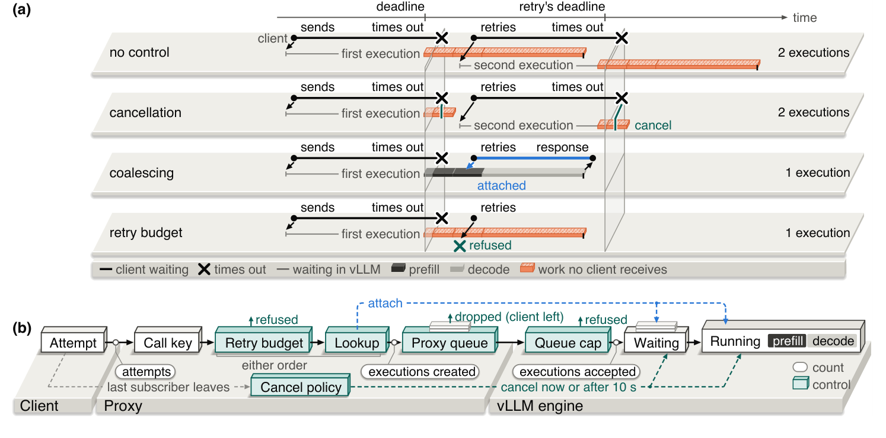查看原图 ↗</a>

*上半图跟踪同一调用的超时与重试；下半图把新建执行、合并、预算和取消放回实际路径。*

无控制时，离开的客户端留下孤儿执行，重试再提交新执行。立即取消会缩短旧执行，但已发往 GPU 的步骤仍会结束，而且它删除了重试可以重新订阅的对象。论文的请求合并按调用标识和完整生成参数寻找仍存活的执行，让后续尝试接回同一份工作，而不是按文本相似度合并不同请求。

这也解释了组合策略为何有顺序问题：先查已有执行、再对确实需要新建的重试施加预算，可以避免拒绝本来不增加引擎负载的重连。作者还测试延迟 10 秒取消，长于其 0.25–3 秒重试退避，使旧执行在重连窗口内继续存活。

### 完成了多少计算，不等于交付了多少回答

开启重试时，立即取消在所有诊断运行中都未于观察窗口内恢复服务；突发后调用最终交付约 12–38%，范围包含混合提示负载。Qwen2.5-7B 轨迹显示，后来被 abort 的执行消耗了 79–85% 的已计算 prompt token，重试通常到离自身截止时间不足半秒才首次运行。这里的 token 与调度器步骤归因不是 GPU kernel 时间测量。

请求合并在对应实验中交付了突发及其后全部调用，但部分已超时限；立即取消会破坏这一效果。延迟取消恢复了重连，但这些运行里没有真正触发最终取消，因此尚未检验“客户端永久离开”后的清理。重试预算可以恢复后续服务，却会丢弃部分突发调用。**这项工作的价值在于把恢复和交付拆开测量**：队列变短、完成 token 增多，都不足以证明用户拿到了结果。

<h2 class="daily-paper-title" id="paper-arxiv-2611.08902">02 · 缓存全失效后，吞吐为什么会误导恢复判断</h2>

[Inside the Trap: A Renewal Law for Prefix-Cache Collapse in LLM Agent Serving](https://arxiv.org/abs/2611.08902)  
Akshat Valse、Ali Jannesari · 2026-11-06

### 流量恢复原样，系统却回不去了

多轮 Agent 的下一次调用会带回旧上下文。前缀缓存有效时，服务能以较低成本处理这些重复 token；突发挤大活跃会话集合后，等待时间延长，同一会话再次到来前，旧 KV 已被其他请求替换。更多 miss 又需要更多 prefill，进一步延长等待，形成自我维持的陷阱。

作者用配对运行区分这种状态和普通突发排队。在两个引擎、两类 GPU、两个模型的注册实验中，200 会话突发使 30 次运行的后续轮次命中率一直保持零；对应无突发运行和限制会话数的运行保持良好。按同时检查积压增长的严格规则，十个负载点通过九个，不能把“30 次零命中”直接说成全部满足所有陷阱判据。

### 队列里被服务的，不再代表稳定工作负载

<a class="note-image-link" href="/assets/images/digest/2026-11-10/cache-trap.png" target="_blank" rel="noopener" aria-label="缓存全失效后，吞吐为什么会误导恢复判断 · 查看原图 ↗">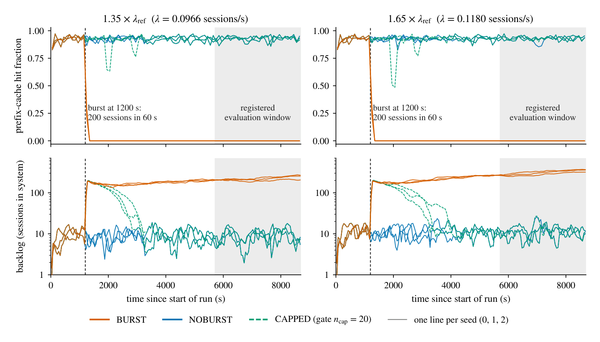查看原图 ↗</a>

*橙线经历突发后命中率归零、会话持续积压；无突发和会话受限的对照仍能复用缓存。*

论文分析一个全 miss、工作守恒、FIFO、多轮完成后立即返回队尾的流体模型。后续轮次上下文更长、成本更高，积压不断增长时，新加入的短会话轮次在实际服务构成中占比上升。作者从 FIFO 轨道推导线性更新递推，刻画轮次间隔增长与倾斜后的轮次分布。

其工程含义是“年轻轮次溢价”：引擎可能完成比稳定全 miss 工作负载容量更多的会话，积压却仍在增长。此时把到达率降到眼前完成吞吐以下，仍可能高于真正的全 miss 排空阈值。完成率看似可观，并不表示系统有足够余量消化所有后续工作。

### 限制竞争集合，让复用重新发生

理论是在读取早期轨迹后形成的。对 57 次已有 stuck 运行的回顾比较中，50 次的被服务 prompt 均值预测误差在 3% 内；每次运行的间隔增长仍有明显离散，不能将汇总吻合当作逐次精确预测。论文另外设计结果盲测，检验减流与不同轮数预算下的预测。

恢复实验中，会话上限在相同外部负载下救回 9/9 个已形成的陷阱，没有丢弃会话，解除限制后仍保持正常。它通过缩小同时竞争缓存的会话集合、将其余会话暂留外侧，恢复上下文复用；不是宣称任意流量都能无损承载。

**这与上一条重试崩溃互补。** 上一条的关键是同一业务调用增殖执行，这里是会话间隔与缓存周转的反馈。模型忽略并发执行、工具等待和实际调度细节，也不证明真实引擎必然收敛到该流体模型。最值得读的是恢复阈值为何不同于观测吞吐，以及作者怎样用配对、回顾和后续盲测分层支撑这个结论。

<h2 class="daily-paper-title" id="paper-arxiv-2603.00468">03 · Cloud-OpsBench：根因答对，还要核对证据是否闭环</h2>

[Cloud-OpsBench: A Reproducible Benchmark for Agentic Root Cause Analysis in Cloud Systems](https://arxiv.org/abs/2603.00468)  
Yilun Wang、Guangba Yu、Haiyu Huang、Yujie Huang、Zirui Wang、Pengfei Chen、Michael R. Lyu · 2026-02-28 · v3 更新于 2026-11-06

### 把“问什么”也放进可比较的评测

静态日志集便于重复实验，却不检验 Agent 是否知道下一步该查哪个服务；每次重新注入故障的 live testbed 保留了交互，但同类故障可能受实时负载、调度与重试影响，表现不完全相同。Cloud-OpsBench 先在真实集群中制造并验证故障，再冻结可观察状态，让不同 Agent 通过工具查询同一份事故证据。

本次阅读的是 11 月 6 日更新的 v3，初稿于 2 月 28 日提交。作者在 OnlineBoutique 和 TrainTicket 上得到 754 个案例、57 类故障，覆盖应用和 Kubernetes 平台。候选故障计划有 800 个，46 个未形成稳定、可诊断的症状而被剔除；这个验证步骤防止将“注入命令执行了”直接等价为“故障真实发生了”。

### 先确认故障，再冻结观测，最后标注诊断事实

<a class="note-image-link" href="/assets/images/digest/2026-11-10/cloud-opsbench.png" target="_blank" rel="noopener" aria-label="Cloud-OpsBench：根因答对，还要核对证据是否闭环 · 查看原图 ↗">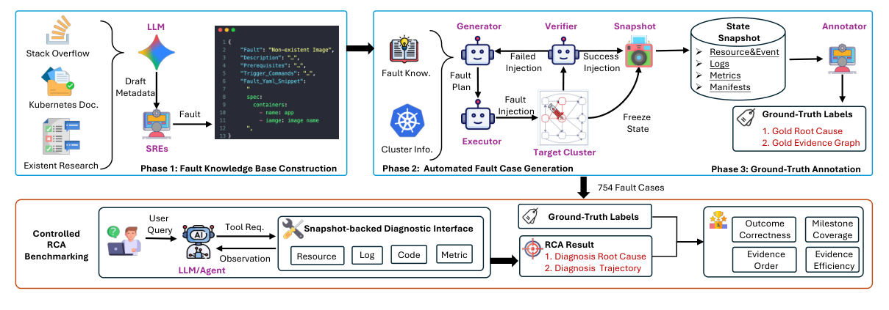查看原图 ↗</a>

*从故障知识到运行验证与状态快照，再通过工具接口比较诊断结果和证据过程。*

构建流程以故障知识生成具体计划，恢复干净部署、建立健康基线后注入，验证器检查机制激活、局部失败与指定上层症状。通过后保存资源、配置、日志、事件、指标与源码等证据。评测接口向 Agent 暴露十二类诊断工具，其参数映射到预先收集的响应；Agent 不直接读取整个快照库。

更有价值的是过程标注。每个案例的 evidence graph 表示需要建立的诊断事实，允许不同工具、不同参数和替代证据组合，不要求复刻一条专家命令序列。例如，Service 没有 endpoint 后，可分别查 selector 与 Pod 标签，也可用同时包含两者的配置证据确认不匹配。事实之间必要的先后关系另行记录。

### 同一个正确答案，可能来自不同质量的调查

十一种 LLM 采用共同 ReAct scaffold 时，两套系统上最高 Joint RCA Accuracy 分别为 0.78 和 0.68。但 GPT-5 在全部评测案例中，分别有 33.1% 和 29.4% 属于“诊断正确、证据未闭合”。这些比例的分母是所有评测案例，不是仅答对的案例，也不意味着这些结论一定是猜中的。

缺口可能来自遗漏后端标签、没有确认数据库实际状态，或停留在显眼的下游错误。它说明最终标签不足以区分可靠调查与尚未完成验证的正确判断；反过来，额外工具调用和更高 token 消耗也未必带来更完整的证据。

**对 AIOps 最值得迁移的是评测对象的分离**：根因定位、机制识别、证据覆盖与调查效率应分别观察。快照只支持已保存工具及参数范围，不能用来评估任意 shell 操作、线上修复或系统随调查演变的行为。证据闭环也取决于标注的事实与覆盖边界，不能提升为生产环境因果证明。

<h2 class="daily-paper-title" id="paper-arxiv-2611.09218">04 · BOXBOX：长任务运行中，让 Agent 修订自己的 harness</h2>

[BOXBOX: Recursive Harness Self-Improvement for Long-Running Performance Optimization](https://arxiv.org/abs/2611.09218v1)（[v1 PDF](https://arxiv.org/pdf/2611.09218v1)）  
Yuhao Tan、Hanyun Jiang、Fangkai Yang、Yuan Yao、Taolue Chen、Bo Qiao、Yu Kang、Lu Wang、Pu Zhao、Xiaoxing Ma、Qingwei Lin · 2026-11-06（v1）

**论文状态说明**：作者已于 2026 年 11 月 9 日在 [arXiv v2 记录](https://arxiv.org/abs/2611.09218v2)中暂时撤回该稿，原文声明为“temporarily to add a clarification regarding the use of Claude Code, in accordance with our company’s compliance requirements”（按公司合规要求补充 Claude Code 使用说明）。本节技术拆解与数字均严格依据已归档的 `arXiv:2611.09218v1` 原文（47 页），作为历史研究机制解读，不再将其中数值作为当前有效排行比较依据；合规补充性撤回本身并不说明实验存在造假。

### PerfRace 基准构造与 Shadow 评测隔离

以往仓库级性能优化基准（如 GSO、SWE-Perf、SWE-fficiency、FormulaCode）多从已知提交或 PR 反推局部 microbenchmark，只在任务结束时评分；但在真实性能工程里，瓶颈并不预先标出，长周期运行也会暴露离线调好的 harness 未曾预见的工具与控制流短板。作者为此构造了 PerfRace：以真实项目与端到端工作负载为核心，不提供参考优化补丁，并在固定总预算 `B = 4h` 内允许 Agent 多次提交工作区快照、由外部 Judge 持续返回正确性与加速比。

基准构建遵循五级漏斗。首先从 2026 年 5 月至 8 月的 ClickHouse `github_events` 检索已知 coding-agent 账号发起的 PR（6,390 个仓库）与分支推送（112,127 个仓库），汇总 118,517 个仓库并成功拉取 104,428 份元数据，去重和可达性检查后留下 103,475 个候选。随后的两阶段 Filter（Table 9）先以确定性规则筛掉低于 10 颗星（93,992 个）、不可达（1,134 个）、缺乏可再分发许可或 Git 跟踪树超过 500 MiB / 25,000 项的仓库，保留 7,257 个；再由 GPT-5.6-Luna 依据源码围绕“安装构建路径、可评测有限过程、Linux x86-64 通用 CPU 容器可行性、本地优化潜力”四道门限筛选，剔除优化潜力不足（4,462 个）、过程不可测（3,066 个）等候选后，余下 239 个进入 Agent–人类 Pair Verification。

在 Pair Verification 阶段，Agent 负责设计工作负载与测量协议，人类审阅员在 Realism（拒绝 132 个）、Reliability（拒绝 6 个）、Integrity（拒绝 0 个）与 Finalize（拒绝 1 个）四道关口逐一审核，最终收编 100 个任务。每项入库任务平均耗费 9.1 小时整理时间（中位数 4.5 小时）、12 次人机交互（中位数 8 次）与 $11.35 Agent 成本（中位数 $8.83）。100 个任务覆盖 7 个领域（开发工具 30、数据系统 25、科学计算 15、媒体处理 9、几何 8、机器学习 7、安全 6）和 16 种主语言（Rust 25、Python 18、TypeScript 15、C++ 11 为主），打包源码中位规模为 886 个文件与 14.56 MiB。在可靠性与防作弊方面，99 项墙钟计时任务的无修改基线变异系数 CV 全部低于 10%（其中 84 项低于 6%），另 1 项智能合约任务 `metamorpho--reallocate` 以确定性 EVM gas（固定 874,508 gas）计量；全部 100 项任务均通过针对空操作、跳过工作、硬编码输出、缓存投机、篡改输入与偷看评测数据六类路径的红队测试（40 项至少经历 2 次红队用例），如在 `rust-clippy--cargo-package-lint` 中通过修改 `clippy-driver` 时间戳与检查 Cargo JSON 非 fresh 工件来堵住缓存复用漏洞。评测划分 40 项训练、10 项验证（供离线基线使用）和 50 项留出测试集。

官方评测采用 Shadow Verification：每次提交时，Judge 通过 `docker compose commit` 暂停任务容器并克隆出独立 shadow 容器运行隐藏的 `tests/test.sh` 与额外正确性用例，评测耗时计入同一 4 小时预算（100 项任务基线 Judge 全量评测中位耗时 4.9 分钟、均值 6.1 分钟，上限 20 分钟）；最后 5 分钟系统会提示 Agent 收尾。每次正确提交记为无修改基线与候选指标的加速比 `s_i`（出错或超时记 0，未提升基线记 `t_0 = 0, s_0 = 1`），跟踪截至时刻 `t` 的最优正确加速比 `S(t) = max_{i: t_i <= t} s_i`。

### BOXBOX 运行时内核：按需进站、只读审阅与热加载边界

<a class="note-image-link" href="/assets/images/digest/2026-11-10/boxbox-runtime-kernel-zh.svg" target="_blank" rel="noopener" aria-label="BOXBOX 运行时内核、状态迁移与回滚边界 · 查看原图 ↗">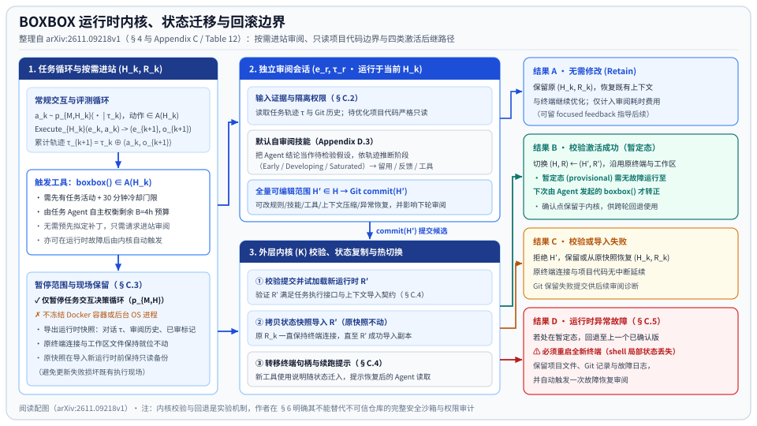查看原图 ↗</a>

*依据 arXiv:2611.09218v1 第四节与附录 C 绘制：Agent 按需调用进站接口，独立审阅会话在只读项目代码边界内提交全量 harness 改动，由外层 kernel 完成快照拷贝验证、终端句柄交接与异常回退。*

形式化上，BOXBOX 固定底座模型 `M`，在交互步 `k` 由当前激活 harness `H_k` 决定模型输入分布 `p_{M,H_k}(· | τ_k)` 与工具执行器 `Execute_{H_k}(e_k, a_k)`。与仅允许改写预设局部的受限方法（`H_bounded ⊆ H`）不同，BOXBOX 开放整个可执行 harness 空间 `H'_k ∈ H`，涵盖提示规则、审阅反馈、技能文档、工具功能、主循环执行逻辑与故障恢复代码，并以 Git 提交版本化管理。由于激活后的 `H_{k+1}` 不仅控制后续任务动作，还直接驱动下一轮审阅会话本身，系统具备“递归自改进”结构。

任务 Agent 通过调用已注册工具 `boxbox() ∈ A(H_k)` 主动触发“进站（pit stop）”，无需预先写出补丁。初始 harness 要求上次审阅后有间隔任务活动且经过 30 分钟冷却门限，之后由 Agent 自行权衡在剩余共享预算 `B` 内是否值得暂停优化工具。内核 `K` 随即将控制权切出：关键边界在于，**内核仅暂停 Agent 的任务决策循环，并不冻结整个 Docker 容器或后台 OS 进程**；同时导出由运行时持有的状态快照（任务对话 `τ`、审阅历史、已审阅轨迹位置），而把正在使用的终端连接与项目工作区留在原地。独立的审阅会话 `(e_r, τ_r)` 在当前 `H_k` 下运行，可读取轨迹与 Git 历史，但把待优化项目代码严格设为只读，并由默认 Self-Review 技能（Appendix D.3）引导：将任务 Agent 的因果解释视作待验证假设，按轨迹所处阶段（`Early` / `Developing` / `Saturated`）决定维持现状、写入 `focused feedback` 或抽象为可复用工具。

候选改动通过 `commit(H')` 提交后，外层内核先检查 Git 提交并试加载新运行时 `R'`，校验任务执行与状态导入接口；在导入前先拷贝一份快照，使原快照与原终端连接在确认成功前保持完好。Table 12 与 Appendix C.5 定义了四类激活后继路径：

| 审阅与加载结果 | 运行时切换与状态处理 | 终端与恢复边界 |
|---|---|---|
| 无需修改（Retain） | 保留原 `(H_k, R_k)`，迁回既有对话与审阅状态 | 原终端与工作区无中断延续，可附带审阅反馈指导后续 |
| 校验并激活成功 | 切换为 `(H', R')` 并设为暂定态（provisional） | 沿用同一终端连接与工作区；须无故障运行至下一次 Agent 主动发起的 `boxbox()` 才转为已确认点 |
| 校验或状态导入失败 | 拒绝候选，保留或从原快照恢复 `(H_k, R_k)` | 原终端与项目文件不受影响，失败提交留存于 Git 供后续审阅诊断 |
| 运行时异常故障 | 若当前为暂定态则回退至上一个已确认 `(H, R)` | 内核重启**全新终端**（shell 局部状态如环境变量与后台作业丢失），保留项目文件、Git 与故障证据并自动进入故障审阅 |

从 150 次测试运行中收集的 620 次有效非空修改（Fig. 5(c)）看，修改分布为提示规则 42.9%、审阅反馈 40.8%、工具功能 16.9%、技能 16.6%、故障修复 12.7% 与执行逻辑 4.7%（单次提交可跨类）。典型案例（Appendix A.4）具体说明了这类任务内调整如何起效：在 `ccc--compile-speed` 中，Agent 通过 3 次审阅先写出批量计时助手、再补入分阶段耗时解析，最后加入交替 A/B 顺序运行检验，从而识别并否决了一项分批测试看似快 9.4%、实为噪声波动的假增益，最终把 SQLite 编译时间从 6.321 秒降至 5.792 秒（1.748×）；在 `rust-clippy--cargo-package-lint` 中，Agent 将普通命令内部轮询等待上限延展至 `AUTO_COMMAND_WAIT_SEC = 180` 以削减纯等待轮次，并把 shell 退出异常替换为调用 `ensure_agent_session()` 的无重放恢复；在 `trixi-framework-trixi-jl--self-gravitating-sedov-amr` 中，针对后期高达约 145,000 input token 的长历史开销，Agent 在消息数达到 64 条且距上次压缩增加 24 条时触发主动摘要压缩。

### 可控对照、消融实验与失效/度量边界（v1 历史记录）

<a class="note-image-link" href="/assets/images/digest/2026-11-10/perfrace-harness-comparison-zh.svg" target="_blank" rel="noopener" aria-label="PerfRace 基准筛选漏斗、可控对照结果与消融边界 · 查看原图 ↗">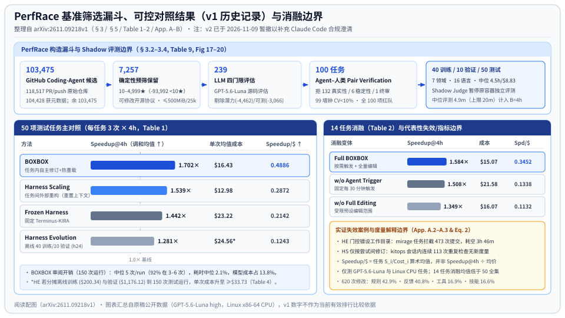查看原图 ↗</a>

*依据 arXiv:2611.09218v1 Table 1–2 与附录 A–B 绘制：展示 PerfRace 筛选漏斗、50 项测试任务主对照及 14 项任务消融数值；v2 暂撤后仅作 v1 历史方法记录。*

主实验在 Azure `Standard_D96ads_v5`（96 vCPU AMD EPYC 7763、384 GiB 内存、Ubuntu 24.04 + Docker）上运行，全部方法均从同一终端基座 `Terminus-KIRA` 起步，任务执行与 harness 优化均使用 `GPT-5.6-Luna`（high 推理强度，计价为未缓存输入 $1.00/M、缓存输入 $0.10/M、输出 $6.00/M），50 项测试任务每任务独立跑 3 次、每次 `B = 4h`（合计 600 次测试运行）。作者先对单任务 3 次运行的最优正确加速比取几何平均 `S_i`，再跨 50 项任务取**调和平均**作为 `Speedup@4h`（抑制少数极端加速任务拉高均值），同时以任务级 `S_i / Cost_i` 的**算术平均**作为 `Speedup/$`。下表汇总 v1 原文 Table 1 主实验与 Table 2 随机抽取 14 项测试任务的消融结果：

| 实验组与方法（arXiv:2611.09218v1） | 范围 | Speedup@4h（调和均值） | 单次均值模型成本 | Speedup/$（任务比值均值） | 核心运行机制与观察现象 |
|---|---|---|---|---|---|
| BOXBOX（主实验 Table 1） | 50 任务 × 3 次 | 1.702× | $16.43 | 0.4886 | 任务内按需修订并保留上下文热重载；后 2 小时从 1.530× 续升至 1.702× |
| Harness Scaling（HS，尝试间外环） | 50 任务 × 3 次 | 1.539× | $12.98 | 0.2872 | 2,132 次尝试（中位 12 次/run、切换间隙 3.37 分钟）；重置上下文降 token 但丢推理记忆 |
| Frozen Harness（FROZEN，固定基座） | 50 任务 × 3 次 | 1.442× | $23.22 | 0.2142 | 保持 `Terminus-KIRA`（均值 ~965 步）；后 2 小时仅从 1.410× 微升至 1.442× |
| Harness Evolution（HE，离线 `h24`） | 50 任务 × 3 次 | 1.281× | $24.56（分摊后 ≥$33.73） | 0.1243 | 40 训练/10 验证离线迭代未稳步提升；分摊 $200.34 训练与 $1,176.12 验证后成本最高 |
| Full BOXBOX（消融 Table 2） | 14 任务抽样 | 1.584× | $15.07 | 0.3452 | 同时保留 Agent 自主触发与全量可执行代码编辑 |
| w/o Agent Triggering（固定 30 分钟） | 14 任务抽样 | 1.508× | $21.58 | 0.1338 | 定时打断正在推进的代码实验，且在无需改动时仍空耗审阅模型调用 |
| w/o Full Editing（预设受限范围） | 14 任务抽样 | 1.349× | $16.07 | 0.1132 | 边界限制使 Agent 无法跨模块修改上下文管理或错误恢复逻辑 |

审阅成本分解（Fig. 5）显示：BOXBOX 在 150 次运行中中位触发 5 次审阅（92% 落在 3–6 次，含故障恢复审阅），审阅耗时仅占 4 小时预算中位数 2.1%，模型费用占总成本中位数 13.8%。值得仔细核对两个读数细节：第一，BOXBOX 的均值成本（$16.43）虽比 Frozen（$23.22）低 29.3%，但仍高于 Harness Scaling（$12.98），因为 HS 每次尝试清空对话历史压低了输入 token，代价是后续尝试需重新探测已验证结论；第二，`Speedup/$` 是逐任务比值 `S_i / Cost_i` 的算术平均，而非 `Speedup@4h ÷ 均值成本`，因此受高加速低开销任务的比值影响更大，不能简写成“所有基线中花钱最少”。

基线失效轨迹（Appendix A.2–A.3）进一步揭示了离线与尝试间外环的脆弱性：HE 在训练第 5 轮为防止虚报噪声提速而强加 `.autoresearch/promotion.json` 与 `git rev-parse HEAD` 门控，但默认在父工作区执行检查，结果在 `mirage-kubernetes-triage` 测试任务中连续拦截 473 次提交请求、耗尽约 3 小时 46 分钟；此外 HE 训练轮次出于可控性被限制为 45 分钟（5 任务 mini-batch），也与测试期 4 小时节奏存在分布差异。HS 则在 `kitops-minilm-pack` 上由外环添加“连续 3 批相同命令”重复警告，但任务 Agent 换用不同命令写法绕过字面匹配，在单次会话内连续执行 113 次无新度量的重复检查，因为外环只能在尝试结束后才能再次介入修改 harness。

### 工程启示、安全与适用性边界

从方法定位看，BOXBOX 与同日 `DeCAF`（离线拆维搜索并验证跨维合成）及 `PatternOps`（运行时重载导致策略与审批回调顺序失配）形成互补对照：BOXBOX 展示了任务内动态修补工具与控制流的机制收益，但**内核级接口校验与 Git 回退并不构成安全边界或策略不变式证明**。作者在第六节“Security and Responsible AI Limitations”明确指出，让 Agent 在可能包含不可信代码的仓库中修改自身可执行 harness，会引入权限削弱、安全回归与非预期能力扩张风险；隔离容器与 Shadow Verification 仅能降低实验风险，BOXBOX 应视作研究原型，生产部署必须补充更严格沙箱、访问控制、安全审计与人工审批。

从实验外推边界看，v1 实证全部基于单一模型（`GPT-5.6-Luna` high effort）、单一初始终端框架（`Terminus-KIRA`）和 Linux x86-64 纯 CPU 本地可测任务，未覆盖 GPU kernel、分布式集群或需要在线外部服务的场景；14 项任务消融抽样的基线加速（1.584×）明显低于 50 项全集（1.702×），也说明跨任务方差较大，不宜把特定样本的百分比直接外推到任意工程仓库。叠加 2026 年 11 月 9 日因补充 Claude Code 合规澄清而作出的 v2 暂时撤回，当前最稳妥的阅读定位是吸收其 `boxbox()` 状态快照隔离与“按需进站 + 只读代码审阅”的系统设计思路，待作者发布合规修订版后再评估最新实验记录。

<h2 class="daily-paper-title" id="paper-arxiv-2611.09088">05 · PatternOps：插件都在线，策略却可能已被绕过</h2>

[When Routine Operations Break Architectural Pattern Relationships in LLM Agent Harnesses](https://arxiv.org/abs/2611.09088)  
Boming Xia、Qinghua Lu、Dino Sejdinovic、Liming Zhu · 2026-11-06

### 无需代码变更，也会破坏执行关系

一个插件做策略判断，另一个插件征求人工批准，宿主决定它们的调用顺序。每个部件单独可用，并不保证“所有工具调用都先经过策略”。这篇研究检查五个已发布 harness、十四个主样本插件，关注 Guardrail Enforcement Point、Autonomy Controller 和 Blackboard 的五种关系，以及日常操作会怎样改变关系。

PatternOps 从模式要求、提供方承诺和具体部署需求追到实现组件，再追到能作判断的运行记录。研究采用受控工具序列，也用真实模型选择动作检验部分路径。其关键不是统计插件报错数量，而是将同一次操作的工具调用、策略决策、批准记录和最终文件效果关联起来。

### 重应用和保存 allow，都可能改变实际路径

<a class="note-image-link" href="/assets/images/digest/2026-11-10/patternops.png" target="_blank" rel="noopener" aria-label="PatternOps：插件都在线，策略却可能已被绕过 · 查看原图 ↗">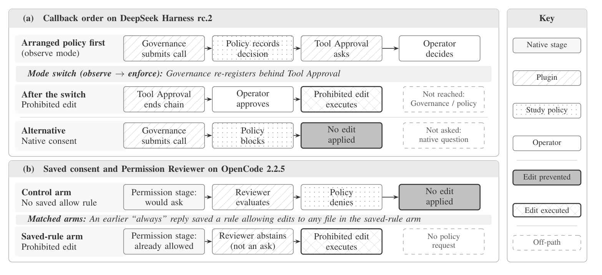查看原图 ↗</a>

*上方重应用改变回调顺序，下方长期 allow 改变审核资格；两条路径都可能绕过原先承担策略的部件。*

在 DeepSeek Harness 的一组组合里，原先排在前面的策略插件被重应用后，旧回调注销、新回调追加到队尾。批准插件先运行，其返回会结束调用链，于是禁止编辑在人工批准后仍能执行。插件管理器显示两者活跃，策略还可以拦截读取，普通健康检查没有暴露编辑路径已绕过策略。

OpenCode 的另一条路径中，保存长期 allow 规则会让权限请求被视作已经获准；只审核“需要询问”的插件不再评估后续编辑。这里不能简单说插件违反自身承诺：只审核 ask 的接口承诺，与部署者要求所有编辑均经过策略之间存在错配。

### 先定义要保住的关系，再选放置位置

研究比较原生批准、固定回调顺序、就地更新与更靠近工具执行的检查。修好某次重应用不保证冷启动顺序也正确；拦住全部禁止效果，也不意味着所有被其他组件提前拒绝的编辑都曾经过策略。对“策略决定所有执行”“每次编辑都必须被评估”“升级请求需要重新征求批准”，正确的组件放置与状态要求不同。

具体证据中，DeepSeek Harness 五个 API 模型在批准插件组合下做了 28 次读取和 28 次编辑：策略覆盖全部读取、没有覆盖编辑。这个结果来自特定版本、配置和操作序列，不是全部 harness 的故障率，也不能推广为某个模型更容易绕过策略。

**它把 AgentOps 的验证单位从静态配置推进到运行历史。** 最值得读的是如何用决策记录连接真实效果，以及修复方案为何必须按要求逐一比较。本期 BOXBOX 提供在线升级机制，这项研究则解释升级后仍须保持哪些关系；两者解决的问题不同，都有独立价值。

## 研究动态

<h2 class="daily-paper-title" id="paper-arxiv-2611.08638">06 · MORTIS：从程序变量推断缓存该留多久</h2>

[MORTIS: Compiler-Guided KV-Cache Management for LLM Agent Programs](https://arxiv.org/abs/2611.08638)  
Xiaoyu Ma、Jayanaka L. Dantanarayana、Savini Kashmira、Baichuan Li、Lingjia Tang、Jason Mars · 2026-11-05

普通前缀缓存把首个变化位置之后的内容视为不透明后缀。MORTIS 针对以 typed LLM function 调用生成提示的 Agent 程序，从变量定义、追加与覆盖关系识别内容的共享方式和寿命，再结合运行时分支及调用间隔预测，协调提示组件排序、保留、驱逐与预取。

<a class="note-image-link" href="/assets/images/digest/2026-11-10/mortis.png" target="_blank" rel="noopener" aria-label="MORTIS：从程序变量推断缓存该留多久 · 查看原图 ↗">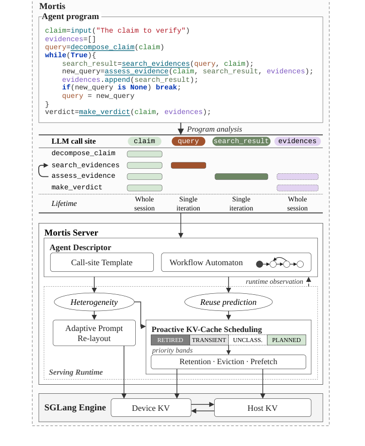查看原图 ↗</a>

*变量寿命与工作流分析生成描述，服务端再据此调整提示顺序与缓存优先级。*

它把已结束会话的易变尾部、活跃会话暂态内容、未分类缓存和预计复用的前缀分成不同驱逐优先级。四个 Agent 工作负载上，相对 SGLang，平均作业完成时间与吞吐的几何平均加速分别为 1.45×、1.49×，最高 1.99×、1.97×。这里通过程序语义改善现有前缀复用，不是任意文本段的位置无关缓存；静态无法确定的值采取保守分类，提示重排的质量影响也需检验。

<h2 class="daily-paper-title" id="paper-alphaxiv-2611-flashstate">07 · FlashState：循环状态与 KV 必须在同一位置可复用</h2>

[FlashState: Unlocking Flexible Hybrid State Management for Agentic LLM Serving](https://www.alphaxiv.org/abs/2611.flashstate)  
Chenxi Li、Weili Xu、Tianyi Zhang、Jue Wang、Zhongzhu Zhou、Chenfeng Xu · 2026-11-09

混合注意力模型不能只保留 KV：恢复位置还必须有匹配的循环状态。FlashState 将 checkpoint 位置与 KV block 边界解耦，在请求完成时捕获真实末端状态；结合后端导出与依赖感知、代价感知的统一准入和驱逐，避免“KV 还在，所需循环状态已被逐出”。

每引擎两张 B200、相同缓存预算的 coding-agent 轨迹上，GLM-5.3-Flash、Nemotron 3 Super、Qwen3.8-Flash-Next 的 prefill 吞吐最高分别为 vLLM 的 3.14×、2.27×、1.54×，GLM 的 p90 TTFT 最高下降 88.4%。这是特定并发与上下文配置的结果。它与 MORTIS 的变量分析、以及独立 H200 文章的 decode KV 共享互补，不能把三者加速简单相乘。

<h2 class="daily-paper-title" id="paper-arxiv-2611.09109">08 · DARIC：按偏差分布分配重算预算</h2>

[DARIC: A Position-Independent KV Cache Reuse System with Distribution-Aware Recomputation](https://arxiv.org/abs/2611.09109)  
Weikang Wang、Haiyang Liu、Xin Zhou、Jun Liu、Weifeng Zhang · 2026-11-06

位置无关复用把独立文档的 KV 搬到不同前缀后，缺少跨块注意力会改变中间状态。DARIC 实测块内开头偏差较大、靠后块偏差增加，以及最近窗口的重要性，据此选择各块起始 token 和末端窗口重算，而不是对所有 token 做昂贵的在线偏差排序。

系统将所选工作拆为标准子请求，尽量保留现有引擎的调度与执行优化。论文在 RAG、function calling 和 agentic coding 场景比较质量与 TTFT，摘要报告相对先进方法 1.1–4.5× TTFT 加速；相对完全重算的倍率另有分母。它推进的是低开销选择与集成，不能保证任意模型、分块与提示上的零质量损失。与 Nebula 的集群管理不同，两项工作均应保留。

<h2 class="daily-paper-title" id="paper-arxiv-2611.09474">09 · Nebula：让位置无关缓存跨工作节点复用</h2>

[Nebula: Distributed Position-Independent Caching for LLM Serving](https://arxiv.org/abs/2611.09474)  
Yifei Liu、Junbin Pan、Junhao Hu、Yang Liu、Junyi Chen、Juntong Wu、Chen Chen、Haiyuan Zhao、Xiaoxu Chen、Weihang Chen · 2026-11-06

单节点能复用文档片段，不等于集群能找到远端片段或把冷片段分给空闲节点。Nebula 将应用标注的 PIC segment 作为分布式对象：先匹配完整前缀，再查其余片段，安排 scatter prefill，最后在 combine 节点汇合并执行必要重算。

控制面用乐观记账与事件更新维护异步状态；驱逐后的 ghost hit 调整前缀缓存与 PIC 的容量份额；调度联合考虑排队、计算和 KV 传输。四模型、四类 RAG/Agent 工作负载的主评测中，相对最强基线，中位 TTFT 平均下降 61.4%，找回前缀缓存漏掉 token 的 76.1%。质量取舍仍由可插拔 PIC 算法承担，集群框架没有让独立片段 KV 自动变成精确全上下文状态。

<h2 class="daily-paper-title" id="paper-arxiv-2611.08770">10 · ReKV：传前面层的 KV，同时重算后面层</h2>

[ReKV: Overlapping Quantized KV Transfer and Suffix Recomputation](https://arxiv.org/abs/2611.08770)  
Guangjian Dong · 2026-11-05

ReKV 的 prefix/suffix 指模型层，不是把输入文本切成前后两段。prefill 端发送前面层的量化 KV 和一个 BF16 边界隐藏状态；decode 端从边界重算连续后续层，同时接收前面层的缓存，以链路带宽与重算代价决定切分位置。

跨节点 H100、8K prompt 的模型形状合成基准中，Q8 联合方案相对 BF16 全量传输为 2.36–3.65×。真实权重的独立 BF16 实验仅测到首 token 返回，收益 1.16–1.63×，并未验证重建 Q8 缓存后的完整解码。更快链路或短提示也可能更适合纯传输。它提供值得研究的重叠机制，证据仍是受限原型，不应写成成熟 serving 系统的整体加速。

<h2 class="daily-paper-title" id="paper-arxiv-2611.09722">11 · FOSCAR：把逐元素反量化移出关键路径</h2>

[FOSCAR: Accelerating Decode Attention over 2- and 4-Bit KV Caches through Affine Folding](https://arxiv.org/abs/2611.09722)  
Donglin Zhuang、Pragaash Ponnusamy、Xiaoxia Wu、Shuaiwen Leon Song、Zhongzhu Zhou · 2026-11-06

2-bit KV 节省带宽，却可能被整数转浮点及 scale/offset 的逐元素运算卡住。FOSCAR 利用仿射变换与矩阵乘法的关系，根据 token-wise 或 channel-wise 分组，把 scale 移到另一操作数或累加结果，把 offset 变成输出修正，并配合位操作和 Hopper/Blackwell 专用流水线。

<a class="note-image-link" href="/assets/images/digest/2026-11-10/foscar.png" target="_blank" rel="noopener" aria-label="FOSCAR：把逐元素反量化移出关键路径 · 查看原图 ↗">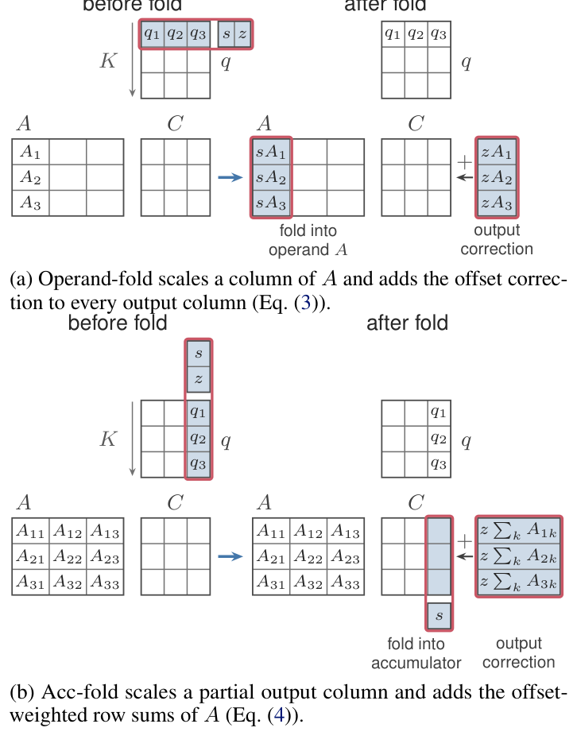查看原图 ↗</a>

*按 scale 所共享的维度，将缩放移入输入或输出，并单独处理 offset 的贡献。*

H100 上 INT2/INT4 相对 FlashInfer BF16 的 kernel 几何平均加速为 3.36×/2.83×；B200 上相对原生 TensorRT-LLM NVFP4 则为 1.16×/1.00×。这个较近基线明显缩小优势。折叠在精确算术中保持反量化后的结果，但不会消除 KV 本身的低比特误差；SGLang 长上下文吞吐收益另受容量与并发影响，不能用 kernel 倍率代替。

<h2 class="daily-paper-title" id="paper-arxiv-2611.09825">12 · BitDecoding-FP4：原生 FP4 解码先解决误差和 softmax</h2>

[BitDecoding-FP4: Native FP4 KV Cache Decoding via Algorithm-System Co-Design](https://arxiv.org/abs/2611.09825)  
Dayou Du、Woon Yee Ng、Guangming Sheng、Nick Lau、Jianyi Cheng、Luo Mai · 2026-11-06

原生 FP4 Tensor Core 可以免除先展开到高精度的路径，但 Q、K 和概率都可能量化失真。BitDecoding-FP4 用两份 FP4 表示 query 本体与残差，结合 key 去异常值和概率下溢感知缩放；系统将 softmax 转置，让线程沿 keys 分工，并把残差 query 填入原来空置的矩阵 tile。

<a class="note-image-link" href="/assets/images/digest/2026-11-10/bitdecoding-fp4.png" target="_blank" rel="noopener" aria-label="BitDecoding-FP4：原生 FP4 解码先解决误差和 softmax · 查看原图 ↗">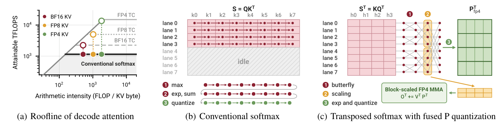查看原图 ↗</a>

*转置后按 key 分配线程，归约过程同时生成 FP4 概率的缩放信息，减少空闲线程与额外遍历。*

vLLM 集成保留 BF16 sink/recent token，整页填满后才转入 FP4 KV。作者在长上下文与推理评测上报告 NVFP4 平均与 BF16 相差不到 0.5 分；B300 上 Qwen3 的峰值服务吞吐为 BF16 的 2.4–3.0×。这些是特定模型、缓存策略和运行点的结果，不是每任务精度差都小于 0.5，也不是没有高精度缓冲的纯 FP4 全路径。

<h2 class="daily-paper-title" id="paper-arxiv-2611.08713">13 · ResServe：用窄矩阵的空余算力补回激活残差</h2>

[ResServe: Accurate and Efficient FP4 LLM Inference with Residue Compensation](https://arxiv.org/abs/2611.08713)  
Shuo Rong、Ruibo Fan、Jiawen Wen、Xiaowen Chu · 2026-11-05

ResServe 将激活拆为 FP4 本体和再次量化的残差，两者乘同一组权重，并在片上合并输出。decode 矩阵行数很少时，新增残差行可以利用原本空闲的 tile；attention 则在 softmax 前合并 query 两部分产生的分数。prefill 行数较多时只选择部分通道补偿，控制额外计算。

B200、8K 输入/256 输出、每秒一次请求的 NVFP4 实验中，相对 W4A4 额外请求延迟至多 3.4%，相对 W4A8 延迟下降 22.4–53.3%。五模型代码生成的平均相对精度改善 15.04% 不能读成 15 个百分点。它和 BitDecoding 都用 query 残差，但本工作还覆盖 linear 层，利用 shape 余量；不是证明残差计算在大 batch 或 prefill 中也免费。

<h2 class="daily-paper-title" id="paper-arxiv-2611.09225">14 · Fused-Softmax：低精度 GEMM 变快后，移走向量瓶颈</h2>

[Fused-Softmax for efficient quantized attention](https://arxiv.org/abs/2611.09225)  
Tianxing Wu、Juuso Korhonen、Jesus Carabano Bravo · 2026-11-06

低精度矩阵吞吐增长快于向量单元，attention 的 softmax 可能成为新瓶颈。Fused-Softmax 冻结推测最大值、仅在越界时回退修正；把指数近似的仿射变换折入 score GEMM 与格式转换，再用矩阵乘法计算归一化分母，将稳态循环的大部分向量工作搬走。

MI355X 上 MXFP8/6/4 attention 相对 BF16 为约 2.1×/2.8×/3.2×。Wan2.2 视频生成的混合 MXFP6/4 调度端到端最高 2.05×，不能直接推广到自回归 LLM decode。附加近似误差低于相应量化误差的结果来自论文测试分布；冻结最大值的阈值也需结合序列长度与数值范围理解，不是任意输入上的精确 softmax 等价变换。

<h2 class="daily-paper-title" id="paper-arxiv-2512.24637">15 · MSched：切换 GPU 任务时，提前准备下一份工作集</h2>

[Towards Fully-fledged GPU Multitasking via Proactive Memory Scheduling](https://arxiv.org/abs/2512.24637)  
Weihang Shen、Yinqiu Chen、Rong Chen、Haibo Chen · 2025-12-31 · v3 更新于 2026-11-06

GPU 显存超售后，逐页缺页迁移容易把大工作集拆成大量昂贵的小事件，整进程换出又搬走许多暂时不会访问的数据。MSched 利用 kernel 参数化访问模板、历史执行与缺页反馈预测工作集，将主动迁移纳入任务切换；调度和内存管理共享后续访问顺序，指导页面替换。

科学计算、深度学习与 LLM 混合负载中，最高相对 demand paging 为 186.69×、相对整进程换出的 Nixie 为 8.63×；最大收益来自 H20 大显存、大工作集组合，不能视为一般任务平均收益。动态 MoE 访问还依赖反馈修正，不是静态参数能完全预测所有内存。初稿为 2025 年 12 月 31 日，本次对应 11 月 6 日 v3 更新。

<h2 class="daily-paper-title" id="paper-arxiv-2607.00466">16 · ELDR：按专家使用相似性路由 decode 请求</h2>

[ELDR: Expert-Locality-Aware Decode Routing for PD-Disaggregated MoE Serving](https://arxiv.org/abs/2607.00466)  
Sangjin Choi、Sukmin Cho、Yifan Xiong、Ziyue Yang、Youngjin Kwon、Peng Cheng · 2026-07-01 · v3 更新于 2026-11-06

ELDR 利用 prefill 已经经过的 MoE gate，统计离散专家激活次数，经 IDF 加权、层筛选与归一化形成请求签名。相似请求分到同一 decode worker，减少一个 batch 需要触达的不同专家；均衡聚类和 locality-band 路由又约束热点，避免只顾局部性而拉高尾延迟。

vLLM、MI300X 集群上，主配置 8P16D，最大 235B 模型配置达 40 GPU；作者报告中位 TPOT 平均下降 5.4–14.5%、最高 17.8%。它依赖 prefill 对 decode 专家行为的预测相关性，离线校准的层掩码、IDF 和专家放置并不在线全面重学。适合研究工作负载结构与负载均衡的联合优化，不能把专家相似直接当成任意混合流量的稳定收益。

<h2 class="daily-paper-title" id="paper-arxiv-2611.08669">17 · ChainFlow：从近期隐状态短程传输，生成投机草稿</h2>

[ChainFlow: Few-Step Latent Flow Matching for Speculative Decoding](https://arxiv.org/abs/2611.08669)  
Selim Aktas、Yusuf Erdem Erdem、Ahmed Zeer、Himmet Toprak Kesgin、Muzaffer Kaan Yuce、Mehmet Fatih Amasyali · 2026-11-05

ChainFlow 以目标模型近期隐状态为条件，用 VAE 压缩后外推未来起点，再用少步 flow transport 同时起草多个位置。轻量 Markov/path heads 根据已经选中的 token 修正位置依赖，随后树搜索候选由目标模型统一验证。主服务配置训练两步、推理一步，不能把流程图的两步直接当线上配置。

B300、vLLM 0.31.0、Qwen3.5-4B、batch 1、greedy 条件下，主树配置平均相对自回归 1.87×，同规模 EAGLE-3/DFlash 为 1.35×/1.69×，对应约 39%/11% 的相对优势。链式消融只有 1.23×，说明树与依赖恢复很关键。需要额外训练 drafter，且收益依赖验证成本、并发和任务分布。

<h2 class="daily-paper-title" id="paper-arxiv-2611.08660">18 · AutoParallel：自动规划后，仍得到普通 PyTorch 程序</h2>

[AutoParallel: Composable, PyTorch-Native Automatic Parallelism for Production Training](https://arxiv.org/abs/2611.08660)  
Kaijian Wang、Sanket Purandare、Aditya Venkataraman、Will Constable、Ivan Kobzarev、Elias Ellison、Simon Fan、Edward Z. Yang、Davide Italiano、Patrick Labatut、Yuke Wang、Francisco Massa · 2026-11-05

AutoParallel 将前向与反向追踪为 ATen 图，为算子枚举合法 DTensor 分布策略，联合求解计算与重分布代价，最后生成可检查、可重放的原生 PyTorch 模块。高维 mesh 用近似搜索控制组合空间；动态 MoE 或定制 context parallel 区域通过 local_map 的输入输出放置契约保留给人工实现。

最多 128 张 H100 的 dense、hybrid 与 MoE 训练上，大多数配置达到或超过专家 TorchTitan recipe，吞吐最高提升 18.3%。这个增量的意义是可组合与维护性，不只是最高倍率。代价模型、代表性输入及内存可行性仍影响选出的计划；负载长度改变后重规划有收益，不能认为一次自动计划适用于所有训练形状。

<h2 class="daily-paper-title" id="paper-arxiv-2611.08723">19 · DeCAF：先分开实验，再验证优化能否合成</h2>

[Divide, Diagnose, and Compose: Optimizing Agentic Pipelines and Harnesses](https://arxiv.org/abs/2611.08723)  
Divij Handa、Christopher Tensmeyer、Jihyung Kil、Vlad I. Morariu · 2026-11-05

DeCAF 根据任务和初始 Agent 流水线划分提示、拓扑、模型与工具策略等优化维度，各维度从同一 seed 出发，在限制编辑范围内尝试多种假设，记录成功和失败实验，保留性能、费用、时延的非支配候选。最终合成阶段重新端到端验证兼容性，而不是把单独有效的修改直接堆叠。

组件轨迹评估器按职责检查正确性、遵循与下游利用，定位可能的问题；其评分不是精确因果贡献。AppWorld、LiveCodeBench、AgentDojo、PostTrainBench 的比较中，相对最强总体基线平均任务性能 +2.58 个百分点、推理费用 -4.30%、时延 -42.45%。这些是优化后推理开销，不能忽略搜索自身成本。与 BOXBOX 不同，它重点组织离线搜索证据和跨维度合成。

<h2 class="daily-paper-title" id="paper-arxiv-2611.09048">20 · LeanDojo-v2：把证明数据、训练与搜索接成工具链</h2>

[LeanDojo-v2: A Comprehensive Library for AI-Assisted Theorem Proving in Lean](https://arxiv.org/abs/2611.09048)（[v1 PDF](https://arxiv.org/pdf/2611.09048v1)）  
Ryan Hsiang、William Adkisson、Robert Joseph George、Anima Anandkumar · arXiv · 2026-11-06（v1 · 录用于 NeurIPS 2025 MATH-AI Workshop）

**论文状态与审校范围**：截至核验时（2026 年 11 月 15 日），[arXiv:2611.09048](https://arxiv.org/abs/2611.09048) 仅有 `v1` 归档版本（提交于 UTC `2026-11-06T06:21:06Z`，正文加附录共 11 页、7 张图表），不存在 `v2` 修订或撤回记录。下述架构流程、API 用法与构建耗时改善严格依据 `arXiv:2611.09048v1` 原文；为核实工程接口边界，我们也核对了作者公开的配套仓库 `lean-dojo/LeanDojo-v2` 与 `lean-dojo/lean4code`，文中凡涉及论文 PDF 未展开的源码实现符号（如 `DynamicDatabase`、`BaseProver.search()`、`build_deps` 开关与 `ProgressTrainer`），均已明确标注其代码核验来源，不与论文正文断言混淆。

### 一、从 LeanDojo-v1 碎片工具链到统一架构与仓库抽取

大模型在自然语言数学推理上表现突出，但推理过程缺乏可验证性，容易出现幻觉与逻辑跳跃；Lean 既是编程语言也是交互式定理证明器，能对数学命题与证明步骤做确定性机器校验。然而，在 LeanDojo-v2 之前，AI + Lean 工具分散在各自独立的研究项目中：LeanDojo（NeurIPS 2023，`arXiv:2306.15626`）负责从仓库抽取前提与证明数据，ReProver 在其数据上训练检索增强模型，LeanCopilot（`arXiv:2404.12534`）通过本地 C++ 推理把模型接入 Lean 4 VSCode 插件，LeanAgent（ICLR 2025，`arXiv:2410.06209`）在多领域间做终身课程学习，ImProver（`arXiv:2410.04753`）与 `ntp-toolkit`、`Lean4trace`、`LeanNavigator` 以及 Pantograph（`arXiv:2410.16429`）、Kimina Lean Server（`arXiv:2504.21230`）等 REPL 各自维护。它们不仅版本容易失步，而且配置门槛高，使缺乏工程背景的数学研究者难以上手，而通用预训练模型在特定数学子域和复杂定理上仍明显吃力，需要围绕目标代码库做领域抽取与微调。

<figure class="note-figure"><a class="note-image-link" href="/assets/images/digest/2026-11-10/leandojo-v2-architecture-zh.svg" target="_blank" rel="noopener" aria-label="查看 LeanDojo-v2 端到端工具链架构图原图">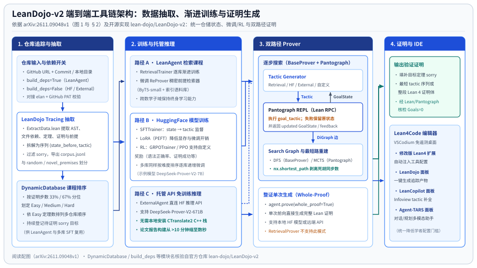查看原图 ↗</a><figcaption>图 1 · LeanDojo-v2 端到端工具链架构：依据 arXiv:2611.09048v1 图 1 与第二节绘制，并标注开源仓库 lean-dojo/LeanDojo-v2 中对应的 DynamicDatabase、build_deps 与 Prover/Trainer 实现模块。</figcaption></figure>

LeanDojo-v2 的核心增量是把「数据抽取（Data Extraction）— 模型训练或托管调用（Trainer / API）— 证明生成与搜索（Prover）— 桌面交互界面（Lean4Code）」收束进同一套库与标准化接口中。在数据抽取入口上，用户指定一个或多个 Lean 仓库的 GitHub URL 与 commit 哈希（配套仓库亦提供 `setup_local_repository()` 支持本地路径），LeanDojo 借助插桩脚本（源码中为 `ExtractData.lean` 与 `trace.py`）编译并追踪仓库，抽取抽象语法树（AST）、文件与前提依赖关系、定理声明、既有证明以及可引用前提。

在后续训练样本构造上，LeanDojo-v2 将每条已有定理证明拆解成一串 `(proof state, tactic)` 转移序列，以当前证明目标状态 `state_before` 作为模型输入，以对应的单步 `tactic` 作为预测目标。配套仓库中的 `DynamicDatabase` 进一步承担跨仓库的状态持久化与切分导出：它先过滤掉 `sorry` 占位与 `"no goals"` 终态，将抽得定理按 `random` 与 `novel_premises` 两种划分导出为 `corpus.jsonl` 与 JSON 数据集，并持续追踪尚未解决的 `sorry` 定理供后续 `prove()` 阶段自动回填；同时通过 `build_deps` 开关控制是否解析外部依赖仓库中的前提（`LeanAgent` 默认开启 `True` 以支撑跨依赖检索，而面向快速微调或推理的 `HFAgent` 与 `ExternalAgent` 默认关闭 `False`，以换取更低的追踪成本）。

### 二、渐进课程训练、微调/RL 与托管 API 推理体系

围绕「既有小模型能领域适配、超大开源模型也能零配置调用」的双重需求，LeanDojo-v2 把训练与推理抽象到统一生命周期中（源码由 `BaseAgent` 定义 `setup_github_repository()` → `train()` → `prove()` 统一编排），并提供三条并行路径：

1. **LeanAgent 检索课程路径**：继承并整合 LeanAgent 的终身学习设计。系统先统计每条已证定理的证明步数（源码 `difficulty.py` 使用 `math.exp(len(proof_steps))`，`sorry` 记为 `inf`），按证明步数的**第 33 百分位与第 67 百分位**将定理划分为 `easy`、`medium`、`hard` 三档，再依据各仓库所含 `easy` 定理数量排序，按「从易到难」顺序在多个仓库上渐进微调 ReProver 的稠密前提检索器（配套仓库默认配置基于 `kaiyuy/leandojo-lean4-retriever-tacgen-byt5-small`）。
2. **HuggingFace 全量/参数高效微调与强化学习路径**：通过 `SFTTrainer` 支持任意 HuggingFace 因果语言模型执行 `state → tactic` 监督微调（配套仓库通过 `SFTConfig(completion_only_loss=True)` 仅对 tactic 补全部分计算损失），内置 `LoRA` 适配以降低显存占用与训练成本；同时提供 `GRPOTrainer` 与 PPO（论文第 2.1 节述及）强化学习接口，允许传入语法正确率或证明成败等自定义奖励函数。面对多个 Lean 仓库时，微调器同样沿用按难度排序的渐进训练节奏逐库推进（例如正文第 2.2 节以十余行 Python 演示对 `DeepSeek-Prover-V2-7B` 做 SFT 后直接搜索证明 `sorry` 定理）。
3. **HuggingFace Inference API 免训练托管路径**：对于如 `DeepSeek-Prover-V2-671B` 这类本地几乎无法微调的超大模型，LeanDojo-v2 提供基于 `HuggingFace Token` 的直接远程推理（`ExternalAgent`），既可用于整证生成与逐步搜索，也直接驱动 `Lean4Code` 中 Lean Infoview 的 AI 自动补全。论文第 2.1 节明确指出，相比初代 LeanCopilot 需要在本地编译安装 `CTranslate2` 等 C++ 推理库，改走 HuggingFace API 把环境构建时间从**超过 10 分钟缩短到几秒钟**，并省去了本地推理硬件负担；其代价则是推理延迟与可用性受网络及托管服务商限制。

| 代理入口（Agent） | 配套训练器 / 推理器 | 配套 Prover 与检索能力 | 依赖追踪 `build_deps` 默认值 | 典型适用模型与场景 |
|---|---|---|---|---|
| `LeanAgent` | `RetrievalTrainer`（按 33%/67% 分位难度逐库渐进训练） | `RetrievalProver`（ReProver 稠密前提检索 + tactic 生成；不支持整证生成） | `True`（构建依赖以提取跨库前提语料 `corpus.jsonl`） | 跨多数学仓库的检索增强与终身课程学习 |
| `HFAgent` | `SFTTrainer` / `GRPOTrainer`（支持 `LoRA` 与自定义奖励；正文另述及 PPO） | `HFProver`（加载本地全量权重或 LoRA 适配器；支持搜索与整证生成） | `False`（聚焦目标仓库自身 `state → tactic` 样本） | 对 `DeepSeek-Prover-V2-7B` 等中小型开源模型做领域定制微调 |
| `ExternalAgent` | 无本地训练器（直接消费 HuggingFace Inference API） | `ExternalProver`（调用托管推理接口；支持搜索与 `whole_proof=True`） | `False`（仅抽取待证明 `sorry` 目标与文件上下文） | 零 GPU / 免 CTranslate2 编译快速调用 `DeepSeek-Prover-V2-671B` |
| `BaseAgent` / `BaseProver`（抽象基类） | 用户覆写 `_get_build_deps()` 与训练钩子扩展自定义方案 | 用户实现 `next_tactic()` 与 `generate_whole_proof()` | 由子类定义 | 接入非机器学习启发式证明器、自定义模型或新搜索策略 |

### 三、Pantograph 状态保留搜索（`goal–tactic` 图）与 `Lean4Code` 桌面端

在定理证明阶段，LeanDojo-v2 支持两条执行模式：**整证生成（Whole-Proof Generation）**与**逐步策略搜索（Step-by-Step Tactic Generation）**。前者在单次前向推理中吐出完整 Lean 证明代码（例如 `agent.prove(whole_proof=True)`）；后者则通过 `Pantograph` 作为 Lean 4 RPC 后端与状态机，将证明过程显式建构为一张有向 **`goal–tactic` 搜索图**——图中节点对应 `GoalState`（当前待证目标与局部上下文），有向边对应一次 `tactic` 调用，搜索从定理初始目标节点出发，直至抵达「剩余目标数为零（`Goals accomplished!`）」的终态节点。

<figure class="note-figure"><a class="note-image-link" href="/assets/images/digest/2026-11-10/leandojo-v2-search-ide-zh.svg" target="_blank" rel="noopener" aria-label="查看 Pantograph goal-tactic 搜索图与 Lean4Code 扩展工作流原图">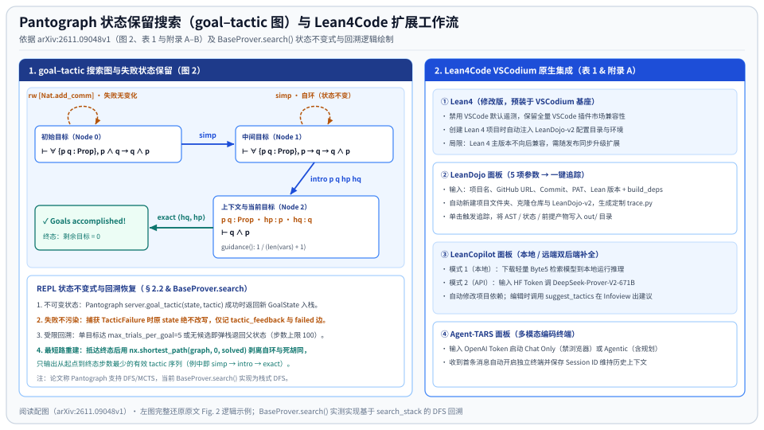查看原图 ↗</a><figcaption>图 2 · REPL 状态保留搜索与桌面集成：左栏还原原文图 2 的 goal–tactic 转移及 BaseProver 状态不变式与回溯逻辑；右栏概括表 1 与附录 A 描述的 Lean4Code 四个内置扩展面板。</figcaption></figure>

理解这套交互接口的关键在于**失败时的非破坏性状态保留语义**。如正文图 2 所示（以目标 `⊢ ∀ {p q : Prop}, p ∧ q → q ∧ p` 为例）：

1. 当策略无效或产生报错时（如图 2 左上方对初始节点尝试 `rw [Nat.add_comm]`），Pantograph 会抛出 `TacticFailure` 或返回原目标而**绝不破坏或改写既有的 `GoalState`**；在 `BaseProver.search()` 实现中，失败分支仅把错误信息写入 `search_state.tactic_feedback` 并在 `nx.DiGraph` 记录一条带 `failed=True` 标记的边，随后留在原目标状态上继续试验下一个候选 tactic。
2. 当策略推进证明时（`simp` 将目标化简为 `⊢ ∀ {p q : Prop}, p → q → q ∧ p`，若再误施 `simp` 则形成原地自环，继而 `intro p q hp hq` 引入上下文 `p q : Prop`、`hp : p`、`hq : q` 并将目标收缩为 `⊢ q ∧ p`，最终 `exact ⟨hq, hp⟩` 关闭全部目标），Pantograph 返回全新的不可变 `next_goal_state` 压入 `search_stack` 并在图中建立前进有向边。
3. 当单节点尝试次数达到上限（源码设定 `max_trials_per_goal = 5`、总步数上限 `max_steps = 100`）或生成器不再输出有效策略时，搜索从 `search_stack` 弹出当前节点、回退到父状态继续分支探索；而一旦任一路径到达零目标终态，系统调用最短路径算法（`nx.shortest_path(search_graph, 0, solved_node_id)`）从根节点重建边数最少的证明序列，自动剥离搜索期间产生的自环与死胡同分支。此处也值得记录一项**源码与论文对照核验**：论文第 2.2 节提到 Pantograph 支持 DFS 与 MCTS，但在当前公开仓库的 `BaseProver.search()` 中，实际实现的默认搜索器是基于 `search_stack` 与变量计数启发式（`1.0 / (len(goal.variables) + 1)`）的栈式 DFS 回溯，未内置独立的 MCTS 树搜索循环。

面向不熟悉命令行与 Python 环境的数学家，论文第 3 节与附录 A 推出了配套桌面编辑器 **Lean4Code**。它基于完全移除微软默认遥测的开源 **VSCodium** 构建，保留了对 VSCode 扩展市场的完整兼容性，并预置了修改版 `Lean4` 扩展（创建新 Lean 项目时自动注入 `LeanDojo-v2` 本地配置目录），作者将其称为首个 Lean 原生代码编辑器。在此基础上，Lean4Code 内置三款目前未上架公共插件市场的定制一键面板（表 1）：

- **LeanDojo 面板（图 3–4）**：在表单中收集 5 项参数（项目名称、GitHub 仓库 URL、目标 Commit 哈希、GitHub Personal Access Token 与 Lean 版本）并勾选 `build_deps`（默认 `False`）后，自动在桌面创建项目目录、克隆目标仓库与 LeanDojo-v2、生成配置好的 `trace/trace.py` 与 `tmp/` 文件夹，用户点击一次按钮即可完成追踪并将产出写入 `out/` 目录。
- **LeanCopilot 面板（图 5–6）**：提供两条接入路线——其一是本地下载轻量 `Byte5` 模型，其二是填入 `HuggingFace Token` 远程调用 `DeepSeek-Prover-V2-671B` 默认推理端点；面板自动修改项目配置与依赖文件，用户在源码中输入 `suggest_tactics` 等提示命令即可在 Lean Infoview 侧栏查看下一步 tactic 建议。
- **Agent-TARS 面板（图 7）**：输入 OpenAI 访问令牌后可切换启动字节跳动 Agent-TARS 的 `Chat Only Mode`（禁用浏览器控制）或 `Agentic Mode`（启用浏览器控制、思考与规划），并在收到首条消息时自动拉起独立终端会话、持久化 `Session ID` 以在多轮问答中保留历史上下文。

### 四、基础设施证据边界、代码核验与 Agent 工程迁移

阅读 `arXiv:2611.09048v1` 最需要保持克制的判断是：**这是一篇系统基础设施、接口设计与 IDE 工程集成报告（NeurIPS 2025 MATH-AI Workshop 短文），而不是提出新推理算法并刷新基准榜单的模型论文**。因此，下表将论文正文给出的实证观察、公开代码库核验出的工程细节以及尚未覆盖的评测缺口严格分栏对照：

| 核查维度 | `arXiv:2611.09048v1` 报告事实 | 配套源码与工程约束核验（`lean-dojo/LeanDojo-v2`） | 当前仍缺失或需外部验证的边界 |
|---|---|---|---|
| 定理证明基准表现 | 未报告 miniF2F、ProofNet 或 Mathlib 等统一数据集上的 `pass@k` 成功率对比表 | `HFAgent` / `ExternalAgent` / `LeanAgent` 仅在附录 B 与 README 中以小型示例仓库 `lean4-example` 演示全流程 | 不能据此宣称在相同算力与预算下比 ReProver、Pantograph 原生脚本或其他证明器取得更高证明成功率 |
| 工程构建与交互开销 | 第 2.1 节报告用 HuggingFace API 替代本地 `CTranslate2` C++ 编译后，构建耗时从 **超过 10 分钟降至几秒钟** | `external_api` 通过 HTTP 调用托管端点；`Lean4Code` 通过预捆绑定制面板减少手工环境配置 | 构建提速依赖外部 HuggingFace Token、网络可达性与托管服务商延迟，并非零成本本地推理 |
| 训练与搜索算法细节 | 论述支持 SFT、LoRA、GRPO、PPO 以及 DFS/MCTS 构图与最短路恢复 | `SFTTrainer` / `GRPOTrainer` 已实现；`GRPOTrainer` 示例中 `reward_func` 为恒定 `1.0` 占位，需用户自备真值奖励；`BaseProver.search()` 实际为栈式 DFS | PPO 训练器与 `LeanProgress`（源码已有数据集脚本与 `ProgressTrainer`）在论文中属既述或未来工作，尚无端到端消融或稳定性评测 |
| 版本兼容与运行前置 | 第 3.2 节坦承 Lean 4 新版本常不向后兼容，需随主要发布同步更新内置 Lean4 扩展 | 追踪流水线依赖本地匹配版本的 `elan` 工具链、`GITHUB_ACCESS_TOKEN` 与充足磁盘缓存空间（`RAID_DIR`） | 跨多版本 Lean 仓库混训仍受工具链与依赖编译限制；`Agent-TARS` 面板另依赖 OpenAI 密钥 |

即便不将其当作推理能力突破来读，LeanDojo-v2 在**外部验证器约束下的 Agent 系统工程**上仍有四点很扎实的迁移启发（可与本期 `BOXBOX`、`DeCAF` 等长程执行基础设施对照阅读）：第一，**验证器状态句柄的不可变隔离与失败零污染**——Pantograph 把每次工具调用（tactic）作用在显式 `GoalState` 句柄上，失败时既不污染既有上下文又回传结构化 `tactic_feedback`，这比在共享可变工作区里直接覆盖文件再试图靠 `git checkout` 擦除副作用稳健得多；第二，**搜索图沉淀 + 最短路蒸馏**——在 `DiGraph` 中保留成功与失败边，在任务完成后用 `nx.shortest_path` 剥除试错自环后再导出为示范轨迹，可避免把探索冗余直接喂回 SFT 训练集中；第三，**将重型推理依赖与轻量编排/IDE 解耦**——用无状态远程 API 替换十分钟级本地 C++ 推理编译，并保留 `build_deps` 开关让用户按任务按需付出依赖解析代价，是降低多工具链耦合度最直接的手段；第四，**按步长分位排列难度课程与编辑器内闭环反馈**——用可度量的结构难度分位驱动增量微调，再通过 Infoview 这类原生验证器视图把候选动作即时交还给人工或外层循环校验，适合迁移到形式化规约生成、数据库迁移校验与编译修复型编码 Agent 中。

## 同日笔记

- [GLM-5.3-Flash：先分清状态，再平衡 H200 上的 prefill 与 decode](/tech/zh/glm53-h200/)
- [TPU Sync：让模型状态沿内存层次异步流动](/tech/zh/tpu-sync/)
- [Grafana Watchers：把持续巡检拆成一次校准与一次判断](/tech/zh/grafana-watchers/)
- [AI SRE 评测：把诊断、证据与操作责任拆开](/tech/zh/ai-sre-evaluation/)
- [Claude Fable / Mythos 5.2：能力、推理成本与访问边界怎样一起变化](/tech/zh/claude-fable-mythos-52/)
