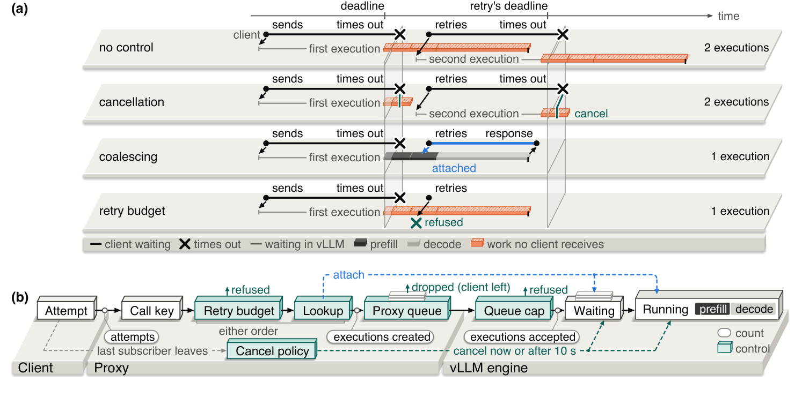
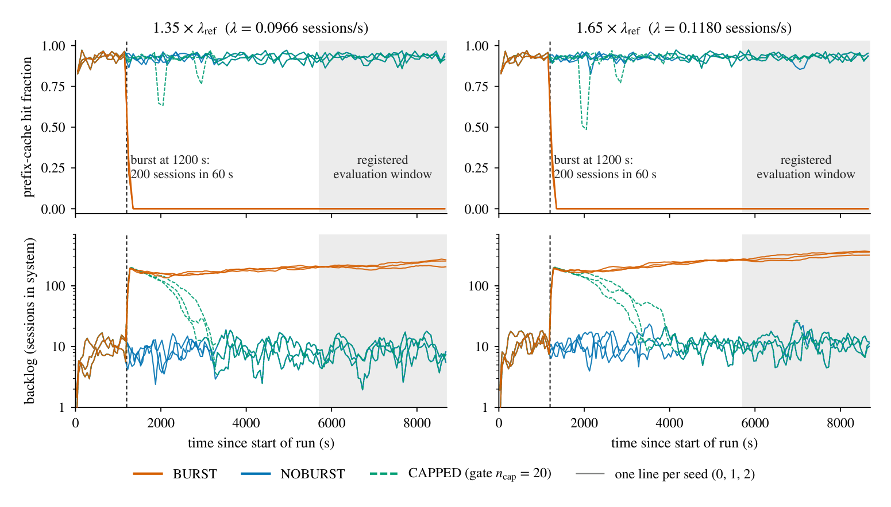
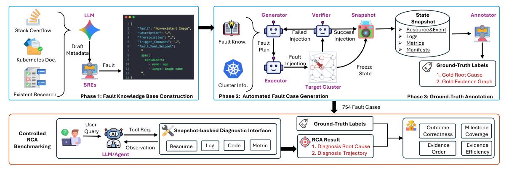
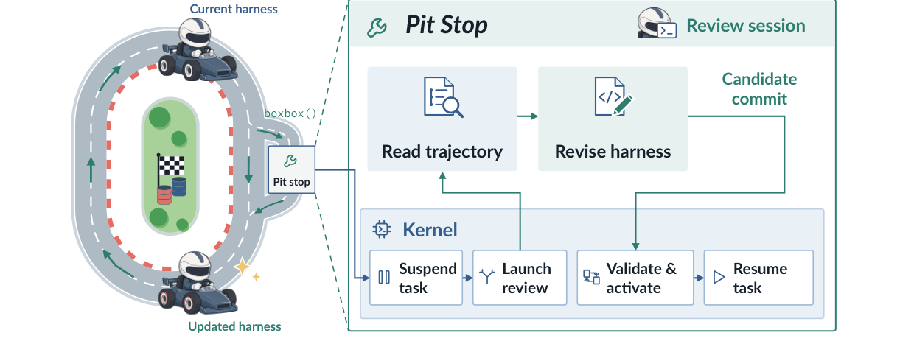
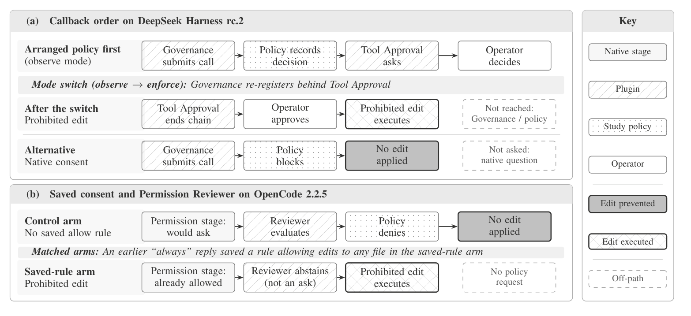
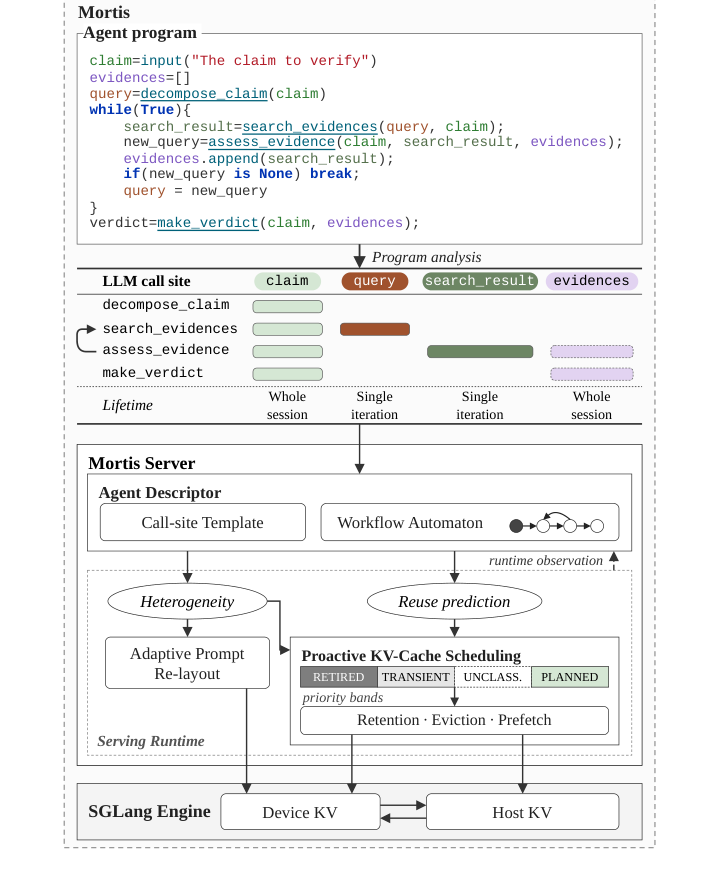
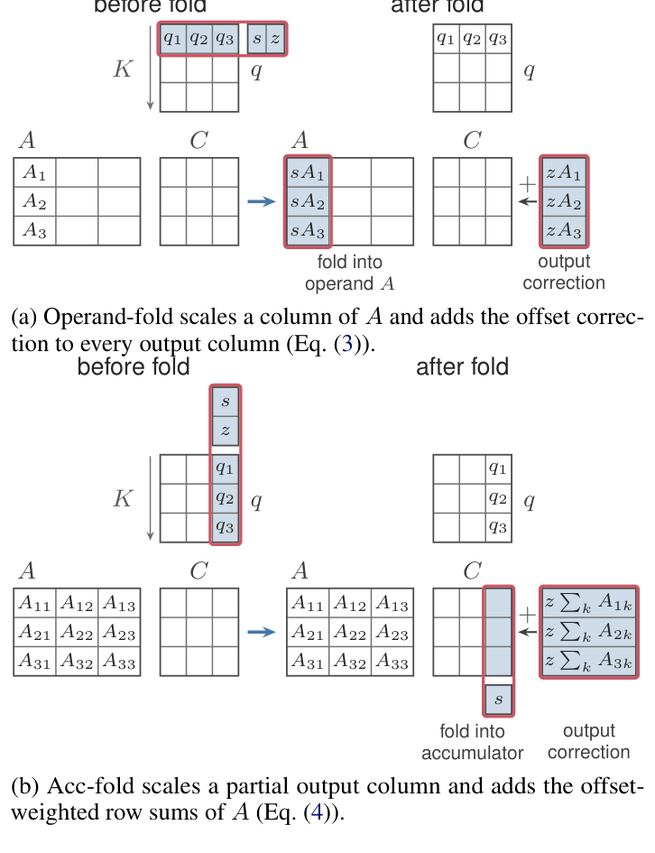
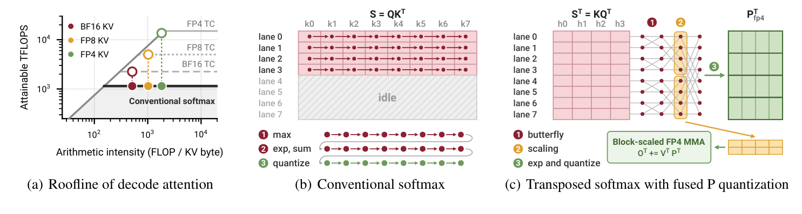

## 本期看点

服务过载之后，流量回落或取消请求都可能不足以恢复：重试仍在增殖执行，多轮会话的缓存也可能持续失效。本期两项研究分别解释这两条反馈链，并提醒我们将用户交付、缓存命中与观测吞吐分开判断。

Agent 侧，Cloud-OpsBench 把“根因答对”与“调查证据闭环”拆开评估；BOXBOX 允许长任务中修订 harness，PatternOps 则揭示日常重载和权限操作如何悄然改变策略路径。这五篇值得深入阅读，其余工作继续沿程序语义、混合状态、分布式缓存、低精度计算与自动规划推进效率。

技术笔记补充 H200 混合模型服务、TPU 状态传输、持续巡检成本、AI SRE 评测与模型更新，帮助区分机制收益、具体运行点和证据范围。

## 重点解读

<h2 class="daily-paper-title" id="paper-arxiv-2611.08684">01 · 取消为什么没能救回过载服务</h2>

[Cancellation Is Not Enough: What Retries Leave Behind in an Overloaded LLM Engine](https://arxiv.org/abs/2611.08684)  
Xindan Zhang、Fei Wang · 2026-11-05

### 一次业务调用，可能变成四份引擎工作

请求超时后，客户端往往重试；取消传播则希望引擎停止为已经离开的客户端计算。这篇论文把业务调用、客户端尝试和引擎执行分开计数，发现问题不只在“有没有及时停止”。每次重试若都创建新执行，队列仍会不断补满；等它终于获得计算机会，自己的截止时间又快到了，刚完成的一部分 prefill 随即被取消。

作者在单张 H100 80GB、vLLM 0.30.0 上测试三个模型。合成开放环负载以各模型容量的 0.6 倍到达，经历 107 秒、2.7 倍容量的突发后回落；每次尝试限时 120 秒，最多重试三次。这个设计让突发积压超过一次尝试的时间预算，却为没有重试放大的服务留出恢复空间。

### 控制执行数量，也要保留重连机会

<a class="note-image-link" href="/assets/images/digest/2026-11-10/retry-executions.png" target="_blank" rel="noopener" aria-label="取消为什么没能救回过载服务 · 查看原图 ↗">查看原图 ↗</a>

*上半图跟踪同一调用的超时与重试；下半图把新建执行、合并、预算和取消放回实际路径。*

无控制时，离开的客户端留下孤儿执行，重试再提交新执行。立即取消会缩短旧执行，但已发往 GPU 的步骤仍会结束，而且它删除了重试可以重新订阅的对象。论文的请求合并按调用标识和完整生成参数寻找仍存活的执行，让后续尝试接回同一份工作，而不是按文本相似度合并不同请求。

这也解释了组合策略为何有顺序问题：先查已有执行、再对确实需要新建的重试施加预算，可以避免拒绝本来不增加引擎负载的重连。作者还测试延迟 10 秒取消，长于其 0.25–3 秒重试退避，使旧执行在重连窗口内继续存活。

### 完成了多少计算，不等于交付了多少回答

开启重试时，立即取消在所有诊断运行中都未于观察窗口内恢复服务；突发后调用最终交付约 12–38%，范围包含混合提示负载。Qwen2.5-7B 轨迹显示，后来被 abort 的执行消耗了 79–85% 的已计算 prompt token，重试通常到离自身截止时间不足半秒才首次运行。这里的 token 与调度器步骤归因不是 GPU kernel 时间测量。

请求合并在对应实验中交付了突发及其后全部调用，但部分已超时限；立即取消会破坏这一效果。延迟取消恢复了重连，但这些运行里没有真正触发最终取消，因此尚未检验“客户端永久离开”后的清理。重试预算可以恢复后续服务，却会丢弃部分突发调用。**这项工作的价值在于把恢复和交付拆开测量**：队列变短、完成 token 增多，都不足以证明用户拿到了结果。

<h2 class="daily-paper-title" id="paper-arxiv-2611.08902">02 · 缓存全失效后，吞吐为什么会误导恢复判断</h2>

[Inside the Trap: A Renewal Law for Prefix-Cache Collapse in LLM Agent Serving](https://arxiv.org/abs/2611.08902)  
Akshat Valse、Ali Jannesari · 2026-11-06

### 流量恢复原样，系统却回不去了

多轮 Agent 的下一次调用会带回旧上下文。前缀缓存有效时，服务能以较低成本处理这些重复 token；突发挤大活跃会话集合后，等待时间延长，同一会话再次到来前，旧 KV 已被其他请求替换。更多 miss 又需要更多 prefill，进一步延长等待，形成自我维持的陷阱。

作者用配对运行区分这种状态和普通突发排队。在两个引擎、两类 GPU、两个模型的注册实验中，200 会话突发使 30 次运行的后续轮次命中率一直保持零；对应无突发运行和限制会话数的运行保持良好。按同时检查积压增长的严格规则，十个负载点通过九个，不能把“30 次零命中”直接说成全部满足所有陷阱判据。

### 队列里被服务的，不再代表稳定工作负载

<a class="note-image-link" href="/assets/images/digest/2026-11-10/cache-trap.png" target="_blank" rel="noopener" aria-label="缓存全失效后，吞吐为什么会误导恢复判断 · 查看原图 ↗">查看原图 ↗</a>

*橙线经历突发后命中率归零、会话持续积压；无突发和会话受限的对照仍能复用缓存。*

论文分析一个全 miss、工作守恒、FIFO、多轮完成后立即返回队尾的流体模型。后续轮次上下文更长、成本更高，积压不断增长时，新加入的短会话轮次在实际服务构成中占比上升。作者从 FIFO 轨道推导线性更新递推，刻画轮次间隔增长与倾斜后的轮次分布。

其工程含义是“年轻轮次溢价”：引擎可能完成比稳定全 miss 工作负载容量更多的会话，积压却仍在增长。此时把到达率降到眼前完成吞吐以下，仍可能高于真正的全 miss 排空阈值。完成率看似可观，并不表示系统有足够余量消化所有后续工作。

### 限制竞争集合，让复用重新发生

理论是在读取早期轨迹后形成的。对 57 次已有 stuck 运行的回顾比较中，50 次的被服务 prompt 均值预测误差在 3% 内；每次运行的间隔增长仍有明显离散，不能将汇总吻合当作逐次精确预测。论文另外设计结果盲测，检验减流与不同轮数预算下的预测。

恢复实验中，会话上限在相同外部负载下救回 9/9 个已形成的陷阱，没有丢弃会话，解除限制后仍保持正常。它通过缩小同时竞争缓存的会话集合、将其余会话暂留外侧，恢复上下文复用；不是宣称任意流量都能无损承载。

**这与上一条重试崩溃互补。** 上一条的关键是同一业务调用增殖执行，这里是会话间隔与缓存周转的反馈。模型忽略并发执行、工具等待和实际调度细节，也不证明真实引擎必然收敛到该流体模型。最值得读的是恢复阈值为何不同于观测吞吐，以及作者怎样用配对、回顾和后续盲测分层支撑这个结论。

<h2 class="daily-paper-title" id="paper-arxiv-2603.00468">03 · Cloud-OpsBench：根因答对，还要核对证据是否闭环</h2>

[Cloud-OpsBench: A Reproducible Benchmark for Agentic Root Cause Analysis in Cloud Systems](https://arxiv.org/abs/2603.00468)  
Yilun Wang、Guangba Yu、Haiyu Huang、Yujie Huang、Zirui Wang、Pengfei Chen、Michael R. Lyu · 2026-02-28 · v3 更新于 2026-11-06

### 把“问什么”也放进可比较的评测

静态日志集便于重复实验，却不检验 Agent 是否知道下一步该查哪个服务；每次重新注入故障的 live testbed 保留了交互，但同类故障可能受实时负载、调度与重试影响，表现不完全相同。Cloud-OpsBench 先在真实集群中制造并验证故障，再冻结可观察状态，让不同 Agent 通过工具查询同一份事故证据。

本次阅读的是 11 月 6 日更新的 v3，初稿于 2 月 28 日提交。作者在 OnlineBoutique 和 TrainTicket 上得到 754 个案例、57 类故障，覆盖应用和 Kubernetes 平台。候选故障计划有 800 个，46 个未形成稳定、可诊断的症状而被剔除；这个验证步骤防止将“注入命令执行了”直接等价为“故障真实发生了”。

### 先确认故障，再冻结观测，最后标注诊断事实

<a class="note-image-link" href="/assets/images/digest/2026-11-10/cloud-opsbench.png" target="_blank" rel="noopener" aria-label="Cloud-OpsBench：根因答对，还要核对证据是否闭环 · 查看原图 ↗">查看原图 ↗</a>

*从故障知识到运行验证与状态快照，再通过工具接口比较诊断结果和证据过程。*

构建流程以故障知识生成具体计划，恢复干净部署、建立健康基线后注入，验证器检查机制激活、局部失败与指定上层症状。通过后保存资源、配置、日志、事件、指标与源码等证据。评测接口向 Agent 暴露十二类诊断工具，其参数映射到预先收集的响应；Agent 不直接读取整个快照库。

更有价值的是过程标注。每个案例的 evidence graph 表示需要建立的诊断事实，允许不同工具、不同参数和替代证据组合，不要求复刻一条专家命令序列。例如，Service 没有 endpoint 后，可分别查 selector 与 Pod 标签，也可用同时包含两者的配置证据确认不匹配。事实之间必要的先后关系另行记录。

### 同一个正确答案，可能来自不同质量的调查

十一种 LLM 采用共同 ReAct scaffold 时，两套系统上最高 Joint RCA Accuracy 分别为 0.78 和 0.68。但 GPT-5 在全部评测案例中，分别有 33.1% 和 29.4% 属于“诊断正确、证据未闭合”。这些比例的分母是所有评测案例，不是仅答对的案例，也不意味着这些结论一定是猜中的。

缺口可能来自遗漏后端标签、没有确认数据库实际状态，或停留在显眼的下游错误。它说明最终标签不足以区分可靠调查与尚未完成验证的正确判断；反过来，额外工具调用和更高 token 消耗也未必带来更完整的证据。

**对 AIOps 最值得迁移的是评测对象的分离**：根因定位、机制识别、证据覆盖与调查效率应分别观察。快照只支持已保存工具及参数范围，不能用来评估任意 shell 操作、线上修复或系统随调查演变的行为。证据闭环也取决于标注的事实与覆盖边界，不能提升为生产环境因果证明。

<h2 class="daily-paper-title" id="paper-arxiv-2611.09218">04 · BOXBOX：长任务运行中，让 Agent 修订自己的 harness</h2>

[BOXBOX: Recursive Harness Self-Improvement for Long-Running Performance Optimization](https://arxiv.org/abs/2611.09218)  
Yuhao Tan、Hanyun Jiang、Fangkai Yang、Yuan Yao、Taolue Chen、Bo Qiao、Yu Kang、Lu Wang、Pu Zhao、Xiaoxing Ma、Qingwei Lin · 2026-11-06

### 优化对象从项目代码扩展到执行环境

长时间性能优化不仅会遇到待优化软件的瓶颈，也会暴露 Agent 自己的工具与控制逻辑缺陷：输出太长、等待重复、常用操作缺少工具封装。离线调好的 harness 未必预见这些情况，重启整个任务又会损失正在积累的执行上下文。BOXBOX 让任务 Agent 自己决定何时暂停做一次 harness 审阅。

论文配套的 PerfRace 从真实项目和完整工作负载构造任务，不提供已知目标补丁。发布集有 100 个任务，经过可运行性、测量稳定性和投机取巧测试；最终主实验用其中 50 个测试任务。这与只让 Agent 重写一个已知慢函数的评测不同，Agent 需要先发现瓶颈、提出修改并维持正确性。

### 可编辑的 harness 外面，还有管理切换的 kernel

<a class="note-image-link" href="/assets/images/digest/2026-11-10/boxbox.png" target="_blank" rel="noopener" aria-label="BOXBOX：长任务运行中，让 Agent 修订自己的 harness · 查看原图 ↗">查看原图 ↗</a>

*任务 Agent 请求进站，审阅会话生成候选修改，外层 kernel 负责验证、激活与保留上下文。*

Agent 调用 boxbox() 后，kernel 暂停任务交互循环，保留轨迹、终端会话与工作区，启动审阅会话。审阅读取实际执行记录，修改提示、工具或运行逻辑，并留下版本记录。kernel 验证候选，成功才加载新 runtime、转移上下文并重新连接原终端；验证或激活失败则保留或恢复旧版本。

因此，“上下文保留”有具体范围：它支持控制逻辑升级后接着做同一任务，并不等于所有后台进程都被暂停，更不证明任意代码变更都语义安全。审阅也消耗同一任务的时间与模型预算，Agent 必须判断剩余时间内修工具是否比继续改项目更划算。

### 收益来自哪种比较

共同初始 harness、GPT-5.6 Luna high effort、每任务三次独立运行、每次四小时的设置下，BOXBOX 的 Speedup@4h 为 1.702×，Frozen Harness 为 1.442×，最强对照 Harness Scaling 为 1.539×。该指标先汇总任务内运行，再跨 50 个任务取调和平均，是优化后项目相对原项目的加速，不是 Agent 本身运行得快 1.70 倍。

BOXBOX 平均模型成本为 $16.43，低于 Frozen 的 $23.22，却高于 Harness Scaling 的 $12.98；不能将“单位成本收益更好”写成“所有基线中总成本最低”。审阅时间占比中位数为 2.1%，模型成本占比为 13.8%。十四个任务的消融支持按需触发和开放编辑范围，但不构成普遍的最优控制策略证明。

**值得关注的是任务内适应的运行机制。** 与本期 DeCAF 的离线分维度搜索不同，它把是否改 harness 的决定交给当前任务中的 Agent。与此同时，本期 PatternOps 研究提醒，运行时重载可能改变策略关系；BOXBOX 的回退能力不能自动替代对权限、状态和接口不变量的验证。

<h2 class="daily-paper-title" id="paper-arxiv-2611.09088">05 · PatternOps：插件都在线，策略却可能已被绕过</h2>

[When Routine Operations Break Architectural Pattern Relationships in LLM Agent Harnesses](https://arxiv.org/abs/2611.09088)  
Boming Xia、Qinghua Lu、Dino Sejdinovic、Liming Zhu · 2026-11-06

### 无需代码变更，也会破坏执行关系

一个插件做策略判断，另一个插件征求人工批准，宿主决定它们的调用顺序。每个部件单独可用，并不保证“所有工具调用都先经过策略”。这篇研究检查五个已发布 harness、十四个主样本插件，关注 Guardrail Enforcement Point、Autonomy Controller 和 Blackboard 的五种关系，以及日常操作会怎样改变关系。

PatternOps 从模式要求、提供方承诺和具体部署需求追到实现组件，再追到能作判断的运行记录。研究采用受控工具序列，也用真实模型选择动作检验部分路径。其关键不是统计插件报错数量，而是将同一次操作的工具调用、策略决策、批准记录和最终文件效果关联起来。

### 重应用和保存 allow，都可能改变实际路径

<a class="note-image-link" href="/assets/images/digest/2026-11-10/patternops.png" target="_blank" rel="noopener" aria-label="PatternOps：插件都在线，策略却可能已被绕过 · 查看原图 ↗">查看原图 ↗</a>

*上方重应用改变回调顺序，下方长期 allow 改变审核资格；两条路径都可能绕过原先承担策略的部件。*

在 DeepSeek Harness 的一组组合里，原先排在前面的策略插件被重应用后，旧回调注销、新回调追加到队尾。批准插件先运行，其返回会结束调用链，于是禁止编辑在人工批准后仍能执行。插件管理器显示两者活跃，策略还可以拦截读取，普通健康检查没有暴露编辑路径已绕过策略。

OpenCode 的另一条路径中，保存长期 allow 规则会让权限请求被视作已经获准；只审核“需要询问”的插件不再评估后续编辑。这里不能简单说插件违反自身承诺：只审核 ask 的接口承诺，与部署者要求所有编辑均经过策略之间存在错配。

### 先定义要保住的关系，再选放置位置

研究比较原生批准、固定回调顺序、就地更新与更靠近工具执行的检查。修好某次重应用不保证冷启动顺序也正确；拦住全部禁止效果，也不意味着所有被其他组件提前拒绝的编辑都曾经过策略。对“策略决定所有执行”“每次编辑都必须被评估”“升级请求需要重新征求批准”，正确的组件放置与状态要求不同。

具体证据中，DeepSeek Harness 五个 API 模型在批准插件组合下做了 28 次读取和 28 次编辑：策略覆盖全部读取、没有覆盖编辑。这个结果来自特定版本、配置和操作序列，不是全部 harness 的故障率，也不能推广为某个模型更容易绕过策略。

**它把 AgentOps 的验证单位从静态配置推进到运行历史。** 最值得读的是如何用决策记录连接真实效果，以及修复方案为何必须按要求逐一比较。本期 BOXBOX 提供在线升级机制，这项研究则解释升级后仍须保持哪些关系；两者解决的问题不同，都有独立价值。

## 研究动态

<h2 class="daily-paper-title" id="paper-arxiv-2611.08638">06 · MORTIS：从程序变量推断缓存该留多久</h2>

[MORTIS: Compiler-Guided KV-Cache Management for LLM Agent Programs](https://arxiv.org/abs/2611.08638)  
Xiaoyu Ma、Jayanaka L. Dantanarayana、Savini Kashmira、Baichuan Li、Lingjia Tang、Jason Mars · 2026-11-05

普通前缀缓存把首个变化位置之后的内容视为不透明后缀。MORTIS 针对以 typed LLM function 调用生成提示的 Agent 程序，从变量定义、追加与覆盖关系识别内容的共享方式和寿命，再结合运行时分支及调用间隔预测，协调提示组件排序、保留、驱逐与预取。

<a class="note-image-link" href="/assets/images/digest/2026-11-10/mortis.png" target="_blank" rel="noopener" aria-label="MORTIS：从程序变量推断缓存该留多久 · 查看原图 ↗">查看原图 ↗</a>

*变量寿命与工作流分析生成描述，服务端再据此调整提示顺序与缓存优先级。*

它把已结束会话的易变尾部、活跃会话暂态内容、未分类缓存和预计复用的前缀分成不同驱逐优先级。四个 Agent 工作负载上，相对 SGLang，平均作业完成时间与吞吐的几何平均加速分别为 1.45×、1.49×，最高 1.99×、1.97×。这里通过程序语义改善现有前缀复用，不是任意文本段的位置无关缓存；静态无法确定的值采取保守分类，提示重排的质量影响也需检验。

<h2 class="daily-paper-title" id="paper-alphaxiv-2611-flashstate">07 · FlashState：循环状态与 KV 必须在同一位置可复用</h2>

[FlashState: Unlocking Flexible Hybrid State Management for Agentic LLM Serving](https://www.alphaxiv.org/abs/2611.flashstate)  
Chenxi Li、Weili Xu、Tianyi Zhang、Jue Wang、Zhongzhu Zhou、Chenfeng Xu · 2026-11-09

混合注意力模型不能只保留 KV：恢复位置还必须有匹配的循环状态。FlashState 将 checkpoint 位置与 KV block 边界解耦，在请求完成时捕获真实末端状态；结合后端导出与依赖感知、代价感知的统一准入和驱逐，避免“KV 还在，所需循环状态已被逐出”。

每引擎两张 B200、相同缓存预算的 coding-agent 轨迹上，GLM-5.3-Flash、Nemotron 3 Super、Qwen3.8-Flash-Next 的 prefill 吞吐最高分别为 vLLM 的 3.14×、2.27×、1.54×，GLM 的 p90 TTFT 最高下降 88.4%。这是特定并发与上下文配置的结果。它与 MORTIS 的变量分析、以及独立 H200 文章的 decode KV 共享互补，不能把三者加速简单相乘。

<h2 class="daily-paper-title" id="paper-arxiv-2611.09109">08 · DARIC：按偏差分布分配重算预算</h2>

[DARIC: A Position-Independent KV Cache Reuse System with Distribution-Aware Recomputation](https://arxiv.org/abs/2611.09109)  
Weikang Wang、Haiyang Liu、Xin Zhou、Jun Liu、Weifeng Zhang · 2026-11-06

位置无关复用把独立文档的 KV 搬到不同前缀后，缺少跨块注意力会改变中间状态。DARIC 实测块内开头偏差较大、靠后块偏差增加，以及最近窗口的重要性，据此选择各块起始 token 和末端窗口重算，而不是对所有 token 做昂贵的在线偏差排序。

系统将所选工作拆为标准子请求，尽量保留现有引擎的调度与执行优化。论文在 RAG、function calling 和 agentic coding 场景比较质量与 TTFT，摘要报告相对先进方法 1.1–4.5× TTFT 加速；相对完全重算的倍率另有分母。它推进的是低开销选择与集成，不能保证任意模型、分块与提示上的零质量损失。与 Nebula 的集群管理不同，两项工作均应保留。

<h2 class="daily-paper-title" id="paper-arxiv-2611.09474">09 · Nebula：让位置无关缓存跨工作节点复用</h2>

[Nebula: Distributed Position-Independent Caching for LLM Serving](https://arxiv.org/abs/2611.09474)  
Yifei Liu、Junbin Pan、Junhao Hu、Yang Liu、Junyi Chen、Juntong Wu、Chen Chen、Haiyuan Zhao、Xiaoxu Chen、Weihang Chen · 2026-11-06

单节点能复用文档片段，不等于集群能找到远端片段或把冷片段分给空闲节点。Nebula 将应用标注的 PIC segment 作为分布式对象：先匹配完整前缀，再查其余片段，安排 scatter prefill，最后在 combine 节点汇合并执行必要重算。

控制面用乐观记账与事件更新维护异步状态；驱逐后的 ghost hit 调整前缀缓存与 PIC 的容量份额；调度联合考虑排队、计算和 KV 传输。四模型、四类 RAG/Agent 工作负载的主评测中，相对最强基线，中位 TTFT 平均下降 61.4%，找回前缀缓存漏掉 token 的 76.1%。质量取舍仍由可插拔 PIC 算法承担，集群框架没有让独立片段 KV 自动变成精确全上下文状态。

<h2 class="daily-paper-title" id="paper-arxiv-2611.08770">10 · ReKV：传前面层的 KV，同时重算后面层</h2>

[ReKV: Overlapping Quantized KV Transfer and Suffix Recomputation](https://arxiv.org/abs/2611.08770)  
Guangjian Dong · 2026-11-05

ReKV 的 prefix/suffix 指模型层，不是把输入文本切成前后两段。prefill 端发送前面层的量化 KV 和一个 BF16 边界隐藏状态；decode 端从边界重算连续后续层，同时接收前面层的缓存，以链路带宽与重算代价决定切分位置。

跨节点 H100、8K prompt 的模型形状合成基准中，Q8 联合方案相对 BF16 全量传输为 2.36–3.65×。真实权重的独立 BF16 实验仅测到首 token 返回，收益 1.16–1.63×，并未验证重建 Q8 缓存后的完整解码。更快链路或短提示也可能更适合纯传输。它提供值得研究的重叠机制，证据仍是受限原型，不应写成成熟 serving 系统的整体加速。

<h2 class="daily-paper-title" id="paper-arxiv-2611.09722">11 · FOSCAR：把逐元素反量化移出关键路径</h2>

[FOSCAR: Accelerating Decode Attention over 2- and 4-Bit KV Caches through Affine Folding](https://arxiv.org/abs/2611.09722)  
Donglin Zhuang、Pragaash Ponnusamy、Xiaoxia Wu、Shuaiwen Leon Song、Zhongzhu Zhou · 2026-11-06

2-bit KV 节省带宽，却可能被整数转浮点及 scale/offset 的逐元素运算卡住。FOSCAR 利用仿射变换与矩阵乘法的关系，根据 token-wise 或 channel-wise 分组，把 scale 移到另一操作数或累加结果，把 offset 变成输出修正，并配合位操作和 Hopper/Blackwell 专用流水线。

<a class="note-image-link" href="/assets/images/digest/2026-11-10/foscar.png" target="_blank" rel="noopener" aria-label="FOSCAR：把逐元素反量化移出关键路径 · 查看原图 ↗">查看原图 ↗</a>

*按 scale 所共享的维度，将缩放移入输入或输出，并单独处理 offset 的贡献。*

H100 上 INT2/INT4 相对 FlashInfer BF16 的 kernel 几何平均加速为 3.36×/2.83×；B200 上相对原生 TensorRT-LLM NVFP4 则为 1.16×/1.00×。这个较近基线明显缩小优势。折叠在精确算术中保持反量化后的结果，但不会消除 KV 本身的低比特误差；SGLang 长上下文吞吐收益另受容量与并发影响，不能用 kernel 倍率代替。

<h2 class="daily-paper-title" id="paper-arxiv-2611.09825">12 · BitDecoding-FP4：原生 FP4 解码先解决误差和 softmax</h2>

[BitDecoding-FP4: Native FP4 KV Cache Decoding via Algorithm-System Co-Design](https://arxiv.org/abs/2611.09825)  
Dayou Du、Woon Yee Ng、Guangming Sheng、Nick Lau、Jianyi Cheng、Luo Mai · 2026-11-06

原生 FP4 Tensor Core 可以免除先展开到高精度的路径，但 Q、K 和概率都可能量化失真。BitDecoding-FP4 用两份 FP4 表示 query 本体与残差，结合 key 去异常值和概率下溢感知缩放；系统将 softmax 转置，让线程沿 keys 分工，并把残差 query 填入原来空置的矩阵 tile。

<a class="note-image-link" href="/assets/images/digest/2026-11-10/bitdecoding-fp4.png" target="_blank" rel="noopener" aria-label="BitDecoding-FP4：原生 FP4 解码先解决误差和 softmax · 查看原图 ↗">查看原图 ↗</a>

*转置后按 key 分配线程，归约过程同时生成 FP4 概率的缩放信息，减少空闲线程与额外遍历。*

vLLM 集成保留 BF16 sink/recent token，整页填满后才转入 FP4 KV。作者在长上下文与推理评测上报告 NVFP4 平均与 BF16 相差不到 0.5 分；B300 上 Qwen3 的峰值服务吞吐为 BF16 的 2.4–3.0×。这些是特定模型、缓存策略和运行点的结果，不是每任务精度差都小于 0.5，也不是没有高精度缓冲的纯 FP4 全路径。

<h2 class="daily-paper-title" id="paper-arxiv-2611.08713">13 · ResServe：用窄矩阵的空余算力补回激活残差</h2>

[ResServe: Accurate and Efficient FP4 LLM Inference with Residue Compensation](https://arxiv.org/abs/2611.08713)  
Shuo Rong、Ruibo Fan、Jiawen Wen、Xiaowen Chu · 2026-11-05

ResServe 将激活拆为 FP4 本体和再次量化的残差，两者乘同一组权重，并在片上合并输出。decode 矩阵行数很少时，新增残差行可以利用原本空闲的 tile；attention 则在 softmax 前合并 query 两部分产生的分数。prefill 行数较多时只选择部分通道补偿，控制额外计算。

B200、8K 输入/256 输出、每秒一次请求的 NVFP4 实验中，相对 W4A4 额外请求延迟至多 3.4%，相对 W4A8 延迟下降 22.4–53.3%。五模型代码生成的平均相对精度改善 15.04% 不能读成 15 个百分点。它和 BitDecoding 都用 query 残差，但本工作还覆盖 linear 层，利用 shape 余量；不是证明残差计算在大 batch 或 prefill 中也免费。

<h2 class="daily-paper-title" id="paper-arxiv-2611.09225">14 · Fused-Softmax：低精度 GEMM 变快后，移走向量瓶颈</h2>

[Fused-Softmax for efficient quantized attention](https://arxiv.org/abs/2611.09225)  
Tianxing Wu、Juuso Korhonen、Jesus Carabano Bravo · 2026-11-06

低精度矩阵吞吐增长快于向量单元，attention 的 softmax 可能成为新瓶颈。Fused-Softmax 冻结推测最大值、仅在越界时回退修正；把指数近似的仿射变换折入 score GEMM 与格式转换，再用矩阵乘法计算归一化分母，将稳态循环的大部分向量工作搬走。

MI355X 上 MXFP8/6/4 attention 相对 BF16 为约 2.1×/2.8×/3.2×。Wan2.2 视频生成的混合 MXFP6/4 调度端到端最高 2.05×，不能直接推广到自回归 LLM decode。附加近似误差低于相应量化误差的结果来自论文测试分布；冻结最大值的阈值也需结合序列长度与数值范围理解，不是任意输入上的精确 softmax 等价变换。

<h2 class="daily-paper-title" id="paper-arxiv-2512.24637">15 · MSched：切换 GPU 任务时，提前准备下一份工作集</h2>

[Towards Fully-fledged GPU Multitasking via Proactive Memory Scheduling](https://arxiv.org/abs/2512.24637)  
Weihang Shen、Yinqiu Chen、Rong Chen、Haibo Chen · 2025-12-31 · v3 更新于 2026-11-06

GPU 显存超售后，逐页缺页迁移容易把大工作集拆成大量昂贵的小事件，整进程换出又搬走许多暂时不会访问的数据。MSched 利用 kernel 参数化访问模板、历史执行与缺页反馈预测工作集，将主动迁移纳入任务切换；调度和内存管理共享后续访问顺序，指导页面替换。

科学计算、深度学习与 LLM 混合负载中，最高相对 demand paging 为 186.69×、相对整进程换出的 Nixie 为 8.63×；最大收益来自 H20 大显存、大工作集组合，不能视为一般任务平均收益。动态 MoE 访问还依赖反馈修正，不是静态参数能完全预测所有内存。初稿为 2025 年 12 月 31 日，本次对应 11 月 6 日 v3 更新。

<h2 class="daily-paper-title" id="paper-arxiv-2607.00466">16 · ELDR：按专家使用相似性路由 decode 请求</h2>

[ELDR: Expert-Locality-Aware Decode Routing for PD-Disaggregated MoE Serving](https://arxiv.org/abs/2607.00466)  
Sangjin Choi、Sukmin Cho、Yifan Xiong、Ziyue Yang、Youngjin Kwon、Peng Cheng · 2026-07-01 · v3 更新于 2026-11-06

ELDR 利用 prefill 已经经过的 MoE gate，统计离散专家激活次数，经 IDF 加权、层筛选与归一化形成请求签名。相似请求分到同一 decode worker，减少一个 batch 需要触达的不同专家；均衡聚类和 locality-band 路由又约束热点，避免只顾局部性而拉高尾延迟。

vLLM、MI300X 集群上，主配置 8P16D，最大 235B 模型配置达 40 GPU；作者报告中位 TPOT 平均下降 5.4–14.5%、最高 17.8%。它依赖 prefill 对 decode 专家行为的预测相关性，离线校准的层掩码、IDF 和专家放置并不在线全面重学。适合研究工作负载结构与负载均衡的联合优化，不能把专家相似直接当成任意混合流量的稳定收益。

<h2 class="daily-paper-title" id="paper-arxiv-2611.08669">17 · ChainFlow：从近期隐状态短程传输，生成投机草稿</h2>

[ChainFlow: Few-Step Latent Flow Matching for Speculative Decoding](https://arxiv.org/abs/2611.08669)  
Selim Aktas、Yusuf Erdem Erdem、Ahmed Zeer、Himmet Toprak Kesgin、Muzaffer Kaan Yuce、Mehmet Fatih Amasyali · 2026-11-05

ChainFlow 以目标模型近期隐状态为条件，用 VAE 压缩后外推未来起点，再用少步 flow transport 同时起草多个位置。轻量 Markov/path heads 根据已经选中的 token 修正位置依赖，随后树搜索候选由目标模型统一验证。主服务配置训练两步、推理一步，不能把流程图的两步直接当线上配置。

B300、vLLM 0.31.0、Qwen3.5-4B、batch 1、greedy 条件下，主树配置平均相对自回归 1.87×，同规模 EAGLE-3/DFlash 为 1.35×/1.69×，对应约 39%/11% 的相对优势。链式消融只有 1.23×，说明树与依赖恢复很关键。需要额外训练 drafter，且收益依赖验证成本、并发和任务分布。

<h2 class="daily-paper-title" id="paper-arxiv-2611.08660">18 · AutoParallel：自动规划后，仍得到普通 PyTorch 程序</h2>

[AutoParallel: Composable, PyTorch-Native Automatic Parallelism for Production Training](https://arxiv.org/abs/2611.08660)  
Kaijian Wang、Sanket Purandare、Aditya Venkataraman、Will Constable、Ivan Kobzarev、Elias Ellison、Simon Fan、Edward Z. Yang、Davide Italiano、Patrick Labatut、Yuke Wang、Francisco Massa · 2026-11-05

AutoParallel 将前向与反向追踪为 ATen 图，为算子枚举合法 DTensor 分布策略，联合求解计算与重分布代价，最后生成可检查、可重放的原生 PyTorch 模块。高维 mesh 用近似搜索控制组合空间；动态 MoE 或定制 context parallel 区域通过 local_map 的输入输出放置契约保留给人工实现。

最多 128 张 H100 的 dense、hybrid 与 MoE 训练上，大多数配置达到或超过专家 TorchTitan recipe，吞吐最高提升 18.3%。这个增量的意义是可组合与维护性，不只是最高倍率。代价模型、代表性输入及内存可行性仍影响选出的计划；负载长度改变后重规划有收益，不能认为一次自动计划适用于所有训练形状。

<h2 class="daily-paper-title" id="paper-arxiv-2611.08723">19 · DeCAF：先分开实验，再验证优化能否合成</h2>

[Divide, Diagnose, and Compose: Optimizing Agentic Pipelines and Harnesses](https://arxiv.org/abs/2611.08723)  
Divij Handa、Christopher Tensmeyer、Jihyung Kil、Vlad I. Morariu · 2026-11-05

DeCAF 根据任务和初始 Agent 流水线划分提示、拓扑、模型与工具策略等优化维度，各维度从同一 seed 出发，在限制编辑范围内尝试多种假设，记录成功和失败实验，保留性能、费用、时延的非支配候选。最终合成阶段重新端到端验证兼容性，而不是把单独有效的修改直接堆叠。

组件轨迹评估器按职责检查正确性、遵循与下游利用，定位可能的问题；其评分不是精确因果贡献。AppWorld、LiveCodeBench、AgentDojo、PostTrainBench 的比较中，相对最强总体基线平均任务性能 +2.58 个百分点、推理费用 -4.30%、时延 -42.45%。这些是优化后推理开销，不能忽略搜索自身成本。与 BOXBOX 不同，它重点组织离线搜索证据和跨维度合成。

<h2 class="daily-paper-title" id="paper-arxiv-2611.08496">20 · MobiInfer：利用 GUI Agent 的轨迹和输出结构</h2>

[MobiInfer: Accelerating On-Device GUI Agents with Workload-Aware Inference](https://arxiv.org/abs/2611.08496)  
Siming Chen、Erhu Feng、Dahu Feng、Yubin Xia · 2026-08-11

手机 GUI Agent 反复执行观察—推理—动作，提示有长寿命组件，输出又有固定 schema。MobiInfer 在 MNN 上规范提示以暴露连续可复用前缀，按阶段缩小词表，再用 schema 固定文本和轨迹内 n-gram 起草。动作类别和坐标属于受保护状态，保留目标模型生成，候选不能跨过保护边界。

三款 Android 手机上，两模型、AndroidWorld 与 111 项真实手机任务的评测报告 prefill/decode 平均 2.6×/2.5×，任务端到端约 2.4×，成功率下降不到一个百分点。投机验证保持的是已做词表特化的目标策略，词表特化自身仍近似，不能说整个系统严格保持原模型输出。原站记录首发为 8 月 11 日，应按较早工作理解。

<h2 class="daily-paper-title" id="paper-arxiv-2610.21390">21 · PriorityFEC：截止时间前，先送达更有用的 KV</h2>

[PriorityFEC: Deadline-Aware Streaming FEC for KV-Cache Handoff in Edge Multi-Agent Systems](https://arxiv.org/abs/2610.21390)  
Han Shen、Qifu Tyler Sun、Fanyang Meng、Ye Wang、Yongsheng Liang · 2026-10-15 · v3 更新于 2026-11-06

边缘链路有丢包且不足以完整传 KV 时，PriorityFEC 先用离线敏感性分析为等大小块赋效用并排序，再以 ACK 滑窗 FEC 保护尚未确认的包，Double-DQN 在发送新数据与冗余修复之间选择。较早发送的重要块因此获得更多修复机会，而已确认前缀退出编码窗口。

两台 Jetson AGX Orin 64GB、Qwen2.5-7B/Llama-3.1-8B 的原型在紧截止时间下改善下游 QA F1。缺块默认零填充，保留张量位置；这是一种有质量损失的部分缓存接续，不是完整 KV 的可靠迁移保证。效用并非精确的任务质量预测，原文也承认 profiling 全注意力张量限制长上下文扩展。当前 PDF 的方法图保留占位符，本节不采用占位图。

<h2 class="daily-paper-title" id="paper-arxiv-2611.09048">22 · LeanDojo-v2：把证明数据、训练与搜索接成工具链</h2>

[LeanDojo-v2: A Comprehensive Library for AI-Assisted Theorem Proving in Lean](https://arxiv.org/abs/2611.09048)  
Ryan Hsiang、William Adkisson、Robert Joseph George、Anima Anandkumar · 2026-11-06

LeanDojo-v2 的增量是统一基础设施：从仓库抽取 theorem、proof、premise 与依赖，构造 proof state→tactic 数据，支持训练及托管模型调用，再以 REPL 驱动逐步搜索或生成完整证明。Lean4Code 将这些接口接入基于 VSCodium 的编辑环境，减少研究工具分散带来的配置工作。

正文展示训练与 proving API、goal–tactic 图，以及 tactic 失败后保持原状态的交互过程；这对需要外部验证器约束 Agent 的研究具有迁移价值。它主要是库与集成说明，没有给出足以支撑新证明成功率优势的统一对照，因此不据此宣称模型推理能力突破。采用时仍取决于 Lean 版本、仓库依赖和目标定理域。

## 同日笔记

- [GLM-5.3-Flash：先分清状态，再平衡 H200 上的 prefill 与 decode](/tech/zh/glm53-h200/)
- [TPU Sync：让模型状态沿内存层次异步流动](/tech/zh/tpu-sync/)
- [Grafana Watchers：把持续巡检拆成一次校准与一次判断](/tech/zh/grafana-watchers/)
- [AI SRE 评测：把诊断、证据与操作责任拆开](/tech/zh/ai-sre-evaluation/)
- [Claude Fable / Mythos 5.2：能力、推理成本与访问边界怎样一起变化](/tech/zh/claude-fable-mythos-52/)
