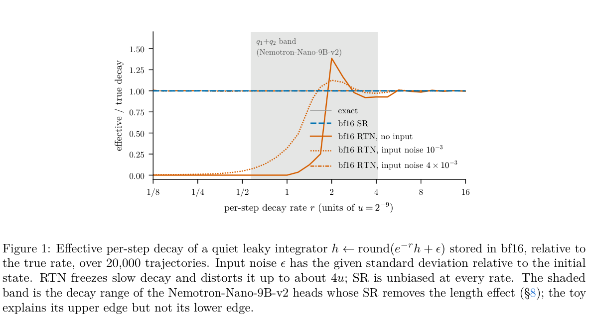
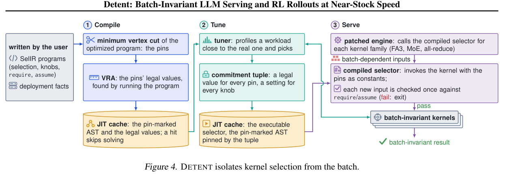
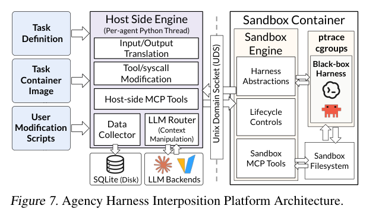
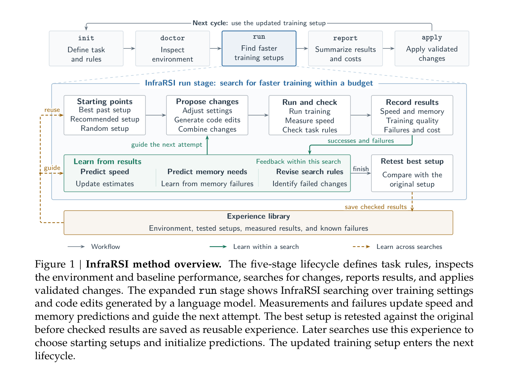

服务结果的漂移未必来自模型权重：循环状态的舍入、批次驱动的内核选择、缓存写失败与 Agent 的结束条件，都能改变用户实际得到的答案和等待时间。本期重点看四种执行细节：Lost in Rounding 把 bf16 状态偏差追到长度与触顶率；Detent 分析并固定批相关选择；lazy-pulling 研究把读故障定位到缓存所有权与写链路；Agency 则说明少几轮调用未必更省钱。

其他工作从 CAD 几何验证、历史回放、工具错误投递和网页安全，补充怎样测量“任务完成”；KV 存储、热 GPU 池与工作区分叉提供不同层级的状态复用机制。共同值得关注的是：每个性能数字究竟省掉哪一步，正确性证据又覆盖到哪一层。

<h2 class="daily-paper-title" id="paper-arxiv-2611.12127">01 · Lost in Rounding：循环状态的舍入误差会变成推理成本</h2>

[Lost in Rounding: bf16 Recurrent State Makes Hybrid Reasoning Models Think Longer](https://arxiv.org/abs/2611.12127)  
Yuchuan Weng、Xin Chen、Chi Liu · 2026-11-09

模型权重没有变，回答却更长、更容易撞上输出上限，问题可能出在 serving 引擎保存循环状态的方式。Mamba-2、Gated DeltaNet 等混合模型每生成一步，都要更新并保存状态；即使更新在 FP32 中计算，写回 bf16 时仍会舍入。论文把这一层数值选择与用户看见的完成率、长度和准确率联系起来，直接关系到推理服务的隐性退化。

**新增证据在于 bf16，而不是首次提出随机舍入。** 既有工作已观察到 FP16、INT8 状态带来的冗长问题。本研究在六个开放混合推理模型上，只改变循环状态的精度与舍入方式，保留 bf16 权重和激活，使用 590 道数学题；另在两个模型上测试 175 道 LiveCodeBench 题。SGLang 0.5.21 与 RTX PRO 6000 Blackwell 是实验环境。

机制可以从“更新被抹掉”理解：当一次衰减或增量相对当前状态太小，最近舍入 RTN 会反复写回同一个 bf16 值，误差便沿生成过程累积。随机舍入 SR 根据精确值处于相邻表示之间的位置决定向上或向下，使写回在期望上无偏。作者用简单衰减系统展示这一点，但没有把玩具模型当作完整的行为解释。

<a class="note-image-link" href="/assets/images/digest/2026-11-11/rounding.png" target="_blank" rel="noopener" aria-label="Lost in Rounding：循环状态的舍入误差会变成推理成本 · 查看原图 ↗">查看原图 ↗</a>

*读图：横轴是每步衰减，纵轴是有效衰减与真实衰减之比；橙线展示 RTN 的冻结与偏差，蓝色虚线是同位宽 SR。阴影头组的行为定位只适用于文中的特定谱系。*

在 32,768 新 token 上限下，五个模型的输出长度几何平均增至 FP32 状态的 1.07–1.27 倍。Qwen3.5-9B 的触顶数由 118/590 增至 223/590，准确率由 85.6% 降到 70.8%。只比较两种设置都正常结束的题，会看到接近相同的准确率，却把最严重的失败筛掉了。把相关题重新采样到 128K 预算后，总体准确率差缩至约 6.9 个百分点，仍未消失；bf16 下未结束的 93 次中，79 次符合精确重复循环判据。因此，加大预算只能处理其中一部分问题。

**修复也有实现条件。** 同宽 bf16 SR 在五个受影响模型中的四个消除了长度膨胀；Nemotron-3 仍有未解释的整体偏移。默认 Philox 在 GDN 内核上开销明显，而整数哈希随机数实现只在 Qwen3.5-9B 上进一步验证了接近 RTN 的速度与 FP32 的准确率，不能把这个结果推广到所有模型。按衰减速度只为四分之一状态头启用 SR 的办法，也只在一个 Nemotron 谱系成立。

这项工作值得服务维护者读的，是**把状态 dtype、舍入规则、长度分布和触顶率一起纳入回归指标**。它没有证明所有长思考都是数值故障；实验任务以竞赛数学和代码为主，仍需按目标模型验证。优先阅读生成闭环、128K 重测与随机数实现的对照，而非只看最终准确率。

<h2 class="daily-paper-title" id="paper-arxiv-2611.10611">02 · Detent：固定批相关的内核选择，保留快速执行路径</h2>

[Detent: Batch-Invariant LLM Serving and RL Rollouts at Near-Stock Speed](https://arxiv.org/abs/2611.10611)  
Peixu Xin、Runchuan Feng、Jiazhen Guo 等 · 2026-11-07

相同请求与随机种子，换一批同伴就产生不同 token，会让回归测试、故障回放和 RL rollout 难以比较。已有批不变内核只能保证“参数给定时不受同批请求影响”；引擎仍会按整个批次的 token 数、KV 长度等切换内核和归约方式。两个数学等价的求和路径可能产生不同浮点位，因此内核正确并不自动带来服务输出可重复。

Detent 将**内核选择本身变成可分析、可执行的程序**。它用 Python 子集 SelIR 表达选择逻辑，把部署常量与批相关输入区分开，部分求值后构建依赖图。求解器寻找从批输入到选择结果之间的最小加权顶点割，将少量中间值固定为常量。例如固定一个 MoE 配置表索引，可以同时阻断多项选择的批依赖，不必把每一个输出参数都单独钉死。

<a class="note-image-link" href="/assets/images/digest/2026-11-11/detent.png" target="_blank" rel="noopener" aria-label="Detent：固定批相关的内核选择，保留快速执行路径 · 查看原图 ↗">查看原图 ↗</a>

*读图：从左到右依次编译选择程序、按负载调优、固定承诺后服务；底部批不变内核仍是独立前提。*

接着，值域分析筛选合法取值，调优器在类似目标到达模式的负载上测量，选择部署时固定的参数元组。在线引擎执行的正是被分析过的选择程序，避免“证明了一份逻辑，实际运行另一份实现”。新输入还会检查前提条件；不满足时停止并报错，而非悄悄换回可能不确定的内核。作者按内核族分开调优以缩小搜索，但这一分解依赖内核执行可加、不同族不重叠等条件，融合或重叠执行必须重新建模。

在 vLLM、SGLang 的多 GPU Llama-3.1-70B 和 Qwen3-30B-A3B 部署中，按负载调优后的每输出 token 延迟为常规配置的 1.04–1.17 倍，而比较的确定性模式为 1.67–10.3 倍。收益来自保留快速且本身批不变的内核，而不是放宽输出一致性。RL 实验还让训练器与服务端使用相同内核和固定元组，使 rollout logprob 逐位匹配；固定种子后，rollout 可在不同批次和缓存切分下重放。

**保证的范围必须说清。** Detent 负责选择不依赖批次，候选内核自身的批不变性仍由使用者保证。固定元组随模型、引擎版本、硬件和部署改变而需要重建；更换元组本身也可能改变舍入和输出。把一种负载上调好的元组直接搬到另一种负载，文中 MoE 案例最差可慢至其专用元组的 4.17 倍，因此不能在线随意切换配置又期待跨配置逐位一致。

它与本期 bf16 状态研究互补：前者控制批次引起的路径变化，后者研究固定路径上的舍入偏差。对 Ops4LLM 的推进，是把“可重复”细化为选择程序、内核性质、采样种子和部署承诺共同满足的契约，同时测量这份契约的服务成本。

<h2 class="daily-paper-title" id="paper-arxiv-2611.11739">03 · Lazy-pulling 缓存：读失败的根因藏在平台账本之外</h2>

[Why Kubernetes Cannot Contain a Full Lazy-Pulling Cache: Two Impossibility Results and a Bounded, Honest Design for Model Serving](https://arxiv.org/abs/2611.11739)  
Georgii Kliukovkin · 2026-11-09

为了缩短模型服务冷启动，lazy pulling 先挂载镜像，再按需从 registry 拉取权重块。但这些块进入节点共享缓存后，未必出现在 kubelet 能够回收的镜像账本里。论文展示的亚健康现象很具体：采样探针仍然绿色，模型的大部分文件却已经无法完整读取。对维护服务可靠性的人，关键不是再加一条告警，而是找出哪个组件真正拥有这些字节和失败语义。

作者在 stargz-snapshotter 上分解了两条常见补救路径的失败。固定 sentinel 文件的就绪检查，在 280 个文件中 272 个不可读时仍通过；频繁检查还可能让被检查部分恰好留在缓存里。把磁盘压力完整暴露给 kubelet 也不够：image GC 释放 0 字节，随后驱逐 26 个没有写入该缓存的旁观 Pod。**压力可见性并未赋予正确的回收能力。** 这些是特定架构与测量条件下的反例，不是证明所有 Kubernetes 缓存设计都不可能安全。

修复同时处理容量和数据路径。持久索引记录块、大小与访问时间，但更新队列选择不阻塞读取，队满时允许丢更新。因此，不能拿这份可能低估的索引当硬预算的唯一依据：文件系统用量决定“是否需要回收多少”，索引决定“回收哪些块”，必要时重扫校正。驱逐跳过在途块，利用已打开文件描述符的 POSIX 语义保护并发读取，缺失块则沿原有路径重新拉取。

更直接的根因是一处写链路耦合：上游把拉回的数据同时写给缓存与调用者，缓存的 ENOSPC 会让整个写链提前返回，即使调用者需要的字节已到达，也会收到读错误。作者把缓存写入改为尽力而为，失败时中止残缺缓存项并计数，继续把数据交给读取者。这样，存不下只意味着下次可能重取，不能否决这次有效读取。

同配置 AWS 实验中，90% 缓存预填时，上游 280 个文件有 273 个失败；修复版本完整读取 150.3 GB、零读错误。在同可用区 registry 的交错对照里，耗时中位数增加 18.5%，即把正确性故障变成可测的重取代价。80 GB 预算实验中，读取期间累计驱逐 224.6 GB；约 301,000 次索引更新丢失下仍维持预算。不同数字对应各自实验，不能合成一个通用性能承诺。

**最值得迁移的是两条边界：资源控制要与所有权一致，缓存写失败要与数据读取解耦。** SOCI、Nydus 的结果主要来自固定版本源码审计；其中 Nydus RAFS 默认路径已采用异步持久化，不能把 stargz 的读失败结论套给整个生态。远端 registry 的重取成本尚未测量，LRU 与 2Q 的对照也未显示可靠优势。本文没有采用代码片段图作为架构图，机制可直接沿上述读写路径理解。

<h2 class="daily-paper-title" id="paper-arxiv-2611.12122">04 · Agency：Agent 降本要追踪每轮重读的上下文</h2>

[System Optimizations for Cost-Efficient Agent Harnesses](https://arxiv.org/abs/2611.12122)  
Jongseok Park、Jiaxiang Yu、Eric Zhou 等 · 2026-11-09

给 Agent 换更便宜的模型之外，harness 本身还有多少空间？这篇论文把成本拆成新增输入、缓存读取和模型输出，并观察它们怎样随工具循环累积。同一段上下文留在会话里，之后每次模型调用都可能再次计费；即使缓存读单价较低，长任务也会反复付出这笔开销。因此，工具调用少、token 少与总费用低并不总是一回事。

作者先分析基准与公开轨迹。其“工具输出平均只有 27% 在后续被引用”是事后可观察的上界线索，不能解释为在线可以安全删除其余 73%。真正困难在于预测未来会用什么，以及修改旧上下文导致的缓存失效是否比节省的读取还贵。

Agency 用插桩层把这一问题从特定 Agent 产品中抽出来。容器中的 sandbox engine 捕获模型与工具相关动作，经 Unix socket 交给主机侧 engine，转换为统一表示、记录数据，再运行修改钩子。上下文块通过哈希和查找表表示，使删除或压缩策略能够在后续调用继续生效；工具输出与系统资源控制也有相应拦截点。它是优化试验平台，而非新的模型训练方法。

<a class="note-image-link" href="/assets/images/digest/2026-11-11/agency.png" target="_blank" rel="noopener" aria-label="Agency：Agent 降本要追踪每轮重读的上下文 · 查看原图 ↗">查看原图 ↗</a>

*读图：右侧已有 harness 的动作经 sandbox engine 与 UDS 进入主机侧拦截层；统一转换、上下文修改和记录发生在同一条路径上。*

五种原型覆盖不同时间尺度。新工具输出先做近乎无损的格式压缩和重复行引用；上下文垃圾回收用树模型预测行的复用概率与剩余轮数，只在预计净节省为正时触发；子任务栈在阶段完成后保留结果、压缩历史。另两种方法是用文件元数据表替代反复目录探索，以及引导模型批量发出互不依赖的工具调用。这里的共同目标是减少重复支付，而非单纯追求最短上下文。

在三种 harness、四种模型、100 道软件工程题和 100 道检索题的组合评估中，合并方案平均成本是基线的 0.77，分组范围为 0.65–0.85；平均准确率比值为 0.97。摘要所说“不影响准确率”需要读得更细：Luna 在部分检索题出现退化，整体准确率比值为 0.93。17%–29% 的单项任务还会变贵，说明平均收益并不保证每条请求获益。

**最有价值的负面结果来自消融。** 在 Basic-full 与 Luna 的编码任务上，工具批处理使步数从 32.0 降到 26.0，却增加了新增输入与不必要工具调用，最终费用上升约 2%。子任务压缩同样带来重新检索成本，只是缓存读节省仍超过它。对 AgentOps 来说，应观测每次调用的上下文构成、缓存写读和任务正确性，再判断策略是否有效。费用模型依赖当时提供商计价，事后“未用信息”的空间也不等于线上可实现收益；优先读成本净收益公式、拦截架构和逐项消融。

<h2 class="daily-paper-title" id="paper-arxiv-2611.10063">05 · Done Is Not Correct：把“完成”绑定到最终几何测量</h2>

[Done Is Not Correct: Measuring Silent Failures and Self-Verification Calibration When LLM Agents Take CAD Actions](https://arxiv.org/abs/2611.10063)  
Carson Rodrigues、Clive Rodrigues、Aravind Reddy G · 2026-11-06

CAD Agent 能生成有效实体并声称完成，尺寸、孔位或体积仍可能不合要求。作者为 13 项任务建立 122 项可计算检查，用 build123d/OpenCascade 测量，不依赖视觉模型评分；工具循环只返回实际几何量，不透露目标容差或最终判分，并强制 Agent 在最终代码测量后才能结束。

四家模型、每种架构 156 次尝试中，单发静默失败为 22/156（14.1%），工具循环为 5/156（3.2%）；这些以全部尝试为分母。另一个指标“声称完成后的正确率”由 64.1% 升至 96.0%，但完成声明率也下降。相同反馈下放松声明契约的消融出现 14 次静默失败，对比固定契约的 5 次，支持检查结束条件的重要性，不过该对照 Fisher p=0.056。

它为 AgentOps 提供了可迁移的完成契约，而非“多放一个 checker 就可靠”。套件很小，人工审查还发现一题有自然语言歧义；几何属性检查也不能覆盖全部制造约束。

<h2 class="daily-paper-title" id="paper-arxiv-2611.11216">06 · Replay Fidelity：同样判分不等于恢复了同样状态</h2>

[Replay Fidelity in LLM Agent Evaluation: Randomness, Hidden State, and Test Oracles in AppWorld](https://arxiv.org/abs/2611.11216)  
You Liu、Quanchao Lu · 2026-11-08

Agent 调试中的回放，究竟要复现屏幕输出、数据库差分，还是未来还能继续执行的状态？作者对固定历史 AppWorld 语料中的 71 条失败执行做 284 次隔离、固定代码回放，同时比较输出、判分前数据库差分与原生判分/测试数。复原声明设置能接纳 42 条，每次交互前重置 RNG 后为 68 条。

但这 26 条差距主要由输出文本变化造成：只比较数据库与判分时，已知匹配数变为 66 对 70；一条终点未知。进一步查询实体行，确认四条差分不一致并非纯序列化差异。还有一个案例在已检查的终点内容一致时，后续相同 API 参数因遗漏的 RNG 位置而写出不同状态。

价值在于为故障定位和反事实实验明确“恢复了什么”，不是证明逐交互重置随机种子是通用修复。实验固定旧运行时与历史代码，没有重新采样实时 Agent，也未测这些差异是否改变修复成功率。

<h2 class="daily-paper-title" id="paper-arxiv-2611.11581">07 · Same Error, Different Recovery：错误投递方式也是恢复变量</h2>

[Same Error, Different Recovery: How Delivery Changes LLM Agent Behavior](https://arxiv.org/abs/2611.11581)  
Sunghyeun Woo、Javier Conde、Pedro Reviriego · 2026-11-08

同一条工具错误，放进 tool 消息、删掉失败交互后改写历史，或保留交互再追加 user 轮，可能诱导不同的重试、修正和停止行为。作者在 13 个 3B–70B 开放模型中控制反馈与呈现形式，并实现一个可选恢复层：识别可分类错误、保留原失败证据，再用新一轮说明应采取的动作。

ToolMaze 的显式错误上，小模型组和大模型组成功率分别提高 14.2、10.5 个百分点；但测最终状态一致性的 Loud/Quiet 没有可测改善。合成对照中，保留历史的总体优势很大程度来自避免 Llama 因删除失败交互而失去正确停止能力；去掉这两个 Llama 模型后，平均差接近零。

这推进了 harness 错误处理的可测设计，而非通用重试策略。实际检测器只正确指导一部分错误，知道真实故障类型的客户端仍更强；对有副作用的调用，超时也不能直接当作“没有提交，可以重试”。

<h2 class="daily-paper-title" id="paper-arxiv-2611.11971">08 · Harness Matters：把能力不足与真正防御分开测</h2>

[Harness Matters: Measuring and Dissecting Security Resilience in Web Agents](https://arxiv.org/abs/2611.11971)  
Xinyi Wu、Jiagui Chen、JiaYi Dong 等 · 2026-11-09

网页 Agent 没有完成攻击者目标，可能只是不会操作网页。WebTrap Farm 将 harness 分成目标理解、网页感知、推理规划、动作执行四阶段，组合恶意用户提示、提示注入和欺骗性网页，并加入配对可用性任务，区分真正防御与能力失败。网页侧事件监控提供跨实现的一致观察接口。

六种开放 harness、七个后端模型的评估中，开放系统总体攻击成功率为 32.55%；不同 harness 差异明显。这个数是所构造攻击集上的加权结果，不能解释为现实浏览任务的受攻击概率。作者还定位防御在执行链的哪个阶段发生，而非只给模型贴“安全/不安全”标签。

它与 CAD 的完成契约、错误投递研究互补，关心的是网页输入到动作的安全边界。任务改编自受控网页与既有攻击集；总体统计支持 harness 重要，但组件比较不能自动隔离每项设计的独立因果效应。

<h2 class="daily-paper-title" id="paper-arxiv-2611.10178">09 · The Storage View of KV Cache：用会话生命周期区分冷与无用</h2>

[The Storage View Of KV Cache: Characterizing Cache Behavior Across LLM Workloads](https://arxiv.org/abs/2611.10178)  
Talia Q. Chen、Daniel Waddington、Narangerelt Batsoyol 等 · 2026-11-06

共享 KV 存储仅凭 LRU 或固定 TTL，很难区分“工具还没返回的长会话”和“已经结束的会话”。论文把 11 份生产与公开 trace 归一到 KV block，区分会话内复用与跨会话共享，指出工作负载 ID、会话 ID、完成信号可以构成小型跨层接口。

轨迹比较中，按工作负载学习复用间隔可保留最多多 22% 的会话内命中，或在其他负载减少最多 40% 的死亡状态；两种收益并非在每个负载同时发生。完成信号只允许立即回收单会话状态，不能删掉仍可能跨会话复用的公共前缀。字节量用共同 KV 几何归一，也不是各原始部署的真实显存占用。

价值在于把分层缓存的保留、降级和回收与执行结构对齐。这是一份存储视角的测量与接口论证，不能把命中改善直接当成已部署服务的端到端加速；开放聊天也未必有明确完成事件。

<h2 class="daily-paper-title" id="paper-arxiv-2611.10832">10 · Firepool：热 Pod 的复用边界和 GPU 待命容量</h2>

[Firepool: Brokering Warm GPU Capacity for Agentic and RL Workloads at LinkedIn](https://arxiv.org/abs/2611.10832)  
Ankit Goyal、Santosh Jha、Zhuo Zhi 等 · 2026-11-07

秒级工具与 RL 作业若每次新建 GPU Pod，启动可能比工作本身更长。LinkedIn 的 Firepool 按硬件 profile 共享基础镜像，运行时再绑定代码、依赖和分布式拓扑；同一调用者优先复用旧 Pod，不跨调用者直接传递残留状态。待命 Pod 占分数调度份额但不创建 CUDA context、持有零显存，上一作业清理后才通过每 GPU 的门禁提升为活跃实例。

生产峰期抽样 3,206 次请求中，94.7% 由热或待命容量满足。H200 固定时长作业的配对实验中，相对每作业新 Pod，Agent/RL 循环分别快 13.0/10.8 倍；这是启动主导的合成循环，并非任意训练任务的加速。

值得读的是隔离、就绪容量和预算如何共同设计。热命中仍可能排队等待调用者配额，依赖包会保留到 Pod 退役，gang 请求也存在大作业饥饿风险；“热”不等于无条件低延迟。

<h2 class="daily-paper-title" id="paper-arxiv-2611.10453">11 · BunshinRL：对整个活动工作区做可分叉状态复用</h2>

[BunshinRL: Splitting Live Agent Workspaces for Memory-Efficient Agentic RL](https://arxiv.org/abs/2611.10453)  
Yutong Huang、Vikranth Srivatsa、Alex Asch 等 · 2026-11-07

RL rollout 不只保存模型上下文，还要保留浏览器、文件与工具进程。BunshinRL 用 BunshinFork 重建容器进程树，以写时复制共享未修改页面，并保留文件、内部通信与 GUI 状态；在此之上按完整工具调用前缀缓存工作区，并投机执行历史上常见的下一调用，预测不符则丢弃私有分支。

OSWorld、WebArena 子集与 Qwen3-VL-8B 的实验中，WebArena 相对 AgentENV 的峰值内存最高下降 43%。OSWorld 的缓存/投机消融中，单个 epoch 从基础方案的 20.8 分钟降至完整方案 17.0 分钟；这项约 18% 降幅是明确对照，不与摘要的最高 23% 混写。

可迁移点是把环境状态本身作为复用单元，且匹配必须包含起始任务与完整调用历史，不能只看参数。外部连接会关闭重建，本地回滚不能撤销远端副作用；工作区容器隔离与 microVM 的安全边界也不同。

<h2 class="daily-paper-title" id="paper-arxiv-2611.11558">12 · InfraRSI：先锁定训练工作量，再让 Agent 搜索提速</h2>

[InfraRSI: Harnessing Recursive Self-Improvement for Training Infrastructure](https://arxiv.org/abs/2611.11558)  
InfraRSI Team、Yuchuan Tian、Haocheng Mei 等 · 2026-11-08

训练优化 Agent 可能通过改变有效 batch、偷偷降精度或把更新移出计时窗“提速”。InfraRSI 先固定工作负载、数据、优化器步数、数值容差和计时边界，再校准集群噪声，联合搜索启动参数与代码补丁。时间代理模型和带删失的峰值内存模型利用成功与 OOM 试验更新判断，候选最终要与新基线背靠背重测才能晋级。

<a class="note-image-link" href="/assets/images/digest/2026-11-11/infrarsi.png" target="_blank" rel="noopener" aria-label="InfraRSI：先锁定训练工作量，再让 Agent 搜索提速 · 查看原图 ↗">查看原图 ↗</a>

*读图：先定义任务并检查环境，再进入提议、执行、验证与记录循环；最优设置必须独立复测，经验库保存通过检查的结果。*

四个稠密/MoE 训练负载、8–16 张 H100/H200 上，作者报告几何平均提速 1.83 倍，平均 MFU 从 17.4% 增至 30.0%，最高 2.75 倍。值得关注的是把失败试验成本也计入账本，并保留没有候选通过时的原始配置。

16 项自动不变量之外仍需要源码路径审查；短窗 loss 一致性不是完整训练收敛等价证明。跨硬件经验也有模型、拓扑与框架兼容边界，不能直接搬运最优参数。

<h2 class="daily-paper-title" id="paper-arxiv-2611.12079">13 · Correct First, Fast Second：小模型 Kernel Agent 的负面证据</h2>

[Correct First, Fast Second: What a Local 7B Code Model Can and Cannot Do for GPU Kernel Optimization](https://arxiv.org/abs/2611.12079)  
Jui-Chien Tsou、Po-Yi Wu · 2026-11-09

固定本地 Qwen2.5-Coder-7B，增加分析、检索和反馈角色是否就能写好 CUDA？30 道 KernelBench 题、V100 上的比较表明，profiling 引导整体正确率最高，为 43%；正确样本的几何平均加速仍只有 eager PyTorch 的 0.97–0.99 倍。多角色循环是唯一解出部分二级融合题的方法，却会把简单任务过度复杂化。

关键消融是让同一生成器采样多个候选，由真实编译、数值与计时检查选择。每轮仅一个候选时正确率 3%，八个时为 33%；去掉反馈分析角色反而改善部分结果。小模型的收益主要来自匹配其能力的融合与执行筛选，不能把更多角色等同于更好优化。

这是单模型、单种子、小规模任务的负面与机制性证据，不能推广到前沿模型。作者还记录生成 kernel 挂住评估 worker 的事故，随后加入子进程硬超时，提醒自动优化的执行隔离也是系统设计的一部分。

## 同日笔记

- [LMCache 与 Phoenix：让 SSD 上的 KV 直接回到 GPU](/tech/zh/phoenix-gds/)
- [NVIDIA Snapshot：复用初始化状态，把副本恢复与冷启动分开](/tech/zh/nvidia-snapshot/)
- [Agent Substrate：会话可挂起，热 Worker 不必绑定一个 Agent](/tech/zh/agent-substrate/)
- [GKE Dynamic Slicing：让 TPU 逻辑拓扑摆脱固定 Nodepool](/tech/zh/gke-dynamic-slicing/)
- [LLDB 的 CPU/GPU 联合调试：共享会话，保留两个地址空间](/tech/zh/lldb-accelerators/)
- [TLX：把 Warp 编排从编译器猜测变成可表达的程序](/tech/zh/tlx-production/)
- [Muse Spark Open on TPU：整步流水线之外，还要保住会话状态](/tech/zh/muse-spark-tpu/)
