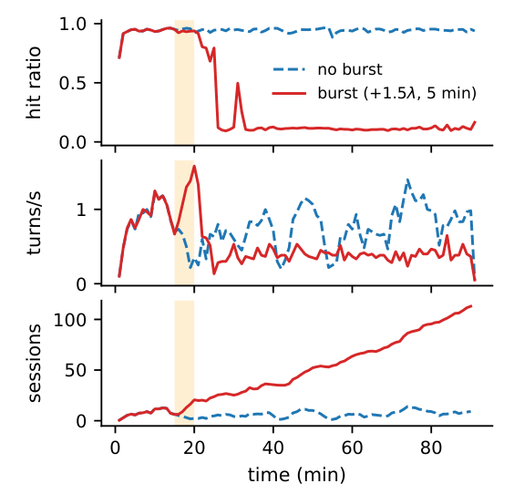
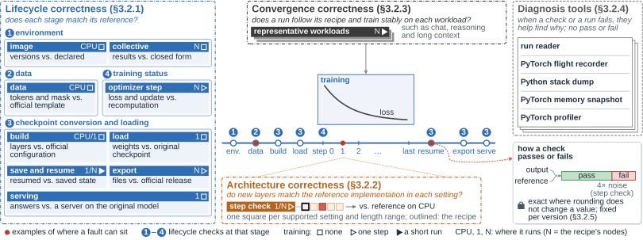
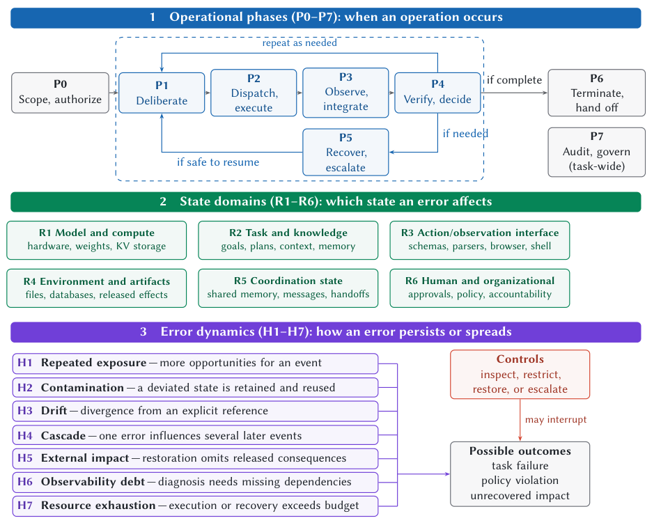
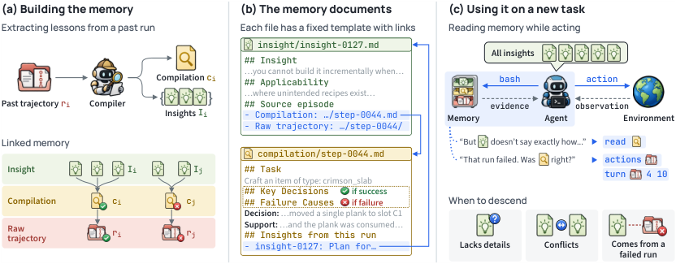
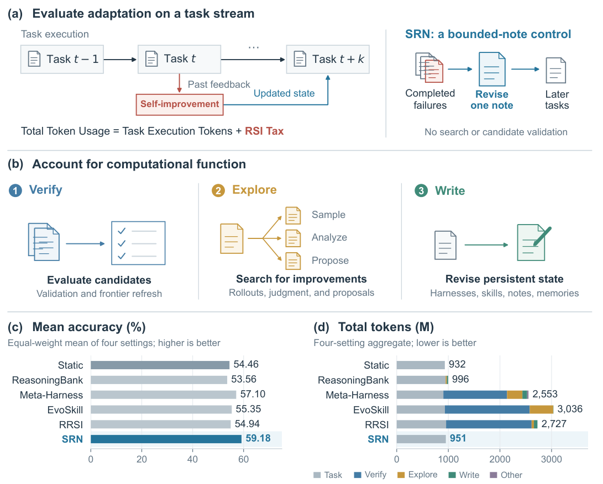
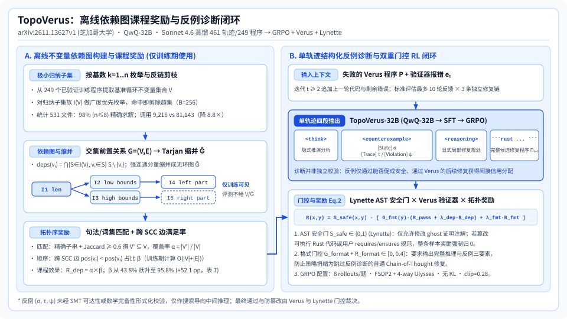
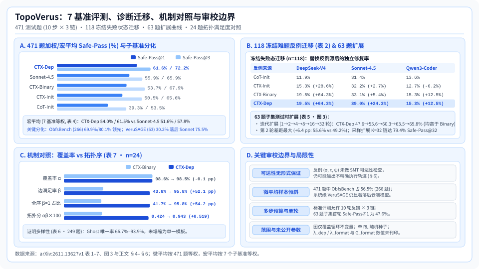
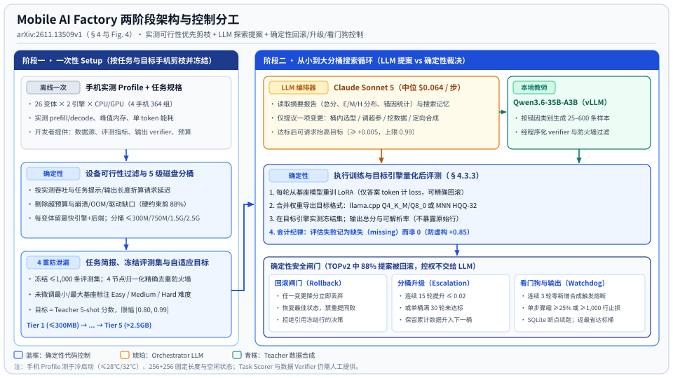
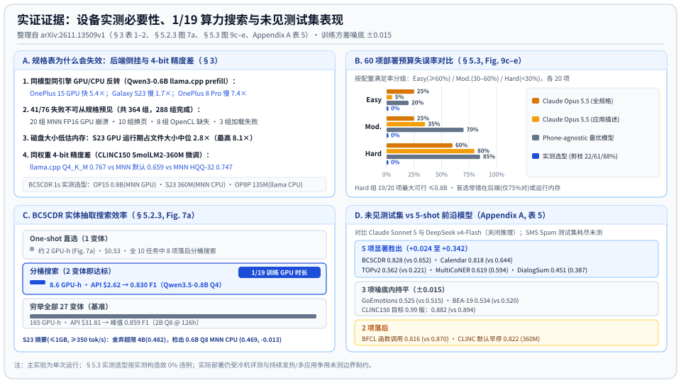

缓存复用、验证和自改进都能节约后续工作，却也可能引入新的依赖：缓存一旦失效，会话积压可能继续破坏命中率；验证若只看 loss 或最终答案，会错过已经污染的状态；复杂自改进如果反复重跑候选，学习成本又可能超过任务本身。本期重点沿这条链条看系统如何恢复效率、检查正确性，以及让 Agent 的经验仍然可以回查。

其他研究把视角延伸到多智能体协作、GPU 通信分析、训练配置选择与证明修复。它们有的改善执行机制，有的提供测量工具或负面证据。阅读时尤其值得区分层级加速与端到端收益、任务得分与行为忠实度，以及模型证明与实现覆盖。

<h2 class="daily-paper-title" id="paper-arxiv-2611.13412">01 · 短暂突发为何留下长期缓存崩溃</h2>

[Bursts That Outlast Themselves: Persistent Degradation in Prefix-Cached Agent Serving](https://arxiv.org/abs/2611.13412)  
Wen Huang , Jack Liu · 2026-11-10

前缀缓存让多轮 Agent 的一次调用只需处理新增内容，但也让服务能力依赖历史状态。Wen Huang 与 Jack Liu 展示的危险是：短暂突发结束后，请求到达率已经恢复，服务器仍不能回到原来的吞吐。其贡献是以配对实验确认这种历史依赖，并区分预防与恢复所需的控制动作；作者明确不把缓存抖动或会话限流本身当作新发明。

### 从命中率下降到自我维持的拥塞

主实验在单张 MI300X 上运行 vLLM、Qwen3-8B，KV 池限制为 40 万 token。每对运行使用相同基础会话流，仅一侧在第 15 分钟增加持续五分钟的到达流，总到达率变为基础值的 2.5 倍。12 对中有 9 对仅突发侧持续降级，没有反向配对；另外两对两侧都降级，一对都健康。典型运行中，突发侧命中率留在约 10%，吞吐大幅下降，积压直到 90 分钟实验结束仍在增长。

原因不是突发请求迟迟没有做完。Agent 必须等待模型和工具返回才能开始下一轮：服务越慢，会话在系统里停留越久；同时活跃的上下文越多，工作集越容易超出 KV 池；前缀被逐出后，每轮都要重算越来越长的历史，进一步拖慢服务。即使基础到达率低于热缓存容量，也可能高于冷缓存状态的处理能力。

<a class="note-image-link" href="/assets/images/digest/2026-11-12/bursts.png" target="_blank" rel="noopener" aria-label="突发结束后，红线的命中率未恢复，会话积压继续增长；蓝线是相同基础流量的无突发对照。">查看原图 ↗</a>

*突发结束后，红线的命中率未恢复，会话积压继续增长；蓝线是相同基础流量的无突发对照。*

### 恢复需要减少已准入的活跃工作集

只限制新会话，已进入系统的会话仍会争抢缓存。作者在网关的轮次边界暂停部分会话，让剩余会话重新装得下。budgeter 用“上下文长度加输出预算”的总和估计 KV 需求，以池容量的 0.75/0.95 为准入与挂起阈值；暂停会话优先于新会话恢复，不中断在途请求。

在所有控制臂都已崩溃的七个配对种子上，budgeter 全部在首个五分钟恢复窗口内恢复，按容量设置的会话上限也全部在六分钟内恢复，单纯准入限制仅恢复一个。对上下文长短变化的流量，token 预算比固定会话数更能跟随需求。128 GiB 主机 KV 卸载层可以推迟崩溃，却不能消除不断增长的工作集。

### 恢复效率不等于清空队列

Qwen3-32B 的轨迹形状实验和 SGLang 实验支持机制的可迁移性，但不能覆盖所有硬件、调度器与真实请求内容。32B 的较长运行中，即使恢复了缓存命中，积压仍可能增长，因为基础流量已经超过长期完成能力。挂起也让部分用户等待更久。对 Ops4LLM 最有价值的结论，是把热态容量、冷态容量、会话驻留需求和恢复动作分开观察；命中率回升并不意味着服务已经恢复到正常用户体验。

<h2 class="daily-paper-title" id="paper-arxiv-2611.13393">02 · Plumbline：下降的 loss 不能证明训练正确</h2>

[Plumbline: When the Loss Lies, Validating LLM Training Correctly](https://arxiv.org/abs/2611.13393)  
Ruochen Wen , Hongyang Wang , Siwei Li , Wenbo Chen , Xian Li , Jingguo Liu , Leo Fan , Yiming Yan , Qian Qu , Zheshen Wang , Benoit Dumoulin · 2026-11-10

训练任务没有报错、loss 也在下降，仍可能学错内容或导出错误模型。Plumbline 把这个问题拆成可检查的契约：输入是否遵循官方模板，参数是否完整加载，恢复是否保留各 rank 状态，更新是否符合优化器定义，导出的模型是否仍是训练所得模型。它在 Amazon 的生产使用提供了实际故障证据，也说明 AI 辅助诊断需要独立于诊断者的判定规则。

### 让每一层都有可比较的参照

系统包含生命周期、架构与收敛三类检查。数据检查逐行比较官方 tokenizer 和模板生成的 token 与 loss mask；加载前用 NaN 填充参数，暴露被跳过的权重；保存恢复按 rank 逐位比较；导出检查以学习率零运行一步，再与原 checkpoint 对照。优化器步骤用更高精度重新计算 loss 归一化和参数更新，避免只观察最终 loss。

架构检查用涵盖各类新层的前几层、真实权重与固定数据，对照 CPU FP32 参考实现，逐一改变框架声称支持的配置。梯度误差超过运行噪声和精度噪声中较大者的四倍才判失败。若容差可能掩盖缺陷，还需注入相应故障确认检查会拒绝。完整模型的收敛运行则补上单步检查看不到的深度、内存及多 rank 时序问题。

<a class="note-image-link" href="/assets/images/digest/2026-11-12/plumbline.png" target="_blank" rel="noopener" aria-label="生命周期、单步架构和整次运行检查覆盖不同故障；右侧诊断工具提供记录，不自行给出通过判决。">查看原图 ↗</a>

*生命周期、单步架构和整次运行检查覆盖不同故障；右侧诊断工具提供记录，不自行给出通过判决。*

### Agent 组织实验，固定检查裁决结果

Agent 选择配置、安排作业并提出根因假设，不能临时改写通过标准。诊断将已有检查与 profiler、内存快照、通信记录及栈信息组合，缩小故障规模并改变单个设置。人工审核者批准计划和关键变更，第二个 Agent 从原始记录重建发现，最终仍由人确认。无法完成比较的检查记为未决或未评估，而不是通过。

在三个框架、五个 MoE 模型的测试版本上，系统发现 61 个问题，其中 32 个静默；42 个已修复或上报上游，其中 8 个为作者首次报告。生命周期和架构检查最先找到了 32 个静默问题中的 29 个；至少 16 个静默问题所在运行通过了收敛检查。一个直观例子是 loss mask 漏掉回复终止 token：训练照常下降，却没有教会模型按预期结束。

### 参照缺失就是覆盖缺口

这些数字按“一个框架上的一个根因”计数，不能理解为 61 个全新漏洞，也不是所有训练任务的故障率。系统对没有可信参考的层不作正确性判决；受测 DeepSeek-V4.1-Flash 尚无对应 Hugging Face 实现就是明确缺口。参考代码和受测框架若共享缺陷，差分也可能漏检。值得读的是检查契约与故障分类：它们把“训练看起来正常”变为多个有边界的证据，而非一个包办所有正确性的分数。

<h2 class="daily-paper-title" id="paper-arxiv-2611.13254">03 · 故障轨迹：发现反证之后，错误状态是否被清除</h2>

[Dependable Long-Horizon LLM Agents: A Trajectory-Centered Empirical Study of Where Errors Enter and Which Controls Reach Them](https://arxiv.org/abs/2611.13254)  
Shaohuang Wang , Jinghao Wen , Xulei Zhang , Xun Jiao · 2026-11-09

“哪个 Agent 在哪一步犯错”常把分析停在最显眼的症状。本文提出 episode 记录，把最早候选故障、受影响状态、传播路径、检测、响应与最终后果连起来。它关注的不是增加一个失败标签，而是回答某项控制是否读得到关键证据、改得到真正出错的状态。这与 AgentOps 的诊断、恢复与审计直接相关。

### 同一种症状可能需要不同控制

框架分别标记操作阶段和状态领域：例如错误事实可以先进入计划，再被写入共享消息，最后通过工具执行。每个传播链接还区分观察到的关系、干预支持的关系与推测。标注者必须把步骤字段锚定到轨迹行号，记录反证出现时 Agent 是否看见、提到或采取行动。这样，“验证失败”可以进一步拆成无来源事实被认可、错误任务被认真执行，或真实观察在交接时丢失。

<a class="note-image-link" href="/assets/images/digest/2026-11-12/trajectory.png" target="_blank" rel="noopener" aria-label="上层是操作阶段，中层是状态领域，下层是传播方式；恢复必须覆盖受污染状态，不能只看终止时的症状。">查看原图 ↗</a>

*上层是操作阶段，中层是状态领域，下层是传播方式；恢复必须覆盖受污染状态，不能只看终止时的症状。*

研究完成 96 条记录，其中一条只有过程违规而最终答案正确，结果统计采用另外 95 条失败轨迹。关键方法限制是：记录由 Claude 按协议逐条生成，**并非独立人工标注数据集**；作者只对部分比较分歧作人工检查，没有报告人工标注者间一致性。样本来自 Who&When 和 MAD 的部分批次，还排除了特别长的轨迹，因此数字应作为有待人工复核的描述性发现。

### 检测与恢复之间有断层

在这些记录中，68/95 条在最终失败前已有矛盾证据，只有 7 条采取了行动。正文的计数与“88% 未行动”表述存在小幅不一致，直接用分子分母更清楚。29 条运行出现偏离检测，但没有响应完全清除错误状态。换一个下一步动作，同时保留错误计划或信念，便可能再次进入原来的循环。

作者认为，恢复 Agent 本地状态足以覆盖 35/95 条；在 56 条中，故障本来就在计划、任务描述或停止规则里，回滚可能只是重演。这里的“足以覆盖”来自事后控制适用性判断，不能理解为已经部署恢复机制并提高了成功率。独立裁判同样只有在读取被遗漏的证据时才可能有效，不是多一个同源投票者就能解决。

### 更坚实的发现来自原始日志扫描

确定性扫描全部 Who&When 原始轨迹时，58 条手工构造运行中有 26 条遭遇 provider 内容过滤错误，其中 25 条随后由 harness 输出了并非 Agent 生成的最终答案。这个结果不依赖 episode 的 LLM 标注，也提醒根因基准不要把运行时兜底答案归罪于某个 Agent。本文最值得沿用的是有来源的传播记录和“检测后状态是否真的改变”的问题；当前比例不宜推广为生产 Agent 的失败分布。

<h2 class="daily-paper-title" id="paper-arxiv-2611.14320">04 · WikiTrace：让记忆保留可回查的证据</h2>

[Don't Just Trust Your Memory: Evidence-Linked Memory Reduces Memory-Induced Degradation in LLM Agents](https://arxiv.org/abs/2611.14320)  
Yukyeong Lee , Yumin Choi , Jinheon Baek , Sung Ju Hwang · 2026-11-10

记忆系统可以提高平均成功率，同时让 Agent 在原本能完成的任务上失败。WikiTrace 将这类回退单独测量，并把原因指向一种常见的信息压缩：从成功或失败标签提炼出一句教训，却丢掉支持它的具体过程。错误归因、不适用的规则和误读都可能因此变成以后任务的指导。

### 从一句教训走回完整轨迹

每条过去运行被单独处理，生成成功原因或可能失败原因的摘要，以及最多三条 insight。原始轨迹不改写；每条 insight 链接到摘要与原始运行，并标明适用条件和来源成败。摘要仍是模型解释，不能因为有链接就被视为已经证实。系统也不预先消除所有冲突，而把判断当前适用性留给执行 Agent。

新任务开始时，Agent 看到全部 insight，以及三个相似历史任务的导航信息。遇到细节不足、教训冲突、失败任务来源或行动失败时，它通过只读文件和终端工具向下查证。PlanCraft 的案例说明了区别：错误记忆把合成界面显示的中间产物误当成已消耗材料的结果；原轨迹显示继续摆放材料仍可完成配方。回查改变的是行动依据，而非只给提示增加更多文字。

<a class="note-image-link" href="/assets/images/digest/2026-11-12/wikitrace.png" target="_blank" rel="noopener" aria-label="左侧构建记忆，中间保留 insight、摘要和原始轨迹的链接，右侧在信息不足或冲突时回查来源。">查看原图 ↗</a>

*左侧构建记忆，中间保留 insight、摘要和原始轨迹的链接，右侧在信息不足或冲突时回查来源。*

### 和同样的 insight 比，证据访问增加了什么

五个基准的八个套件各运行三次，使用相同 DeepSeek-V4-Flash Agent；记忆一次性从相同的训练轨迹构建，不额外试跑验证。平均得分从无记忆的 79.5 到 WikiTrace 的 90.2；相对仅提供相同 insight 的 87.0，提高 3.2 个百分点。后一个比较更直接，但变化同时包含来源访问能力和引导回查的提示，不能把收益只归给文件链接。

作者按无记忆三次试验的多数结果定义原本可解任务。WikiTrace 在这部分上的回退率为 4.5%，仅 insight 为 6.5%；另外重跑无记忆 Agent 得到 9.7%，说明任务随机性本身也会带来回退。测试时 WikiTrace 的平均单任务成本为仅 insight 的 1.17 倍，需要和质量收益一起看。

### 可追溯不等于记忆已经正确

系统把全部 insight 放入首条消息，规模增大后仍需解决检索与上下文容量。回查由 Agent 自己选择，因而“回查运行比不回查运行更好”的分组分析不是随机干预证据。错误类型和回查效果还依赖 LLM 对推理文本的判断。其可靠性价值在于保留了修正教训的路径，并把新增成功与破坏原有成功分开报告；它没有保证每条记忆正确，也尚未解决长期在线记忆无限增长的问题。

<h2 class="daily-paper-title" id="paper-arxiv-2611.13524">05 · RSI Tax：把改进过程本身计入成本</h2>

[The RSI Tax: When Recursive Self-Improvement Is Not Worth the Cost](https://arxiv.org/abs/2611.13524)  
Yitong Zhang , Ang Li , Yisen Wang · 2026-11-10

自改进系统通常展示新 harness 或技能让后续任务更强，却容易把“如何找到这次改进”留在账外。The RSI Tax 把生成候选、分析经验、重复验证与写入持久状态的 token 全部纳入成本，并在任务反馈用于更新之前固定该任务的成绩。这让评估更接近连续提供服务时实际付出的代价。

### 简单基线为何有比较价值

研究比较六种方法、两个底座模型，在七条仓库任务链共 105 个位置和 89 个 Terminal-Bench 2.1 任务上形成 2,328 个方法—任务评分。共同初始 Agent 与任务顺序有助于减少混杂；不过 EvoSkill 等方法为连续任务流做了适配，结果不是它们原始论文设定的原样复测。

基线 SRN 每四个任务更新一次不超过 2,048 token 的笔记，只利用允许窗口内失败任务的轨迹片段与标量结果。没有失败就保留旧笔记，不进行候选搜索或额外验证。其意义是提供一个会学习但改进成本很低的参照，检验复杂搜索是否确实买到了足够收益。

<a class="note-image-link" href="/assets/images/digest/2026-11-12/rsi-tax.png" target="_blank" rel="noopener" aria-label="先固定当前任务成绩，再用历史反馈更新；总成本同时包含执行任务以及验证、探索和写入改进的成本。">查看原图 ↗</a>

*先固定当前任务成绩，再用历史反馈更新；总成本同时包含执行任务以及验证、探索和写入改进的成本。*

### 验证比写技能更昂贵

SRN 在四个模型—基准设置中三次取得最高观察准确率，一次与 EvoSkill 持平。相对 Meta-Harness、EvoSkill 和 RRSI，总 token 的设置内比值再平均，分别减少 65.6%、71.0% 和 68.2%。这不是证明复杂自改进永远无效，而是显示在这些有限任务流里，改进过程没有充分摊销。

三种复杂方法的 RSI Tax 中，验证占 74.8%–93.6%。例如 DeepSeek 的终端任务流上，Meta-Harness 执行任务本身比 SRN 少用 token，但加上约 578.45M 的改进成本，总量达到 762.57M，对照 SRN 为 214.65M。单看部署后执行效率会得出不同结论。

### 未复用成本不等于可直接删除的浪费

论文还把成本关联到后续是否使用相应状态或产物；这里统计的是 token 份额，不是失败更新比例。候选未部署可能仍影响后续搜索判断，因此不能把这部分成本直接当作可无损删除。输入 token 占大头也意味着总 token 不等于按缓存折扣、输入输出差价计算的美元账单。

证据覆盖两个模型、一个终端任务顺序和有限仓库链，尚不足以比较更长时间上的回报或结果稳定性。对 AgentOps 最值得迁移的是记账方法：任务成本与学习成本分开，验证、探索、写入再分开，并观察产物真正被使用多久。它给出了值得重视的负面结果，而不是“别做自改进”的普遍结论。

<h2 class="daily-paper-title" id="paper-arxiv-2611.13176">06 · SHADOWPREFILL：提前为下一次模型切换预热</h2>

[SHADOWPREFILL: Keeping Your Next Model Warm for Per-Step Model Routing in Agentic LLM Serving](https://arxiv.org/abs/2611.13176)  
Haoran Qiu , Rohan Mahapatra , Rodrigo Fonseca , Mark Russinovich · 2026-11-09

逐步路由切换模型时，旧模型的 KV 不能直接给新模型使用。SHADOWPREFILL 在未被选中的模型上增量预填会话历史，优先安排更可能切换的会话；正常队列为空且 SLO 有余量时才加入 shadow 工作，shadow KV 先被逐出并可卸载到主机。切换时不等待预热完成，直接使用已有前缀并补算余下部分。

22 组模型对的主体结果来自轨迹驱动模拟，缓存 token 按未缓存价格的十分之一计费，因而成本下降不能当作 GPU 开销下降。16 张 H100 的原型验证另报告平均切换 TTFT 降低 61.9%、每个达标请求能耗增加 1.4%；部分组合因 decode 占主导，整任务模型调用时间几乎不变。它与跨版本 KV 复用研究的区别在于重新计算目标模型自身状态，收益取决于可用余量、上下文长度及缓存驻留。

<h2 class="daily-paper-title" id="paper-arxiv-2611.14051">07 · 跨版本 KV 复用：任务有用不代表行为一致</h2>

[Can KV Cache Be Reused Across Model Updates? A DeepSeek-V4-Flash Case Study](https://arxiv.org/abs/2611.14051)  
Zhikun Tao , Fangyong Jin , Junping Zhao · 2026-11-10

模型更新后直接沿用旧 KV，可能保留检索能力，却改变新模型的答案或停止方式。作者在四组更新上比较原生目标缓存、原生源缓存和直接移交；不同模型对结果差异很大。DeepSeek-V4-Flash 到 Flash-0731 的长前缀 QA 中，已备好源缓存时三项基准 TTFT 中位加速 2.10–5.08 倍，但 HotpotQA 与 2WikiMQA 的 F1 分别下降约 3 和 7 个百分点；较短 BABILong 仅为 0.86 倍。

TTFT 包含缓存载入，却不含生成源缓存和模型启动成本。总体准确率接近也可能掩盖原来正确答案被破坏、另一些错误被修复的交换。Functional Cache Divergence 进一步比较匹配历史下的预测分布。对滚动升级而言，这是一项兼容性实证研究：首 token 一致、任务得分和完整生成忠实度需要分别检查，不能把可加载的缓存当成语义兼容承诺。

<h2 class="daily-paper-title" id="paper-arxiv-2611.13442">08 · ForeSpark：起草之前就分配计算预算</h2>

[ForeSpark: Joint Draft and Verification Budget Scheduling for Parallel Speculative Decoding](https://arxiv.org/abs/2611.13442)  
Jaeyong Song , Daniel Wang , Pratyush Patel , Jonny Kong , Preyas Shah , Shobhit Kanaujia · 2026-11-10

并行 drafter 一次生成整块候选，只在验证时丢弃 token，仍付出了无用起草成本。ForeSpark 用目标模型的上下文特征和锚 token，在起草前预测不同长度的接受收益；调度器把请求收益曲线转为可全局排序的边际收益，结合离线延迟表联合选择起草长度和验证预算。生成后再依据实际候选置信度分配验证，保留标准投机采样的输出分布。

在 vLLM、Qwen3-14B 与两款 GLM 模型、H100/B200 的 ShareGPT 负载上，相同用户生成速率下相对 DSpark 的吞吐最高为 1.77 倍。这个最大值来自 decode-only 比较，端到端收益受 prefill 占比影响；最重负载下 Qwen3-14B 的普通自回归吞吐仍可能更高。全局排序还可能让某请求某一步完全不起草。价值在于把“少验证”推进为“少做注定不会验证的工作”，同时保留吞吐与公平性的边界。

<h2 class="daily-paper-title" id="paper-arxiv-2611.14356">09 · EngineAgent：模型适配要穿过引擎层次与真实设备</h2>

[EngineAgent: Agentizing On-Device LLM Inference Engines with Inference Stack Hierarchy Awareness and Hardware Abilities](https://arxiv.org/abs/2611.14356)  
Zhengxiang Huang , Yujie Sun , Shengheng Chen , Zhaode Wang , Chaoyue Niu , Zeyu Zhao , Chengfei Lv , Fan Wu , Guihai Chen · 2026-11-10

端侧引擎支持新模型，常需同时修改导出、计算图、算子和硬件后端。EngineAgent 先构建引擎层次与依赖索引，用已支持模型在真实设备上验证构建、运行和调试步骤，再让 builder、debugger 与 auditor 依这些材料迭代。最终通过与否由非 Agent 的验证器比较设备输出 logits 和主机 PyTorch 参照决定，而非审查者口头认可。

三个模型、四种引擎—后端组成 12 个任务；每次最长五小时。两种底座下均成功 9/12，最强基线为 4/12。去掉层次索引或硬件技能分别降至 3/12、5/12，支持“仓库知识与可运行验证路径互补”的解释。预构建索引和技能有另计的一次性费用，逐任务 API 成本不等于全部维护成本；样本小，也未证明数值检查覆盖所有输入。它把端侧适配成功从“代码能编译”推进到跨层完整性和设备执行一致性。

<h2 class="daily-paper-title" id="paper-arxiv-2611.13188">10 · NVLinkOneSided：先发 token，免去前置元数据交换</h2>

[One-Sided Expert-Parallel All-to-All for Mixture-of-Experts Inference over NVLink](https://arxiv.org/abs/2611.13188)  
Bo Li , Chulian Zhang , Or Biri , Anthony Chang , Anton Korzh , Noam Duvdevani , XingFei Xi , Daniel Stokes , Zhenhuan Chen , Ludwig Schneider , Artem Y. Polyakov , Julien Demouth , Chandler Zhou · 2026-11-09

MoE 小 batch 通信中，固定握手成本可能比数据搬运更贵。NVLinkOneSided 为每个来源 rank 分配独占缓冲区域，直接推送 token；目标侧生成专家对应的 slot 索引，grouped GEMM 原地读取，省去按专家重新排列的数据副本。Fence 协议批量同步，Sentinel 用到达数据检测就绪，分别适合较大与较小 batch。

八张 B300、均衡人工路由的层级实验中，小 batch 的 dispatch+combine 相对 DeepEP 加速 1.75–3.00 倍；大 batch 下融合 MegaMoE 可以凭通信计算重叠反超。该机制依赖同一 NVLink 域内 peer 访问和字级到达性质，不能直接推广到 RDMA，工作区还随 EP 规模增长。它与本期 SGLang megakernel 的区别是保留模块化通信接口，不把全部收益绑定到某个融合计算实现。

<h2 class="daily-paper-title" id="paper-arxiv-2611.13762">11 · ForeSight：区分固定停顿与资源排队</h2>

[Exploiting What NVIDIA Profilers Hide: Fast and Accurate Analytical GPU Performance Modeling](https://arxiv.org/abs/2611.13762)  
Ziwen Wang , Qi Luo , Kunlin Li , Changxi Liu , Dongsheng Wang , Yun Chen · 2026-11-10

换 GPU 配置后，把所有 stall 一起缩放会混淆固定依赖和资源争用。ForeSight 先在原配置 profile，再复用固定延迟停顿、按目标单元压力重新估计排队，并重放 CTA 执行。UnitSight 从 CUPTI 的 CounterData 恢复逐 SM、L2 slice 和内存通道计数，避免聚合值掩盖局部不均衡。

九款 GPU 的配置实验覆盖 50 个负载，其中 47 个是推理算子，整体时间预测 MAPE 为 8.3%，最佳比较基线为 14.1%。H20 上单次预测中位约 26 秒，相对周期模拟器约快 49 倍，但原始 profile 中位仍需约 170 秒，其他简单解析模型还可更快。其价值是把可观测性细化到资源单元后支持配置预测；不是任意新架构都可无测量迁移，也不是服务延迟优化本身。

<h2 class="daily-paper-title" id="paper-arxiv-2611.13293">12 · TKNP：分开权重位置与 attention 所有权</h2>

[Decode Token Parallelism: Memory-Efficient Distributed Attention Parallelism for Scalable LLM Decoding](https://arxiv.org/abs/2611.13293)  
Susav Shrestha , Brad Settlemyer , Narasimha Reddy · 2026-11-09

长上下文 decode 扩容时，复制模型会挤占 KV，而跨节点切 attention 又需合并局部结果。TKNP 将单份权重按连续层块分布，各层的持有节点为整批请求计算投影和 MLP；每个请求的 KV 始终归属固定节点，该节点为自身请求计算 attention。网络主要搬当前 token 激活，dense TP collective 留在节点内。

vLLM 实现在最多 64 张 H100 上评测 Llama 3.1 405B 和 Nemotron-4 340B，长上下文、高并发的完成吞吐相对 DP 最高提高 2.06 倍。这个指标包括容量引发的准入波次和排空，不等于活跃请求的逐 token 延迟同幅改善。小 batch、短上下文可能被通信同步成本抵消；双活 root 微批版本还新增第二份分布式权重，以 KV 容量换重叠，不能笼统宣称所有版本只存一份权重。

<h2 class="daily-paper-title" id="paper-arxiv-2611.13413">13 · SlackTier：按每层查表截止时间选择存储</h2>

[Placing LLM Lookup Tables by Per-Layer Prefetch Deadlines](https://arxiv.org/abs/2611.13413)  
Wen Huang , Jack Liu · 2026-11-10

Engram 表索引只依赖输入 token，可以在 decode 步开始就查，而不等对应层执行。SlackTier 利用不同层的预取窗口：早层很快就要数据，晚层可把慢存储读取藏在前面计算后。SGLang 实现先提交早层读取，在 CUDA Graph 的旁路中做索引、去重与 I/O，各层只等待自己的事件；小 GPU 行缓存优先缓解紧截止时间和共享磁盘争用。

四张 H200、DeepSeek-V4.1-Flash 的 Agent/chat 回放中，双表放四块 NVMe 后每输出 token 时间相对未修改 SGLang 最多增加 1.4%，主机内存由 212 降为 34 GiB。这里是可预知且稀疏的查表，不适用于每步读取大量 dense 或专家权重；可选跳过行模式也属于有损路径，不能与精确 gather 混称。新硬件仍需重测窗口、I/O 争用和 miss 曲线。

<h2 class="daily-paper-title" id="paper-arxiv-2611.14246">14 · SinkState：在线维护低秩递归状态</h2>

[SinkState: On-the-Fly SVD of Recurrent States for Efficient Hybrid LLM Serving](https://arxiv.org/abs/2611.14246)  
Haolin Jiang , Weihang Li , Zhongzhu Zhou , Jinwen Pan , Santosh Pandey , Hang Liu · 2026-11-10

混合模型的线性注意力状态大小不随历史增长，却仍可能在大 batch 中消耗大量内存流量。SinkState 先用随机 SVD 初始化低秩因子，缓存若干步的新更新，再仅在主子空间合并；其他分量由 CPU 异步整理，融合 kernel 直接从因子和缓冲计算输出，避免每步物化稠密状态。

在单张 96GB RTX PRO 6000 Blackwell 上，四个 Mamba-2/GDN 混合模型相对稠密状态后端的峰值递归状态内存最高缩小 2.6 倍。这个分母不是整个模型或全 GPU 内存。按奇异值阈值丢弃分量属于近似，阈值随模型族不同，且依赖 CPU 合并与 PCIe 路径；质量保持是受测基准的经验结果。其增量是在服务过程中持续控制状态秩，区别于只压缩 prefill 后快照的做法。

<h2 class="daily-paper-title" id="paper-arxiv-2611.14285">15 · LM-SimBench：把预测误差连回训练执行阶段</h2>

[LM-SimBench: A Unified Framework, Dataset, and Benchmark for Large Language Model Training Simulation](https://arxiv.org/abs/2611.14285)  
Yu Dong , Hong Li , Qiang Sun , Xu Zhou , Jinbiao Huo , Qixiu Cheng , Zhiyuan Liu · 2026-11-10

训练模拟器若采用不同工作负载和成本口径，很难判断预测误差来自算子、通信还是重叠调度。LM-SimBench 将编译、设备绑定、执行表示、成本估计与调度聚合分开，并用共享配置/rank 标识连接六种测量视图。Ascend 910B3 主数据包含十个模型族、23 个设置和 348 个可行配置，联合改变五种并行维度与重计算。

共同测试的六个配置上，vTrain 与 Calculon 的时间 sMAPE 分别为 1.86% 和 8.88%，但二者都选中最快配置：数值预测更准不必然改变决策。这个小比较不能当成覆盖全部 348 配置的统一排名。配对 V100/NPU 实验支持用 NPU 结果缩小 GPU 候选，但只涵盖两款小 Qwen 模型，最终仍用 GPU 测量选择。它的价值是统一证据接口与误差定位，而非宣布一个跨硬件通用赢家。

<h2 class="daily-paper-title" id="paper-arxiv-2611.13246">16 · ExpertCrowd-SWE：用维护者标准衡量多文件改动</h2>

[ExpertCrowd-SWE: Measuring Frontier Coding Agents on Expert-Authored Engineering Tasks in Unfamiliar Codebases](https://arxiv.org/abs/2611.13246)  
Josip Vrdoljak , Akash Singh , Bas Steunebrink , Alex Yarotsky , John Lorenzo , Achille Nicoletti , Sam Pigott · 2026-11-09

ExpertCrowd-SWE 让熟悉仓库的工程师在固定 commit 上设计真实多文件变更，配参考实现与加权评分器。部分得分之外还有必须通过的 blocker，空改动和原仓库要得零分，参考实现要满分，近半任务再用偷懒或对抗补丁校准。它把“测试过了多少”扩展为“哪些缺失会让维护者拒绝合并”。

100 个任务覆盖 87 个项目和 11 种语言。七个模型五次运行共 3,495 次评分，头部 67.3% 与 63.7% 是平均部分得分，不是完整解决率，差异也未达显著。任务曾按前沿模型难度筛选，当前仅公开 24 个、保留 76 个；平台 harness 与原生工具接口也影响比较。值得关注的是评分器校准和重复运行可靠性，而不是把单一榜单当所有编码场景的能力排序。

<h2 class="daily-paper-title" id="paper-arxiv-2611.13709">17 · 上下文文件指令：遵从度必须落到可观察产物</h2>

[Do They Do as They Are Told? Investigating Coding Agents' Adherence to Explicit Instructions in Context Files](https://arxiv.org/abs/2611.13709)  
Gianmario Voria , Yutaro Kashiwa , Gemma Catolino , Fabio Palomba · 2026-11-10

把规则写入 AGENTS.md 类文件，并不能证明 Agent 执行时照做。研究将 621 个上下文快照关联到 268 个仓库的 6,541 次 Agent 提交，抽取显式、可操作、可观察的指令，生成脚本及测试夹具，并要求独立候选脚本相互佐证，再检查适用提交的产物。

结果呈现明显两极：54.4% 的受评指令在所有适用提交中符合，37.3% 一次也不符合。不过每条指令适用提交中位仅三个，单次样本天然只能得 0% 或 100%；作者用更高样本门槛做敏感性检查。观测到符合也不证明是上下文文件导致，仓库惯例和模型默认行为都可能贡献。其增量是可执行的指令测量与证据门槛，而非给不同 Agent 的服从能力下因果排名。

<h2 class="daily-paper-title" id="paper-arxiv-2611.13627">18 · TopoVerus：训练能推动修复的反例诊断</h2>

- **论文标题**：[Curriculum Proof Repair with Learned Counterexamples](https://arxiv.org/abs/2611.13627)（[v1 PDF](https://arxiv.org/pdf/2611.13627) · [HTML](https://arxiv.org/html/2611.13627v1) · [代码](https://github.com/Etha-Sun/Topoverus) · [模型权重](https://huggingface.co/YuechunSun/TopoVerus-32B)）
- **作者与机构**：Yuechun Sun, Jun Yang, Kexin Pei（Department of Computer Science, University of Chicago）
- **发表与版本**：arXiv:2611.13627v1 `[cs.PL; cs.LG]` · 提交于 2026-11-10（PDF 采用 NeurIPS 2026 会议模板；截至核验仅发布 `v1`，无 `v2` 修订或撤稿记录）

`TopoVerus` 针对 Rust 形式化验证工具 **Verus** 中的自动证明修复难题，提出了一条与「堆叠提示工程」或「仅用最终通过/失败信号搜索」不同的训练路线：把**源代码级反例诊断**直接内化为大语言模型的原生策略能力，并以参考证明的**不变量依赖拓扑图**在强化学习内部构造微课程（micro-curriculum）。在跨越 `7` 套 Verus 基准共 `471` 道测试题上，基于 `QwQ-32B` 训练的 `TopoVerus-32B`（`CTX-Dep`）取得 **`61.6%` / `72.2%`** 的加权（微平均）`Safe-Pass@1` / `Safe-Pass@3`，超越闭源基线 `Claude Sonnet 4.5`（`55.9%` / `65.9%`）`5.7` / `6.3` 个百分点。以下精读严格依据 `arXiv:2611.13627v1` 原文与公开表 1–7 及附录 A–D，将作者实测口径与审校边界分开标明。

### 一、问题建模、依赖失序症状与单轨迹反例生成

在 Verus 中，待验证任务由可执行 Rust 代码、用户给定规范 $$\Phi = (P_{\text{pre}}, Q_{\text{post}})$$（`requires` / `ensures`）以及幽灵（ghost）证明注解 $$\Pi$$（循环 `invariant`、`assert`、`decreases` 等）组成，并交由底层 SMT 求解器（Z3 / cvc5）检验。现有 verifier-in-the-loop 修复方法面临两难：一方面，Verus 返回的报错往往只是粗糙的位置与二值失败提示（例如 `postcondition not satisfied` 或 `invariant not satisfied before loop`），缺少具体失败程序状态与缺失事实；另一方面，依赖启发式规则提示或推理期反复采样/外部手写反例校验器（如 `ExVerus`）的方法成本高昂且随验证器演进脆弱。

`TopoVerus` 将修复步骤 $$t$$ 的报错 $$e_t$$ 拆解为前置条件 $$A_t(\sigma)$$ 与证明义务 $$C_t(\sigma)$$，反例状态 $$\sigma$$ 理想情况下应满足 $$\sigma \models A_t(\sigma) \land \neg C_t(\sigma)$$。论文没有在推理时调用外部符号执行或 SMT 模型重构来强行校验 $$\sigma$$，而是训练策略模型 $$\pi_\theta(y \mid x)$$ 在**单次轨迹内顺序生成四段结构化输出**（见附录 D）：
1. **`<think>` 块**：内部推演思维链；
2. **`<counterexample>` 块**：结构化三元组 $$(\sigma, \tau, \psi)$$，强制包含 `[State]`（具体输入与变量状态 $$\sigma$$）、`[Execution Trace]`（从 $$\sigma$$ 出发的执行轨迹 $$\tau$$）和 `[Violation]`（为什么该证明义务被破坏的自然语言诊断 $$\psi$$）；
3. **`<reasoning>` 块**：基于上述反例给出的简洁修复规划；
4. **`rust` 代码块**：包含完整候选修复程序 $$\Pi_{t+1}$$ 的单个代码块。

作者在第二节通过二分查找插入函数 `search_insert` 直观揭示了**为什么仅用最终成败或无序诊断会失效**（原文图 1–2）：该函数包含 `5` 条循环不变量——数组长度范围 `I1`、索引边界 `I2`（`low`）与 `I3`（`high`），以及依赖边界成立才能真正派上用场的语义划分不变量 `I4`（左侧 `< target`）与错误边界的 `I5'`（误把 `high < i` 写成 `high <= i`）。若修复草稿缺失前置约束 `I1–I3`，模型输出的 `[State]–[Execution Trace]–[Violation]` 虽然格式齐全，却会在循环进入前虚构未定义的 `mid = 0`、甚至在 `high = 2, len = 3` 时去实例化量词域之外的 `i = 1`，最终只能笼统抱怨「无法证明返回后置条件」，无法定位局部错误；相反，一旦前置 `I1–I4` 先被建立，`nums = [1, 3, 5], target = 5, low = 2, high = 2` 就能把越界实例化精准钉死在 `i = high = 2`（`nums[2] = 5` 不满足 `> 5`），直接指向唯一局部修复 `high <= i -> high < i`。

### 二、拓扑不变量依赖图、Lynette 安全门与课程 RL 架构

<figure class="note-figure"><a class="note-image-link" href="/assets/images/digest/2026-11-12/topoverus-curriculum-pipeline-zh.svg" target="_blank" rel="noopener" aria-label="查看 TopoVerus 离线依赖图构建与安全门控强化学习闭环架构图原图">查看原图 ↗</a><figcaption>图 1 · TopoVerus 技术路线：左侧为仅在训练期离线构建的极小归纳子集依赖图与拓扑序奖励；右侧为单轨迹反例诊断生成与 Lynette + Verus 双重门控 GRPO 闭环。</figcaption></figure>

为把这种「先建前置约束、再修依赖不变量」的结构化顺序转化为可微/可优化的过程反馈，`TopoVerus` 的方法设计由三根支柱组成：

1. **离线不变量依赖图与 SCC 缩并（第 3.3 节、附录 A）**：给定训练程序的已验证参考循环不变量集合 $$V = \{v_1, \dots, v_n\}$$，设 $$\mathcal{I}(V)$$ 为所有归纳子集（在循环入口成立且经循环体保持不变）的族。每条不变量 $$v_i$$ 的结构前置集合定义为所有包含 $$v_i$$ 的归纳子集之交集：

   $$\mathrm{deps}(v_i) = \left(\bigcap_{S \in \mathcal{I}(V),\, v_i \in S} S\right) \setminus \{v_i\}$$

   由此构成有向依赖图 $$G = (V, E)$$，其中 $$(v_j, v_i) \in E \iff v_j \in \mathrm{deps}(v_i)$$。针对相互归纳（mutually inductive）不变量形成的环路，系统运行 Tarjan 算法将其缩并为强连通分量（SCC）有向无环图 $$\hat{G} = (\hat{V}, \hat{E})$$。由于精确枚举全部极小归纳子集等价于超图横断枚举（`Trans-Enum`，已知最优复杂度为拟多项式 $$N^{O(\log N / \log \log N)}$$），附录 A 算法 1 采用**按基数 $$k = 1 \dots n$$ 递增的广度优先枚举配合反链剪枝**（发现极小归纳集 $$T$$ 即跳过其全部超集）与上限预算 $$B = 256$$ 次 Verus 调用。跨 `5` 个集合共 `531` 个程序（中位数 $$n = 3$$、均值 $$n = 3.0$$）的统计表明：`98%` 的程序满足 $$n \le 8$$（$$2^n - 1 \le 255 < B$$），在预算内**精确穷举**；仅 `2%`（`9` 个 LeetCode 文件，$$n \le 16$$）触发近似截断；总验证调用从朴素 `81,143` 次压至 `9,216` 次（**`8.8×` 缩减**，`LeetCode` 达 `25.9×`），单机离线耗时约 `64` 分钟（实测单次 Verus 调用均值 `0.42 s`，范围 `0.25–0.71 s`）。实际训练仅使用 `249` 个训练程序（与 `471` 道测试题完全不相交）的图，且评估阶段完全不向模型暴露参考证明、$$V$$ 或 $$G$$。

2. **拓扑图奖励 $$R_{\text{dep}}$$ 与训练期微课程（公式 6）**：将模型生成的不变量通过精确子串匹配与词元集 Jaccard 相似度 $$J(\cdot,\cdot) \ge 0.6$$ 对齐至参考集合得到 $$V' \subseteq V$$，进而沿输出源码位置 $$\mathrm{pos}(\cdot)$$ 统计跨 SCC 依赖边 $$\hat{E}' = \{(v_j, v_i) \in E \mid v_j, v_i \in V',\, \hat{S}(v_j) \neq \hat{S}(v_i)\}$$ 的顺序满足度：

   $$R_{\text{dep}} = \underbrace{\frac{\lvert V'\rvert}{\lvert V\rvert}}_{\alpha} \times \underbrace{\frac{\bigl\lvert\{(v_j, v_i) \in \hat{E}' \mid \mathrm{pos}(v_j) < \mathrm{pos}(v_i)\}\bigr\rvert}{\lvert\hat{E}'\rvert}}_{\beta}$$

   其中 $$\alpha$$ 度量参考不变量覆盖率，$$\beta$$ 度量跨 SCC 边前置顺序满足率（SCC 内部边不计入顺序约束；当 $$\hat{E}' = \emptyset$$ 时令 $$\beta = 1$$）。训练步中该计算仅为字典查询与 $$O(\lvert V\rvert + \lvert E\rvert)$$ DAG 检查，额外开销可忽略不计。

3. **AST 安全门与 GRPO 组合奖励（公式 2）**：策略响应级总奖励定义为

   $$R(x, y) = S_{\text{safe}}(x, y)\Big[G_{\text{format}}(y)\bigl(R_{\text{pass}}(x, y) + \lambda_{\text{dep}} R_{\text{dep}}(x, y)\bigr) + \lambda_{\text{format}} R_{\text{format}}(x, y)\Big]$$

   其中 **AST 安全门** $$S_{\text{safe}} \in \{0, 1\}$$ 调用 `Lynette`（Yang et al., 2025）比对抽象语法树，一旦发现模型修改了可执行 Rust 程序体或用户 `requires`/`ensures` 规范（例如直接删改待证目标骗过验证器），整条样本奖励强制清零；$$R_{\text{pass}} \in \{0, 1\}$$ 为 Verus 通过信号；$$R_{\text{format}} \in [0, 0.4]$$ 与可行性门控 $$G_{\text{format}}(y)$$ 联合惩罚缺失 `<counterexample>`（及其三要素）或 `<reasoning>` 块的输出，避免策略在 RL 中退化为跳过反例诊断的普通 CoT。训练从 `QwQ-32B` 出发：先用 `Claude Sonnet 4.6` 基于 `249` 个源程序合成 **`461` 条 SFT 轨迹**（使用参考程序抽出推理过程，DeepSpeed ZeRO-3，`4 × NVIDIA L40S`，`lr = 2×10⁻⁵`，`batch = 32`，长度 `8,192`，`2 epochs`），再以 GRPO（FSDP2 + 4 路 Ulysses 序列并行，vLLM 采样 `temp = 0.7`, `top-p = 0.9`, `8 rollouts/prompt`, `lr = 2×10⁻⁶`, 无 KL 惩罚, PPO clip `0.28`, `2 epochs`）在同一批 `249` 个程序上微调。

### 三、七基准定量评测、诊断迁移、机制消融与审校边界

<figure class="note-figure"><a class="note-image-link" href="/assets/images/digest/2026-11-12/topoverus-eval-mechanisms-zh.svg" target="_blank" rel="noopener" aria-label="查看 TopoVerus 七基准评测、迁移实验、机制对照与审校边界四象限图原图">查看原图 ↗</a><figcaption>图 2 · 定量实证与机制审校：7 基准微/宏平均表现（表 1、表 4）、118 冻结失败态反例迁移（表 2）、63 题测试时扩展（表 5）与 24 题拓扑满足度（表 7）。</figcaption></figure>

标准测试在 `7` 个 Verus 基准共 `471` 个问题上进行，每条修复链允许最多 **`10` 步 Verus 反馈迭代**，`Safe-Pass@3` 运行 `3` 条独立链，且所有通过方案均须经 `Lynette` 确认仅修改幽灵代码。表 1 汇总了论文表 1 与表 4 的完整对比（同时列明微平均与宏平均两种聚合口径）：

| 方法 / 变体（出自表 1、表 4） | VerusBench (`26`) `@1`/`@3` | DafnyBench (`17`) `@1`/`@3` | HumanEval (`15`) `@1`/`@3` | LeetCode (`5`) `@1`/`@3` | VeriCogen (`89`) `@1`/`@3` | ObfsBench (`266`) `@1`/`@3` | VeruSAGE (`53`) `@1`/`@3` | 微平均 (`471`) `@1`/`@3` | 宏平均 (`7` 套件) `@1`/`@3` |
| :--- | :--- | :--- | :--- | :--- | :--- | :--- | :--- | :--- | :--- |
| `Sonnet-4.5` | `73.1` / `84.6` | `70.6` / `76.5` | `13.3` / `13.3` | **`40.0` / `40.0`** | `26.7` / `30.0` | `62.0` / `75.2` | **`75.5` / `84.9`** | `55.9` / `65.9` | `51.6` / `57.8` |
| `GPT-4o` | `42.3` / `42.3` | `76.5` / `76.5` | `6.7` / `13.3` | `0.0` / `0.0` | `40.4` / `41.4` | `21.8` / `22.9` | `17.0` / `24.5` | `27.2` / `29.0`* | `29.2` / `31.6`* |
| `Qwen3-Coder` | `34.6` / `34.6` | `52.9` / `52.9` | `6.7` / `6.7` | `0.0` / `0.0` | `20.0` / `25.6` | `14.3` / `18.8` | `45.3` / `64.2` | `21.0` / `26.7`* | `24.8` / `29.0`* |
| `DeepSeek-V4` (`Flash`) | `23.1` / `38.5` | `47.1` / `82.4` | `13.3` / `20.0` | `0.0` / `0.0` | `28.9` / `36.7` | `12.8` / `29.3` | `58.5` / `66.0` | `22.7` / `36.7`* | `26.2` / `39.0`* |
| `AutoVerus` | `38.5` / `50.0` | `58.8` / `70.6` | `6.7` / `6.7` | `20.0` / `20.0` | `22.5` / `28.1` | `13.2` / `23.7` | `7.5` / `9.4` | `17.2` / `25.5`* | `23.9` / `29.8`* |
| `CoT-Init` (`QwQ-32B` SFT) | `46.2` / `50.0` | `82.4` / **`100`** | `20.0` / `26.7` | `0.0` / `0.0` | `38.2` / `48.3` | `42.9` / `60.9` | `15.1` / `24.5` | `39.3` / `53.5`* | `35.0` / `44.3`* |
| `CTX-Init` (+反例格式 SFT) | **`88.5`** / `92.3` | `88.2` / **`100`** | **`26.7`** / `26.7` | `20.0` / **`40.0`** | `48.3` / `61.8` | `55.3` / `73.3` | `9.4` / `22.6` | `50.5` / `65.6`* | `48.1` / `59.5`* |
| `CTX-Binary` (+二值 RL) | **`88.5`** / **`96.2`** | `94.1` / **`100`** | **`26.7`** / `26.7` | `20.0` / **`40.0`** | `44.9` / `60.7` | `58.6` / `75.9` | `24.5` / `30.2` | `53.7` / `67.9` | `51.0` / `61.4` |
| `CTX-Dep` (`TopoVerus-32B`) | **`88.5`** / `88.5` | **`100` / `100`** | `20.0` / **`33.3`** | `20.0` / `20.0` | **`49.4` / `65.2`** | **`69.9` / `80.1`** | `30.2` / `43.4` | **`61.6` / `72.2`** | **`54.0` / `61.5`** |

*注：`Sonnet-4.5`、`CTX-Binary` 与 `CTX-Dep` 的微/宏平均以及 `CoT-Init`、`CTX-Init` 微平均 `@1`（`39.3%` / `50.5%`）直接取自正文第 4.3 节与表 4；带 `*` 数值为依据表 1 各套件题目数（`26, 17, 15, 5, 89, 266, 53`）按表 4 定义复算得到的汇总值。*

深入拆解表 1、表 2、表 5–7 与图 3，可以同时看清**有效机制**与**结构短板**：

| 验证维度与实验设置 | 对比基线与输入条件 | 核心实测数据 | 机制含义与限制说明 |
| :--- | :--- | :--- | :--- |
| 反例跨模型迁移（表 2，`118` 个冻结失败状态） | 固定错误程序与 Verus 报错，仅替换反例来源喂给 `DeepSeek-V4` / `Sonnet-4.5` / `Qwen3-Coder` | `DeepSeek`: `11.9%` → `15.3%` (`CTX-Init`) → **`19.5%`** (`Binary`/`Dep`, `+64.3%`)；`Sonnet`: `31.4%` → `32.2%` → `33.1%` → **`39.0%`** (`+24.3%`)；`Qwen`: `13.6%` → `12.7%` (`-6.2%`) → **`15.3%`** (`+12.5%`) | 证明学习到的反例诊断虽非形式证书，却含可迁移信号；在 `DeepSeek` 与 `Qwen` 上 `CTX-Dep` 与 `CTX-Binary` 持平，差距主要体现在 `Sonnet`（`+5.9 pp`） |
| 迭代与采样扩展（图 3、表 5，`63` 题四套件子集） | `1` 链 × `32` 迭代对比 `CTX-Binary` vs `CTX-Dep`；`32` 链 × `10` 迭代采样 | 迭代 `1/2/4/8/16/32` 轮 `Safe-Pass@1`：`47.6%→47.6%`、`49.2%→55.6%` (`+6.4 pp`)、`57.1%→60.3%`、`61.9%→63.5%`、`68.3%→69.8%`、`68.3%→69.8%`；`32` 链采样达 `79.4%` (`Sonnet` 16 链 `73.0%`) | 拓扑奖励最大加速出现在第 `2` 轮（`+6.4 pp`）；第 `1` 轮单次直接通过率为 `47.6%`，第 `16` 至 `32` 轮趋于饱和 |
| 事后不变量覆盖与拓扑序审计（表 7，`24` 对均通过任务） | 筛选双方均通过且有非空依赖图的 `24` 题，用匹配器测算覆盖率与边序 | 不变量覆盖率：从 `98.6%` 变为 `98.5%` (`-0.1 pp`)；**跨 SCC 边满足率**：从 `43.8%` 跃升至 **`95.8%` (`+52.1 pp`)**；全序 (`β=1`) 任务占比从 `10/24` (`41.7%`) 升至 **`23/24` (`95.8%`)**；均值分数从 `0.424` 升至 `0.943` | 直接证实 `CTX-Dep` 的增益并非靠多背几条不变量，而是把**先写前置、后写依赖**的生成次序从随机水平（`43.8%`）拉升至近全序（`95.8%`） |
| 幽灵代码签名多样性（表 6，`249` 对多解任务） | Lynette 抽离可执行代码后比对 `3` 条独立链的幽灵证明签名 | `CTX-Binary` / `CTX-Dep` 的 Ghost rate：域内四套 `84.9% / 79.4%`、VeriCogen `94.2% / 88.4%`、ObfsBench `96.9% / 93.9%`、VeruSAGE `72.2% / 66.7%`；ObfsBench 唯一签名数 `2.618 / 2.640` | 施加拓扑序奖励并未导致策略塌缩成单一固定模板，仍维持多种有效证明路径 |

与此同时，逐字核验原文也暴露出五项必须明示的**科学审校边界**：
1. **反例的可达性与数学有效性没有形式保证**：第 6 节明确指出，由于在复杂程序中用求解器严格校验反例可达性往往不可行，TopoVerus 仅将 $$(\sigma, \tau, \psi)$$ 当作以修复成功为目标的中间推理步骤；因此**模型仍可能产生局部幻觉或不精确的执行轨迹**，真正负责逻辑健全性（soundness）的始终是外部 `Verus` 验证器与 `Lynette` AST 安全门，绝不能把生成反例当成独立形式化反证证书。
2. **微平均领先高度受 `ObfsBench` 权重倾斜驱动，系统级代码仍落后前沿闭源模型**：`ObfsBench`（`266` 题）占全部 `471` 道测试题的 **`56.5%`**。在变量名被混淆的 `ObfsBench` 上，`CTX-Dep`（`69.9% / 80.1%`）相对 `Sonnet-4.5`（`62.0% / 75.2%`）和 `CTX-Binary`（`58.6% / 75.9%`）拿下最大幅度反超；但在代表真实系统模块（Anvil / Mimalloc / NrOS）的 `VeruSAGE`（`53` 题）上，`CTX-Dep` 仅为 **`30.2% / 43.4%`**，大幅低于 `Sonnet-4.5`（`75.5% / 84.9%`）、`DeepSeek-V4`（`58.5% / 66.0%`）与 `Qwen3-Coder`（`45.3% / 64.2%`）。表 4 的套件等权宏平均也反映出差距收敛：`54.0% / 61.5%` 仅领先 `Sonnet-4.5` `2.4 / 3.7` 个百分点，且 `@3` 仅领先 `CTX-Binary` `0.1` 个百分点（`61.5%` vs `61.4%`）。
3. **「单次轨迹生成反例」不等于「单轮即可修通所有证明」**：论文强调在**单一轮次内一次性输出反例、理由与修复**（无需像外部反例工具那样在每轮内部反复精炼反例），但标准修复评测依然运行**最多 `10` 轮验证器反馈**（`Safe-Pass@3` 再叠加 `3` 条独立链）；从表 5 也可看出，`63` 题子集在仅 `1` 轮迭代时的 `Safe-Pass@1` 为 `47.6%`，到第 `16` 轮才升至 `69.8%`。
4. **拓扑课程范围限定与部分超参数未公开**：$$R_{\text{dep}}$$ 仅覆盖循环不变量，未直接对跨函数 lemma、辅助 `assert` 等验证结构建模；受算力限制（NeurIPS 检查清单第 7 项），RL 实验仅跑单次随机种子且未报告误差棒；此外，公式 (2) 中的固定标量权重 $$\lambda_{\text{dep}}, \lambda_{\text{format}}$$ 以及 $$G_{\text{format}}$$ 的各档衰减系数未在 PDF 正文中刊印具体数值。
5. **本次核验范围**：本文已对照 `arXiv:2611.13627v1` 全文及表 1–7 并确认 GitHub/HuggingFace 链接返回 HTTP `200`，但未在本地部署 Verus 求解器或复跑 `TopoVerus-32B` 推理。

### 四、对 Verifier-in-the-Loop 编码与系统可靠性智能体的工程启示

1. **先把「工具验收门」与「诊断生成解耦」，再在 RL 中内化诊断结构**：对于形式化验证、CI 静态分析或确定性回归测试等强验证器场景，让小模型先输出结构化状态—轨迹—违例三元组（`CTX-Init` 较 `CoT-Init` 即带来 `+11.2 pp` 跃升），比无约束思维链更能暴露缺失前提；且由于最终有确定性验证器兜底，**中间诊断本身不必做到 100% 形式可验证，只要受下游安全通过率信用分配即可形成正收益**。
2. **防止奖励作弊（Reward Hacking）必须做 AST 级规范锁定**：在任何允许 Agent 修改带契约代码（测试断言、前置/后置条件、接口类型约束）的场景，文本 diff 或正则过滤极易被绕过；将 `Lynette` 这类 AST 级只读规范门 $$S_{\text{safe}} \in \{0, 1\}$$ 乘在总奖励最外层，是工程上阻止模型「删测试 / 改题目」最可靠的机制。
3. **用「结构依赖拓扑序」打破多缺陷耦合时的稀疏反馈僵局**：当一个失败任务同时缺少多项前置约束与高层语义属性时，只看终态 Pass/Fail 的二值 RL 会因前置未立而把大量探索浪费在无意义的下游报错上。利用离线参考实现构造轻量的拓扑序微课程奖励，可在几乎不增加在线滚动成本（$$O(\lvert V\rvert+\lvert E\rvert)$$）的前提下，把有序建立前置条件的比例从 `43.8%` 推升至 `95.8%`，并让早期反馈迭代（前 `2–4` 轮）更快收敛。

来源：[Curriculum Proof Repair with Learned Counterexamples](https://arxiv.org/abs/2611.13627)

<h2 class="daily-paper-title" id="paper-arxiv-2611.13509">19 · Mobile AI Factory：把手机实测放进模型选择</h2>

[Mobile AI Factory: Building Specialized Language Models for Your Mobile Device](https://arxiv.org/abs/2611.13509)（[v1 PDF](https://arxiv.org/pdf/2611.13509) · [代码仓库](https://github.com/evanly-gh/SLM_Factory)）  
Evan Li\*、Krishna Deshpande\*、Wen Cheng\*、Shyamnath Gollakota（University of Washington，Paul G. Allen School of Computer Science and Engineering；\* 共同一作）· `arXiv:2611.13509v1 [cs.CL]` · 2026-11-10 提交（截至核验仅存 `v1`，无修订或撤回记录；PDF 页眉标注 October, 2026）

云端大模型很难兼顾用户数据不出端与离线可用，而端侧小语言模型（SLM）只有同时满足两项条件才真正可用：针对具体任务完成微调，且尺寸、精度与推理后端精确适配目标手机硬件。`Mobile AI Factory` 解决的正是端侧场景下「每换一台手机、每换一个任务都要专家反复重调模型与引擎」的工程瓶颈。与只在服务器端追求最高精度的自动微调框架（如 Pioneer Agent、PostTrainBench）不同，本文将**真机离线实测 Profile**前置为搜索空间的硬过滤条件，在受限池内由编排 LLM 提出超参调整、真实数据挖掘与定向合成干预，再由确定性代码强制执行回滚、分桶升级、量化后实机格式评分与缺失评估记账。以下精读严格依据 `arXiv:2611.13509v1` 原文与附录，将作者实测数据与工程适用边界分开陈述。

### 一、为什么不能只看规格表：四款手机与两套引擎的实测倒挂

手机端推理需要联合选定基础模型、量化位数、推理引擎（`llama.cpp` 与 `MNN`）及执行后端（`CPU` 与 `GPU`）。论文 §3 在跨越五年的四款 Android 手机上对搜索池 27 个变体中的 **26 个**（SmolLM2 `135M/360M`、Gemma 3 `270M`、Qwen3 `0.6B/1.7B/4B`、Qwen3.5 `0.8B/2B/4B` 各取 4/8/16-bit；仅 16-bit `Qwen3.5-4B` 因超出其中两款手机 RAM 未在全机评测）开展逐一实测：

- **受测硬件与协议**：四款机型分别为 `OnePlus 15`（Snapdragon 8 Elite Gen 5，16 GB）、`Galaxy S23`（Snapdragon 8 Gen 2，8 GB）、`OnePlus 8 Pro`（Snapdragon 865，12 GB）和 `Redmi 9A`（MediaTek Helio G25，4 GB；因缺乏 OpenCL 仅能运行 CPU）。每组配置在 256 token 提示 + 256 生成 token、4 个 CPU 线程、1 次预热后重复 3 次，冷启动起始电池温度 ≤28°C（空闲温高于此的机型取 ≤32°C），飞行模式开启 Wi-Fi 连 `adb` 且关闭屏幕（OnePlus 8 Pro 仅息屏不休眠以防 CPU 降频），整机电池能耗每 100 ms 读自电量计并扣除待机功耗。4-bit 测速采用 `llama.cpp Q4_0`（该固定编译版本的 OpenCL 后端缺少 `Q4_K_M` kernel）与 MNN 默认导出。
- **同模型跨手机性能差达 42× 与 94×**：以 4-bit `Qwen3-0.6B` 运行于 `llama.cpp CPU` 为例，decode 速度从 OnePlus 15 的 `72 tokens/s`、S23 的 `50 tokens/s`、OnePlus 8 Pro 的 `48 tokens/s` 骤降至 Redmi 9A 的 `1.7 tokens/s`（`42×`）；prefill 差距更拉大到 `309 tokens/s` 对 `3.3 tokens/s`（`94×`）。
- **最优后端在同代及跨代旗舰间发生反转**：`Qwen3-0.6B` 使用 `llama.cpp` 时，GPU prefill 在 OnePlus 15 上比 CPU 快 `5.4×`，在 S23 上反慢 `1.7×`，在 OnePlus 8 Pro 上更是慢 `7.4×`（Fig. 3a）。阶段分工同样分化：OnePlus 15 上最优 GPU 的 prefill 中位数比 CPU 快 `3.4×`，但 `<2B` 的 `18` 个模型-精度组合中有 `14` 个是 CPU decode 更快；S23 上 MNN 运行 `SmolLM2-135M` 时 CPU decode 达 `224 tokens/s`，GPU 却只有 `9 tokens/s`（相差 `25×`）。
- **引擎排序与精度随量化配方剧烈变化**：MNN 4-bit 默认按 64 权重分块就近取整，而 `llama.cpp Q4_K_M` 按 32 权重分块搜索缩放/偏置并将最敏感层保留为 6-bit。在 `CLINC150` 151 分类上（Table 1，运行间噪底约 `±0.015`），同一微调权重下的 `SmolLM2-360M` 在 `Q4_K_M` 得 `0.767`，换成 MNN 默认 4-bit 骤降至 `0.659`，零样本 `Qwen3-1.7B` 更从 `0.538` 跌至 `0.351`；改用 32 权重分块的 `MNN HQQ-32` 后分别恢复到 `0.747` 与 `0.557`。
- **规格表漏掉一半以上真实失败**：四部手机共尝试 `364` 组配置（三款 GPU 机型各 `104` 组 + Redmi 9A `52` 组），仅 `288` 组成功跑完，`76` 组失败。其中只有 `35` 组可由权重文件大小预测，其余 **`41` 组完全无法从参数表预判**：`20` 组 MNN 16-bit GPU 崩溃、`10` 组权重明明装得下 RAM 却发生 swap 换页、`8` 组触发 GPU 驱动缺口（如 OnePlus 8 Pro 驱动缺少新版 `llama.cpp` OpenCL 所需符号，导致所有 `Qwen3.5` 无法在该机 GPU 运行）、`3` 组加载失败。文件大小也严重低估运行期内存：S23 上 `llama.cpp GPU` 后端实占内存是文件大小的中位 `2.8×`、最高 `8.1×`（因需额外分配权重/KV/工作区 GPU 缓冲区并保留 CPU 权重副本）。在 `BC5CDR` 生物医学实体抽取任务中（256 提示 + 48 输出，Table 2），若要求 1 秒内返回，三款旗舰各自对应完全不同的最优模型与引擎后端（OnePlus 15 选 `Qwen3.5-0.8B Q4` MNN GPU 得 `0.835`，S23 选 `SmolLM2-360M Q4` MNN CPU 得 `0.744`，OnePlus 8 Pro 选 `SmolLM2-135M Q4` llama.cpp CPU 得 `0.719`），Redmi 9A 则无一达标（最快也需 10 秒）。

### 二、两阶段架构：设备可行性剪枝、LLM 提案与确定性闸门分工

<figure class="note-figure"><a class="note-image-link" href="/assets/images/digest/2026-11-12/mobile-ai-factory-architecture-zh.svg" target="_blank" rel="noopener" aria-label="查看 Mobile AI Factory 两阶段架构与控制分工图原图">查看原图 ↗</a><figcaption>图 1 · Mobile AI Factory 两阶段架构与控制分工（整理自 arXiv:2611.13509v1 §4 与 Fig. 4）：实测可行性剪枝先锁定可部署子集，再把探索提案权交给编排 LLM，把停止、回滚、升级与缺失记账交给确定性代码。</figcaption></figure>

系统通过 `LangGraph` 状态机实现，每次运行占用两张 NVIDIA L40S GPU（一张专职 LoRA 训练与目标引擎评分，另一张以 `vLLM` 部署 `Qwen3.6-35B-A3B` 本地教师模型），经 API 调用 `Claude Sonnet 5` 作为编排器，每步状态写入 SQLite 并在 SLURM 超时前自我重排续跑。其核心工程设计体现为**「一次性前置剪枝」**与**「LLM 提案 / 确定性裁决」**两重分离：

1. **Setup 阶段（每任务一次）**：
   - **设备可行性过滤与五级磁盘分桶**：读取目标手机 Profile，按实测 prefill/decode 吞吐与具体任务的输入输出长度折算请求延迟，剔除崩溃、缺驱动及任一项超预算（延迟、峰值内存、单请求能耗）的配置；对通过筛查的每个模型变体，只保留该机上 decode 最快的一组引擎与后端。全部 `27` 个变体按磁盘体积（参数量 × 精度联合决定，如 `2B Q4` 约 `1.3 GB` 与 `0.6B FP16` 约 `1.4 GB` 同桶）划分为 5 级，分界为 `300 MB`、`750 MB`、`1.5 GB` 与 `2.5 GB`（各桶分别含 `6, 5, 5, 4, 7` 个变体），手机 Profile 只做剔除、不改桶界。
   - **四重防泄漏防火墙与难度分级**：冻结最多 `1,000` 条评测样本（分类任务按类别均衡；仅 DialogSum 为 `500`、Calendar JSON 为 `535`、MultiCoNER 为 `871`），并在数据集加载、每次数据挖掘/合成后、质量控制改写后以及固定标签集合四个节点做归一化精确去重防火墙，一旦训练集残余重叠即终止运行；训练过程中另切分独立验证集选 checkpoint，确保冻结评测集不直接参与训练。随后用未微调的最小与最大基座模型分别打分，标出 `Easy`（皆对）、`Medium`（仅大模型对）与 `Hard`（皆错）难度分布，并以本地教师模型 5-shot 得分（`CLINC150` 因 5 个示例超上下文长度取 0-shot）作为初始搜索目标，限幅在 `[0.80, 0.99]`。
2. **Search Loop（从最便宜分桶爬坡，§4.3）**：
   - **为什么要把控制权收归确定性代码**：论文指出两项现实原因——（1）搜索越是卡住时，调用编排器越频繁，因此「判断是否卡住」不能由编排器自己决定；（2）编排器绝大多数想法都会失败，在迭代最多的 `TOPv2` 嵌套意图解析运行中（共 `109` 次评测、`104` 次干预），有 **`88%` 的干预反而降低了分数并被回滚**。
   - **编排器负责的三类有限动作**：读取聚合评分报告（总分、E/M/H 分项、主要错因统计）与搜索图记忆后，输出 JSON 提议单一变更——桶内选型、调超参（LoRA rank、`α/rank`、weight decay、学习率与 epochs；dropout 固定 `0`）、挖掘数据（先读任务自带数据源再联网搜索，连续两轮为空即放弃）或定向合成（按错因占比让教师生成 `25–600` 行，若某错因未降则丢弃该类）。当当前桶达到目标后，编排器还可申请将目标至少抬高 `0.005`（上限 `0.99`；仅在抬高后疑似遇到模型容量瓶颈时允许回降，且不得低于初始目标）。
   - **合成的三道门与「会做题 vs 会出题」偏差**：默认合成门要求教师 5-shot 分数 ≥ `0.80`，外加程序化校验（如抽取实体必须逐字出现在原文）和教师对照 Task Brief 的样本自检。主实验中作者特意在教师不足 `0.80` 的 7 项任务上放开第一道门，结果**贡献了全部分桶搜索合成收益的 `67%`**——典型如 `TOPv2` 上教师 5-shot 解题仅得 `0.02`，但按提示生成训练行时有 `90%` 通过程序校验并贡献了该任务 `60%` 的搜索增益，说明「把解题能力当成合成准入门槛」过于严苛，更应评测教师「按参考模板写样本」的通过率。
   - **确定性三闸门**：（1）**回滚**：每轮均从基座模型重新训练（而非在受损 LoRA 上续训），只要掉分即精确恢复最佳状态，且强制编排器换方向，同一数据上重复提议的超参组合会被替换为邻近未试值；任何引用冻结评测行的输出会被直接拒绝。（2）**分桶升级**：最近 `15` 次评估分数提升未超过 `0.02`，或单桶累计 `30` 次评估（均含被回滚的尝试）仍未达标，则保留已累计的优质训练集升入下一桶。（3）**看门狗**：连续 `3` 轮合成零新增样本，或单步质量控制导致训练集骤缩 `≥25%`（或 `≥1,000` 行）立即停机止损，防止类似早期实验「连续 8 小时跑 8 轮零收益数据变更」的资源空转。

### 三、量化后评测与「缺失 vs 零分」会计纪律

端侧微调最容易出现的工程假象，是训练阶段在 PyTorch/Transformers 里看 BF16 指标一路上涨，导出部署文件上手机却精度崩塌或跑不通。`Mobile AI Factory` 在 §4.3.3 设定了三条严格的评估契约：

- **量化导出后再评分**：每轮迭代必须先合并 LoRA 适配器，导出为目标引擎的实际部署格式——`llama.cpp` 端导出 `Q4_K_M`/`Q8_0`，`MNN` 端针对其默认 4-bit 最高暴跌 `0.19` 的缺陷改用 32 权重分块 `HQQ-32`——再在目标推理引擎中对冻结评测集评分（仅 16-bit 变体在 Transformers 中直接测分）。在 OnePlus 15 上的真机端到端复核（Table 4）证实了这种服务器目标引擎代理评测的高保真度：与服务器同引擎得分相比，手机 CPU 在 `8/10` 任务上的差值不超过 `0.0014`（Calendar 与 TOPv2 为 `0.0000`），GPU 在 `7/10` 任务上不超过 `0.0022`；唯一接近噪底（`±0.015`）的波动来自 `SMS Spam`（CPU `-0.0160`、GPU `-0.0119`），因其指标只算少数垃圾短信类的 F1，边界样本微小翻转即会放大变动；同一模型在手机 CPU 与 GPU 间的分差全任务均在 `0.0041` 以内。
- **信息隔离与格式可解析率拆分**：评估器只向编排器返回总分、E/M/H 细分、主要错因及**可解析输出比例**，绝不透传评测行原文。将「可解析率」单独暴露能防止小模型因输出格式崩溃（例如 `270M` 模型在两个桶中可解析输出不足 `20%`）被误判为「语义学不会」。
- **基座优先与「评估失败记为缺失，绝不记为零分」**：搜索以未微调基座模型的实测量化得分为起点，劣于基座的微调尝试全部丢弃。原文特别强调了一条血泪教训：必须把导出或推理崩溃导致的**评估失败记为缺失（missing）而非 `0` 分**——作者早期实验中一次失败评测被记作了 `0`，直接让后续微调凭空制造出 **`+0.85` 的虚假增益**。

### 四、十项任务、四款手机、盲选对照与 1/19 算力消融

<figure class="note-figure"><a class="note-image-link" href="/assets/images/digest/2026-11-12/mobile-ai-factory-evidence-zh.svg" target="_blank" rel="noopener" aria-label="查看 Mobile AI Factory 实证证据四象限图原图">查看原图 ↗</a><figcaption>图 2 · 实证证据汇总（arXiv:2611.13509v1 §3、§5.2.3、§5.3 与 Appendix A）：后端倒挂、盲选高失误率、BC5CDR 约 1/19 训练 GPU 时长逼近穷举峰值，以及未见测试集胜负分布。</figcaption></figure>

在十项任务（每项起始 `2,600–5,000` 条真实样本；训练随机噪底约 `±0.015`）上，论文分别考察了与关闭推理的 `Claude Sonnet 5` / `DeepSeek v4-Flash`（0-shot 与 5-shot）对比、两类搜索基线消融，以及 60 项真机部署约束下的实测选型价值：

| 任务（类别与指标） | Claude 5-shot | DeepSeek 5-shot | 工厂最优选型（文件大小） | 未微调基座（Held-out） | 首次微调（Held-out） | 工厂搜索后（Held-out） | 未见测试集（Base → Tuned vs 最优 5-shot） |
| :--- | :--- | :--- | :--- | :--- | :--- | :--- | :--- |
| BC5CDR（span F1，格式强约束） | 0.606 | 0.508 | Qwen3.5-0.8B Q4（517 MB） | 0.000 | 0.705 | **0.830** | 0.000 → **0.828**（vs 0.652） |
| Calendar JSON（arg match，格式强约束） | 0.634 | 0.669 | Qwen3.5-0.8B Q4（517 MB） | 0.036 | 0.535 | **0.811** | 0.036 → **0.818**（vs 0.644） |
| TOPv2（exact match，格式强约束） | 0.242 | 0.085 | Qwen3-4B Q8（4,082 MB） | 0.003 | 0.534 | **0.599** | 0.002 → **0.562**（vs 0.221） |
| MultiCoNER（micro F1，格式强约束） | 0.587 | 0.521 | Qwen3-4B Q8（4,082 MB） | 0.284 | 0.604 | **0.653** | 0.292 → **0.619**（vs 0.594） |
| BFCL（arg match，格式强约束） | 0.875 | 0.876 | Qwen3.5-4B Q4（2,655 MB） | 0.818 | 0.834 | 0.852 | 0.808 → 0.816（vs 0.870） |
| CLINC150 默认目标（macro F1） | 0.933 | 0.904 | SmolLM2-360M Q4（258 MB） | 0.114 | 0.770 | 0.884 | 0.111 → 0.822（vs 0.894） |
| CLINC150 固定 0.99（macro F1） | 0.933 | 0.904 | Qwen3-4B Q8（4,082 MB） | 0.766 | 0.901 | **0.937** | 0.704 → **0.882**（持平 0.894） |
| SMS Spam 默认目标（minority F1） | 0.961 | 0.832 | SmolLM2-360M Q4（258 MB） | 0.235 | 0.878 | 0.913 | 未测（测试集仅余 5 条未用样本） |
| SMS Spam 固定 0.99（minority F1） | 0.961 | 0.832 | Qwen3-1.7B Q4（1,223 MB） | 0.000 | 0.707 | **0.961** | 未测（测试集仅余 5 条未用样本） |
| GoEmotions（Ekman F1） | 0.481 | 0.436 | Qwen3-4B Q8（4,082 MB） | 0.378 | 0.598 | **0.598** | 0.393 → **0.525**（持平 0.515） |
| BEA-19（ERRANT F0.5） | 0.506 | 0.528 | Qwen3-4B Q8（4,082 MB） | 0.435 | 0.536 | **0.565** | 0.411 → **0.534**（持平 0.520） |
| DialogSum（ROUGE-L，分布内风格） | 0.424 | 0.374 | Qwen3-4B Q8（4,082 MB） | 0.272 | 0.482 | **0.482** | 0.241 → **0.451**（vs 0.387；单参考摘要） |

*表 1 · 十项任务上的小模型搜索对比两款前沿通用模型（arXiv:2611.13509v1 Table 3 与 Appendix A Table 5；注意这是特定任务微调 SLM 与 0/5-shot 通用模型的对比，加粗表示该行最优或处于 `0.015` 噪底内）。*

- **冻结评测集 vs 未见测试集（Appendix A）**：由于冻结评测集每轮参与决策可能略偏高，作者在从未参与训练和选型的未见测试集上复测。扣除测试集已被占尽的 `SMS Spam`（仅余 5 条未用垃圾短信），在全部未见测试上，工厂小模型**在 5 项任务上超过两款 5-shot 前沿模型**（领先 `0.024–0.342`，集中于输出格式严格的 `BC5CDR`、`Calendar JSON`、`TOPv2`、`MultiCoNER` 以及 `DialogSum`），在 `GoEmotions`、`BEA-19` 和 `CLINC150 (0.99)` **3 项任务上进入 `±0.015` 噪底持平**，仅在前沿模型已预训练充分的 `BFCL`（`0.816` vs `0.870`）及受默认早停阈值限制停在 `360M` 的 `CLINC150` 默认运行（`0.822` vs `0.894`）落后。这里也说明任务上限往往由默认目标设置决定，而非搜索机制本身。
- **增益拆分、稀缺数据与搜索效率（§5.2.1–5.2.5）**：首次微调贡献了相对未微调模型总提升的中位 `82%`，而迭代搜索在 `34/42` 个有效分桶对上比首次微调额外提高超 `0.015`（中位 `+0.051`，在最小桶收益 `+0.082`、最大桶收敛至 `+0.023`）。三类干预分摊的搜索收益为超参 `41%`、合成 `40%`（剔除一次 `SMS Spam` `1.7B` 模型从 `0.707` 坍塌修复的异常贡献后为 `35%`）、挖掘 `19%`。在 Appendix B 的极度稀缺测试（每任务仅 `100` 条真实样本，`CLINC` 为每意图 `1` 条共 `151` 条）中，合成数据帮助 `SMS Spam 360M` 从 `0.637` 拉升至 `0.935`，但 `BC5CDR`（合成通过程序 QC 率仅 `3%`）与 `MultiCoNER`（通过率 `24%`）掉分 `16–30%`，证明合成有效性取决于**样本通过 QC 存活率**而非教师自身答题分数。计算成本上，`BC5CDR` 穷举全部 `27` 个变体耗费 **`165` 训练 GPU 小时**与 **`$31.81`** 编排 API（第 52 小时首次达 `0.80`，第 126 小时才找到 `2B Q8` 峰值 `0.859`），而分桶搜索仅用 **`8.6` GPU 小时**与 **`$2.62`** 就在 `0.8B Q4` 达到 `0.830`（距穷举峰值仅差 `0.029`，训练 GPU 时间约为 **1/19**）；跨 10 任务相比 `One-shot` 直选（`60` GPU-h / `$11.68`），分桶搜索（`286` GPU-h / `$45.39`）在 `8/10` 任务得分更高（`6` 项超噪底、`4` 项高出 `0.066–0.216`）。十次主运行总 API 费用仅 `$57.37`（单任务 `$2.62–$8.46`，中位 `$0.064`/步），远低于双卡集群总占用 `663` 小时（每运行占用 1 训 + 1 教两张 L40S）。当很快达标（≤3 轮）时，编排器 `8/9` 次主动抬高目标（6 轮后 `9/10` 次停止），后续 `7/9` 次扩训平均再增 `+0.036`。

| 60 项真机部署约束分级（各 20 项） | 训练前实测剪枝比例（中位数） | Phone-agnostic 最高分模型可满足率 | Claude Opus 5.5 盲选失误率（全规格参数） | Claude Opus 5.5 盲选失误率（仅应用描述） | 带手机实测选型失误率（按实测构造） |
| :--- | :--- | :--- | :--- | :--- | :--- |
| Easy（≥60% 配置达标） | 22% | 80%（16/20） | 25% | 5% | 0%（0/20） |
| Moderate（30–60% 配置达标） | 61% | 30%（6/20） | 25% | 35% | 0%（0/20） |
| Hard（<30% 配置达标） | 88% | 15%（3/20） | 60% | 80% | 0%（0/20） |

*表 2 · 60 项真机资源预算（延迟、内存、吞吐、能耗四项全达标）下的选型与剪枝对比（arXiv:2611.13509v1 §5.3 & Fig. 9c–e；`Claude Opus 5.5` 开启 high reasoning effort）。*

- **真机部署与盲选对比（§5.3）**：60 项端侧部署限制中（涵盖键盘 300 MB / 0.3 s 首字、应用内嵌 1,024 MB / 0.5 s 等 6 类场景），`18` 组跨多款手机测试的部署中有 `15` 组在各机上需要不同配置。以 `Galaxy S23` 通话摘要为例（`≤1,024 MB`、`≥350 tokens/s` prefill、`≤90 J`），Phone-agnostic 最优模型 `Qwen3-4B Q8`（`4,082 MB`、`0.482` ROUGE-L）根本装不下；实测剪枝后仅搜索 `11` 个可行变体，在 `33.2 h`、`$2.38` 内检出 `Qwen3-0.6B Q8`（`MNN CPU`）得 `0.469`，与不可行大模型的差距仅 `-0.013`（在噪底内）。更关键的是，即使用强于编排器的 `Claude Opus 5.5`（high reasoning effort）在**不测量手机**的情况下根据完整规格表与四项预算选型，在 Easy/Moderate 仍失误 **`25%`**、在 Hard 高达 **`60%`**——它选对引擎的概率虽有 `92%`，但选对 CPU/GPU 后端仅 **`75%`**，常低估运行期内存与后端 prefill 反转（`11/60` 次选对了模型和精度却因后端或引擎错配而违约）；若只给应用描述，在 Hard 上失误升至 **`80%`**（`15/16` 次过大），而在 Easy 成功案例中有 `10` 次低估手机余量少用了 `2–5.6×` 参数。实测不仅保底达标，在 Hard 约束中还让 `19/20` 个场景把模型上限直接锁在 `≤0.8B`，从一开始就免去 `≥1.7B` 模型的无效训练。

### 五、运行时边界、人工依赖与工程迁移启示

把这项工作用于端侧 Agent/SLM 自动化交付时，需要严格区分原文已证实的机制与尚未覆盖的真实设备边界：

1. **冷启动与单机隔离 Profile 边界**：§3 与 §5.3 的实测曲线全部测于电池温度 ≤28°C/32°C 的冷机、固定 `256+256` 提示输出长度、4 线程且无其它并发应用的飞行模式环境。真实手机上连续对话引发的**持续发热降频（thermal throttling）**、前台/后台多应用内存争用、变长长上下文的 KV 显存膨胀，以及移动端 **NPU**（文献 [8] 指出 NPU 可把 prefill 提速约一个数量级但 decode 增益有限）均未进入当前 Profile 测量面；当提示长度或温控阈值越过基线时，仍需重新标定预算或保留热态安全余量。
2. **人工编写 Scorer 与 Verifier 仍是核心门槛**：数据连接器、评价指标以及合成数据过滤所依赖的程序化 Verifier 均由开发者提供。Appendix B 表明，一旦任务缺乏高存活率的程序化质量控制（如 `BC5CDR` 仅有 `3%` 合成样本过检），即便使用局部最优教师也无法在极少真实样本下撑起小模型精度。此外，主模型池限定在 9 个 `135M–4B` 解码器模型且只做 LoRA SFT，尚未涵盖分类任务更轻量的 `1–50M` 编码器或 RL/DPO/在线蒸馏；除特殊设计实验外，长耗时搜索均为单次运行（需保留 `±0.015` 方差区间解读细微名次）。
3. **可迁移的系统工程原则**：（1）**让实测约束先于训练与搜索**：与其在几百行 YAML/规格表上让强推理模型「凭空猜后端」，不如对目标机型池做一次与任务无关的端侧基准测量，将其直接编码为可复用硬掩码；（2）**严格分离 LLM 探索建议与确定性状态机**：容许 LLM 在结构化动作空间内试错（哪怕 `88%` 提案无效），但回滚、停机看门狗、跨桶爬坡与**失败评估记缺失不记零**必须由确定性代码铁腕执行；（3）**用目标推理引擎的最终导出物打分**：量化配方差异足以抹平数倍模型参数换来的微调收益，只有评测最终上机的产物，选型结论才不会在最后一公里失效。

## 同日技术笔记

- [vstack 与 veriserve：用完成证据管理 KV 页的生命期](/tech/zh/haoailab-vstack-verifiable-llm-infra/)
- [Jev 裁判：把 SRE 诊断评估拆成可校准的判断](/tech/zh/sregym-jev-as-a-judge/)
- [vLLM EPD：分离编码器之后，还要分清元数据与数据](/tech/zh/vllm-epd-encoder-disaggregation/)
- [SGLang megakernel：把等待藏进每一层的执行](/tech/zh/lmsys-muse-spark-open-megakernel/)
