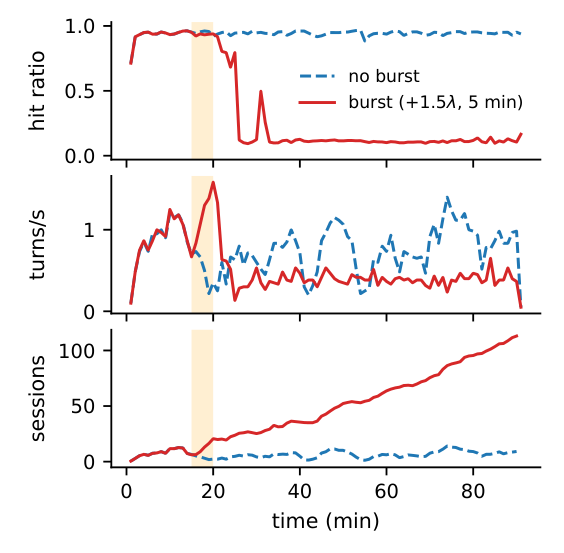
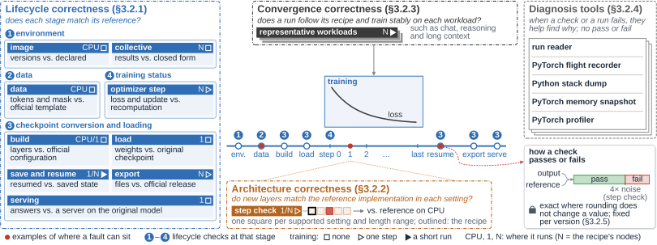
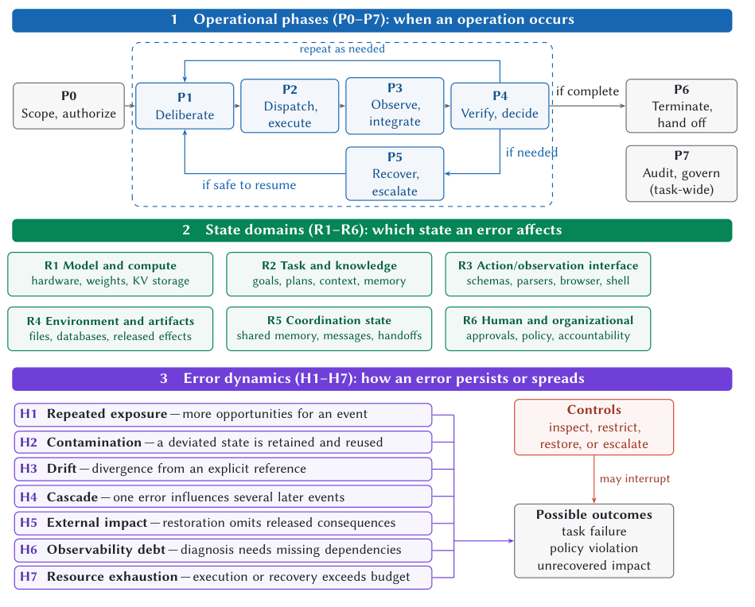
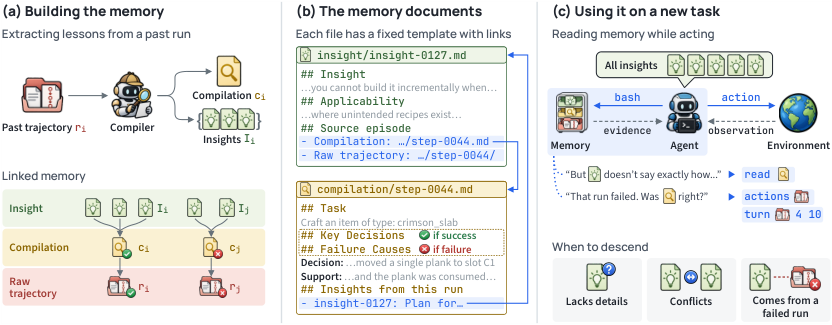
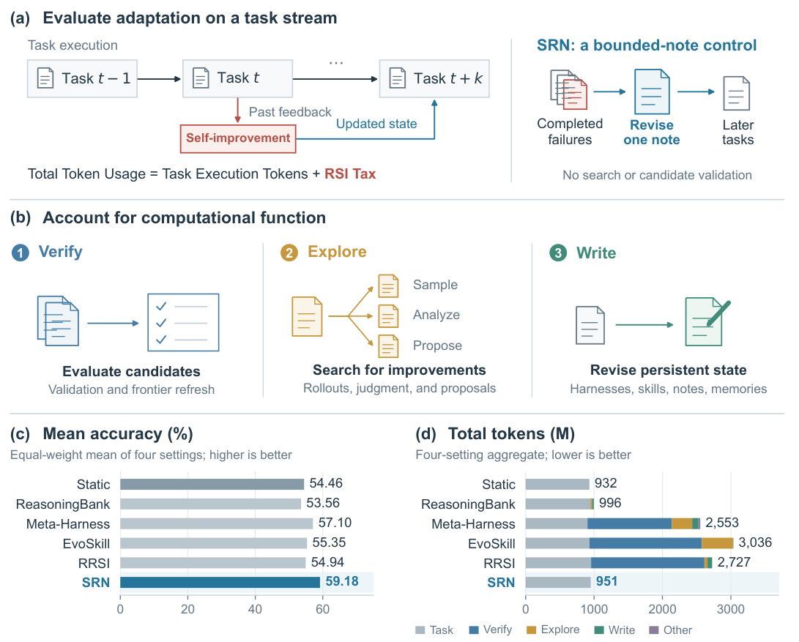

缓存复用、验证和自改进都能节约后续工作，却也可能引入新的依赖：缓存一旦失效，会话积压可能继续破坏命中率；验证若只看 loss 或最终答案，会错过已经污染的状态；复杂自改进如果反复重跑候选，学习成本又可能超过任务本身。本期重点沿这条链条看系统如何恢复效率、检查正确性，以及让 Agent 的经验仍然可以回查。

其他研究把视角延伸到 GPU 通信与模拟、张量编译、训练配置选择、证明修复和端侧模型适配。它们有的改善执行机制，有的提供测量工具或负面证据。阅读时尤其值得区分层级加速与端到端收益、任务得分与行为忠实度，以及模型证明与实现覆盖。

<h2 class="daily-paper-title" id="paper-arxiv-2611.13412">01 · 短暂突发为何留下长期缓存崩溃</h2>

[Bursts That Outlast Themselves: Persistent Degradation in Prefix-Cached Agent Serving](https://arxiv.org/abs/2611.13412)  
Wen Huang , Jack Liu · 2026-11-10

前缀缓存让多轮 Agent 的一次调用只需处理新增内容，但也让服务能力依赖历史状态。Wen Huang 与 Jack Liu 展示的危险是：短暂突发结束后，请求到达率已经恢复，服务器仍不能回到原来的吞吐。其贡献是以配对实验确认这种历史依赖，并区分预防与恢复所需的控制动作；作者明确不把缓存抖动或会话限流本身当作新发明。

### 从命中率下降到自我维持的拥塞

主实验在单张 MI300X 上运行 vLLM、Qwen3-8B，KV 池限制为 40 万 token。每对运行使用相同基础会话流，仅一侧在第 15 分钟增加持续五分钟的到达流，总到达率变为基础值的 2.5 倍。12 对中有 9 对仅突发侧持续降级，没有反向配对；另外两对两侧都降级，一对都健康。典型运行中，突发侧命中率留在约 10%，吞吐大幅下降，积压直到 90 分钟实验结束仍在增长。

原因不是突发请求迟迟没有做完。Agent 必须等待模型和工具返回才能开始下一轮：服务越慢，会话在系统里停留越久；同时活跃的上下文越多，工作集越容易超出 KV 池；前缀被逐出后，每轮都要重算越来越长的历史，进一步拖慢服务。即使基础到达率低于热缓存容量，也可能高于冷缓存状态的处理能力。

<a class="note-image-link" href="/assets/images/digest/2026-11-12/bursts.png" target="_blank" rel="noopener" aria-label="突发结束后，红线的命中率未恢复，会话积压继续增长；蓝线是相同基础流量的无突发对照。">查看原图 ↗</a>

*突发结束后，红线的命中率未恢复，会话积压继续增长；蓝线是相同基础流量的无突发对照。*

### 恢复需要减少已准入的活跃工作集

只限制新会话，已进入系统的会话仍会争抢缓存。作者在网关的轮次边界暂停部分会话，让剩余会话重新装得下。budgeter 用“上下文长度加输出预算”的总和估计 KV 需求，以池容量的 0.75/0.95 为准入与挂起阈值；暂停会话优先于新会话恢复，不中断在途请求。

在所有控制臂都已崩溃的七个配对种子上，budgeter 全部在首个五分钟恢复窗口内恢复，按容量设置的会话上限也全部在六分钟内恢复，单纯准入限制仅恢复一个。对上下文长短变化的流量，token 预算比固定会话数更能跟随需求。128 GiB 主机 KV 卸载层可以推迟崩溃，却不能消除不断增长的工作集。

### 恢复效率不等于清空队列

Qwen3-32B 的轨迹形状实验和 SGLang 实验支持机制的可迁移性，但不能覆盖所有硬件、调度器与真实请求内容。32B 的较长运行中，即使恢复了缓存命中，积压仍可能增长，因为基础流量已经超过长期完成能力。挂起也让部分用户等待更久。对 Ops4LLM 最有价值的结论，是把热态容量、冷态容量、会话驻留需求和恢复动作分开观察；命中率回升并不意味着服务已经恢复到正常用户体验。

<h2 class="daily-paper-title" id="paper-arxiv-2611.13393">02 · Plumbline：下降的 loss 不能证明训练正确</h2>

[Plumbline: When the Loss Lies, Validating LLM Training Correctly](https://arxiv.org/abs/2611.13393)  
Ruochen Wen , Hongyang Wang , Siwei Li , Wenbo Chen , Xian Li , Jingguo Liu , Leo Fan , Yiming Yan , Qian Qu , Zheshen Wang , Benoit Dumoulin · 2026-11-10

训练任务没有报错、loss 也在下降，仍可能学错内容或导出错误模型。Plumbline 把这个问题拆成可检查的契约：输入是否遵循官方模板，参数是否完整加载，恢复是否保留各 rank 状态，更新是否符合优化器定义，导出的模型是否仍是训练所得模型。它在 Amazon 的生产使用提供了实际故障证据，也说明 AI 辅助诊断需要独立于诊断者的判定规则。

### 让每一层都有可比较的参照

系统包含生命周期、架构与收敛三类检查。数据检查逐行比较官方 tokenizer 和模板生成的 token 与 loss mask；加载前用 NaN 填充参数，暴露被跳过的权重；保存恢复按 rank 逐位比较；导出检查以学习率零运行一步，再与原 checkpoint 对照。优化器步骤用更高精度重新计算 loss 归一化和参数更新，避免只观察最终 loss。

架构检查用涵盖各类新层的前几层、真实权重与固定数据，对照 CPU FP32 参考实现，逐一改变框架声称支持的配置。梯度误差超过运行噪声和精度噪声中较大者的四倍才判失败。若容差可能掩盖缺陷，还需注入相应故障确认检查会拒绝。完整模型的收敛运行则补上单步检查看不到的深度、内存及多 rank 时序问题。

<a class="note-image-link" href="/assets/images/digest/2026-11-12/plumbline.png" target="_blank" rel="noopener" aria-label="生命周期、单步架构和整次运行检查覆盖不同故障；右侧诊断工具提供记录，不自行给出通过判决。">查看原图 ↗</a>

*生命周期、单步架构和整次运行检查覆盖不同故障；右侧诊断工具提供记录，不自行给出通过判决。*

### Agent 组织实验，固定检查裁决结果

Agent 选择配置、安排作业并提出根因假设，不能临时改写通过标准。诊断将已有检查与 profiler、内存快照、通信记录及栈信息组合，缩小故障规模并改变单个设置。人工审核者批准计划和关键变更，第二个 Agent 从原始记录重建发现，最终仍由人确认。无法完成比较的检查记为未决或未评估，而不是通过。

在三个框架、五个 MoE 模型的测试版本上，系统发现 61 个问题，其中 32 个静默；42 个已修复或上报上游，其中 8 个为作者首次报告。生命周期和架构检查最先找到了 32 个静默问题中的 29 个；至少 16 个静默问题所在运行通过了收敛检查。一个直观例子是 loss mask 漏掉回复终止 token：训练照常下降，却没有教会模型按预期结束。

### 参照缺失就是覆盖缺口

这些数字按“一个框架上的一个根因”计数，不能理解为 61 个全新漏洞，也不是所有训练任务的故障率。系统对没有可信参考的层不作正确性判决；受测 DeepSeek-V4.1-Flash 尚无对应 Hugging Face 实现就是明确缺口。参考代码和受测框架若共享缺陷，差分也可能漏检。值得读的是检查契约与故障分类：它们把“训练看起来正常”变为多个有边界的证据，而非一个包办所有正确性的分数。

<h2 class="daily-paper-title" id="paper-arxiv-2611.13254">03 · 故障轨迹：发现反证之后，错误状态是否被清除</h2>

[Dependable Long-Horizon LLM Agents: A Trajectory-Centered Empirical Study of Where Errors Enter and Which Controls Reach Them](https://arxiv.org/abs/2611.13254)  
Shaohuang Wang , Jinghao Wen , Xulei Zhang , Xun Jiao · 2026-11-09

“哪个 Agent 在哪一步犯错”常把分析停在最显眼的症状。本文提出 episode 记录，把最早候选故障、受影响状态、传播路径、检测、响应与最终后果连起来。它关注的不是增加一个失败标签，而是回答某项控制是否读得到关键证据、改得到真正出错的状态。这与 AgentOps 的诊断、恢复与审计直接相关。

### 同一种症状可能需要不同控制

框架分别标记操作阶段和状态领域：例如错误事实可以先进入计划，再被写入共享消息，最后通过工具执行。每个传播链接还区分观察到的关系、干预支持的关系与推测。标注者必须把步骤字段锚定到轨迹行号，记录反证出现时 Agent 是否看见、提到或采取行动。这样，“验证失败”可以进一步拆成无来源事实被认可、错误任务被认真执行，或真实观察在交接时丢失。

<a class="note-image-link" href="/assets/images/digest/2026-11-12/trajectory.png" target="_blank" rel="noopener" aria-label="上层是操作阶段，中层是状态领域，下层是传播方式；恢复必须覆盖受污染状态，不能只看终止时的症状。">查看原图 ↗</a>

*上层是操作阶段，中层是状态领域，下层是传播方式；恢复必须覆盖受污染状态，不能只看终止时的症状。*

研究完成 96 条记录，其中一条只有过程违规而最终答案正确，结果统计采用另外 95 条失败轨迹。关键方法限制是：记录由 Claude 按协议逐条生成，**并非独立人工标注数据集**；作者只对部分比较分歧作人工检查，没有报告人工标注者间一致性。样本来自 Who&When 和 MAD 的部分批次，还排除了特别长的轨迹，因此数字应作为有待人工复核的描述性发现。

### 检测与恢复之间有断层

在这些记录中，68/95 条在最终失败前已有矛盾证据，只有 7 条采取了行动。正文的计数与“88% 未行动”表述存在小幅不一致，直接用分子分母更清楚。29 条运行出现偏离检测，但没有响应完全清除错误状态。换一个下一步动作，同时保留错误计划或信念，便可能再次进入原来的循环。

作者认为，恢复 Agent 本地状态足以覆盖 35/95 条；在 56 条中，故障本来就在计划、任务描述或停止规则里，回滚可能只是重演。这里的“足以覆盖”来自事后控制适用性判断，不能理解为已经部署恢复机制并提高了成功率。独立裁判同样只有在读取被遗漏的证据时才可能有效，不是多一个同源投票者就能解决。

### 更坚实的发现来自原始日志扫描

确定性扫描全部 Who&When 原始轨迹时，58 条手工构造运行中有 26 条遭遇 provider 内容过滤错误，其中 25 条随后由 harness 输出了并非 Agent 生成的最终答案。这个结果不依赖 episode 的 LLM 标注，也提醒根因基准不要把运行时兜底答案归罪于某个 Agent。本文最值得沿用的是有来源的传播记录和“检测后状态是否真的改变”的问题；当前比例不宜推广为生产 Agent 的失败分布。

<h2 class="daily-paper-title" id="paper-arxiv-2611.14320">04 · WikiTrace：让记忆保留可回查的证据</h2>

[Don't Just Trust Your Memory: Evidence-Linked Memory Reduces Memory-Induced Degradation in LLM Agents](https://arxiv.org/abs/2611.14320)  
Yukyeong Lee , Yumin Choi , Jinheon Baek , Sung Ju Hwang · 2026-11-10

记忆系统可以提高平均成功率，同时让 Agent 在原本能完成的任务上失败。WikiTrace 将这类回退单独测量，并把原因指向一种常见的信息压缩：从成功或失败标签提炼出一句教训，却丢掉支持它的具体过程。错误归因、不适用的规则和误读都可能因此变成以后任务的指导。

### 从一句教训走回完整轨迹

每条过去运行被单独处理，生成成功原因或可能失败原因的摘要，以及最多三条 insight。原始轨迹不改写；每条 insight 链接到摘要与原始运行，并标明适用条件和来源成败。摘要仍是模型解释，不能因为有链接就被视为已经证实。系统也不预先消除所有冲突，而把判断当前适用性留给执行 Agent。

新任务开始时，Agent 看到全部 insight，以及三个相似历史任务的导航信息。遇到细节不足、教训冲突、失败任务来源或行动失败时，它通过只读文件和终端工具向下查证。PlanCraft 的案例说明了区别：错误记忆把合成界面显示的中间产物误当成已消耗材料的结果；原轨迹显示继续摆放材料仍可完成配方。回查改变的是行动依据，而非只给提示增加更多文字。

<a class="note-image-link" href="/assets/images/digest/2026-11-12/wikitrace.png" target="_blank" rel="noopener" aria-label="左侧构建记忆，中间保留 insight、摘要和原始轨迹的链接，右侧在信息不足或冲突时回查来源。">查看原图 ↗</a>

*左侧构建记忆，中间保留 insight、摘要和原始轨迹的链接，右侧在信息不足或冲突时回查来源。*

### 和同样的 insight 比，证据访问增加了什么

五个基准的八个套件各运行三次，使用相同 DeepSeek-V4-Flash Agent；记忆一次性从相同的训练轨迹构建，不额外试跑验证。平均得分从无记忆的 79.5 到 WikiTrace 的 90.2；相对仅提供相同 insight 的 87.0，提高 3.2 个百分点。后一个比较更直接，但变化同时包含来源访问能力和引导回查的提示，不能把收益只归给文件链接。

作者按无记忆三次试验的多数结果定义原本可解任务。WikiTrace 在这部分上的回退率为 4.5%，仅 insight 为 6.5%；另外重跑无记忆 Agent 得到 9.7%，说明任务随机性本身也会带来回退。测试时 WikiTrace 的平均单任务成本为仅 insight 的 1.17 倍，需要和质量收益一起看。

### 可追溯不等于记忆已经正确

系统把全部 insight 放入首条消息，规模增大后仍需解决检索与上下文容量。回查由 Agent 自己选择，因而“回查运行比不回查运行更好”的分组分析不是随机干预证据。错误类型和回查效果还依赖 LLM 对推理文本的判断。其可靠性价值在于保留了修正教训的路径，并把新增成功与破坏原有成功分开报告；它没有保证每条记忆正确，也尚未解决长期在线记忆无限增长的问题。

<h2 class="daily-paper-title" id="paper-arxiv-2611.13524">05 · RSI Tax：把改进过程本身计入成本</h2>

[The RSI Tax: When Recursive Self-Improvement Is Not Worth the Cost](https://arxiv.org/abs/2611.13524)  
Yitong Zhang , Ang Li , Yisen Wang · 2026-11-10

自改进系统通常展示新 harness 或技能让后续任务更强，却容易把“如何找到这次改进”留在账外。The RSI Tax 把生成候选、分析经验、重复验证与写入持久状态的 token 全部纳入成本，并在任务反馈用于更新之前固定该任务的成绩。这让评估更接近连续提供服务时实际付出的代价。

### 简单基线为何有比较价值

研究比较六种方法、两个底座模型，在七条仓库任务链共 105 个位置和 89 个 Terminal-Bench 2.1 任务上形成 2,328 个方法—任务评分。共同初始 Agent 与任务顺序有助于减少混杂；不过 EvoSkill 等方法为连续任务流做了适配，结果不是它们原始论文设定的原样复测。

基线 SRN 每四个任务更新一次不超过 2,048 token 的笔记，只利用允许窗口内失败任务的轨迹片段与标量结果。没有失败就保留旧笔记，不进行候选搜索或额外验证。其意义是提供一个会学习但改进成本很低的参照，检验复杂搜索是否确实买到了足够收益。

<a class="note-image-link" href="/assets/images/digest/2026-11-12/rsi-tax.png" target="_blank" rel="noopener" aria-label="先固定当前任务成绩，再用历史反馈更新；总成本同时包含执行任务以及验证、探索和写入改进的成本。">查看原图 ↗</a>

*先固定当前任务成绩，再用历史反馈更新；总成本同时包含执行任务以及验证、探索和写入改进的成本。*

### 验证比写技能更昂贵

SRN 在四个模型—基准设置中三次取得最高观察准确率，一次与 EvoSkill 持平。相对 Meta-Harness、EvoSkill 和 RRSI，总 token 的设置内比值再平均，分别减少 65.6%、71.0% 和 68.2%。这不是证明复杂自改进永远无效，而是显示在这些有限任务流里，改进过程没有充分摊销。

三种复杂方法的 RSI Tax 中，验证占 74.8%–93.6%。例如 DeepSeek 的终端任务流上，Meta-Harness 执行任务本身比 SRN 少用 token，但加上约 578.45M 的改进成本，总量达到 762.57M，对照 SRN 为 214.65M。单看部署后执行效率会得出不同结论。

### 未复用成本不等于可直接删除的浪费

论文还把成本关联到后续是否使用相应状态或产物；这里统计的是 token 份额，不是失败更新比例。候选未部署可能仍影响后续搜索判断，因此不能把这部分成本直接当作可无损删除。输入 token 占大头也意味着总 token 不等于按缓存折扣、输入输出差价计算的美元账单。

证据覆盖两个模型、一个终端任务顺序和有限仓库链，尚不足以比较更长时间上的回报或结果稳定性。对 AgentOps 最值得迁移的是记账方法：任务成本与学习成本分开，验证、探索、写入再分开，并观察产物真正被使用多久。它给出了值得重视的负面结果，而不是“别做自改进”的普遍结论。

<h2 class="daily-paper-title" id="paper-arxiv-2611.13176">06 · SHADOWPREFILL：提前为下一次模型切换预热</h2>

[SHADOWPREFILL: Keeping Your Next Model Warm for Per-Step Model Routing in Agentic LLM Serving](https://arxiv.org/abs/2611.13176)  
Haoran Qiu , Rohan Mahapatra , Rodrigo Fonseca , Mark Russinovich · 2026-11-09

逐步路由切换模型时，旧模型的 KV 不能直接给新模型使用。SHADOWPREFILL 在未被选中的模型上增量预填会话历史，优先安排更可能切换的会话；正常队列为空且 SLO 有余量时才加入 shadow 工作，shadow KV 先被逐出并可卸载到主机。切换时不等待预热完成，直接使用已有前缀并补算余下部分。

22 组模型对的主体结果来自轨迹驱动模拟，缓存 token 按未缓存价格的十分之一计费，因而成本下降不能当作 GPU 开销下降。16 张 H100 的原型验证另报告平均切换 TTFT 降低 61.9%、每个达标请求能耗增加 1.4%；部分组合因 decode 占主导，整任务模型调用时间几乎不变。它与跨版本 KV 复用研究的区别在于重新计算目标模型自身状态，收益取决于可用余量、上下文长度及缓存驻留。

<h2 class="daily-paper-title" id="paper-arxiv-2611.14051">07 · 跨版本 KV 复用：任务有用不代表行为一致</h2>

[Can KV Cache Be Reused Across Model Updates? A DeepSeek-V4-Flash Case Study](https://arxiv.org/abs/2611.14051)  
Zhikun Tao , Fangyong Jin , Junping Zhao · 2026-11-10

模型更新后直接沿用旧 KV，可能保留检索能力，却改变新模型的答案或停止方式。作者在四组更新上比较原生目标缓存、原生源缓存和直接移交；不同模型对结果差异很大。DeepSeek-V4-Flash 到 Flash-0731 的长前缀 QA 中，已备好源缓存时三项基准 TTFT 中位加速 2.10–5.08 倍，但 HotpotQA 与 2WikiMQA 的 F1 分别下降约 3 和 7 个百分点；较短 BABILong 仅为 0.86 倍。

TTFT 包含缓存载入，却不含生成源缓存和模型启动成本。总体准确率接近也可能掩盖原来正确答案被破坏、另一些错误被修复的交换。Functional Cache Divergence 进一步比较匹配历史下的预测分布。对滚动升级而言，这是一项兼容性实证研究：首 token 一致、任务得分和完整生成忠实度需要分别检查，不能把可加载的缓存当成语义兼容承诺。

<h2 class="daily-paper-title" id="paper-arxiv-2611.13442">08 · ForeSpark：起草之前就分配计算预算</h2>

[ForeSpark: Joint Draft and Verification Budget Scheduling for Parallel Speculative Decoding](https://arxiv.org/abs/2611.13442)  
Jaeyong Song , Daniel Wang , Pratyush Patel , Jonny Kong , Preyas Shah , Shobhit Kanaujia · 2026-11-10

并行 drafter 一次生成整块候选，只在验证时丢弃 token，仍付出了无用起草成本。ForeSpark 用目标模型的上下文特征和锚 token，在起草前预测不同长度的接受收益；调度器把请求收益曲线转为可全局排序的边际收益，结合离线延迟表联合选择起草长度和验证预算。生成后再依据实际候选置信度分配验证，保留标准投机采样的输出分布。

在 vLLM、Qwen3-14B 与两款 GLM 模型、H100/B200 的 ShareGPT 负载上，相同用户生成速率下相对 DSpark 的吞吐最高为 1.77 倍。这个最大值来自 decode-only 比较，端到端收益受 prefill 占比影响；最重负载下 Qwen3-14B 的普通自回归吞吐仍可能更高。全局排序还可能让某请求某一步完全不起草。价值在于把“少验证”推进为“少做注定不会验证的工作”，同时保留吞吐与公平性的边界。

<h2 class="daily-paper-title" id="paper-arxiv-2611.14356">09 · EngineAgent：模型适配要穿过引擎层次与真实设备</h2>

[EngineAgent: Agentizing On-Device LLM Inference Engines with Inference Stack Hierarchy Awareness and Hardware Abilities](https://arxiv.org/abs/2611.14356)  
Zhengxiang Huang , Yujie Sun , Shengheng Chen , Zhaode Wang , Chaoyue Niu , Zeyu Zhao , Chengfei Lv , Fan Wu , Guihai Chen · 2026-11-10

端侧引擎支持新模型，常需同时修改导出、计算图、算子和硬件后端。EngineAgent 先构建引擎层次与依赖索引，用已支持模型在真实设备上验证构建、运行和调试步骤，再让 builder、debugger 与 auditor 依这些材料迭代。最终通过与否由非 Agent 的验证器比较设备输出 logits 和主机 PyTorch 参照决定，而非审查者口头认可。

三个模型、四种引擎—后端组成 12 个任务；每次最长五小时。两种底座下均成功 9/12，最强基线为 4/12。去掉层次索引或硬件技能分别降至 3/12、5/12，支持“仓库知识与可运行验证路径互补”的解释。预构建索引和技能有另计的一次性费用，逐任务 API 成本不等于全部维护成本；样本小，也未证明数值检查覆盖所有输入。它把端侧适配成功从“代码能编译”推进到跨层完整性和设备执行一致性。

<h2 class="daily-paper-title" id="paper-arxiv-2611.13188">10 · NVLinkOneSided：先发 token，免去前置元数据交换</h2>

[One-Sided Expert-Parallel All-to-All for Mixture-of-Experts Inference over NVLink](https://arxiv.org/abs/2611.13188)  
Bo Li , Chulian Zhang , Or Biri , Anthony Chang , Anton Korzh , Noam Duvdevani , XingFei Xi , Daniel Stokes , Zhenhuan Chen , Ludwig Schneider , Artem Y. Polyakov , Julien Demouth , Chandler Zhou · 2026-11-09

MoE 小 batch 通信中，固定握手成本可能比数据搬运更贵。NVLinkOneSided 为每个来源 rank 分配独占缓冲区域，直接推送 token；目标侧生成专家对应的 slot 索引，grouped GEMM 原地读取，省去按专家重新排列的数据副本。Fence 协议批量同步，Sentinel 用到达数据检测就绪，分别适合较大与较小 batch。

八张 B300、均衡人工路由的层级实验中，小 batch 的 dispatch+combine 相对 DeepEP 加速 1.75–3.00 倍；大 batch 下融合 MegaMoE 可以凭通信计算重叠反超。该机制依赖同一 NVLink 域内 peer 访问和字级到达性质，不能直接推广到 RDMA，工作区还随 EP 规模增长。它与本期 SGLang megakernel 的区别是保留模块化通信接口，不把全部收益绑定到某个融合计算实现。

<h2 class="daily-paper-title" id="paper-arxiv-2611.13741">11 · Arknife：把指令布局要求变成全局约束</h2>

[Retargetable Compilation for Tensor Kernels via a Unified Layout Abstraction](https://arxiv.org/abs/2611.13741)  
Likai Ma , Renze Chen , Tianqi Li , Yuhao Luo , Youwei Xiao , Size Zheng , Xiuhong Li , Yun Liang · 2026-11-10

不同加速器的指令对张量在寄存器、lane 和存储层级中的摆放有不同要求。Arknife 将这些要求放入目标描述，用统一布局代数约束逻辑轴到硬件轴的映射；绑定指令后插入移动、转置等修复，检查可行性，用 e-graph 消去冗余转换，再全局求解布局并生成代码。新后端仍需提供指令和修复规则，并非零成本移植。

在受测 x86 九类负载上，相对 oneDNN 几何平均加速 2.17 倍，小形状收益更大；Hexagon 十一类算子相对 QNN 为 3.78 倍，但 Int8 GEMM 仅 1.08 倍。A100 的 TF32 GEMM 达到 cuBLAS 性能的约 97%。它的增量是跨后端组织布局约束，而非承诺每个 kernel 超过厂商库；离线约束构建与求解成本也需计算。

<h2 class="daily-paper-title" id="paper-arxiv-2611.13762">12 · ForeSight：区分固定停顿与资源排队</h2>

[Exploiting What NVIDIA Profilers Hide: Fast and Accurate Analytical GPU Performance Modeling](https://arxiv.org/abs/2611.13762)  
Ziwen Wang , Qi Luo , Kunlin Li , Changxi Liu , Dongsheng Wang , Yun Chen · 2026-11-10

换 GPU 配置后，把所有 stall 一起缩放会混淆固定依赖和资源争用。ForeSight 先在原配置 profile，再复用固定延迟停顿、按目标单元压力重新估计排队，并重放 CTA 执行。UnitSight 从 CUPTI 的 CounterData 恢复逐 SM、L2 slice 和内存通道计数，避免聚合值掩盖局部不均衡。

九款 GPU 的配置实验覆盖 50 个负载，其中 47 个是推理算子，整体时间预测 MAPE 为 8.3%，最佳比较基线为 14.1%。H20 上单次预测中位约 26 秒，相对周期模拟器约快 49 倍，但原始 profile 中位仍需约 170 秒，其他简单解析模型还可更快。其价值是把可观测性细化到资源单元后支持配置预测；不是任意新架构都可无测量迁移，也不是服务延迟优化本身。

<h2 class="daily-paper-title" id="paper-arxiv-2611.13860">13 · GemAtlas：用硬件微基准校正模拟器的存储层次</h2>

[Uncovering the Memory Hierarchy of Modern NVIDIA GPUs for Accurate Simulation](https://arxiv.org/abs/2611.13860)  
Ziwen Wang , Jiapeng Zhou , Changxi Liu , Dongsheng Wang , Yun Chen · 2026-11-10

只把公开容量和带宽填入模拟器，仍可能漏掉 cache 组映射、slice 路由和替换行为。GemAtlas 用 SASS 级 prime–evict–probe 控制加载依赖与时钟测量，推断存储层次参数，再写入扩展 AccelSim。它与 ForeSight 互补：前者重建微架构行为，后者借实测计数建立更快的排队预测。

评测包含 25 个传统 GPU 负载和 28 个 LLM 算子，硬件与模拟均从冷缓存开始。H20 上，把公开存储参数补齐后的基线 MAPE 为 27.58%，加入恢复出的机制后为 20.04%，其中分布式 L2 建模贡献较大。残余误差仍显著，部分来自存储之外的模拟器组件。受测硬件是 H20、H100、A800 和 RTX 4090；未来架构还需要对应 SASS 支持，不能把“可扩展”写成已经验证。

<h2 class="daily-paper-title" id="paper-arxiv-2611.13293">14 · TKNP：分开权重位置与 attention 所有权</h2>

[Decode Token Parallelism: Memory-Efficient Distributed Attention Parallelism for Scalable LLM Decoding](https://arxiv.org/abs/2611.13293)  
Susav Shrestha , Brad Settlemyer , Narasimha Reddy · 2026-11-09

长上下文 decode 扩容时，复制模型会挤占 KV，而跨节点切 attention 又需合并局部结果。TKNP 将单份权重按连续层块分布，各层的持有节点为整批请求计算投影和 MLP；每个请求的 KV 始终归属固定节点，该节点为自身请求计算 attention。网络主要搬当前 token 激活，dense TP collective 留在节点内。

vLLM 实现在最多 64 张 H100 上评测 Llama 3.1 405B 和 Nemotron-4 340B，长上下文、高并发的完成吞吐相对 DP 最高提高 2.06 倍。这个指标包括容量引发的准入波次和排空，不等于活跃请求的逐 token 延迟同幅改善。小 batch、短上下文可能被通信同步成本抵消；双活 root 微批版本还新增第二份分布式权重，以 KV 容量换重叠，不能笼统宣称所有版本只存一份权重。

<h2 class="daily-paper-title" id="paper-arxiv-2611.13413">15 · SlackTier：按每层查表截止时间选择存储</h2>

[Placing LLM Lookup Tables by Per-Layer Prefetch Deadlines](https://arxiv.org/abs/2611.13413)  
Wen Huang , Jack Liu · 2026-11-10

Engram 表索引只依赖输入 token，可以在 decode 步开始就查，而不等对应层执行。SlackTier 利用不同层的预取窗口：早层很快就要数据，晚层可把慢存储读取藏在前面计算后。SGLang 实现先提交早层读取，在 CUDA Graph 的旁路中做索引、去重与 I/O，各层只等待自己的事件；小 GPU 行缓存优先缓解紧截止时间和共享磁盘争用。

四张 H200、DeepSeek-V4.1-Flash 的 Agent/chat 回放中，双表放四块 NVMe 后每输出 token 时间相对未修改 SGLang 最多增加 1.4%，主机内存由 212 降为 34 GiB。这里是可预知且稀疏的查表，不适用于每步读取大量 dense 或专家权重；可选跳过行模式也属于有损路径，不能与精确 gather 混称。新硬件仍需重测窗口、I/O 争用和 miss 曲线。

<h2 class="daily-paper-title" id="paper-arxiv-2611.14246">16 · SinkState：在线维护低秩递归状态</h2>

[SinkState: On-the-Fly SVD of Recurrent States for Efficient Hybrid LLM Serving](https://arxiv.org/abs/2611.14246)  
Haolin Jiang , Weihang Li , Zhongzhu Zhou , Jinwen Pan , Santosh Pandey , Hang Liu · 2026-11-10

混合模型的线性注意力状态大小不随历史增长，却仍可能在大 batch 中消耗大量内存流量。SinkState 先用随机 SVD 初始化低秩因子，缓存若干步的新更新，再仅在主子空间合并；其他分量由 CPU 异步整理，融合 kernel 直接从因子和缓冲计算输出，避免每步物化稠密状态。

在单张 96GB RTX PRO 6000 Blackwell 上，四个 Mamba-2/GDN 混合模型相对稠密状态后端的峰值递归状态内存最高缩小 2.6 倍。这个分母不是整个模型或全 GPU 内存。按奇异值阈值丢弃分量属于近似，阈值随模型族不同，且依赖 CPU 合并与 PCIe 路径；质量保持是受测基准的经验结果。其增量是在服务过程中持续控制状态秩，区别于只压缩 prefill 后快照的做法。

<h2 class="daily-paper-title" id="paper-arxiv-2611.14285">17 · LM-SimBench：把预测误差连回训练执行阶段</h2>

[LM-SimBench: A Unified Framework, Dataset, and Benchmark for Large Language Model Training Simulation](https://arxiv.org/abs/2611.14285)  
Yu Dong , Hong Li , Qiang Sun , Xu Zhou , Jinbiao Huo , Qixiu Cheng , Zhiyuan Liu · 2026-11-10

训练模拟器若采用不同工作负载和成本口径，很难判断预测误差来自算子、通信还是重叠调度。LM-SimBench 将编译、设备绑定、执行表示、成本估计与调度聚合分开，并用共享配置/rank 标识连接六种测量视图。Ascend 910B3 主数据包含十个模型族、23 个设置和 348 个可行配置，联合改变五种并行维度与重计算。

共同测试的六个配置上，vTrain 与 Calculon 的时间 sMAPE 分别为 1.86% 和 8.88%，但二者都选中最快配置：数值预测更准不必然改变决策。这个小比较不能当成覆盖全部 348 配置的统一排名。配对 V100/NPU 实验支持用 NPU 结果缩小 GPU 候选，但只涵盖两款小 Qwen 模型，最终仍用 GPU 测量选择。它的价值是统一证据接口与误差定位，而非宣布一个跨硬件通用赢家。

<h2 class="daily-paper-title" id="paper-arxiv-2611.13246">18 · ExpertCrowd-SWE：用维护者标准衡量多文件改动</h2>

[ExpertCrowd-SWE: Measuring Frontier Coding Agents on Expert-Authored Engineering Tasks in Unfamiliar Codebases](https://arxiv.org/abs/2611.13246)  
Josip Vrdoljak , Akash Singh , Bas Steunebrink , Alex Yarotsky , John Lorenzo , Achille Nicoletti , Sam Pigott · 2026-11-09

ExpertCrowd-SWE 让熟悉仓库的工程师在固定 commit 上设计真实多文件变更，配参考实现与加权评分器。部分得分之外还有必须通过的 blocker，空改动和原仓库要得零分，参考实现要满分，近半任务再用偷懒或对抗补丁校准。它把“测试过了多少”扩展为“哪些缺失会让维护者拒绝合并”。

100 个任务覆盖 87 个项目和 11 种语言。七个模型五次运行共 3,495 次评分，头部 67.3% 与 63.7% 是平均部分得分，不是完整解决率，差异也未达显著。任务曾按前沿模型难度筛选，当前仅公开 24 个、保留 76 个；平台 harness 与原生工具接口也影响比较。值得关注的是评分器校准和重复运行可靠性，而不是把单一榜单当所有编码场景的能力排序。

<h2 class="daily-paper-title" id="paper-arxiv-2611.13709">19 · 上下文文件指令：遵从度必须落到可观察产物</h2>

[Do They Do as They Are Told? Investigating Coding Agents' Adherence to Explicit Instructions in Context Files](https://arxiv.org/abs/2611.13709)  
Gianmario Voria , Yutaro Kashiwa , Gemma Catolino , Fabio Palomba · 2026-11-10

把规则写入 AGENTS.md 类文件，并不能证明 Agent 执行时照做。研究将 621 个上下文快照关联到 268 个仓库的 6,541 次 Agent 提交，抽取显式、可操作、可观察的指令，生成脚本及测试夹具，并要求独立候选脚本相互佐证，再检查适用提交的产物。

结果呈现明显两极：54.4% 的受评指令在所有适用提交中符合，37.3% 一次也不符合。不过每条指令适用提交中位仅三个，单次样本天然只能得 0% 或 100%；作者用更高样本门槛做敏感性检查。观测到符合也不证明是上下文文件导致，仓库惯例和模型默认行为都可能贡献。其增量是可执行的指令测量与证据门槛，而非给不同 Agent 的服从能力下因果排名。

<h2 class="daily-paper-title" id="paper-arxiv-2611.14106">20 · ProofCoder：把证明脚本当可持续修订的产物</h2>

[ProofCoder: Continuous Reasoning for Automated Software Verification](https://arxiv.org/abs/2611.14106)  
Martim Afonso , Inês Lynce , Maurizio Morisio , João F. Ferreira · 2026-11-10

ProofCoder 不把模型限制为外部循环中的 tactic 生成器，而让它结合 Rocq 反馈决定查状态、补上下文、修改后缀或回溯。定理本身不能修改，admit 等占位证明被禁止，只有 Rocq 接受且所有目标消解才算成功；连续推理负责选择修复位置，证明助手负责最终判定。

受测集合为 200 个高复杂度 SV-COMP 义务加 80 个 Verker 任务。GPT-6 Sol 的整段生成配置在前一集合完成 120/200，对比同模型 AutoRocq 的 94/200；后一集合为 60% 对 47.5%。这是子集结果，不是所有 AutoRocq 任务的统一提升。200K 非缓存 token 和三十分钟等限制、不同 harness 的上下文管理都影响成本比较。与 TopoVerus 相比，它改的是交互修订过程，并不训练一个新的反例生成模型。

<h2 class="daily-paper-title" id="paper-arxiv-2611.13627">21 · TopoVerus：训练能推动修复的反例诊断</h2>

[Curriculum proof repair with learned counterexamples](https://arxiv.org/abs/2611.13627)  
Yuechun Sun , Jun Yang , Kexin Pei · 2026-11-10

TopoVerus 让 QwQ-32B 衍生模型根据失败证明和 Verus 报错，依次生成结构化反例、修复理由和新证明。训练用 verifier 反馈强化最终修复，并以不变量依赖图鼓励先建立前置约束；AST 安全门拒绝改可执行程序或用户规范的“修复”。依赖图来自训练实例，评估时不向模型提供参考证明。

七套基准 471 个问题上，报告加权 Safe-Pass@1/3 为 61.6%/72.2%，标准修复过程仍允许最多十步 verifier 反馈，不能把 single-pass 反例生成写成一次就完成所有证明。生成反例的可达性和数学有效性没有形式保证，它是帮助搜索的中间诊断；最终证明与安全门才负责验收。与 ProofCoder 的在线工具编排不同，这里新增的是学习到的诊断能力及依赖顺序奖励。

<h2 class="daily-paper-title" id="paper-arxiv-2611.13509">22 · Mobile AI Factory：把手机实测放进模型选择</h2>

[Mobile AI Factory: Building Specialized Language Models for Your Mobile Device](https://arxiv.org/abs/2611.13509)  
Evan Li , Krishna Deshpande , Wen Cheng , Shyamnath Gollakota · 2026-11-10

给定任务与手机，Mobile AI Factory 先按设备 profile 排除不满足预算的模型、量化和后端组合，再让 LLM 选择调参、挖数据或合成数据。停止、升级模型规模与回滚由固定规则决定；量化后再评分，避免训练精度很好但部署产物不达标。原文还指出评估失败必须记为缺失，不能当零分制造虚假提升。

十个任务、四款 Android 手机的实验显示，五项任务的专用小模型超过两个 five-shot 前沿模型，另三项相近；这是任务微调与少样本通用模型的比较。实体抽取搜索接近穷举 27 个变体的得分，训练 GPU 时间约为十九分之一。手机 profile 来自冷启动、固定提示长度和空闲设备，未覆盖持续发热或并发应用；任务 scorer 与数据 verifier 仍需人工提供。核心价值是让设备可行性成为搜索输入，而非只凭规格表猜后端。

<h2 class="daily-paper-title" id="paper-arxiv-2611.13378">23 · Looped CED：增加计算深度，不按轮复制全局 KV</h2>

[Looping Deeper Without Growing the KV Cache: Recurrent Depth for Causal Encoder-Decoders](https://arxiv.org/abs/2611.13378)  
Jiaqi Leng , Minshen Zhang , Zhaofeng Sun , Yu-Yang Qian , Peng Zhao , Hao Zhang · 2026-11-09

循环模型加深计算时若每层每轮都保存全局 KV，服务并发会迅速受内存限制。Looped CED 把循环放在产生全局 KV 的 encoder 内，反复精炼表示；随机循环深度训练促使后期状态稳定，使推理只保留最后一轮 KV。把循环放到 decoder 只会反复读取既定全局状态，长程建模收益较弱。

150M 受控实验中，encoder loop 的验证 BPB 为 0.8468，接近 dense loop 的 0.8461，而全局 KV 为每 token 8KB 对 48KB。质量实验最大仅 340M、训练上下文 2048。552B DeepSeek-V4.1-Flash 的 GB200/H200 服务实验则使用 dummy 或未按循环训练的原始权重，并以限制 KV 池模拟按轮缓存，只说明成本潜力，不证明大模型同样无损。encoder 还需在 prefill 中执行多轮，内存节省不能等价为单请求计算成本下降。

## 同日技术笔记

- [vstack 与 veriserve：用完成证据管理 KV 页的生命期](/tech/zh/haoailab-vstack-verifiable-llm-infra/)
- [Jev 裁判：把 SRE 诊断评估拆成可校准的判断](/tech/zh/sregym-jev-as-a-judge/)
- [vLLM EPD：分离编码器之后，还要分清元数据与数据](/tech/zh/vllm-epd-encoder-disaggregation/)
- [SGLang megakernel：把等待藏进每一层的执行](/tech/zh/lmsys-muse-spark-open-megakernel/)
- [Meta Intelligent Delivery：按算力的边际收益分配请求](/tech/zh/meta-intelligent-delivery-ads-compute/)
- [ExecuTorch WebGPU：同一导出文件进入浏览器 GPU](/tech/zh/pytorch-executorch-webgpu/)
- [Quarkus AI RCA：先把遥测整理成可分析的上下文](/tech/zh/quarkus-ai-root-cause-analysis/)
