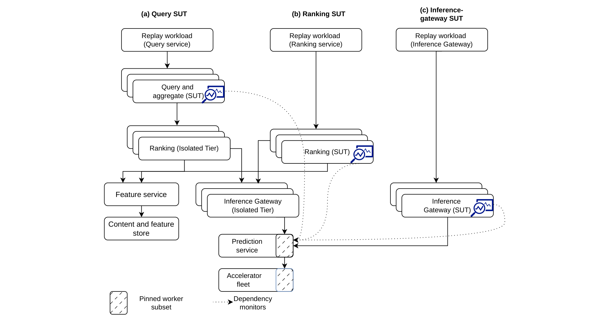
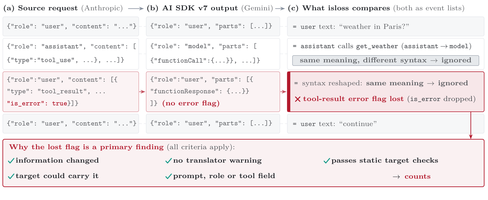
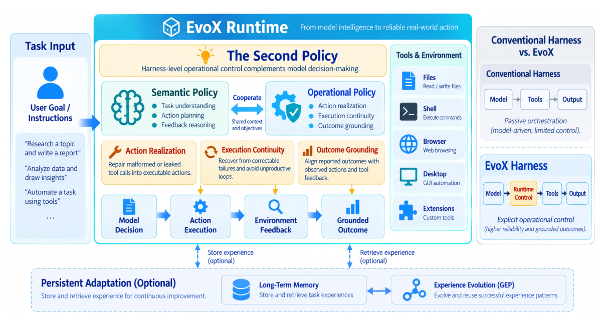
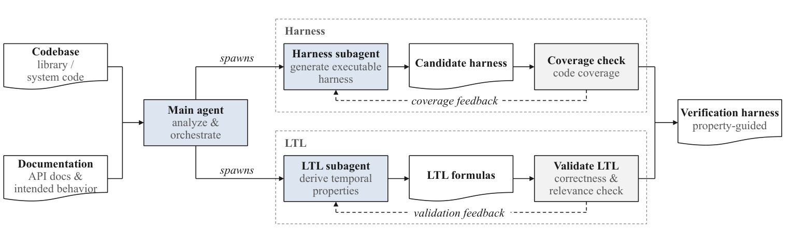
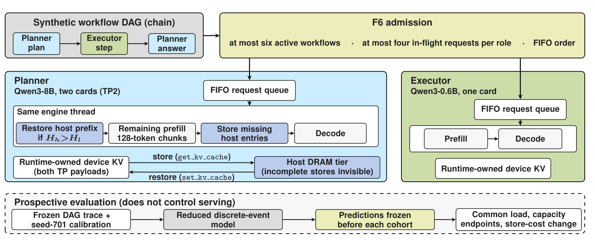
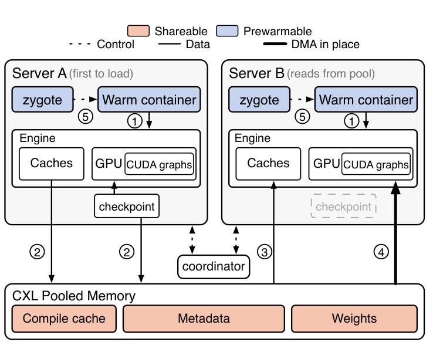

本期最值得关注的是可靠性边界如何变得可检查：FIRE 约束实验对共享下游的影响，数据库现场研究揭示排障 Agent 缺失的生产证据，isloss 则发现合法 API 请求仍可能丢失角色与工具信息。三者分别回答影响能否收住、原因能否看见、上下文是否完整。

其余工作把同一问题带到生成 kernel 的接受合同、harness 的执行控制和服务状态复用。KernelMutate 与 KernelAudit 检查不同层面的义务；Aries、EvoX 和 MULTILOOP 展示观测、控制与优化之间的距离。缓存和冷启动的收益则取决于恢复路径与调度成本，不能只看容量或最高倍率。

<h2 class="daily-paper-title" id="paper-arxiv-2611.14962">01 · FIRE：把生产连通实验的影响限制在下游边界</h2>

[FIRE: Failure Isolation and Reliability for Production-Connected Experiments at Scale](https://arxiv.org/abs/2611.14962)  
Shripad Nadgowda 等 · 2026-11-11

候选代码还没上线，测试流量却已经能够伤及生产。FIRE 讨论的正是这种中间状态：用录制请求驱动待测服务，同时允许部分调用访问真实依赖，以提高发布前验证的真实性。普通的结果对比能发现待测服务退化，却未必看见它把错误输入送进共享预测服务、触发加速器断言并留下无法继续工作的 worker。对混沌工程和变更验证而言，关键问题由“实验流量占多大比例”变成了“它能触达多少故障域”。

<a class="note-image-link" href="/assets/images/digest/2026-11-14/fire.png" target="_blank" rel="noopener" aria-label="隔离层、下游监测与固定 worker 子集的组合 · 查看原图 ↗">查看原图 ↗</a>

*读图：隔离层、下游监测与固定 worker 子集的组合。*

### 三种护栏分别控制什么

第一层是选择性隔离。能够低成本维护、且状态与配置足够接近生产的 ranking 和 inference-gateway 层，使用实验专属副本。请求仍沿真实调用链执行，但相关崩溃留在实验路径内。昂贵的加速器预测集群和有状态特征服务则不适合整体复制，所以隔离不是覆盖所有依赖的万能方案。

第二层持续观察共享下游。健康探测器看重启、异常和无效结果；带实验归属的探测器进一步把错误记录关联回 control/treatment job。经过预热，连续若干次检查违规才取消实验，以避免一次短暂波动误停。这里“发现依赖不健康”和“证明某实验造成故障”是两件事：只有调用身份保留下来，才可能精准停止责任实验。

第三层 traffic pinning 把实验调用固定在指定 shard，而不是向所有 worker 扇出。少量畸形请求也可能逐个击穿大量 worker，限制请求比例挡不住这种风险，固定可达范围才直接约束其影响。但它会集中负载，且无法阻止共享状态传播副作用，因此仍需要健康监测和独立的写入、生命周期控制。

### 工业数据说明了哪些效果

在所测 ranking 路径上，隔离层每天处理数十亿回放请求，worker 容量不足对应共享层的 1%。90 天内，它容纳了超过 20 万次异常 worker 退出，其中 96% 是 fatal-signal；这个数包含反复崩溃循环，不能称为发现了 20 万个独立缺陷。另一个三个月窗口中，下游监测取消约 5% 的实验，占全部取消的约 87%。这些是不同窗口和分母下的观测，不宜拼成统一的“故障降低率”。

监测也不是即时阻断。单独的 16 天测量中，从首次观测违规到终止实验，健康探测器和实验归属探测器的中位间隔分别为 62 秒与 121 秒；真正故障可能更早发生。能让 worker 瞬间失效的输入，仍需要在依赖入口验证。

### 为什么值得关注

FIRE 的增量是把真实性与影响控制一起放进发布前平台：可复制处隔离、不可复制处保留归属与监测、局部崩溃风险处限制扇出。它也用构建依赖筛掉不相关实验，实测少运行 25% 的代码评审期工作负载。不过回放保留的是采样请求，并非完整并发与因果会话；多个实验共享隔离层或 pinned shard 时仍会互相干扰。最值得借鉴的是这些边界与信号如何组合，而不是将某一护栏视为生产安全保证。

<h2 class="daily-paper-title" id="paper-arxiv-2611.17304">02 · 数据库排障：Agent 看不见的生产状态</h2>

[Where LLM Agents Get Stuck Debugging Databases: Access More Than Reasoning](https://arxiv.org/abs/2611.17304)  
Gustavo Pinto · 2026-11-12

读懂代码不等于能够诊断正在发生的事故。这项现场观察跟踪一个生产消息分发引擎的 8 起数据库事故，发现所有 5 起依赖运行时并发的事故都先出现错误假设。它提供的价值不在一个新的 RCA 分数，而在于把诊断过程里具体缺失的证据、错误修复和后续纠正对应起来。

### 缺的不是更多日志文本，而是能回答问题的状态

Agent 可以读写仓库、运行本地测试，但生产访问不对称：部分日志需要它没有的登录权限，数据库 SQL 要由人通过只读代理执行，集群环境还需要手动切换。锁等待是瞬时状态，等人转交查询结果时，阻塞关系可能已经消失；应用日志截断了 deadlock DETAIL，而完整信息其实保存在 Agent 无权访问的数据库日志中。

一个例子是持锁事务：Agent 先尝试提前提交，之后发现真正需要消除的是跨步骤持有的行锁。另一起重试修复在尝试之间调用 rollback，反而抹掉上层尚未提交的工作、使 ORM 对象失效；正确方向是把重试放入 savepoint。吞吐调查更连续排除了六个假设，最后定位到配置中的 retry-sweep 上限。代码里有这个值，却没有生产饱和证据帮助 Agent 及时锁定它。

### “访问”与“推理”不能二选一

作者把 5 起并发事故分成 1 起仅存在访问缺口、4 起访问与推理错误并存。后者包括漏查配置、锚定历史故障、误解事务语义。因此标题中的 Access More Than Reasoning 应读成这组观察中访问缺口更普遍，不能推成更强模型没有用。所谓 false start 也是作者定义的编码类别：假设与当时可见证据相容，后来被新证据推翻，并非所有错误都被归为凭空编造。

研究依据会话记录、提交与部署/负载记录相互印证，覆盖 27 次会话。约 410 小时是会话首尾时间的累计，包含跨工作日保持开启的时间，不能当作持续推理耗时。Claude Code 是工具外壳，约 79% 模型调用由 DeepSeek 服务、约 17% 由 Claude Opus 服务；没有逐个假设的模型归因，不能把结果当作单一 Claude 模型的能力测试。吞吐事故通过配置改动解决，表中没有修复提交，也不宜把每个被否定假设都机械算成一次代码发布。

### 可迁移的是取证接口设计

作者提出只读、受审计的调查 API，暴露锁、活动查询、执行计划等；持续保存锁等待与完整死锁报告；用生产回放补上本地单进程难以重现的并发；把假设与否定它的证据记录为显式账本。这些是从案例推导的工具方向，并非已经验证能缩短 MTTR 的新系统。

这是单团队、单系统、十天窗口的回顾性研究，分类也由参与工作的作者完成。没有改变访问权限或模型能力的控制对照，所以访问缺口与错误同现并不证明因果。对 AI SRE 最有用的启发是：评估前先问关键证据是否存在、能否及时查询、对应哪个环境，再评估 Agent 能否据此推理。原文没有独立的取证架构图，本文保留案例解释。

<h2 class="daily-paper-title" id="paper-arxiv-2611.15543">03 · isloss：请求被接受，也可能已经丢失对话信息</h2>

[Testing Conversation Preservation Across LLM APIs: A Rule-Based Oracle for Detecting Silent Information Loss](https://arxiv.org/abs/2611.15543)  
Xin Liu 等 · 2026-11-11

模型切换和 API 网关常被当作传输适配层：只要目标端接受请求，就认为迁移成功。isloss 指出一个独立的正确性问题：角色权威、工具调用与返回的关联、错误标记或显式生成参数，可能在合法 JSON 里悄悄消失。Agent 随后的行为变化，未必来自模型能力，也可能来自它收到的对话已经不同。

<a class="note-image-link" href="/assets/images/digest/2026-11-14/isloss.png" target="_blank" rel="noopener" aria-label="从源工具错误标记到目标格式，再检查信息是否保留 · 查看原图 ↗">查看原图 ↗</a>

*读图：从源工具错误标记到目标格式，再检查信息是否保留。*

### 先统一表示，再判断哪些变化被允许

方法把源请求与翻译后的请求映射到 ConvIR：有序的对话事件记录说话者、内容、工具关系与相关标志，另存调用者明确指定的生成控制。不同 API 的字段名、角色名和工具 ID 可以变化，只要规则认可且信息保留，就不算错误；相邻消息合并也要保留内容和顺序。这样不需要一个“标准答案翻译器”，也不用再调用模型充当裁判。

原文的工具错误例子很直观：源端工具返回带 is_error，翻译后容器格式合法、工具文本也在，但失败标志消失。下一轮模型可能把执行失败当成正常结果。isloss 将“信息是否改变”“目标格式能否表达”“翻译器有没有告知降级”分别记录；公开说明的降级仍是信息损失，却不等于静默、可避免的缺陷。

### 数字必须跟着分母读

在固定规则后构造的留出测试中，检查器检出 125 个已激活注入故障中的 95 个，100 个允许的表示变化中误报 2 个。这说明规则能捕获不少问题，也明确留下约四分之一的故障未检出。它检查的是显式表示的信息，不证明跨模型输出或完整语义等价。

主请求实验覆盖 5 个翻译器代码库、6 种配置和 14 条翻译路径。714 次尝试中有 29 次明确拒绝，余下 685 次完成翻译；其中 127 次同时满足静态目标检查通过、未声明改变、目标本可表达、影响 prompt/role/tool 信息等主统计条件，占 18.5%。这不是生产流量错误率，也不是 127 个不同 bug。静态 schema 通过同样不表示每条都已被在线端点接受。

另一个响应流实验中，558 条翻译流有 203 条在至少一种所测官方 OpenAI SDK 中抛异常或静默破坏组装结果。它与请求实验的分母不同，不能相加。人工评审也有分歧，尤其是目标 API 本身不支持某种信息时；有可信目标译文可用的对照中，若干比较器比 isloss 更好，因此优势在于无需参考译文的确定性检查，而非全面胜过其他 oracle。

### 对 AgentOps 的意义

这项工作把兼容性从“能调用”细化为“哪些信息被保留、哪些被明确降级”。它适合启发网关回归测试与模型评测的输入审计：若角色或错误语义已改变，跨模型分数就存在额外混杂因素。检查器目前仍是离线研究工具，规则覆盖、截取请求的位置和 API 版本都影响结果；晚于最后观测边界的服务端重写也可能看不到。最值得读的是信息保持规则和具体翻译案例，而非把合成测试比例外推到所有网关。

<h2 class="daily-paper-title" id="paper-arxiv-2611.15441">04 · KernelMutate：通过五次测试之后，还漏掉什么</h2>

[KernelMutate: Mutation-Guided Validation of Generated GPU Kernels](https://arxiv.org/abs/2611.15441)  
Ziyuan Li 等 · 2026-11-11

LLM 生成 kernel 的接受条件，常比“可以替换原算子”窄得多。KernelMutate 先对已接受实现植入受控故障，建立能暴露差异的输入模板，再结合源码特征安排定向与通用测试；比较不只看输出，还包括输入副作用和调用后状态。

838 个自然候选中，五次抽样接受 548 个，后续完整策略在其中 136 个找到原生 FP32 反例。另有 362 个仅出现扩展 dtype 证据，多数是低精度执行不支持；没有发布者支持承诺时，不能一概判成违反原合同。定向方案找到同样的 692 个候选、计费测试成本低 26.1%，却让 16 个候选只留下 dtype 证据，失去完整策略找到的原生反例。**找到相同候选，不等于得到相同诊断证据。** 源码指导与预算、停止规则的独立贡献尚未分离，这比一个检出倍率更值得关注。

<h2 class="daily-paper-title" id="paper-arxiv-2611.15506">05 · KernelAudit：连验证器也必须接受合同审计</h2>

[KernelAudit: Contract-Aware Auditing of Validators for LLM-Generated GPU Kernels](https://arxiv.org/abs/2611.15506)  
Ziyuan Li 等 · 2026-11-11

与 KernelMutate 扩展测试输入不同，KernelAudit 追问验证器究竟执行了哪些合同：数值语义是否一致、是否偷偷把禁止的计算交给库、计时是否包含真实完成的工作。它用参考校准的压力测试、dispatcher 干预和底层 kernel-launch 来源追踪分别取证；源码里出现库名本身不构成违规证明。

6 个验证器、716 个候选的审计得到 172 个 PASS、397 个 FAIL、147 个不确定。这里 PASS 只是所审表面未发现违规，不是全输入证明；无法对齐状态或可靠归因时也不能直接判 FAIL。人工复核使用的库调用规则与研究合同存在差异，整体特异性估计为 0.626，提示审计器自身仍需校准。该工作对奖励设计的重要性在于：输出正确、实现合规和性能可信是不同义务。它与 KernelMutate 互补，不能用一个总“正确率”合并二者。

<h2 class="daily-paper-title" id="paper-arxiv-2607.29069">06 · Aries：按完整轨迹观察 Agent 服务</h2>

[Rethinking AI Cloud Infrastructure for Agentic Serving Systems with the Aries Experimentation Framework](https://arxiv.org/abs/2607.29069)  
Jooyoung Park 等 · 2026-07-31; 修订 2026-11-03

Aries 将任务定义与运行配置分开，以跨组件事件 ID 把模型调用、harness、工具沙箱和系统遥测重建成同一条轨迹。这样可以保持任务及评分条件不变，比较不同执行环境，而不是只用 TTFT 和 token 吞吐描述整个 Agent。

论文结合商用平台八小时轨迹与开源 harness 的受控实验；后者每个 benchmark 选 20 个任务、各重复五次。工具占端到端延迟的 13%–48%，harness 另可占到 9%。上下文扩大会挤压 KV 容量，却未持续提高任务成功率；沙箱又表现为长时间空闲夹杂短资源突发。快照成本分析是将工具轨迹代入计费模型，不能当作真实云账单。它的独有贡献是可关联、可比较的观测基础，而非已经实现了最佳弹性调度。该文首发于 7 月，本期阅读的是 11 月修订版本。

<h2 class="daily-paper-title" id="paper-arxiv-2611.15006">07 · EvoX：把执行控制作为第二种策略</h2>

[EvoX: Rethinking the Agent Harness as a Runtime Policy](https://arxiv.org/abs/2611.15006)  
Haoyang Zhang 等 · 2026-11-11

EvoX 将模型选择行动的语义策略，与 harness 负责执行的运维策略分开。运行时校验工具调用、做有界参数规范化，对可恢复错误给反馈，对反复无效尝试设置停止条件。最终完成声明则主要靠提示约束与执行记录对齐，不能误读为独立的结果证明器。

<a class="note-image-link" href="/assets/images/digest/2026-11-14/evox.png" target="_blank" rel="noopener" aria-label="模型语义决策与运行时控制共同推进执行，底部是可选能力 · 查看原图 ↗">查看原图 ↗</a>

*读图：模型语义决策与运行时控制共同推进执行，底部是可选能力。*

配套 Contrast 保留各 harness 的原生提示与控制循环，同时约束外部条件并审计请求和评分。在 691 个共同有效的任务—模型对上，EvoX 成功率为 56.2%，其余五者均值为 53.1%，最接近的 Pi 为 55.9%。评测关闭了记忆、演化和扩展，所以结果不支持这些可选能力的收益；不同模型的领先者也不同。值得借鉴的是评测时区分外部公平条件与内部设计，而不是把很接近的总体数值当作普遍胜出。

<h2 class="daily-paper-title" id="paper-arxiv-2611.15754">08 · MULTILOOP：准确率提高，编排问题仍在</h2>

[MULTILOOP: Evolving Multi-Agent Harnesses for Complex Information-Seeking Tasks](https://arxiv.org/abs/2611.15754)  
Daniela Gottesman 等 · 2026-11-11

MULTILOOP 让 coding agent 阅读执行轨迹、历史修改和评分，反复编辑多 Agent harness，再按训练表现选版本。贡献在于把既有自动优化范式放到多 Agent 场景下检验，而非提出全新搜索算法。

10 个困难训练样本、10 轮优化后，在其余 890 个 DeepSearchQA 问题上，完全正确率从 67.27% 到 71.88%，提高 4.61 个百分点；仅改 prompt 的版本反而降到 64.62%。但改动主要仍是提示细化与新增下载工具，任务委派等结构性问题持续存在。优化后每题子 Agent 总步数从 152 增到 250，尚无等计算量比较，不能把全部增益归为更优协作。它对 AgentOps 的提醒是：总体分数上涨之后，还要检查失败类型和工作量是否改变，否则可能只是让系统更努力地重复原来的编排。

<h2 class="daily-paper-title" id="paper-arxiv-2611.15207">09 · Pre-QED：先问证明覆盖了哪些合法用法</h2>

[Pre-QED: Environment Specifications for Agentic Verification](https://arxiv.org/abs/2611.15207)  
Tristan Lim 等 · 2026-11-11

对固定 fuzz harness 证明不崩溃，不代表覆盖库的所有合法调用。Pre-QED 用一个重复读取触发越界的例子说明：只调用一次 read 的 harness，即使证明通过，也看不到第二次读取的状态错误。

<a class="note-image-link" href="/assets/images/digest/2026-11-14/pre-qed.png" target="_blank" rel="noopener" aria-label="代码和文档分别支撑 harness 与时序约束，再合成为验证目标 · 查看原图 ↗">查看原图 ↗</a>

*读图：代码和文档分别支撑 harness 与时序约束，再合成为验证目标。*

方法从代码与文档抽取合同，由 harness 与 LTL 两条生成路径分别处理可执行测试环境和时序约束，再用状态 guard 排除非法调用、开放合法序列。29 个库的平均 API 覆盖率从 22.1% 提高到 89.3%，但这是 API 出现范围，不是所有调用序列的覆盖证明。论文释放的是更强验证目标与挑战，完整证明仍需要持久状态不变量、API 引理组合和协议推理。对自动形式化验证，重要增量在“证明什么”，而不是又一次证明速度提升；合同抽取与人工检查仍属于信任边界。

<h2 class="daily-paper-title" id="paper-arxiv-2611.15126">10 · Host-Tier KV：省下 prefill，也可能拖长尾延迟</h2>

[Recompute or Restore? Host-Tier KV for Multi-Model Agent Workflows on a Static-Graph NPU Serving Stack](https://arxiv.org/abs/2611.15126)  
Sungwon Woo 等 · 2026-11-11

在 Rebellions ATOM+ 的静态图服务栈上，planner 的前缀被逐出后只能重算；作者观察到过载时 89.5% 的 planner prompt token 曾经计算过。实现通过公开 KV copy 接口把前缀保存在主机 DRAM，只有主机可用前缀更长才恢复，且两份 TP payload 都写完才推进输入位置，未完成存储不可见。

<a class="note-image-link" href="/assets/images/digest/2026-11-14/host-kv.png" target="_blank" rel="noopener" aria-label="恢复、prefill、存储与 decode 共享 planner 引擎线程 · 查看原图 ↗">查看原图 ↗</a>

*读图：恢复、prefill、存储与 decode 共享 planner 引擎线程。*

两种过载条件中，给默认策略加 host tier，SLO 达成率从 22.8% 到 100%、9.4% 到 99.8%。然而恢复、存储、prefill 与 decode 共用引擎线程：在可稳定承载的 fork 负载下，固定准入策略后加缓存反而使 P99 增加 16%–18%。冻结的事件模型能预测主要趋势，但三项策略差异方向仍预测错。该文把缓存收益还原为调度与传输成本问题，证据限于 Qwen3-8B planner/0.6B executor 和特定同步 NPU 路径，不宜推广成“缓存越大越快”。

<h2 class="daily-paper-title" id="paper-arxiv-2611.16180">11 · Cairn：共享启动产物，预热与模型无关的工作</h2>

[Fast Serverless LLM Cold Starts by Sharing and Prewarming Startup Work](https://arxiv.org/abs/2611.16180)  
Hongjin Kim 等 · 2026-11-12

Cairn 将冷启动拆成可共享、可预热和绑定进程的工作。首台服务器把权重、编译缓存等写入共享 CXL 内存池；单写者完成刷写后才发布不可变条目，其他服务器复用。暖容器提前导入依赖、初始化 CUDA；替补容器从尚未初始化 CUDA 的 zygote fork，避免不安全的 CUDA 后 fork。进程绑定的 CUDA Graph 仍重新捕获。

<a class="note-image-link" href="/assets/images/digest/2026-11-14/cairn.png" target="_blank" rel="noopener" aria-label="首次启动发布共享产物，其他服务器从池中读取 · 查看原图 ↗">查看原图 ↗</a>

*读图：首次启动发布共享产物，其他服务器从池中读取。*

在两台虚拟服务器、各一张 RTX A6000、远端 NUMA 内存模拟 CXL 池的实验中，6 个 1B–14B 模型冷启动从 57–85 秒降至 11–21 秒，约 4.1–5.2 倍；一小时请求流的 TTFT 中位数下降 64%。共享条目已由另一服务器生成的单启动测试，不等于全空集群的首次成本。暖容器也占主机内存和 CUDA context，首写池会增加加载时间。它与快照技术笔记互补：这里显式共享产物并重做图捕获，后者恢复已捕获的进程状态。

## 社区动态

**vstack 的 vLLM 验证案例。** [Hao AI Lab 原帖](https://x.com/haoailab/status/2121320482876399825)于 11 月 13 日报告发现 17 个问题，并公开其中五项修复 PR。关联的一手 tracker 给出不同强度的证据：例如非默认细粒度前缀匹配下的同一步复制，可能读到尚未写入的 KV；LoRA 原地更新后再经历缓存逐出，则可能重新加载旧路径。它们把缓存一致性、请求结束后的资源归还、更新后可见性变成可检查的合同。数字是团队报告，不等于全部修复已合并；tracker 中含单次或少量复现、特定 flag 和未完成验证项，适合按触发条件逐项追踪。

**Microsoft 365：恢复访问与清空积压是两个阶段。** [官方事故线程](https://x.com/MSFT365Status/status/2120938282204688468)从 11 月 12 日的 Exchange Online 访问异常，逐步报告服务器不可用导致剩余容量承压、健康检查失败，以及切换健康检查方法、重启和重分配流量等缓解。官方随后指出，有些服务器接回流量后会再次失去响应；访问改善时，邮件队列仍需要继续排空，并曾把邮件超时延长到 48 小时。11 月 14 日更新称剩余受影响客户和地区已恢复。该过程对可靠性观测的启发是把服务可访问性、有效容量和积压处理分开；公开线程尚不足以确认最终根因，更不支持流传的具体配置变更解释。

## 同日技术笔记

- [Vera 沙箱：CPU 怎样影响 Agentic RL 的训练节奏](/tech/zh/miles-vera/)
- [浮点公式：实数证明为什么挡不住梯度归零](/tech/zh/rounding-ml-formulas/)
- [自定义模型冷启动：快照究竟省掉了什么](/tech/zh/custom-model-snapshots/)
