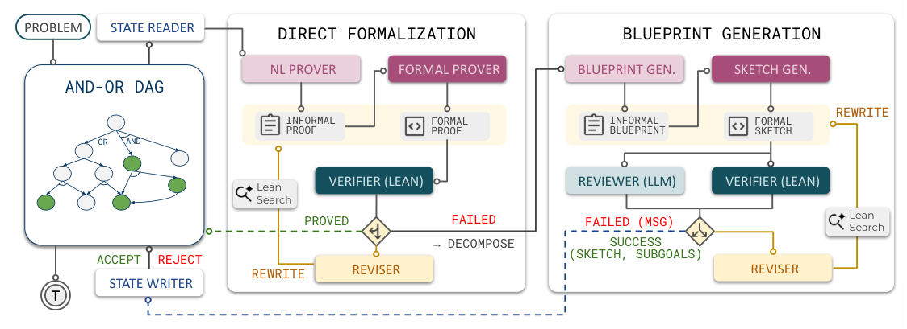

## 本期看点

自主优化和故障诊断都遇到了“证据太贵”的问题：完整性能测试限制搜索次数，长执行轨迹则推高归因成本。DuoDiscover 让 Agent 同时寻找优化位置和快速评测方法，再用真实测试纠正代理指标；CoLFA 利用交接与内容引用关系，减少诊断模型必须处理的记录。两篇值得重点读，前者关注优化反馈是否可信，后者关注失败证据是否组织得当。

LEAP 提供另一个可迁移思路：将经过检查的中间进展保存在共享依赖图里，而非每条分支重新推理。两篇技术笔记分别讨论 Google 长任务的验证机制和 Baseten 的投机解码、跨机缓存；FAA 的官方时间线则展示了通信异常时收缩运行规模的应对方式。

<h2 class="daily-paper-title" id="paper-arxiv-2610.17184">DuoDiscover：让代理评测也接受持续检验</h2>

[DuoDiscover: Scaling Autonomous Discovery Beyond the Evaluation Bottleneck](https://arxiv.org/abs/2610.17184)  
Shubham Agarwal、Akshat Gupta、Mike Heddes、Dilara Soylu 等 · 首发 2026-10-12

### 完整测试太慢，搜索就被评测卡住

优化真实系统时，一次端到端验证可能持续数十分钟。即使编码 Agent 很快生成补丁，也只能尝试少量候选。DuoDiscover 将“改哪里”和“怎样便宜地判断改动有用”一起交给 worker：它可以选中调度路径、热点循环或 kernel 阶段，并编写称为 yardstick 的快速评分脚本。相对预先指定待优化代码块的方式，这扩大了目标选择范围；相对只做 profiling，新增的是可持续使用并接受校验的代理评测。

### 快循环探索，慢循环确认

<a class="note-image-link" href="/assets/images/digest/2026-11-15/duodiscover.png" target="_blank" rel="noopener" aria-label="DuoDiscover 的 worker、快速 yardstick 循环和真实评测校验循环 · 查看原图 ↗">查看原图 ↗</a>

*左侧协调器管理多个 worker；右侧快速循环生成和筛选改动，底部真实评测确认收益，并检查 yardstick 的排序是否仍可信。*

worker 在自己的代码副本上反复修改、评分、保留或回退。yardstick 不必准确预测完整运行时间，但应将候选按真实目标的优劣排列。慢循环执行完整测试，协调器再比较两种评分的排序：只纳入超过测量噪声的差异，并以 Kendall 相关性检查代理指标。搜索可能逐渐钻代理评测的空子，因此每次真实评测之后都会重查；已经通过的 yardstick 也可能失效，需要重建或换目标。

协调器还会终止无进展的 worker、启动新的探索、分享已确认的发现，或让新 worker 合并多个补丁。合并也必须重新通过真实评测，局部收益不能直接相加。论文样本中，41% 的仓库 yardstick 和 45% 的 kernel yardstick 后续失效，说明漂移是实际遇到的问题，而非只在设计上预防。

### 收益要连同目标和预算一起读

在 100 个 SWE-fficiency-Lite 任务、通常 8 小时与四个 Agent 的设置下，作者报告相对原代码的几何平均加速为 15.02×，Claude Code 为 12.81×，专家补丁为 6.90×。这衡量特定任务工作负载，不能解释为任意 Python 项目都能获得同等提速。消融样本中，只加未经校验的 yardstick 反而使成绩从 12.85× 降到 10.33×；加入保真检查才恢复收益。

vLLM 案例在 8×B200 上运行 GLM-5.2 NVFP4，使用 20 小时预算和约 85 分钟的完整评测。1.92× 是四项目标的几何平均收益：p99 decode 延迟降低 2.94 倍、首 token 延迟降低 3.61 倍、功率下降 21%，吞吐保持不变，不能写成“吞吐提升 1.92×”。SQLite 则在 speedtest1 和完整测试约束下达到 1.38×。

对系统优化最有价值的是把代理指标当作需要维护的组件。主实验多为单次运行，重复性分析仅覆盖子集；无法构造可信 yardstick 时仍需退回昂贵搜索，短预算还可能抵不过初始化成本。优先看双循环、漂移消融和 vLLM 案例，能比榜单名次更直接理解方法的适用条件。

<h2 class="daily-paper-title" id="paper-arxiv-2611.14980">CoLFA：沿协作关系组织失败证据</h2>

[CoLFA: Collaboration-Guided Lightweight Failure Attribution for LLM-Based Multi-Agent Systems](https://arxiv.org/abs/2611.14980)  
Yufei Luo、Yuchen Ling、Chunrong Fang · 首发 2026-11-11

### 出现错误的位置，不一定是决定失败的位置

多 Agent 轨迹按时间排列，却不一定按信息形成过程排列：一个结果可能由上游生成、经其他 Agent 转述，最后被误用；早期错误也可能已经被修复。CoLFA 要找的是对最终失败起决定作用的最早错误步骤及责任 Agent。它没有给诊断模型增加更多轮自由推理，而是先组织模型将读取的证据。

### 按交接展开，再用引用压缩重复

<a class="note-image-link" href="/assets/images/digest/2026-11-15/colfa.png" target="_blank" rel="noopener" aria-label="CoLFA 从交错轨迹选择形成步骤、建立内容引用并定位错误 · 查看原图 ↗">查看原图 ↗</a>

*从左侧原始轨迹出发，上方按交接关系选择步骤，下方保留全局概览并引用重复内容，右侧一次模型调用输出错误步骤和责任 Agent。*

在委派与交接配置中，系统保留最终输出 Agent 的全部步骤，沿内容对应关系向上游追踪结果生产过程，再为其他 Agent 提供的一跳输入和需求补充上下文。连接线索包括任务交接、Agent 提及和重复出现的特定数字、标识符或文本；不是让 LLM 先凭空推断一张完整因果图。群聊等配置使用相应的展开规则，因此这些规则也构成迁移边界。

选中步骤仍保留原编号、作者、行动及执行上下文。重复文本用指向早先记录的引用替代，步骤引用帮助比较输入要求与后续处理；动作不按长度截断，过长推理和工具反馈会截断并标记。未详细展开的步骤仍出现在全局概览中。这样既减少重复阅读，又避免把不同 Agent 对同一内容作出的决策混成一个摘要。

### 更低的成本，不等于归因已经可靠

Who&When 的 184 条失败轨迹中，DeepSeek-V4.1-Flash 的精确步骤准确率从最强基线 CORRECT 的 41.30% 升到 44.57%，平均 token 从 22.7K 降到 6.9K。LongRCA 的 1,140 条失败轨迹包含多种系统，也包括单 Agent 执行；同一 backbone 下精确定位为 21.84%，CORRECT 为 18.86%，平均 token 分别为 22.4K 和 114.5K。

四个主设置相对各自最准基线的提升约为 1.84–3.26 个百分点，同时少用 66–90% token；第五个 Claude Sonnet 5.5 设置也显示准确率与成本优势。token 统计包含方法内全部模型调用的输入和输出，但不是墙钟延迟或货币成本的直接比较。去掉步骤展开或内容组织都会降低准确率、增加 token，支持两部分协同的解释。

这项工作的 AgentOps 价值在于把日志组织作为诊断设计的一部分，而非单纯换更强模型。不过，候选步骤取决于交接记录与内容对应能否覆盖真正错误；缺失连接可能使根因不在候选集合中。LongRCA 上约两成的精确定位率也说明它仍是辅助诊断。论文尚未通过修复后重跑证明归因能提升任务完成率，不能将定位成绩当作自动修复能力。

<h2 class="daily-paper-title" id="paper-arxiv-2606.03303">LEAP：用可复用证明图保存搜索进展</h2>

[LEAP: Supercharging LLMs for Formal Mathematics with Agentic Frameworks](https://arxiv.org/abs/2606.03303)  
Po-Nien Kung、Linfeng Song、Dawsen Hwang 等 · 首发 2026-06-02；本文依据 2026-11-12 修订版

LEAP 将定理与引理存成 OR 节点，将需要全部子目标成立的证明分解存成 AND 节点。系统先尝试直接证明并根据 Lean 编译反馈修订；失败后生成非形式化蓝图和形式化草图，再检查依赖无环，将子目标写回共享 DAG。已有引理可跨分支复用。Lean 检查逻辑，LLM reviewer 则判断分解是否真正让问题变简单，两种检查承担不同职责。

<a class="note-image-link" href="/assets/images/digest/2026-11-15/leap.png" target="_blank" rel="noopener" aria-label="LEAP 的共享证明 DAG、直接形式化与蓝图生成流程 · 查看原图 ↗">查看原图 ↗</a>

*中间先尝试直接证明；失败后转向右侧蓝图分解，经检查的结构写回左侧 DAG。草图中的待证引理必须最终完成，不能将中间占位符视为完整证明。*

Gemini-3.1-Pro 主设置在 Lean-IMO-Bench Basic／Advanced 上为 83.3%／56.7%；移除全局共享、改用树后为 73.3%／40.0%。作者还报告完成 Putnam 2025 全部 12 题。这里的收益来自迭代框架，不能说成基础模型一次生成就有 70% 成功率。对长任务 Agent，更可迁移的是保存可检查进展与共享依赖；几何题仍弱，跨模型重复实验也有限。

## 同日技术笔记

- [Antigravity /teamwork：长任务如何组织独立验证](/tech/zh/antigravity-teamwork/)：从上下文交接、原测试保留到生产变更，区分工作流机制与厂商报告的收益。
- [DeepSeek Ultrafast：投机解码与跨机 KV 状态](/tech/zh/deepseek-ultrafast/)：理解 1,740–2,060 token/s 的测量条件，以及缓存所有权如何支持跨副本续接。

## 事故动态：FAA 在通信异常后限制新起飞

[Secretary Sean Duffy 的官方时间线](https://x.com/SecDuffy/status/2121426698172293310)称，11 月 13 日美国东部时间 15:36，多处设施及 TRACON 出现通信问题。FAA 随后限制起飞，当时空中有 3,500 多架飞机；机组与管制员按既定程序组织降落，20:00 空中数量已低于 400，20:15 解除 ground stop。

官方同时说明并未失去全部雷达或通信能力，医疗救援、救命物资和执法航班保留例外。对可靠性研究，这提供了通过减少新增负载、保留关键业务来应对部分能力受损的实际案例；时间线没有说明技术根因，不能据此确认“路由器打满网络”或断言从未开展相关演练。
