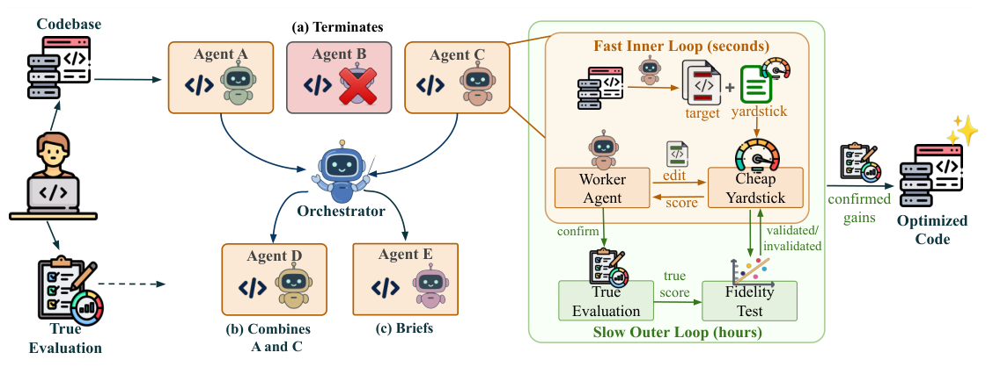
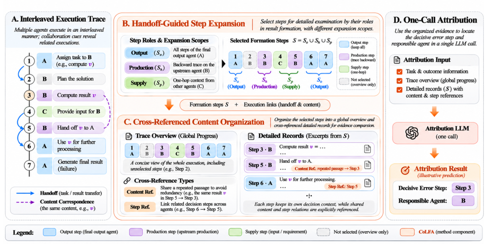
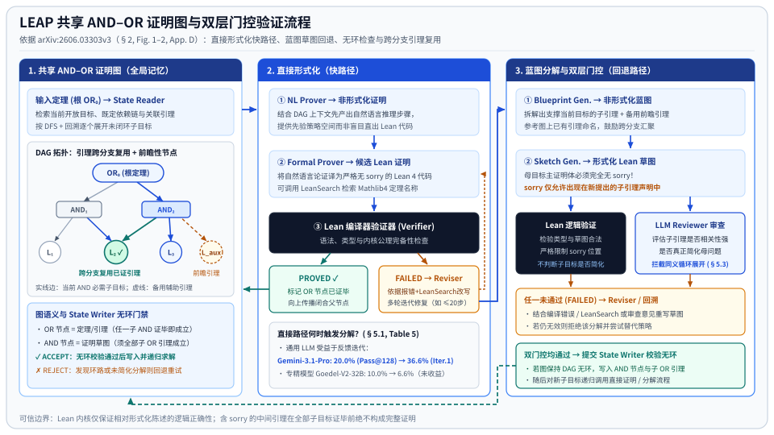
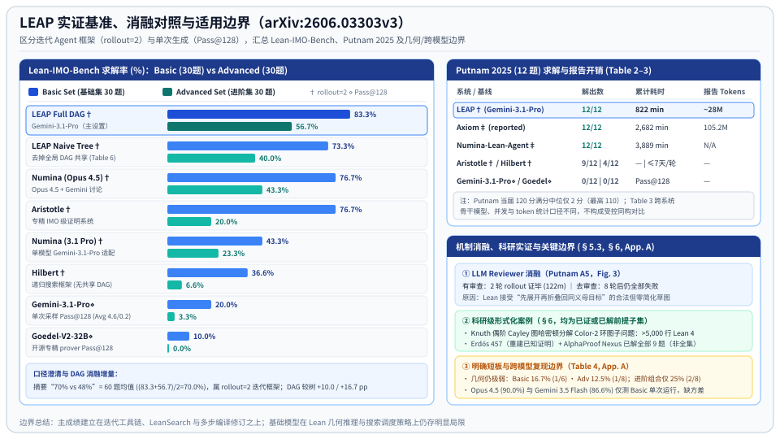

## 本期看点

自主优化和故障诊断都遇到了“证据太贵”的问题：完整性能测试限制搜索次数，长执行轨迹则推高归因成本。DuoDiscover 让 Agent 同时寻找优化位置和快速评测方法，再用真实测试纠正代理指标；CoLFA 利用交接与内容引用关系，减少诊断模型必须处理的记录。两篇值得重点读，前者关注优化反馈是否可信，后者关注失败证据是否组织得当。

LEAP 提供另一个可迁移思路：将经过检查的中间进展保存在共享依赖图里，而非每条分支重新推理。两篇技术笔记分别讨论 Google 长任务的验证机制和 Baseten 的投机解码、跨机缓存。

<h2 class="daily-paper-title" id="paper-arxiv-2610.17184">DuoDiscover：让代理评测也接受持续检验</h2>

[DuoDiscover: Scaling Autonomous Discovery Beyond the Evaluation Bottleneck](https://arxiv.org/abs/2610.17184)  
Shubham Agarwal、Akshat Gupta、Mike Heddes、Dilara Soylu 等 · 首发 2026-10-12

### 完整测试太慢，搜索就被评测卡住

优化真实系统时，一次端到端验证可能持续数十分钟。即使编码 Agent 很快生成补丁，也只能尝试少量候选。DuoDiscover 将“改哪里”和“怎样便宜地判断改动有用”一起交给 worker：它可以选中调度路径、热点循环或 kernel 阶段，并编写称为 yardstick 的快速评分脚本。相对预先指定待优化代码块的方式，这扩大了目标选择范围；相对只做 profiling，新增的是可持续使用并接受校验的代理评测。

### 快循环探索，慢循环确认

<a class="note-image-link" href="/assets/images/digest/2026-11-15/duodiscover.png" target="_blank" rel="noopener" aria-label="DuoDiscover 的 worker、快速 yardstick 循环和真实评测校验循环 · 查看原图 ↗">查看原图 ↗</a>

*左侧协调器管理多个 worker；右侧快速循环生成和筛选改动，底部真实评测确认收益，并检查 yardstick 的排序是否仍可信。*

worker 在自己的代码副本上反复修改、评分、保留或回退。yardstick 不必准确预测完整运行时间，但应将候选按真实目标的优劣排列。慢循环执行完整测试，协调器再比较两种评分的排序：只纳入超过测量噪声的差异，并以 Kendall 相关性检查代理指标。搜索可能逐渐钻代理评测的空子，因此每次真实评测之后都会重查；已经通过的 yardstick 也可能失效，需要重建或换目标。

协调器还会终止无进展的 worker、启动新的探索、分享已确认的发现，或让新 worker 合并多个补丁。合并也必须重新通过真实评测，局部收益不能直接相加。论文样本中，41% 的仓库 yardstick 和 45% 的 kernel yardstick 后续失效，说明漂移是实际遇到的问题，而非只在设计上预防。

### 收益要连同目标和预算一起读

在 100 个 SWE-fficiency-Lite 任务、通常 8 小时与四个 Agent 的设置下，作者报告相对原代码的几何平均加速为 15.02×，Claude Code 为 12.81×，专家补丁为 6.90×。这衡量特定任务工作负载，不能解释为任意 Python 项目都能获得同等提速。消融样本中，只加未经校验的 yardstick 反而使成绩从 12.85× 降到 10.33×；加入保真检查才恢复收益。

vLLM 案例在 8×B200 上运行 GLM-5.2 NVFP4，使用 20 小时预算和约 85 分钟的完整评测。1.92× 是四项目标的几何平均收益：p99 decode 延迟降低 2.94 倍、首 token 延迟降低 3.61 倍、功率下降 21%，吞吐保持不变，不能写成“吞吐提升 1.92×”。SQLite 则在 speedtest1 和完整测试约束下达到 1.38×。

对系统优化最有价值的是把代理指标当作需要维护的组件。主实验多为单次运行，重复性分析仅覆盖子集；无法构造可信 yardstick 时仍需退回昂贵搜索，短预算还可能抵不过初始化成本。优先看双循环、漂移消融和 vLLM 案例，能比榜单名次更直接理解方法的适用条件。

<h2 class="daily-paper-title" id="paper-arxiv-2611.14980">CoLFA：沿协作关系组织失败证据</h2>

[CoLFA: Collaboration-Guided Lightweight Failure Attribution for LLM-Based Multi-Agent Systems](https://arxiv.org/abs/2611.14980)  
Yufei Luo、Yuchen Ling、Chunrong Fang · 首发 2026-11-11

### 出现错误的位置，不一定是决定失败的位置

多 Agent 轨迹按时间排列，却不一定按信息形成过程排列：一个结果可能由上游生成、经其他 Agent 转述，最后被误用；早期错误也可能已经被修复。CoLFA 要找的是对最终失败起决定作用的最早错误步骤及责任 Agent。它没有给诊断模型增加更多轮自由推理，而是先组织模型将读取的证据。

### 按交接展开，再用引用压缩重复

<a class="note-image-link" href="/assets/images/digest/2026-11-15/colfa.png" target="_blank" rel="noopener" aria-label="CoLFA 从交错轨迹选择形成步骤、建立内容引用并定位错误 · 查看原图 ↗">查看原图 ↗</a>

*从左侧原始轨迹出发，上方按交接关系选择步骤，下方保留全局概览并引用重复内容，右侧一次模型调用输出错误步骤和责任 Agent。*

在委派与交接配置中，系统保留最终输出 Agent 的全部步骤，沿内容对应关系向上游追踪结果生产过程，再为其他 Agent 提供的一跳输入和需求补充上下文。连接线索包括任务交接、Agent 提及和重复出现的特定数字、标识符或文本；不是让 LLM 先凭空推断一张完整因果图。群聊等配置使用相应的展开规则，因此这些规则也构成迁移边界。

选中步骤仍保留原编号、作者、行动及执行上下文。重复文本用指向早先记录的引用替代，步骤引用帮助比较输入要求与后续处理；动作不按长度截断，过长推理和工具反馈会截断并标记。未详细展开的步骤仍出现在全局概览中。这样既减少重复阅读，又避免把不同 Agent 对同一内容作出的决策混成一个摘要。

### 更低的成本，不等于归因已经可靠

Who&When 的 184 条失败轨迹中，DeepSeek-V4.1-Flash 的精确步骤准确率从最强基线 CORRECT 的 41.30% 升到 44.57%，平均 token 从 22.7K 降到 6.9K。LongRCA 的 1,140 条失败轨迹包含多种系统，也包括单 Agent 执行；同一 backbone 下精确定位为 21.84%，CORRECT 为 18.86%，平均 token 分别为 22.4K 和 114.5K。

四个主设置相对各自最准基线的提升约为 1.84–3.26 个百分点，同时少用 66–90% token；第五个 Claude Sonnet 5.5 设置也显示准确率与成本优势。token 统计包含方法内全部模型调用的输入和输出，但不是墙钟延迟或货币成本的直接比较。去掉步骤展开或内容组织都会降低准确率、增加 token，支持两部分协同的解释。

这项工作的 AgentOps 价值在于把日志组织作为诊断设计的一部分，而非单纯换更强模型。不过，候选步骤取决于交接记录与内容对应能否覆盖真正错误；缺失连接可能使根因不在候选集合中。LongRCA 上约两成的精确定位率也说明它仍是辅助诊断。论文尚未通过修复后重跑证明归因能提升任务完成率，不能将定位成绩当作自动修复能力。

<h2 class="daily-paper-title" id="paper-arxiv-2606.03303">LEAP：用可复用证明图保存搜索进展</h2>

[LEAP: Supercharging LLMs for Formal Mathematics with Agentic Frameworks](https://arxiv.org/abs/2606.03303)（[v3 PDF](https://arxiv.org/pdf/2606.03303v3) · [v1 PDF](https://arxiv.org/pdf/2606.03303v1) · [项目主页](https://billkunghappy.github.io/LEAP/) · [Lean 解答仓库](https://github.com/google-deepmind/superhuman/tree/main/leap) · [Lean-IMO-Bench](https://imobench.github.io)） 
Po-Nien Kung、Linfeng Song、Dawsen Hwang、Jinsung Yoon、Chun-Liang Li、Simone Severini、Mirek Olšák、Edward Lockhart、Quoc V Le、Burak Gokturk、Thang Luong、Tomas Pfister、Nanyun Peng（Google Cloud AI Research / Google Cloud / Google DeepMind / UCLA）· arXiv:2606.03303v3（cs.AI）· 首次提交：2026-06-02（v1）；v2 修订：2026-06-03；最新修订：2026-11-12（v3，未撤回）

### 1. 问题重塑：瓶颈不在数学推理，而在单次生成可验证 Lean 证明

大语言模型在自然语言数学推理上已达到竞赛奖牌水平，但一旦要求在 Lean 4 等交互式定理证明器中输出可由内核机械检验的形式化证明，单次生成成功率往往断崖式下跌。长期以来，主流路线假定通用基础模型缺乏足够的形式化语料偏好，因而投入大量算力微调 AlphaProof、DeepSeek-Prover-V2、Seed-Prover、Goedel-Prover-V2 等专用 prover，或构建依赖专精模型负责 Lean 证明步的混合系统（如 Hilbert、AlphaProof Nexus、Aristotle、Seed-Prover 1.5）。

LEAP（LLM-in-Lean Environment Agentic Prover）在 `arXiv:2606.03303`（2026-06-02 提交 v1，2026-11-12 更新至 v3）中给出了一个更尖锐的诊断：通用大模型之所以在常规形式化测试中落后，**主要瓶颈既不是数学思路缺失，也不是对 Lean 语法完全无知，而是难以在一次前向生成中无误地构造超长、多步、依赖精密的形式证明**。为在 MiniF2F 与 PutnamBench 逐渐饱和之外给出更严格的标尺，作者基于专家审校的 `IMO-ProofBench` 由 Lean 专家人工形式化并核验了全部 **60 道题的 `Lean-IMO-Bench`**，均分为 **Basic**（30 题：pre-IMO 至 IMO-Medium，含代数 8、组合 8、数论 8、几何 6）与 **Advanced**（30 题：最高达 IMO-Hard，含代数 8、组合 8、数论 6、几何 8）。题干均只需初等数学背景，避免把评测成本消耗在重建现代数学大型前置库上，从而集中检验非套路、多步推导的形式证明搜索能力。

原论文 Table 1 直接证明了上述判断：在自然语言证明任务上，`Gemini 2.5 Pro` 的 `Pass@1` 已达 Basic **55.2%**、Advanced **17.6%**；但换作形式化定理证明时，`Gemini 3.1 Pro` 即便放宽到 `Pass@128`，求解率也仅 **20.0%**（Basic）与 **3.3%**（Advanced），平均单次采样 `Avg.@128` 更只有 **4.6%** 与 **0.2%**。更说明问题的是 **Formal Proof Translation** 任务：即便把**已确认正确的非形式化证明**直接喂给 `Gemini 3.1 Pro`，`Pass@128` 仍纹丝不动地停在 **20.0% / 3.3%**，`Avg.@128` 也只微升至 **4.6% / 0.8%**。这把设计重心从“再微调一个专精小模型”拉回到了“如何用结构化工作流把通用模型的长上下文、非形式规划、工具检索与编译器纠错能力组织起来”。

### 2. 共享 AND–OR 证明图与双路径协同：快路径直证、蓝图回退与双层门控

<figure class="note-figure">
<a class="note-image-link" href="/assets/images/digest/2026-11-15/leap-proof-dag-workflow-zh.svg" target="_blank" rel="noopener" aria-label="LEAP 共享 AND-OR 证明图与双层门控验证流程图 · 查看原图 ↗">查看原图 ↗</a>
<figcaption>依据 arXiv:2606.03303v3 第 2 节与图 1–2 绘制：LEAP 以持久化 AND–OR 有向无环图保存全局证明状态，先走直接形式化与编译反馈改写循环，失败后退入蓝图草图分解，并将 Lean 逻辑检查与 LLM 简化度审查拆为两道独立门控。</figcaption>
</figure>

受人类数学家在大型形式化工程（如 Fermat's Last Theorem）中借助 `leanblueprint` 管理依赖图的启发，LEAP 完全基于**通用大模型（主实验为 `Gemini-3.1-Pro`，不接任何专精 prover 微调模型）**运行，围绕三项紧密耦合的机制构建持久化的全局记忆：

**共享 AND–OR 有向无环图（DAG）与前瞻性引理规划**：系统将输入定理注册为根节点（OR 节点）。在图中，**OR 节点**代表任意待证命题（主定理或子引理），只要存在至少一条子 AND 分解或直接证明成立即可闭合；**AND 节点**代表一次具体证明分解（一段形式化草图及其依赖的子引理集合），必须等待**全部**子 OR 节点均被证毕才能成立。相比孤立的递归树（如 Hilbert 存在 <i>O</i>((<i>n</i> · <i>b</i>)<i>d</i>) 的重复子目标爆炸），DAG 记忆同时带来两项收益：其一是**单调精化（monotone refinement）**——某个目标一旦分解成合法的子目标依赖序，后续局部尝试的改写、回溯或放弃都不会破坏既定全局骨架；其二是**跨分支引理复用与前瞻性引理规划（anticipatory lemma planning）**——`State Reader` 在展开任一开放节点时会读取图中已有引理与依赖上下文，蓝图生成器除提出当前草图必需的子引理外，还可顺带声明暂不阻塞当前 AND 节点的前瞻性辅助引理（论文 Fig. 2 中的虚线边），留待下游分支直接复用。

**直接形式化（快路径）与蓝图草图（回退路径）**：每当通过深度优先搜索（DFS + 回溯）选中一个开放 OR 节点时，LEAP 先尝试**直接形式化**：`NL Prover` 先生成自然语言证明，再由 `Formal Prover` 译为完全不含 `sorry` 的 Lean 4 证明并送交 `Lean Verifier` 编译；若失败，`Reviser` 结合编译器报错信息与 `LeanSearch`（Gao et al., 2024）的 Mathlib4 语义检索执行多轮改写（例如消融实验中最多 20 步修订）。当直接路径耗尽预算仍未通过时，流程切入**蓝图分解（`→ DECOMPOSE`）**：`Blueprint Gen.` 先起草自然语言蓝图说明如何将当前目标归约为更小引理，再由 `Sketch Gen.` 翻译为形式化 Lean 草图。系统对草图施加严格的**占位符隔离约束**：母目标的主证明体必须**完全无 `sorry`**，`sorry` 占位符**仅允许出现在新提出的子引理声明中**——这从类型系统层面保证只要日后所有子引理全部证毕，母目标即可无条件成立。

**双层验证职责分离与无环写入门禁**：LEAP 显式把“形式合法性”与“搜索有效性”拆给两种不同的检查器。`Lean Verifier` 负责硬性的语法、类型与 `sorry` 位置合法性检查；而 `LLM Reviewer` 负责局部启发式审查，判断新提出的子引理是否真正**相关、降低了原问题难度且有希望可证**。通过双门控的 `(sketch, subgoals)` 还要经过 `State Writer` 的**无环依赖检查（acyclicity check）**——仅当新增依赖边不破坏 DAG 无环性时才会 `ACCEPT` 提交为新的 AND 节点与子 OR 节点，否则 `REJECT` 并触发回溯或换路。

| LEAP 核心模块 | 职责定位与输入输出 | 关键约束与可信边界 | 失效后的处理路径 |
|---|---|---|---|
| `State Reader` 与 AND–OR DAG | 维护全局证明状态；OR 表定理/引理（任一成立），AND 表分解（全子目标须成立） | `State Writer` 在提交前强制校验无环性；支持非阻塞前瞻引理（虚线边） | 子目标按 DFS + 回溯调度；无效分支被放弃而不污染已证节点 |
| 直接形式化路径（`NL` → `Formal`） | 先写非形式证明再译为完整 Lean 4 证明 | 禁止任何 `sorry` 占位符；接入 `LeanSearch` 检索 Mathlib4 | 编译失败由 `Reviser` 依报错多轮重写；耗尽后转入蓝图分解 |
| 蓝图分解路径（`Blueprint` → `Sketch`） | 生成自然语言分解蓝图与 Lean 形式草图 | 母目标主证明体必须无 `sorry`，仅新建子引理声明允许带 `sorry` | 草图未闭合前绝不视作完整证明；需递归证毕全部子引理 |
| `Lean Verifier`（逻辑检查器） | 核验 Lean 4 语法、类型推导与内核公理完整性 | 仅保证“代码相对给定 Lean 陈述”正确，无法识别同义循环分解 | 报错返回 `Reviser` 结合 `LeanSearch` 修正草图或直接证明 |
| `LLM Reviewer`（语义审查器） | 评估子引理是否真正简化母问题、具有可解前景 | 不具形式化可信度，只作搜索剪枝与局部启发式过滤 | 拒绝“形式合法但无实质推进”的分解，早停并触发回溯 |

### 3. 定量评测、结构消融与科研级实证归因

<figure class="note-figure">
<a class="note-image-link" href="/assets/images/digest/2026-11-15/leap-proof-dag-eval-ablation-zh.svg" target="_blank" rel="noopener" aria-label="LEAP 实证基准、消融对照与适用边界汇总图 · 查看原图 ↗">查看原图 ↗</a>
<figcaption>依据 arXiv:2606.03303v3 表 1–6、第 5–6 节与附录 A 绘制：对比不同系统在 Lean-IMO-Bench 与 Putnam 2025 的成绩与口径差异，并标注树结构消融、LLM Reviewer 消融及几何与跨模型复现边界。</figcaption>
</figure>

**Putnam 2025（12 题）端到端表现与效率边界**：第 86 届 Putnam 竞赛难度极高（人类参赛者满分 120 分中最高 110 分、平均约 10 分、中位数仅 2 分）。在仅提供 Lean 题面陈述、无参考非形式证明的条件下，单次生成基线 `Gemini-3.1-Pro` 与 `Goedel-Prover-V2-32B` 在 `Pass@128` 下均解出 **0 / 12 题（0.0%）**；开源递归 Agent `Hilbert`（`rollout=2`，单轮上限给到 7 天）解出 **4 / 12 题（33.3%）**（A2、A3、A4、B6）；专精闭源系统 `Aristotle`（`rollout=2`）解出 **9 / 12 题（75.0%）**（漏掉 A5、B5、B6）。相比之下，**LEAP（`Gemini-3.1-Pro`，`rollout=2`）解出全部 12 / 12 题（100.0%）**，追平 `Numina-Lean-Agent` 与 `Axiom` 的满分覆盖率。v3 新增的 Table 3 汇总了三家满分系统的公开运行统计：LEAP 报告累计耗时 **822 分钟**、约 **28M tokens**，低于 `Axiom`（2,682 分钟、105.2M tokens）与 `Numina-Lean-Agent`（3,889 分钟，未报告 token；仅 A5 单题即耗 2,040 分钟）。需要严格守住口径边界的是：论文在 Table 3 说明中明确指出，三套系统使用的骨干模型、并行配置与 token 统计口径各异，因此这组汇总数字**不能当作严格受控的同构架构对照**（此外 v1 版本 Table 3 曾披露 LEAP 内部各题消耗：从 B2 的 46 次 LLM 调用 / 8 个活跃节点 / 300 行证明，到最难的 A5 需 3.0k 次调用 / 170 个活跃节点 / 2.0k 行证明，以及 B5 需 211 个活跃节点）。

**Lean-IMO-Bench 主对照与“70% vs 48%”口径澄清**：在更贴近深度洞察与跨领域泛化的 Lean-IMO-Bench 上，LEAP 在 `Gemini-3.1-Pro`（`rollout=2`）下取得 Basic **83.3%（25/30）**、Advanced **56.7%（17/30）**，在代数（Basic/Adv 均 **100%**）和数论（Basic/Adv 均 **100%**）上全面打通，明显领先规范配置下的 `Numina (Opus 4.5)`（76.7% / 43.3%）与单骨干适配版 `Numina (3.1 Pro)`（43.3% / 23.3%）、专精系统 `Aristotle`（76.7% / 20.0%）以及 `Hilbert`（36.6% / 6.6%）。这里必须为读者拆清一个极易被误引的摘要数字：论文摘要与引言提到“把求解率从 10% 以下提升到 70%，超过专业系统 48%”，**实际对应的是 Basic 30 题与 Advanced 30 题合并后的 60 题总均值**——LEAP 为 (83.3% + 56.7%) / 2 = **70.0%**（42/60），`Aristotle` 为 (76.7% + 20.0%) / 2 = **48.35%**（29/60），而 `Gemini-3.1-Pro` 单次生成 `Avg.@128` 均值为 (4.6% + 0.2%) / 2 = **2.4%**（`Pass@128` 均值为 11.7%）。也就是说，**70.0% 是迭代式 Agent 框架在 `rollout=2` 下的多步搜索成绩，绝不能转述为“基础模型一次生成就有 70% 成功率”**。

| 方法与评测口径 | Basic 代数 | Basic 组合 | Basic 数论 | Basic 几何 | Basic 总计 | Adv 代数 | Adv 组合 | Adv 数论 | Adv 几何 | Adv 总计 |
|---|---|---|---|---|---|---|---|---|---|---|
| `Gemini-3.1-Pro`（Pass@128） | 37.5 | 12.5 | 25.0 | 0 | 20.0 | 0 | 12.5 | 0 | 0 | 3.3 |
| `Goedel-Prover-V2-32B`（Pass@128） | 37.5 | 0 | 0 | 0 | 10.0 | 0 | 0 | 0 | 0 | 0 |
| `Hilbert`（rollout=2） | 62.5 | 25 | 50 | 0 | 36.6 | 12.5 | 0 | 16.6 | 0 | 6.6 |
| `Aristotle`（rollout=2） | 75 | 100 | 100 | 16.7 | 76.7 | 37.5 | 12.5 | 33.3 | 0 | 20.0 |
| `Numina`（Gemini 3.1 Pro 单骨干，rollout=2） | 50 | 50 | 50 | 16.7 | 43.3 | 50 | 12.5 | 33.3 | 0 | 23.3 |
| `Numina`（Opus 4.5 + Gemini 讨论，rollout=2） | 87.5 | 100 | 87.5 | 16.7 | 76.7 | 87.5 | 25 | 66.6 | 0 | 43.3 |
| `LEAP w/o DAG`（无共享树消融，rollout=2） | 100 | 75 | 100 | 0 | 73.3 | 75 | 25 | 66.6 | 0 | 40.0 |
| `LEAP Full DAG`（主设置 Gemini-3.1-Pro，rollout=2） | **100** | **100** | **100** | **16.7** | **83.3** | **100** | **25** | **100** | **12.5** | **56.7** |

**三组关键消融把机制收益拆得非常干净**：

- **单次采样 vs 编译反馈迭代（§5.1, Table 5）**：在 Lean-IMO-Bench Basic 集上仅运行“直接形式化”模块，比较 128 次独立采样（`Pass@128`）与单次起步加最多 20 步编译反馈改写（`Iterative Pass@1`）。`Goedel-Prover-V2-32B` 从 10.0% 降至 **6.6%**，未能消化编译器报错；而 `Gemini-3.1-Pro` 在更小采样预算下反而从 20.0% 跃升至 **36.6%**，证明读懂报错、维持上下文与多步修正正是通用基础模型在 Agent 框架中的核心比较优势。
- **共享 DAG vs 朴素树（§5.2, Table 6）**：去掉跨分支引理复用、退化为树结构后，LEAP 的 Basic/Advanced 仍达 **73.3% / 40.0%**，显著高出同样没有共享 DAG 的 `Hilbert`（36.6% / 6.6%）——这隔离出“非形式–形式交错规划 + 编译修订 + 审查”本身已带来巨大跃迁；而重新启用全局共享 DAG 后，成绩再进一步推高 **+10.0 个百分点（Basic → 83.3%）** 与 **+16.7 个百分点（Advanced → 56.7%）**，尤其体现在最依赖引理复用的进阶代数（75% → 100%）、进阶数论（66.6% → 100%）和几何破零（0% → 16.7% / 12.5%）。
- **LLM Reviewer 审查消融（§5.3, Fig. 3）**：在最具挑战性的 Putnam 2025 A5 上，完整 LEAP 经 **2 轮 rollout（122 分钟，10M tokens）**成功证明；一旦移除 LLM 分解审查器，Agent 连跑 **8 轮 rollout 全部失败**。追踪轨迹发现（论文 Fig. 3），模型先将祖父目标 `perms_a_equiv_b_card` 展开定义为中间引理 `valid_perms_end_eq_sigma_card`，随后又把它折叠回与祖父目标**句法完全一致**的新子引理 `card_perms_a_eq_card_perms_b`——虽然使用了新引理名而在形式上无环且能通过 Lean 编译，却未对数学状态做任何实质简化，导致搜索在同义循环中耗尽预算。

**科研级形式化案例（§6）**：在研究级题目上，作者展示了三项验证：其一，针对 Donald Knuth 提出的偶阶有向 Cayley 图 Γ<i>m</i> = Cay(ℤ<i>m</i>3, {<i>e</i>1, <i>e</i>2, <i>e</i>3}) 哈密顿分解问题（具体定理形式化条件为 <i>m</i> = 2<i>h</i> ≥ 12），LEAP 将 Color-2 平面投影轮转映射（`r2Map`）构成单一 <i>m</i>2 长度环这一关键子问题的约 20 页密集分片构造与奇偶缺陷路由非形式证明，自主分解并合成为 **超过 5,000 行经 Lean 4 机械验证的形式化代码**；其二，基于 `Formal Conjectures` 的形式化陈述与 LLM 重建的已知证明，完成 **Erdős 457** 素因子整除定理的 Lean 4 自动化重构与证明；其三，v3 新增测试中，在既不提供参考证明也不允许联网搜索的前提下，以 `Gemini-3.1-Pro` 完成 **AlphaProof Nexus 已解出的全部 9 道 Erdős 问题**（论文明确限定这只是针对该 9 道已解实例的对照，而非 AlphaProof Nexus 考察的全部题库）。

### 4. 适用边界、未解短板与对长程可验证 Agent 的工程启发

尽管 LEAP 展示了通用大模型在严谨形式系统中的潜力，论文第 4–6 节与附录 A 同时划出了必须正视的四条边界：

1. **几何与高难组合仍是明显短板**：在 `Lean-IMO-Bench` 上，包括 LEAP 在内的所有系统在几何题上几乎集体失灵——LEAP 仅解出 Basic **16.7%（1/6）** 与 Advanced **12.5%（1/8）**，朴素树变体与多数基线更是 **0%**；Advanced 组合也停留在 **25%（2/8）**。这反映出缺乏专门符号几何引擎时，仅靠通用 Lean/Mathlib 规划仍难以跨越奥赛几何的形式化壁垒。
2. **主干与跨模型复现有限**：正文主实验和消融全部建立在 `Gemini-3.1-Pro` 上；附录 A 虽补充了 `Opus 4.5 + Gemini 3.1 Pro` 讨论搭档（**90.0%**）与 `Gemini 3.5 Flash`（**86.6%**）在 Basic 集上的测试（对比主设置 83.3%），但作者明确注明这只是**仅覆盖 Basic 集的单次运行（brief single evaluations）**，既未测 Advanced 集，也未提供多次重复实验方差。
3. **搜索调度策略仍较朴素**：当前在 AND–OR DAG 上采用带回溯的简单深度优先搜索（DFS），虽然有助于干净地隔离 DAG 记忆的消融增益，但随着分解粒度变细，状态空间会迅速膨胀，尚未引入学习型节点优先级、分解排序或自适应预算分配。
4. **可信基与规范对齐边界**：Lean 内核只保证“证明代码满足给定的 Lean 形式化陈述”，并不能自动验证自然语言题目是否被忠实翻译成了 Lean 声明（本工作中 `Lean-IMO-Bench` 依赖 Lean 专家人工形式化与核验，Erdős 题面取自 `Formal Conjectures`）；同时任何含 `sorry` 的草图节点在子目标全闭环前都只是搜索中间态，绝非完整证明。

对更广泛的**长程可验证 Agent（编码、系统优化、科研自动化）**而言，LEAP 最具迁移价值的架构经验有三条：**第一，用可检验的 DAG 记忆替代线性历史或孤立搜索树**，把经过硬验证器确认的中间子目标与前瞻性引理保存为共享节点，让并行或回溯分支汇聚到公共前置工作上；**第二，在草图分解阶段强制“父体封闭、仅叶子带占位符”的接口契约**，确保全局结构精化的单调性；**第三，把硬逻辑验证器与语义进展审查器解耦并置**——编译器和单元测试只负责兜底“不出错”，还必须配一层低成本语义裁判去拦截“语法完全合法但原地绕圈”的空转分解，把推理预算留给真正降低问题复杂度的分支。

## 同日技术笔记

- [Antigravity /teamwork：长任务如何组织独立验证](/tech/zh/antigravity-teamwork/)：从上下文交接、原测试保留到生产变更，区分工作流机制与厂商报告的收益。
- [DeepSeek Ultrafast：投机解码与跨机 KV 状态](/tech/zh/deepseek-ultrafast/)：理解 1,740–2,060 token/s 的测量条件，以及缓存所有权如何支持跨副本续接。
