数据库准备切换主节点时，收到成功的 API 响应，并不能证明候选副本已经追平。本期从这个运维错误读起。HotNets 的形式化运维规约把前置条件交给检查器；HerAgent 则把「安装完成」拆成容器内通过、干净环境可重放、外部测试通过三个判断。推理服务中的 Callo 面对另一个状态问题：旧 KV 仍能帮助起草下一段输出，但提交前必须等到精确状态。三项工作都给出了能改变工程判断的证据，包括控制器的反例、环境重放后的通过率，以及缓存命中请求也计入时的延迟收益。

<h2 class="daily-paper-title" id="paper-hotnets26-formal-operations-specifications">故障切换前，运维程序能检查哪些条件？</h2>

[Formal Operations Specifications for Reliable System Management](https://djapg7v42ea9q.cloudfront.net/pdf/hotnets26-final281.pdf)  
Jinlang Wang, Jiawei Tyler Gu, Ruize Tang, Tej Chajed, Tianyin Xu, Xudong Sun · HotNets ’26，2026 年 11 月 16–17 日

同一条提升备库的命令，在一个 PostgreSQL 集群里可以恢复服务，在另一个集群里却可能丢数据。区别藏在命令参数以外。备库是否就绪？异步复制时它的日志落后多少？同步复制时它是否属于同步备库集合？作者追溯了三起各自漏掉一个前置条件的错误。运维程序即使成功调用 Kubernetes API，也未必完成了数据库允许的状态转换。

<a class="note-image-link" href="/assets/images/digest/2026-11-17/hotnets26-formal-operations-specifications.png" target="_blank" rel="noopener" aria-label="三组候选备库分别违反就绪、日志进度和同步成员资格条件。 查看原图 ↗">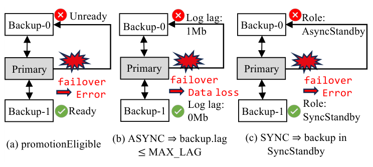查看原图 ↗</a>

*三组候选备库分别违反就绪、日志进度和同步成员资格条件。*

作者提出让被管理的系统提供一份形式化运维规约（FOS）。编写者从实现中提取影响操作合法性的状态，把候选节点、复制模式、日志进度和操作前后的约束写进 P 语言模型。模型可以略去数据库怎样存放每一条记录，却必须保留足以区分「可提升」和「不可提升」的细节。运维程序的协调逻辑和 Kubernetes API 各有一个模型，三者交换事件后，检查器就能探索不同状态与执行顺序。例如，程序从副本中选择候选者时，检查器可以选到同步集合之外的副本。失败的断言同时给出到达该状态的执行路径，让开发者知道应该在哪次操作前补检查。

安全性只是问题的一半。Solr 的案例中，备份开始后控制器重启，集群仍记录着备份进行中，恢复后的控制器却无法接着完成。只检查每一次请求是否合法，很容易漏过这种永久停滞；把「最终完成备份」也写进规约，才能检查整段协调过程。作者在 CockroachDB、Kafka、RabbitMQ 和 Solr 的 105 个管理接口上编写了 1,946 条断言，报告在四个 operator 中发现 39 个新缺陷，其中 29 个来自 CockroachDB。这是四组具体实现的检查结果，不能据此推算其他控制器的缺陷率。

把规约作为软件接口交付还有一项维护成本。团队手工编写第一份规约，再让编码智能体沿用提取步骤为其他系统建模。程序可以通过自身模型里的所有断言，模型仍可能漏掉实现中的状态；作者把用真实执行轨迹校验模型列为后续问题。对运维智能体而言，眼前最可迁移的是这份操作契约：即使难以提前建模智能体将提出什么动作，执行前仍可以检查候选动作的系统前置条件。论文已评估的是 operator 模型检查，智能体运行时验证是由此延伸的方案。

<h2 class="daily-paper-title" id="paper-arxiv-2611.18443">HerAgent 把环境安装进度保存在可重放的步骤块中</h2>

[HerAgent: A Block-Level Checkpointing Harness for Coding-Agent Environment Setup](https://arxiv.org/abs/2611.18443)  
Xiang Li, Siyu Lu, Federica Sarro, Claire Le Goues, He Ye · arXiv · 2026-11-13

给仓库配置环境时，安装命令可能正常退出，却装错了运行时版本。等前端测试报错，工作目录里已经混入多轮补丁。沿着当前容器继续试，最后能跑的环境很难从脚本重建；从空镜像重来，又要重复此前正确的安装。HerAgent 先读仓库文档、依赖清单和测试配置，按可单独验证的任务组织安装块，例如准备运行时、安装依赖和检查测试工具。每通过一块，就把脚本、容器状态和执行记录关联起来保存。

<a class="note-image-link" href="/assets/images/digest/2026-11-17/arxiv-2611.18443.png" target="_blank" rel="noopener" aria-label="先检查仓库，再逐块验证并保存状态，修复后还要从干净环境重放。 查看原图 ↗">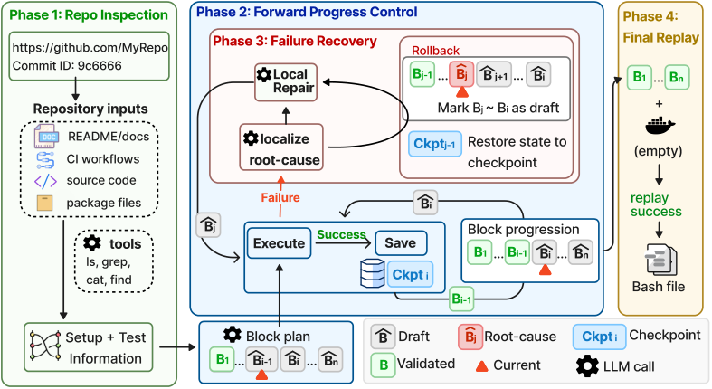查看原图 ↗</a>

*先检查仓库，再逐块验证并保存状态，修复后还要从干净环境重放。*

修复时，智能体可以在容器里试改，但必须把有效修改写回脚本或保存 shell 环境的前导代码，再从上一检查点重新执行。若当前块一直失败，智能体可以把故障定位到更早的块，丢弃其后的检查点，保留此前已经验证的前缀。最后从干净环境重放整个产物，再交给基准自己的验证器。这样能分别看见三个结果：智能体以为配置好了、脚本可以重放、环境通过外部验收。

作者对比六种已有智能体，在 Installamatic-Bench 上报告成功率从 52.0% 到 85.0%，在 SetupBench 上从 46.3% 到 70.4%。所有块共享每任务 20 次局部修复预算。定位错误依赖时，一个好的块边界可以省下一大段重装，也可能因本地检查太弱而暂时放过错误。阅读消融实验时，比单看交互步数更有意义的是看干净重放到外部验收之间还会损失多少任务：一次块执行可以包含多条命令。
重复运行也揭示了单次成功的边界。补充实验中，GPT-5.4 在 SetupBench 的 54 个仓库上各尝试三次，其中 25 个仓库三次全部通过外部验收，5 个三次都失败，其余 24 个有时成功、有时失败。这里的三次是重新运行智能体，不是重复检查同一个已保存的脚本。对于要把配置产物交给后续编码任务的系统，既要问某一次产物能否重放，也要问重新生成时有多大概率得到这样的产物。

<h2 class="daily-paper-title" id="paper-arxiv-2611.18459">Callo 用失效 KV 起草，等精确状态回来再提交</h2>

[Callo: Serving Cache-Miss Requests with Speculative Decoding on Invalidated KV under Prefill-Decode Disaggregation](https://arxiv.org/abs/2611.18459)  
Jianjun Ou, Matthew Lentz · arXiv · 2026-11-13

编码智能体删改早先的工具输出时，编辑点之后的 token 即便文本相同，其 KV 也可能已经改变。在 prefill 与 decode 分离的服务中，这意味着两段串行等待：先在 prefill 端重算，再把结果送到 decode 端。Callo 保留旧状态，利用另一端暂时空闲的算力先起草一段回答。编辑点以前的精确前缀可以复用，编辑点以后的旧状态只参与猜测。精确 KV 到达后才验证候选 token，只有通过验证的前缀可以提交给用户。

<a class="note-image-link" href="/assets/images/digest/2026-11-17/arxiv-2611.18459.png" target="_blank" rel="noopener" aria-label="左侧是旧 KV 和精确 KV 的两条路径，右侧标出起草可以与重算重叠的时段。 查看原图 ↗">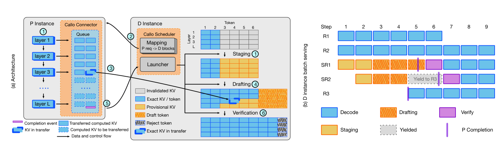查看原图 ↗</a>

*左侧是旧 KV 和精确 KV 的两条路径，右侧标出起草可以与重算重叠的时段。*

这套机制有两种成本。旧上下文若误导了模型，猜出的后半段没有价值；decode 若已排满，草稿还会挤掉正常请求。Callo 根据 decode 端的负载决定是否接纳投机任务，并可提前停止不太可能被接受的草稿。论文还把 KV 传输与计算重叠，所以系统收益包含数据提前到达和草稿通过验证两部分。

为什么旧状态还有用？上下文编辑会改变保留 token 所关注的历史，但许多位置的文本没有改变。作者在主要工作负载的缓存失效请求上离线起草 32 个 token，按固定平局处理的贪心验证，65% 的请求整段通过；从提示中查找匹配片段并复制续文的对照只有 12%。即使从精确状态逐 token 生成，再用多 token 验证，整段通过率也只有 80%，因为接近平局时两种计算的数值差异足以改变选择。因此「整段未通过」也不能简单解释为旧 KV 全无信息。

作者在双 H200 上回放 SWE-agent 会话，对三种模型系列分别测量。中等负载下，按所有请求的平均延迟计算，vLLM 与 Callo 的比值为 1.05–1.19。这里的分母包括缓存命中请求，它们也会受到 decode 端资源竞争影响；只看缓存失效请求会漏掉这笔账。集群规模的结果来自轨迹驱动模拟。最能说明适用条件的是分负载的结果：能否把重算时间换成用户可见的收益，取决于精确状态何时到达，以及等待期间还有多少解码余量。

<h2 class="daily-paper-title" id="paper-arxiv-2611.17662">LeBet 提前停止失败轨迹，也数清误停的成功任务</h2>

[Learn then Bet: Learning Interpretable Rules for Reliable Agent Intervention](https://arxiv.org/abs/2611.17662)  
You-Lin Chen, Xinyi Lisa Chen, Pedro Herrero-Vidal, Xiaojing Yu, Bingqing Song, Bin Xu · arXiv · 2026-11-13

LeBet 从带最终成败标签的轨迹学习可读的布尔规则。上线判定只看当前可见历史，把规则命中转成逐步累积的统计证据，越过阈值才干预。这样，同一条可疑工具调用无需立即触发停机。其有限样本分析有轨迹独立同分布等前提。SWE-bench Lite 上，Ministral 3 8B 的 120 条评估轨迹中，规则停下了 98 条失败中的 29 条，也误停了 22 条成功中的 3 条。节省 34.46% 输入输出 token 的代价由此可见：剩余回答的成功占比提高到 21.59%，但实际成功任务从 22 个降到了 19 个。

<a class="note-image-link" href="/assets/images/digest/2026-11-17/arxiv-2611.17662.png" target="_blank" rel="noopener" aria-label="每条轨迹随工具调用积累证据，虚线表示触发提前停止的阈值。 查看原图 ↗">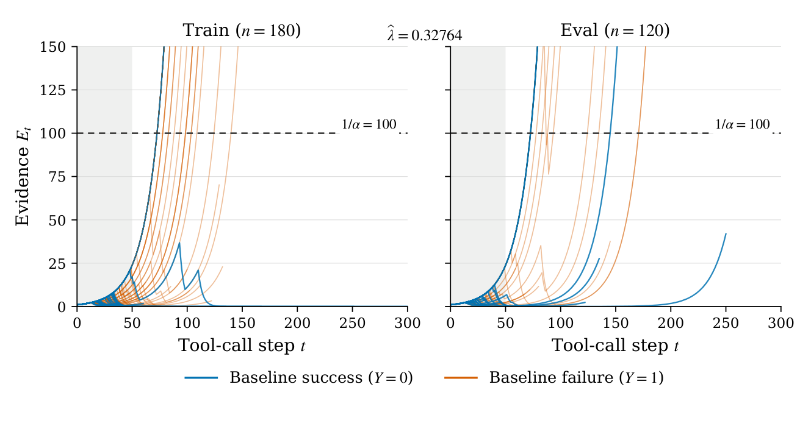查看原图 ↗</a>

*每条轨迹随工具调用积累证据，虚线表示触发提前停止的阈值。*

<h2 class="daily-paper-title" id="paper-arxiv-2611.17632">生成回归测试时，先问有多少用例会碰到故障</h2>

[Generated Evaluation Suites as Diversity-Driven Search for Real Agent Regressions](https://arxiv.org/abs/2611.17632)  
Pulkit Yadav · arXiv · 2026-11-13

一次工具移除只会影响原本需要调用它的任务。如果整套测试很少走到这里，整体通过率的变化就会被稀释。作者在 τ²-bench 中注入七种受控缺陷，把未修改智能体的轨迹与变异运行配对，并按会触及相关行为的用例分别计分。航空场景的一组 50 个任务里，仅 7 个用到被移除工具；这个子集出现明显退化，全套通过率的点估计却朝相反方向移动。零售场景里，强制升级人工服务又能在指定轨迹覆盖为零时改变行为。覆盖率决定怎样解释检出与漏检，但一种事件标签不能概括所有故障。

<h2 class="daily-paper-title" id="paper-arxiv-2611.18392">VelServe 按解码尾延迟决定每轮能塞入多少预填充</h2>

[VelServe: Taming Decode Jitters in LLM Inference with Tail-Calibrated Scheduling](https://arxiv.org/abs/2611.18392)  
Ishaan Datta, Alind Khare, Koushik Kumar Dey, Ratnesh Jamidar, Anand Kumar Singh · arXiv · 2026-11-13

一次迭代多带一段 prefill，可以缩短新请求的排队，却也可能让整个 decode batch 同时晚交一个 token。VelServe 用迭代耗时的实测尾部为每步预留余量，再优先处理较短的等待提示。在首 token 时限随提示长度增长时，较长请求有更多等待空间。分离部署下，系统还控制新请求进入 decode 的间隔，限制同一请求经历的慢步骤数。在作者的聚合服务实验中，Qwen3-8B 和 DeepSeek-V4-Flash 满足 SLO 的有效吞吐为最强对照的 2.4–2.9 倍。持续高负载下仍有长提示超时，衡量收益要同时看首 token 和后续 token 的时限。

<a class="note-image-link" href="/assets/images/digest/2026-11-17/arxiv-2611.18392.png" target="_blank" rel="noopener" aria-label="前台规划器按预算组织迭代，后台校准器用迭代记录更新预算。 查看原图 ↗">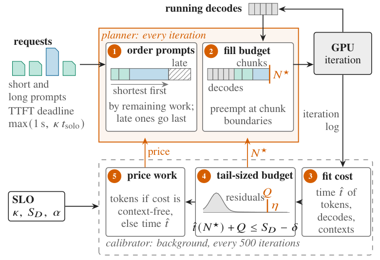查看原图 ↗</a>

*前台规划器按预算组织迭代，后台校准器用迭代记录更新预算。*

<h2 class="daily-paper-title" id="paper-arxiv-2611.17824">TailGuard 按训练阶段选择存储路径</h2>

[TailGuard-GDS: Tail-Safe Control of GPU Storage Data Movement](https://arxiv.org/abs/2611.17824)  
Jiaqi Liu, Fan Yang, Xiaohang Shi, Xianzhe Zhang, Tao Jiang, Guojun Yuan, Zhan Wang, Guangming Tan · arXiv · 2026-11-13

从 NVMe 直接送入 GPU 可以省一次主机中转，但训练实际等待的是各阶段数据就绪的尾延迟。TailGuard 保持同一读写语义，联合比较传输后端、请求切分和放置方式，再按阶段选计划；条件变化时重新评估，复用已准备好的资源以降低切换成本。八卡 ZeRO-3 的五种工作负载中，相比固定主机中转，step p95 降低 7.9%–24.6%，相比固定 GDS 降低 28.4%–42.6%。与调优过的 DeepSpeed AIO 对比降幅为 5.6%。这些对照说明，收益既取决于是否绕过主机，也取决于基线有没有调过 I/O 形状。

<a class="note-image-link" href="/assets/images/digest/2026-11-17/arxiv-2611.17824.png" target="_blank" rel="noopener" aria-label="同一操作和请求大小下比较直接与主机中转路径，不同面板对应不同并发条件。 查看原图 ↗">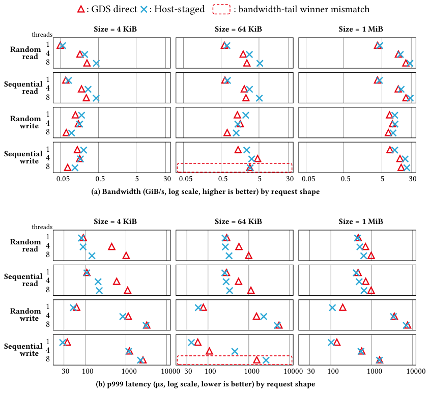查看原图 ↗</a>

*同一操作和请求大小下比较直接与主机中转路径，不同面板对应不同并发条件。*

<h2 class="daily-paper-title" id="paper-arxiv-2611.17857">Fuse-All MoE 让专家负载变化时仍能直接写回</h2>

[Fuse-All MoE Inference Kernel with Load Balancing on TPUs](https://arxiv.org/abs/2611.17857)  
Rupeng Liu, Bangsheng Tang, Zongwei Zhou, Chengji Yao, Yejin Lee · arXiv · 2026-11-13

在 TPU7x 上，路由偏斜会让少数专家拖住整轮。内核把收集输入、专家投影、门控激活和写回融合，中间张量留在片上。每个路由结果有固定的 token 与槽位目的地，专家执行顺序、放置位置可以变化而无需重新定义合并结果。八颗芯片上的 EP16 prefill 实测中，偏斜负载耗时从同一均衡参考值的 2.3 倍降至 1.09 倍。解码改用 EP8TP2，让同芯片两个 TensorCore 分担专家工作，在 32–512 个 token 下内核延迟最多降低 21.3%。服务吞吐最多提升 34.5% 的结果还包含其他服务栈优化。

<a class="note-image-link" href="/assets/images/digest/2026-11-17/arxiv-2611.17857.png" target="_blank" rel="noopener" aria-label="融合边界包住专家计算的中间张量，最终结果直接写入对应槽位。 查看原图 ↗">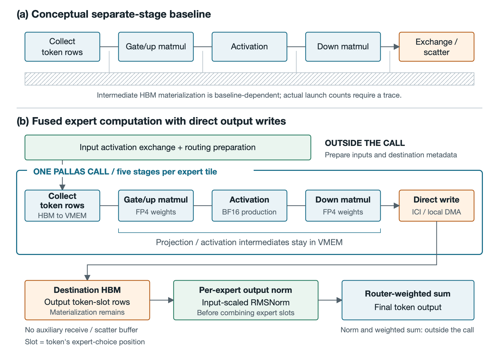查看原图 ↗</a>

*融合边界包住专家计算的中间张量，最终结果直接写入对应槽位。*

<h2 class="daily-paper-title" id="paper-arxiv-2611.18075">Zero-SM NCCL 用额外启动代价换回计算资源</h2>

[Zero-SM NCCL: A Systematic Guide to Designing and Deploying SM-Free GPU Communication](https://arxiv.org/abs/2611.18075)  
Zhenhao He, Siyuan Shen, Ke Wen, Prajwal Singhania, Shiqing Fan, Youngeun Kwon, Sangkug Lym, Vasudevan Rengasamy, Vishnuswaroop Ramesh, Yicheng Qiang, Craig Belusar, Jeff Hammond, Torsten Hoefler · arXiv · 2026-11-13

通信与矩阵乘法同时运行时，常规 NCCL 内核也要占用流式多处理器（SM）。作者用有序的流内存操作同步，节点内让复制引擎搬运数据，跨节点则让 CPU 代理按流顺序推进 RDMA。在 GB200 NVL72 和 B200 NVL8 的实验中，重叠 GEMM 的中位减速从 33% 降到 4%，但单次通信延迟更高。Megatron-LM 中，FSDP 最多提速 3.5%，流水线并行的单边 put 最多提速 15%。因此选择通信路径时，消息大小、CPU 是否已成瓶颈，以及可重叠的计算量，都比孤立的峰值带宽更有解释力。

<a class="note-image-link" href="/assets/images/digest/2026-11-17/arxiv-2611.18075.png" target="_blank" rel="noopener" aria-label="无 SM 路径通过流同步、复制引擎和 CPU 代理实现部分通信原语。 查看原图 ↗">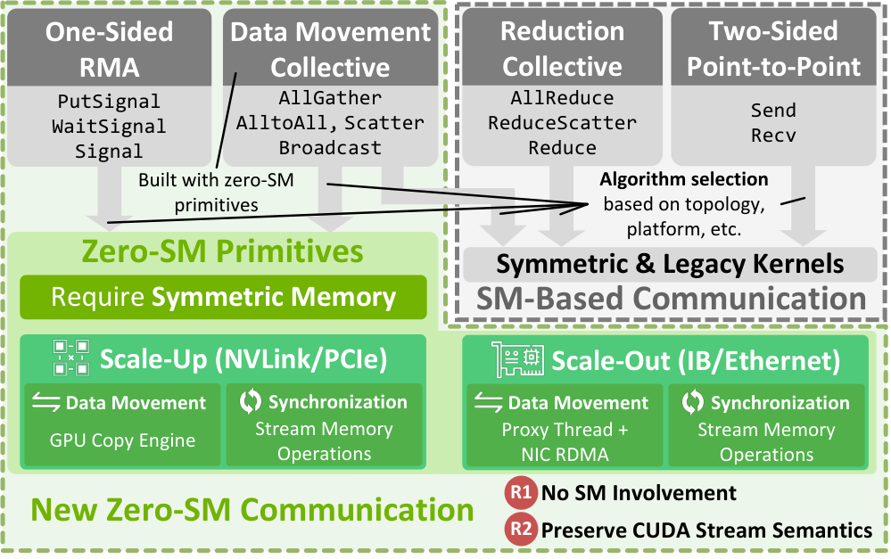查看原图 ↗</a>

*无 SM 路径通过流同步、复制引擎和 CPU 代理实现部分通信原语。*

<h2 class="daily-paper-title" id="paper-arxiv-2611.18145">Obaleth 把通信缓冲区的生命周期交给编译器</h2>

[Compiling Specialized GPU-Initiated Networking](https://arxiv.org/abs/2611.18145)  
Javid Baydamirli, Ismayil Ismayilov, Kaan Oktay, Didem Unat · arXiv · 2026-11-13

GPU 发起网络传输时，库调用隐藏了编译器最需要的信息：缓冲区何时会被下一次计算读写，哪些传输必须等待完成。Obaleth 把通信表示为内核中间表示里的操作，结合缓冲区生命周期安排完成通知，并针对传输后端合并同步和批处理。256 GPU 上，小消息 all-to-all 相对 NVSHMEM 和 NCCL GIN 分别快 1.25 倍和 2.3 倍。在 16 张 B200 的 vLLM 实验中，Qwen3-235B 请求相对 DeepEP 快 1.15–1.29 倍。与 Zero-SM NCCL 的资源卸载不同，这里的收益来自编译器看到单个内核的通信与计算依赖。

<a class="note-image-link" href="/assets/images/digest/2026-11-17/arxiv-2611.18145.png" target="_blank" rel="noopener" aria-label="从数据流到队列命令，每层中间表示都暴露出不同的传输优化机会。 查看原图 ↗">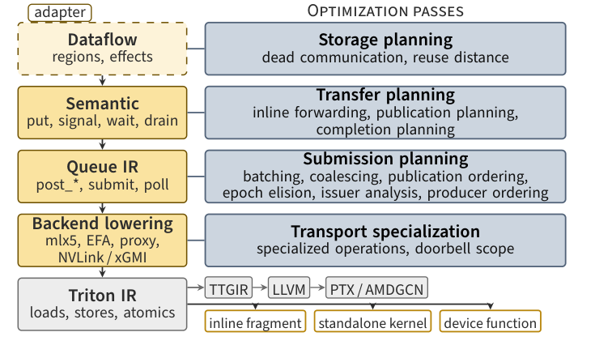查看原图 ↗</a>

*从数据流到队列命令，每层中间表示都暴露出不同的传输优化机会。*

<h2 class="daily-paper-title" id="paper-arxiv-2611.17924">TIDE 在长尾采样结束前启动部分训练</h2>

[TIDE: Reclaiming Lost Performance In On-Policy Reinforcement Learning](https://arxiv.org/abs/2611.17924)  
Mathew Jacob, Morgan Borjigin-Wang, Kan Zhu, Po Hao Chen, Yi Pan, Andy Ruan, Nayani Modugula, Ethan Lavi, Luis Ceze, Malte Schwarzkopf, Akshay Narayan, Deepti Raghavan, Stephanie Wang · arXiv · 2026-11-13

同步 on-policy 训练中，最慢的一批 rollout 还在生成时，已经跑完的推理卡可能空等。TIDE 把剩余请求迁往更少的推理引擎，提高解码批密度，并让腾出的 GPU 先处理已完成样本的训练工作。最终参数更新仍遵守同一策略批次的边界。迁移本身也要付出状态搬运成本，所以系统按当前负载决定何时合并，而非每轮固定迁移。作者在共置部署对照上报告端到端最多 1.36 倍提速。可回收的空闲时间取决于 rollout 长度分布和剩余引擎容量。

<a class="note-image-link" href="/assets/images/digest/2026-11-17/arxiv-2611.17924.png" target="_blank" rel="noopener" aria-label="路由器集中剩余采样请求，腾出的 GPU 从推理池转到训练池。 查看原图 ↗">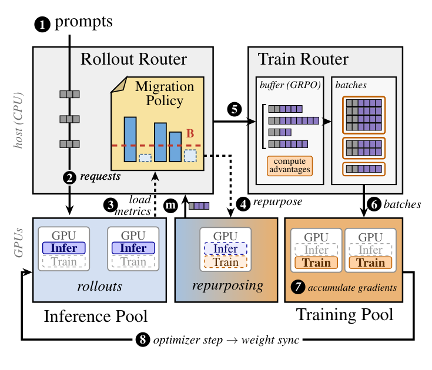查看原图 ↗</a>

*路由器集中剩余采样请求，腾出的 GPU 从推理池转到训练池。*

<h2 class="daily-paper-title" id="paper-arxiv-2611.18533">ModHarness-RL 同时调整历史压缩和行为引导</h2>

[ModHarness-RL: Recasting Harnesses as Learnable and Evolving Programs for Agentic RL](https://arxiv.org/abs/2611.18533)  
Zelin He, Siyu Zhu, Jacob Helwig, Yujian Liu, Li An, Rohit Jain, Shiyu Chang, Alborz Geramifard · arXiv · 2026-11-13

强化学习更新了模型，固定的上下文管理规则却可能一直在纠正旧错误。ModHarness-RL 把控制层拆成两个可执行程序：一个决定历史中保留什么，一个在重复调用等偏离迹象出现时给出提示。训练过程中根据近期轨迹提出候选程序，经过执行检查，再在既有轨迹上回放比较。CodeSearch 的 Qwen3-8B 实验中，单加压缩使上下文受限时的综合定位 F1 从 0.333 升到 0.359，上下文充足时从 0.403 到 0.418。对比两种预算就能看到，压缩的收益与原先丢失多少有效上下文有关。

<a class="note-image-link" href="/assets/images/digest/2026-11-17/arxiv-2611.18533.png" target="_blank" rel="noopener" aria-label="同一份轨迹经过压缩程序后进入上下文，引导程序在重复动作出现时补充建议。 查看原图 ↗">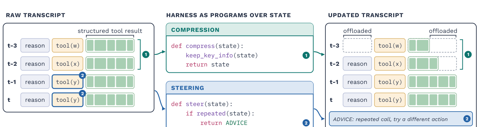查看原图 ↗</a>

*同一份轨迹经过压缩程序后进入上下文，引导程序在重复动作出现时补充建议。*

<h2 class="daily-paper-title" id="paper-arxiv-2611.17696">Co-Sight 把长流程的验收条件放到模型之外</h2>

[Co-Sight Harness: Externalized Control Assets and Deterministic Enforcement for Long-Horizon Business Agents](https://arxiv.org/abs/2611.17696)  
Luyao Wang, Xijun Zhu, Zhaohui Hao, Xiwen Zhang, Xingyu Wen, Weishan Li, Yuyang Liao, Yanqin Gao, Yongsheng Du, Lingjun Huang, Shaowei Zhao, Gang Li, Qifan Yu, Baoli Wang · arXiv · 2026-11-13

几百步的业务任务中，模型遗漏前序凭证仍可能写出看似完整的报告。Co-Sight 将工作流、状态和领域知识保存为有版本的资产，由状态机执行验收门槛，并让独立审计器评估轨迹。修改这些资产需要回归检查和人工批准。在 Domain A 的 120 例部署评估中，无人值守完成率从 50% 增至 100%，端到端耗时从 440 分钟降到 159 分钟。论文另用受控消融拆解执行约束与知识供应，两组数据来源不同。这一结果说明明确门槛可支撑已建模的长流程，换领域仍要定义状态和验收证据。

<a class="note-image-link" href="/assets/images/digest/2026-11-17/arxiv-2611.17696.png" target="_blank" rel="noopener" aria-label="工作流、执行、知识资产和证据分别进入编译、运行和审计过程，变更需经过回归检查。 查看原图 ↗">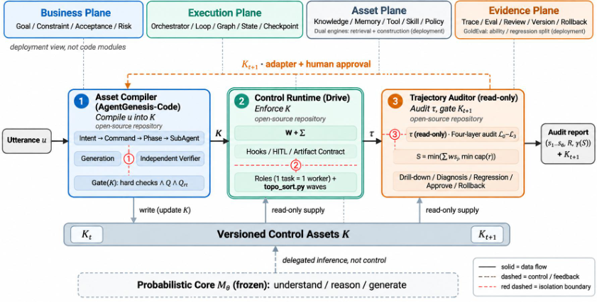查看原图 ↗</a>

*工作流、执行、知识资产和证据分别进入编译、运行和审计过程，变更需经过回归检查。*

<h2 class="daily-paper-title" id="paper-arxiv-2611.17880">Soteria 让已验证的计划也参与运行时纠偏</h2>

[Soteria: Formally Verified Planning with Runtime Enforcement for Safe LLM Agents](https://arxiv.org/abs/2611.17880)  
Mike He, Ankush Desai, Sharad Malik, Aarti Gupta · arXiv · 2026-11-13

工具动作被拒绝之后，智能体常常知道不能做什么，却不知道怎样继续完成任务。Soteria 先把任务分解成带分支的结构化计划，在首次工具调用前按形式规约检查，再让执行器根据实际观察逐步收窄合法分支。计划因而既可阻止不满足条件的动作，也能提供下一步的方向。多个工具使用基准上，作者报告平均任务成功率约为最佳基线的 1.7 倍，实验中未观察到违反所给规约的行为。前提是目标政策已经准确形式化；遗漏的业务规则不会因为计划通过了检查而自动获得保障。

<a class="note-image-link" href="/assets/images/digest/2026-11-17/arxiv-2611.17880.png" target="_blank" rel="noopener" aria-label="左侧把领域规约编译为可检查约束，右侧把已验证的计划接到运行时执行器。 查看原图 ↗">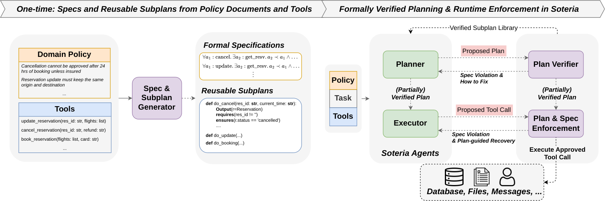查看原图 ↗</a>

*左侧把领域规约编译为可检查约束，右侧把已验证的计划接到运行时执行器。*

<h2 class="daily-paper-title" id="paper-arxiv-2611.17621">AscendGYM 给内核提速记上搜索成本</h2>

[AscendGYM: A Cost-Aware Kernel Optimization Benchmark for Real-World Workloads on Ascend NPUs](https://arxiv.org/abs/2611.17621)  
AI Training Platform Team, Bingwei Zhang, Jing Li, Amir Abdullin, Sihang Chen, Xin Chen, Liangjun Feng, Yingmeng Gao, Tao Guo, Junjie Huang, Dongfang Li, Zhanglian Lin, Jiajun Liu, Zekun Liu, Zhengxuan Lu, Xiaodong Luo, Jian Meng, Ivan Nosov, Linyuan Qiu, Weijian Sun, Wanrui Yan, Binfan Zheng, Zhicheng Zhou, Baotian Hu, Min Zhang, Haizhou Li, Zhiquan Luo · arXiv · 2026-11-13

两个智能体都能产出较快内核，但一个靠几次修改，另一个可能耗费数千万 token。AscendGYM 用真实工作负载的形状和数据类型组织 48 个任务，在 Ascend 910C 上编译、验证和计时，保留通过正确性检查的候选。模型可用统一搜索流程，也可以连同自己的 harness 一起评估。Speedup-Token Score 将所得加速与 token 成本联系起来。论文提醒，相同的保留加速值可能分别代表「正确但没更快」和「没有正确候选」，解读预算曲线时还要一起看通过率。

<a class="note-image-link" href="/assets/images/digest/2026-11-17/arxiv-2611.17621.png" target="_blank" rel="noopener" aria-label="资源调度、内核执行与验证反馈组成 AscendForge 的评测环境。 查看原图 ↗">查看原图 ↗</a>

*资源调度、内核执行与验证反馈组成 AscendForge 的评测环境。*

<h2 class="daily-paper-title" id="paper-arxiv-2611.18030">PerfArena 测量正确程序之间的性能差距</h2>

[PerfArena: Ranking LLMs by Code Performance](https://arxiv.org/abs/2611.18030)  
Rui Rua, Hailemariam Mersha, Joao Paulo Fernandes, Karim Ali · arXiv · 2026-11-13

同一道题通过所有测试后，模型生成的程序在运行时间、峰值内存和能耗上仍可能差异很大。PerfArena 分别采用 10 个计算密集型基准和 99 道正确解之间存在可测延迟差异的 LeetCode 题，在统一主机上测量正确解，使用 RAPL 获取能耗，并检查预热对测量的影响。论文版本包含 13 个模型、7 种语言的 9,455 个正确实测解。这个设计适合问「在同一语言和资源指标下，哪个模型更常给出高效解」；将这些数字外推到其他硬件或不易拉开性能差距的程序，需要重新测量。

<a class="note-image-link" href="/assets/images/digest/2026-11-17/arxiv-2611.18030.png" target="_blank" rel="noopener" aria-label="提交经过正确性检查后才能接受性能测量，结果存入同一数据库。 查看原图 ↗">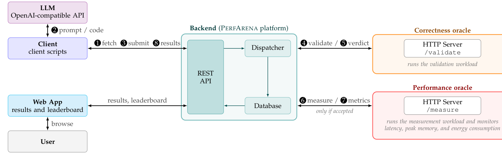查看原图 ↗</a>

*提交经过正确性检查后才能接受性能测量，结果存入同一数据库。*

<h2 class="daily-paper-title" id="paper-arxiv-2611.17955">WebArena-Pro 把音视频和跨站操作纳入可重放任务</h2>

[WebArena-Pro: A Heterogeneous, Multimodal, Reproducible Benchmark for Web Agents](https://arxiv.org/abs/2611.17955)  
Imene Kerboua, Fatemeh Pesaran Zadeh, Xing Han Lù, Weijian Qi, Alexander Miller, Junyi Song, Yunjia Tian, Dongjin Kang, Seyeon Choi, Marzia Nouri, Ewen Gueguen, Matteo Boglioni, Fengyuan Liu, Zeyi Liao, Mengqi Yuan, Yue Li, Alexandre Lacoste, Alexandre Drouin, Spandana Gella, Huan Sun, Gunhee Kim, Siva Reddy · arXiv · 2026-11-13

网页应用的状态会被前一次操作改变，音视频内容又很难仅凭 DOM 验证。WebArena-Pro 采用 20 个自托管应用和有种子数据的隔离环境，为听取音频、查看视频设置专用动作，并结合任务状态与评分规则判定结果。300 项任务中有 79 项涉及音频或视频。50 步预算下，最佳两组配置均达到 62.3% 成功率。这个分数同时反映模型、动作接口和代理框架的能力；比较媒体工具消融比单看总分更能解释能力差异来自哪里。

<a class="note-image-link" href="/assets/images/digest/2026-11-17/arxiv-2611.17955.png" target="_blank" rel="noopener" aria-label="上半部列出应用领域，下半部展示网页、音视频观察和智能体可用动作。 查看原图 ↗">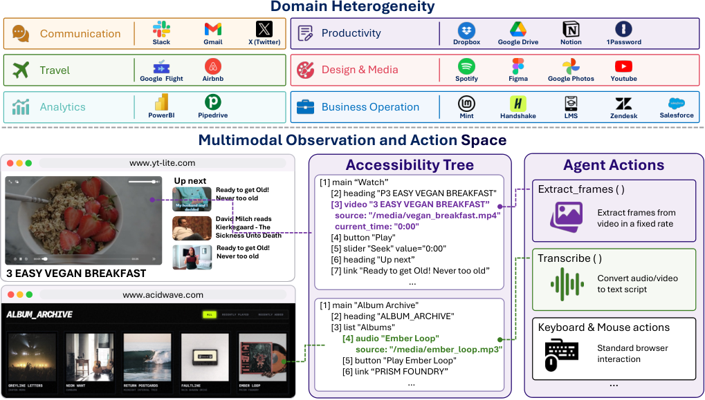查看原图 ↗</a>

*上半部列出应用领域，下半部展示网页、音视频观察和智能体可用动作。*

<h2 class="daily-paper-title" id="paper-arxiv-2611.18036">R2C2 为 C 到 Rust 的翻译生成可检查的精化证明</h2>

[C-to-Rust Translation Validation at the LLVM IR Level via AI-Assisted Refinement Proof](https://arxiv.org/abs/2611.18036)  
Eunsu Kim, Sukyoung Ryu, Jaemin Hong · arXiv · 2026-11-13

逐个测试输入很难覆盖翻译后所有执行，尤其当 C 与 Rust 使用不同的数据表示时。R2C2 将两端编译到 LLVM IR，用共同抽象连接表示差异，让智能体构造程序特定的证明，再由 Rocq 检查。在 519 个已有翻译基准程序中，486 个翻译获得无需限制执行长度的证明，另有 3 个发现反例。未取得证明本身不能判定翻译错误。对编码智能体的启发是把「提出验证论证」和「决定论证是否成立」交给不同组件，其覆盖范围仍取决于支持的语义与抽象。

<a class="note-image-link" href="/assets/images/digest/2026-11-17/arxiv-2611.18036.png" target="_blank" rel="noopener" aria-label="智能体构造规约与证明，证明助手负责检查推导是否成立。 查看原图 ↗">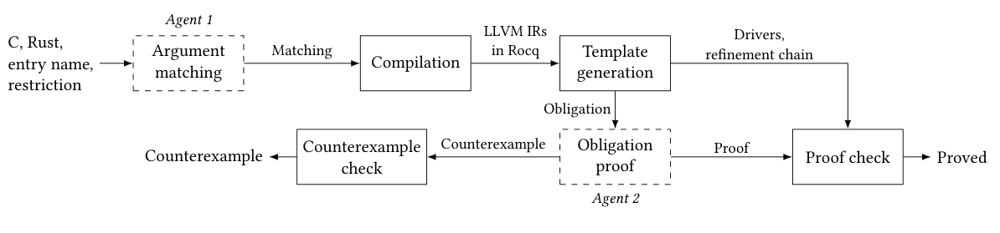查看原图 ↗</a>

*智能体构造规约与证明，证明助手负责检查推导是否成立。*

<h2 class="daily-paper-title" id="paper-arxiv-2611.18064">A³ 在链路恶化时启动设备端语音后备路径</h2>

[A³: Adaptive Audio Agent Framework for Collaborative Edge Computing](https://arxiv.org/abs/2611.18064)  
Zexin Li, Xueyi Zhang, Tao Ren, Yiming Chen · arXiv · 2026-11-13

边缘服务器能缩短语音任务耗时，但链路断开会使设备等不到整段回复。A³ 以完整流水线阶段为放置单位，让有足够内存的设备保留本地识别、语言模型和语音合成能力。服务器先开始，链路感知的截止时间决定何时启动本地副本，先完成的一路交付结果。Jetson 与 RTX A4500 测试中，健康链路下延迟接近纯服务器方案，完全断连时 AGX 仍回答了所有请求。最小的 Orin Nano 上三项服务分别测量的内存合计达 7.1 GB，后备能力因此高度依赖设备规格；与百分位对冲的断网分布比较来自模拟。

<a class="note-image-link" href="/assets/images/digest/2026-11-17/arxiv-2611.18064.png" target="_blank" rel="noopener" aria-label="服务器先启动，链路监测决定何时启动本地路径，先完成的答复胜出。 查看原图 ↗">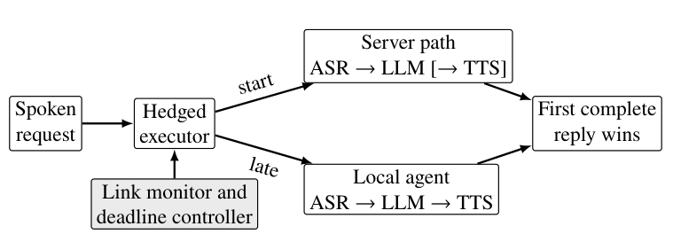查看原图 ↗</a>

*服务器先启动，链路监测决定何时启动本地路径，先完成的答复胜出。*

## 同日技术笔记

- [Microsoft 365 网关故障中，流量改道为何加快了级联失效](/tech/zh/microsoft-365-pre-pir-2026-11-12-gateway-outage/)
- [读懂 MLPerf 端点成绩里的每千瓦吞吐](/tech/zh/nvidia-vera-rubin-nvl72-mlperf-endpoints-v1-0/)
- [Cloudflare 如何把延迟到达的用量变成边缘支出上限](/tech/zh/cloudflare-spend-management-metering-pipeline/)
- [三个 CUDA 编程会话里的性能诊断与资源隔离](/tech/zh/x-elliotarledge-qwen4-max-kernelbench-cuda/)
- [Qwen4-Max 把长历史分成可压缩状态和可检索片段](/tech/zh/qwen4-max/)
