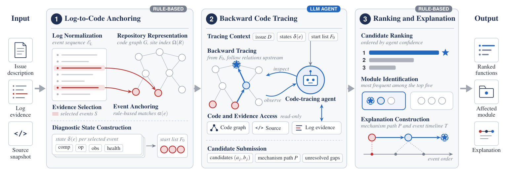
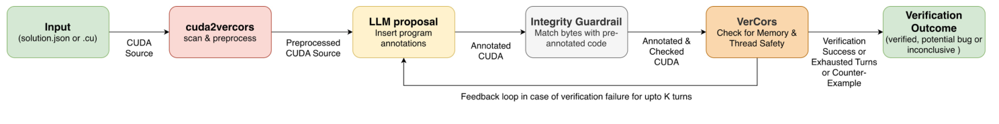
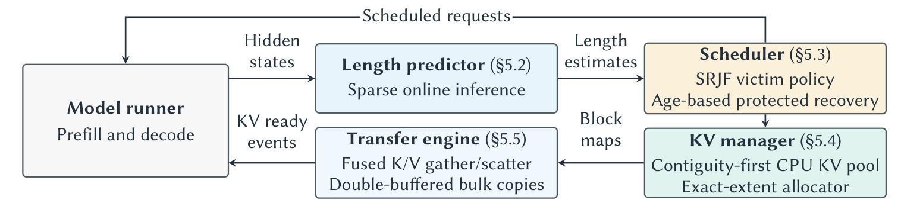

本期最值得连起来看的，是安全、证据和进展三种不同的保证。KernelArmor 把 CUDA 安全验证接入优化回路；CLEW 将日志线索接到候选根因代码，同时暴露排名与因果解释之间的距离；Stint 则处理请求反复恢复却不产生新输出的 KV 抖动。它们共同提醒我们：输出正确、进程存活或工具返回成功，都不足以概括系统可靠性。

其他研究沿两条线展开：一条改进低精度、存储、并行和能耗，但收益受负载与资源边界约束；另一条改进 agent 的环境、监督和形式化反馈，尤其重视“真正完成了什么”。阅读时应将阶段加速与端到端收益、可编译与语义忠实、缓存恢复与用户进展分别衡量。

<h2 class="daily-paper-title" id="paper-arxiv-2611.19448">01 · CLEW：从报错位置追到候选根因</h2>

[CLEW: Log-Anchored Backward Tracing for Root-Cause Code Localization](https://arxiv.org/abs/2611.19448)  
Bai, Wenji, Waseem, Muhammad, Peltonen, Jaakko, Abrahamsson, Pekka · 2026-11-14

生产故障留下的往往是 issue、日志片段和部署代码，而不是可重放的失败测试。日志对应的函数也可能只是最后发现异常的地方。CLEW 把这个落差明确建模：先建立日志与代码之间可检查的联系，再让智能体从症状函数向上游探索，最终给出函数排名、受影响模块和带事件线索的机制路径。对于 AIOps，它的价值是把“看起来像根因”的回答变成可以逐步检查的代码调查入口。

第一步主要靠规则。系统为源码建立日志语句、异常抛出点、函数位置索引及静态代码图，再按堆栈、文件行号、消息模板等信息匹配日志。一个事件可以保留多个锚点，匹配分数表示规则特异性，并非校准后的因果概率。筛出的事件被组织为组件、操作、观测和健康状态；未知字段保持未知。健康状态只描述该条观测是否异常，不能直接充当根因标签。

<a class="note-image-link" href="/assets/images/digest/2026-11-18/clew.png" target="_blank" rel="noopener" aria-label="日志规则先建立锚点，智能体再检查上游代码，输出保留证据链接。 · 查看原图 ↗">查看原图 ↗</a>

*日志规则先建立锚点，智能体再检查上游代码，输出保留证据链接。*

随后，智能体获得 issue、诊断状态和初始函数列表，使用只读工具检查函数体、调用者、属性引用与重写关系。静态图无法解析的动态分派，还可以通过源码检查补充；无法解释的缺口也随候选提交。最后的排序依赖智能体置信度，事件时间线帮助读者回到原始日志。这里的“向后追踪”是一种调查方向，不是完整的数据流分析，更不是已经证明的因果链。

LogLoc 将两种证据分开：150 个真实 issue 来自 25 个 Python 仓库，以修复提交改动的非测试函数作为定位代理标签；42 个 Airflow 故障注入案例则有已知注入函数。CLEW 在前者的 Acc@1 为 77.3%，LocAgent 为 72.0%，差异未达到统计显著；Recall@5 反而低于 LocAgent。Airflow 上，CLEW 与两个领先基线同为 97.6%。把这两组混成一个“生产根因准确率”会掩盖标签性质和难度差异。

效率结果更直接：192 个案例平均耗时约 60 秒，对比 LocAgent 的 219 秒，约减少 73%；平均推理成本为 0.157 美元与 0.154 美元，基本相当。不同数据集的成本方向不一样，不能把更快同时解释为普遍更便宜。

最值得读的是消融和讨论。去掉追踪智能体会明显退化，但去掉结构化锚定并未产生一致的准确率损失。因此，现有结果支持“锚定让线索显式且可追溯”，尚不足以支持“锚定本身稳定提高定位精度”。解释只做了结构一致性检查，未验证真实因果正确性或工程师排障时间收益。它适合作为日志到代码的调查组织方式，也提示后续评测应把排名、证据忠实度和实际诊断帮助分开衡量。

<h2 class="daily-paper-title" id="paper-arxiv-2611.18754">02 · KernelArmor：把安全证明放进 CUDA 优化回路</h2>

[KernelArmor: End-to-End Agentic System for Establishing Memory and Thread Safety for CUDA](https://arxiv.org/abs/2611.18754)  
Chatterjee, Bodhisatwa, Zaid, Mohamed Tarek Ibn, Damani, Sana, Hari, Siva Kumar Sastry, Kozyrakis, Christos · 2026-11-11

一个 CUDA kernel 在基准输入上得到正确输出，并不说明它对调用者接受的所有尺寸、偏移和并发情况都安全。KernelArmor 针对的是这种测试覆盖与真实接口之间的空隙：LLM 负责提出契约和注解，扩展后的 VerCors 负责检查内存与线程安全，验证失败再回到智能体修订。它不是让模型凭文字审查给程序盖章，而是把可检查的安全义务接入优化决策。

具体流程从确定性的 CUDA 前端开始。它识别不支持的结构、规范化语法，并把支持的低层操作转换成带显式安全契约的调用。智能体结合可用的主机代码和启动参数生成前后置条件、循环不变量及权限注解。完整性检查随后去除注解，要求剩下的程序与预处理基线逐字节一致，防止通过悄悄改程序来“完成证明”。验证反馈指出失败义务及源码位置，系统在有界轮数内修补注解。

<a class="note-image-link" href="/assets/images/digest/2026-11-18/kernelarmor.png" target="_blank" rel="noopener" aria-label="完整性检查保护原程序，验证器反馈驱动注解修订，结果区分已证明、潜在缺陷与无结论。 · 查看原图 ↗">查看原图 ↗</a>

*完整性检查保护原程序，验证器反馈驱动注解修订，结果区分已证明、潜在缺陷与无结论。*

这套工作的技术增量在 CUDA 建模。异步拷贝占用的权限直到相应完成事件才释放，错误的等待不能授权重用缓冲区；warp 同步只能在指定参与线程之间转移权限；宽向量访问仍须满足完整元素范围与对齐要求。类型转换也必须保留字节偏移语义。例如，先做 32 位乘法再转 64 位，无法挽救已经发生的溢出。这些都是“正常尺寸跑通”容易漏掉的条件。

三个语料共有 740 个实例、1,370 个 kernel 定义。系统对 84 个实例建立安全证明，对 582 个报告潜在缺陷，74 个无结论；对应 11.4%、78.6% 与 10%。这是所选实现语料中的验证分类，不是线上故障发生率。竞态基准也要读分母：范围内的 14 个竞态全部检测到，另外 9 个涉及跨流、CPU–GPU 或多 GPU 交互，超出当前范围，所以不能写成覆盖所有 CUDA 竞态。

更有工程意义的实验把验证放入生成回路：11 个 KernelBench 任务各做 7 条独立轨迹，每条最多 8 轮、6 小时，在 A40 上测量。新候选先通过数值检查并优于当前最好实现，再进入安全验证，只有证明通过才接纳。77 条轨迹最终都有已验证 kernel，几何平均加速保留无约束回路的 99%。如果只在优化结束后筛掉未验证结果，可留下实现的轨迹少得多，说明反馈参与下一次修改很关键。

代价和保证边界同样重要。验证会消耗时间，也会拒绝暂时无法证明的快速候选；“无结论”不等于“有 bug”。安全性仍依赖显式前置条件、受支持的 CUDA 模型和外部库契约，并不自动证明数值语义等价。对 AgentOps，最可迁移的设计是将潜在缺陷、证明未完成与不支持结构分成不同反馈，避免一个失败状态把优化方向带偏。

<h2 class="daily-paper-title" id="paper-arxiv-2611.20106">03 · Stint：恢复 KV 之后，还要保证请求向前走</h2>

[Making Preemption Productive in Long-Output LLM Serving](https://arxiv.org/abs/2611.20106)  
Shi, Ziji, Wan, Xinyi, Ruan, Chaoyi, Huang, Guangxing, Lin, Min, Li, Jialin · 2026-11-15

长输出请求的 KV cache 持续占据显存，容量耗尽时系统只能抢占部分请求。问题不止是重算或搬运花了多久：一个请求可能反复失去状态、恢复状态，再次被抢占，却几乎不产生新 token。Stint 将这种现象称为 KV thrashing。它把优化目标从“更快恢复缓存”推进到“恢复后真正取得进展”，直接对应推理服务仍存活但用户长时间看不到输出的亚健康状态。

调度首先估计剩余输出长度，优先让接近完成的请求留在 GPU。预测使用解码过程中已有的隐藏状态，并稀疏刷新，减少额外调用成本。若候选缺少可用预测，就回退到释放物理 KV 块最多的策略。被抢占请求如果能分到 CPU 存储，就保存当前完整快照；分配失败则退回重算，系统并不承诺无限缓存。

<a class="note-image-link" href="/assets/images/digest/2026-11-18/stint.png" target="_blank" rel="noopener" aria-label="预测器参与选择被抢占请求，缓存池与传输引擎负责恢复，调度器保护新输出。 · 查看原图 ↗">查看原图 ↗</a>

*预测器参与选择被抢占请求，缓存池与传输引擎负责恢复，调度器保护新输出。*

存储设计利用“暂停后快照不再增长”的性质。CPU 池优先给出一段精确大小的连续区域，不够时使用少量区段，避免固定大页填充浪费。GPU 上分散的 K/V 块先由融合 kernel 聚集到暂存区，再批量 DMA；恢复反向执行。双缓冲让一块的数据复制与另一块的聚集或散布重叠，CUDA 事件约束缓冲区重用和计算依赖。它减少搬运开销，但不会把所有传输都隐藏在计算后面。

更关键的是恢复调度。请求从首次抢占开始累计停顿年龄，重载或重算旧状态不会清零，直到产生新 token 才清零。实验配置中，停顿达到 5 秒获得重新接纳资格；每个副本一次保护一个请求，在恢复状态后让它生成 64 个新 token 或提前完成，期间不再被抢占。5 秒是资格阈值，并非等待时间上界；64 个 token 也不能由重算的旧上下文凑数。

主实验用八张 H200，以四个 TP2 副本服务 BF16 Qwen3-32B，按每秒 4 个请求回放奥数工作负载。相对同一维护版引擎中的重算基线，Stint 的 p99 TPOT 降低 50.69%，吞吐提高 11.99%，整批约提前 10.7% 完成；观察到的请求停顿均未超过 50 秒。固定输出长度保证比较执行相同输出工作量，但不是答案质量评测，也不意味着不同调度产生逐 token 相同文本。

这个结果不能简化为无代价的尾延迟优化。CPU 锁页内存和 GPU 暂存区要占资源，恢复保护可能让其他请求等待；其他工作负载的吞吐收益也小得多。预测器部分训练问题进入主回放，作者另给出训练集外子集分析。值得优先读其恢复状态机、资源核算和跨负载结果：真正的新意是让缓存保留、数据搬运与调度保护共同服务于新输出，而不是只把交换机制做得更快。

## 系统与智能体研究动态

<h2 class="daily-paper-title" id="paper-arxiv-2611.19230">04 · CompoundingKernel：有效测量速率决定搜索规模</h2>

[CompoundingKernel: Self-Improving from Zero to First](https://arxiv.org/abs/2611.19230)  
Qu, Qian, Wang, Hongyang, Chen, Wenbo, Li, Yichuan, Liu, Jingguo, Li, Xian, Wang, Xuan, Wen, Ruochen, Fan, Leo, Yan, Yiming, Wang, Zheshen, Dumoulin, Benoit · 2026-11-14

CompoundingKernel 从 PyTorch 定义出发搜索 GPU kernel，把所有通过检查的候选及父子关系存入模型外的档案；控制器每轮重读档案，为并行子任务指定父代和一个修改方向。慢一点的正确候选仍可成为后续改进的起点，重启也不必丢掉搜索进度。

截至作者报告的 11 月 11 日，235 题都有站点验证通过的实现，209 道公开榜题相对官方参考的几何平均加速为 4.40 倍。当地 B200 时钟与官方站点不同，不能把更大的本地加速直接替代此数字。同墙钟比较中，控制器在 38 题的 35 题胜过 UCB 树，主要来自更多正确尝试，而非每次选父代更聪明。一次包含多项修正的热重启将评估速率提高 3.6 倍，不能归因于单一修复。它补充 KernelArmor：前者组织搜索与外部测试，后者提供契约范围内的安全证明。

<h2 class="daily-paper-title" id="paper-arxiv-2611.18972">05 · NVFP4-MLA：缓存与两次矩阵乘一起降到 FP4</h2>

[NVFP4-MLA: Unified FP4 KV-Cache Storage and Attention Computation for Multi-Head Latent Attention](https://arxiv.org/abs/2611.18972)  
Ni, Chao, Zhang, Qi, Wang, Xiao, Jing, Zongfei, Hao, Mingyang, Chen, Binghan, Duan, Kefeng, Chen, Yu-Jung, Wang, Mengdi, Blankevoort, Tijmen, Yang, Jun · 2026-11-13

只压缩 KV、计算时再解量化，未必能加速已经受计算限制的 MLA。NVFP4-MLA 用二维 token×channel 量化块兼容 QK 与 PV 两个不同规约方向，并对敏感通道添加 FP4 残差，让同一份缓存直接服务两次低精度矩阵乘。

DeepSeek-R1 与 Kimi-K3 的九任务平均分接近 BF16，MLA 缓存分别压缩 3.20 与 3.05 倍。Kimi 的统计不含 KDA 状态，最后两层 MLA 仍用 FP8，不能写成整个模型状态都压缩三倍。Rubin 上，相同缓存预算的 AgentX 回放显示：更高缓存命中率减少重复 prefill，DeepSeek-R1 在 48 会话时 p90 TTFT 从 108 秒降到 30.9 秒。平均分接近也不保证每项任务无损；读这篇应同时看数值误差、缓存容量和 kernel 吞吐三个层面。

<h2 class="daily-paper-title" id="paper-arxiv-2611.20095">06 · 语音服务：按当前工作量选择融合粒度</h2>

[High-Throughput Serving of Nemotron 3.5 Transcribe with Regime-Aware Megakernels and Kernel Fusion](https://arxiv.org/abs/2611.20095)  
Chatterjee, Aditya, Chauhan, Sanjay Singh, Jain, Mayank, Dhingra, Arushi, Chowdhury, Sahin, Mittal, Rahul · 2026-11-15

Nemotron 3.5 Transcribe 的连续批处理让每轮工作量变化，始终使用一个 megakernel 会在大批量时吃亏。作者离线测定交叉点，在线按编码 token 数或解码行数切换持久化 megakernel 与融合 kernel 链；例如编码路径在约 384 token、MoE 路径在约 448 行切换。

H100 SXM 上峰值为 4,345 倍实时处理速度，相对调优 vLLM 峰值为 1.39 倍；B200 上为 6,367 倍实时、相对 1.64 倍。这里“倍实时”是音频处理吞吐，不是单请求延迟倍率。400 ms 的 p95 完成时间预算下，可承载并发为基线八倍。原生主机路径、特征提取和投机解码也参与收益，不能全部归因于切换。额外的跳层等开关会增加 WER，应与主要保精度配置分开。

<h2 class="daily-paper-title" id="paper-arxiv-2611.21288">07 · GNoF：减少远程存储完成路径的 GPU 忙等</h2>

[GNoF: A Low-SM-Overhead GPU-Native NVMe-over-Fabrics Completion Path for Data-Intensive GPU Workloads](https://arxiv.org/abs/2611.21288)  
Tian, Lei, Gu, Wenhao · 2026-11-16

GPU 发起远程 I/O 后，长时间轮询完成队列仍会占住计算资源。GNoF 合并 doorbell、批量收割完成项，用单调计数器避免清标志造成的丢唤醒，并将页缓存的发起读取与等待拆开；CPU 保留建连和管理职责，数据路径面对未修改的 SPDK 目标。

200 Gb/s InfiniBand 下报告每客户端 177 万次 4KB IOPS、0.37% 主机 CPU 和约 1% SM 占用。更重要的是负载边界：出租车数据的选择性列读取相对整批载入快 10–22 倍，但大图遍历和规则写入可由批量搬运胜出；正文明确缺少应用级 BaM 对比。它的独有价值是降低完成路径资源成本及按需访问，不是证明所有存储应用都应绕过 CPU。

<h2 class="daily-paper-title" id="paper-arxiv-2611.19861">08 · HBF-EventLab：把资源生命周期放进闪存模拟</h2>

[HBF-EventLab: A Discrete-Event Simulator for Studying Host-Device Coordination in High Bandwidth Flash](https://arxiv.org/abs/2611.19861)  
Mei, Ziqing, Huang, Yiwei, Zeng, Zhiyi, Xiao, Yuhao, Pang, Pu, Chen, Quan, Zeng, Deze, Guo, Minyi · 2026-11-15

HBF-EventLab 把主机发令、命令准入、碎片写组装、读资格、NAND 执行和响应放进同一离散事件循环。不同资源在不同时间释放：命令被设备接受后，即便后来报错，credit 仍要等响应交付才归还。调度策略和这些约束分开，便于判断性能变化到底来自策略还是资源占用。

Qwen3-0.6B 集成将真实 GPU 活动时长与模拟权重访问等待相加；覆盖全部 28 层 FFN 权重的配置，模拟 TTFT 从 6.392 ms 增至 20.166 ms。张量数据仍留在 GPU，logits 逐位一致证明该接入没有改变数值路径，并不证明 HBF 设备性能。参数尚未硬件校准，也未覆盖线上到达、批处理和 KV 流量；它适合机制探索，不宜据此估算生产容量。

<h2 class="daily-paper-title" id="paper-arxiv-2512.03416">09 · TokenScale：按 token 工作速率扩缩分离服务</h2>

[TokenScale: Timely and Accurate Autoscaling for Disaggregated LLM Serving with Token Velocity](https://arxiv.org/abs/2512.03416)  
Lai, Ruiqi, Liu, Hongrui, Lu, Chengzhi, Liu, Zonghao, Cao, Siyu, Shao, Siyang, Zhang, Yixin, Mai, Luo, Ustiugov, Dmitrii · 2025-12-03

TokenScale 将 prefill、KV 传输和 decode 的处理能力统一到 Token Velocity，与输入负载比较，避免 GPU 利用率滞后或请求数量忽略长度差异。decode 指标关注请求完成后释放状态的速率，不只是正在生成多少 token；输出长度预测和模型—硬件组合的离线剖析参与容量估计。

突发期间，预留资源的 Convertible Decoder 临时处理 prefill，缓冲新实例启动的延迟，而不是任意把 prefill 塞进已满的 decode GPU。正文 NVIDIA 集群上，Llama-3.1-8B 的 SLO 达标由基线 62–88% 提升到 89–96%，平均 GPU 用量少 6–13%。收益依赖长度预测、剖析与预留策略，不能只归功于一个指标。论文首次发布于 2025-12-03，本次阅读的是 2026-11-04 修订、SoCC ’26 版本。

<h2 class="daily-paper-title" id="paper-arxiv-2611.21165">10 · 多模态降频：低功率可能换来更高总能耗</h2>

[A Matter of Stages: Energy-Latency Trade-offs in Multimodal LLM Serving](https://arxiv.org/abs/2611.21165)  
Sun, Yifan, Jiang, Jiantong, Zhang, Zhexiang, Bai, Xu, Liu, Feng, Buyya, Rajkumar, Toosi, Adel N. · 2026-11-16

在固定三张 L40S 预算下，研究比较三副本融合服务与编码、prefill、decode 各占一张卡的 EPD 分离，并逐阶段降频。核心发现是队列会传播局部减速：某阶段省下的功率，可能被更长执行时间及其他阶段等待抵消。

Qwen3-VL 的一组 Chart-to-text 负载中，统一频率从 50% 降到 40% 后，功率继续下降，但总能耗从 415.1 kJ 升至 423.5 kJ，TTFT 从 1.00 秒增至 31.69 秒。18 组负载里，80% 统一频率节能 11.7–18.6%，属于所测配置的经验范围。四次探测找到最优可行点的结论仅对 288 个有正余量的 SLO 场景成立；零余量场景仍会漏解。可迁移的是整条流水线计量，而非通用“降到 80%”配方。

<h2 class="daily-paper-title" id="paper-arxiv-2611.20289">11 · 双 DGX Spark：并行方式要连同负载一起选</h2>

[Benchmarking LLM Inference on Desktop-Scale NVIDIA Grace Blackwell Clusters](https://arxiv.org/abs/2611.20289)  
Bhimani, Kevin, Escobar, Christian, Mihovch, Daniel, Eigenmann, Rudolf, Chandrasekaran, Sunita · 2026-11-15

两台 200 GbE 连接的 GB10 上，作者用 vLLM 比较 TP2、PP2 与单机，覆盖 17 个检查点及并发 1–64。TP 分摊每层权重读取，但每层要通信；PP 只在阶段间传递状态，低并发却难以重叠两段执行。这解释了为什么“通信少”不一定让单 token 更快。

13 个完整可比检查点的峰值吞吐增益中位数为 TP2 1.59 倍、PP2 1.39 倍。模型装得下一台时，低并发偏向 TP，高并发双副本可能更好；不过双副本基线由单机结果推导，假设完美分流。输入是固定长度合成请求、关闭前缀缓存，峰值也只指测试并发内最大值。它与本期 Inferact 的长缓存 prefill 线程不冲突：硬件、缓存模式和延迟目标不同。

<h2 class="daily-paper-title" id="paper-arxiv-2611.18956">12 · Olmo-core：MoE 的容量成本与路由假象</h2>

[Supercharging Olmo-core for Efficient and Scalable MoE Training](https://arxiv.org/abs/2611.18956)  
Tao, Tianhua, Bhagia, Akshita, Groeneveld, Dirk, Walsh, Pete, Romero, Tyler, Samaga, Yashas, Morrison, Jacob, Beltagy, Iz, Anderson, Taira, Smith, Noah A., Hajishirzi, Hannaneh · 报告封面 2026-10；arXiv 首次 2026-11-13

Olmo-core 将每轮重新聚合权重的 FSDP 路径改为分区权重常驻的 DDP，并组合 EP、PP、分布式优化器与重计算。行式 EP 通过 NVSHMEM 将 token 直接写入专家缓冲区，路由元数据留在 GPU，减少重排与主机同步。

报告中的 1.2T 配置在 512 张 B300 上达到每卡 858 useful-model TFLOP/s，但主矩阵采用随机路由、不同规模的批量和拓扑也不同，不能视作学习路由的训练质量或受控扩展曲线。更值得可靠性读者注意的是 Token Gerrymandering：硬路由计数与软概率可以分离，负载均衡损失下降时真实不均衡反而上升。并发通信也会拖慢同跑的 GEMM。它提供了具体反例：代理指标变好、执行重叠增多，都不自动等于系统变好。

<h2 class="daily-paper-title" id="paper-arxiv-2611.21584">13 · CertiSum：跨平台一致性从规约语义开始</h2>

[CertiSum: Bitwise-Identical MXFP4 Training Across Platforms and Parallelism Layouts](https://arxiv.org/abs/2611.21584)  
Rhyner, Steve, Gao, Yubo, de Lasa, Stefan, Durvasula, Sankeerth, Vijaykumar, Nandita · 2026-11-16

低精度训练的逐位不一致并不只来自随机种子，规约顺序和分片方式也会改变结果。CertiSum 在量化时收集统计量，证明原生 FP32 累加对当前 MXFP4 操作数是否精确；无法认证的输出才用精确路径重算，跨设备部分和也保持精确直到最终舍入。

为了不让布局改变输入本身，MX 量化块按全局张量位置定义，而非每张卡的局部切片。Qwen3-8B-Base 的 200 步实验中，MI350X 与 GB200 的损失、参数和优化器状态哈希一致；另一组实验在 DP、CP、TP 布局间切换仍匹配参考轨迹。这里的一致性是针对共享数值定义和量化后的操作数，不是恢复 BF16 真值。它为训练调试和弹性恢复提供可检查契约，代价则是认证与精确重算。

<h2 class="daily-paper-title" id="paper-arxiv-2611.19982">14 · ITOps Observability Studio：把工具接缝纳入评测</h2>

[Autonomous Multi-modal Agents for ITOps Observability](https://arxiv.org/abs/2611.19982)  
Siddharth, Gunjan, Garai, Sanjana, Shekhar, Utsav, Jain, Prakhar, Maheshwari, Sarvam, Ganesan, Balaji, Saha, Avirup, Nagar, Seema, Mishra, Pratik, George, Felix, Samanta, Suranjana, Kumar, Harshit, Verma, Mudit, Mohapatra, Prateeti, Jagannathan, Ravi, Paradkar, Amit, Mehta, Sameep, Moogi, Pratibha · 2026-11-15

Observability Studio 用 UI 编排、专用智能体和 MCP 工具三层连接异构运维数据。GraphQL 查询、schema 生成与映射、可视化、trace 采样各自承担任务，模型和工具调用又被纳入观测，适合研究“诊断智能体自身如何被诊断”。

正文没有一个可概括全系统的 RCA 准确率：各 agent 用不同基准。DLM 的 30 个确定性 mock 场景中完成 22 个，预期工具序列正确 23 个；错误包括调用了错误成本工具、漏掉第二次调用。schema 映射的 judge 评分中，不到一半可 join，约四分之一等价，而且没有 gold 标签。因此它值得读的是集成边界和失效定位，不能把查询或路由表现扩写成端到端自治运维已成熟。

<h2 class="daily-paper-title" id="paper-arxiv-2611.21407">15 · Harness 比较：正常退出可能没有任何交付物</h2>

[Harness Leverage Across Model Size: A Ladder of Five Local Agent Harnesses from 0.75B to 4.7B](https://arxiv.org/abs/2611.21407)  
Wang, Hao, Huang, Ting · 2026-11-16

这项研究交叉比较五种 harness 与四个 0.75B–4.7B 本地模型，用同一个读取磁盘工件的确定性检查器评估 18 个任务。357 个可用单元中，127 个未留下声明工件，其中 85 个仍正常退出：只用退出码打分会把没有交付的运行记成成功。

Mingbird 在各规模均值最高，但机制解释并非“完成检查越多越好”。关闭六项完成门禁的均值差异区间均包含零；相反，移除防重复规则在最小模型上明显伤害进展。预注册的四组比较只有两组通过多重校正。模型家族、量化精度和检查器天花板共同影响趋势，无法据此断言模型越大越不需要 harness。其最强信息是测量对象应落到真实交付状态。

<h2 class="daily-paper-title" id="paper-arxiv-2611.21152">16 · RepoFactory：让训练环境本身接受反馈</h2>

[From Repositories to Training Environments: Scaling Long-Horizon Coding Agents with Environment Evolution Loop](https://arxiv.org/abs/2611.21152)  
Tian, Yang, Zheng, Tianyu, Yang, Xiyuan, Du, Yaxin, Yang, Chengran, Zhao, Bo, Yang, Jian, Dai, Bryan · 2026-11-16

RepoFactory 将真实仓库变成从规格重建项目的环境，分别保存可见说明与工作区、隐藏验证器与参考实现。环境演化不反复训练模型来选择候选，而是联合检查参考实现通过、空工作区失败、函数结构耦合和实现规模，再修订规格、测试与参考实现。

生成集合含 10,159 个环境。相同 Qwen3.5-35B-A3B 上，训练后 NL2Repo 从 23.8 升至 46.4；不做环境演化也能到 41.3，因此演化的额外增量是 5.1 个百分点，而不是整个 22.6。五基准平均额外增量约 2.1 点。构建范围偏向可离线、CPU 执行的 Python 仓库，规模和耦合只是训练价值的代理。它提供可验证环境供给方法，与直接修改 agent 的 ELITE 属于不同改进层次。

<h2 class="daily-paper-title" id="paper-arxiv-2611.20772">17 · DroidPrefill：把手机动作决策移向预填充</h2>

[Building Fully On-Device GUI Agents with Mobile NPUs](https://arxiv.org/abs/2611.20772)  
Dong, Zhe, Cai, Guanyu, Jiang, Yuchen, Wang, Jiliang · 2026-11-16

手机 NPU 擅长并行 prefill，却不一定擅长逐 token 生成长推理。DroidPrefill 把 UI 操作编成候选，先选择动作与目标，只有输入文本等带参数动作再生成值，并用有限状态账本控制上下文。这改变了推理形态，而非简单换成更快模型。

同一手机上的 Qwen3-4B、llama.cpp/Q4_0 对比中，单步推理延迟从 34.8 秒降至 5.2 秒；简单任务成功率从 13.1% 升至 37.7%，是增加 24.6 个百分点。中难任务仍只有 7.3%，显示接口优化不能消除模型能力上限。AndroidWorld 环境在主机模拟器运行，智能体决策在手机上执行；延迟是动作可用的关键路径，并非整个手机任务或全部后台计算耗时。

<h2 class="daily-paper-title" id="paper-arxiv-2611.18747">18 · VEX：把教程与执行回看变成同一种视频接口</h2>

[Video-as-Experience: Learning Computer Use via Audio-Visual Understanding](https://arxiv.org/abs/2611.18747)  
Sun, Guangzhi, Zhai, Zhonghao, Li, Yixuan, Zhang, Chao · 2026-11-11

VEX 让 agent 先执行，再回看自己的带音频轨迹；自评不足时，从教程视频提取指导重新尝试。AGGO 则用真实动作轨迹的预测损失评价指导是否有用，训练生成指导与生成动作的不同适配器，而不是仅奖励“摘要写得像教程”。

OSWorld 中完整系统成功率 49.99%；去掉教程或自验证后分别约为 45.63% 和 45.58%。直接给另一模型整段视频反而退化，说明视频获取与可执行知识提炼不是一回事。收益还依赖多次尝试和自评选轨迹，不能当作单次动作能力的纯增量。相比 EVIDENT 的外部证据审计，VEX 的回看是 agent 自己的决策机制，仍可能误判成功；两个方向值得结合但保证不同。

<h2 class="daily-paper-title" id="paper-arxiv-2611.20488">19 · EVIDENT：答对了，也可能从未看见证据</h2>

[EVIDENT: Evaluating Evidence Grounding in GUI Agents](https://arxiv.org/abs/2611.20488)  
Nam, Yerin, Cho, Minkyung, Kim, MinKyu, Song, SeungWoo, Yoo, Hangyeol, Kim, Jihyo, Lim, KyungTae · 2026-11-16

EVIDENT 将 GUI 任务完成、必要证据被观察、最终声明被证据支持分成 TSR、ESR、GSR。评测冻结执行时截图，由提取和 judge 流程检查人工作出的证据要求，不重新访问可能已变化的网站。这样可以区分“到了相关页面”与“真正看到了支持答案的内容”。

220 个英韩任务中，Gemini CUA 的英文 TSR 为 87.14%，GSR 只有 55.71%。主 judge 在 126 条分层抽样轨迹上与人工标签一致率为 91.27%，但视觉细节在提取时丢失仍会误判。70 个英文和 150 个韩文任务来自不同网站，不能据此比较语言能力。对 AgentOps 的推进是增加可审计证据链，而非只再加一个完成率排行榜。

<h2 class="daily-paper-title" id="paper-arxiv-2611.21421">20 · AuXSpec：为声明式规约接上可执行反馈</h2>

[AuXSpec: Learning to Autoformalize Program Specifications via Executable Postconditions](https://arxiv.org/abs/2611.21421)  
Wang, Haocheng, Yuan, Weixuan, Hübler, Florian, Huang, Yinya, Guo, Zhijiang, Yingchareonthawornchai, Sorrachai, Kyng, Rasmus · 2026-11-16

AuXSpec 为 Lean 声明式后置条件配一个可执行布尔版本，并要求二者在合法输入上等价，使固定测试可以直接评价规约。训练再结合编译、测试对齐、非同义反复和质量检查，阻止把代码执行过程原样改写成毫无约束意义的“规格”。

300 题 AuXSpec-Test 上，9B 与 27B 模型的 SpecGen pass@4 达到 82.7% 和 84.3%；Verina 原始无测试提示下 pass@1 为 73.7% 和 84.5%。这些指标由测试和 judge 的接受标准定义，不等于每个生成规约都已证明忠于自然语言。规格和实现分离、可执行对应物提供反馈，是可迁移的新意；有限测试之外的语义忠实度仍需独立把关。

<h2 class="daily-paper-title" id="paper-arxiv-2611.21084">21 · CompCert4Lean：先审接口，再并行补证明</h2>

[CompCert4Lean: Porting a Verified C Compiler to Lean in Six Weeks with Parallel Coding Agents](https://arxiv.org/abs/2611.21084)  
Wang, Cong, Chen, Zhiyang, Long, Fan, Rinard, Martin · 2026-11-16

CompCert4Lean 将迁移拆为有明确归属和稳定接口的单元，先翻译定义与定理陈述，再独立审核，最后并行重建证明。早期审核发现 1,091 条定理被退化成 True：构建通过甚至证明通过，都不能确认翻译了正确命题。这是比“六周完成”更值得迁移到编码 agent 工作流的经验。

最终 4,908 条证明义务完成，无项目专用公理，保证从 typed CompCert C AST 到 x86-64 assembly AST 的语义保持；与 Rocq 原版的对应仍由源码审查和差分测试支持，而非机械化等价证明。各一次 24 活跃小时优化中，Lean 候选相对原 CompCert 的 29 个小程序运行时间降低 11.7%，Rocq 为 2.3%。样本与单次搜索限制了因果解释，不能归因于 Lean 一项因素。

<h2 class="daily-paper-title" id="paper-arxiv-2611.20671">22 · MASTA：让验证器结果决定下一位 agent</h2>

[MASTA: A Feedback-Scheduled Multi-Agent System for End-to-End Tamarin Modeling and Analysis](https://arxiv.org/abs/2611.20671)  
Xiao, Yongkang, Deng, Qiyi, Chen, Jing, Shi, Min, Ma, Ju, Du, Ruiying · 2026-11-16

MASTA 将安全协议的规则建模交给 Architect，性质建模交给 Auditor，Arbiter 只调度、不写模型。自然语言先转成角色动作块，再形成 Tamarin 规则与 lemma；最新验证结论决定修谁、由谁修，问题标签和去重列表减少循环调度。

10 个协议、139 个变异体的评测中，与同为 Qwen 3.5-plus 的 OpenCode 比较，正确性子均值由 0.573 到 0.698，完整性由 0.767 到 0.873。它不只是增加 agent 数量，而是把编写职责与验证反馈分派分开。范围仍是受限协议集、符号攻击模型和有界验证时间；形式化工具证明的是给定模型，是否准确表达原协议仍是独立问题。

<h2 class="daily-paper-title" id="paper-arxiv-2611.21299">23 · Turing Agent：证明正确之前，先确认命题没变</h2>

[Turing Agent: Agentic Formal Verification for Mathematical Research](https://arxiv.org/abs/2611.21299)  
Chen, Yang, Wang, Qianyi, Yang, Ronghui, Li, Zhanhao, Cong, Yu, Zhang, Chen, Zhang, Hangfan, Zhang, Shao, Li, Shuai, Takisaka, Toru, Xu, Chao, Zhou, Yi, Tang, Zhihao, Wang, Xiao, Zhang, Bo, Hu, Shuyue · 2026-11-16

Turing Agent 将定理形式化与证明形式化分开。主命题先通过 Lean 检查和语义审查，再冻结为证明目标；分解成子命题时，必须先证明这些子命题足以推出父命题，再并行完成依赖图中的证明。这把“分工是否仍覆盖原任务”变成显式义务。

Formal TCS Bench 上，两种骨干的编译率超过 97%，但忠实形式化成功率只有 57.34% 与 61.54%，揭示编译成功与目标忠实之间的巨大差距。忠实度由独立模型审查，并非全面机械化语义等价证明。虽然落点是数学，冻结目标、验证任务分解、分别审查语义与执行正确性的机制，对长程 agent 的完成判定有直接借鉴意义。

<h2 class="daily-paper-title" id="paper-arxiv-2611.21056">24 · ELITE：不靠下游分数，合并互补实现机制</h2>

[Evaluation-Free Recursive Self-Improvement for Coding Agents](https://arxiv.org/abs/2611.21056)  
Ren, Zhe, Rong, Guowei, Chen, Yimeng, Li, Nanbo, Piękos, Piotr, Ostaszewski, Mateusz, Guo, Dandan, Schmidhuber, Jürgen · 2026-11-16

ELITE 每代从同一个父 agent 出发实现多个改进假设，再检查实现之间的互补、冗余和冲突，重写为一致后代。循环内仍有结构与运行有效性检查；“evaluation-free”只指不使用候选在下游任务上的结果来决定演化，不是完全没有检查，也不是最终不评测。

论文报告 SWE-bench Pro 从 60.0% 到 85.6%，接近 DGM/HGM；资源表中 DeepSeek 配置的演化时间为 4.90 小时，对比 43.15 与 15.66 小时，但这些是所报设置的观察墙钟。模型、实现和资源配置共同影响比值。它与 CompoundingKernel 的区别很明确：后者依靠外部正确性和性能测量选搜索方向，ELITE 则测试能否通过代码机制整合省掉循环内任务评测。

<h2 class="daily-paper-title" id="paper-arxiv-2611.16591">25 · Singularity-Bench：先保护评分，再评估自动研发</h2>

[Singularity-Bench: Can Agents Build Agents?](https://arxiv.org/abs/2611.16591)  
Zhou, Yang, Agarwal, Krish, Chen, Zhuoming, Wang, Zerui, Zhang, Zhenyu, Li, Wenshuang, Wei, Xinpeng, Zeng, Zhichen, Liu, Jingyu, Wang, Jue, Wu, Sen, Jiang, Ziheng, Dong, Zhen, Cai, Han, Yuan, Binhang, Sheng, Ying, Zhang, Ce, Li, Bo, Chen, Beidi · 2026-11-12

Singularity-Bench 用预训练、中训练、后训练、推理、harness 与集群编排六项任务评估端到端 AI 开发，价值不只是更开放的任务，还在于主动攻击评测基础设施。作者发现，限制 agent 工作容器并不够：提交代码随后进入验证器执行，仍可能接触答案、替换依赖或留下跨阶段进程。

Breakwater 增加二进制指纹检查、API 路由限制、阶段间清理进程、agent 无法读写的外部日志和隔离执行阶段，拦截了论文测试的攻击。即便已有 LLM judge，可写日志和被污染的输入仍会损害评分。六任务领先人类参考的结果只能描述该硬件和任务组合，不能推出普遍自主研发或“奇点已到”。对 AgentOps 更直接的推进，是把评分器和审计证据纳入威胁模型。

<h2 class="daily-paper-title" id="paper-arxiv-2611.18963">26 · SpecRelay：云边投机不再逐轮等待网络</h2>

[SpecRelay: Amortize or Avoid the Round Trip in Edge-Cloud Speculative Decoding](https://arxiv.org/abs/2611.18963)  
Jain, Jai, Ahn, Chihyo, Liu, Yong, Chen, Charles, Hoang, Duc N. M, Jaiswal, Ajay Kumar, Ilhan, Fatih, Kim, Han-Byul, Hannah, Lauren, Dixit, Richa, Cho, Minsik, Lin, Yingyan Celine, Kim, Hyesoon · 2026-11-13

SpecRelay 在前一轮验证未返回时继续发送固定预算的草稿树，并从多个可能延续点展开，收到结果后保留确认的谱系；云端在模型前向前丢弃过期请求。另一层路由器结合查询和 RTT，在本地直接回答、简短或完整推理、云端验证之间选择。

实验用 RTX 4090 边缘端、A100 云端及 Qwen3-1.7B/14B，人工增加 0–500 ms RTT。正文在 500 ms 附加延迟下，匹配目标模型准确率的 SPROUT 吞吐为同步重现基线的 2.21 倍。网络重叠减少空等，却可能增加云验证活跃度；只有部分问题留在本地才进一步省云计算。质量匹配是数据集级统计，不保证每条本地答案与目标模型一致。

<h2 class="daily-paper-title" id="paper-arxiv-2611.20119">27 · CECAR：缓存状态参与专家选择</h2>

[CECAR: Cache & Expert Co-Aware Routing Accelerates On-Device Inference of MoE LLMs](https://arxiv.org/abs/2611.20119)  
Kim, Byeongju, Lee, Hoonki, Kim, Byungjun, Ra, Inyul, Kim, Yongjin, Lee, Yongseong, Kim, Sangyeob · 2026-11-15

CECAR 不是只把 MoE 专家放进更好的缓存。它预测专家复用距离，用淘汰分数给已驻留专家加选择奖励，再剪掉部分不在缓存的低优先级专家；选择使用调整后的 logit，混合权重仍来自原 logit。这样把昂贵 SSD 缺失纳入路由，却也改变了精确 top-k 路径。

Qwen3-30B-A3B 在 16GB 显存配置下达到 12.5 token/s，基线为 2.8；命中率从 68.3% 到 96.6%。平均激活专家从 8 降到 7.13，并非完全相同的计算。HumanEval 均值接近，但 MBPP 从 64.4 降到 61.1，不能称全面无损。它适合研究内存受限端侧推理的质量—I/O 取舍，与保持原路由不变的纯缓存策略应分开评估。

## 社区工程与观点

### vstack：健康检查通过，decode 仍可能停顿

[Agentic Formal Verification on SGLang: vstack finds 20+ issues and fix PRs](https://x.com/haoailab/status/2122758544462434802) · 2026-11-17

Hao AI Lab 的官方线程展示 vstack 对 SGLang 的异步交错检查。其中两个修复已进入主分支：[权重更新](https://github.com/sgl-project/sglang/pull/50717)需等待已经发起的 forward 完成，避免覆盖仍在读取的权重；[decode 队列修复](https://github.com/sgl-project/sglang/pull/50712)在回撤请求等待时继续轮询已到达传输，避免有状态占位却无请求推进。其可靠性意义是把“进程响应健康检查”与“业务状态机仍能向前走”分开。线程提到的 20 多项是团队报告的发现与修复集合，并非这里逐项确认的生产事故数。

### Inferact：较宽的 TTFT 目标改变并行选择

[Pipeline parallelism for prefill can be cheaper under agentic serving (MiniMax-M3.1-Flash on 2×B300)](https://x.com/inferact/status/2122479013897896315) · 2026-11-16

Inferact 的五帖实验采用两张 B300、MiniMax-M3.1-Flash 和 vLLM：100K token 缓存前缀后追加 7.5K–12.5K token，在 2 秒 p50 TTFT 目标下，PP2 每卡承载请求比 DEP2 多 23%、比 TP2 多 17%。阶段交接改用 CUDA copy engine 后，PP2 同负载 p50 TTFT 再降 8–16%。但轻载及 1 秒目标仍由 TP2 领先。它说明 agent 回合的缓存形态和时延容忍度会改变布局，而不是 PP 普遍优于 TP。

### DSpark：限制草稿缓存，接受长度另算

[DSpark for Kimi K3.1 Pro: up to 30% higher acceptance length with bounded draft KV](https://x.com/vllm_project/status/2122736816809992294) · 2026-11-17

vLLM 官方发布与模型卡确认，Kimi K3.1 Pro 的 DSpark 每层使用 2K 滑动窗口，使草稿侧 KV 不随完整上下文增长。HumanEval 的接受长度为 4.660，条件为七 token 草稿、temperature 1.0、top_p 0.95，指标包含额外 bonus token。官方称相对预览版最高增加 30%，不能据此宣称整机吞吐增加 30%。窗口约束只管 drafter，不会让主模型的所有缓存也变成常数。

### 系统研究不能被模型进展替代

Tianyin Xu · 2026-11-17

Tianyin Xu 在[原帖](https://x.com/tianyin_xu/status/2122521147468374232)呼吁继续投入资源管理、亚稳态和过载保护等基础问题，并追问 AI 在代码生成与故障诊断中究竟起了什么作用。这是研究立场，不是一份事故复盘；帖子提出的问题本身没有给出 AI 导致这些故障的证据。它与本期 Stint 的停顿和 vstack 的存活性案例相呼应：模型能力增长后，系统的状态推进和资源边界仍需单独验证。

## 同日笔记

- [RecSA：用树搜索与局部位置外推百万 token](/tech/zh/recsa/)
- [LMCache Ascend：让 KV 缓存跨越引擎进程生命周期](/tech/zh/lmcache-ascend-mp/)
- [稀疏注意力：省下的工作可能转移到了选择器](/tech/zh/sparse-attention-codesign/)
- [TokenEconomizer：从仓库历史减少 agent 的重复工作](/tech/zh/tokeneconomizer/)
- [Quarkus AI RCA：从遥测关联到可重复故障评测](/tech/zh/quarkus-ai-rca/)
- [Sciforium：流量定制草稿怎样转化为输出速度](/tech/zh/sciforium-traffic-speculators/)
- [GPT-6.2：模型升级之外，研究 agent 如何接受监督](/tech/zh/gpt-62-agent-oversight/)
