一次缓存故障改写了回答，任务就一定失败吗？一个 Agent 技能在一次测试中领先，下一轮就值得保留吗？本期两项研究分别用任务判定器与独立重跑检查这两种推断。前者发现，文本改变最频繁的任务未必最容易由对变错；后者发现，演化方法能够提出好技能，但少量轨迹常常分辨不出它们。其余工作沿着这些系统实际运行的路径展开，从技能更新、代码上下文发布，到多个请求争用显存、带宽和计算资源。

<h2 class="daily-paper-title" id="paper-arxiv-2611.22243">共享前缀损坏后，答案改变多少，任务又错了多少？</h2>

[From Token Changes to Task Failures: Bit Flips in a Shared KV-Cache Block](https://arxiv.org/abs/2611.22243) · Yuji Yamamoto, Satoshi Matsuura · arXiv v1 · 2026-11-17

同一段提示前缀可以供许多请求复用。缓存中若有一处静默数据错误，推理引擎依然可以正常结束生成，下游却可能收到错误答案。这里有两个不同的监控目标：检测输出是否发生变化，以及判断原本答对的请求是否因此答错。一段程序可以换一种写法仍通过测试；事实问答只改一个实体，就可能失去全部分数。把两种变化都算成服务故障，会得出颇具误导性的任务排序。

<a class="note-image-link" href="/assets/images/digest/2026-11-19/arxiv-2611.22243.png" target="_blank" rel="noopener" aria-label="查看原图 ↗ — 横轴是输出变化率，纵轴是任务损害率。三个任务的坐标尺度不同，斜率反映变化有多大机会造成错答。">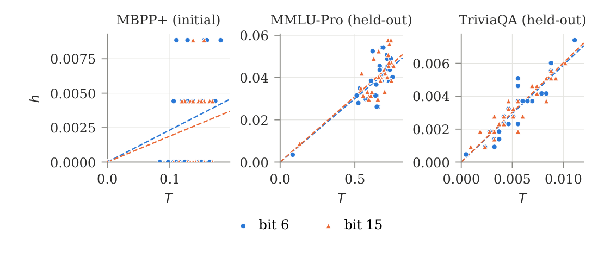查看原图 ↗</a>

*横轴是输出变化率，纵轴是任务损害率。三个任务的坐标尺度不同，斜率反映变化有多大机会造成错答。*

作者用 vLLM 服务 Qwen3-8B，在受控的软件故障实验中比较干净缓存与受扰缓存的响应。评价从干净运行已答对的样本出发，分别记录文本变化、任务判错，以及变化中有害的比例。以表 4 的新请求为例，MBPP+ 的两种扰动都让约 13% 的输出改变，但改变中只有 2.3% 或 1.9% 让代码失去原有的正确性。留出的 TriviaQA 数据恰好相反，只有约 0.53% 的输出改变，其中却有 59% 或 60% 成了错答。后两个数对应原先正确样本中约千分之三的损害率。运维人员若只拿到文本差异计数，甚至会把哪个任务更容易把变化转成错误判断反过来。

任务判定器也有分辨率。代码测试只能判断程序是否通过现有用例，问答的匹配规则则可能把表达差异算成失败。论文把新请求与已经缓存更多历史的返回请求分开测，前者在两套留出任务上都更易改变输出，但只有 TriviaQA 的损害率也随之上升。另一项对照仅改变组批方式，在 MBPP+ 上也观察到文本变化。相同输入没有逐字复现，并不足以单独识别缓存故障。

对推理服务而言，最棘手的是可见症状与普通模型错误很相像。作者因此把完整性检查的落点放在共享缓存块上：块是许多请求共同依赖的状态，也比生成文字更接近故障源。实验给出的是特定模型、缓存条件与评分器下的后果分布，生产中这类故障出现得多频繁，以及检查共享状态要付出多少成本，仍需另外测量。

<h2 class="daily-paper-title" id="paper-arxiv-2611.23068">Agent 演化能提出改进，却未必能从候选中认出它</h2>

[The Resolution Hypothesis: Agent Evolution's Key Is Identifying Improvements](https://arxiv.org/abs/2611.23068) · Yuanhao Zeng, Shaocheng Lan, Ao Lu, Kuang Yan, Heng Lin, Xinang Xu, Yuan Luo, Yueting Wang, Yexin Li, Ruo Shan, Kan Ren · arXiv v1 · 2026-11-17

如果一轮更新后任务得分提高几个百分点，最自然的解释是新技能更好。但这一次比较同时抽到了特定的技能、特定的任务和特定的执行轨迹。论文把通常混在最终分数里的两个问题拆开：生成器有没有提出有益候选，以及选择器看过少量反馈后，能否把这些候选留下。两个环节的改法很不一样。若好候选已经存在，单纯扩大提案数量可能只是给噪声更多获胜的机会。

<a class="note-image-link" href="/assets/images/digest/2026-11-19/arxiv-2611.23068.png" target="_blank" rel="noopener" aria-label="查看原图 ↗ — 不同颜色对应不同方法，各分布表示单次运行可能报告的分数。相邻分布重叠时，一次测试很难排出稳定次序。">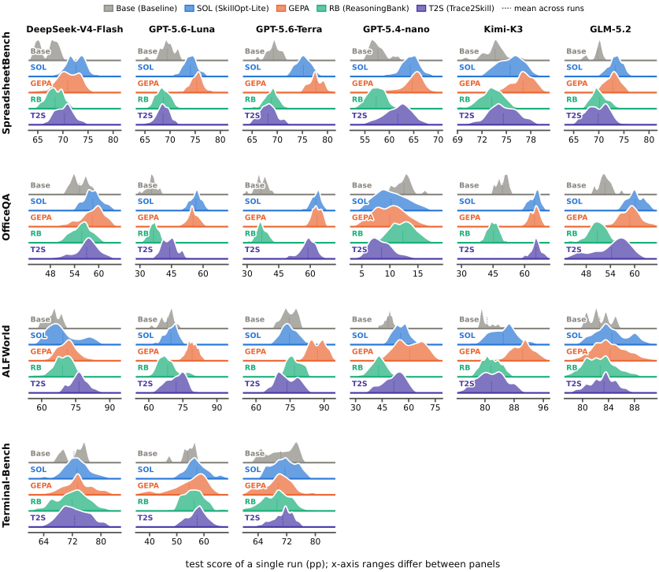查看原图 ↗</a>

*不同颜色对应不同方法，各分布表示单次运行可能报告的分数。相邻分布重叠时，一次测试很难排出稳定次序。*

作者从两个尺度检查这件事。在方法层面，他们对相同配置独立重跑整个演化流程，再重复评价产出的制品。七种方法、六种模型所涉及的 150 个配置合计有 1,030 次独立演化、超过 210 万条测试轨迹。独立重跑包含了前几轮选择走向不同分支的差异，只对同一份最终制品多跑几遍无法捕捉这部分方差。在文中四种文本制品演化方法的排名模拟中，一次运行选中真正最优方法的概率约为 33%，随机选是 25%。同一方法重跑间的波动足以覆盖许多论文报告的优势。

在候选层面，作者冻结技能池，再用较多独立执行估计候选质量。这一步让比较双方看到同一批提案，也让研究者有参照去问：常规预算下选中的究竟是哪一个？池中存在有益变体，少量执行的评分却常常无法分辨相近候选。给模型评判器更多材料也没有在所测配对上带来可靠的判断。一次误选还会改变下一轮提案的起点，最终不同运行之间的差异可以远大于单轮看见的变化。

对维护 Agent harness 的团队，这改变了应当报告的实验单位。多次执行同一个最终技能，适合描述执行结果的稳定性；独立演化出多份技能，才能衡量更新流程能否稳定选好。论文的随机基线发生在给定任务、候选池和预算内。它并未给出适合所有任务的统一复测次数，真正要比较的是预期改进的大小与评估能分辨的差距。

<h2 class="daily-paper-title" id="paper-arxiv-2611.22525">技能维护先回放成功时依赖的检查</h2>

[When Agent Skills Go Stale: Runtime Behavior and Selective Maintenance in Evolving Environments](https://arxiv.org/abs/2611.22525) · Ömer Faruk Akgül, Shuli Jiang, Yuting Zhang, Yi Zhang, Xiaohan Fei, Wei Xia, Stefano Soatto · arXiv v1 · 2026-11-17

工具升级后，技能文件仍能加载，其中的字段映射或工具调用却可能已经失效。作者从旧环境的成功执行和保留的技能中提取检查，在新环境回放。回放本身无需额外模型调用，有冲突才交给验证器判读和修补；修改通过验证才提交，局部修补无效再重新生成。这使维护成本可以与之后复用技能节省的步骤分开计算。四类任务、两种模型中，税表字段准确率相对直接沿用旧技能最多提高 67 个百分点，ScienceWorld 执行步数最多减少 37%。两项最大收益来自不同任务，前者看是否填对，后者看完成任务所需的动作。

<a class="note-image-link" href="/assets/images/digest/2026-11-19/arxiv-2611.22525.png" target="_blank" rel="noopener" aria-label="查看原图 ↗ — 从健康执行提取检查，回放后仅处理冲突，修补或重新生成的技能通过验证才提交。">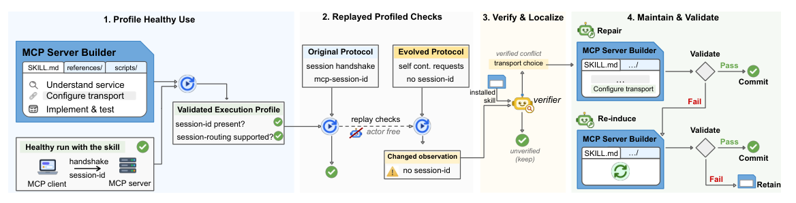查看原图 ↗</a>

*从健康执行提取检查，回放后仅处理冲突，修补或重新生成的技能通过验证才提交。*

<h2 class="daily-paper-title" id="paper-arxiv-2611.21616">代码索引在完整修订就绪后一次发布</h2>

[Revision-Consistent Code Context for Agents That Edit Their Environment](https://arxiv.org/abs/2611.21616) · Meng Shi · arXiv v1 · 2026-08-20

Agent 重命名一个符号时，搜索结果、依赖关系和源码可能按不同节奏更新。即使每项单独看来合理，拼起来也可能对应一个从未存在的仓库。Codetrip 在后台增量构造索引，在完整修订就绪时统一切换。此前读者可等待、收到暂不可用，或继续读取完整旧版。在冻结的 Gin 和 Cobra 上，300 次可评价恢复试验均得到与干净重建等价的新上下文，中位重启至上下文可用时间为 77–131 毫秒。重命名探针中，混合上下文从对照的 30/30 降为 0/30。这验证的是发布边界，不能据此推断所有编辑任务的完成率。

<a class="note-image-link" href="/assets/images/digest/2026-11-19/arxiv-2611.21616.png" target="_blank" rel="noopener" aria-label="查看原图 ↗ — 增量构造在后台进行，读者跨过发布边界后才看到整份新修订。">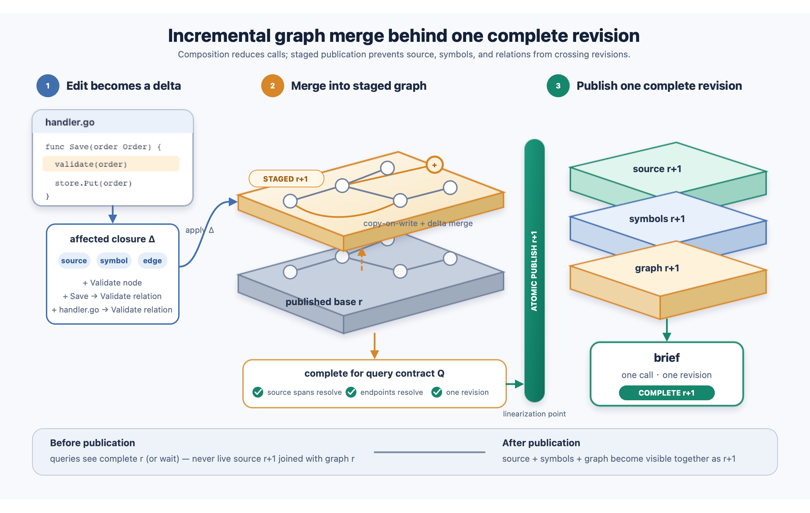查看原图 ↗</a>

*增量构造在后台进行，读者跨过发布边界后才看到整份新修订。*

<h2 class="daily-paper-title" id="paper-arxiv-2611.22835">检查通过后，证据究竟覆盖了哪个操作？</h2>

[When Passing Checks Do Not Establish Completion: Evidence Interpretation in Coding Agents](https://arxiv.org/abs/2611.22835) · Xueping Gao · arXiv v1 · 2026-11-17

编码 Agent 修改的仓库也可能提供验证器的启动代码和记录结果的逻辑。启动成功、生成了见证、目标操作确实执行，是三个需要分别确认的事实。作者通过回退局部修改、改变见证来源等干预，在 31 个任务的 118 次修复中追踪这条依赖链。另一组留出实验中，交付的 122 个标签全部正确，仍有 16 次回答把执行事实说错，另有 11 次把结论扩展到授权范围以外。单看标签正确率会漏掉这两类报告错误。论文对具体依赖的诊断比对通用修复策略优越性的支持更充分。

<a class="note-image-link" href="/assets/images/digest/2026-11-19/arxiv-2611.22835.png" target="_blank" rel="noopener" aria-label="查看原图 ↗ — 从被改代码到最终完成声明，中间依次经过启动、执行与见证记录，任一环节都影响证据涵盖的范围。">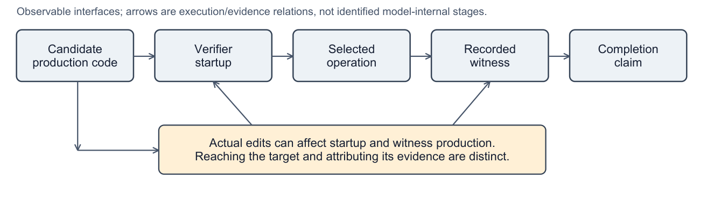查看原图 ↗</a>

*从被改代码到最终完成声明，中间依次经过启动、执行与见证记录，任一环节都影响证据涵盖的范围。*

<h2 class="daily-paper-title" id="paper-arxiv-2611.21679">FCP 把制品是否合规与规约是否忠实拆开检查</h2>

[FCP: Formal Context Protocol for Verifying LLM-Generated Artifacts](https://arxiv.org/abs/2611.21679) · Shashank · arXiv v1 · 2026-11-15

用模型自编的测试验收同一模型生成的实现，很容易把共同误解当作两份相符的证据。FCP 把自然语言请求拆成逐项可检查的解读，独立形式化，再用模型检测或 SMT 求解判断制品是否满足解读；遇到互相冲突的约束或能区分两种解读的见证时，把问题交回需求方。四个硬件设计中，信任生成的断言会给 23% 的已违反需求放行，FCP 未放行其中任何一项。在十个代码任务的 33 处违反中，仍有三处通过 FCP。这个残差点明了验证边界：证明实现满足某种解读，依然可能漏掉双方对原请求的共同误读。

<a class="note-image-link" href="/assets/images/digest/2026-11-19/arxiv-2611.21679.png" target="_blank" rel="noopener" aria-label="查看原图 ↗ — 请求解读与制品各自进入验证路径，最终逐项输出证明、违反见证或待澄清问题。">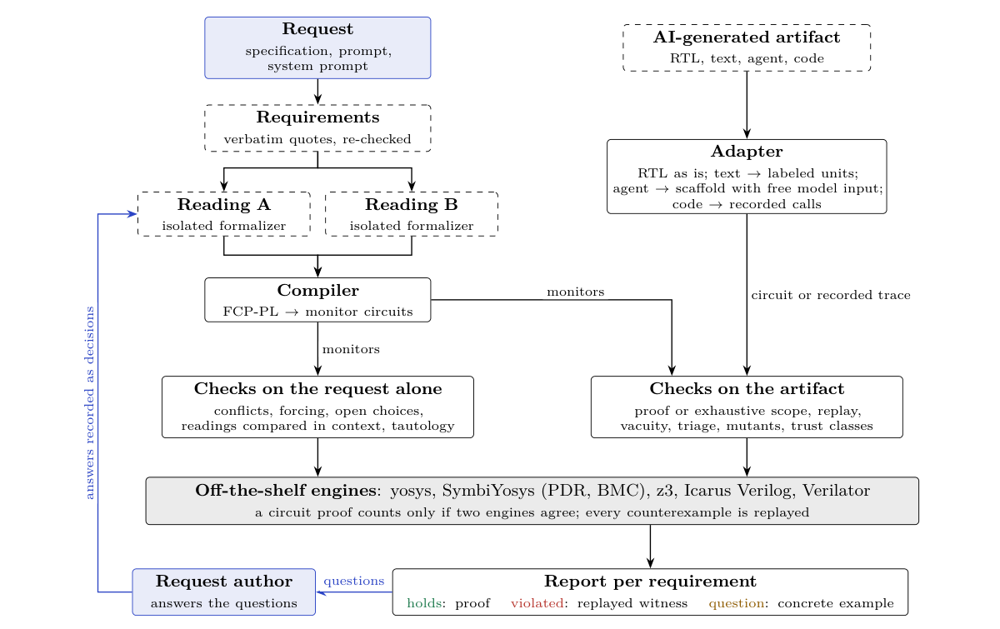查看原图 ↗</a>

*请求解读与制品各自进入验证路径，最终逐项输出证明、违反见证或待澄清问题。*

<h2 class="daily-paper-title" id="paper-arxiv-2611.22583">安全护栏需要同时衡量防护与任务效用</h2>

[Evolution Under Fire: Evolving Agent Safety Harnesses with Adaptive Injection Stressors](https://arxiv.org/abs/2611.22583) · Yujun Wang, Yilun Liu, Jinhe Bi, Krishna Kanth Nakka, Xuebing Zhou, Hinrich Schütze, Yunpu Ma · arXiv v1 · 2026-11-17

一个一律拒绝调用工具的护栏很容易在单一安全指标上得高分，也可能让 Agent 完不成工作。作者固定任务模型、工具和评分器，把无干扰任务的效用及受干扰时的效用纳入护栏选择，再用留出的条件比较。AgentDyn 与 GPT-4o-mini 组合中，攻击成功率由初始护栏的 50.4% 降到 3.0%，两项效用均改善；换成 Agent-SafetyBench 和 Qwen2.5-7B，成功率从 82.6% 降至 62.0%。后者仍有很高的残余风险。两个环境给出的差异，比单独摘出最优结果更能说明基准选择如何影响部署判断。

<a class="note-image-link" href="/assets/images/digest/2026-11-19/arxiv-2611.22583.png" target="_blank" rel="noopener" aria-label="查看原图 ↗ — 向右表示抵抗攻击的比例更高，向上表示受干扰条件下仍有较高任务效用。">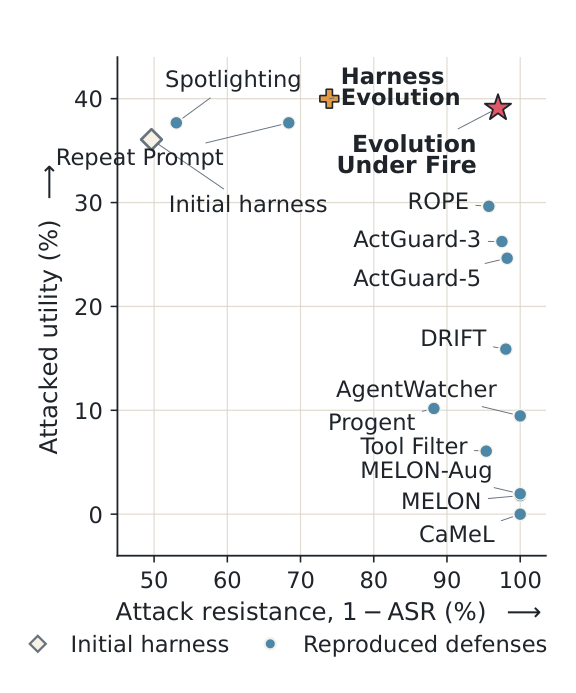查看原图 ↗</a>

*向右表示抵抗攻击的比例更高，向上表示受干扰条件下仍有较高任务效用。*

<h2 class="daily-paper-title" id="paper-arxiv-2611.22171">Readie 按依赖重叠规划沙箱启动快照</h2>

[Readie: Low-Latency Code Sandboxes for AI Agents](https://arxiv.org/abs/2611.22171) · Arjun Sivaraman, Zhaoheng Li, Alan Shi, Sanjay Malisetty, Eugene Wu, Yongjoo Park · arXiv v1 · 2026-11-17

Agent 运行短脚本时，导入依赖可能比真正计算更耗时。每个请求单独保存快照吃掉存储，一个装满库的通用镜像又要恢复大量无关状态。Readie 从公开及合成脚本的导入集合学习快照组合，用贪心设施选址近似算法权衡新增快照覆盖哪些请求、节省多少初始化、占用多少空间。新请求可复用接近其依赖的预热内存状态，再补载缺项。同等存储预算下，作者报告初始化延迟改善 3–22 倍，而端到端运行时间改善 1.3–3.3 倍。后一组数字保留了脚本本身的执行时间，更接近一次工具调用实际能节约的等待。

<a class="note-image-link" href="/assets/images/digest/2026-11-19/arxiv-2611.22171.png" target="_blank" rel="noopener" aria-label="查看原图 ↗ — 学习得到的内存快照既能跨请求共享，也能省去重复执行的包初始化。">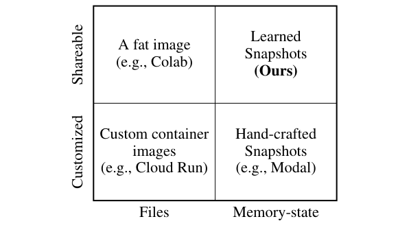查看原图 ↗</a>

*学习得到的内存快照既能跨请求共享，也能省去重复执行的包初始化。*

<h2 class="daily-paper-title" id="paper-arxiv-2611.22215">EchoMoE 在专家间传激活变化量</h2>

[Communicate the Change: Efficient Expert Parallelism via Activation Compression](https://arxiv.org/abs/2611.22215) · Fengyuan Liu, Jay Gala, Siva Reddy, Dzmitry Bahdanau · arXiv v1 · 2026-11-17

专家并行要把激活送往远端专家，再收回各处的输出。同一 token 在相邻层的残差状态往往相似，EchoMoE 因此把连续若干层分组：首层广播完整参照，之后只派发相对参照的压缩差值。专家直接使用参照与差值计算，返回端先合并低维结果再解压，路由器仍读取完整状态。对改装后的 Qwen3-30B-A3B，四节点 EP32、每卡 128 个请求的四层分组配置把跨节点 RDMA 流量削减 58%，吞吐提高 22.6%，代价是 18 项任务平均下降 3.8 个百分点。带宽更紧的 TCP 条件下最高加速达 2.38 倍，说明收益随互连变化；选择压缩宽度也在选择可接受的任务损失。

<a class="note-image-link" href="/assets/images/digest/2026-11-19/arxiv-2611.22215.png" target="_blank" rel="noopener" aria-label="查看原图 ↗ — 左侧按层组保存参照，右侧展示非参照层如何派发差值、计算专家输出并合并压缩结果。">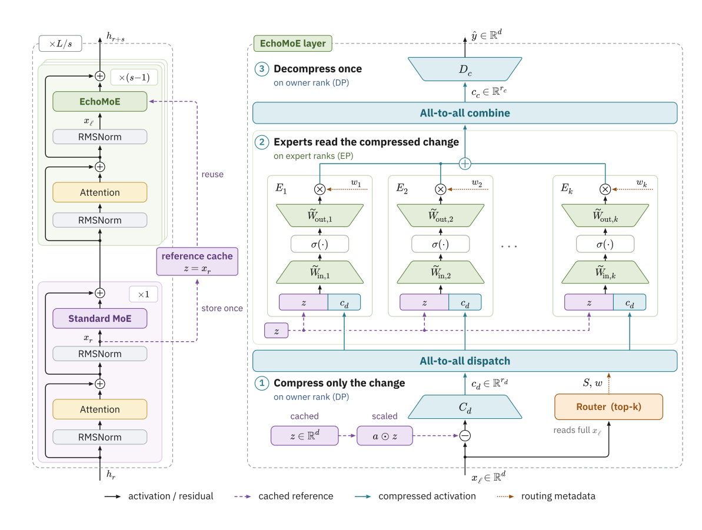查看原图 ↗</a>

*左侧按层组保存参照，右侧展示非参照层如何派发差值、计算专家输出并合并压缩结果。*

<h2 class="daily-paper-title" id="paper-arxiv-2611.21852">权重量化后，扩散解码的耗时移到采样器</h2>

[The Hidden Cost of MoE Diffusion Decoding: Profiling and Fixing the Sampler](https://arxiv.org/abs/2611.21852) · Harshit Samrat, Ramakrishna Paramahamsa Kompella · arXiv v1 · 2026-11-16

块扩散解码每轮要处理一整片位置的词表分数。在 GB10 上加快专家矩阵乘法之后，参考实现为了决定接受哪些位置、何时停下，两次读取同一批 logits 计算熵。第一层优化复用熵，张量变化时才重算，可保持输出与步数逐项一致；第二层把熵计算融合成一次扫描，并改变采样实现，保持分布但允许抽到不同 token。叠加 W4A16 专家内核后，在 GSM8K、HumanEval、MATH 各 100 题上，相对 BF16 的端到端加速为 2.4–2.7 倍，所测准确率持平。该对照使用 eager 参考循环；稠密扩散模型中这段流水线仅占 3.6%，优化顺序会随模型改变。

<h2 class="daily-paper-title" id="paper-arxiv-2611.22191">RISA 把暂时不读的 KV 页留给后续块</h2>

[RISA: Recoverable Sparse Attention for Block-Diffusion Language Models](https://arxiv.org/abs/2611.22191) · Xinrui Zhong, Fanjiang Ye, Yuke Wang · arXiv v1 · 2026-11-17

块内去噪时历史 KV 不变，query 却会改变。每个 query 单独选页会让实际读取的并集变大，只按近期访问永久删除又会丢失后续块需要的历史。RISA 把精确 KV 留在 GPU 上，用种子 query 为整个块选一份限额读页表，同块后续步骤复用索引、用新 query 重算注意力，下一块可以重新选回冷页。默认配置在 32K 上注意力加速 2.67 倍，固定解码轨迹的整请求加速为 1.36 倍。128K 用于检验长上下文计算扩展性；部分模型原生支持与任务质量评测止于 32K，不能从速度曲线外推质量。

<a class="note-image-link" href="/assets/images/digest/2026-11-19/arxiv-2611.22191.png" target="_blank" rel="noopener" aria-label="查看原图 ↗ — 左侧比较注意力质量与实际读页范围，右侧区分减少 KV 读取与减少重复选页两种节约。">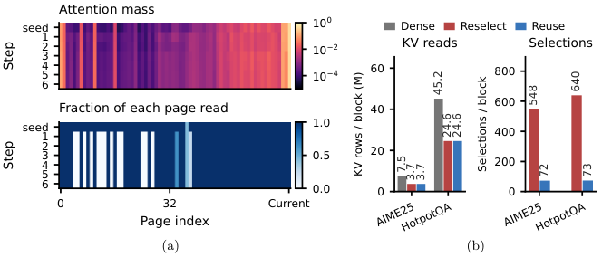查看原图 ↗</a>

*左侧比较注意力质量与实际读页范围，右侧区分减少 KV 读取与减少重复选页两种节约。*

<h2 class="daily-paper-title" id="paper-arxiv-2611.21974">在 B200 上按语言质量与实际显存选择量化配置</h2>

[Beyond Bitwidth: Deployment-Constrained Mixed-Precision Quantization for Multilingual LLM Inference on NVIDIA Blackwell](https://arxiv.org/abs/2611.21974) · Hyojung Han · arXiv v1 · 2026-11-16

同为四比特权重，激活精度、输出头和引擎实际调用的内核都可能改变部署结果。作者检查 B200 上 vLLM 如何执行 Qwen3-8B 的 144 个融合线性模块，根据逐模块恢复精度的效果选择要保留 INT8 的位置，再锁定配置做留出测试。通过门槛的配置保留 16 位激活，98 个模块使用 NVFP4、46 个使用 INT8，输出头也是 INT8。最终 5,168 条样本上，韩语教师答对题目的保留率为 0.904，只略高于 0.90 门槛；权重加载占 5.917 GiB，每输出 token 时间为 BF16 的 0.939 倍。权重加载内存没有包含完整服务进程，最终检查点也未保存，逐位重建仍待验证。

<a class="note-image-link" href="/assets/images/digest/2026-11-19/arxiv-2611.21974.png" target="_blank" rel="noopener" aria-label="查看原图 ↗ — 横线给出不同配置间配对精度差的区间，可以直接查看区间是否跨过零。">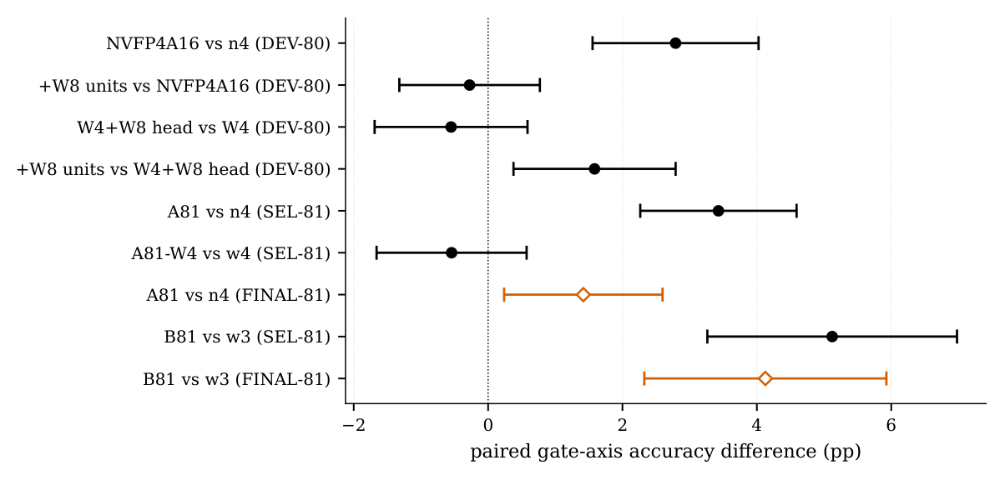查看原图 ↗</a>

*横线给出不同配置间配对精度差的区间，可以直接查看区间是否跨过零。*

<h2 class="daily-paper-title" id="paper-arxiv-2611.21677">Chimera 把 FPGA 布局纳入解码带宽设计</h2>

[Chimera: A Configurable LLM Decode Accelerator Architecture with Compute-Memory-Floorplan Co-Design for HBM-Equipped Multi-Die FPGAs](https://arxiv.org/abs/2611.21677) · Zhiheng Chen, Yifan Zhang, Yu-An Chou, Ye Qiao, Sitao Huang · arXiv v1 · 2026-11-14

多裸片 FPGA 的 HBM 接口集中在一侧。把计算通道铺到更多区域可以增加并行度，却也可能让跨区域连线压低所有内存端口的时钟。Chimera 把直接访问 HBM 的代理端口留在接口附近，其他区域通过这些端口供数；对放不进 HBM 的 MoE，再按专家与存储层安排权重。作者在 Alveo U280 上实际布局布线了十种设计，覆盖稠密、混合注意力与最高 80B 的 MoE。相对论文选取的既有 FPGA 设计，解码 token 吞吐几何平均为 1.6 倍。这个数字说明跨区供数与布线可共同限制吞吐，不能直接当作多用户服务容量。

<a class="note-image-link" href="/assets/images/digest/2026-11-19/arxiv-2611.21677.png" target="_blank" rel="noopener" aria-label="查看原图 ↗ — 不同模型在 U280 上的实际布局与资源分配，反映同一块板上计算与布线的取舍。">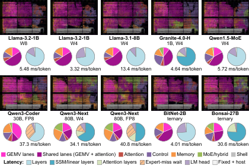查看原图 ↗</a>

*不同模型在 U280 上的实际布局与资源分配，反映同一块板上计算与布线的取舍。*

<h2 class="daily-paper-title" id="paper-arxiv-2611.23035">用两个重叠视图减少 Gemma 4 的全局 KV 存储</h2>

[Storing the Gemma 4 K=V Cache Once: Exact Global-KV Memory Savings in a Paged Serving Engine with Unchanged Attention Kernels](https://arxiv.org/abs/2611.23035) · Kushagra Bainsla · arXiv v1 · 2026-11-17

Gemma 4 31B 全局层的 key 和 value 共享投影结构。作者重排维度，把重合部分只写一次，用一个 640 元素行提供两个 512 元素视图，已有分页注意力内核仍按自己的步长读。紧凑实现与执行同一算术的常规缓存模拟按位一致；这个对照很重要，因为实现改变了部分算术次序。全局行缩短后，滑窗层和分页分组仍占空间，稳态每请求节省约为 1.34 倍的容量比。A100、NIXL 与 CPU 卸载的 eager 实验中，中位提示为 16K 和 8K 时，吞吐分别为基线的 1.30 和 1.11 倍。收益来自同一池子里能容纳更多请求，固定批量时步进反而慢 4%–9%。

<a class="note-image-link" href="/assets/images/digest/2026-11-19/arxiv-2611.23035.png" target="_blank" rel="noopener" aria-label="查看原图 ↗ — 两个 512 元素窗口重叠在同一行，共享中段使 640 个位置即可提供 K 和 V。">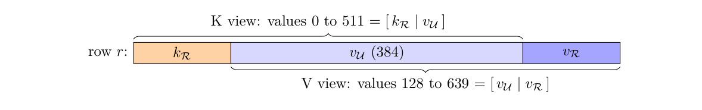查看原图 ↗</a>

*两个 512 元素窗口重叠在同一行，共享中段使 640 个位置即可提供 K 和 V。*

<h2 class="daily-paper-title" id="paper-arxiv-2611.22280">XM-Sparse 分开调度两种远端读取</h2>

[XM-Sparse: High-Throughput Sparse-Attention LLM Serving over Scale-up Memory Pools](https://arxiv.org/abs/2611.22280) · Yijun Sun, Xudong Liao, Zhuobin Huang, Kai Chen, Nikita Lazarev, Zhizhen Zhong · arXiv v1 · 2026-11-17

稀疏注意力把历史 KV 移出显存后，用来选页的 K-index 本身也会限制并发。XM-Sparse 利用两条读取路径的可预测性差异：索引按已知顺序使用，可以由 GPU 提前发起 DMA，真正选中的 KV 要到运行时才知道，就把 TMA 取回与注意力消费按 tile 重叠。在 SGLang 的模拟扩展内存池上，16K 至 1M 的测量覆盖 DeepSeek-V3.2 和 GLM-5.3。相对 PCIe 版 ECHO、HiSparse 的最高吞吐比分别为 4.98 和 4.52，混入了互连与系统两方面的变化；同一内存池上对朴素接入的最高提升为 1.34 倍，更能隔离软件路径的贡献。

<a class="note-image-link" href="/assets/images/digest/2026-11-19/arxiv-2611.22280.png" target="_blank" rel="noopener" aria-label="查看原图 ↗ — 批量增大时，待取回的 KV 字节增加，而一次换入的延迟变化较小，短传输的固定成本因此值得隐藏。">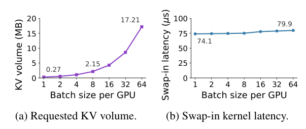查看原图 ↗</a>

*批量增大时，待取回的 KV 字节增加，而一次换入的延迟变化较小，短传输的固定成本因此值得隐藏。*

<h2 class="daily-paper-title" id="paper-arxiv-2611.22296">SpecSearch 把关闭投机也纳入搜索</h2>

[SpecSearch: Towards Hardware-Aware Efficient Speculative Decoding](https://arxiv.org/abs/2611.22296) · Selin Yildirim, Ali Zeyrek, Deming Chen · arXiv v1 · 2026-11-17

草稿模型一次猜更多 token 可以摊薄验证开销，却会占用计算和 KV 空间。并发升高或输出缩短时，同一块 GPU 上也可能换一个最优策略。作者在 RTX 5090 上观察到 DFlash 从低并发的自回归吞吐 3.50 倍，变成高并发短输出时的 0.76 倍。SpecSearch 联合比较自回归与投机策略、草稿长度和缓存精度。在 RTX 5090、H100、L40 和 MI300X 上，经目标硬件标定的选择平均达到默认投机配置的 1.36 倍。用其他 GPU 数据训练的 Jev 在留一硬件评测中达到完整搜索吞吐的 97.36%；它省下目标卡标定，结论限于所测模型、负载与硬件集合。

<a class="note-image-link" href="/assets/images/digest/2026-11-19/arxiv-2611.22296.png" target="_blank" rel="noopener" aria-label="查看原图 ↗ — 输出长度上限和批量共同改变可行策略，标为 OOM 的格子还受显存容量约束。">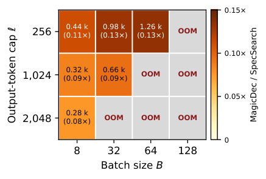查看原图 ↗</a>

*输出长度上限和批量共同改变可行策略，标为 OOM 的格子还受显存容量约束。*

<h2 class="daily-paper-title" id="paper-arxiv-2611.22746">LaFlash 为等待工具的会话保留状态</h2>

[LaFlash: Capacity-Driven Acceleration for Coding Agent Workflows via QLC-HBF](https://arxiv.org/abs/2611.22746) · Yuseon Choi, Eunjong Lee, Sanghyeon Park, Seongyon Hong, Sangjin Kim, Thierry Tambe · arXiv v1 · 2026-11-17

工具调用期间 GPU 可以服务其他请求，但若同时驱逐休眠会话的 KV，工具一返回就要重新预填充。LaFlash 研究用高容量 QLC 高带宽闪存保留这些状态，把新会话分配给会话数最少的组以平衡活跃状态和上下文长度，并利用不同页的读取延迟差异分配快页；HBM 缓冲则减少很快会被覆盖的数据写入。作者使用轨迹驱动的逻辑与时序模拟器，在编码 Agent 负载上得到相对扩批 SLC-HBF 的 7.04 倍吞吐；若两端都保留休眠会话，则相对 QLC-HBF 对照为 2.36 倍。两种分母区分了容量策略的价值与闪存管理的增量，均为模拟结果。

<a class="note-image-link" href="/assets/images/digest/2026-11-19/arxiv-2611.22746.png" target="_blank" rel="noopener" aria-label="查看原图 ↗ — 工具等待和图节点切换都产生休眠状态，GPU 上当前执行的请求只代表总状态的一部分。">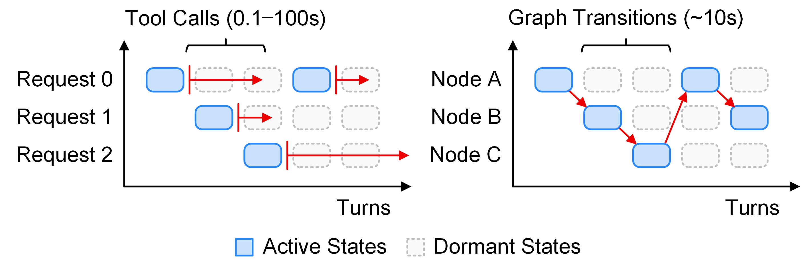查看原图 ↗</a>

*工具等待和图节点切换都产生休眠状态，GPU 上当前执行的请求只代表总状态的一部分。*

<h2 class="daily-paper-title" id="paper-arxiv-2611.21839">让少数草稿注意力头读取图像</h2>

[VisHead-Spec: Head-Routed Visual Attention for Multimodal Speculative Decoding](https://arxiv.org/abs/2611.21839) · Xin Guo, Arushi Rai, Xiang Zhou, Qiang Zhang, Siyu Lin, Xiangjun Fan, Lizhu Zhang · arXiv v1 · 2026-11-16

视觉投机解码若让所有草稿头反复处理图像 token，高并发时草稿开销会吞掉并行验证的优势。VisHead-Spec 从冻结的 Qwen3-VL-8B 选取较高层图像特征，预先指定少数 KV 头可读图，其余头保留文本路径。对 MMSpec 的六类任务，40 个头中开放 8 个时，平均接受长度与 DSpark 相差不到 0.3%。batch 64 时，相对自回归的吞吐增益由 DSpark 的 9.5% 提高到 16.0%；batch 1 两者相近。保住接受长度有意义，是因为这样节省草稿计算后不必付出更多轮目标验证。

<a class="note-image-link" href="/assets/images/digest/2026-11-19/arxiv-2611.21839.png" target="_blank" rel="noopener" aria-label="查看原图 ↗ — 右侧只给部分草稿 KV 头开放视觉特征，其余头继续沿文本路径推理。">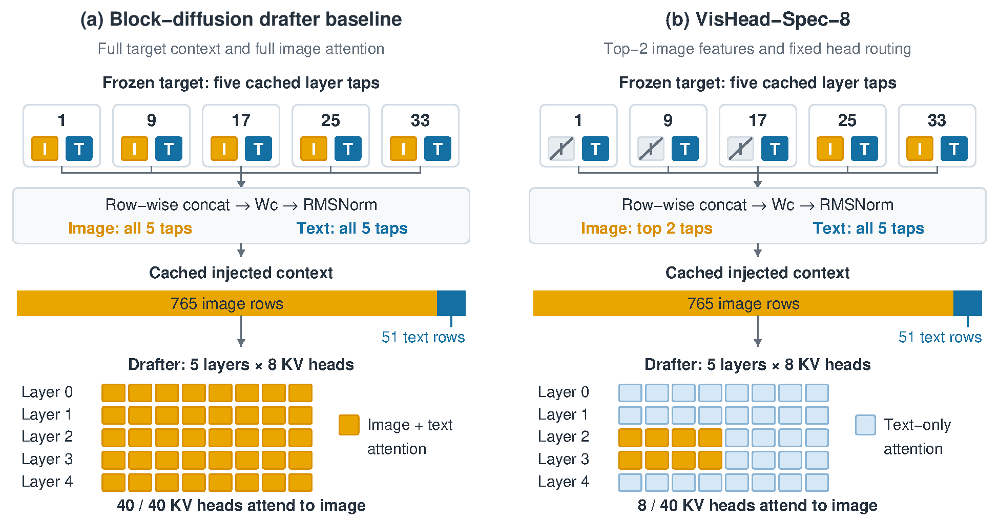查看原图 ↗</a>

*右侧只给部分草稿 KV 头开放视觉特征，其余头继续沿文本路径推理。*

<h2 class="daily-paper-title" id="paper-arxiv-2611.22206">TAILROLL 将负载不均与最后一个长样本分开处理</h2>

[TAILROLL: Tail-Aware Rollout Acceleration for RL-Based LLM Post-Training](https://arxiv.org/abs/2611.22206) · Niloofar Gholipour, Marcos Assuncao, Timothy Yu, Gursimran Singh, Rajkumar Buyya, Julien Gascon-Samson, Zhenan Fan, Yong Zhang · arXiv v1 · 2026-11-17

一次 RL 训练步要等一组 rollout 完成。某个引擎堆着许多未完成请求，与只剩一个极长响应，是两种不同的空闲来源。TAILROLL 在分块边界根据剩余收益迁移请求，目标引擎用已知 token 重做一次预填充；组内样本足够时才允许提前结束长尾，并屏蔽未完成输出的训练贡献。十组配置上，rollout 气泡比例相对下降 21%–74%。长推理链的端到端训练中，rollout 时间缩短 24%–34%，完整训练步缩短 21%–22%。终止规则会改变可用样本，因而作者同时比较最终 reward；相当或更高的结果限于所测任务和终止预算。

<a class="note-image-link" href="/assets/images/digest/2026-11-19/arxiv-2611.22206.png" target="_blank" rel="noopener" aria-label="查看原图 ↗ — 控制器读取引擎负载，在分块边界决定迁移或终止，执行接口把决定送到各 rollout worker。">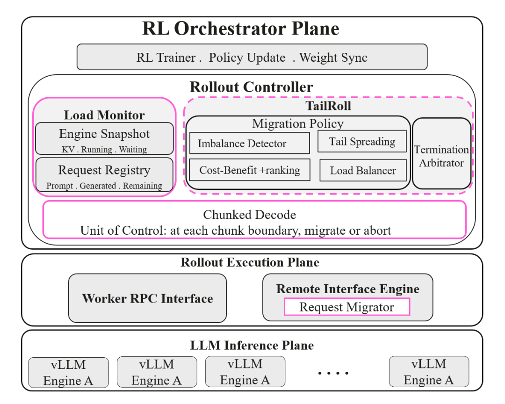查看原图 ↗</a>

*控制器读取引擎负载，在分块边界决定迁移或终止，执行接口把决定送到各 rollout worker。*

<h2 class="daily-paper-title" id="paper-arxiv-2611.22115">Xing4 训练把主机抖动和异步任务时长都纳入调度</h2>

[TeleChat to Xing4: Advancing Frontier Agentic Models on Domestic Chips and Frameworks](https://arxiv.org/abs/2611.22115) · Xingchen AGI Lab, et al. · arXiv v1 · 2026-11-17

Xingchen AGI Lab 的报告把 285B 模型的硬件布局写到了主机线程一级。大规模同步训练中，一个主机线程与后台任务抢核，延迟会传播给等待它的其他卡。团队在 8,192 张 Ascend 910C 上结合绑核与资源隔离，报告吞吐提高 5%–10%；内存亲和仍需单独配置。后训练平台 TeleGym 面对另一种等待：不同任务引擎、沙箱和工具各有响应时间。执行平台把环境交互与模型生成解耦，服务器整理轨迹，训练侧用有限过采样和部分 rollout 消化长短差。两类工程结果的负载和指标不同，预训练的吞吐改善不能直接算到 Agent 任务收益上。

<a class="note-image-link" href="/assets/images/digest/2026-11-19/arxiv-2611.22115.png" target="_blank" rel="noopener" aria-label="查看原图 ↗ — TeleGym 产生环境交互，服务器组装轨迹，训练侧由此异步接收样本。">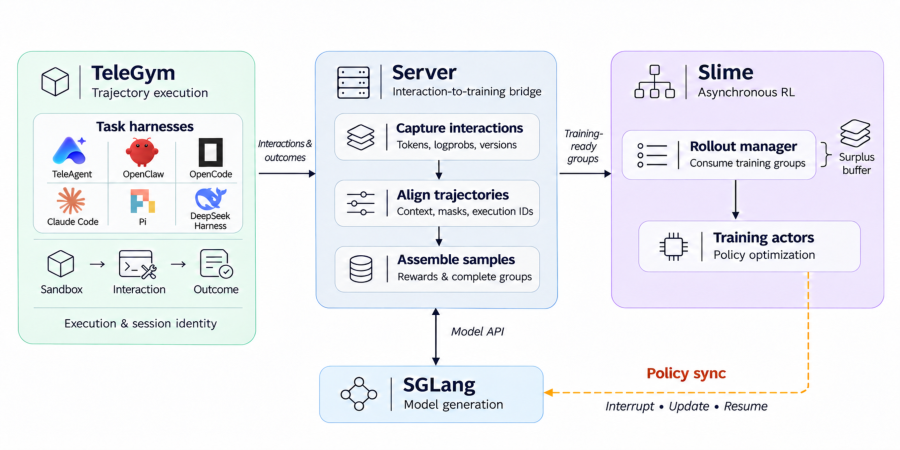查看原图 ↗</a>

*TeleGym 产生环境交互，服务器组装轨迹，训练侧由此异步接收样本。*

<h2 class="daily-paper-title" id="paper-arxiv-2611.23053">SPICE 让稀疏通信适应变化的训练邻居</h2>

[SPICE: Sparse Parameter Gossip for LLM Pretraining](https://arxiv.org/abs/2611.23053) · Pietro Cagnasso, Daniele Kopyshevskiy, Edouard Oyallon, Eugene Belilovsky · arXiv v1 · 2026-11-17

当预训练副本跨越慢链路时，稠密同步会拖住快副本。普通稀疏更新若把未传出的残差绑定到固定邻居，下一轮换邻居时就难以解释。SPICE 传选中坐标的参数值，并把误差反馈留在本地更新中，使接收者无须持有双方约定的旧增量。副本增加时可以扩展邻居集合，单条消息仍稀疏。作者用流量控制限制带宽并让部分链路暂时变慢，在 134M 模型上还比较了相同训练时间的验证损失。稀疏 gossip 的吞吐与质量优势随带宽而变；每项训练配置只运行一个随机种子，对小幅质量差应保留这一不确定性。

<a class="note-image-link" href="/assets/images/digest/2026-11-19/arxiv-2611.23053.png" target="_blank" rel="noopener" aria-label="查看原图 ↗ — 横轴是相对模型大小的出站通信量，纵轴是验证损失，比较时须同时看交换量与收敛质量。">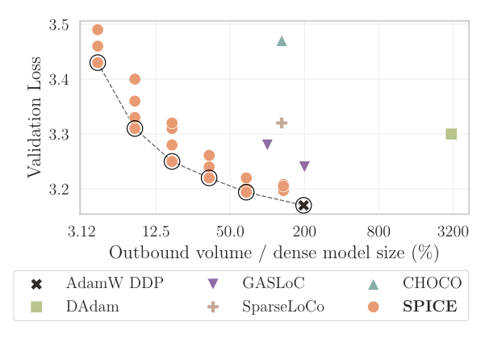查看原图 ↗</a>

*横轴是相对模型大小的出站通信量，纵轴是验证损失，比较时须同时看交换量与收敛质量。*

<h2 class="daily-paper-title" id="paper-arxiv-2611.22086">HyCoInfer 让链路带宽参与云边解码放置</h2>

[HyCoInfer: Cloud-Edge Collaborative Inference for Large Language Models on Heterogeneous GPU-FPGA Architectures](https://arxiv.org/abs/2611.22086) · Zewen Huang, Xiangwen Zhuge, Yingkun Hu, Zheng Yang, Qiang Ma · arXiv v1 · 2026-11-17

把预填充留在云 GPU、把解码放到边缘 FPGA，会引入一次可能比排队更慢的 KV 迁移。HyCoInfer 同时考虑提示长度、队列与网络状态，决定在哪一侧解码。迁移时分层流水传输，以渐进残差向量量化按带宽选择编码深度；边缘负载低时还可预计算部分前缀。两块 V100 和 Alveo U280 的实验覆盖 100–1,000 Mbps。500 Mbps 时，Qasper 上满足服务目标的请求吞吐最高达纯云 vLLM 的 4.11 倍，平均端到端延迟最多下降 61.1%。收益依赖迁移能够与计算重叠以及边缘尚有余量，单凭 FPGA 的 token 速率无法确定放置选择。

<a class="note-image-link" href="/assets/images/digest/2026-11-19/arxiv-2611.22086.png" target="_blank" rel="noopener" aria-label="查看原图 ↗ — 调度器在云侧预填充后选择解码位置，将逐层传输与边缘计算重叠。">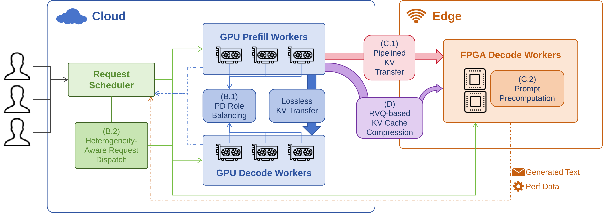查看原图 ↗</a>

*调度器在云侧预填充后选择解码位置，将逐层传输与边缘计算重叠。*
