一台服务器提前结束维修、一批分类请求少占用几张 GPU、一个工具调用中断后还能找到外部记录，这三种结果都有明确的观察终点。本期重点看 HardwareDx 如何把诊断建议放进真实维修循环，Cap-and-Track 如何把过载留在可恢复的队列中，以及工具故障实验如何区分“不重复”和“可恢复”。其余研究把问题推进到更细处：缓存命中能否兼顾跨回合公平，视觉草稿应验证证据还是动作，内核的加速又能保留多少到整项任务。

<h2 class="daily-paper-title" id="paper-arxiv-2611.23398">HardwareDx 如何缩短机器维修循环</h2>

[HardwareDx: A Foundational Graph Model System for Datacenter Machine Repairs](https://arxiv.org/abs/2611.23398) · Yuanlin Wen, Elan Markowitz, Zubo Gu, Sami Abu-El-Haija, Bryan Perozzi, Mikhail Galkin, Ali Parviz, Aayush Gupta, Venkata Chivukula, Griffin Hadfield, Aravind Akella, Daniel J. Frame, Vahab Mirrokni, Amin Vahdat · arXiv v1 2026-11-17

一台训练服务器报出几个 GPU 同时消失，维修人员应该更换几张卡，还是先检查这些卡共同依赖的部件？生产规则可以给每种症状指定故障分数，但同一故障往往同时触发多条规则；换一代机器，部件的连接关系和日志格式也会改变。Google 把诊断目标落在一个可操作的选择上：从一台机器的一百多个现场可更换单元中，找出该修哪里，再结合已尝试过的操作给维修人员建议。一次判断是否有价值，最终体现在机器要经过多少轮测试才能回到服务。一轮压力测试可能就要耗费数小时。

HardwareDx 为每次测试建立一张图。部件、端口与诊断信号构成不同类型的节点，物理连线、内部连接和信号归属决定哪些节点可以交换信息。模型分别编码测试日志、传感器读数和既往维修记录，再将它们投到共同的图表示上。这样，一个部件的判断可以利用邻近部件的症状，新平台也能复用旧平台学到的连接模式。图网络和 Transformer 输出部件级预测，维修计划还要考虑技术员之前已经试过什么。诊断服务失效时系统回退到规则，反复维修仍不成功的机器则交给专家。

<a class="note-image-link" href="/assets/images/digest/2026-11-20/arxiv-2611.23398.png" target="_blank" rel="noopener" aria-label="故障信号先连到相应部件，图网络汇集邻近证据，再由不同预测头给出诊断。">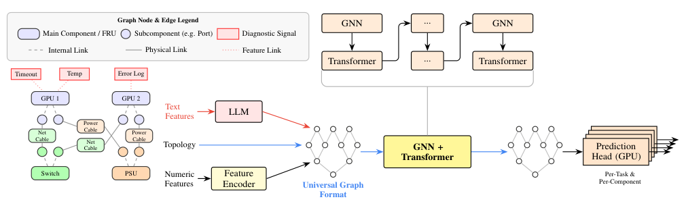查看原图 ↗</a>

*故障信号先连到相应部件，图网络汇集邻近证据，再由不同预测头给出诊断。*

训练数据也反映了这个循环。少量专家标注可以直接指出故障部件，大量历史记录通常只知道某次操作之后测试是否通过。如果一次换了多个部件，通过测试并不能证明每个被换部件都有故障。论文保留了两种监督信号的区别。离线消融用于检验拓扑和日志编码各自是否有用，线上实验则让维修人员在真实流程中采用两套系统给出的建议。

在按机器随机分组的生产对照中，作者分析了 225 个 H100 维修窗口和 2,567 个 TPU 维修窗口。相对原有规则，测试、诊断、维修至恢复服务的平均用时分别下降 18.3% 和 16.1%，均不含安装时间。新硬件交付关心的是较慢的维修案例：按集群移交目标对应的维修时间分位数衡量，两个平台的 QA 指标分别改善 28.3% 和 25.1%。这组数据值得与自动诊断覆盖率一起读。在 H100 上覆盖率从 83.1% 到 93.9%，意味着系统既加快了维修，也能为更多原本需要人工诊断的案例给出建议。对新一代硬件能提前多久达到可用精度，论文另外用历史数据评估；线上维修时间的随机对照不能直接回答这个迁移问题。

<h2 class="daily-paper-title" id="paper-arxiv-2611.24891">Cap-and-Track 把等待留在推理引擎之外</h2>

[Cap-and-Track: Optimizing LLM Inference Request Dispatch Across Shifting Capacity](https://arxiv.org/abs/2611.24891) · Benjamin Novotny, Doug Szeto, Chang Wang, Shicheng Chen, George Zhihua Yuan, Bob Kamma, Michael Ge, John Xin Zhou, Andrea Olgiati · arXiv v1 2026-11-18

直播和帖子分类共享一组推理副本时，流量整形器在请求到达前不知道模型要生成多少 token，也不知道一小时后还有多少算力可用。按固定速率派发，速率低了会让卡闲置，高了则可能把大量请求送进副本内部等待。此时即使队列外来了更紧急的工作，它也排不到前面。Meta 的做法是把持久优先队列放在执行路径之前，让每个饱和资源尽早给出能否接纳工作的反馈。

Cap 放在知道自己已经接近饱和的位置。例如副本能看到本地积压，外部供应商则可以返回限流信号。被拒的请求回到持久队列，保留再次派发的机会。Track 不必理解每种资源的容量单位。领导工作进程每 15 秒根据各队列的成功次数和容量拒绝次数更新速率。生产配置中，拒绝占比不高于 2% 时将速率提高 3%，超过目标则分档降低速率。轻微拒绝只让控制器缓慢回退，大范围容量丢失会触发更大降幅。这里有意容许少量拒绝：只有主动探测，调度器才知道空闲容量是否重新出现。其前提是能在大量计算或长时间等待之前识别容量拒绝。

<a class="note-image-link" href="/assets/images/digest/2026-11-20/arxiv-2611.24891.png" target="_blank" rel="noopener" aria-label="等待发生在持久队列中，在线工作进程根据后端拒绝信号调节派发。">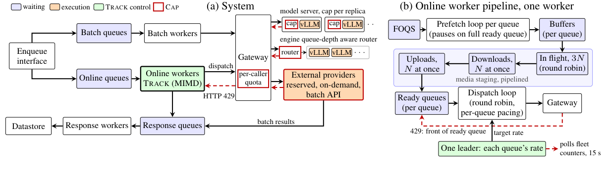查看原图 ↗</a>

*等待发生在持久队列中，在线工作进程根据后端拒绝信号调节派发。*

生产同流量对照中，分类器在新系统上少用了 43% 的 H100。另一个零样本工作负载使用两组各约 600 张 MI300X 的等规模机群，整形器每次都先清空共同的积压，领先时间的中位数为三小时。两组实验分别回答了多少硬件能承担同一任务，以及固定硬件多久能排空队列。成本也落在队列里：回填高峰时，低优先级工作等待更久。对允许延后完成的分类任务，把等待移到持久队列可以换来更小的机群；对每次请求都有严格响应期限的交互服务，这些实验并未给出同等保证。

<h2 class="daily-paper-title" id="paper-arxiv-2611.23353">动作只执行一次，崩溃后仍可能无从交账</h2>

[Idempotency Is Not Recovery: A Fault-Injection Study of Language-Model Agent Tool Actions](https://arxiv.org/abs/2611.23353) · Song Xu · arXiv v1 2026-11-17

工具已经完成扣款一类的外部动作，进程却在收到确认前崩溃。目标端的幂等键可以拦住第二次生效；调用方重启时还需要知道这次动作由谁授权、对应哪一项请求、目标端究竟做了什么，以及下一步该重试还是等待对账。Song Xu 用单机故障注入把这些保证拆开测量。实验的重要发现恰好来自一个看似成功的简化配置：即使没有产生重复效果，动作仍可能没有本地记录可供追踪。

完整运行时先检查授权，再为动作保留稳定身份，写入可持久化的账本。目标端按身份去重，运行时在完成确认后更新状态。如果崩溃留下一项未完成动作，重新收到相同请求时，运行时可以明确报告尚待确认，并查询目标记录进行对账。把“不知道”保留下来有具体价值：恢复逻辑可以分辨已知完成、已知未完成和证据缺失，避免把超时一律解释成失败。

<a class="note-image-link" href="/assets/images/digest/2026-11-20/arxiv-2611.23353.png" target="_blank" rel="noopener" aria-label="授权后才保留动作身份，尚未确认与已完成的动作有不同的恢复路径。">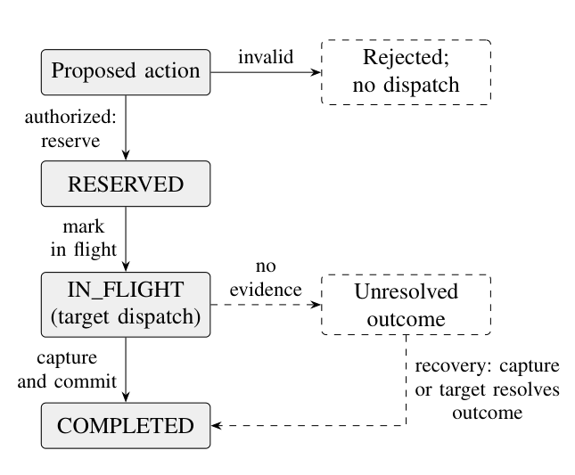查看原图 ↗</a>

*授权后才保留动作身份，尚未确认与已完成的动作有不同的恢复路径。*

作者注入十类单机故障。在预先指定的 200 对崩溃与重放中，完整配置出现 0 次重复生效，三个较简单的基线各出现 117 次。但另一组消融更能说明幂等性的边界：移除一组账本相关能力后，目标端仍能阻止重复，记录到的 170 个外部效果却全部成了无法与本地动作对应的孤立效果，300 个案例中能恢复的从 300 降到 200。账本存在而缺少对账时，另一组已知崩溃留下的 100 个结果都无法消除歧义。消融一次移除了多种相关能力，因此不能把差异全部归给某个日志字段。实验给出了区分重复、孤立和歧义的检验方法，其覆盖范围是受控目标端和指定的单机中断点。

<h2 class="daily-paper-title" id="paper-arxiv-2611.23307">工具声明幂等之后，怎样验证重试</h2>

[Checking Retry Transparency in Agent Tools](https://arxiv.org/abs/2611.23307) · Jiapeng Li (Microsoft) · arXiv v1 2026-11-11

同一个写入调用执行两次，最终值没变，只能说明它单独执行时可重复。如果另一个客户端在两次尝试之间已经收到更新成功的确认，盲目重试仍可能覆盖那次更新。Jiapeng Li 从实现中提取效果契约，分别检查整次尝试能否吸收重试，以及操作内部的中间步骤与其他写入交错时会暴露什么状态。在后端已完成写入、回复被抑制的 27 次检查中，按证据选择恢复策略完成了 6 个可证明的工作流，没有破坏已确认目标；盲重试完成 9 个，却破坏了其中 3 个目标。这个数字衡量的是固定组件和有限交错内可以安全完成多少工作。它补充了前文的账本实验：即使能查到账本，工具本身能否与并发更新相容，仍是独立的问题。

<h2 class="daily-paper-title" id="paper-arxiv-2611.23362">TRACE-MAS 从下游症状回溯协作故障</h2>

[TRACE-MAS: Diagnosing and Repairing Collaboration Failures in Multi-Agent Systems](https://arxiv.org/abs/2611.23362) · Zekai Chen, Yihan Sun, Xunkai Li, Xun Wu, Xinmo Jin, Yinlin Zhu, Haodong Lu, Xuaner Chen, Rong-Hua Li · arXiv v1 2026-11-17

协作系统里最反常的消息可能只是转述了更早的错误。TRACE-MAS 用良性轨迹学习状态、消息和任务依赖之间的正常关系，把一次运行表示为有偏序关系的事件图。发现偏离后，系统依次假设某个候选事件恢复正常，比较下游违反约束的程度下降多少，据此追溯起点并选择局部修复。在五个受控基准上，首选位置命中已标注起点的比例平均比 AcMAS 高 28.0 个百分点。定位与任务恢复要分别看：改动源头附近的分支有时也能让任务成功，即使排在第一位的节点并非真实起点。开放式协作中，良性流程本身随时间变化，学习到的约束也需要重新验证。

<a class="note-image-link" href="/assets/images/digest/2026-11-20/arxiv-2611.23362.png" target="_blank" rel="noopener" aria-label="事件图上的同一组约束连接检测、源头归因与局部修复。">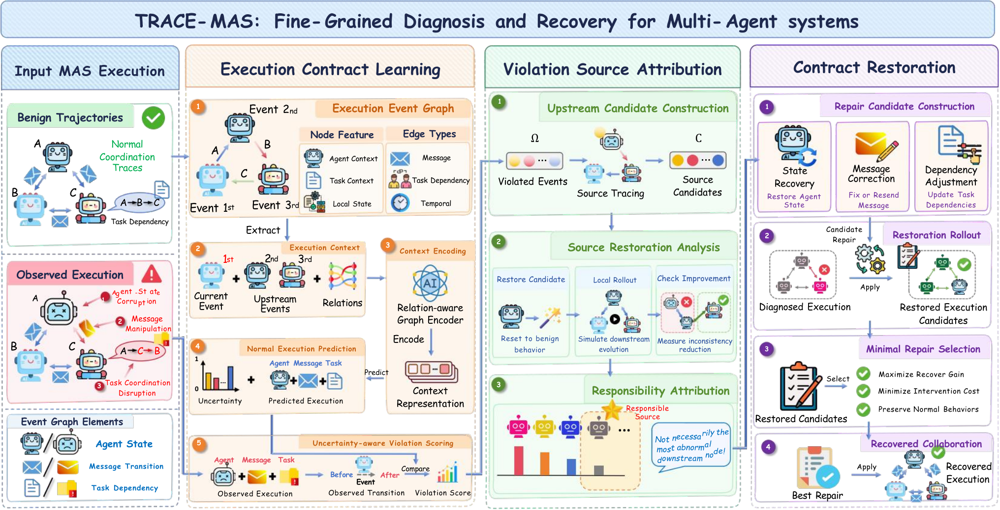查看原图 ↗</a>

*事件图上的同一组约束连接检测、源头归因与局部修复。*

<h2 class="daily-paper-title" id="paper-arxiv-2611.23346">沿状态转移记录证据，找出第一次偏离</h2>

[Securing and Auditing Long-Horizon LLM Agents: State-Transfer Auditing and Controls in the Agent Harness](https://arxiv.org/abs/2611.23346) · Deep Shah, Nehal Kathrotia · arXiv v1 2026-11-17

上下文压缩、长期记忆写入和回滚都能改变智能体以后“知道什么”，只保留工具日志很难追踪这种改变。作者在状态转移处记录来源、目标和片段沿袭关系，并用哈希链连接记录。确定性检查负责核对身份与状态一致性，内容是否丢失重要约束则交给语义检查。在 120 条正常和 120 条注入故障的轨迹上，完整记录的违规召回率为 98.3%，仅用工具日志为 16.7%。微秒级耗时测的是确定性包装层；语义判断的成本和漏检风险需要另算。对跨会话恢复而言，最值得保留的是能把异常内容追溯到第一次转移的证据。

<a class="note-image-link" href="/assets/images/digest/2026-11-20/arxiv-2611.23346.png" target="_blank" rel="noopener" aria-label="写入、压缩或回滚都可能改变后续决策能读到的状态。">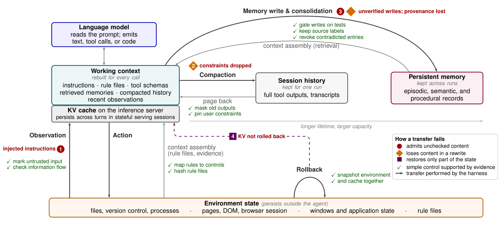查看原图 ↗</a>

*写入、压缩或回滚都可能改变后续决策能读到的状态。*

<h2 class="daily-paper-title" id="paper-arxiv-2611.23611">隐藏工具执行图必须保留上层操作的语义</h2>

[RefinementGuard: Counterexample-Directed Semantic Qualification for Hidden Agent-Tool Execution](https://arxiv.org/abs/2611.23611) · Adhyayan Veer Singh, Fanjiang Ye, Yuke Wang · arXiv v1 2026-11-17

把一次仓库操作展开为后台并行检查可以节省时间，但少看一条应检查的分支，就可能给上层返回错误的“通过”。RefinementGuard 在隔离状态中分别运行候选执行图与独立参考，按上层操作的义务比较证据来源、必查项和可见结果，然后把资格判定绑定到实际运行的产物。仓库缺陷定位和补丁验证两个契约中，义务检查拒绝 100 个已激活非等价故障中的 49 个，并接受全部 60 个合法变体。精确相等检查能挡住更多故障，却也拒绝了全部合法变体。有限输入的资格证明仍会漏过错误，它的价值是明示哪些不同实现可以安全互换以及判断依赖哪些样本。

<a class="note-image-link" href="/assets/images/digest/2026-11-20/arxiv-2611.23611.png" target="_blank" rel="noopener" aria-label="候选执行图先离线验证，运行时再核对证书与实际产物。">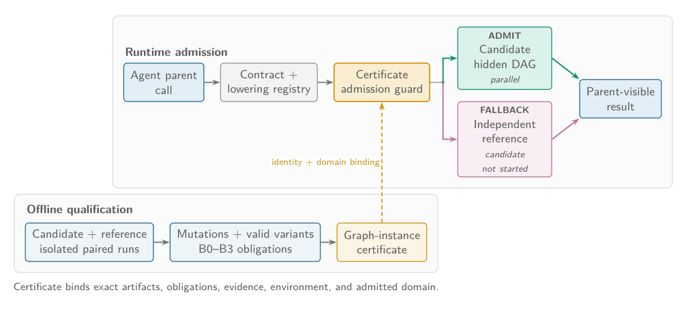查看原图 ↗</a>

*候选执行图先离线验证，运行时再核对证书与实际产物。*

<h2 class="daily-paper-title" id="paper-arxiv-2611.23558">Duru 追踪整个智能体被拖慢了多少</h2>

[Towards Fair Resource Sharing in Agentic LLM Serving](https://arxiv.org/abs/2611.23558) · Sehyeon Lee, Yuchen Xia, Zhaoyang Hong, Jinrui Hu, Anuradha Pandey, Evan Zhao, Ankita Nayak, Nishil Talati · arXiv v1 2026-11-17

工具调用期间保留某个智能体的 KV 缓存，可以加快它回来后的解码，却会让另一个智能体迟迟拿不到显存。在一组 100 个智能体、并发 18 的实验中，缓存保留让中位归一化减速从 1.4 倍降到 1.0 倍，p99 却从 6.6 倍升到 10.7 倍。Duru 用智能体相对独占执行的累计减速协调路由、准入与运行时排队，让已经落后的工作获得机会。作者在 MI300X 和 H100 的工作负载组合上报告 p99 减速的几何平均降幅为 44.4%，吞吐落在基线的 91.8%–127.4%。只汇报缓存命中率会漏掉这项取舍：有些负载需要用少量吞吐换尾部公平。

<a class="note-image-link" href="/assets/images/digest/2026-11-20/arxiv-2611.23558.png" target="_blank" rel="noopener" aria-label="保留 A 的缓存让 A 更快返回，也可能让 B 等过多个回合；右侧曲线显示尾部影响。">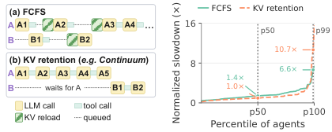查看原图 ↗</a>

*保留 A 的缓存让 A 更快返回，也可能让 B 等过多个回合；右侧曲线显示尾部影响。*

<h2 class="daily-paper-title" id="paper-arxiv-2611.23239">ETA 在工具结果到达时检查能否结束思考</h2>

[ETA: Exit on Tool Arrival in Speculative Agent Loops](https://arxiv.org/abs/2611.23239) · Saptarshi Mitra, Xuan Zhu, Rohith Kukkala, Sitao Huang, Karthik Vijayan · arXiv v1 2026-09-01

提前推测工具调用并发出请求，可以把外部等待藏在主模型思考期间；但结果到达后，主路径有时还在生成一长串不会改变决定的 token。ETA 把投机分支用作观察器：只有调用预测稳定、与已派发的调用一致、探针也支持即将调用，并且结果到达时才尝试截断。模型仍须通过原有动作检查，探针的预测不会直接执行。相对允许重试的 SPORK，在 τ²-bench 航空与零售 155 个任务上作者测得 1.33 倍加速，在电信任务和 BFCL v4 多轮任务上分别为 1.26、1.13 倍。论文检验的是配对任务上的动作匹配，不能据此保证每条轨迹都不改变。

<a class="note-image-link" href="/assets/images/digest/2026-11-20/arxiv-2611.23239.png" target="_blank" rel="noopener" aria-label="多个条件同时满足才尝试退出，探针建议仍要经过主路径的动作检查。">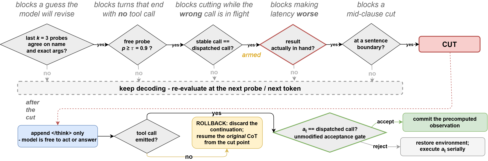查看原图 ↗</a>

*多个条件同时满足才尝试退出，探针建议仍要经过主路径的动作检查。*

<h2 class="daily-paper-title" id="paper-arxiv-2611.24496">BubbleTea 把微调切进 MoE 层内的等待时间</h2>

[Harvesting Expert-Parallel Bubbles for Fine-Tuning](https://arxiv.org/abs/2611.24496) · Oana Balmau, Saurav Banka, Jiaxuan Chen, Anne-Marie Kermarrec, Ramya Narasimha Prabhu, Rafael Pires, Mathis Randl, Martijn de Vos · arXiv v1 2026-11-18

即使整卡一直在处理请求，同一 MoE 层内先算完本地专家的卡仍要等待其他卡。BubbleTea 从路由器已知的 token 分配预测每张卡可用的微秒数，把共享已加载权重的微调计算切成小块，只有能在等待窗口内完成的块才获准执行。这个粒度比按整轮推理估算空闲更细。在四张 A100 的三个 MoE 模型实验中，微调吞吐为 LLMStation 的 1.9–6.2 倍。63 组配置中有 50 组的 p90 推理延迟指标维持在仅服务时的 10% 以内。后一个分母很重要：预测气泡可以回收算力，但不能为每种上下文长度和负载提供相同的尾延迟保证。

<a class="note-image-link" href="/assets/images/digest/2026-11-20/arxiv-2611.24496.png" target="_blank" rel="noopener" aria-label="每卡收到的 token 数不同，先完成的卡在汇合前留下可用于微调的空隙。">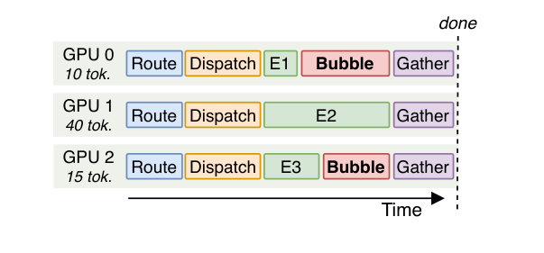查看原图 ↗</a>

*每卡收到的 token 数不同，先完成的卡在汇合前留下可用于微调的空隙。*

<h2 class="daily-paper-title" id="paper-arxiv-2611.23848">KIWI 让 CPU 代理承担可编程的专家通信</h2>

[A Fast, Programmable GPU-to-CPU Invocation Layer for GPU-Initiated Communication](https://arxiv.org/abs/2611.23848) · Jiakun Yan, Shiksha Patel, David Sidler, Gengyu Rao, Brandon Potter, Bradford Beckmann · arXiv v1 2026-11-18

专家并行需要将 token 分发到相应设备，再汇总计算结果。KIWI 让 GPU 将精简请求写入队列，由专用 CPU 代理推进通信；应用可以定义一次调用所代表的完整操作。KIWI-EP 因而能为专家分发与汇合编写专门的通信路径。作者在 AMD 多节点环境测了小消息延迟、通信内核和 vLLM 端到端服务：在八节点 GLM-5.3 FP8 服务上，相对 MORI 每输出 token 时间最多减少 29%。代价包括预留 CPU 核，收益也取决于节点间传输方式；多卡位于同一目的节点时，能否合并发送会改变不同实现的带宽需求。

<a class="note-image-link" href="/assets/images/digest/2026-11-20/arxiv-2611.23848.png" target="_blank" rel="noopener" aria-label="两节点点对点实验把小消息的单向延迟和大消息的带宽分别画出。">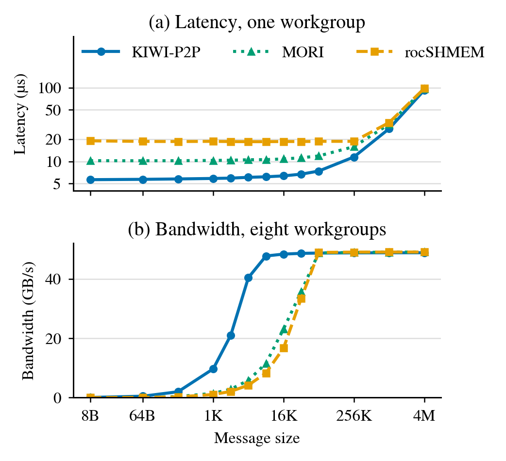查看原图 ↗</a>

*两节点点对点实验把小消息的单向延迟和大消息的带宽分别画出。*

<h2 class="daily-paper-title" id="paper-arxiv-2611.23512">DexAttention 把稀疏掩码的规划成本计入加速</h2>

[DexAttention: Distributed Sparse Attention through Rapid Online Planning and Persistent GPU Execution](https://arxiv.org/abs/2611.23512) · Sirui Chen, Xuehai Qian · arXiv v1 2026-11-17

稀疏注意力减少了计算，却未必减少跨卡交换：掩码随输入和注意力头变化时，固定的分块归属可能把通信都挤到同一条链路。DexAttention 在 GPU 上结合拓扑为掩码分配工作，由轻量调度器决定粗粒度传输与计算顺序，再由各卡的常驻内核按依赖释放细任务。规划器因此不必预测每个内核的准确结束时刻。在四节点十六卡集群、11 个配置中，端到端训练相对各自最快适用基线的几何平均加速为 1.39 倍；动态视频注意力相对 Ring Attention 为 2.11–2.37 倍，包含重新规划时间。后者是特定注意力工作负载的比较，不能替代完整训练结果。

<a class="note-image-link" href="/assets/images/digest/2026-11-20/arxiv-2611.23512.png" target="_blank" rel="noopener" aria-label="分配器根据掩码安排数据与计算，常驻执行器按就绪依赖推进各卡任务。">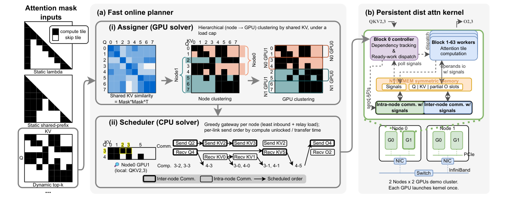查看原图 ↗</a>

*分配器根据掩码安排数据与计算，常驻执行器按就绪依赖推进各卡任务。*

<h2 class="daily-paper-title" id="paper-arxiv-2611.24458">分开 SM 后，还会争用同一个交叉开关端口</h2>

[A Runtime System for Mitigating Crossbar Port Contention on SM-Partitioned GPUs](https://arxiv.org/abs/2611.24458) · Ziwen Wang, Qi Luo, Kunlin Li, Changxi Liu, Dongsheng Wang, Yun Chen · arXiv v1 2026-11-18

给延迟敏感工作划出独占的流式多处理器，并不能隔离所在图形处理集群到 L2 的通路。GPCPlace 利用放置位置调节争用：跨更多 GPC 铺开可以获得更多端口，而将不同负载装入不同 GPC 又能减少相互干扰。运行时改变实际使用的处理单元掩码，使同一应用无需修改代码就能选择布局。作者在 14 款 GPU、112 组负载上与 CUDA Green Contexts 比较，报告的平均加速最高为 1.15 倍，个例达 2.38 倍，同时维持总吞吐。能得到多少改善取决于计算请求速率、缓存通路压力与同时运行的工作，峰值不能代表任意共置。

<a class="note-image-link" href="/assets/images/digest/2026-11-20/arxiv-2611.24458.png" target="_blank" rel="noopener" aria-label="不同 SM 分区仍可能通过同一个 GPC 端口访问 L2。">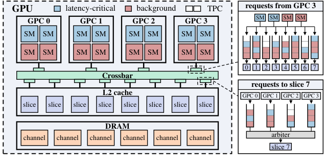查看原图 ↗</a>

*不同 SM 分区仍可能通过同一个 GPC 端口访问 L2。*

<h2 class="daily-paper-title" id="paper-arxiv-2611.24437">从等待屏障的 warp 中找出可提前执行的指令</h2>

[Dissecting an Unexplored SASS Control-Code Field: Barrier Exemption and Programmable Warp Priority](https://arxiv.org/abs/2611.24437) · Ziwen Wang, Qi Luo, Kunlin Li, Changxi Liu, Dongsheng Wang, Yun Chen · arXiv v1 2026-11-18

同样的指令序列，在同步屏障前后可能留出不同的调度空间。作者通过指令级微基准区分 NVIDIA SASS 控制字段的两类作用：EXEMPT 允许等待屏障时发射独立指令，另一组标记调整 warp 的硬件优先级。编译后的优化器选择符合条件的位置放置标记，直接用实际推理负载检查微基准收益能否延续。llama.cpp 上以 32 条并发序列解码 Qwen3-30B-A3B，H20 上最高改善 3.6%，同一框架的稠密模型预填充最高约 1%。小专家的工作划分会改变等待占比，收益集中在特定内核和形状，不能按单个内核的加速外推到整个模型。

<a class="note-image-link" href="/assets/images/digest/2026-11-20/arxiv-2611.24437.png" target="_blank" rel="noopener" aria-label="对照时间线显示被标记的独立加载如何与屏障等待重叠。">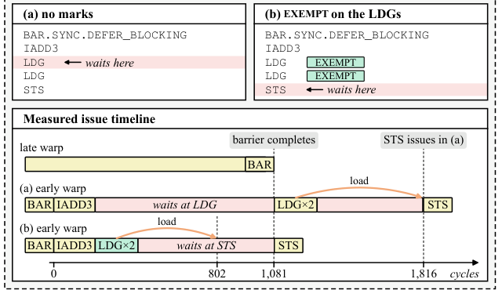查看原图 ↗</a>

*对照时间线显示被标记的独立加载如何与屏障等待重叠。*

<h2 class="daily-paper-title" id="paper-arxiv-2611.23835">NarrowSpec 让草稿模型选择自己的宽度</h2>

[NarrowSpec: Draft Hidden Width Need Not Match the Target in Speculative Decoding](https://arxiv.org/abs/2611.23835) · Alagappan Valliappan, Ankit More, Dheevatsa Mudigere, Jatin Mitra · arXiv v1 2026-11-18

投机解码的草稿网络读取目标模型的隐状态，并不要求它在内部每一层都保留相同宽度。NarrowSpec 缩小残差流，在接口处适配维度；对借用目标词表头的 DFlash，还能把两个线性映射提前合成一次。每步草拟更便宜，但少接受一个候选 token 就可能抵消节省。作者用 880 条提示比较 DFlash 和 EAGLE-3，在温度为零时，半宽或四分之一宽在 B200 上端到端解码加速 1.06–1.12 倍，在 GB10 上为 1.13–1.44 倍。更大批量也做了扫描，B200 测到 batch 512，最高达 1.21 倍。各变体只按匹配的数据预算训练一次，硬件带宽利用率与训练充分程度均会影响最优宽度。

<a class="note-image-link" href="/assets/images/digest/2026-11-20/arxiv-2611.23835.png" target="_blank" rel="noopener" aria-label="装载时合成输出适配器和词表头，解码时只需一次较窄的投影。">查看原图 ↗</a>

*装载时合成输出适配器和词表头，解码时只需一次较窄的投影。*

<h2 class="daily-paper-title" id="paper-arxiv-2611.23388">QDA 用快慢两种信号搜索量化配方</h2>

[QDA: Closed-Loop LLM Quantization Design with Agents](https://arxiv.org/abs/2611.23388) · Xingyang Li, Tianlang Zhao, Song Han, Ligeng Zhu · arXiv v1 2026-11-17

量化配方在一个模型上有效，换模型或位宽后可能反而损害输出。QDA 把目标内核支持的格式固定下来，让智能体修改离线量化过程。大多数候选用相对原模型输出分布的 KL 散度快速打分，只有少数有希望的方案再做长生成，检查短样本难以暴露的重复循环。四个推理模型上，每次约 64 GPU 小时的搜索相对最强公开配方，在 W4A16、W4A8、W3A16 下平均分别多得 0.9、1.4、2.2 个准确率百分点。收益来自搜索出的权重和配方，部署仍用既有内核。更低 KL 只是筛选信号，长生成和下游任务分数决定改进是否真正保留。

<a class="note-image-link" href="/assets/images/digest/2026-11-20/arxiv-2611.23388.png" target="_blank" rel="noopener" aria-label="多数配方先用 KL 快速排序，长生成检查集中在少数候选上。">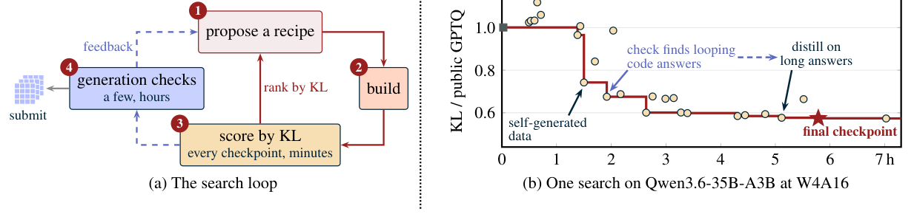查看原图 ↗</a>

*多数配方先用 KL 快速排序，长生成检查集中在少数候选上。*

<h2 class="daily-paper-title" id="paper-arxiv-2611.24431">SkimPrefill 保留整幅图和整段文字</h2>

[Let a Small Model Read First: Faster Prefill for Long Interleaved Image-Text Inputs](https://arxiv.org/abs/2611.24431) · Xiaolin Lin, Kai-Chiang Wu, Bing Li, Grace Li Zhang · arXiv v1 2026-11-18

长图文文档的瓶颈往往在回答之前：让目标模型先读完全部内容，再决定删哪些 token，可能已经付出了大部分预填充成本。SkimPrefill 用 Qwen3.5-0.8B 以半分辨率浏览输入，只运行到早期层，用一个注意力头对整张图和整段文字排序，再把选中的单元交给不同家族的目标模型。MMLongBench 的 128K 测试中，保留 10% token 时，三个目标的首 token 加速分别为 3.7、11.6、8.2 倍，计入筛选时间。保留整个单元有助于留下证据词之间的关系，但需要跨段归纳的答案仍可能因丢失背景而受损，应按任务核对准确率。

<a class="note-image-link" href="/assets/images/digest/2026-11-20/arxiv-2611.24431.png" target="_blank" rel="noopener" aria-label="示例中保留整段文字留下了颜色词，而逐 token 剪枝丢掉了答案所需的词。">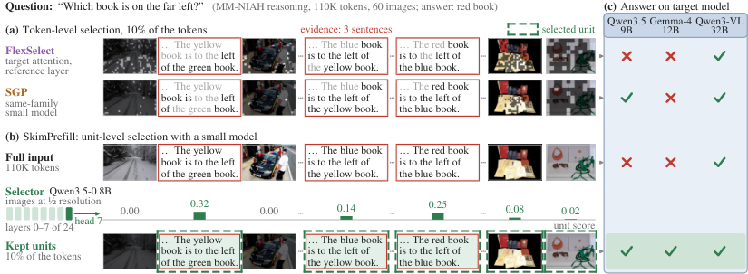查看原图 ↗</a>

*示例中保留整段文字留下了颜色词，而逐 token 剪枝丢掉了答案所需的词。*

<h2 class="daily-paper-title" id="paper-arxiv-2611.23483">SpecLook 先验证该看哪里</h2>

[SpecLook: Speculating Where to Look for Fast and Reliable Agentic MLLMs](https://arxiv.org/abs/2611.23483) · Xi Ding, Jiawei Zhang · arXiv v1 2026-11-17

视觉智能体反复放大局部来确认答案，成本来自多轮工具调用。SpecLook 让小模型先提出一处可核验的观察，再看新证据是否支持原答案。答案稳定且置信度足够就提前退出；不够确定时，大模型先在无工具条件下核验，证据仍不足才进入完整循环。快速变体直接略过最后的搜索。在 V*、HR-Bench 和 POPE 的六个切分上，以 DeepEyes-7B 作专家，快速变体平均准确率提高 4.2 个百分点，每题用时从 9.92 秒降至约 1 秒。平均准确率按切分、时间按问题汇总，两者权重不同。此处验证的是视觉问答证据，后面的 Vanguard 验证的则是界面上的下一步操作。

<a class="note-image-link" href="/assets/images/digest/2026-11-20/arxiv-2611.23483.png" target="_blank" rel="noopener" aria-label="小模型先提出局部观察，只有证据仍不足的问题才进入后续搜索。">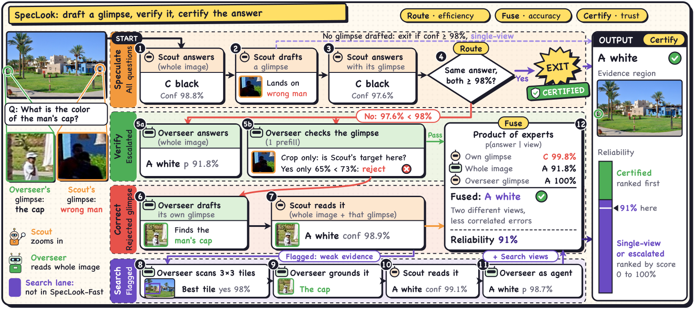查看原图 ↗</a>

*小模型先提出局部观察，只有证据仍不足的问题才进入后续搜索。*

<h2 class="daily-paper-title" id="paper-arxiv-2611.23917">Vanguard 用当前屏幕判断下一步动作</h2>

[Vanguard: Knowing When to Trust the Draft in Speculative Vision-Language Agents](https://arxiv.org/abs/2611.23917) · Hanqi Mao, Jiajun Fan, Ruihan Guo, Shuaike Shen, Ziwen Wang, Hui Ren, Xianrui Zhong, Ge Liu · arXiv v1 2026-11-18

“点击确认”在文字上很合理，屏幕上却可能根本没有这个按钮。Vanguard 让小模型提出候选步骤，判定模型同时看截图、任务、历史动作与候选动作，通过阈值才采用，否则让较大模型接手。它利用小模型多次采样中正确答案可能已出现这一事实，把计算用于辨别候选。在 Mind2Web 两个留出集的 820 和 975 个步骤上，四个草稿候选配合 8B 回退，步骤成功率分别为 66.5% 和 66.8%，由 8B 写出的步骤占 26% 和 23%。阈值在开发集选定；成功的单步比例、整段任务完成率及端到端时间需要分别衡量。

<a class="note-image-link" href="/assets/images/digest/2026-11-20/arxiv-2611.23917.png" target="_blank" rel="noopener" aria-label="界面案例和闭环轨迹展示哪些步骤由草稿模型完成，哪些交给目标模型。">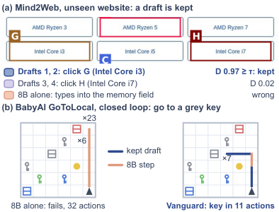查看原图 ↗</a>

*界面案例和闭环轨迹展示哪些步骤由草稿模型完成，哪些交给目标模型。*

<h2 class="daily-paper-title" id="paper-arxiv-2611.24324">编码任务的超时升级能省多少 GPU 小时</h2>

[Reducing Inference Cost of Coding Agents with Timeout Cascades](https://arxiv.org/abs/2611.24324) · Boxi Zhou, German Sviridov, Dmitrii Ustiugov, Haris Javaid · arXiv v1 2026-11-18

按任务难度路由需要先判断一道题对小模型是否太难。另一种做法是给小模型有限时间，用结果决定是否升级。作者比较 36 个开放权重模型，再用 mini-swe-agent 的轨迹模拟 GLM-4.7-Flash 到 GLM-4.7 的串联策略。在 SWE-bench Verified 的 500 项任务上，最佳超时点相对全用大模型节省 16.4% GPU 小时，同时维持解决率；可利用难度信息的理想化路由节省 17.9%。低、中难度任务占 91%，有利于小模型先做。升级的任务必须顺序支付两次等待，且真实环境需要识别失败；单次评测的成本估算不能直接换算成交互响应时间。

<a class="note-image-link" href="/assets/images/digest/2026-11-20/arxiv-2611.24324.png" target="_blank" rel="noopener" aria-label="左侧按超时或失败升级，右侧在执行前按预测的难度选模型。">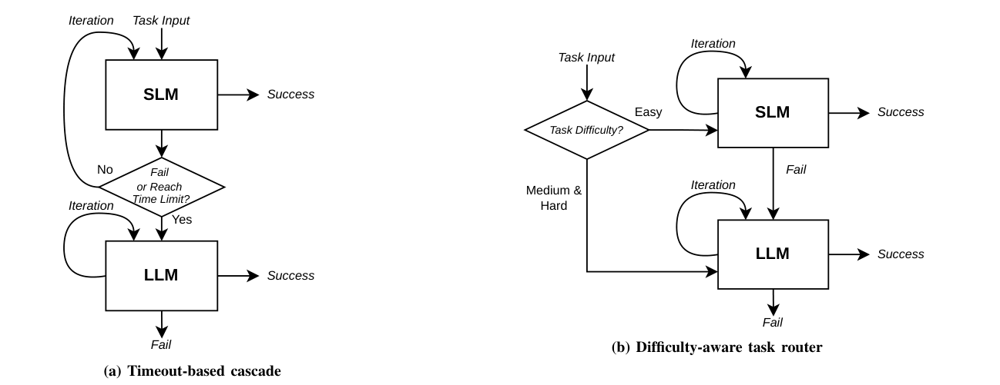查看原图 ↗</a>

*左侧按超时或失败升级，右侧在执行前按预测的难度选模型。*

<h2 class="daily-paper-title" id="paper-arxiv-2611.24892">用户模拟器会不会奖励接受坏结果的行为</h2>

[On Evaluating User Simulators for Interactive Agents](https://arxiv.org/abs/2611.24892) · Hengguang Zhou, I-Hung Hsu, Li Chen, Priyanshi Shrivastava, Anastasios Angelopoulos, Wei-Lin Chiang, Ion Stoica, Cho-Jui Hsieh · arXiv v1 2026-11-18

交互评测的用户模拟器如果过早宣布满意，智能体看起来就会比实际更可靠。作者在可比轨迹中改变目标、移除约束、提前停止，或要求模拟用户接受已损坏的结果，观察现有指标能否对这种变化作出正确反应。十类扰动里，三个已有评测套件各自只对五至六类给出可检测的下降。新套件把单条轨迹意图与约束、群体行为统计、智能体排名与参考排名的一致性分层测量，合计检出十类。这不等于一个通用总分：能识别坏轨迹的指标未必能筛出对真实智能体排序有用的用户群体，两者应分别测试。

<a class="note-image-link" href="/assets/images/digest/2026-11-20/arxiv-2611.24892.png" target="_blank" rel="noopener" aria-label="从单条轨迹的意图，到用户群体统计，再到智能体排序，三层指标回答不同问题。">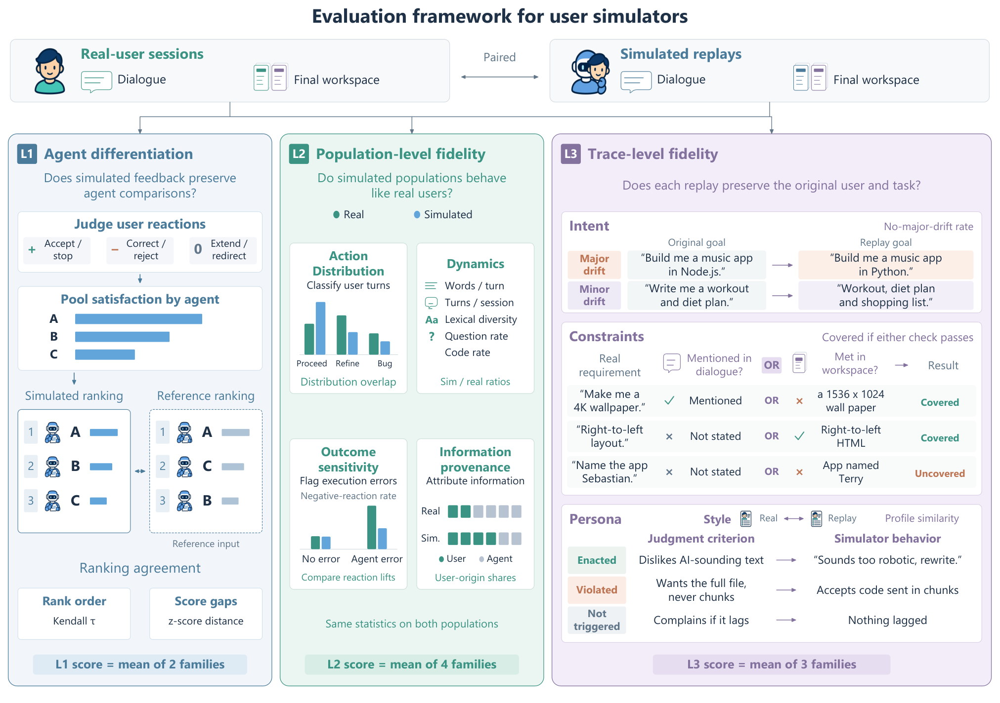查看原图 ↗</a>

*从单条轨迹的意图，到用户群体统计，再到智能体排序，三层指标回答不同问题。*

<h2 class="daily-paper-title" id="paper-arxiv-2611.24395">RSIBench-Infra 把提速提交交给独立验收</h2>

[RSIBench-Infra: Can Agents Optimize Their Own Training and Inference Infrastructure at Production Scale?](https://arxiv.org/abs/2611.24395) · Hanlin Wu, Yifei Wang, Zhicheng Cai, Huan-ang Gao, Wei-Ying Ma, Ya-Qin Zhang, Jingjing Liu, Hao Zhou · arXiv v1 2026-11-18

智能体可以轻易让某个内核更快，却可能同时减少工作量、损坏数值结果，或把时间移到测量区间外。RSIBench-Infra 从官方可运行配方构造 20 个训练与推理任务，固定硬件、输入、计时边界和质量要求；智能体可以改动整套软件，但须以 OCI 镜像层提交，再由独立环境运行。七种智能体与模型配置、每项八小时预算下，正式评分的 130 个提交中有 86 个通过质量条件且加速超过 1.10 倍。这个分母是提交数，同一任务可有多个提交。逐项查看预热排除规则、质量检查和端到端时间，才能判断加速究竟来自软件优化还是测量口径。

<a class="note-image-link" href="/assets/images/digest/2026-11-20/arxiv-2611.24395.png" target="_blank" rel="noopener" aria-label="优化、应用镜像层和独立评测分开执行，性能测试之前先过质量检查。">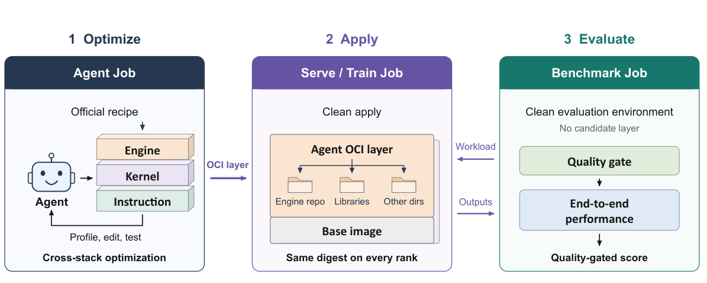查看原图 ↗</a>

*优化、应用镜像层和独立评测分开执行，性能测试之前先过质量检查。*

<h2 class="daily-paper-title" id="paper-arxiv-2611.24788">为并发证明任务租用已预热的 Isabelle 会话</h2>

[Isabelle Pool Server: a pooled verification service for prover training and multi-agent proving](https://arxiv.org/abs/2611.24788) · Xuanwei Ren, Wenda Li · arXiv v1 2026-11-18

多个证明智能体共享验证器时，反复启动会话会吞掉吞吐，无限制保留分支又会耗尽内存。Isabelle Pool Server 按导入环境复用预热会话，每个会话同一时刻只租给一个客户端，按内存决定是否接受新请求，并给调用设定时限。客户端能逐步检查、保存状态并回退，最终仍可做完整理论构建。在单机扩展实验中，32 个工作进程在预热条件下获得约 24 倍的验证吞吐；计入会话启动后速率明显降低。脚本化完整 rollout 的增幅也小于短块验证。复用最适合导入相同、分支很多的搜索，不能把块吞吐直接当作证明完成率。

<a class="note-image-link" href="/assets/images/digest/2026-11-20/arxiv-2611.24788.png" target="_blank" rel="noopener" aria-label="同样扩到 32 个工作进程，是否计入启动会话的时间会改变吞吐曲线。">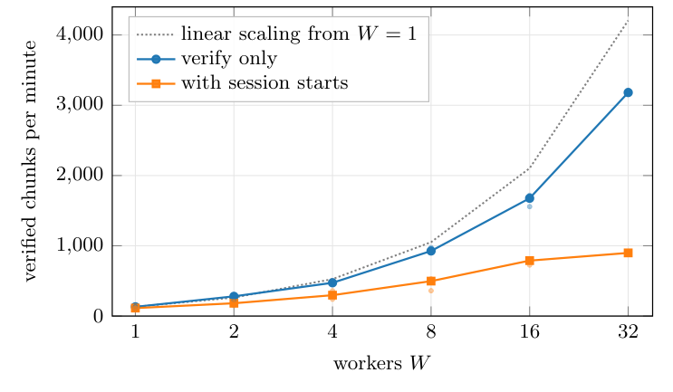查看原图 ↗</a>

*同样扩到 32 个工作进程，是否计入启动会话的时间会改变吞吐曲线。*

<h2 class="daily-paper-title" id="paper-arxiv-2611.24578">BaseRSI 把外部提示的增益写回视觉模型</h2>

[BaseRSI: Recursive Self-Improvement of a Base Vision-Language Model via Training-Free Harness Internalization](https://arxiv.org/abs/2611.24578) · Mingda Zhang, Yuanhao Dong, Qiang Huang, Rui Qian, Yanjin Li, Zhenyu Liu, Xiao Huang, Zihao Yang, Jian Wang, Pinjia He, Xiaoying Tang · arXiv v1 2026-11-18

同一个视觉推理提示每次都随请求发送，其帮助只在外部流程存在时有效。BaseRSI 先从失败案例提出并验证新的提示或观察策略，再让带策略的模型指导同一模型的裸运行。ReGap 用逐层激活差指出要补回的信号，ReKey 把更新限制在少量神经元上，多轮可在同一检查点叠加。作者在十个视觉推理基准上测量准确率，还以随机替换写入值的消融检验是否只是改动权重就能奏效。它提供的是开放权重条件下转移部分策略收益的证据。评测集中于图像问答，尚不能推断多工具生产流程的行为也能同样内化。

<a class="note-image-link" href="/assets/images/digest/2026-11-20/arxiv-2611.24578.png" target="_blank" rel="noopener" aria-label="外层筛选策略，内层把策略造成的激活变化写回权重。">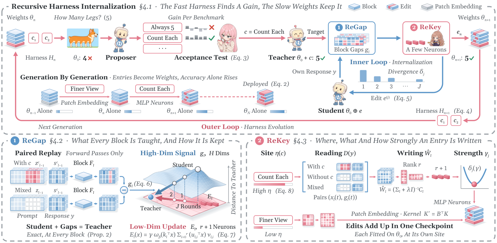查看原图 ↗</a>

*外层筛选策略，内层把策略造成的激活变化写回权重。*

<h2 class="daily-paper-title" id="paper-arxiv-2611.23878">HETEROVLM 在板上给紧急视觉请求让路</h2>

[HETEROVLM: Edge Multi-Request Vision-Language Model Serving on a Heterogeneous Versal SoC with AI Engines and Programmable Logic](https://arxiv.org/abs/2611.23878) · Zhiheng Chen, Yu-An Chou, Yifan Zhang, Ye Qiao, Saptarshi Mitra, Sitao Huang · arXiv v1 2026-11-18

摄像头问题与纯文本问题共享边缘设备时，排在长预填充之后的短请求可能错过截止时间。HETEROVLM 把编码、预填充和注意力放到 AIE 阵列，把小批量解码和调度放在可编程逻辑上。多个请求在一次解码中共享权重读取，紧急任务在工作单元边界抢占，被暂停的任务从 DDR 里的中间结果继续。在 Versal VC1902 实板上，文本问题和含一张 512×288 图像的 177-token 摄像头问题的首 token 用时分别为 140 和 303 毫秒。面对正在处理的 4K 输入，抢占使紧急请求比空载仅多等约 14 毫秒。数字对应特定板卡、模型和输入形状。

<a class="note-image-link" href="/assets/images/digest/2026-11-20/arxiv-2611.23878.png" target="_blank" rel="noopener" aria-label="板上布局区分 AIE 阵列、内存服务和用于小批量解码的 GEMV 引擎。">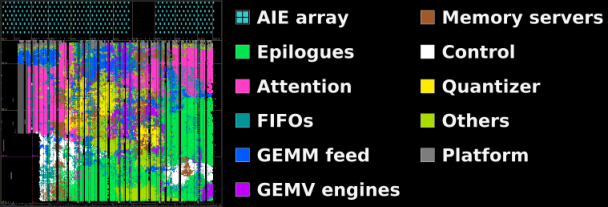查看原图 ↗</a>

*板上布局区分 AIE 阵列、内存服务和用于小批量解码的 GEMV 引擎。*

<h2 class="daily-paper-title" id="paper-arxiv-2611.24085">LEDGE 用真机校准异构边缘推理的放置成本</h2>

[LEDGE: An Efficient Simulator for Distributed LLM Serving on Heterogeneous Edge Devices](https://arxiv.org/abs/2611.24085) · Zihao Wang, Ye Tian, Tajana Rosing, Nalini Venkatasubramanian · arXiv v1 2026-11-18

异构小设备如何切分模型，受不同精度的算子耗时和共享上行链路共同制约。LEDGE 省去实际张量计算，用端到端测量校准设备模型，模拟非均匀张量并行、流水线分段和多组请求的链路争用。作者使用 Jetson 与树莓派等十台设备验证预测。在原 Qwen 设置中，请求级平均绝对百分比误差低于 3.6%；移到其他模型家族而不重新校准时，端到端误差为 7.44%。这些精度使大量放置方案可先经仿真筛选，也说明真实工作负载一旦偏离校准分布，就需要重新测量，尤其不能把高仿真速度误当成设备本身加速。

<a class="note-image-link" href="/assets/images/digest/2026-11-20/arxiv-2611.24085.png" target="_blank" rel="noopener" aria-label="放置决策作为输入，设备与共享网络模型共同决定模拟的请求延迟。">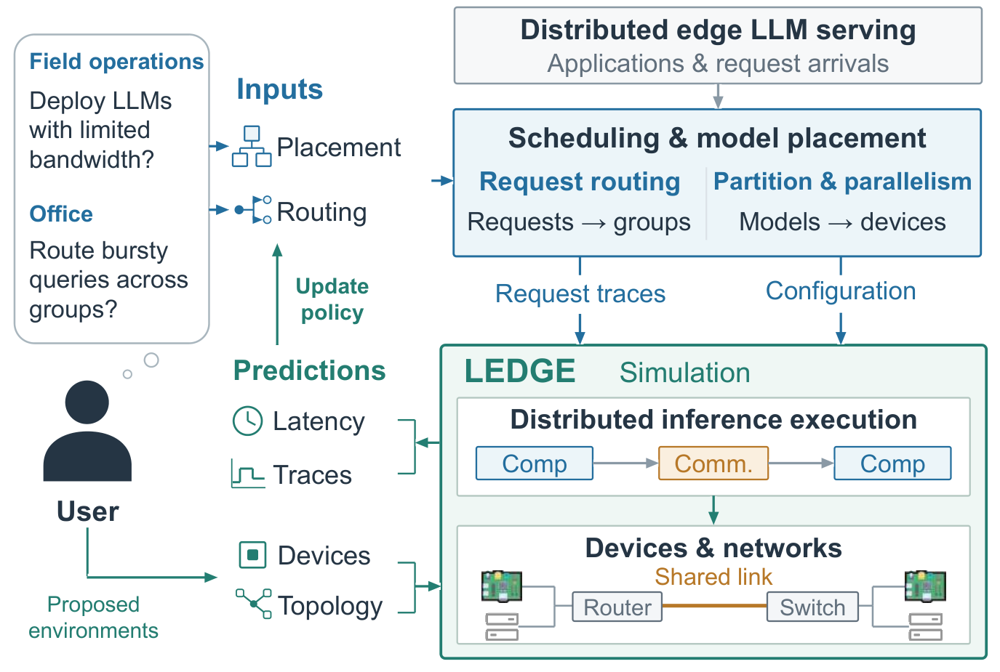查看原图 ↗</a>

*放置决策作为输入，设备与共享网络模型共同决定模拟的请求延迟。*

## 社区动态

### SREGym 用业务结果检验 Outlook 故障是否恢复

SREGym 已合并根据微软 11 月 12 日初步事故报告构造的网关级联任务。验收要求邮件恰好送达一次、峰值下探测恢复，并能承受后续突发流量。在单层环境的专机验证中，参考修复使 1,644 封邮件恰好投递一次，部分修复虽然改善表面症状，却未通过连接负载检查。改用更接近事故报告的变更日志措辞后，gpt-6.1-sol 在两台主机上的两组实验合计 0/10 通过。结果说明线索措辞会改变诊断难度。隔离策略是对未披露细节的建模，多副本层级仍待实机验证。 · Jackson Clark · 2026-11-18 · [原帖](https://x.com/HacksonClark/status/2123165881324716111) · [项目验收记录](https://github.com/SREGym/SREGym/pull/1202)

### KernelBench 记录了吞吐提升，也保留了同步疑点

KernelBench 维护者为 Gemini 4 Neon xhigh 公布了逐项审计。在 RTX PRO 6000 的 Kimi-Linear Decode 上，2K、8K、16K 上下文的结果汇总为相对 Torch 的 36.66 倍加速。居中的 int4 反量化使取整更稳定，缓存策略则针对前一步 KV 写入挤出稠密权重的问题。审计仍指出一次归一化状态重置与全网格同步的顺序存疑；维护者报告隔离重复 110 次没有失败，重载下出现过一次。在另一项 DeepSeek NSA 测试中，0.073 毫秒是几何平均内核时间。评测没有为每个智能体设统一时间预算，这些数值描述特定硬件上的产物性能。 · Elliot Arledge · 2026-11-19 · [原帖](https://x.com/elliotarledge/status/2123522413464031716) · [逐项审计](https://kernelbench.com/models/gemini-4-neon-xhigh)

## 同日笔记

- [H20-3e 上的 DeepSeek 服务：首 token 提前，逐 token 解码变慢](/tech/zh/lmsys-deepseek-v41-flash-h20-pd-colocate/)
- [工具按需加载，省下的是每一步都要读取的上下文](/tech/zh/baseten-deferred-tool-loading/)
- [Inferact 怎样用影子流量筛选 vLLM 优化](/tech/zh/inferact-autonomous-inference-system/)
- [SageMaker 如何判断推理请求该跨区、该重试还是该等待](/tech/zh/aws-sagemaker-cross-region-inference-routing/)
- [Performance Factory 如何判断一次性能回归已经修复](/tech/zh/openai-performance-factory/)
- [Gemini 4 Neon 的任务成本取决于推理档位和执行环境](/tech/zh/gemini-4-neon/)
