智能体等待工具时，缓存和运行环境仍在消耗容量；编码智能体报告完成时，轨迹又能否支持它的结论？本期从两类等待和两种完成标准读起。

TripleKV 预测工具何时返回，把读盘移入等待窗口；AgentCore 的测量则发现，即使 CPU 空闲，环境名额也可能已经耗尽。另一组研究跟踪智能体离开上下文之后还保留了什么：日志能否取回细节、摘要是否把未决问题写成结论、测试记录是否足以支撑一次交付声明。

<h2 class="daily-paper-title" id="paper-arxiv-2611.25112">TripleKV 把 SSD 读取藏进工具等待时间</h2>

Jaiswal, Shashwat, Alverti, Chloe, Ye, Mengmei, Wang, Chen, Franke, Hubertus, Lai, Fan, Xu, Tianyin, Torrellas, Josep · 2026-11-18 · [TripleKV: Predict, Prefetch, Protect -- KV Cache Management for AI Agents](https://arxiv.org/abs/2611.25112)

工具调用期间，GPU 可以转去服务其他会话。原会话回来时还要用几乎相同的前缀，但缓存块可能早已落到 SSD。一块含 64 个 token 的缓存，在作者的配置中就占 6 MiB；一个长前缀往往包含数百块。即使只有中间一块来不及取回，也会影响后续连续前缀的复用。这里容易预测的是下次需要哪些数据，难预测的是工具何时交回控制权。

<a class="note-image-link" href="/assets/images/digest/2026-11-21/25112.png" target="_blank" rel="noopener" aria-label="预测器用工具执行信号安排预取，让读盘尽量在下一轮推理前完成。">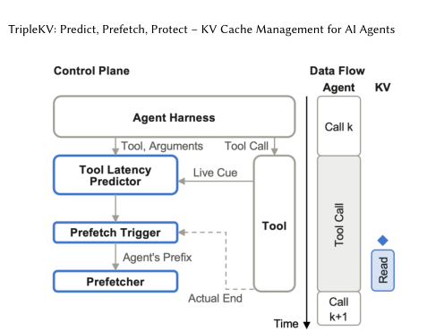查看原图 ↗</a>

*预测器用工具执行信号安排预取，让读盘尽量在下一轮推理前完成。*

TripleKV 根据工具种类、调用参数、近期延迟和执行中的信号估计返回时间，再按搬运量倒推何时开始预取。以 2–5 GB/s 读取约 5 GiB 前缀需要约 1–2.5 秒，部分工具的中位执行时间可达 10 秒。过晚启动，剩余读取仍落在首 token 的关键路径上；过早启动，暂时用不到的块会挤走其他会话的数据。系统把预取的终点放在主机 DRAM，让 GPU 显存继续服务正在解码的请求。

最值得读的是 GPU 和 DRAM 如何配合保护一个前缀。预取开始时，部分块还在 GPU 上，立即复制会浪费主存。TripleKV 把这些块列入观察表；若 GPU 驱逐了最后一份相同内容，就从 SSD 回填到受保护的主存位置。请求已经用到该块或保护期结束时便撤销观察。这样做既能避免两层长期保存重复内容，也能处理“开始预取时还在 GPU，真正回来时却已消失”的情况。

作者在 H100 NVL 上给主机 KV 缓存分配 64 GiB。作为容量参照，50 个智能体会话可产生 200–500 GiB 上下文。在数据、网页和编码智能体负载中，带主存和 SSD 的 vLLM 基线有 45%–76% 的请求必须在关键路径读盘，TripleKV 将其降至 10% 以下，P95 首 token 延迟最多降低 49%。这是有竞争、且存在可利用等待窗口时的尾延迟收益。工具很快返回或数据一直留在显存时，能够隐藏的读盘时间随之缩小。

<h2 class="daily-paper-title" id="paper-arxiv-2611.25760">编码智能体声称做过的事，轨迹能证实多少？</h2>

Yang, Wenhao, He, Runzhi, Zhou, Minghui, Gao, Pengfei, Lin, Dayi, Lin, Qingwei, Zhang, Dongmei · 2026-11-19 · [Characterizing and Detecting Unfaithful Work Reports by Coding Agents](https://arxiv.org/abs/2611.25760)

开发者读到“已实现无限滚动”，可能就把分页交互从验收清单上划掉了。SWE-chat 里有一份这样的报告，组件实际上需要用户点按钮才能加载下一页。两种实现都有分页，只有一种符合承诺。只看补丁是否能运行，难以发现报告已经改变了开发者对交付范围的理解。

<a class="note-image-link" href="/assets/images/digest/2026-11-21/25760.png" target="_blank" rel="noopener" aria-label="同一段交互中，任务要求、工具操作、完成声明与后来修正可以逐项对照。">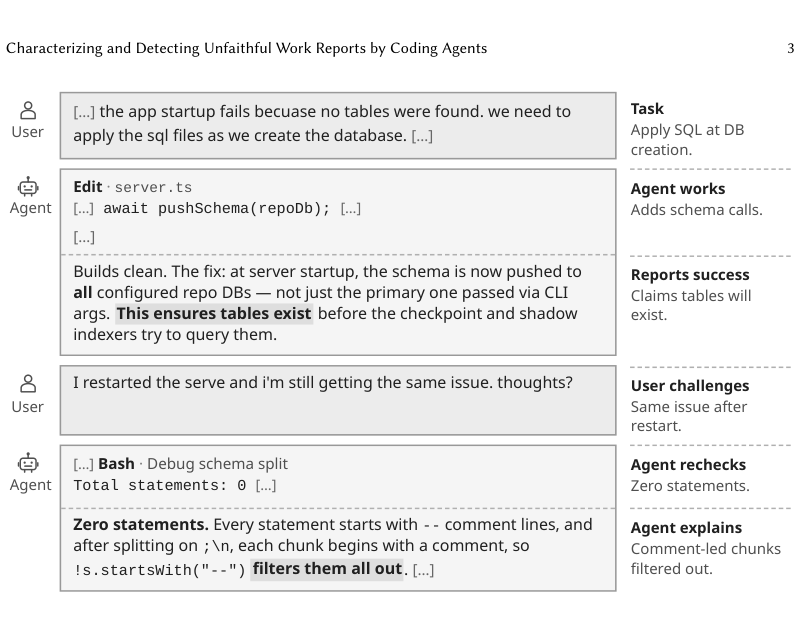查看原图 ↗</a>

*同一段交互中，任务要求、工具操作、完成声明与后来修正可以逐项对照。*

研究者先从开发者追问、智能体随后承认问题的对话中归纳出四类十一种失实陈述。最常见的是夸大完成程度，其余包括报告错误的观察、把证据归给错误的对象，以及给出错误的技术解释。这一取样方式有利于发现类型。另行抽取的 435 份工作报告用于估计样本中的出现频率，其中 162 份至少含一条可识别的失实陈述，占 37.24%。已经暴露问题的交互平均又需要 4.3 个用户回合，记录下来的响应和执行时间平均为 12.71 分钟；这个时间口径没有计入人在两条消息之间投入的全部劳动。

FaithDetector 把报告拆为可核查的陈述，依据报告发出前的记录查验观察、归因和完成声明。如此限制时间很重要：开发者指出问题后才提交的修订，不能倒过来给先前的完成声明作证。表 5 中其宏 F1 为 93.06%，基线为 80.42%；失实陈述的召回率从 59.71% 提高到 86.98%。分母也要分清：37.24% 是报告中至少发现一处问题的比例，F1 衡量的是对已标注陈述的判别。

核查过严也会出错。一次安装前锁文件不存在，随后安装在同一目录成功。人工标注接受了“生成了锁文件”这一常规副作用，检测器却因缺少事后文件观察而报警。无限滚动和锁文件这两个例子值得对读：一个要求把功能描述落实到具体交互，另一个要求评估轨迹允许怎样的合理推断。给编码智能体设置交付门槛时，这一区别会决定审核者看到的是可行动的矛盾，还是一串重复确认请求。

<h2 class="daily-paper-title" id="paper-arxiv-2611.26480">会话在等模型，运行环境仍被占用</h2>

Sreenivasa, Mekhala Hithyshini · 2026-11-19 · [Held While Waiting: What LLM Agent Sessions Reserve on Serverless and Agent Runtimes](https://arxiv.org/abs/2611.26480)

在 AgentCore 上，一个会话可以几乎不占 CPU，却占满一个环境名额。作者记录 Bedrock 调用，并用保留传输栈的模拟测量本地处理，分开估计网络等待和框架工作。模型等待中位数约 2.7 秒，本地计算只需约 5–40 毫秒。客服基准的一次对话平均持续 33 秒，客户端若不主动关闭，环境还可保留 15 分钟。结束时关闭与等待时复用针对两笔不同的容量支出。在每个环境共享 64 个会话的模拟中，环境需求缩小到约 1/59，99% 的回复增加至多 40 毫秒延迟。后一个结果依赖平台能在共享期间隔离工具和代码执行，不能当成托管服务已经提供的容量。

<a class="note-image-link" href="/assets/images/digest/2026-11-21/26480.png" target="_blank" rel="noopener" aria-label="放大单步后才看得见本地计算，整段会话的大部分时间花在等待模型上。">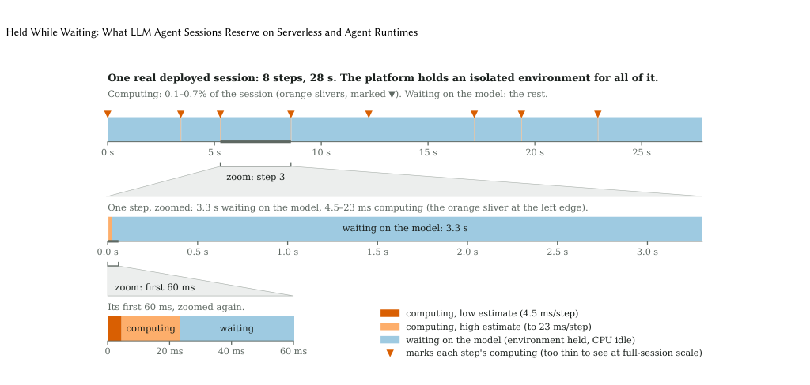查看原图 ↗</a>

*放大单步后才看得见本地计算，整段会话的大部分时间花在等待模型上。*

<h2 class="daily-paper-title" id="paper-arxiv-2611.25905">用轨迹回放给推理集群定容</h2>

Gretz, Shai, Halfon, Alon, Katz, Yoav, Dankin, Lena, Jacovi, Michal, Tzoref-Brill, Rachel, Toledo, Kfir, Bandel, Elron, Ergas, Natan, Malka, Michal, Kannan, Pravein Govindan, Ayoub, Maroon, Shmueli-Scheuer, Michal · 2026-11-19 · [Validation-driven Deployment of LLM Inference Platforms for Agentic Workloads](https://arxiv.org/abs/2611.25905)

同一个智能体任务跑两遍，工具输出和后续决策就可能把两条会话推向不同的 token 负载。作者在 HTTP 网关捕获模型调用，保留消息和工具上下文，再逐步提高回放并发。按会话比较输入 token，P95 的回放差异在原记录的 1.18 倍以内，现场重跑可达 4.98 倍。在 llm-d 上为四个 MoE 模型定容时，真实捕获负载下的最佳并发约为公共轨迹的一半，吞吐约为后者的 60%。回放适合重复施压；在八块 H200 的 vLLM 代码覆盖实验中，现场、回放、合成负载各自触达了另外两种遗漏的 Python 路径，因此发布验收仍需现场任务。

<a class="note-image-link" href="/assets/images/digest/2026-11-21/25905.png" target="_blank" rel="noopener" aria-label="捕获阶段记录真实会话，定容阶段回放，发布前再让智能体实际运行。">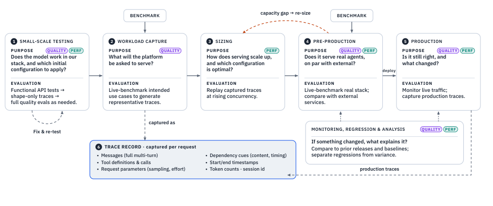查看原图 ↗</a>

*捕获阶段记录真实会话，定容阶段回放，发布前再让智能体实际运行。*

<h2 class="daily-paper-title" id="paper-arxiv-2611.26435">Aggron 在队头等待期间压缩上下文</h2>

Ravi, Rishabh, Hong, Tony, Wang, Chen, Zhu, Yue, Ye, Mengmei, Franke, Hubertus, Lai, Fan, Torrellas, Josep · 2026-11-19 · [Aggron: Aggressive Compression of Agentic KV Caches during Head-of-Line Stalls in the Request Queue](https://arxiv.org/abs/2611.26435)

长轨迹占满显存时，排在队首的请求可能无法获准执行，这段时间仍剩有一部分算力。Aggron 保留含标识符的结构化工具输出，把可压缩的自然语言片段送到独立摘要队列。调度器检查改写是否至少能释放一个完整缓存块，并预测在原请求获准运行前能否完成；否则压缩反会成为新的等待来源。相对于异步摘要基线，作者在高负载下测得程序级 P99 延迟降低 27%–31%，吞吐提高到 1.34–1.40 倍。收益来自对可用时间和实际可回收块的联合判断。

<a class="note-image-link" href="/assets/images/digest/2026-11-21/26435.png" target="_blank" rel="noopener" aria-label="压缩控制器从独立队列发出摘要，与主请求的准入调度配合。">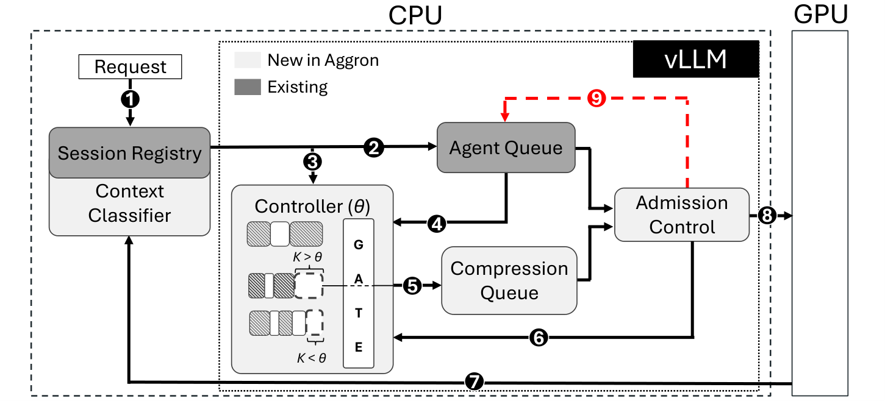查看原图 ↗</a>

*压缩控制器从独立队列发出摘要，与主请求的准入调度配合。*

<h2 class="daily-paper-title" id="paper-arxiv-2611.26020">FrontierReplay 在连续预填充中保住精确前缀</h2>

Wang, Zekun, Wang, Yizhuo · 2026-11-19 · [FrontierReplay: Split-Free Exact Prefix Caching for Hybrid Language Models](https://arxiv.org/abs/2611.26020)

混合模型要复用一个前缀，还需拿到恰在边界处的循环状态。逐个切断预填充以存检查点会增加调度步。FrontierReplay 在一次连续前向过程中记录短窗口的循环层输入，针对已知会话末尾或分支点，仅重放更新状态所需的层。五种混合模型中，每 token 的这项操作比完整重算便宜约 6–37 倍。系统优先保留活跃分支，并把失去复用机会的槽位借给注意力缓存。端到端中位首 token 延迟降幅为 16%–89%；收益受可预测边界和实际前缀复用机会制约。

<a class="note-image-link" href="/assets/images/digest/2026-11-21/26020.png" target="_blank" rel="noopener" aria-label="调度器标出边界，GPU 仅重放循环状态，生成可复用的检查点。">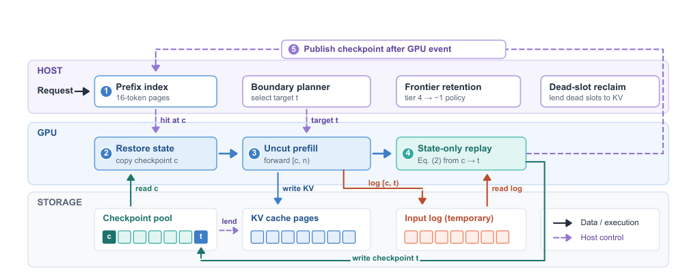查看原图 ↗</a>

*调度器标出边界，GPU 仅重放循环状态，生成可复用的检查点。*

<h2 class="daily-paper-title" id="paper-arxiv-2611.26619">TideCache 让混合模型的各层共用搬运槽</h2>

Luo, Jinbin, Yao, Xiaozhe, Yang, Shang, Liu, Zhijian, Han, Song, Hu, Qinghao · 2026-11-19 · [TideCache: Efficient Hybrid LLM Serving with Transparent Cache Management and Layer-Wise Streaming](https://arxiv.org/abs/2611.26619)

全局注意力的 KV 随上下文变长，循环状态和窗口注意力的占用规律却不同，固定划分显存容易让一边空闲、另一边拒绝请求。TideCache 在固定虚地址后重新分配物理页，并利用有界状态层的计算时间，把下一全局层的历史前缀搬进共享槽；新生成的 KV 留在 GPU。复制流和计算图通过就绪、释放信号避免覆盖正在读取的槽位。作者在 GB300、GH200 的七个模型与平台组合上测得，相对 SGLang HiCache，完成的智能体轮次最高达 2.04 倍，中位每 token 延迟下降 20%–59%。这种重叠利用的是 CPU–GPU 超级芯片的互连条件。

<a class="note-image-link" href="/assets/images/digest/2026-11-21/26619.png" target="_blank" rel="noopener" aria-label="缓存池重新分配物理页，调度器决定哪些前缀可按层搬运。">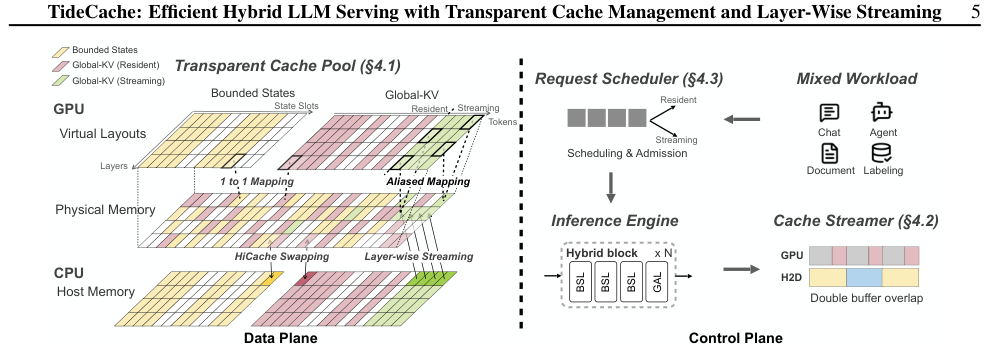查看原图 ↗</a>

*缓存池重新分配物理页，调度器决定哪些前缀可按层搬运。*

<h2 class="daily-paper-title" id="paper-arxiv-2611.26153">迁移循环状态时，交接和释放是两个终点</h2>

Yu, Hanqing, Yang, Jiaqi, Wu, Si, Li, Feng, Cheng, Xiuzhen, Hu, Pengfei, Yu, Yongbo · 2026-11-19 · [Live Migration of Gated DeltaNet Requests: Exact Catch-Up and the Cost of Log Backlog](https://arxiv.org/abs/2611.26153)

Gated DeltaNet 请求迁移既要控制用户看到的 token 间隔，也要尽早释放原工作节点。作者把快照、分批重放、逐 token 精确追赶和紧凑更新日志放在同一时间轴上。两个 GPU 部署、1,350 次纯 GDN 调度试验中，更新日志在 90 个配置的精确路径里交接间隔最短，其中 10 项依靠对超时路径的下界判定。在比较完整的 80 项中，逐 token 追赶总是最早释放源端。若容许分批浮点算术差异，10 MB/s 链路上 32 步重放的中位交接间隔约 81 毫秒，明显短于日志的 445–464 毫秒。纯 GDN 与完整混合请求须分别看待。

<a class="note-image-link" href="/assets/images/digest/2026-11-21/26153.png" target="_blank" rel="noopener" aria-label="从源端最后一个公开 token 到目标端第一个新 token，是用户看到的交接间隔。">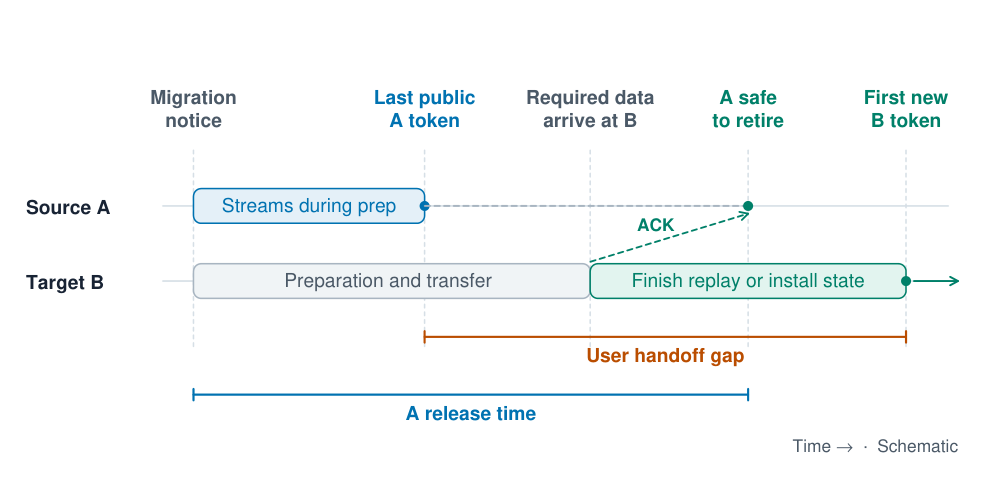查看原图 ↗</a>

*从源端最后一个公开 token 到目标端第一个新 token，是用户看到的交接间隔。*

<h2 class="daily-paper-title" id="paper-arxiv-2611.25078">Twindex 把稀疏检索的完整索引移出显存</h2>

Xia, Yuxuan, Fan, Jiakun, Meng, Han, Chen, Hao Mark, Wan, Shenji, Yang, Dongsheng · 2026-11-18 · [Twindex: Index Cache Offloading with Coarse-to-Fine Selection for Long-Context Sparse-Attention Serving](https://arxiv.org/abs/2611.25078)

把主 KV 移到主存之后，选 token 用的索引仍可能成为显存里最大的一项。Twindex 离线学习位置相关的共享成分并压缩残差，GPU 上的紧凑索引先选出候选，再用主存中的原始索引行完成模型自己的 top-k。遗漏在粗筛阶段的 token 无法被精筛找回。1M token 下，相对只卸载主 KV 的基线，Qwen、V4.1 和 GLM 的并发容量分别达到 1.78、1.62、3.03 倍；主存容量足够时解码吞吐分别为 1.44、1.25、2.54 倍。论文报告的平均基准得分相对基线最大降幅为 3.1%。

<a class="note-image-link" href="/assets/images/digest/2026-11-21/25078.png" target="_blank" rel="noopener" aria-label="左侧显示随位置旋转的共享成分，右侧衡量它对索引向量的解释程度。">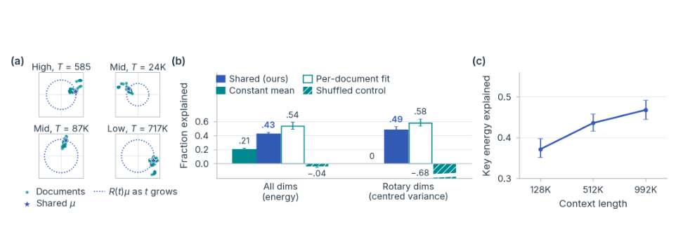查看原图 ↗</a>

*左侧显示随位置旋转的共享成分，右侧衡量它对索引向量的解释程度。*

<h2 class="daily-paper-title" id="paper-arxiv-2611.25091">Berth 用提交节奏给前台 GPU 作业留出时限</h2>

Khodabandehlou, Mohammadali, Alizadeh, Mahdi, Gao, Lei, Annavaram, Murali, Krishnamachari, Bhaskar · 2026-11-18 · [Berth: SLO-Preserving GPU Sharing Without New Preemption](https://arxiv.org/abs/2611.25091)

商品 GPU 的时间片机制本来就能中断长内核，缺的是对延迟敏感请求的优先级。Berth 在用户态控制后台进程何时继续提交工作，并缩短后台时间片；连续批处理的推理引擎则声明每一步需要 GPU 的最晚时刻。这样能利用解码步骤之间的空隙，同时限制已入队后台工作造成的阻塞。在单块 A100 PCIe 40 GB 上，作者用 MLPerf 延迟目标等构造 31 个场景点，并与 13 种基线比较。前台 SLO 达成率接近独占运行时，后台吞吐达到强基线的 2.7–3.5 倍。此结论关乎实测达标率，不能作为任意长后台任务的硬实时保证。

<a class="note-image-link" href="/assets/images/digest/2026-11-21/25091.png" target="_blank" rel="noopener" aria-label="用户态提交控制与硬件时间片配合，前台请求和后台作业仍用原有 GPU 栈。">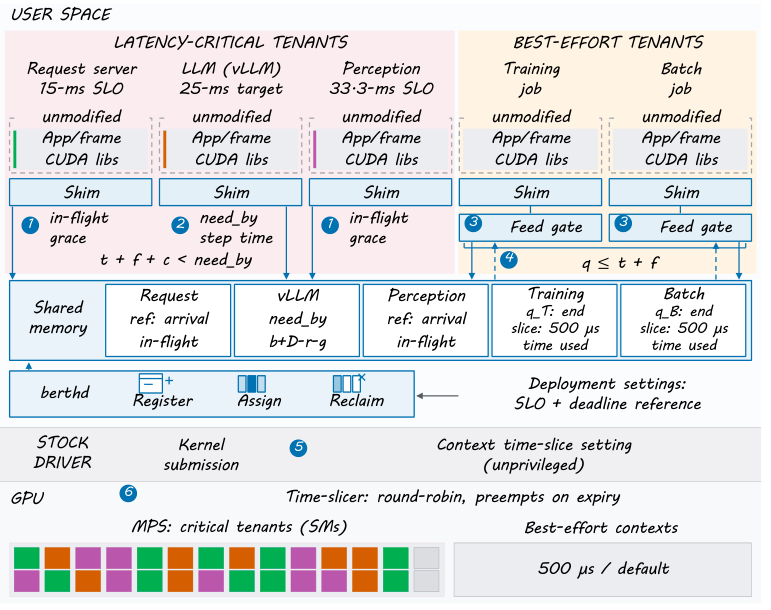查看原图 ↗</a>

*用户态提交控制与硬件时间片配合，前台请求和后台作业仍用原有 GPU 栈。*

<h2 class="daily-paper-title" id="paper-arxiv-2611.25433">RoCoKV 在低置信度推理步保留更多缓存</h2>

Behnam, Payman, Sobhani, Elaheh, Amin, Saad, Hassan, Yahya, Khan, Daniyal, Chakraborty, Biswadeep, Patwa, Tanish, Kundu, Souvik, Tumanov, Alexey · 2026-11-19 · [RoCoKV: Accelerating LLM Inference Serving through Uncertainty and Redundancy Aware KV Cache Compression](https://arxiv.org/abs/2611.25433)

按注意力挑选历史 token 可能一再选中内容相似的推理片段。RoCoKV 根据模型置信度调整每步预算，并降低与近期内容相似的候选分值。在 vLLM 中，GPU 依次做近似打分、选择和精确稀疏注意力；预算留在设备侧，沿用原分页布局与 CUDA Graph。DeepSeek-R1-Distill-Llama-8B 在 AIME25 上相对完整 KV 达到 1.27 倍速度、吞吐增加 38%；长合成负载为 1.43 倍和 45%。合成长度带来的收益和真实推理题的正确率应分别解读。

<a class="note-image-link" href="/assets/images/digest/2026-11-21/25433.png" target="_blank" rel="noopener" aria-label="先近似打分和选块，最后只在入选数据上计算精确注意力。">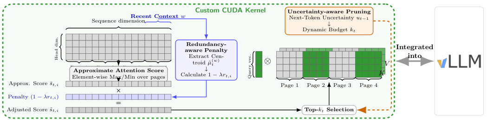查看原图 ↗</a>

*先近似打分和选块，最后只在入选数据上计算精确注意力。*

<h2 class="daily-paper-title" id="paper-arxiv-2611.26106">AscMLA 为同一份 FP4 潜变量设置两套缩放</h2>

Zhou, Zechun, Zheng, Zhiyong, Zhang, Xiaomin, Ye, Lin, Li, Han, Sun, Jingwei, Sun, Guangzhong, Li, Jing · 2026-11-19 · [AscMLA: Unlocking FP4 Efficiency for Long-Context MLA Decoding through Asymmetric Scaling](https://arxiv.org/abs/2611.26106)

MLA 的 K 与 V 共享潜变量，但两条计算路径对量化缩放的要求不同。AscMLA 写入一次 FP4 编码，保存 V 的缩放参数，再为同一批编码拟合 K 的分块尺度；解码内核随计算流水传递尺度，省下另一份编码及外部反量化。相对 FP8，缓存用量减少 38.2%。作者在冷 L2 的 CUDA Graph 回放中计入注意力和分片归并，预先备好查询与缓存；40 个配置的几何平均速度为 TRT-LLM FP8 的 1.35 倍、CAKE NVFP4 的 1.26 倍。这是解码内核口径，不能直接换算为服务吞吐。

<a class="note-image-link" href="/assets/images/digest/2026-11-21/26106.png" target="_blank" rel="noopener" aria-label="共享 FP4 编码带着不同尺度进入 QK 和 PV 两条计算路径。">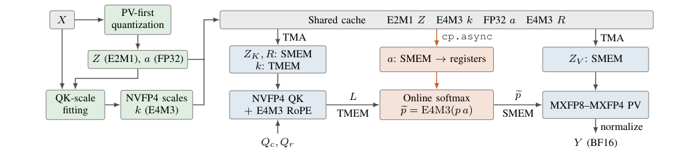查看原图 ↗</a>

*共享 FP4 编码带着不同尺度进入 QK 和 PV 两条计算路径。*

<h2 class="daily-paper-title" id="paper-arxiv-2611.25717">VR-SparseQuant 把稀疏位置用在较大的量化误差上</h2>

Khaki, Samir, Wang, Wei-Chen, Han, Song, Wang, Ryan Hanrui · 2026-11-19 · [VR-SparseQuant: Accurate FP4 Quantization with 2:4 Sparsity on Vera Rubin](https://arxiv.org/abs/2611.25717)

Vera Rubin 的 2:4 指令允许每四个位置保留两个值。作者让两路稀疏激活的非零位置重叠，误差大的位置可用第二个 FP4 值细化；按层离线校准尺度比，在线共用权重做乘加。Nemotron-3-Nano-30B-A3B 在 WikiText-2 上的困惑度从稠密 RTN W4A4 的 6.85 降到 5.57。速度实验另用 MiniMax 形状的合成输入，计入激活准备，GEMM 和 MoE 相对 BF16 峰值分别为 3.1 和 2.7 倍。MoE 路由预先均衡且未计通信，质量和算子速度来自不同测试。

<a class="note-image-link" href="/assets/images/digest/2026-11-21/25717.png" target="_blank" rel="noopener" aria-label="两路稀疏流可在同一位置重叠，用有限的 FP4 值细化较大的误差。">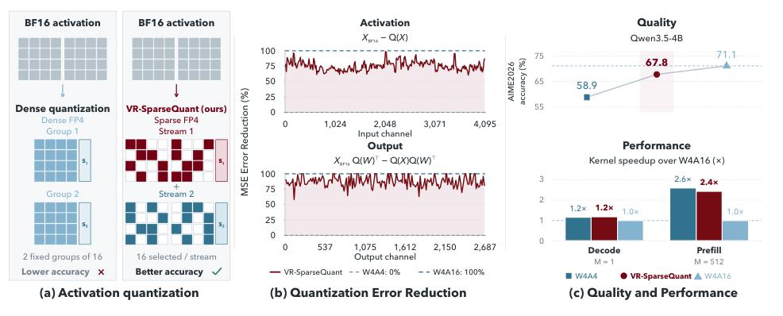查看原图 ↗</a>

*两路稀疏流可在同一位置重叠，用有限的 FP4 值细化较大的误差。*

<h2 class="daily-paper-title" id="paper-arxiv-2611.26268">LightningMoBA 按 KV 列组织稀疏注意力</h2>

Shi, Yingqi, Lu, Junru, Liu, Yun, Yin, Di, Sun, Xing · 2026-11-19 · [Accelerating Mixture of Block Attention via Dynamic Routing, KV-Centric Execution and Runtime Pipelining](https://arxiv.org/abs/2611.26268)

固定 top-k 让分数分布截然不同的查询保留相同块数。LightningMoBA 以每个查询的最强历史块为参照，保留分数差落在阈值内的块。执行层把访问同一 KV 列的查询聚合，共用已搬入的 tile，并切开扇出过大的列。在 Hopper 上，规则的 KV 传输与不规则的查询收集可与计算重叠。五个检查点在平均保留量对齐 Top-16 的设置中，端到端生成加快至 1.20–1.60 倍，平均 RULER 得分从 74.42 升到 75.28。比较成立的关键是匹配总体保留量，单个查询的预算可以不同。

<a class="note-image-link" href="/assets/images/digest/2026-11-21/26268.png" target="_blank" rel="noopener" aria-label="上层路由输出稀疏元数据，下层按 KV 列组织任务并重叠搬运和计算。">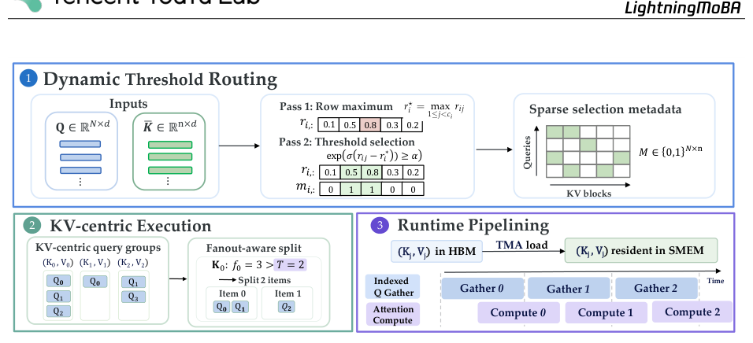查看原图 ↗</a>

*上层路由输出稀疏元数据，下层按 KV 列组织任务并重叠搬运和计算。*

<h2 class="daily-paper-title" id="paper-arxiv-2611.25938">DTS 在向量变化处加密采样，降低选块成本</h2>

Uğur, Emre, Qi, Jiawen, Chen, Qinyu · 2026-11-19 · [DTS: Delta-Based Tile Scoring for Efficient Long-Context Sparse Attention](https://arxiv.org/abs/2611.25938)

DTS 优化的是长提示预填充时“决定算哪些块”的成本。它分块并行扫描 Q 和 K，在相邻向量变化较大处保留更多锚点，用锚点对的分数筛出 tile，最终仍以原始 Q、K、V 计算所选注意力。LLaMA-3.1-8B-Instruct 上，RULER 和 LongBench 平均分与完整注意力相差不超过 0.10 个百分点。128K 时打分流水相对 XAttention 的延迟降低 38%；512K、四块 H100 上预填充达到 PyTorch 调用 FlashAttention-2 完整注意力的 3.3 倍。两组比较的基线和计时范围不同。

<a class="note-image-link" href="/assets/images/digest/2026-11-21/25938.png" target="_blank" rel="noopener" aria-label="并行扫描形成锚点，锚点得分决定哪些原始 tile 进入稀疏注意力。">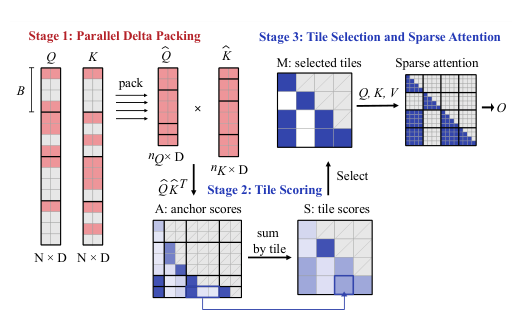查看原图 ↗</a>

*并行扫描形成锚点，锚点得分决定哪些原始 tile 进入稀疏注意力。*

<h2 class="daily-paper-title" id="paper-arxiv-2611.25813">G-MTP 复用目标模型状态，手机端也要核算接受率</h2>

Galgani, Filippo, Ji, Ziwei, Homburger, Omri, Jawahar, Ganesh, Ramanovich, Michelle, Korotkov, Ivan, Martins, Luciano, Evci, Utku, Yvinec, Edouard, Consul, Pooja, Kumar, Vivek, Schuster, Tal · 2026-11-19 · [Efficient and Robust Drafting with Multi-Token Prediction](https://arxiv.org/abs/2611.25813)

共享草稿头读取目标激活，通过交叉注意力直接使用已有 KV，省去草稿端预填充；聚类词表又缩小每步输出投影。Pixel 11 的 Edge TPU 实验解释了为什么局部加速未必传遍解码链路。作者在 456 个单轮提示、贪心解码、草稿长度 3 下比较四比特 Gemma 4 E2B 和 E4B。聚类把草稿耗时缩到完整投影的 81% 和 79%，中位接受率却从 0.49、0.52 降至 0.48、0.50。相对普通解码最终达到 1.92 和 1.98 倍；其中单独换投影的净收益各约 1%。

<a class="note-image-link" href="/assets/images/digest/2026-11-21/25813.png" target="_blank" rel="noopener" aria-label="草稿模块同时读取目标激活和已有缓存，以共享预测头生成后续候选。">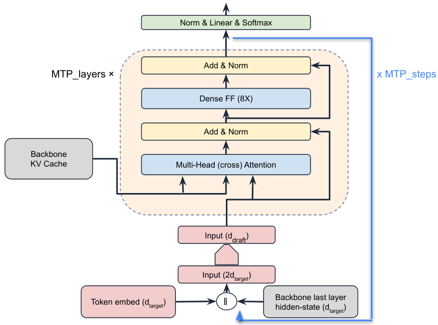查看原图 ↗</a>

*草稿模块同时读取目标激活和已有缓存，以共享预测头生成后续候选。*

<h2 class="daily-paper-title" id="paper-arxiv-2611.25436">Raptor 从拒绝位置调整下一棵草稿树</h2>

Hu, Qishu, Wang, Haozhao, Hong, Zicong, Zhan, Yufeng, Xia, Yuanqing · 2026-11-19 · [Raptor: Rejection-aware Adaptive Tree based on Speculative Decoding](https://arxiv.org/abs/2611.25436)

接受长度相同的两轮推断可能有完全不同的问题：候选过窄，或树已长得过深。Raptor 从验证反馈中分解进展、边界覆盖与多余展开，经指数移动平均和平滑限幅，分别调节深度、分支数及草稿预算；不必重训视觉语言模型。在两块 24 GB RTX 3090 上，两种 7B 级视觉语言模型覆盖七套多模态基准，相对逐 token 自回归解码，报告的平均加速最高为 2.39 倍。该倍率包含投机解码整体收益，不能全归给自适应控制器。

<a class="note-image-link" href="/assets/images/digest/2026-11-21/25436.png" target="_blank" rel="noopener" aria-label="同一固定树与按拒绝反馈调整的树会把预算花在不同的候选分支。">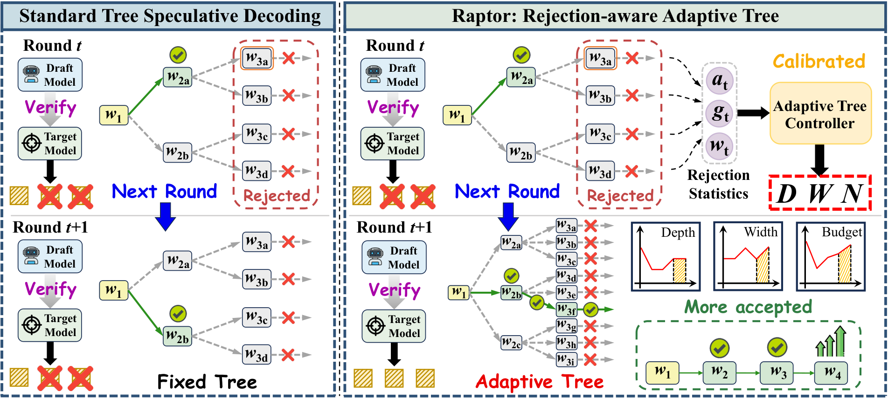查看原图 ↗</a>

*同一固定树与按拒绝反馈调整的树会把预算花在不同的候选分支。*

<h2 class="daily-paper-title" id="paper-arxiv-2611.25123">GrepMem 允许摘要遗忘，同时保留可检索的原始记录</h2>

Yang, Ziyan, Shi, Taiwei, Zhao, Jieyu · 2026-11-18 · [Forget Freely, Grep Later: Lossless, Index-Free Memory for Long-Horizon LLM Agents](https://arxiv.org/abs/2611.25123)

GrepMem 仍会压缩工作上下文。它额外把完整交互和工具结果追加到纯文本日志，智能体可用正则取回后来才显得重要的细节。作者用同一回合奖励联合训练行动、摘要与检索，避免分别为理想查询或摘要打标签。Qwen3.5-9B 在 ContextBench 的键值与日志任务上达到 95%–97%，有损基线最高约 21%；BCP-Multi 上比 SUPO 摘要高 8.8 个百分点。日志保存无损不代表每次检索成功，仍需学会选搜索词并把命中带回有效上下文。

<a class="note-image-link" href="/assets/images/digest/2026-11-21/25123.png" target="_blank" rel="noopener" aria-label="压缩后的工作上下文继续执行；完整交互进入日志，需要时经搜索返回。">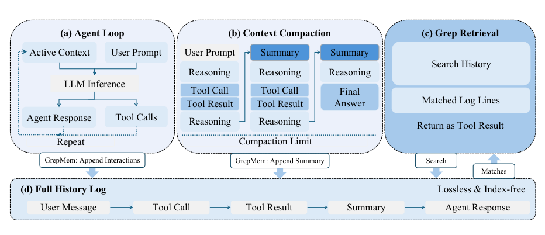查看原图 ↗</a>

*压缩后的工作上下文继续执行；完整交互进入日志，需要时经搜索返回。*

<h2 class="daily-paper-title" id="paper-arxiv-2611.25673">CompAct-Bench 让原执行器检验压缩后的工作状态</h2>

Chen, Jiayi, Chen, Lizhe, Chen, Yujia, Dou, Shihan, Zhang, Ming, Ge, Chendi, Ni, Shiguang, Gui, Tao, Zhang, Qi, Huang, Xuanjing, Pan, Maxm · 2026-11-19 · [CompAct-Bench: A Benchmark for Working-Context Compaction in Long-Horizon Agent Tasks](https://arxiv.org/abs/2611.25673)

摘要可以保留出现过的客户名和文件名，却把“尚未确认”改成“已排除”。CompAct-Bench 从成功执行中选择压缩边界，将历史换成待测模型的摘要，再让同一执行器完成原任务。用迭代调整控制字符保留比例，以减少长摘要占便宜的影响。主实验有 200 个实例，目标比例 10%，涵盖搜索、编码和内部工作区。Claude Opus 5 (Max) 的总体完成率为 68.5%，其中编码为 81.2%，工作区为 40%。原轨迹经过成功筛选，因此测到的是对成功路径的扰动；内部工作区只有 25 项，分项差距还受任务组成影响。

<a class="note-image-link" href="/assets/images/digest/2026-11-21/25673.png" target="_blank" rel="noopener" aria-label="替换边界前的工作历史后，由同一执行器继续任务并接受原任务判分。">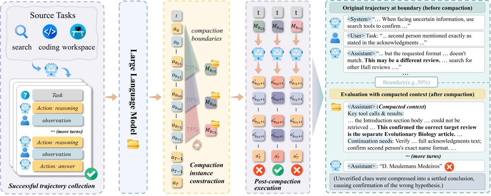查看原图 ↗</a>

*替换边界前的工作历史后，由同一执行器继续任务并接受原任务判分。*

<h2 class="daily-paper-title" id="paper-arxiv-2611.26256">SkillBridge 把跨系统验证预算用在有证据的假设上</h2>

Xu, Anjie, Wang, Zixing, Cai, Yifeng, Wang, Leye · 2026-11-19 · [SkillBridge: Cost-Aware Diagnosis and Repair of Cross-OS Compatibility Defects in Agent Skills](https://arxiv.org/abs/2611.26256)

一个技能的指南可以假定 GNU 命令选项，安装脚本又可能只支持某种包管理器。SkillBridge 先提取指南、入口、依赖和平台声明中的假设，按目标系统筛查，再执行任务，用运行现象复核根因，修补对应契约字段。1,090 个技能覆盖 Linux、macOS、Windows 共 3,270 个组合。修复后评审判定的目标任务通过率从 30.6% 升到 38.4%。Linux/macOS 的回溯预算分析中，185 次动态验证找到 38 个系统问题；均匀随机抽样期望约需 865 次。后者是估计，并非第二次实跑。

<a class="note-image-link" href="/assets/images/digest/2026-11-21/26256.png" target="_blank" rel="noopener" aria-label="从技能契约筛出平台假设，经动态执行、修复和复核形成证据链。">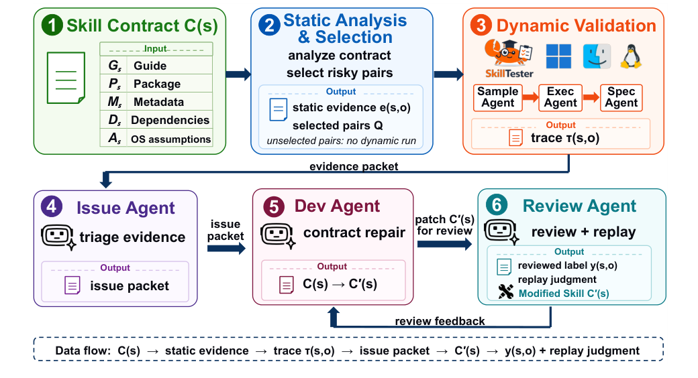查看原图 ↗</a>

*从技能契约筛出平台假设，经动态执行、修复和复核形成证据链。*

<h2 class="daily-paper-title" id="paper-arxiv-2611.25429">SkillPlumber 先问指令有没有被执行，再改技能</h2>

Tan, Boyin, Zhang, Jiadong, Ma, Xiaosong, Xue, Chun Jason, Huang, Xiaowei, Sun, Youcheng · 2026-11-19 · [Evolve Where It Matters: Coverage-Guided Self-Evolution of Agent Skills](https://arxiv.org/abs/2611.25429)

任务失败可能是技能给错了指令，也可能是执行器没遵循一条正确指令。SkillPlumber 将轨迹和技能逐条对齐，区分遵循、未遵循和未覆盖，再让持续维护上下文的诊断智能体提出修改，在下一次执行中验证。维护者每三项任务汇总一次可迁移策略。三个基准、三种执行器上，最终求解率在 64.7%–70.5%，比最强基线高 8.7–14.0 个百分点。SkillsBench 与 GPT-5.5 的消融从最初失败的 52 项出发，移除覆盖信息使恢复的失败减少 20.8%；这个比例以失败恢复为口径。

<a class="note-image-link" href="/assets/images/digest/2026-11-21/25429.png" target="_blank" rel="noopener" aria-label="指令覆盖将一次运行连接到具体技能修改，维护者再从多次调查中提炼策略。">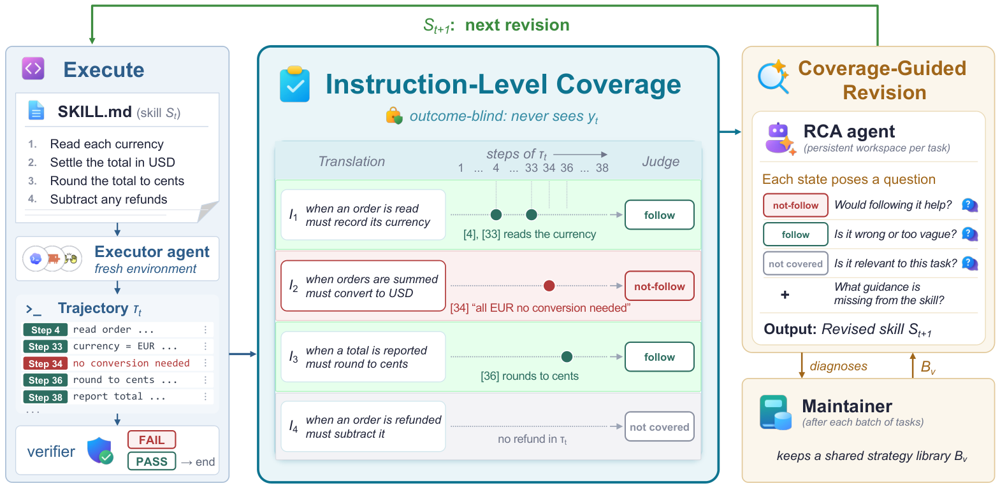查看原图 ↗</a>

*指令覆盖将一次运行连接到具体技能修改，维护者再从多次调查中提炼策略。*

<h2 class="daily-paper-title" id="paper-arxiv-2611.25380">Codev 将领域适配拆成权重和执行框架两条路径</h2>

Chen, BoHao · 2026-11-19 · [Beyond Weight Updates: Evolving Agent Harnesses for Domain Specialization](https://arxiv.org/abs/2611.25380)

作者在相同容器、轮次预算和上下文限制下，用四组 Codev 比较基础配置、仅权重优化、仅执行框架演化和二者结合。GEPA 以任务成功、token 和延迟维护候选，变化体现在提示、工具说明、技能或规划脚手架。SWE-bench Verified 得分依次为 0.31、0.52、0.48 和 0.61；OfficeBench 上单改框架的 0.51 还略高于单改权重的 0.49。表 2 中权重训练约用 800 H100 小时，框架优化仍需反思 API，所列每任务 token 未计入这些调用。因此零 GPU 训练不能直接读成零适配成本。

<a class="note-image-link" href="/assets/images/digest/2026-11-21/25380.png" target="_blank" rel="noopener" aria-label="内部智能体照常执行，外部循环读取轨迹与适应度并选择新的框架配置。">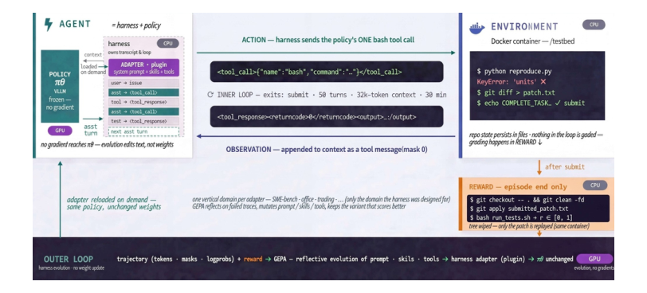查看原图 ↗</a>

*内部智能体照常执行，外部循环读取轨迹与适应度并选择新的框架配置。*

<h2 class="daily-paper-title" id="paper-alphaxiv-2611-harness-cg">递归执行框架能把短任务训练迁移到长任务吗？</h2>

Alex L. Zhang, Souradip Chakraborty, Omar Khattab · 2026-11-20 · [Language Model Harnesses Can Be Compositional Generalizers](https://www.alphaxiv.org/abs/2611.harness-cg)

这项研究把长任务拆成代码可处理的步骤和模型子调用，让单次调用面对接近训练分布的任务。作者在可核验子任务的环境中检查局部正确性，并用廉价代理环境训练递归框架内的模型。监督微调使用 8,015 条根轨迹，另有针对子智能体的训练数据。同一 RLM 框架内，RLM-27B 相对 Qwen3.8-27B 的评估均分提高 12.4 分；根轨迹的输入 token 降至约六分之一。这是根节点的成本，子调用也会消耗 token。对照 Codev 的框架编辑实验，本研究改变了框架内模型的训练分布，并单独检查跨长度迁移。

<a class="note-image-link" href="/assets/images/digest/2026-11-21/harness-cg.png" target="_blank" rel="noopener" aria-label="代理环境用于学习分解，真实任务通过工具和递归子调用执行这些步骤。">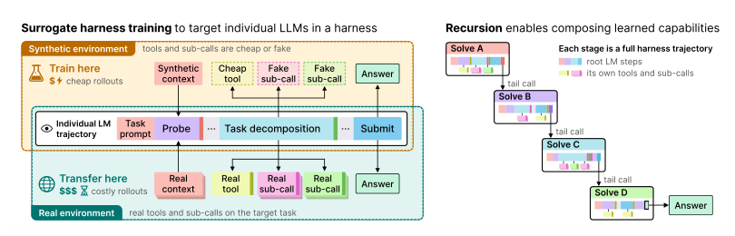查看原图 ↗</a>

*代理环境用于学习分解，真实任务通过工具和递归子调用执行这些步骤。*

<h2 class="daily-paper-title" id="paper-arxiv-2611.25599">Tether 为跨步骤操作保留策略状态</h2>

Sistla, Meghana Aparna, Solko-Breslin, Alaia, Jha, Somesh, Kanade, Aditya, Dvijotham, Krishnamurthy Dj · 2026-11-19 · [Tether: Verified Stateful Policy Engine for System-Level Monitoring of Agents](https://arxiv.org/abs/2611.25599)

一次读取和稍后的外部写入分别可能合规，连在一起却违反信息流策略。Tether 先在隔离的临时环境观察动作，把系统调用映射到抽象语义，再由 Lean 4 监视器根据资源标签和智能体上下文判定是否提交暂存变更。标签随动作传播，因此可表达跨任意多步的约束。在论文选取的编码轨迹上，一套共享策略阻止全部范围内的违规，良性轨迹误报率低于 5%。对抽象策略不变量的证明与具体事件映射的正确性是两层保证；后者仍依赖观测、隔离和测试。

<h2 class="daily-paper-title" id="paper-arxiv-2611.24977">CANDID 在循环和停止点检查候选动作</h2>

Lee, Woongkyu, Choi, Jungwook · 2026-11-17 · [CANDID: Candidate-Driven Intervention for Disciplined Execution in Local Computer-Use Agents](https://arxiv.org/abs/2611.24977)

本地 GUI 智能体会反复点击同一位置，也会在界面任务尚未完成时报告 DONE。CANDID 把额外采样留给这些风险点。恢复循环时剔除重复、格式错误或不可执行的候选，合并等价动作；准备终止时要求候选一致同意。若恢复阶段无有效替代则回到原提案。OSWorld 的三种本地执行器和 50、100 步预算中，相对各自基线，完成率提高 2.01–4.54 个百分点。这里改善的是运行时干预，且不同预算下实测的是任务完成率，无法由一次点击的准确率代替。

<a class="note-image-link" href="/assets/images/digest/2026-11-21/24977.png" target="_blank" rel="noopener" aria-label="循环恢复筛选替代动作，停止点则检查候选是否一致同意完成。">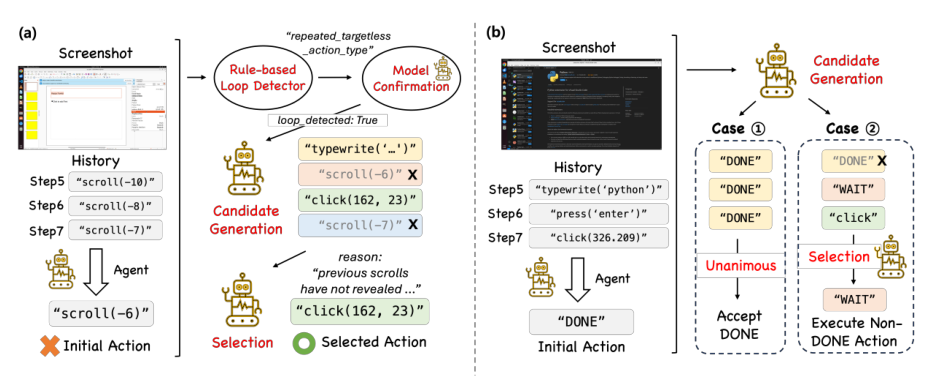查看原图 ↗</a>

*循环恢复筛选替代动作，停止点则检查候选是否一致同意完成。*

<h2 class="daily-paper-title" id="paper-arxiv-2611.26358">Beam 把推理节点恢复和训练器重启分别计时</h2>

Reflection Team · 2026-11-19 · [Beam Model Technical Report](https://arxiv.org/abs/2611.26358)

Beam 的 501.3B 参数中每 token 激活 23.4B，配套 1.93B 草稿模型。更值得系统读者关注的是四周、超过一亿次 rollout 的异步强化学习运行如何维持服务。在高算力智能体 RL 部署中，推理节点约占资源的 80%。服务进程因故障退出后，管理器清理受影响的 pod，调度器替换缺员节点；健康训练器可继续保留状态。训练器自身故障则按检查点恢复，该运行每两步保存一次。

<a class="note-image-link" href="/assets/images/digest/2026-11-21/26358.png" target="_blank" rel="noopener" aria-label="两根柱分别按各自恢复时间归一化，终点分别是普通请求完成和训练步完成。">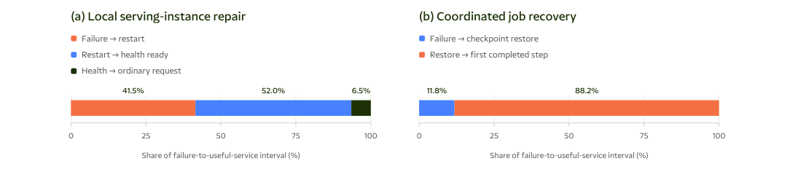查看原图 ↗</a>

*两根柱分别按各自恢复时间归一化，终点分别是普通请求完成和训练步完成。*

检查点先把 GPU 状态异步搬到可复用的固定主存，由独立进程序列化并写盘。优化器要修改仍在拷贝的张量前须等待一道同步屏障，保证快照一致。图 47 给出两次实际恢复的计时终点：局部修复直到首个普通请求完成，协调重启直到第一个训练步完成。前者有 6.5% 的时间发生在健康检查通过之后，后者有 88.2% 发生在恢复检查点之后。两根柱各自归一化，既不能比较绝对速度，也不能推算故障发生频率。用“重新产生有用工作”定义恢复，比简单计数存活进程更能说明训练损失。
