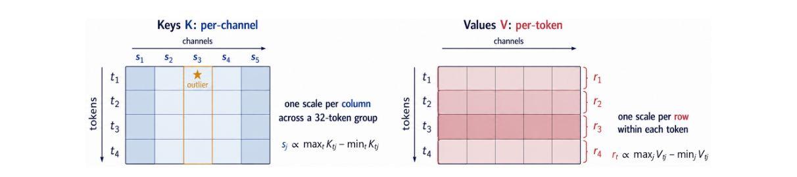

投机解码多养了一份草稿模型的 KV 缓存。把这份缓存压小，最先改变的是每段上下文需要保留的字节数；是否能加速，还取决于预填充、解包和验证怎么做。另一组单卡实验从服务侧看同一个问题：当许多会话同时返回时，缓存能否装下它们的历史，足以改变首 token 延迟的尾部。

<h2 class="daily-paper-title" id="paper-arxiv-2611.20565">草稿 KV 缓存压到 4 位后，谁来兑现节省的显存？</h2>

Saksham Gupta、Michael Li · arXiv · 2026-11-16 · [Memory-Efficient Speculative Decoding with Quantized Draft KV Cache](https://arxiv.org/abs/2611.20565)

小模型一次猜几个 token，大模型验收与自身贪心选择一致的前缀，在首处分歧给出修正。两者各自保存历史。作者只压缩草稿侧的键和值，保留 BF16 目标缓存。这样，量化可以让小模型猜错更多次，但无需修改目标模型的修正规则。接受率衡量的是猜中的比例；要检查实现是否正确，还得逐条对照目标模型单独解码的输出。

### 为什么给键多分几位看似有用

若每个 token 的键向量共用一个尺度，单个通道的异常大值会拉大量化刻度，连带损失其他通道的分辨率。作者先固定总位数，比较键 8 位、值 4 位和反向分配。按 token 对称量化时，多给键分位数，平均接受率高出 10.87 个百分点。改用 KIVI 式分组后，这个差距变为 −0.25 个百分点。原始比较还改变了值的量化方式等条件；作者另在一组 Qwen 上固定提示、值量化和残留窗口设置，只换键量化器，差距也从 +28.70 变为 −0.33 个百分点。

<a class="note-image-link" href="/assets/images/digest/2026-11-22/quantizer.png" target="_blank" rel="noopener" aria-label="草稿键沿列共享尺度，值沿行共享尺度">查看原图 ↗</a>

*同一异常通道由自己的尺度吸收，其他列可以保留更细的刻度。*

实际采用的 K4V4 让每个键通道跨 32 个 token 共用尺度，最近 128 个键保留 BF16，值则在同一 token、同一头内分组。六组模型覆盖 360M 至 8B 参数。作者用 576 条长度为 1,024 token 的 FineWeb-Edu 提示，每轮最多提议四个 token，共生成 16 个。逐模型对等权平均后，接受率从 57.93% 降至 57.14%。计入尺度、零点和残留窗口，草稿缓存字节数下降 66.20%，两份 KV 合计下降 23.95%。权重和临时工作区另占显存。

### 从缓存账本到运行峰值

Qwen2.5 3B/1.5B 的实际打包实现在 32K 上下文下，把每序列的草稿缓存从 896.0 MiB 压到 260.2 MiB。但它在 BF16 预填充之后才打包，因此峰值显存没有下降。在 1K 和 16K 的单请求测试中，打包版本比 BF16 投机解码慢 18%–33%。主接受率实验采用逐 token 验证，每输出一个 token 就调用一次目标模型；能一次验证整段的原型即使用 BF16 草稿也没有稳定匹配目标输出。论文给出了可信的持久存储收益，也定位了服务实现仍要解决的两件事：在预填充过程中限制峰值，以及在批量验证时准确回退状态。

## 社区实测：两分钟压测错过了什么

Johnson Shi 在每次试验独占一块 Azure A100 80GB PCIe 的条件下，用 Nanbeige 4.3-33B 对 vLLM 和 SGLang 做了 337 次配置试验。一次 vLLM 聊天测试将并发序列上限从 256 调到 512，两分钟测得容量增加 19%；延长到九分钟，两者都稳定在约 3.21 请求/秒。小上限让请求排队，大上限让活跃批次增长，输出 token 间隔触及 100 毫秒目标。

在另一组合成负载中，48 个会话分别进行六轮对话，基线已开启前缀缓存。调整权重和 KV 精度后，vLLM 可容纳的 KV 从 70,656 增至 418,816 个 token，抢占从 11 次降到零，首 token 延迟 p90 从 114 秒降至约 1.05 秒。这个结果反映的是特定并发历史能否留在显存中。上游另有一项可单独核查的修复，使两种基准数据集收到指定的随机种子。[Johnson Shi · X](https://x.com/johnsonshi86/status/2124250717963932121) · [vLLM #68859](https://github.com/vllm-project/vllm/pull/68859)
