恢复命令返回成功，操作者可能仍要重建工作现场。对 50 个框架与运行时的调查追踪了这个差距。另一项工作 Contexture 则问，什么时候删去旧工具结果，才值得牺牲已经算好的前缀？两篇研究都把观察窗口延长到下一轮：一次操作省下了什么，又给后续任务留下什么。其余工作从插件协同、评分隔离和端侧策略检查，延伸到长上下文索引、专家放置及解码的数值一致性。

<h2 class="daily-paper-title" id="paper-arxiv-2611.27090">恢复命令执行后，任务恢复了吗？</h2>

Kaviru Hapuarachchi · 2026-11-20  
[Exercised, Rarely Recovered: What Public Reports Say About Recovery in 50 AI Agent Harnesses and Runtimes](https://arxiv.org/abs/2611.27090)

一个编码助手可以成功撤销自己改过的文件，同时留下子智能体的修改。也有用户用撤销命令恢复代码，却丢了自己还没提交的工作。这两种情形里，接口都能返回成功，但操作员要恢复的对象是整个工作现场。Kaviru Hapuarachchi 把这个差别做成了一个可核查的问题：公开记录能证明某项恢复机制走到了哪一步，执行之后任务又怎样了？

研究分开考察 12 个持久化运行时、26 个编码智能体框架和 12 个研究运行时。每个系统按八类机制取最高证据等级。文档里写了断点续跑、教程里演示过、基准上测过、有操作者在真实任务中用过，各自对应不同等级。最后一类还要看结果能否归为完整恢复、部分恢复、失败或不清楚。这样，同一个系统可以有相当成熟的部署记录，却只对某一种恢复动作留下足够证据。

在前两组中，分别有 11/12 和 25/26 个系统留下至少一类真实使用记录。细看 128 条系统与机制记录，仅 19 条描述完整恢复，54 条只恢复一部分，45 条失败，另有 10 条结局不明。断点续跑的 27 条里只有一条完整恢复，撤销的 15 条里也是一条。一个进程可以从检查点继续执行，可它此前写进外部服务的状态仍然存在。研究原型讨论用补偿动作处理这些外部效果，作者在 26 个编码框架中没有找到对应能力的证据。

这些数字的分母值得保留。作者事先冻结了检索和编码规则，由两种模型独立判读，随后对分歧和高等级证据复核，作者逐项检查最终标签。公开问题单倾向记录出错的运行，且每个系统与机制只取最强证据。19/128 描述的是这组材料能证明什么，无法估计下一次运行恢复成功的概率。对 AgentOps 更有用的测量单位，是一次恢复究竟覆盖了哪些文件、子任务与外部效果，以及操作者最终能否继续原任务。

<a class="note-image-link" href="/assets/images/digest/2026-11-24/arxiv-2611.27090.png" target="_blank" rel="noopener" aria-label="真实故障记录中的恢复结果">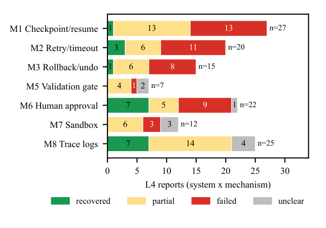查看原图 ↗</a>

*真实故障记录中的恢复结果*

<h2 class="daily-paper-title" id="paper-arxiv-2611.26980">Contexture 如何决定何时删去旧工具输出</h2>

Colin Hong, Bryan Shan, Wei Siong Pang, Chengzhi Lu, Xu Guo, Nitin Shivaraman, Tao Luo, Esha Choukse, Kisson Lin, Dmitrii Ustiugov · 2026-11-20  
[Contexture: Runtime Context Eviction for High-Throughput Agent Serving](https://arxiv.org/abs/2611.26980)

同一文件在修改前后可能都被读过。旧读数对下一步用处不大，却可能仍是其他缓存块共同依赖的前缀。立刻从提示里删掉它，后面本来能命中的内容就得重新预填充。反过来，等到单个会话达到长度上限才压缩，又可能在几十个短会话挤满共享显存时毫无反应。Contexture 关注的正是两笔账：删掉的历史能省下多少 KV，占用 GPU 重算又会让哪些并发请求等待。

运行时保留框架的完整对话，在送给模型的副本上动手。它追踪工具类型、目标和结果，用后来成功的文件操作或测试找出已被取代的旧输出。一轮里所有工具结果都过期，才有理由连带考虑该轮上下文。宽限窗口让刚产生的记录再保留几轮。作者从轨迹中标出的候选占最终历史 token 的 64%；这个比例描述可考虑移除的内容，实际提交删除还要经过缓存判断。

执行时，系统在渲染后的提示中定位这些片段，查询最长驻留前缀。若删除位置之后的内容本来就没有命中，改写提示几乎不牺牲可复用计算。若命中会被打断，运行时再检查共享池占用，以及每删一个 token 需要额外预填充多少 token。默认压力阈值为 80%，重算上限为每删一个 token 对应六个。这样，相同的文件操作在池子宽裕和紧张时可以触发不同决策，全程不需要额外的模型调用。

作者把 Hermes 和 OpenClaw 分别接到 H200 上的 Qwen3.8-27B 和 H100 上的 Qwen3.6-35B-A3B，再在两个基准上测试，共八种配置。吞吐按每分钟在任务预算内完成的会话计数，比较点取 P90 会话耗时达到该任务无负载、不驱逐时的十倍。在轨迹回放中，作者报告的吞吐较不驱逐、框架压缩、AgentDiet、Continuum 中的最佳者高 20%–73%。更激进的观察屏蔽在吞吐上仍有竞争力，Contexture 只在其中五种配置领先 7%–63%。但在真实运行智能体的质量实验中，相对无负载且不驱逐的基线，Contexture 平均高 1.4 个百分点，最差低 3.7 点，观察屏蔽则低 3–28 点。这里删的是会改变下一步决策的输入；工具是否真的取代旧结果，和 KV 能省多少一样重要。论文实现的规则集中在沙箱与文件工具，外部服务需要另行定义语义。

<a class="note-image-link" href="/assets/images/digest/2026-11-24/arxiv-2611.26980.png" target="_blank" rel="noopener" aria-label="工具事件与缓存驻留共同决定下一轮提示">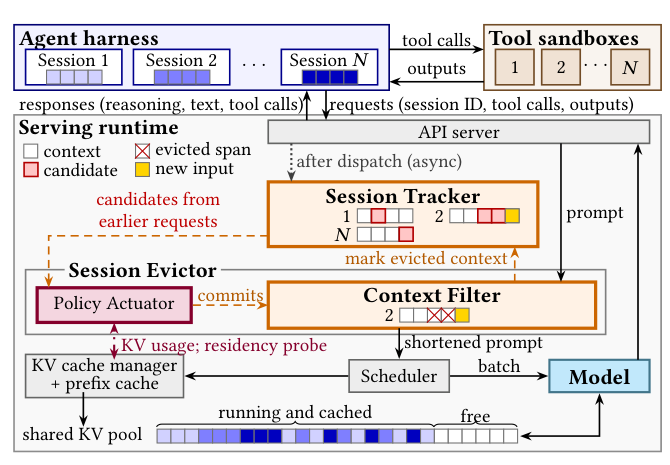查看原图 ↗</a>

*工具事件与缓存驻留共同决定下一轮提示*

<h2 class="daily-paper-title" id="paper-arxiv-2611.27554">贪心解码的逐字一致要以哪条执行路径为准？</h2>

Mohammed Nayeem Khan, Navin Kumar R · 2026-11-20  
[Vega-Fafnir: Is Greedy Decoding the Same Decoding? Where Rounding Noise in Speculative Verification Comes From and What Removing It Costs](https://arxiv.org/abs/2611.27554)

即使每步都选最大 logit，同一模型仍可能在投机验证和逐 token 生成时写出不同文本。一次验证四个猜测会改变矩阵形状与舍入；即便下一步切回单 token，KV 缓存里也可能留着宽验证写下的差异。作者让 Qwen3-0.6B 以 BF16 在 GSM8K 和 ARC 的 150 条提示上生成 128 个 token，四 token 验证有 60% 的文本偏离逐 token 参考。首次分歧时，前两名 logit 差距均不超过 0.375。

有针对性的对照是让低置信位置回退。在 100 条提示上，继续沿用原缓存，回退后仍有 58 条不同，普通验证为 61 条。改用单 token 重建缓存，差异降到零，代价是每生成一个 token 平均调用模型 7.2 次。若把参照也定为固定宽度 5，用填充保持每次执行形状相同，有无草稿的两条路径在这组提示上完全一致，带草稿只需 0.75 次调用。后者兑现的是新参照下的一致性。调用次数也不能直接换算成生产延迟，论文的计时来自一张共享 GPU 上的小模型。

<a class="note-image-link" href="/assets/images/digest/2026-11-24/arxiv-2611.27554.png" target="_blank" rel="noopener" aria-label="逐 token 基线、宽验证与回退路径">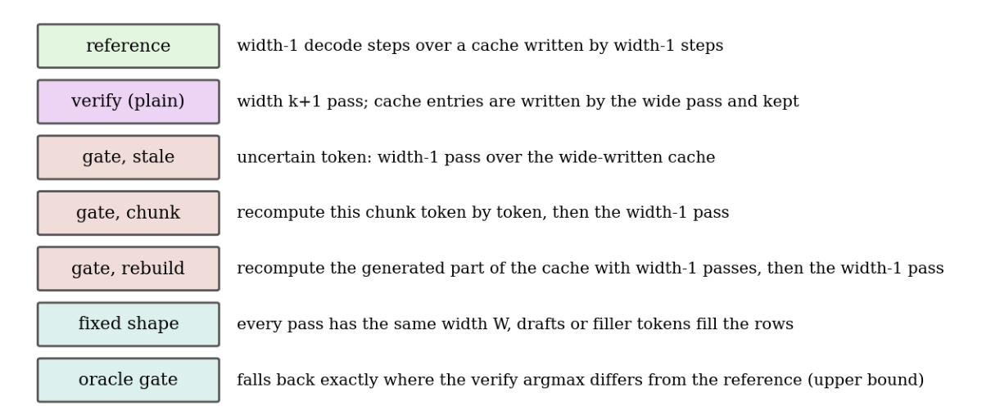查看原图 ↗</a>

*逐 token 基线、宽验证与回退路径*

<h2 class="daily-paper-title" id="paper-arxiv-2611.27294">HookEvo 让多个插件共用一次工具执行的结果</h2>

Shengze Huang, Yanyu Mao, Xiaofei Yu, Baoshen Guo, Xiaorui Wang, Zhiwen Wu, Sheng Wu, Fukang Wen, Chengxu Wu, Linhao Li, Kailai Sun, Baotong Mi · 2026-11-20  
[HookEvo: A Framework for Coordinated Plugin Evolution on Hook-Enabled Agent Runtimes](https://arxiv.org/abs/2611.27294)

工具已返回有效结果，下一轮却可能再次尝试同一动作。HookEvo 让改进模型从执行轨迹提出一组插件修改：一个处理器解析回执并写入任务状态，另一个组装上下文，第三个在执行前检查动作。训练期间在匹配任务上同时统计修好的失败和新增的回归，再决定保留哪个版本。执行模型固定为 Qwen3-4B，Sol 提出协同修改时在 ALFWorld、DBBench、WebShop、OSBench 上分别达到 95.41%、70.56%、48.17%、41.67%。这些是分任务搜索所得框架的测试结果；拓宽可编辑范围的收益也随改进模型而变。

<a class="note-image-link" href="/assets/images/digest/2026-11-24/arxiv-2611.27294.png" target="_blank" rel="noopener" aria-label="父版本与候选插件在相同任务上比较">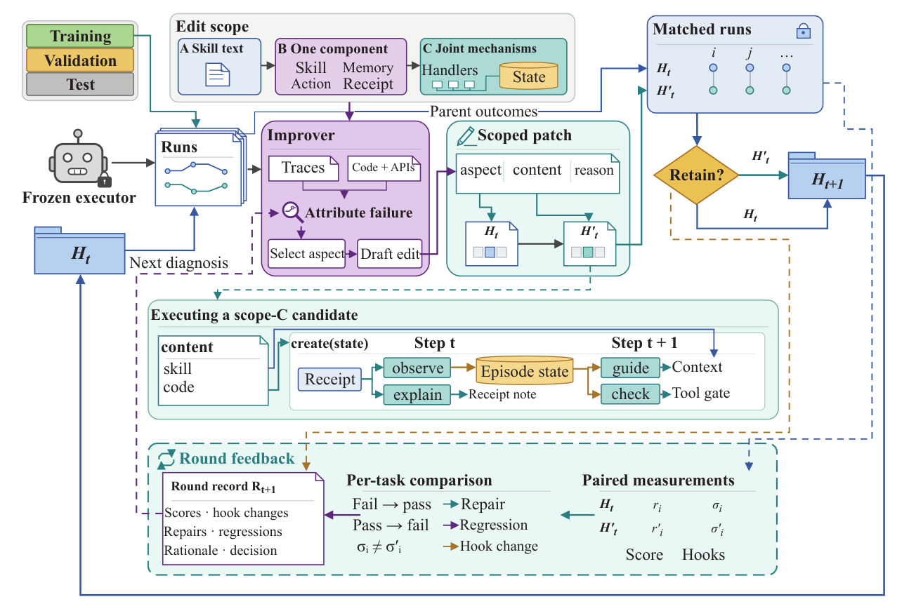查看原图 ↗</a>

*父版本与候选插件在相同任务上比较*

<h2 class="daily-paper-title" id="paper-arxiv-2611.27860">SplitBench 把预期答案留在可信评分器中</h2>

Nathan Nour Houlamy, Mattia Favretto, Earlence Fernandes, Mauro Conti · 2026-11-20  
[Who Grades the Agent? Privilege Separation for Coding-Agent Benchmarks](https://arxiv.org/abs/2611.27860)

执行智能体提交的程序时，测试环境本身也要当作不可信输入源。SplitBench 把测试执行与判分拆开：隔离的环境运行候选程序并返回观察值，可信 Oracle 保管预期答案并作比较。作者把两个现有基准的 202 项任务转换了 180 项，新旧评分器对可比较尝试的判断有 98.7% 一致。在作者设定的对抗评估中，系统拦下 75% 的已完成尝试。剩余案例揭示第二层问题：保护预期答案可以维护评分边界，但一个检查项若只测任务的一小部分，仍会接受不完整的解。

<a class="note-image-link" href="/assets/images/digest/2026-11-24/arxiv-2611.27860.png" target="_blank" rel="noopener" aria-label="测试环境输出观察值，评分器独立判定">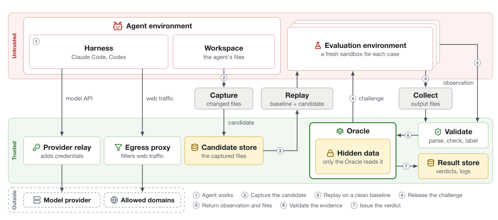查看原图 ↗</a>

*测试环境输出观察值，评分器独立判定*

<h2 class="daily-paper-title" id="paper-arxiv-2611.27095">工具回执能否为模型的完成声明作证？</h2>

Sean Maxwell · 2026-11-20  
[Epistemic Guard: Out-of-Process MCP Receipt Proxying, Post-Turn Prose Supervision, and Provenance-Gated Memory for Tool-Using Autonomous Agents](https://arxiv.org/abs/2611.27095)

工具执行失败后，智能体仍可能说“已经完成”。Epistemic Guard 把 MCP 回执的签名放进独立进程，回合结束后在 CPU 上把自然语言声明与执行证据比对，持久记忆写入也要通过来源检查。确定性的协议检查与语义判断在这里有不同的误差：200 个日志叶节点的篡改测试全部被拒，250 条冻结轨迹的声明分类准确率为 93.2%。到了 60 条在线代理轨迹，风险检出率达 96.15%，误报率也达 38.24%。签名能证明回执来源，解释用户看到的一句话仍是更难的环节。

<h2 class="daily-paper-title" id="paper-arxiv-2611.27216">端侧策略检查会受此前正确决策影响</h2>

Chong Tian, Yu Wang, Steve Liu, Qirong Ho, Xiuying Chen · 2026-11-20  
[Correct Precedents Induce Policy Violations in On-Device LLM Agents](https://arxiv.org/abs/2611.27216)

端侧智能体按条目状态决定是否允许操作。论文用配对的合成队列检验一个容易漏测的情形：历史里的判断都正确，当前受限条目仍可能被错误放行。作者在 13 个开放权重模型上观察到安全率下降，对最敏感的模型，一次正确先例就使安全率约减半。配对决策蒸馏用较少受影响的教师生成样本，让 LoRA 学生学会按当前条目的状态重新判断。蒸馏模型在该评估中的安全率接近 100%，部署时无需再请求模型。这项结果的适用范围是实验里的策略、队列及采样条件。

<a class="note-image-link" href="/assets/images/digest/2026-11-24/arxiv-2611.27216.png" target="_blank" rel="noopener" aria-label="配对队列诊断先例效应，并用于蒸馏">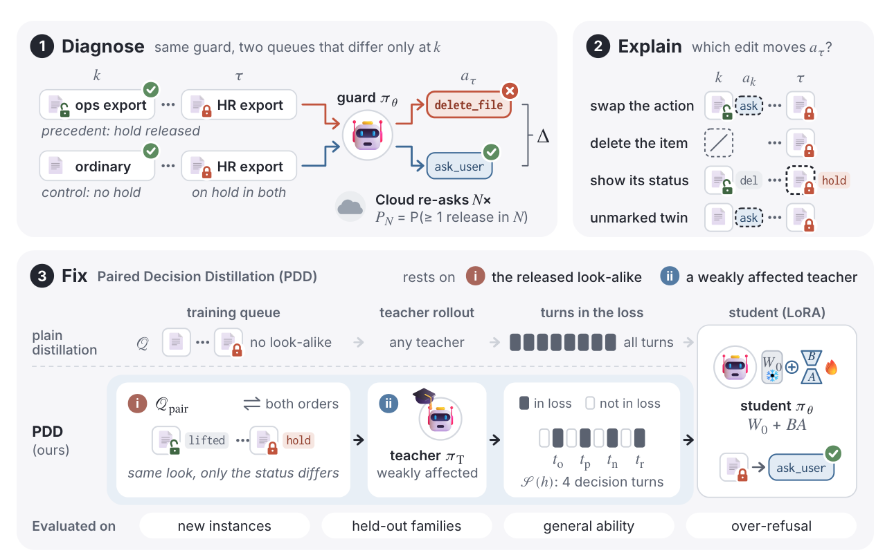查看原图 ↗</a>

*配对队列诊断先例效应，并用于蒸馏*

<h2 class="daily-paper-title" id="paper-arxiv-2605.17170">TriAxialKV 按工具角色、轮次与模态分配位宽</h2>

Hanzhang Shen, Haoran Wu, Yiren Zhao, Robert Mullins · 2026-05-16  
[TriAxialKV: Toward Extreme Low-Precision KV-Cache Quantization for Agentic Inference Tasks](https://arxiv.org/abs/2605.17170)

截图、工具观察和当前轮的用户问题占据同一片 KV 缓存，但量化误差对任务的影响不同。TriAxialKV 给 token 标记轮次远近、模态和语义角色，离线测量各组合对低精度的敏感度，再按预算分配 INT2 或 INT4。推理时分池存放，用融合的解码内核读取。Qwen3-VL-32B-Thinking 在 OSWorld 上达到与 SGLang BF16 相当的任务表现，缓存容量为其 4.5 倍，端到端吞吐约高 30%。文本记忆任务上的位宽扫描也显示，把太多 token 压到两位会损失准确率。这是五月首发论文的十一月修订版。

<a class="note-image-link" href="/assets/images/digest/2026-11-24/arxiv-2605.17170.png" target="_blank" rel="noopener" aria-label="离线校准标签，在线读取两种位宽的缓存池">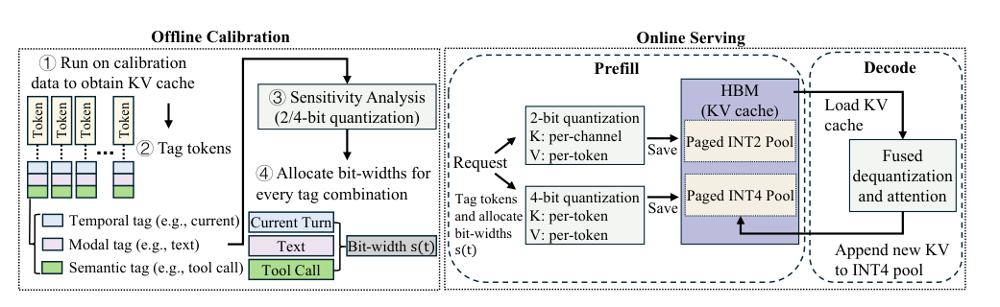查看原图 ↗</a>

*离线校准标签，在线读取两种位宽的缓存池*

<h2 class="daily-paper-title" id="paper-arxiv-2611.27233">LongCat 先选页，再在页内挑选注意力位置</h2>

Hao Zhang, Bin Xiao, Kefeng Zhang · 2026-11-20  
[LongCat Recall Sparse Attention: Co-Designing Key Organization and Retrieval for Long-Context Inference](https://arxiv.org/abs/2611.27233)

稀疏注意力只访问少量 KV，但寻找这些位置仍可能扫描全部历史。LRSA 把已填满的时间桶独立建索引，按方向分成容量平衡的小组，同页容纳多个完整组。查询先看组中心挑页，再把页内成员与近期窗口、固定起点、尚未建索引的位置一起精排。SGLang 可以异步建新桶，也可在前缀命中后复用兼容索引。1024K 上选键比 DSA 快 4.70 倍；35.60 倍是选键加注意力相对稠密注意力的加速。把维护索引和整模型执行都算进去，同长度、2048 个最终位置的端到端加速为 DSA 的 1.865 倍。

<a class="note-image-link" href="/assets/images/digest/2026-11-24/arxiv-2611.27233.png" target="_blank" rel="noopener" aria-label="分桶索引保留细粒度中心并按页读取">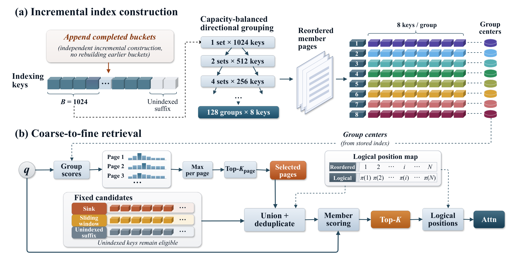查看原图 ↗</a>

*分桶索引保留细粒度中心并按页读取*

<h2 class="daily-paper-title" id="paper-arxiv-2611.27973">MemOnce 用一份历史表示为多层重建 KV</h2>

Chang Nie, Chaoyou Fu, Songlin Liu, Yiqing Hu, Caifeng Shan · 2026-11-20  
[MemOnce: A Scalable Memory Architecture for Large Language Models](https://arxiv.org/abs/2611.27973)

MemOnce 改变模型保存历史的方式。它从最后一层抽取部分隐藏状态，后续输入只检索一次相关记忆，再为各注意力层按需解码出 KV。这样，较冷的状态可以移到 CPU 或 SSD，活跃的 GPU 缓存随检索预算受控。作者对 Qwen3.5-4B 做架构适配，在百万 token 的测试中报告活跃缓存缩小 1313 倍，预填充加速 6.9 倍，解码吞吐提高到 3.5 倍。读这些数字要保留两个条件：模型经过适配训练，活跃显存之外仍有卸载的历史状态。

<a class="note-image-link" href="/assets/images/digest/2026-11-24/arxiv-2611.27973.png" target="_blank" rel="noopener" aria-label="顶层记忆按需解码成注意力层的 KV">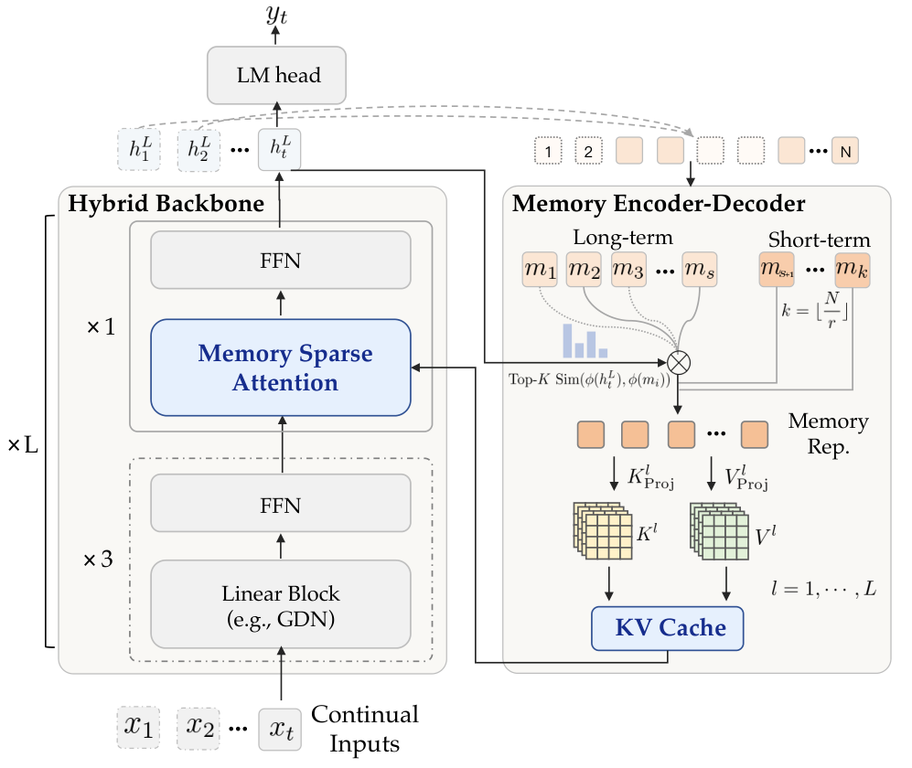查看原图 ↗</a>

*顶层记忆按需解码成注意力层的 KV*

<h2 class="daily-paper-title" id="paper-arxiv-2611.27596">Isonomy 把跨请求复用与首 token 可见时间分开</h2>

Bowen Sun, Chaowei Xiao · 2026-11-20  
[Isonomy: Isolating Every Request from Timing Side Channels at Nearly Full-Sharing Throughput in Multi-Instance LLM Prefill](https://arxiv.org/abs/2611.27596)

共享前缀缓存可以节省预填充，但另一请求留下的命中会改变首 token 到达时间。Isonomy 在 vLLM 前按请求可见的缓存和负载选择实例，默认隔离请求，也允许显式共享组。实例内部仍能复用隐藏命中；预测模式按可见前缀和排队情况控制放行时刻，执行模式则预留本应消耗的工作量并尝试用其他请求填充。在两种带账户标签的负载上，预测模式饱和吞吐约为完全共享的 98%，按账户隔离分别为 95% 和 80%。适用前提是客户端无法观察彼此的负载，证据针对这一条件下的首 token 时序。

<a class="note-image-link" href="/assets/images/digest/2026-11-24/arxiv-2611.27596.png" target="_blank" rel="noopener" aria-label="以可见前缀安排路由并预留被省下的工作">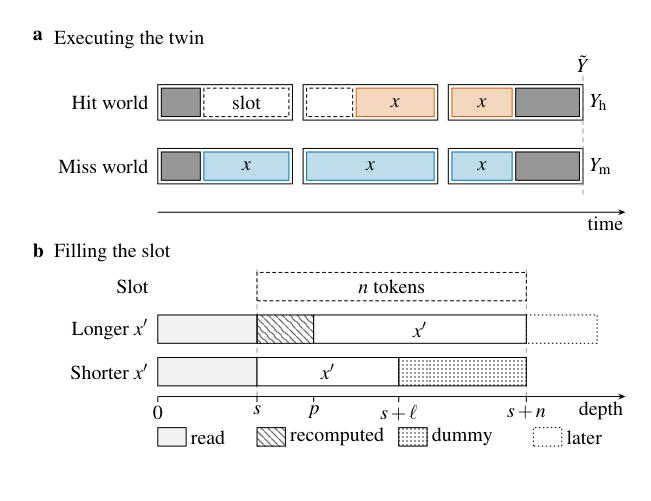查看原图 ↗</a>

*以可见前缀安排路由并预留被省下的工作*

<h2 class="daily-paper-title" id="paper-arxiv-2611.27604">IsoMoE 在 CPU 和 GPU 上保持相同的专家算术</h2>

Hang Gu, Teng Wang, Zhendong Zheng, Qianyu Cheng, Wenqi Lou, Lei Gong, Xi Li, Xuehai Zhou · 2026-11-20  
[IsoMoE: Placement-Invariant Hybrid CPU-GPU MoE Inference with Lossless 12-bit Experts](https://arxiv.org/abs/2611.27604)

将 MoE 专家移到 CPU 一般是为了省显存，却可能因为累加次序不同而改变贪心输出。IsoMoE 让 GPU 专家内核逐位重放 CPU 的算术，把适合无损 12 位表示的权重按 AVX-512 点积的读取次序布局，在寄存器中解包，减少主存流量。双微批流水线覆盖两端计算，同时保留每个 token 的运算次序。三种 MoE 模型在不同专家放置下输出逐位一致，解码较各设置最快基线平均加速 1.26 倍、最高 1.54 倍。这个一致性承诺针对放置变化，并以两端实现同一算术为条件。

<a class="note-image-link" href="/assets/images/digest/2026-11-24/arxiv-2611.27604.png" target="_blank" rel="noopener" aria-label="专家布局改变，运算顺序保持一致">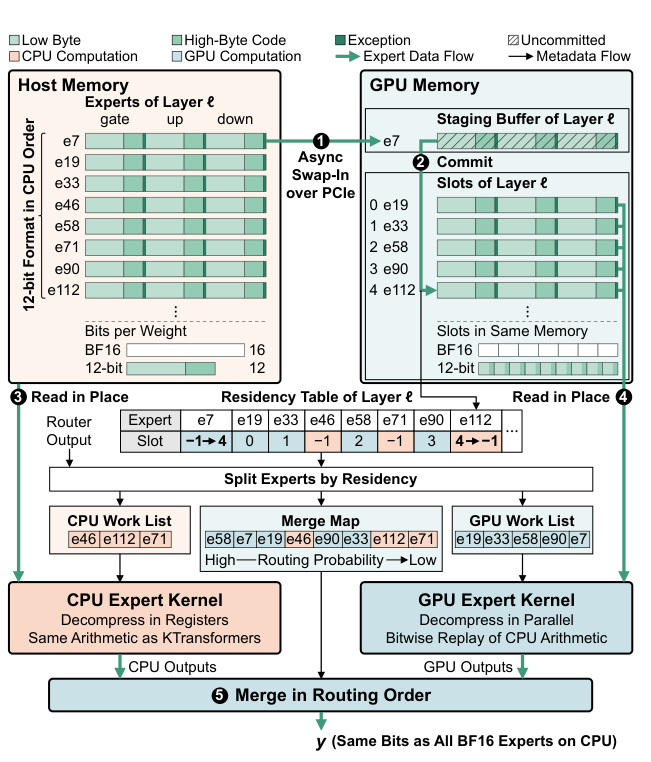查看原图 ↗</a>

*专家布局改变，运算顺序保持一致*

<h2 class="daily-paper-title" id="paper-arxiv-2611.27765">Weave 按本轮路由为通信和计算分配 warp</h2>

Ziyu Huang, Yangjie Zhou, Chenhao Zhu, Hongzhe Yan, Tianwei Qiao, Sicheng He, Zihan Liu, Peng Yu, Shulai Zhang, Xingxun Tang, Xinhao Luo, Minyi Guo, Xiu Lin, Yinghao Yu, Guodong Yang, Liping Zhang, Shixuan Sun, Qingyun Chen, Jingwen Leng · 2026-11-20  
[Weave: Routing-Adaptive Runtime Warp Scheduling for MoE Megakernels](https://arxiv.org/abs/2611.27765)

专家并行中，送到某块 GPU 的 token 数和要做的专家乘法不总是同比增长。Weave 在启动融合内核时，用本轮路由统计为每块 GPU 选择通信、矩阵计算及写回所占的 SM 和 warp；层的开头和结尾还可临时切换 warp 职责。相比编译时固定分工，这既能适应设备间负载差异，也能利用一层内部不同阶段的空闲。在八路专家并行下，相对 DeepGEMM-MegaMoE，SM103 和 SM90 的层级耗时几何平均加速分别为 1.30 和 1.24 倍。基准测量的是 MoE 层，整次请求还要执行注意力和调度。

<a class="note-image-link" href="/assets/images/digest/2026-11-24/arxiv-2611.27765.png" target="_blank" rel="noopener" aria-label="每个 GPU 按路由统计选择空间与时间调度">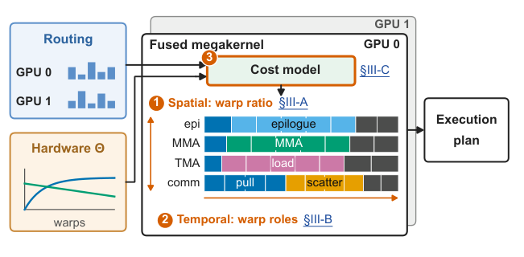查看原图 ↗</a>

*每个 GPU 按路由统计选择空间与时间调度*

<h2 class="daily-paper-title" id="paper-arxiv-2611.26840">何时应让通信稍晚启动？</h2>

Marco Kurzynski, Shaizeen Aga, Di Wu · 2026-11-19  
[Contention-Aware Flexible Execution for Machine Learning Workloads](https://arxiv.org/abs/2611.26840)

把已就绪的集合通信尽早与矩阵乘重叠，有时会延长关键路径。作者在 MI300X 上利用毫秒级采样区分计算单元不足与缓存、内存流量争用，再选择与通信重叠的算子和资源份额。例如让 QKV 投影先取得足够计算单元，一波完成后再让通信占用余量，可以避免为少量剩余工作再开一波。在预填充、解码和训练配置的调度对照中，灵活重叠较尽早启动的几何平均收益为 3.7%，峰值 13% 来自批量 4、序列长 2K 的预填充。收益取决于数据流里实际存在的调度余量。

<a class="note-image-link" href="/assets/images/digest/2026-11-24/arxiv-2611.26840.png" target="_blank" rel="noopener" aria-label="并发内核的资源争用">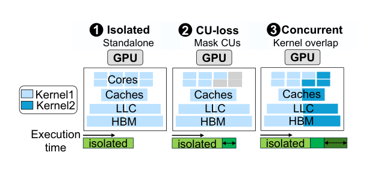查看原图 ↗</a>

*并发内核的资源争用*

<h2 class="daily-paper-title" id="paper-arxiv-2611.26657">BitPrefill 让三值权重用上 INT4 Tensor Core</h2>

Fang Chen, Xuming Chen, Sanmukh Kuppannagari, Gourav Datta · 2026-11-18  
[BitPrefill: W1.58A4 Tensor-Core Acceleration for Compute-Bound LLM Prefill](https://arxiv.org/abs/2611.26657)

三值模型的解码可以少读权重，但长输入的预填充仍要完成大矩阵乘法。BitPrefill 把激活在线量化并打包为四位，以原生 INT4 Tensor Core 执行投影，在 GEMM 写回时应用尺度，避免单独搬运中间结果。RTX 4090 上，输入行数为 2048、另两维为 2560 时，包含打包和写回的算子耗时 60.1 微秒，BF16 是 183 微秒；行数仅 64 时分别为 11.8 和 12.8 微秒。差异说明算子规模如何摊薄量化成本。整模型测试按单轮提示测量，结论集中在预填充阶段。

<a class="note-image-link" href="/assets/images/digest/2026-11-24/arxiv-2611.26657.png" target="_blank" rel="noopener" aria-label="量化激活进入低位矩阵乘，在写回时恢复尺度">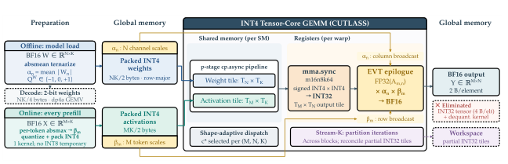查看原图 ↗</a>

*量化激活进入低位矩阵乘，在写回时恢复尺度*

<h2 class="daily-paper-title" id="paper-arxiv-2611.26975">ToRA 用同一次权重读取执行流式检查</h2>

Soheil Zibakhsh, Pedram Aghazadeh, Farinaz Koushanfar · 2026-11-20  
[Run One, Get Two: Near-Free Streaming Safety Checks for Local LLMs](https://arxiv.org/abs/2611.26975)

端侧单用户解码常受内存带宽限制，另跑一个防护模型要再读一套权重。ToRA 在首个适配的前馈层分出验证行，双行内核对两行复用同次权重读取，也复用生成端 KV，从而保留独立判别所需的计算。Qwen3-0.6B 上，它在 17 个基准中的 12 个取得高于独立流式检查器的 F1；相对隐藏状态探针，风险响应检出改善 11.8 个百分点，每 token 增加的延迟低于 4%。这里可利用的余量来自单用户带宽瓶颈，多请求已填满计算单元时需重新衡量成本。

<a class="note-image-link" href="/assets/images/digest/2026-11-24/arxiv-2611.26975.png" target="_blank" rel="noopener" aria-label="验证分支与生成分支共享权重和 KV">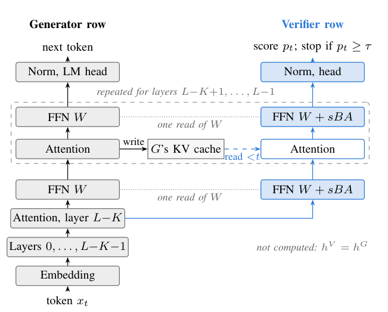查看原图 ↗</a>

*验证分支与生成分支共享权重和 KV*

<h2 class="daily-paper-title" id="paper-arxiv-2611.27092">PLoQ 为当前提示保留一小组高精度方向</h2>

Faraz Tahmasebi, Michael Pellauer, Hyoukjun Kwon, Sitao Huang · 2026-11-20  
[PLoQ: A Prompt-Specific Low-Rank Basis for 4-bit Quantization of LLM Activations](https://arxiv.org/abs/2611.27092)

离线校准能找到许多激活离群方向，却不能预知每一条提示里的特殊方向。PLoQ 从预填充样本拟合低秩基，把主导分量与残差分开量化，在层内矩阵乘中合回，解码继续使用同一组基。对比实验固定平均位宽，用一部分八位通道替换原有高精度预算中的方向。六种 Llama、Qwen 模型上的困惑度均获改善，最多挽回基线剩余四位激活误差的 46%。在 Llama-3.1-8B、8K 长度下，预填充和解码分别增加 4% 和 8% 时间。这里的收益是同位宽质量提升，需要付出运行时计算。

<a class="note-image-link" href="/assets/images/digest/2026-11-24/arxiv-2611.27092.png" target="_blank" rel="noopener" aria-label="预填充拟合的低秩基在解码中复用">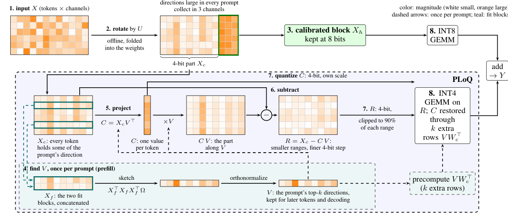查看原图 ↗</a>

*预填充拟合的低秩基在解码中复用*

<h2 class="daily-paper-title" id="paper-arxiv-2611.27891">DICE 把本轮采样随机数提前交给草稿树</h2>

Guanning Zeng, Andrea Zanette · 2026-11-20  
[Speculative Decoding Is Less Speculative Than You Think](https://arxiv.org/abs/2611.27891)

草稿模型不知道目标模型下一步的分布，但采样所用随机数可以预先抽取。DICE 在草稿与验证之间同步这些随机数，用来安排候选树节点，也可为下一轮异步准备更可能用到的草稿。它保留目标采样分布，无需重训草稿模型。H200、温度 1、单并发的异步预取对照中，Llama-3.1-70B-Instruct 配 1B 草稿时，结果缓存命中率从 59.8% 升到 77.9%，吞吐从 160.8 到 182.0 token/s。论文另测了两种引擎的并发扫描；这里的增益随草稿、温度与调度方式变化。

<a class="note-image-link" href="/assets/images/digest/2026-11-24/arxiv-2611.27891.png" target="_blank" rel="noopener" aria-label="同一组随机数引导候选扩展和验证">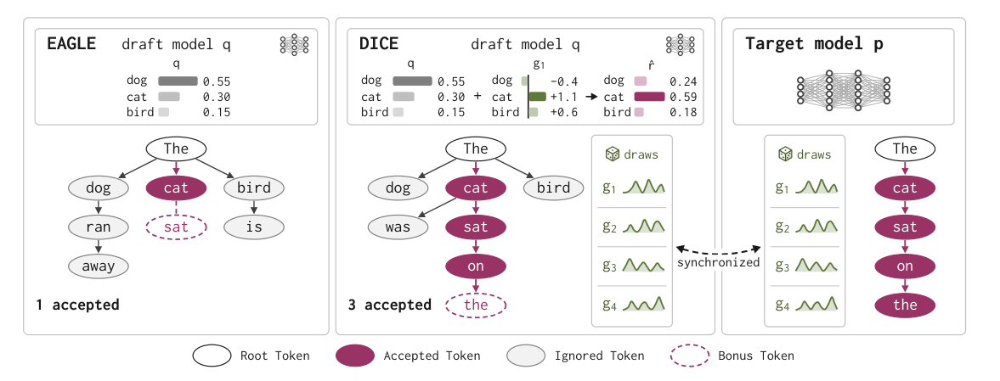查看原图 ↗</a>

*同一组随机数引导候选扩展和验证*

<h2 class="daily-paper-title" id="paper-arxiv-2611.26944">多个机器人共享 GPU 时，哪个阶段适合组批？</h2>

Stefan de Lasa, Mohammadreza Mofayezi, Gennady Pekhimenko, Nandita Vijaykumar · 2026-11-20  
[Analysis of Multi-Client Inference Techniques for Vision-Language-Action Models](https://arxiv.org/abs/2611.26944)

机器人执行一串动作时 GPU 可能闲置，但把多个客户端一并送入模型，对各阶段的影响并不相同。作者在 RTX 4090 和 H100 上剖析了三种视觉语言动作模型。动作专家的权重读取能被多个样本摊薄；在 H100 上批量从一增至四，该阶段延迟仅增至 1.15–1.33 倍。视觉语言主干中的大矩阵乘已经占满计算资源，更大的批次会拉长响应时间。即便把并行工作隔离到不同 SM，减少每个算子可用的计算单元也会拖慢投影。这些测量解释了为何共享策略要考虑控制周期和阶段，尚未给出完整调度器。

<a class="note-image-link" href="/assets/images/digest/2026-11-24/arxiv-2611.26944.png" target="_blank" rel="noopener" aria-label="三种模型在不同动作块长与控制频率下的 GPU 空闲比例">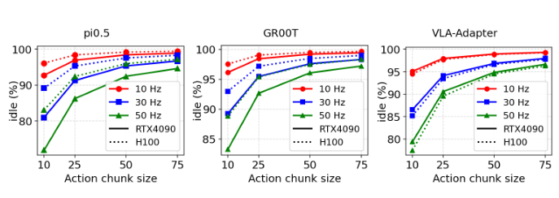查看原图 ↗</a>

*三种模型在不同动作块长与控制频率下的 GPU 空闲比例*

<h2 class="daily-paper-title" id="paper-arxiv-2611.27119">CTRL 让采样与训练在同一块 GPU 上持续并行</h2>

Ruijia Yang, Ruikai Li, Zeyi Wen · 2026-11-20  
[CTRL: Concurrent Training and Rollout for LLM Reinforcement Learning via GPU Co-Residency](https://arxiv.org/abs/2611.27119)

RL 采样批次随响应结束而变小，训练器却需要密集计算。CTRL 通过 CUDA MPS 让两者常驻每块 GPU，把优化器状态留在主机，按层窗口向训练端流送权重。就绪批次可先训练，到发布新策略前才按陈旧度上限等待。在三种 GPU 上、允许滞后两个版本的 24 个配置中，作者报告吞吐为较强 verl 异步基线的 1.11–2.24 倍。为区分训练器实现与共置布局的作用，作者还固定训练器：此时相对分时执行的收益为 1.10–1.26 倍。主机内存和传输开销仍属于这笔资源账。

<a class="note-image-link" href="/assets/images/digest/2026-11-24/arxiv-2611.27119.png" target="_blank" rel="noopener" aria-label="主机保管优化器，GPU 只保留有限的层窗口">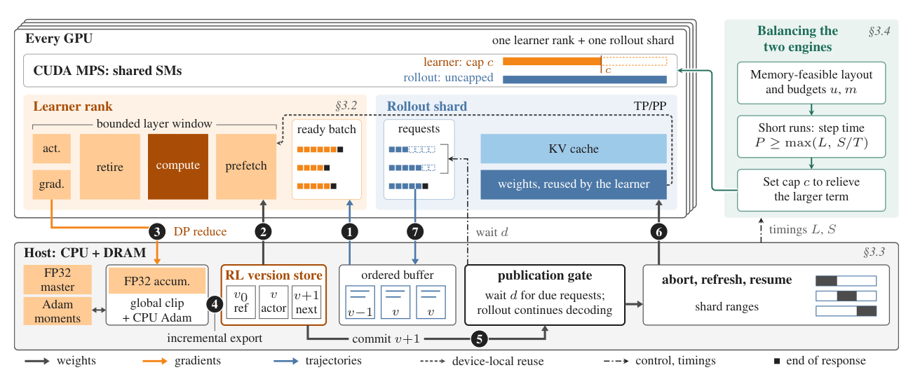查看原图 ↗</a>

*主机保管优化器，GPU 只保留有限的层窗口*

<h2 class="daily-paper-title" id="paper-arxiv-2611.27255">AceVLN 在云端指导变旧时选择刷新或补偿</h2>

Zihao Zheng, Hangyu Cao, Yulong Han, Xichang Wu, Zhihao Mao, Maoliang Li, Jiayu Chen, Hailong Zou, Donggang Cao, Xuanzhe Liu, Hong Mei, Xiang Chen · 2026-11-20  
[AceVLN: Asynchronous Cloud Edge Deployment of VLNs via Latent Scheduling and Compensation](https://arxiv.org/abs/2611.27255)

边缘机器人执行动作时，较慢的云端规划仍可能在传输旧场景的指导。AceVLN 从边缘特征中跟踪与动作相关的子空间漂移，用熵调节刷新时机，只在近期漂移足够连续时对迟到的指导做补偿。DualVLN 配 Orin、RxR-CE 上，固定每百次决策十次云调用时，部署成功率由周期刷新的 52.8% 升至 60.5%。改为维持 52.8% 的成功率目标，则只需七次调用。减少云计算可降低摊销耗时，但相对 Bridge 的平均响应仍增加 5–13 毫秒，说明平均计算预算和动作响应延迟应分别看。

<a class="note-image-link" href="/assets/images/digest/2026-11-24/arxiv-2611.27255.png" target="_blank" rel="noopener" aria-label="依据动作相关漂移决定何时访问云端">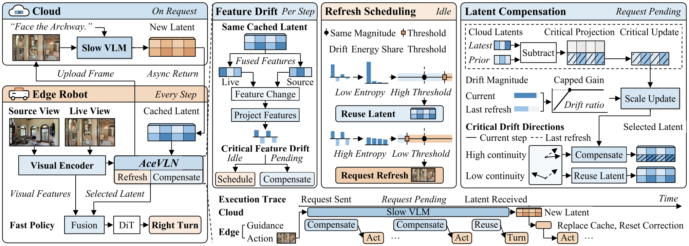查看原图 ↗</a>

*依据动作相关漂移决定何时访问云端*
