在 AlgoTune 中，多跑一个任务会改变另一个智能体看到的性能反馈。TideSand 用独占回放给计时建立参照。RetryRealistic 发现，工具返回部分数据时，重试往往根本没有发生。Exact on Paper 则让相同请求换个顺序，测出推理服务在未改配置时会翻转多少答案。三项研究给出了不同的对照方式：独占执行、任务真值和重复副本。它们分别回答一次提速、一个答案和一次发布回归是否可信。

<h2 class="daily-paper-title" id="paper-arxiv-2611.31118">TideSand 怎样让同机任务仍能测准工具耗时</h2>

Shulu Li, Hanchen Li, Xiaokun Chen, Qiuyang Mang, Hanfei Chen, Jacky Kwok, Hanfei Yu, Alvin Cheung, Edward A. Lee, Joseph E. Gonzalez, Ion Stoica · arXiv 首次提交 2026-11-23 · [TideSand: Performance-Accurate Sandbox Multiplexing for LLM Agents](https://arxiv.org/abs/2611.31118)

在 AlgoTune 一类任务里，工具的运行时间本身就是反馈。智能体试了两种实现，如果第二次恰逢邻居争抢 CPU，优化方向就可能选反。给每个沙箱独占资源可以测准，但模型思考时，预留的 CPU 常常闲着。TideSand 把调度单位缩小到一次工具调用，并把「相对独占环境多花了多少时间」变成和每台主机吞吐同等重要的指标。

<a class="note-image-link" href="/assets/images/digest/2026-11-25/arxiv-2611.31118.png" target="_blank" rel="noopener" aria-label="查看原图">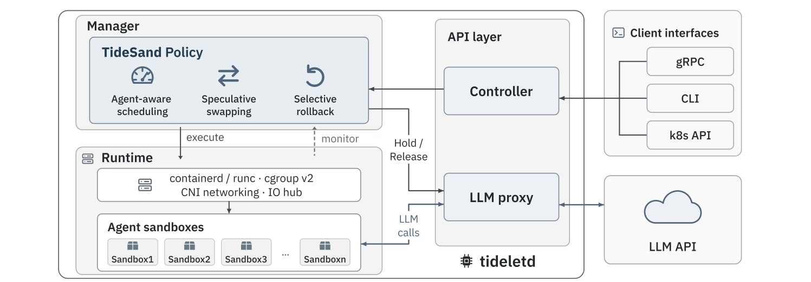查看原图 ↗</a>

*调度策略位于管理器内，沙箱分配与准入通过 API 接到容器和模型服务。*

一次模型调用给主机留下了机会窗口。调度器可以把等待推理的沙箱内存换出，为正在执行工具的沙箱让出 DRAM，再在下一次工具调用之前预取。这样做的时机很重要。若由操作系统在内存耗尽时被动回收，活跃任务也会遭遇缺页，计时仍被扭曲。TideSand 同时控制工具准入。遇到竞争，它可以给选中的沙箱创建检查点，在资源宽松时恢复并重做受影响的工作。论文把保存开销和真正重做的频率分开测量，六组负载中回滚比例最高为 0.44%。

作者在一台 64 核、128 GB 的 Arm 主机上回放调用，把 56 核和 112 GiB 分给沙箱，驱动程序使用剩余 CPU。每条轨迹先在严格预留条件下回放五次，以五次中最慢的一次为参照。对于参照时间至少一秒的调用，耗时膨胀小于 10% 才算保真。这里选择较慢的参照，容许了独占执行自身的波动。吞吐统计到一轮中 80% 的调用完成，因而这个数字也不能回答最后一批长尾任务要等多久。

在 AlgoTune、Terminal-Bench 4.0 和 Terminal-Bench Science 上组成的六组模型与负载配对中，作者测得每主机吞吐为严格预留的 3.8–10 倍，同时保持相近的调用保真度。AlgoTune 的回放评分误差缩小了 19 倍。这个结果把资源管理和评测结论连了起来。若工具在做性能比较，主机引入的抖动会进入奖励，平均 CPU 利用率无法说明这一点。论文中把同一调用与独占回放逐一配对的实验，值得与总体吞吐一起读。

<h2 class="daily-paper-title" id="paper-arxiv-2611.28341">RetryRealistic 追踪工具返回半份数据后的错误答案</h2>

Gün Kaynar, Boshen Yan, Carl Kingsford · arXiv 首次提交 2026-11-20 · [When Tools Fail, Agents Fabricate: Silent Failure and Verification-First Oversight in Tool-Using LLM Agents](https://arxiv.org/abs/2611.28341)

工具明确拒绝访问时，智能体至少知道手上的证据有缺口。更难察觉的是一个成功返回的查询少了几行，模型据此算出一个完全说得通的总数。研究者用真实文件、SQLite 和工具执行环境搭建 RetryRealistic，在八种工具、三十个多步任务中控制九类故障及其持续时间。四种智能体共经历 2,100 次带故障的运行。评判依据是任务真值，并区分正确恢复、承认失败和自信地给出错误答案。只统计「是否回复了用户」会合并这三种结果。

<a class="note-image-link" href="/assets/images/digest/2026-11-25/arxiv-2611.28341.png" target="_blank" rel="noopener" aria-label="查看原图">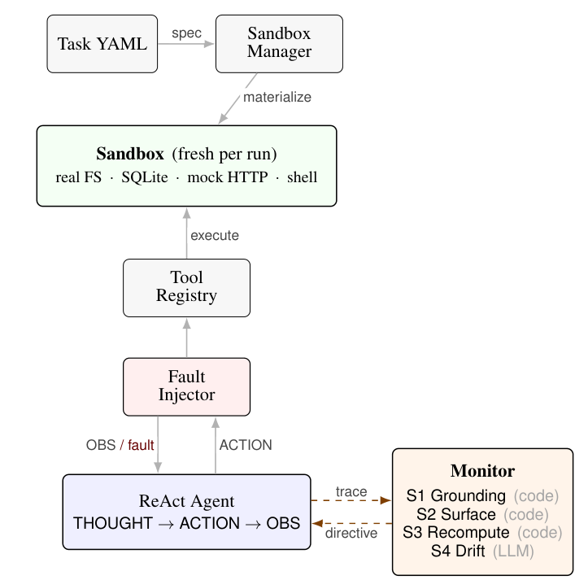查看原图 ↗</a>

*工具故障进入智能体的观察记录，监督器读取轨迹后可以要求修正。*

轨迹揭示了排查顺序。在部分成功和格式异常的返回真正触发时，609 次运行中有 554 次没有再次调用同一工具。相反，硬性拒绝更容易引出重试或承认做不到。把故障标签和返回内容拆开比较后，错误更贴近返回内容是否足以乱真。这里的操作含义很具体。重试预算再大，也得先有人发现这一次需要重试。

监督器从工具输出里寻找答案所声称的值，也能在取回的行上重新计算。它把矛盾送回智能体，让后者修正答案；最后一级用模型检查是否偏离任务。汇总后，正确恢复率从 45.6% 升至 56.3%，编造率从 17.3% 降至 10.8%。仅保留代码检查时，两项分别是 54.7% 和 13.4%。不同模型的代价也不同，Claude Haiku 的编造率下降时，正确恢复率也下降了 5.7 个百分点。

最值得读的是监督器没有介入的样本。在 324 次装有完整监督器的部分成功实验中，有 224 次没有触发它。截短的数据没有报错，用这几行重算也可能和答案一致。这个故障组的编造率仍有 32.1%，起点为 38.3%。答案可从现有证据推出，与工具是否交付了完整证据，是两项需要分别观测的性质。

<h2 class="daily-paper-title" id="paper-arxiv-2611.29663">怎样判断一次推理服务变更真的翻转了答案</h2>

Sharven Rane · arXiv 首次提交 2026-11-22 · [Exact on Paper: Which LLM Serving Shortcuts Flip Graded Answers, Measured Against the Noise of Reordering the Same Requests](https://arxiv.org/abs/2611.29663)

两次运行的准确率相同，也可能是原来做对的题和原来做错的题恰好交换。作者用一个 4B 指令模型，在 vLLM 0.33.0 上逐项配对五个基准的 3,380 条请求，比较九种单项配置变更。参照配置也跑多份，既比较重启前后，又只改变同一组请求的到达顺序。后一项改变批次组成，为「服务本身通常会翻转多少答案」提供参照。

<a class="note-image-link" href="/assets/images/digest/2026-11-25/arxiv-2611.29663.png" target="_blank" rel="noopener" aria-label="查看原图">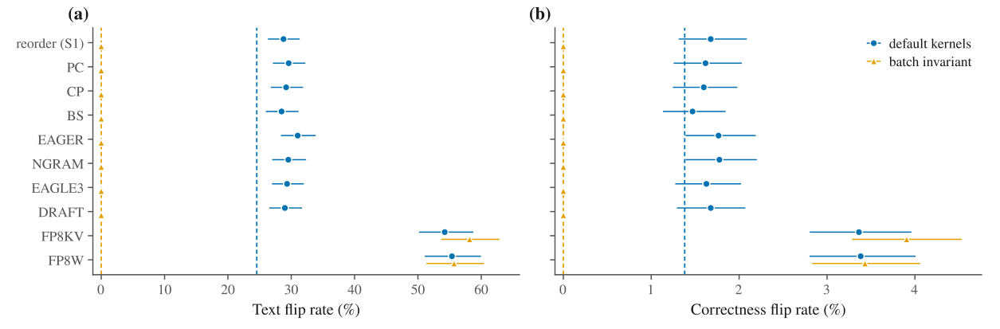查看原图 ↗</a>

*两列分别统计文本与得分翻转，批次不变内核下仍可见量化带来的差异。*

默认内核下，七项按算法应保持结果的优化各有 1.47%–1.78% 的请求改变得分，和重排参照的 1.72% 处于同一量级。FP8 KV 的翻转率达到 3.36%。换用不随批次改变数值结果的内核后，七项优化在所有请求上连输出文本都与参照一致，FP8 KV 仍有 3.91% 的评分翻转。平均准确率的变化在一个百分点以内，却掩盖了这两类配置的差异。翻转既包括答对变答错也包括相反方向，不能把它直接记作准确率损失。

对发布门槛而言，论文还有一个负面结果。仅拿一对参照副本估计噪声，有一次连未改动的配置都被判失败。作者建议在可行时使用批次不变内核，或者用至少三个副本估计重排波动。这个数字来自单一模型、单 GPU 和可精确判分的任务。迁移到依赖裁判模型的开放问答时，还需把裁判本身的波动加入参照。

<h2 class="daily-paper-title" id="paper-arxiv-2611.30027">Hopper 上的 4 位 KV 何时能提高服务容量</h2>

Jian Zhang · arXiv 首次提交 2026-11-23 · [Fast 4-bit KV-Cache Decoding on Hopper GPUs: Why Existing Kernels Are Slow and How to Fix Them](https://arxiv.org/abs/2611.30027)

把缓存位宽减半，解码仍可能更慢。作者逐条统计 GPU 指令，发现解包、重新排列和串行搬运会耗尽指令发射带宽。新内核在写缓存时就排好数据，由生产者 warp 提前搬运，计算组从寄存器取数，并交换矩阵操作数以免给小查询组补零。精度也有专门处理，包括让首层和四个起始 token 保留 BF16。单张 H200 上，Llama-3.1-8B 一条约 1K 输入、8K 输出的请求流要求至少 99% 的请求同时满足首 token 两秒和后续每 token 100 毫秒的目标。可承受的到达率为 FP8 的 1.23–1.32 倍。batch 为 1 时单步大致持平，预填充慢约 7%，长输出和缓存压力决定了收益。

<a class="note-image-link" href="/assets/images/digest/2026-11-25/arxiv-2611.30027.png" target="_blank" rel="noopener" aria-label="查看原图">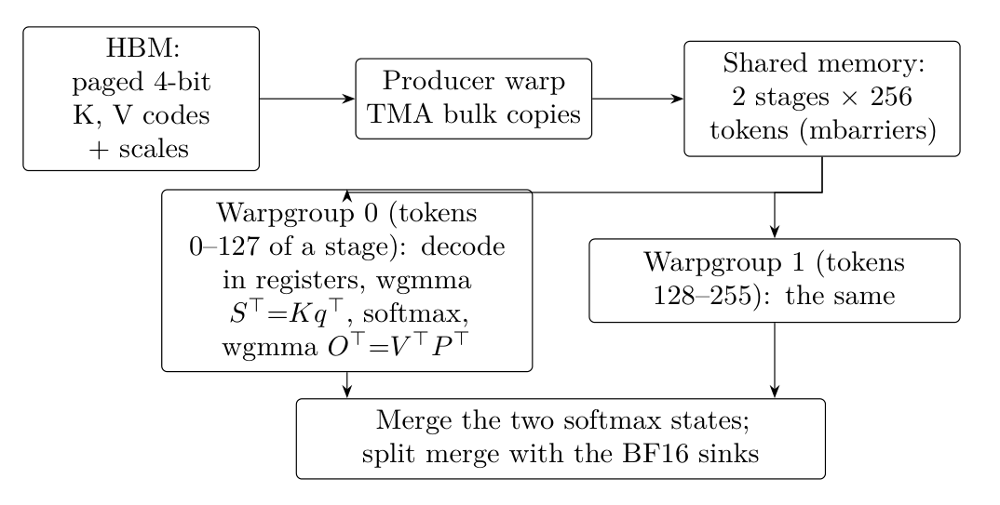查看原图 ↗</a>

*生产者提前搬运下一批数据，两组计算线程各自处理一段 token，最后合并结果。*

<h2 class="daily-paper-title" id="paper-arxiv-2611.28671">MASSYS 把没有交付的多智能体任务也纳入分母</h2>

Haoyuan Zheng, Dongting Li, Hancheng Ye, Qinsi Wang, Mingyuan Ma, Yuncheng Yao, Yifei Wang, Baijun Zhou, Zishan Shao, Tingjun Chen, Hai Helen Li, Danyang Zhuo, Yiran Chen · arXiv 首次提交 2026-11-21 · [The Evaluation Substrate Matters: Benchmarking Multi-Agent Serving Substrates](https://arxiv.org/abs/2611.28671)

并行启动多个工作者可以缩短等待，也会同时占用更多 KV。MASSYS 固定任务与工作流，改变服务后端、并发和资源限制，同时记录已交付答案的质量、超时和以所有提交任务为分母的有效质量。在受控诊断中，星形工作流的平均延迟排名从第一降至第四，链形则在 KV 紧张时从第四升至第一。作者另在五种后端组合上测试，发现某些任务中幸存答案的平均质量变化较小，交付率已明显恶化。对线上工作流，延迟排名要和负载条件一起报，答案质量也需要一个明确的分母。

<a class="note-image-link" href="/assets/images/digest/2026-11-25/arxiv-2611.28671.png" target="_blank" rel="noopener" aria-label="查看原图">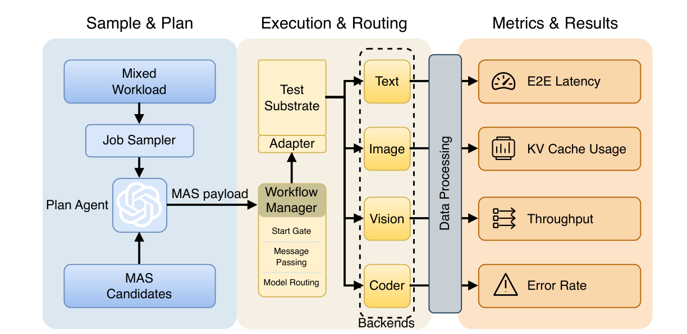查看原图 ↗</a>

*相同任务与工作流经过不同后端，右侧同时收集服务指标和任务结局。*

<h2 class="daily-paper-title" id="paper-arxiv-2611.29004">在状态真正被读取时检查恢复结果</h2>

Guijia Zhang, Huihao Jing, Bing Li, Shing-Chi Cheung, Harry Yang, Ziqi Zhang · arXiv 首次提交 2026-11-21 · [Consumer-Time Validity in Stateful AI Runtimes: Verifying Recovered State and Deferred Authority](https://arxiv.org/abs/2611.29004)

故障后能继续输出 token，还不能说明下一次请求读到了正确状态。作者把恢复契约拆成排除无效状态、保留有效工作和完成任务，并将调度元数据与消费请求绑定。对延后执行的工具操作，则要确认批准仍对应当前版本。离线核验器在 42 个冻结的 GPU 场景中与参照判定全部一致。一个无故障 BF16 对照在第 30 个 token 就因批处理而分歧，实际被注意力读取的 KV 摘要却相同。这解释了为什么只比输出文本会误报。独立的调度实验中，绑定修订版的执行检查挡住 160 次确定性写入冲突；这些都是固定场景的覆盖数。

<a class="note-image-link" href="/assets/images/digest/2026-11-25/arxiv-2611.29004.png" target="_blank" rel="noopener" aria-label="查看原图">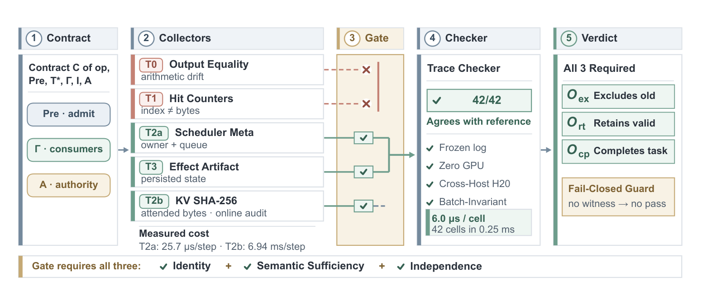查看原图 ↗</a>

*契约指定消费位置，核验器从证据判断排除、保留和完成条件。*

<h2 class="daily-paper-title" id="paper-arxiv-2611.31105">LiveLoRA 在更新适配器时一并提交缓存和下一步分数</h2>

Tianyi Huang, Samuel Xu, Ivy Gu, Nathan Huang, Siqi Zhang · arXiv 首次提交 2026-11-23 · [LiveLoRA: Exact KV Cache Migration Across LoRA Updates for LLM Agents](https://arxiv.org/abs/2611.31105)

长会话更换 LoRA 后，旧缓存可能对应旧权重，整段重新预填充又会使切换代价随历史增长。LiveLoRA 限定更新发生在最后一个解码块，冻结低层和 K/V 的下投影，保留每个 token 不变的基投影与低秩坐标。系统先私下重建候选缓存、重算最后一枚 token，再把权重、缓存和 logits 一起提交。Qwen2.5-3B-Instruct 上，32 个各含 8K token 的会话，五次运行的配对发布加速中位数平均为 68.98 倍；持续解码开销约 4.8%。精确等价证明有算术和更新位置的假设，无法直接覆盖任意层更新。

<a class="note-image-link" href="/assets/images/digest/2026-11-25/arxiv-2611.31105.png" target="_blank" rel="noopener" aria-label="查看原图">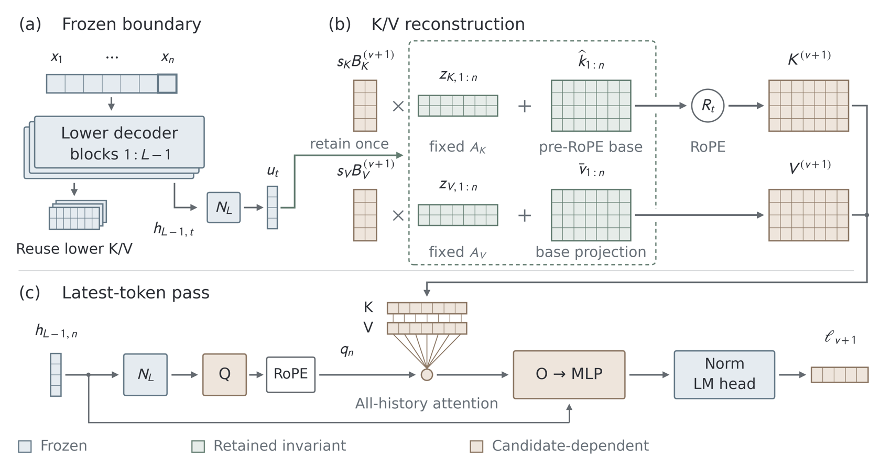查看原图 ↗</a>

*最后一块从冻结的输入重建 K/V，再计算当前前缀的下一步输出。*

<h2 class="daily-paper-title" id="paper-arxiv-2611.28625">IndexerStage 把稀疏注意力的索引键分层存放</h2>

Xin Zhang, Weifeng Zhang, Xianyan Xie, Huijun Shen, Xijin Yin, Zhen He, Yinben Xia, Xiang Li, ZeKun He, Yachen Wang, Xianneng Zou, Guo Chen · arXiv 首次提交 2026-11-21 · [IndexerStage: Staging Indexer-K across Memory Tiers for Sparse-Attention LLM Serving](https://arxiv.org/abs/2611.28625)

稀疏注意力只取少数位置的值，但为了决定取哪些位置，索引器仍要扫描长历史的键。IndexerStage 把已完成的索引页放入后备层，本地保留新写入的条目和跨层复用的执行缓冲区。准入同时检查空间和逐层传输预算，避免显存装得下、下一层却等不到数据。SGLang 原型用了 16 张服务 H800 和 16 张后备 H800。在 64K 输入、固定 latent-KV 后备路径下，同为 batch 24 时每 token 时间增加 2.42%，扩大到 29 后吞吐才达到对照的 1.10 倍。这是用搬运代价换容量的结果，后备 GPU 也是资源成本。

<a class="note-image-link" href="/assets/images/digest/2026-11-25/arxiv-2611.28625.png" target="_blank" rel="noopener" aria-label="查看原图">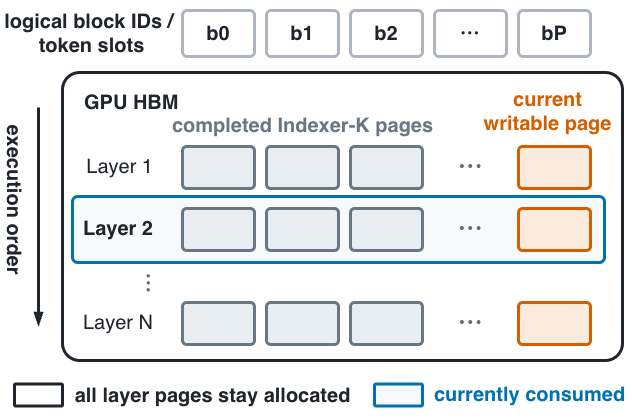查看原图 ↗</a>

*常驻方案为每一层保留索引页，当前可写页与本层实际消费的页分别标出。*

<h2 class="daily-paper-title" id="paper-arxiv-2611.28702">机密推理中的 KV 备份也会阻塞前台 token</h2>

Haoxuan Xu, Shaoyu Wang, Minghao Lin, Beijie Liu, Potung Yu, Yongqin Wang, Vincent Quentin Ulitzsch, Seo Jin Park, Murali Annavaram, Mengyuan Li · arXiv 首次提交 2026-11-21 · [HiPerfCC-KVCache: Accelerating Confidential LLM Serving with Hierarchical KV Caching](https://arxiv.org/abs/2611.28702)

开启机密计算后，CPU 与 GPU 之间的缓存传输还要走受保护路径。即使备份和生成分属不同线程和流，锁和暂存区的所有权仍可阻塞前台。HiPerfCC-KVCache 限制一次发出的备份工作量，让已经就绪的 token 回读插入空档，并借助辅助上下文和共享暂存区并行恢复 KV。在三种模型、三种负载的最高测试压力下，相对分阶段传输的 HiCache-Workers，H200 输出吞吐的几何平均加速为 1.74 倍，平均首 token 时间平均降低 36%。Blackwell 上同口径吞吐为 1.28 倍，收益取决于受保护复制路径的瓶颈。

<a class="note-image-link" href="/assets/images/digest/2026-11-25/arxiv-2611.28702.png" target="_blank" rel="noopener" aria-label="查看原图">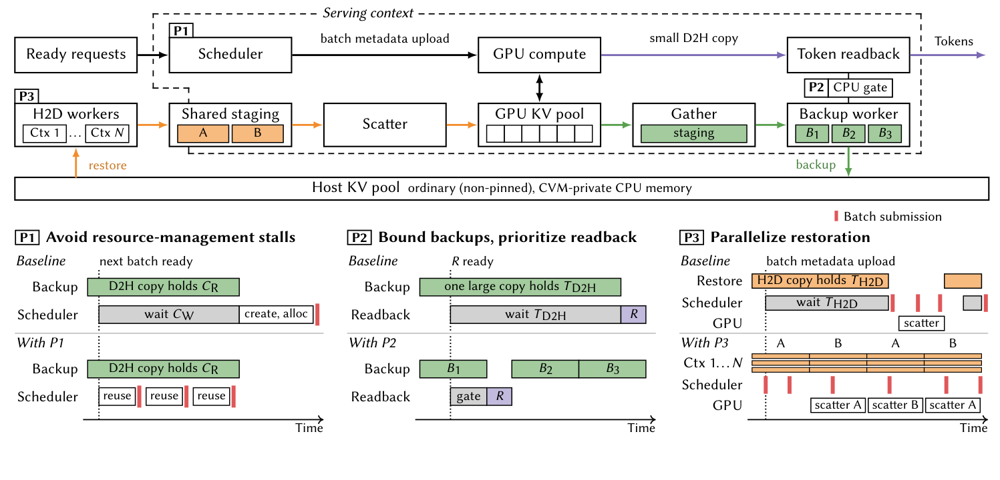查看原图 ↗</a>

*时间线显示备份、token 回读与恢复对前台进度的影响。*

<h2 class="daily-paper-title" id="paper-arxiv-2611.28522">DisSparse 让可变数量的注意力块脱离调度关键路径</h2>

Nurlan Nazaraliyev, Elaheh Sadredini, Nael Abu-Ghazaleh · arXiv 首次提交 2026-11-21 · [DisSparse: Pipelined Top-$p$ Sparse Attention for Long-Context LLM Serving](https://arxiv.org/abs/2611.28522)

固定取 k 个块便于分配显存，但不同 KV 头的注意力有时集中、有时分散。按累计概率选块能跟随差异，代价是块数事前未知，选择本身也可能比注意力还慢。DisSparse 在 vLLM 中让另一条流与层计算重叠，单遍直方图内核估计截断点，再依据预填充阶段的分数重排 token，减少只因夹杂少量重要 token 就必须整块读取的情况。相对已有 top-p 方案，选择阶段加速 1.17–1.80 倍；相同显存下最大批次一度达到稠密 vLLM 的八倍。后一个数字衡量可容纳的请求数，两者都不能直接当成端到端吞吐比。

<a class="note-image-link" href="/assets/images/digest/2026-11-25/arxiv-2611.28522.png" target="_blank" rel="noopener" aria-label="查看原图">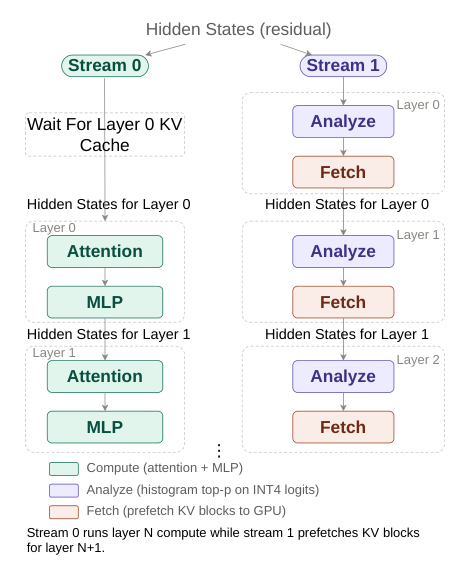查看原图 ↗</a>

*两条流分别承担层计算和稀疏分析，选择工作可以与主流重叠。*

<h2 class="daily-paper-title" id="paper-arxiv-2611.29280">QASparse 在预填充时分别决定算多少、保留谁</h2>

Zhiyuan Chen, Zihao Yang, Quanjiang Li, Haijiang Li, Jiancheng Pan, Qichao Zhao, Zihan Dong, Qiushi Shi, Jinshi Liu · arXiv 首次提交 2026-11-22 · [QASparse: Query-Adaptive Sparse Attention with Tailored Budgets and Tokens](https://arxiv.org/abs/2611.29280)

多个查询头可以共享粗略的重要性估计，但越靠近保留边界，它们对哪些位置值得计算的意见越不一致。QASparse 对抽样查询做局部回归，为不同位置和头分配预算，再用真实查询与键的打分为临界候选投票。第二步可以换掉候选而不扩大预算。长短序列走不同的选择内核，以免灵活分配本身吃掉节省的时间。作者在 RULER 等长上下文任务上同时比较质量和延迟，在 64K 下相对 FlashAttention-2 报告最高 1.77 倍首 token 加速。这个结果针对提示处理，和 DisSparse 的解码选块解决不同阶段的问题。

<a class="note-image-link" href="/assets/images/digest/2026-11-25/arxiv-2611.29280.png" target="_blank" rel="noopener" aria-label="查看原图">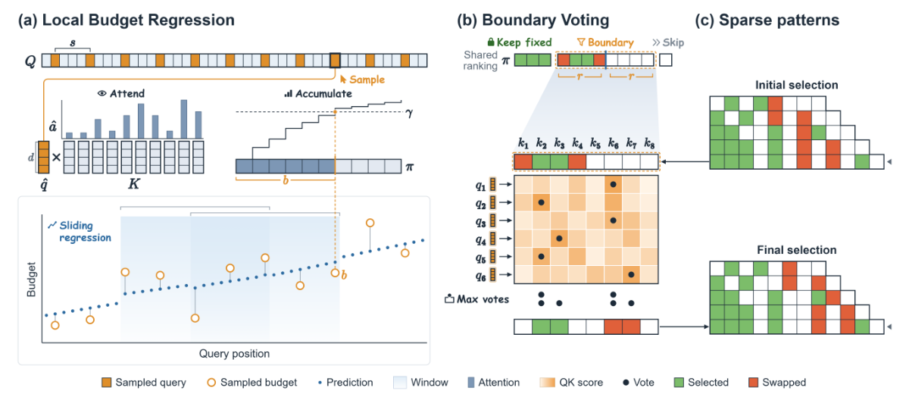查看原图 ↗</a>

*先估计预算，再用投票调整临界候选，得到每个查询的稀疏模式。*

<h2 class="daily-paper-title" id="paper-arxiv-2611.30554">Near-Far Attention 对近处和远处的历史分别评分</h2>

YuanShuo Wang, Jianchao Tan, Lei Gong, Teng Wang, Wenqi Lou, Xuehai Zhou · arXiv 首次提交 2026-11-23 · [Near-Far Attention: Region-Aware Sparse Retrieval for Long-Context LLM Decoding](https://arxiv.org/abs/2611.30554)

同一个页面打分规则可能遗漏远处的孤立线索，也可能在近处保留过多相似 token。NFA 在预填充时判断哪些区域可以跳过，为其余区域提取共用的低维特征，按距离分别给页打分，再把候选 token 放在同一预算下竞争。作者对可装入显存的配置测试了 batch 1、2、4。Qwen3-8B 在 512K、batch 1 时，相对 FlashInfer 的最高整模型解码加速为 2.97 倍，已计入选择代价。原文还比较了相同预算下的选择器；这比单看算子最高 5.49 倍更能判断长上下文里检索额外花的时间是否值得。

<a class="note-image-link" href="/assets/images/digest/2026-11-25/arxiv-2611.30554.png" target="_blank" rel="noopener" aria-label="查看原图">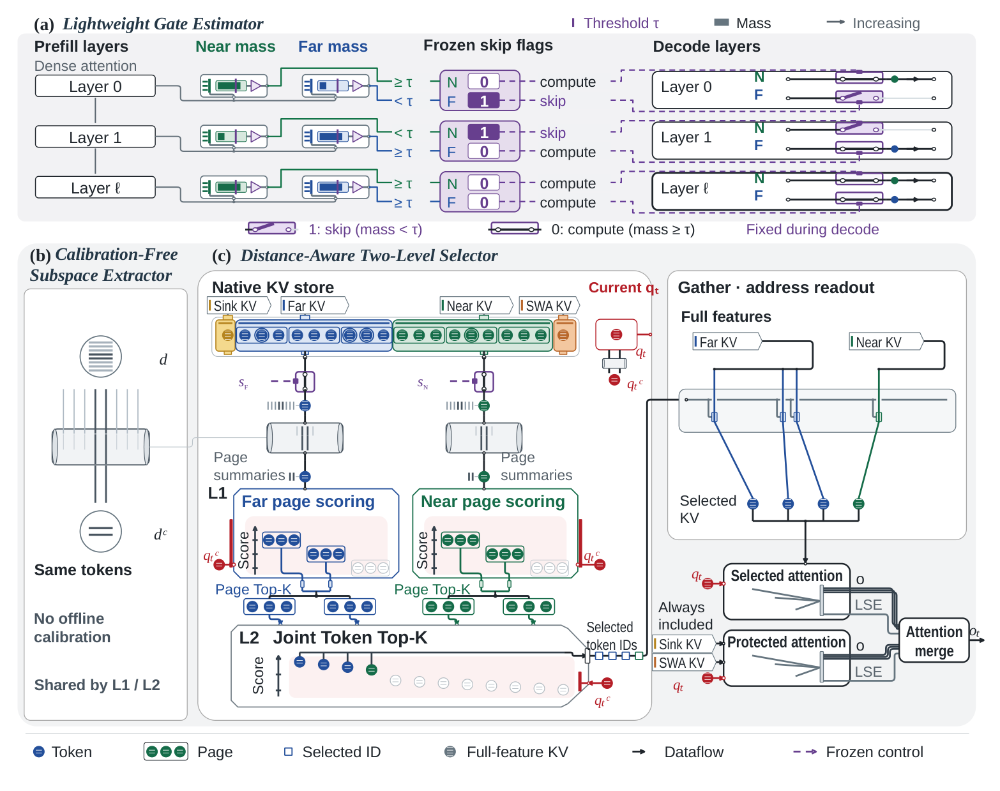查看原图 ↗</a>

*预填充确定可跳过的区域，解码阶段分两级给页和 token 打分。*

<h2 class="daily-paper-title" id="paper-arxiv-2611.31112">并行草稿在验证前先看一眼前缀</h2>

Mohammad Mahdi Moradi, Ali Pourranjbar, Zongzuo Wang, Mingming Zhu, Ben Feng, Boxing Chen · arXiv 首次提交 2026-11-23 · [Look Back, Draft Ahead: Corrective Prefix Attention for Parallel Speculative Decoding](https://arxiv.org/abs/2611.31112)

并行预测一个块时，前面一个 token 不协调就可能让后续全部被拒。CPA 先为各位置建立候选短表，并行算好候选之间的交互；按顺序确定前缀时只查表、累加和评分。训练时的额外自回归损失教草稿模型利用干净前缀，线上无须另跑一遍网络。在 Ascend NPU、两个 Qwen3 目标模型和八个基准上，每轮提交的 token 比 DSpark 多 13%–15%。并发会改变帐目：Qwen3-4B 相对仅跑目标模型的加速从单请求的 3.35 倍降到 32 请求的 1.52 倍，此时 DSpark 为 1.42 倍。

<a class="note-image-link" href="/assets/images/digest/2026-11-25/arxiv-2611.31112.png" target="_blank" rel="noopener" aria-label="查看原图">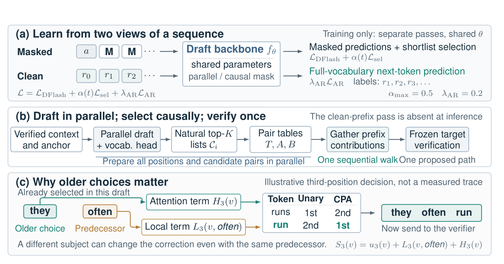查看原图 ↗</a>

*干净前缀用于训练；推理时先并行算候选交互，再按顺序确定选择。*

<h2 class="daily-paper-title" id="paper-arxiv-2611.30455">CGSpec 将边缘草稿的返回时间纳入云端排队</h2>

Yuanbing Ouyang, Xiaoli Liu, Shirong Wei, Hao Wang, Xiang Su · arXiv 首次提交 2026-11-23 · [CGSpec: Consistency-Guided Speculative Decoding with Overlap-Aware Verification Scheduling for Edge-Cloud Inference](https://arxiv.org/abs/2611.30455)

多个边缘设备共用云端验证器时，一棵更大的候选树可能改善接受长度，也可能挤占很快就会返回的其他请求。CGSpec 从验证反馈估计草稿与目标分布的偏离，据此调整树的预算，把全局扩展和局部候选筛选分开。调度器再用客户端剩余时间和验证工作量选择下一项。四种模型配对、三个数据集以及注入网络延迟、抖动和带宽限制的实验中，8 和 16 客户端的系统吞吐相对比较方法分别提高 12.2% 和 10.2%。延迟来自模拟网络配置，实网突发拥塞下的排列次序仍需测量。

<a class="note-image-link" href="/assets/images/digest/2026-11-25/arxiv-2611.30455.png" target="_blank" rel="noopener" aria-label="查看原图">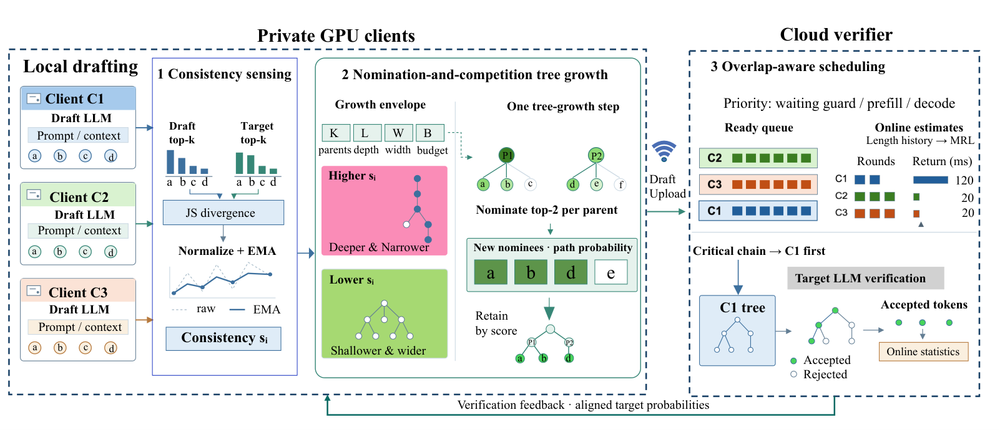查看原图 ↗</a>

*客户端按验证反馈构造候选，云端据工作重叠情况决定验证次序。*

<h2 class="daily-paper-title" id="paper-arxiv-2611.28760">OSplit 用容量模型决定预填充与解码配卡</h2>

Akshat Pandey, Dominic Cheng, Sidharth Sharma, Ashwin Gumaste · arXiv 首次提交 2026-11-21 · [Analytical Modeling and Optimal GPU Provisioning for Disaggregated LLM Inference](https://arxiv.org/abs/2611.28760)

两阶段分开部署后，哪边增卡取决于输入长度、输出长度、模型权重读取和注意力流量。OSplit 从集合通信方案、内核和硬件容量估计每步时间，再搜索满足负载的配比。作者用 vLLM 测量 H100 和 GB300 上的运行时间来检验模型。H100 上固定模型与输出长度，把输入从 1K 延长到最长的测试点，最优预填充对解码配卡比增加 3.3–4.9 倍。它给出的是指定互连域和负载下的配置预测；生产队列里请求混合变化时，仍要检验预测出的阶段容量能否承接到达流。

<a class="note-image-link" href="/assets/images/digest/2026-11-25/arxiv-2611.28760.png" target="_blank" rel="noopener" aria-label="查看原图">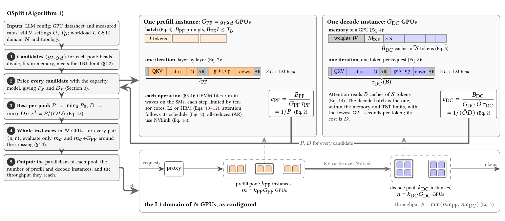查看原图 ↗</a>

*模型分别估计预填充与解码容量，寻找能匹配两侧速率的配卡方案。*

<h2 class="daily-paper-title" id="paper-arxiv-2611.29104">四张卡上的五种部署各自在什么负载下胜出</h2>

Jihui Yang, Wentai Wu, Jiahua Huang, Weiwei Lin, Ligang He, Linghong Tsang · arXiv 首次提交 2026-11-22 · [When Does Decomposition Help? Empirical Study on Workload-Architecture Affinity in LLM Inference Serving](https://arxiv.org/abs/2611.29104)

作者在同一四卡资源上比较独立副本、张量并行、流水并行和两种阶段分离，分别施加短聊天、长输出和 32K 上下文负载。四个单卡副本在短聊天与长输出中端到端延迟最低。32K 以每秒 0.4 个请求到达时，四段流水的 P95 首 token 为 1.55 秒，副本为 3.81 秒；分离的双段流水则以 3.98 秒获得更好的 P95 端到端延迟。静态 TP2+TP2 在更高的长上下文负载下错误率达到 92.9%。论文和 OSplit 的互补点在于固定四卡时队列是否稳定，尤其是阶段不能独立扩容时。

<a class="note-image-link" href="/assets/images/digest/2026-11-25/arxiv-2611.29104.png" target="_blank" rel="noopener" aria-label="查看原图">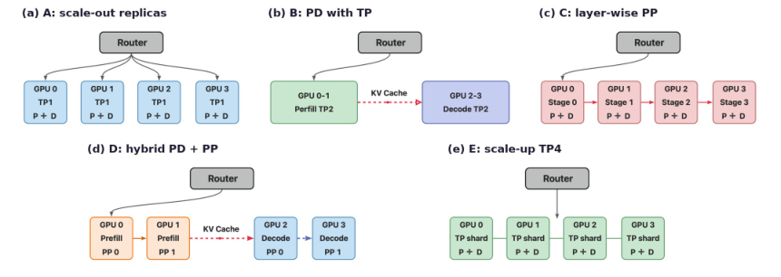查看原图 ↗</a>

*五种部署使用同样的四张卡，阶段和副本的切分方式不同。*

<h2 class="daily-paper-title" id="paper-arxiv-2611.29156">ARC 给可能还有价值的 rollout 组一次恢复机会</h2>

Yihui Zhang, Tianyu Wo, Jinghao Wang, Xiao Zhou, Huitian Xue, Xiaoyang Sun, Zeying Wang, Chunming Hu, Renyu Yang · arXiv 首次提交 2026-11-22 · [ARC: Adaptive Rollout Control for Efficient Synchronous LLM Reinforcement Learning](https://arxiv.org/abs/2611.29156)

同步 GRPO 的一步训练需要足够多的有效组，盲等慢样本浪费时间，过早丢弃又会改变进入训练的数据。ARC 利用已完成的组内样本判断是否补入新候选，把尚不确定的组暂存，允许有限次数恢复，并根据所需组数限制后续准入。双节点、共 16 张 H20 的数学任务实验中，作者报告在线 rollout 耗时下降 37.4%，有效 GRPO 吞吐提高 50.1%，原本最终会保留的组找回了 98.9%。恢复机制贡献很具体，主实验中恢复组占召回率的 18.3 个百分点。数学数据的奖励结构会影响提前判定的可靠性。

<a class="note-image-link" href="/assets/images/digest/2026-11-25/arxiv-2611.29156.png" target="_blank" rel="noopener" aria-label="查看原图">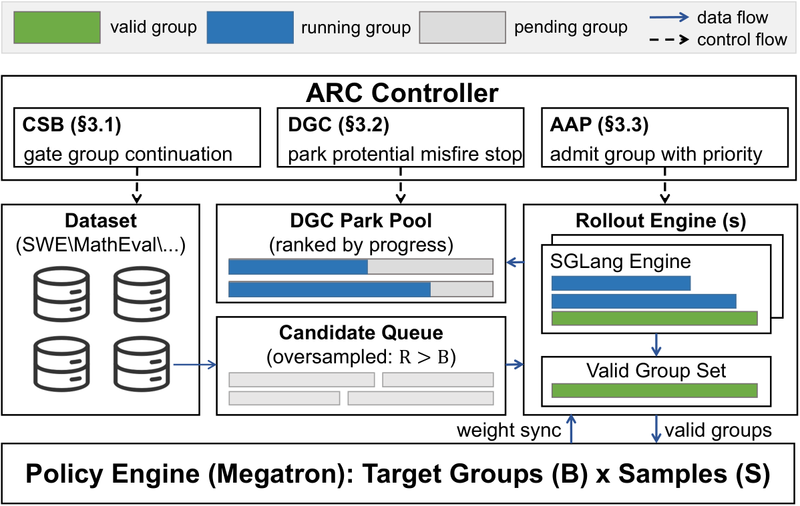查看原图 ↗</a>

*控制器在候选队列、暂存池和 rollout 引擎之间调配组。*

<h2 class="daily-paper-title" id="paper-arxiv-2611.28469">Apsis 从工作流连线中找出运行前就能发现的故障</h2>

Yanju Chen, Ying Li, Bosi Zhang, Hanzhi Liu, Hongbo Wen, Yufei Ding, Yuan Tian, Yu Feng · arXiv 首次提交 2026-11-21 · [Automated Safety Analysis for Agentic Workflows](https://arxiv.org/abs/2611.28469)

一个验证节点可以永远跳回分析节点，即便每个组件单独都能正常工作。Apsis 将不同框架里的步骤、控制流、输入依赖和共享状态转为同一种图，记录必填输入和并发写入的合并规则，然后用声明式模式寻找不可能前进或不满足数据契约的位置。作者从 13 个框架的真实报告整理缺陷，在可重现的缺陷与修复样本上测得 91% 精确率、84% 召回率，另报告 36 个此前未知的工作流缺陷。它能指出哪一步违反已建模规则；模型对输入的开放式语义判断仍在这一图表示之外。

<a class="note-image-link" href="/assets/images/digest/2026-11-25/arxiv-2611.28469.png" target="_blank" rel="noopener" aria-label="查看原图">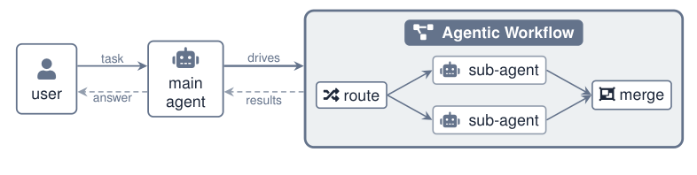查看原图 ↗</a>

*主智能体可将子任务送入固定工作流，内部的路由与合并都有明确位置。*

<h2 class="daily-paper-title" id="paper-arxiv-2611.29290">干预能修哪种错，取决于当前运行框架</h2>

Zihan Jin, Gaoyuan Du, Jiate Li, Dongze Ye, Shawn Li, Yue Zhao, Defu Cao · arXiv 首次提交 2026-11-22 · [Which Failure Does an Intervention Repair? When Agent Interventions Help, and Where Self-Evolving Skills Stall](https://arxiv.org/abs/2611.29290)

同一条技能提示在弱框架上有效，换上带执行反馈的框架后可能无所增益。作者配对固定任务，在九个基准上改变模型、技能、框架和预算，累计近 90 万条轨迹。观察到的失败信号比「用了更强模型」更能解释某些结果。SQuAD 中，带反馈的框架挽回了 76.9% 有信号的失败，对静默失败只挽回 1.3%。SimpleQA 上自学技能也难以补上缺失事实，提供检索段落后变化更大。选干预措施时，应同时报告此前留下哪种错、干预能看见哪些信号，以及改用什么框架后收益消失。

<a class="note-image-link" href="/assets/images/digest/2026-11-25/arxiv-2611.29290.png" target="_blank" rel="noopener" aria-label="查看原图">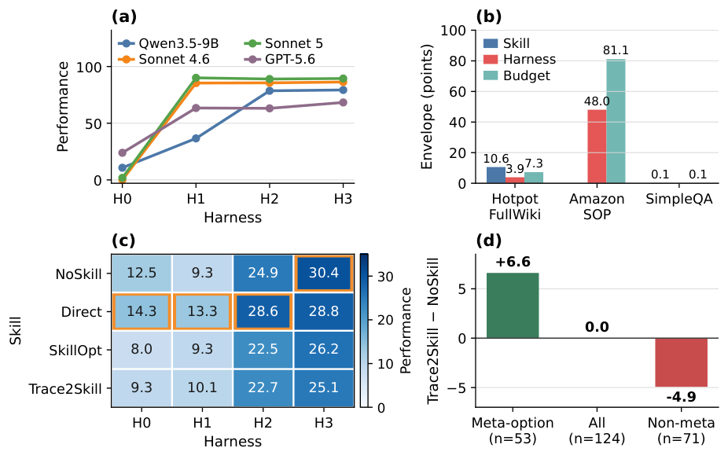查看原图 ↗</a>

*不同模型和框架组合下，技能增益与故障恢复率随条件变化。*

<h2 class="daily-paper-title" id="paper-arxiv-2611.30483">数据库错误的即时损失和可恢复损失应分开量</h2>

Abdullah Kaya, Cevheri Bozoglan, Yusuf Gundogdu · arXiv 首次提交 2026-11-23 · [When an AI agent makes a mistake in a database, what decides the damage?](https://arxiv.org/abs/2611.30483)

作者先用脚本执行 22 种固定错误，把权限和恢复手段与模型行为解耦，再让六个小型开放权重模型在九种引擎上完成带风险任务，得到 9,468 次主实验。恢复演练改变了对受损范围的理解。Cassandra 的默认快照在 432 次试验中没有留下永久受损的保护行，但这组恢复在出错后数秒启动，是后加的测量。另有 392 次损失试验中，215 次丢的是订单备份副本。若把副本与原行混在一个指标，容易误判保护措施的效果。七项预注册假设只有三项达到各自判据，其中两项很大程度上由实验设计决定。

<h2 class="daily-paper-title" id="paper-arxiv-2611.29546">ShellPlan 把授权判定绑定到实际执行计划</h2>

Jieyu Li · arXiv 首次提交 2026-11-22 · [ParseGap: Testing What Coding Agents Authorize and What Shells Execute](https://arxiv.org/abs/2611.29546)

编码智能体若先判断一段命令文本，再把它交给另一套解释器，用户批准的动作与实际副作用可能不同。ParseGap 用观测到的运行后果检验策略；其防护方案 ShellPlan 为支持的语言子集建立类型化执行计划，按参数能力检查，再直接执行同一计划，超出支持范围则升级审批。在 90 次模型驱动的风险测试中，防护组记录到零次违规效果，未加防护时为 62 次。代价也能量化：标准开发任务在前沿模型子组完成 36/36，所有模型合计为 74/100。这组结果支持缩小解释差异，但不能推及未建模的命令语义。

<h2 class="daily-paper-title" id="paper-arxiv-2611.31010">Airlock 将策略执行移到智能体虚拟机之外</h2>

Sina Abdollahi, Amir Al Sadi, Marios Kogias, Hamed Haddadi, Adrien Ghosn, Antoine Delignat-Lavaud, Manuel Costa, Mark Russinovich · arXiv 首次提交 2026-11-23 · [Airlock: Robust Sandboxing and Governance of Rogue Agents](https://arxiv.org/abs/2611.31010)

在同一个运行环境里同时执行智能体和管控规则，会让审计记录也依赖该环境的完整性。Airlock 用另一台机密虚拟机处理智能体的网络与文件 I/O，适配 OpenShell，将凭据与策略隔离，并通过单独的审计机制保留取证信息。Radxa 开发板原型中，套接字带宽相对基线下降 51%–70%，OpenClaw 任务平均系统时间由 15.5 秒增至 20.7 秒，端到端时间却只从 85.7 秒增至 91.4 秒。工具实际占总时长的比例决定用户看到的代价；这项硬件原型尚不能替代云上高吞吐网络负载的测量。

<a class="note-image-link" href="/assets/images/digest/2026-11-25/arxiv-2611.31010.png" target="_blank" rel="noopener" aria-label="查看原图">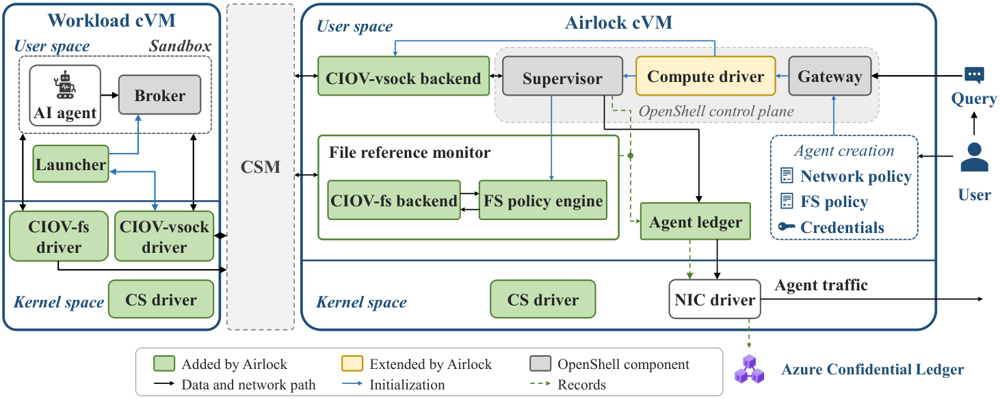查看原图 ↗</a>

*工作负载虚拟机的 I/O 交由独立 Airlock 虚拟机中的策略和审计组件处理。*

<h2 class="daily-paper-title" id="paper-arxiv-2611.28947">NightWatch 在界面发生变化时重排智能体的动作</h2>

Jiaqi Su, Jie-Jing Shao, Yichen Liu, Long-Kai Huang, Haiyan Yin · arXiv 首次提交 2026-11-21 · [Don't Sleep, Keep Watch: Proactive Perception for Computer-Use Agents](https://arxiv.org/abs/2611.28947)

模型生成动作时屏幕还在变化，推理开始时正确的点击目标可能已经消失。NightWatch 用 0.8B 观察模型连续看截图，根据界面变化唤醒主模型、打断过时推理或取消待执行动作。作者用同一截图输入比较多种观察策略。对大型视觉语言智能体，OSWorld 的非推理时间减少 33%，任务成功率相近；在动态网页 DynaCU-Bench 上，成功率从 39.5% 升至 44.2%。消融中，仅等待像素静止会把窗口动画和真正可以继续操作混为一谈。时间收益针对非推理部分，不能等同于总任务提速。

<a class="note-image-link" href="/assets/images/digest/2026-11-25/arxiv-2611.28947.png" target="_blank" rel="noopener" aria-label="查看原图">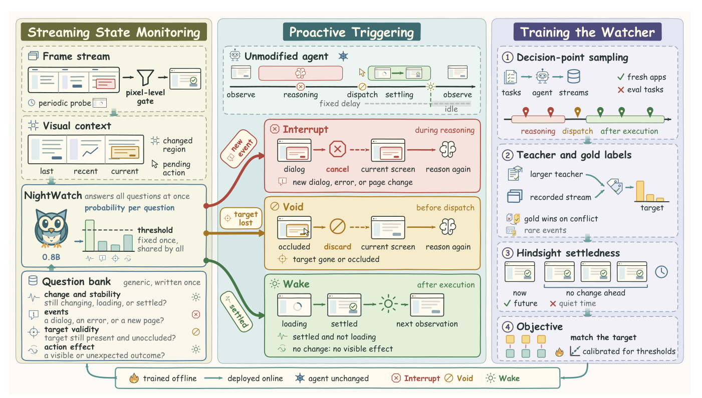查看原图 ↗</a>

*屏幕流驱动观察模型，由它决定何时唤醒、打断或撤销动作。*

<h2 class="daily-paper-title" id="paper-arxiv-2611.30190">网页智能体的两份成绩之间，到底差多少</h2>

Zelong Wang, Weiyue Li, Fei Xue, Junru Zhu · arXiv 首次提交 2026-11-23 · [Same Executions, Different Gaps: Judgment Rules in Web-Agent Evaluation](https://arxiv.org/abs/2611.30190)

固定执行轨迹，只改判分规则，也会改变领先幅度。论文把「大概完成了」与「记录中有足够证据证明完成」分开，并保留无法确认这一状态。两个智能体都被高估时，其误差有时互相抵消；把各自分数估得更准，差值反而可能偏得更远。作者从同一批任务抽成对样本，用人工参照标签校正自动裁判预测。每次抽取 50 对，在十种裁判与证据设置下，相对直接用样本差值估计，回归法的均方误差降低 16.9%–36.9%。这个精度改进以固定任务集合和成对标注为条件。

<a class="note-image-link" href="/assets/images/digest/2026-11-25/arxiv-2611.30190.png" target="_blank" rel="noopener" aria-label="查看原图">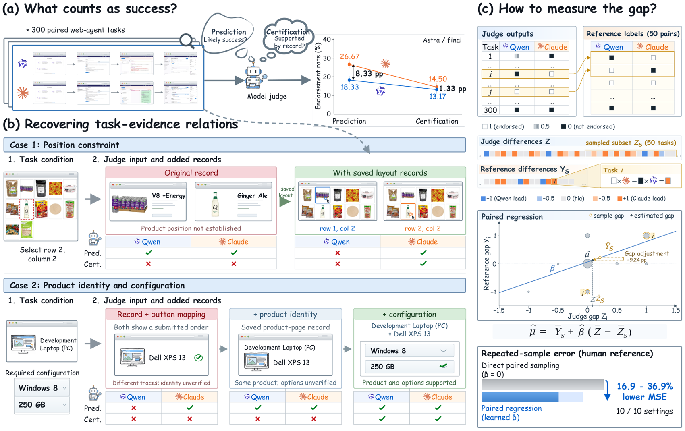查看原图 ↗</a>

*同一轨迹可改变判定规则、补充证据，再用成对标签估计分差。*

<h2 class="daily-paper-title" id="paper-arxiv-2611.28516">SQLution 为不等价查询寻找反例</h2>

Haoran Ding, Zhaoguo Wang, Zuming Jiang, Haibo Chen, Jinyang Li, Ruzica Piskac · arXiv 首次提交 2026-11-21 · [Bound to be Complete: Efficient Verification for SQL Equivalence via U-Expressions](https://arxiv.org/abs/2611.28516)

数据库查询改写若悄悄改变了排序或重复行，有限的测试表可能看不出差异。SQLution 用 U-expression 表达查询语义，再用一阶逻辑编码元组顺序，把求和在推导出的有限范围内展开，以降低寻找反例的求解成本。作者从 Spider 得到的 997 对查询中评估了 271 对不等价查询，工具覆盖全部 271 对。与既有验证器相比，验证时间的最大降幅为 98.6%。这里需要看的是在支持的 SQL 特性、给定边界和求解预算内能否给出区分查询的数据库实例，最大降幅并非任意 SQL 的平均耗时。

<a class="note-image-link" href="/assets/images/digest/2026-11-25/arxiv-2611.28516.png" target="_blank" rel="noopener" aria-label="查看原图">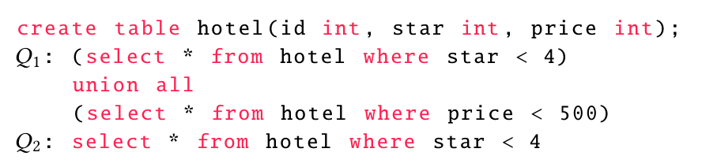查看原图 ↗</a>

*两个查询对重复行的处理不同，构造合适的表实例才能显出差异。*

<h2 class="daily-paper-title" id="paper-arxiv-2611.28436">SafeJIT 把不崩溃证明延伸到生成的机器码</h2>

Gabriel Ebner · arXiv 首次提交 2026-11-21 · [SafeJIT: A Speculating JIT Engine Verified Down to the Machine Code](https://arxiv.org/abs/2611.28436)

推测执行的 JIT 在类型假设失效时需要恢复解释器状态，这条回退路径也可能出错。SafeJIT 在 Lean 4 中把证明一路接到静态链接的 RISC-V 与 x86-64 可执行文件，覆盖运行时生成的代码、垃圾回收和去优化元数据。证明按 Sail 指令语义检查 Linux 用户进程模型中的不崩溃性质，编译器和链接器无需列入可信基础。两种实现的优化程度不同，x86-64 版本缺少寄存器分配等优化。工程价值在于证明经过了代码生成边界；具体结论是模型内的运行安全，仍需另证 JavaScript 程序结果是否符合语言规范。

<a class="note-image-link" href="/assets/images/digest/2026-11-25/arxiv-2611.28436.png" target="_blank" rel="noopener" aria-label="查看原图">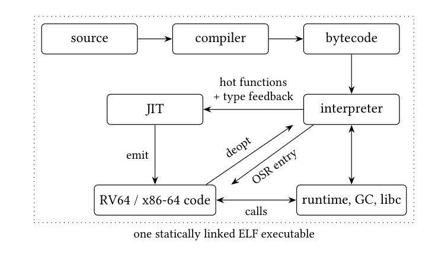查看原图 ↗</a>

*解释器和即时编译器共享运行时，机器码与动态生成代码都处在证明边界内。*

<h2 class="daily-paper-title" id="paper-arxiv-2611.28704">让求解器的答案带上可独立检查的证书</h2>

Tobias Philipp · arXiv 首次提交 2026-11-21 · [Zero-Trust Formal Methods: AI Agents Build Verified Checkers for Untrusted Solvers](https://arxiv.org/abs/2611.28704)

验证智能体生成的代码，往往仍要相信验证器背后的求解器。作者让智能体先用 Isabelle/HOL 编写规约、可靠性证明和参照检查器，独立审查后冻结规约，再以 Verus 验证高效 Rust 检查器。求解器提交证书，检查器接受后结果才进入下一环。实验中来自 20 个 crate 的 3,726 个 SMT 查询通过认证和验证，15,662 份答案集证明被两套检查器接受。可信清单仍包括规约之间的对应关系等假设。对工具链，双实现和显式信任边界让「验证通过」这个信号更容易审查。

<a class="note-image-link" href="/assets/images/digest/2026-11-25/arxiv-2611.28704.png" target="_blank" rel="noopener" aria-label="查看原图">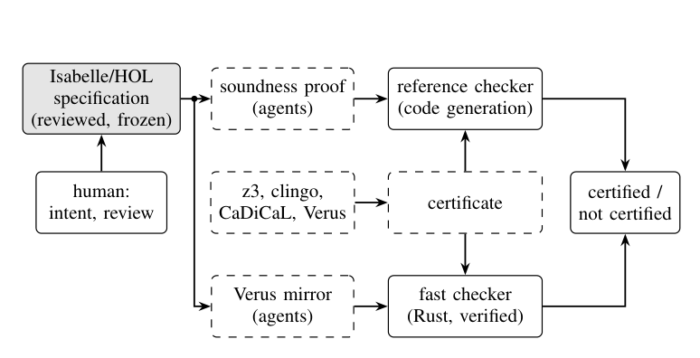查看原图 ↗</a>

*求解器提供证书，独立的参照检查器和快速检查器依赖经过审查的规约。*

<h2 class="daily-paper-title" id="paper-arxiv-2611.29745">CGRizz 用三种证据定位静态调用图遗漏</h2>

Mohammad Rafieian, Michael Hicks, Shiyi Wei · arXiv 首次提交 2026-11-22 · [Agentic Root Cause Reasoning and Localization of Unsoundness in Static Call Graph Analysis](https://arxiv.org/abs/2611.29745)

动态执行确实发生过、静态图却没有的调用，给分析器缺陷提供了一个可定位的起点。CGRizz 让智能体提出缺失的程序模式与负责处理它的工具位置，再用运行时插桩、能触发缺边的测试和目标位置的警告作交叉检查。对 WALA、OPAL 和 Soot 的 1,459 条边，直接分析覆盖 10.3%，另外 84.1% 通过与已验证原因分组解释。抽查中 86% 的分组边与代表边原因一致，因此不能将整组视作逐条确认。在留出程序上，派生警告标出了 74%–92% 的不健全情况。

<a class="note-image-link" href="/assets/images/digest/2026-11-25/arxiv-2611.29745.png" target="_blank" rel="noopener" aria-label="查看原图">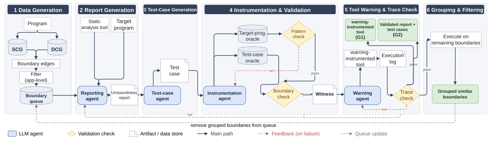查看原图 ↗</a>

*从实测缺边提出原因，再用插桩、测试与定点警告核验。*
