同一个智能体在工具返回后继续工作，服务端可能为这次停顿付出三种代价。把请求送到空闲副本，可能需要重算上万 token 的历史；让短请求排在长提示后面，可能要等上百秒才看到首个 token；把历史中间一段改成摘要，又可能让本来没动过的后缀缓存失效。PARK、PipeAxes 和 NOOA 分别用会话回放、混合长短请求和可编辑上下文来测量这些成本。本期也看另一类容易被完成率掩盖的问题：任务恢复后是否仍满足原有保护，多智能体答对前绕了多少路，以及自动修改工作流时引入了哪些新回归。

<h2 class="daily-paper-title" id="paper-arxiv-2611.34584">PARK 把下一轮的前缀重算计入路由</h2>

Sentao Miao, Tianjiao Nie, Yuan Zhou, Song Yuan, Yuanwei Lu, Yibo Zhu · arXiv v1 · 2026-11-25 · [Routing and Cache Retention for Multi-Turn LLM Inference: Theory and Implementation](https://arxiv.org/abs/2611.34584)

一个编码智能体调完工具，几十秒后可能带着几乎相同的提示再次请求推理。两轮之间有一个尴尬的选择。保留键值缓存（KV），下次可以直接接着算，却要在不知道会等多久的情况下占住显存。清掉缓存，眼前的队列松了一口气，如果会话很快返回，就得把同一段历史重新送入模型。路由器即使找到了队列最短的副本，也可能因此选中重算成本最高的地方。PARK 研究的正是这两项决定如何相互影响。

<a class="note-image-link" href="/assets/images/digest/2026-11-27/34584.png" target="_blank" rel="noopener" aria-label="查看原图 ↗ SWE 轨迹上，前缀命中率、KV 占用率和两种吞吐量随时间一起变化。">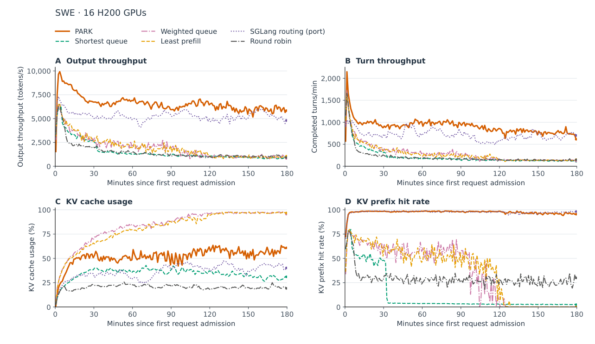查看原图 ↗</a>

*SWE 轨迹上，前缀命中率、KV 占用率和两种吞吐量随时间一起变化。*

每个副本上报计算与活跃 KV 的压力，控制器给这两种资源分别定价。对于返回的请求，留在原副本可以抵扣已有前缀的计算；迁到别处要先付重算成本，但新位置也可能让下一轮避开持续拥堵。工程实现要求目标副本在一段时间内确实更空闲，而且迁移带来的收益足够大，才允许改绑。等待时间会提高请求的优先级。这样，一次过时的负载快照不容易把会话来回搬动。

副本内部则按「每字节占用一段时间，预计能省多少重算」决定先回收哪些空闲块。分子取决于重建前缀要做的工作，分母同时考虑前缀大小和等到下一次有用访问所付的时间。在这个模型里，短前缀可能便宜到值得丢，特别长的前缀也可能贵到不值得留。一个物理块由多个会话共享时，实现会累加它们的优先级，再从最低的非空桶中回收。按最近使用时间驱逐，很难同时表达上述三种差别。

两组轨迹的差异也解释了为什么需要联合决策。完成的 SWE 会话平均约 72 轮，每次回复约 433 个 token，智能体频繁返回给缓存创造了复用机会。Terminal-Bench 会话平均约 17 轮，但回复平均约 2,290 个 token，长时间占用解码槽位与活跃 KV。在前一种流量中，只看队长会低估已有前缀；在后一种流量中，只追求命中又容易把计算集中到已经很忙的副本。

用两个张量并行副本、总计 16 张 H200 服务一个 197B MoE 时，作者记录了完整的三小时窗口。SWE 轨迹上 PARK 达到每秒 6,575 个输出 token，比移植到同一 vLLM 栈的 SGLang 路由规则高 24.2%。Terminal-Bench 上是每秒 8,590 个，比最短队列高 40.0%。最强对照随工作负载改变，因此两个百分比各自回答一组比较。更能解释机制的是单副本消融：固定路由后，已确认过的前缀 token 在会话返回时的丢失比例从 LRU 的 13.26% 降到 2.17%，对应的重算量从 3,077 万降到 662 万。部署中若能同时记录这一损失和输出吞吐，就有机会辨认性能下降究竟来自排队，还是来自引擎在重复读历史。

<h2 class="daily-paper-title" id="paper-arxiv-2611.34615">PipeAxes 让短请求穿过长预填充的空隙</h2>

Xiaoqiang Guo, Yifan Lin, Yang Liu, Jianan Zhang, Yingqi Peng, Jiamei Lv, Yi Gao, Wei Dong · arXiv v1 · 2026-11-25 · [PipeAxes: Decoupling Compute and Communication Granularities for Pipeline-Parallel LLM Serving](https://arxiv.org/abs/2611.34615)

一条六万 token 的提示和一条交互请求共用流水线时，短请求可能还没开始生成，就已为长请求等了数分钟。通常把预填充切成更窄的 token 块，给解码留下插队机会。但过窄的块会让 GPU 多次读取同一组权重。反过来，把块做宽虽然提高了矩阵计算效率，也会让别的请求等待整段计算和传输完成。PipeAxes 将三个经常绑在一起的决定拆开了：一次计算多少行、可以连续跑多少层、一次向下一段流水线发送多少行。

<a class="note-image-link" href="/assets/images/digest/2026-11-27/34615.png" target="_blank" rel="noopener" aria-label="查看原图 ↗ 跟随一组激活值，从上游的分层计算、压缩发送，读到下游接收和调度反馈。">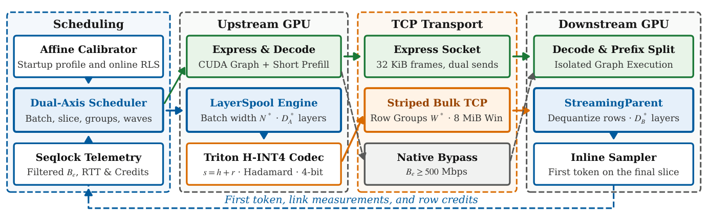查看原图 ↗</a>

*跟随一组激活值，从上游的分层计算、压缩发送，读到下游接收和调度反馈。*

调度器保留宽的预填充批次，估算距离下一次解码时限还有多少余量，再决定这次运行到第几层就让出 GPU。阶段边界上的激活按较小的行组发送，接收端可以在前几组到达后动工。Hadamard 变换配合 INT4 量化减少传输字节数；单独的快速队列让短请求有机会越过尚未发出的批量数据。这里有两个分别可能堵住的地方：GPU 已让出算力时，链路可能还在排队；链路空闲时，上游又可能在跑很长的阶段。只缩小网络分组或只提高请求优先级，都不能消除另一个等待点。

广域网实验还揭示了目标函数的区别。在两组 SWE-agent 负载中，固定 512 分块的会话 p95 完成时间为 66.6–71.4 秒，短于 PipeAxes 的 70.9–78.7 秒；但前者没有一条请求同时满足全部延迟目标。PipeAxes 的 p95 每输出 token 时间维持在 83.5–84.0 毫秒。对于用户要等多久才能看到下一段输出的问题，整段会话结束得早并不能代替逐请求测量。

最容易看清取舍的是两张 PCIe A800 上的 32B 稠密模型。64K 混合回放中有 15 条短请求和 8 条 56K–63K 的长提示。短请求的 p95 首 token 时间从原生 vLLM 的 129.8 秒降到 512 毫秒，15 条短请求全部满足延迟目标；总体输出为每秒 14.6 token，保留了固定 4096 分块方案吞吐的 93.6%。尾延迟的大幅改善没有同比例变成吞吐增益。另一个需要单独看的代价是激活压缩：相对 BF16，INT4 传输在 MMLU 上高 0.06 个百分点，在 GSM8K 上低 0.46 个百分点。对有交互时限的部署，论文表 1 的同负载回放可以同时看到短请求等待、输出速度和达到时限的请求数。

<h2 class="daily-paper-title" id="paper-arxiv-2611.34147">NOOA 让模型决定该压缩哪段历史</h2>

Alessio Devoto, Avinash Vem, Tara Safavi, Sanjay Kariyappa, Yu-Hsuan Tseng, Paul Furgale, Ricardo Silveira Cabral · arXiv v1 · 2026-11-25 · [Letting Models Manage Their Own Context: Where We Stand](https://arxiv.org/abs/2611.34147)

[作者技术导读，2026 年 11 月 23 日](https://nvidia-nemo.github.io/Applied-Research/dev-notes/posts/2026-11-23-model-driven-context-management/)

长任务的难点未必是窗口装不下，也可能是该删什么只有做任务的模型才知道。NOOA 的对照框架在上下文用量越过阈值时触发摘要，保留初始指令与最近十条事件。实验组把决定时机和范围的权力交给模型。它能检查事件历史，把一段连续事件折叠为自己写的摘要，通过标签取回原件。比如已经结束的目录探索可以缩为一句，先前找到的一个关键数值却值得保留原文。能精确选择范围，才有可能同时做到这两点。

<a class="note-image-link" href="/assets/images/digest/2026-11-27/34147.png" target="_blank" rel="noopener" aria-label="查看原图 ↗ 上方由框架保留最近事件；下方由模型选择连续事件写成摘要，原件按标签归档。">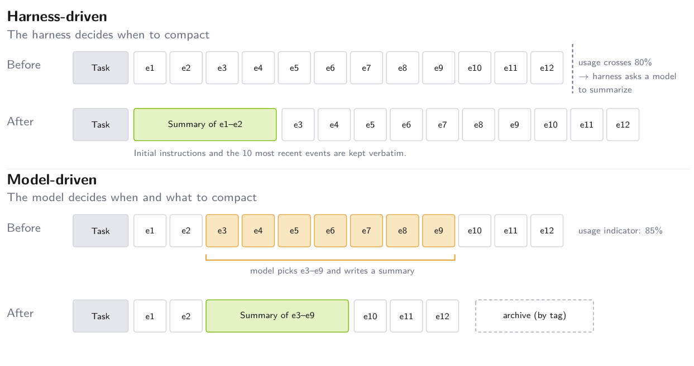查看原图 ↗</a>

*上方由框架保留最近事件；下方由模型选择连续事件写成摘要，原件按标签归档。*

作者在 OfficeQA Pro v2 的 90 个文档问答问题上限制上下文预算。GPT-6.1 Sol 在 32K 时的任务得分从 21% 升到 56%。但给不同模型同一个接口，会得到不同使用习惯：有的很少调用，有的一次压缩很大一段，也有的在还有余量时就动手。调用次数不能单独解释任务成绩。这里值得比较的是相同模型、相同预算下，删掉什么和何时删是否让下游还能找到证据。

窗口预算与累计用量也回答不同问题。预算规定每一轮能放进多少上下文，累计输入则把每一轮带上的历史重复计数，包含已缓存的 token。频繁提前压缩可能让累计用量变少，却损失后面需要的细节。作者发现 Opus 5.5 很少用这个接口，在较小预算下落后于框架策略；MLE-bench Lite 上各策略的差距也较小。实验通过缩小窗口制造压力，真正跨天执行的任务还会遇到这类短基准没有覆盖的依赖。

缩短提示也不必然省下等量的 GPU 工作。若在历史中间写入摘要，普通前缀缓存只能匹配到编辑点，此后原封不动的工具返回也可能重新预填充。作者给 SGLang 做了后缀 KV 复用原型，在 Qwen3.6-27B、32K 上单独评估。沿用后缀的旧状态是一种近似，因为它最初是在旧前文条件下算出的。在三个任务套件上，每请求预填充计算量比标准前缀缓存低 4%–15%，任务成绩未见可测变化。在 OfficeQA 上，编辑后存活的后缀平均约一万 token，占提示约六成，节省也最大。这里的系统实验和前面的问答提升来自不同模型；要估算服务收益，除了看模型能否写好摘要，还要看一次编辑使多长的缓存失效。

<h2 class="daily-paper-title" id="paper-arxiv-2611.33605">ARGUS 用「带保护完成」衡量故障恢复</h2>

Boyang Ma, Jinku Li, Hao Wu, Sheng Gao, Man Zhou, Minghui Xu, Yue Zhang · arXiv v1 · 2026-11-25 · [The Detour Is the Danger: Preserving Security During LLM Agent Recovery](https://arxiv.org/abs/2611.33605)

工具故障后，智能体常能找到另一条路完成任务，但原流程中的授权、校验等保护是否仍然生效？ARGUS 把义务绑定到操作影响的资源，根据可信合约判断需要哪些证据，在替代计划执行前检查保障是否等价，并在真正产生影响时再次强制检查。作者在 12 个工作流模板上比较了仅阻断与提供恢复指导等设置。无防护的服务故障条件下，Qwen Plus 完成了 36 次中的 30 次，带保护完成却只有 7 次。在强制执行的测试中未观察到保护丢失；对 DeepSeek Flash，仅阻断时有 28/36 次带保护完成，提供恢复指导后为 35/35。对故障演练而言，分别记录完成、违规和带保护完成，比单看任务成功率更能发现静默退化。实验依赖可信合约和受控执行入口。

<a class="note-image-link" href="/assets/images/digest/2026-11-27/33605.png" target="_blank" rel="noopener" aria-label="查看原图 ↗ 恢复路径执行前，ARGUS 核对任务要求、已有证据和替代操作。">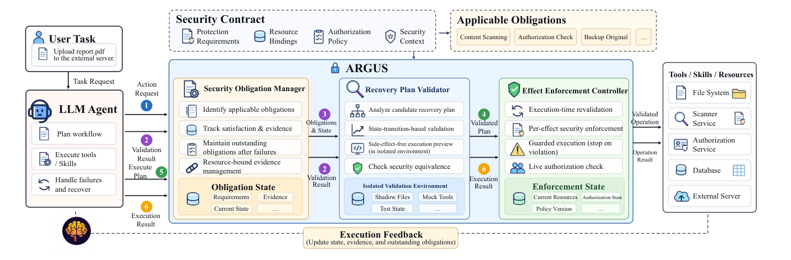查看原图 ↗</a>

*恢复路径执行前，ARGUS 核对任务要求、已有证据和替代操作。*

<h2 class="daily-paper-title" id="paper-arxiv-2611.34776">DFly2 借用目标模型已经选好的历史位置</h2>

Hong Liu, Rui Cen, Junhan Shi, Lin Niu, Runzhi Fan, Zhaojing Zhou, Haodi Lei, Jiebin Zhang, Saiyong Yang, Junqiang Zheng, Zhenghai Xue, Guanghua Yu, Jianchen Zhu · arXiv v1 · 2026-11-25 · [DFly2: Turbocharging Long-Context Speculative Decoding by Sharing the Target's Sparsity](https://arxiv.org/abs/2611.34776)

目标模型已为稀疏注意力选好了少量历史位置。草稿模型若再建一套 KV 或重算相关性，反而会吃掉稀疏化省下的内存和带宽。DFly2 将三个草稿层配对到目标层，直接在后者上一步选中的位置读取缓存，并行提出一块候选 token。作者先测了这种索引能沿用多久：在 DS-V4.1-Flash 上，提前一步的选择仍覆盖后续位置所选内容的近九成。与同配方训练的 DFlash、DSpark 相比，每步接受长度的优势在长上下文和智能体负载上扩大。更具服务意义的是 DS-V4.1-Flash 的高并发测试：匹配 DSpark 的单用户解码速度后，CodeSpan 64K 和 SWE 64K 吞吐分别高 62% 和 81%。迁移这套设计需要能读取目标层的缓存和选位结果。

<a class="note-image-link" href="/assets/images/digest/2026-11-27/34776.png" target="_blank" rel="noopener" aria-label="查看原图 ↗ 三个草稿层分别连接目标层，沿用其 KV 和稀疏索引。">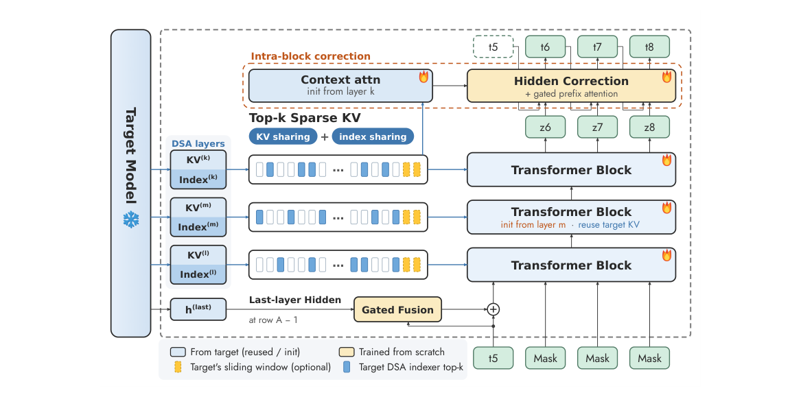查看原图 ↗</a>

*三个草稿层分别连接目标层，沿用其 KV 和稀疏索引。*

<h2 class="daily-paper-title" id="paper-arxiv-2611.34010">AsymSpec 只给草稿模型看示例</h2>

Guang Huang, Zeyi Wen · arXiv v1 · 2026-11-25 · [Asymmetric Speculative Decoding: Unlocking In-Context Learning in Draft Models](https://arxiv.org/abs/2611.34010)

同一提示对大模型容易，对小模型却可能很难。AsymSpec 离线收集目标模型对同类问题的回答，选取示例只放进草稿上下文，让小模型模仿目标的输出行为。验证时目标仍使用原提示与自己的缓存，采样校正依据实际的提议分布，论文给出了保持目标分布的证明。这里节省的是拒绝草稿后重走的步数，也多出了准备示例池的成本。在 HumanEval 和 MATH-500 上，作者将各自前半数据用于建池，后半留作评测；用同任务池比换用其他池更快。相对普通自回归的实测加速为 2.29–4.95 倍。这个比较包含投机解码本身的收益，单看示例的贡献应读与标准投机解码及不同池的对照。

<a class="note-image-link" href="/assets/images/digest/2026-11-27/34010.png" target="_blank" rel="noopener" aria-label="查看原图 ↗ 两条输入路径让草稿读取示例，目标仍按原提示验证。">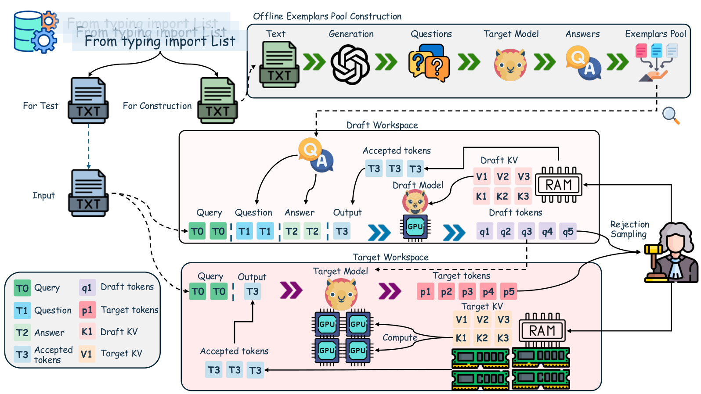查看原图 ↗</a>

*两条输入路径让草稿读取示例，目标仍按原提示验证。*

<h2 class="daily-paper-title" id="paper-arxiv-2611.33896">Floodgates 用浅层循环读取深层前缀</h2>

Ayhan Suleymanzade, Sean McLeish, Sehoon Kim, Jinwoo Kim, Antoine Bosselut · arXiv v1 · 2026-11-25 · [Looped Models are Fast Multi-Token Predictors](https://arxiv.org/abs/2611.33896)

循环语言模型会多次运行同一组层。Floodgates 让一次浅循环读取上轮全深度验证留下的前缀状态，在多个掩码位置并行猜词，再让完整模型验证，遇到首个不匹配就截断。这把草稿的网络深度和它能看到的历史表征分开了。七个循环模型、五个基准的比较包括贪心和采样；最高 7.5 倍属于单请求延迟结果。另在 A100 上对 Huginn 3.5B 复用单份循环缓存，GSM8K 可把批量扩大到 320。在多个任务的最大批量处仍能赢过其他解码器，但幅度远小于单请求峰值。它依赖浅层状态也学到预测能力，适用对象是循环模型。

<a class="note-image-link" href="/assets/images/digest/2026-11-27/33896.png" target="_blank" rel="noopener" aria-label="查看原图 ↗ 一次浅循环并行填充掩码位置，完整循环一次验证整块。">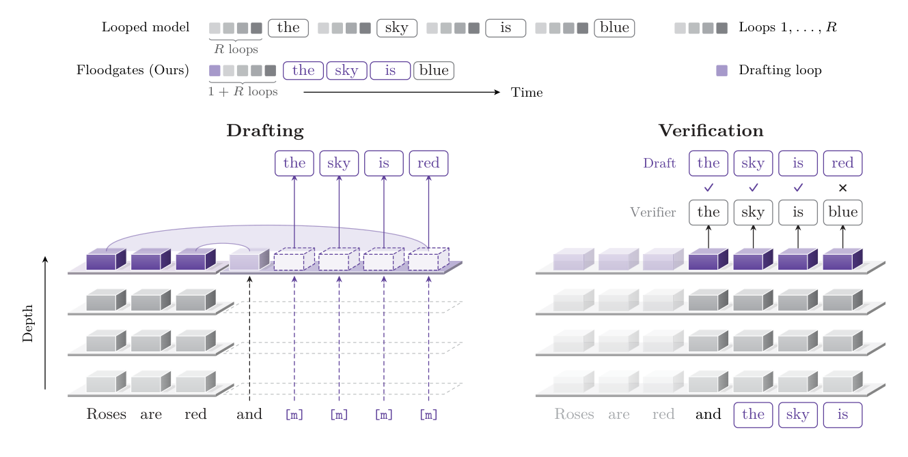查看原图 ↗</a>

*一次浅循环并行填充掩码位置，完整循环一次验证整块。*

<h2 class="daily-paper-title" id="paper-arxiv-2611.33542">RankCast 为预填充和解码选择不同的均衡目标</h2>

Kaidi Fu, Xu-Hao Lu, Pingwei Sun, Jianchao Tan, Yuchen Xie, Xunliang Cai · arXiv v1 · 2026-11-24 · [RankCast: Phase-Aware Rank Balancing in MoE Serving](https://arxiv.org/abs/2611.33542)

MoE 的瓶颈随阶段变化。预填充时某张卡收到太多 token 会拖慢整组；解码时每个专家收到的 token 很少，激活多少个专家反而左右权重读取成本。RankCast 预测下一层的路由，保护最高分的一组专家，只在剩余候选中调整。预填充给繁忙 rank 提价，解码则用掩码限制活跃专家；最终选择仍参考目标层的分数。SGLang 和 DeepEP 实现让预测与当前层执行重叠。在 EP=8 的 Qwen3-235B-A22B 与 EP=16 的 Qwen3.5-397B-A17B 上，预填充吞吐最多提高 19%，解码每输出 token 时间最多降低 10%。它会改变专家选择，测得的质量差异低于一个百分点，要求精确保持原路由的部署需另行考虑。

<a class="note-image-link" href="/assets/images/digest/2026-11-27/33542.png" target="_blank" rel="noopener" aria-label="查看原图 ↗ 预填充调节各卡接收的 token 数，解码限制最忙卡上活跃的专家数。">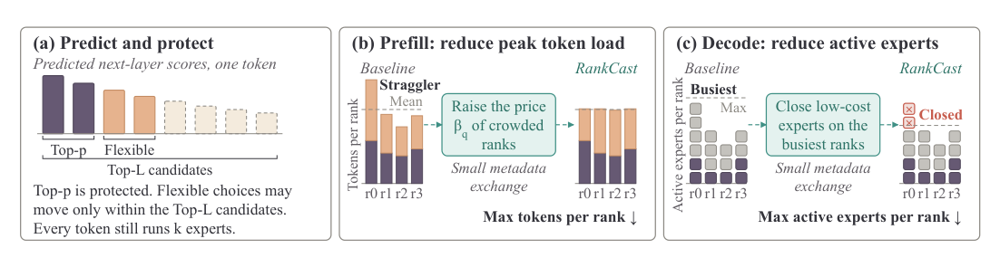查看原图 ↗</a>

*预填充调节各卡接收的 token 数，解码限制最忙卡上活跃的专家数。*

<h2 class="daily-paper-title" id="paper-arxiv-2611.34161">CoordRoute 为后续请求预留计算预算</h2>

Boning Huangfu, Boxiao Du, Chen Chen · arXiv v1 · 2026-11-25 · [CoordRoute: Coordinated Multi-Model Routing for Maximum Compute-Budget Utility](https://arxiv.org/abs/2611.34161)

当一批陆续到达的请求共用一个算力预算，给当前请求升级模型，有可能让后面的请求完全得不到回答。CoordRoute 同时预测候选模型的回答得分和计算开销，用剩余预算与预期到达量估计多花一单位计算的机会成本。执行时还能依照这个价格决定是否检查中间答案、停止或重启升级。作者在 Azure Conversation 与 BurstGPT 到达轨迹上回放，按实际生成长度核算 FLOPs，报告总满意度比最强已有路由器高 18.72%。这里的满意度是评测中的回答效用，未服务请求也影响总分。轨迹实验解释了固定价格为何在突发负载下吃亏，从 FLOPs 换算到某个集群的延迟或 API 账单还需要具体后端数据。

<a class="note-image-link" href="/assets/images/digest/2026-11-27/34161.png" target="_blank" rel="noopener" aria-label="查看原图 ↗ 同一请求重复生成 100 次，回答得分和计算开销都有分布。">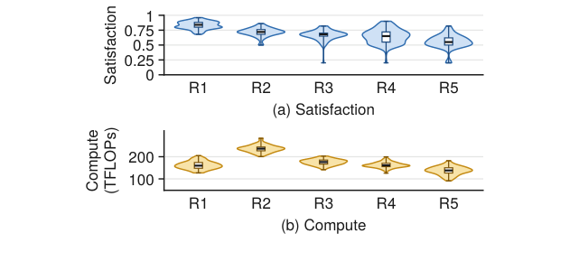查看原图 ↗</a>

*同一请求重复生成 100 次，回答得分和计算开销都有分布。*

<h2 class="daily-paper-title" id="paper-arxiv-2611.34402">Any-Rate 用半比特步长调节同一套权重</h2>

Hoonki Lee, Haechan Shin, Hyuntaek Jung, Yeonu Choi, Sangyeob Kim · arXiv v1 · 2026-11-25 · [Any-Rate: Half-Bit Multi-Precision LLM Quantization with Coded Bit-Planes](https://arxiv.org/abs/2611.34402)

若每档精度都放一套权重，端侧根据内存预算切换精度就需要多份模型。Any-Rate 在一个检查点里嵌套多个位平面，不同模式只读所需的前几层。关键是将八个相邻权重的一层索引约束为一个扩展汉明码字，四个存储位可选出八位模式，平均每权重增加半比特。多档联合校准需要兼顾低精度误差和后续档位可达到的重建值。在四个模型上，2 比特模式平均保留约 69% 的 FP16 准确度；它是相对比例。对 Llama-3.1-8B-Instruct，LPDDR 加速器模型估计同等准确度下每 token 最多省能 27%；这部分来自存储与解码能耗估算，真机表现还取决于实现。

<a class="note-image-link" href="/assets/images/digest/2026-11-27/34402.png" target="_blank" rel="noopener" aria-label="查看原图 ↗ 上下两行比较共用低位选择在不同误差目标下如何约束高精度重建。">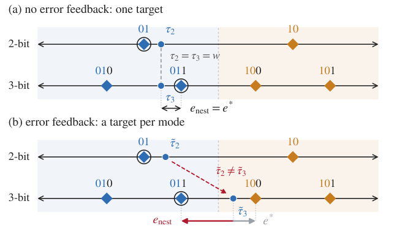查看原图 ↗</a>

*上下两行比较共用低位选择在不同误差目标下如何约束高精度重建。*

<h2 class="daily-paper-title" id="paper-arxiv-2611.33981">MixMoMo 按当前输入给端侧专家分配精度</h2>

Hailong Zou, Maoliang Li, Taohong Han, Haoze Chi, Zihao Zheng, Jiayu Chen, Xiang Chen · arXiv v1 · 2026-11-25 · [MixMoMo: Accelerating Extra--Large MoE Inference with Mixed--Precision GPU--NPU Execution on Mobile Devices](https://arxiv.org/abs/2611.33981)

同一个 MoE 专家对不同 token 的量化误差不同，按专家调用频率永久指定精度容易把比特花错地方。MixMoMo 离线测量关键输入维度与最终输出偏差的关系，在线据此给已选专家分配精度。随后按精度分组，根据两种处理器的执行时间划分工作，在 Hexagon 向量单元上并行解量化。这样才能在压低权重流量时避免其中一个处理器等待另一个。扩展 llama.cpp 后，作者在两种移动平台、三个 MoE 模型和五个基准上比较，平均解码速度为统一 Q4_0 的 3.72 倍、最强混合精度对照的 1.53 倍。后一项更接近调度方法自身带来的增量，能否迁移取决于设备的异构执行成本。

<a class="note-image-link" href="/assets/images/digest/2026-11-27/33981.png" target="_blank" rel="noopener" aria-label="查看原图 ↗ 从输入敏感度到精度分组，再到 GPU 与 NPU 分工和批量解量化。">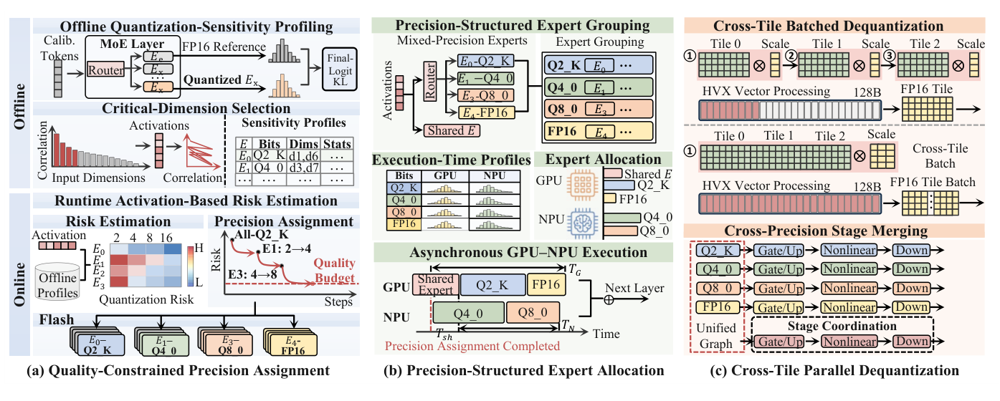查看原图 ↗</a>

*从输入敏感度到精度分组，再到 GPU 与 NPU 分工和批量解量化。*

<h2 class="daily-paper-title" id="paper-arxiv-2611.34759">并发集合通信共用光电路配置</h2>

Xinchi Han, Weihao Jiang, Xuanyu Wang, Zhuoran Liu, Ximeng Liu, Haoyuan Liu, Kairui Zhou, Jiachen Wang, Yike Liu, Peirui Cao, Xun Nie, Xinbing Wang, Shizhen Zhao · arXiv v1 · 2026-11-25 · [Minimizing Optical Circuit Reconfigurations for Concurrent Collectives](https://arxiv.org/abs/2611.34759)

光交换网络切换连接时有固定开销。若每个集合通信都按自己的阶段顺序发起配对，多个并发操作会反复要求不同电路。作者将可重排的通信模式纳入同一个调度问题，在保持各集合操作依赖的前提下，让同一轮尽量共用连接；用各类配对的数量描述问题，还能缩小求解规模。在 64 个超节点、64 个域的调度实例中，pairwise-AlltoAll 的重配次数从 62 降到 3。按八个真实模型参数构造的 ASTRA-sim 合成训练回放假设每端口 400 Gb/s、重配 10 微秒，迭代时间最多缩短约 34%。前一个结果数的是配线变化，后一个结果还依赖于拓扑、消息大小及网络模型。

<a class="note-image-link" href="/assets/images/digest/2026-11-27/34759.png" target="_blank" rel="noopener" aria-label="查看原图 ↗ 八个 rank 的两条 AllReduce 调度可按不同顺序使用相同配对。">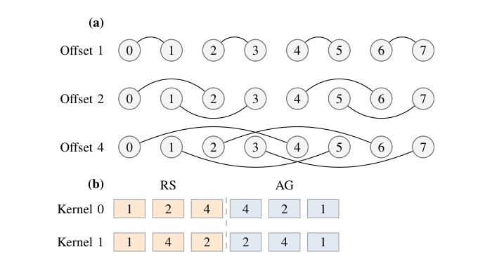查看原图 ↗</a>

*八个 rank 的两条 AllReduce 调度可按不同顺序使用相同配对。*

<h2 class="daily-paper-title" id="paper-arxiv-2611.33757">TransHarness 用同一任务的成败对照筛选干预策略</h2>

Tianze Xia, Zimo Wang, Heng Tong, Zhaoxiang Liu, Shiguo Lian, Fan Huang, Wenyu Liu, Yunchao Wei, Xinggang Wang · arXiv v1 · 2026-11-25 · [TransHarness: From Benchmark Overfitting to Transferable Harness Evolution](https://arxiv.org/abs/2611.33757)

从失败轨迹学到的提醒可能只记住了某道题。TransHarness 在同一任务的成功和失败执行间寻找分歧，把有证据支持的差别写成可触发的干预。它先在其他源任务上回放，看策略能否被激活，再交给看不到回放统计的审查者判断诊断是否成立、建议是否脱离原题仍有意义。策略随后在目标任务中依据当前事件与历史触发。DeepSWE v1.1 的 113 项任务上最佳配置得到 76.4%，Terminal-Bench 2.1 的 89 项上另一配置得到 95.5%。相对各自基础框架的配对增益置信区间均跨零。论文最值得读的是对新近修复和新引入回归分别计数的分析，同样的净分数可能对应很不一样的干预风险。

<a class="note-image-link" href="/assets/images/digest/2026-11-27/33757.png" target="_blank" rel="noopener" aria-label="查看原图 ↗ 从成败轨迹提出触发条件，经独立审查后才在新任务里执行。">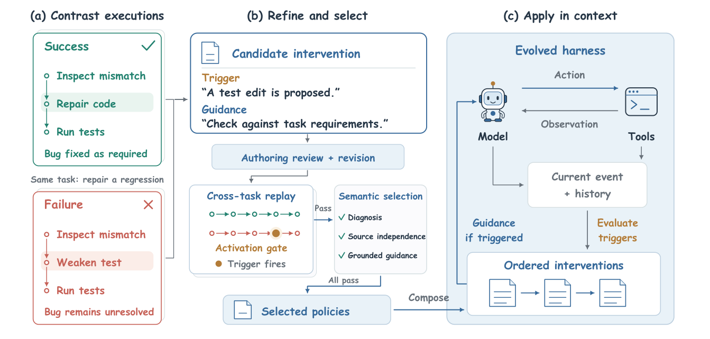查看原图 ↗</a>

*从成败轨迹提出触发条件，经独立审查后才在新任务里执行。*

<h2 class="daily-paper-title" id="paper-arxiv-2611.34624">HoMe 从多条查询失败定位记忆系统的改动点</h2>

Yifei Xu, Li Yu, Zhaoyang Liu, Ce Wang, Sen Huang, Yanyan Shen, Yun Lin, Linpeng Huang, Hong Mei · arXiv v1 · 2026-11-25 · [HoMe: Toward Practical Harness Optimization of Memory Systems for AI Assistants](https://arxiv.org/abs/2611.34624)

长期记忆系统答错，可能是记忆写入方式不当，也可能是查询时读错文件。HoMe 汇总多条失败记录，让开发代理沿检索、读文件和作答过程查找共同原因，修改 ReMe 的记忆管理逻辑。实验管理器控制候选评测，并优先抽取过去较难的样本。每个基准在完整初评之后只进行六次正式候选评测。由于候选抽到的题不同，不能直接按中间平均分挑赢家。最终 LongMemEval-S 测试得分从 0.888 到 0.916，每查询 token 从 43.9K 降到 17.9K。用 BEAM-100K 优化后到 BEAM-1M 测试，得分从 0.650 到 0.704，token 从 101.8K 到 60.4K。这些是查询阶段成本，优化阶段的诊断和试验另计。

<a class="note-image-link" href="/assets/images/digest/2026-11-27/34624.png" target="_blank" rel="noopener" aria-label="查看原图 ↗ 开发代理提出修改，实验管理器选择样本，在隔离环境中比较候选。">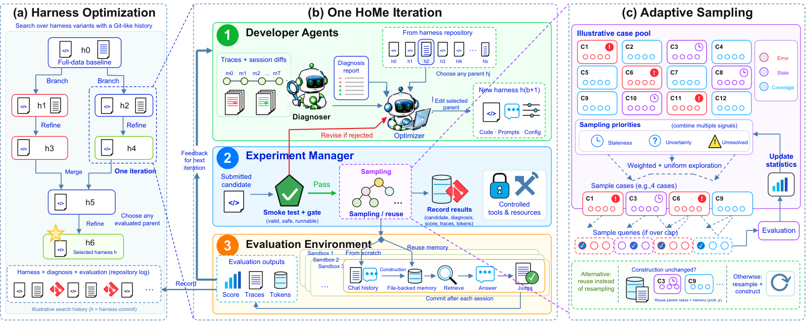查看原图 ↗</a>

*开发代理提出修改，实验管理器选择样本，在隔离环境中比较候选。*

<h2 class="daily-paper-title" id="paper-arxiv-2611.33242">CypherMAS 单独测量多跳委派中的消息丢失</h2>

Danil Kostromin, Andrey Sakhovskiy, Semen Budennyy · arXiv v1 · 2026-11-24 · [CypherMAS: Benchmarking Routing Reliability in LLM-Based Multi-Agent Systems](https://arxiv.org/abs/2611.33242)

开放任务失败时，很难区分模型解不出问题和消息根本没送到。CypherMAS 把正确解码器分配给另一个节点，要求消息沿邻接边找到它并带回答案。任务可计算最少调用次数，因而即使最终答对，也能测到多走了多少步。在四种固定拓扑上比较 11 个开放模型，同时切换工具协议和自由文本通信，作者发现链或环容易出现循环与传输丢失；对较强模型，直径受限的拓扑则更接近最短调用路径。每次运行设 2,048 次调用上限。这个合成基准的意义在于把路由距离与节点数量拆开，不宜将其成功率直接解释为真实协作任务的完成率。

<a class="note-image-link" href="/assets/images/digest/2026-11-27/33242.png" target="_blank" rel="noopener" aria-label="查看原图 ↗ 图的连边限制可联系的邻居，每个请求要找到匹配的解码器并送回结果。">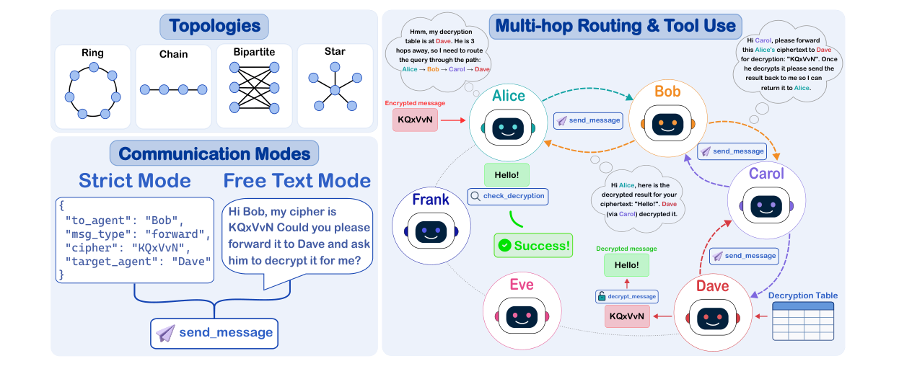查看原图 ↗</a>

*图的连边限制可联系的邻居，每个请求要找到匹配的解码器并送回结果。*

<h2 class="daily-paper-title" id="paper-arxiv-2611.33402">Partial Routing 根据过去的执行决定哪些子任务值得委派</h2>

Siddharth Arya, Kshitij Jain · arXiv v1 · 2026-11-24 · [Partial Routing: Trace-Tuned Delegation for Resource-Efficient Agentic Workflows](https://arxiv.org/abs/2611.33402)

一次请求可能需要昂贵模型统筹，却包含便宜模型足以胜任的局部工作。作者让主模型与工作模型先分别独立做一组任务，标注轨迹中反复出现的子任务，再按质量差距与可接受风险编成委派策略。运行时主模型保留整体责任，把限定范围的工作交给助手。δ=0.75 时，在十个留出的 ViBench 应用上，相对主模型独做，分数从 70.2 升至 78.5，成本低 19%；23 个留出的 Terminal-Bench 任务上，通过率从 54% 到 61%，成本相近。作者也测试了只给任务拆解、不提供工作模型的主模型，后者本身就能在 Terminal-Bench 获益。这个对照分开了计划和委派两种效应。

<a class="note-image-link" href="/assets/images/digest/2026-11-27/33402.png" target="_blank" rel="noopener" aria-label="查看原图 ↗ 先标注两种模型各自的轨迹，再把子任务策略交给主模型。">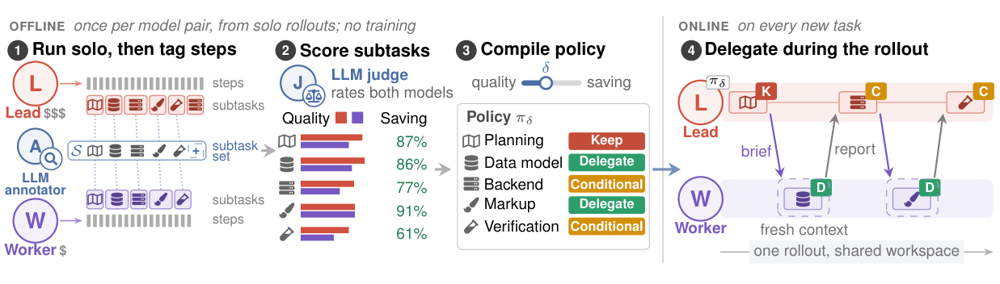查看原图 ↗</a>

*先标注两种模型各自的轨迹，再把子任务策略交给主模型。*

<h2 class="daily-paper-title" id="paper-arxiv-2611.33817">SentryWard 检查异步 GPU 内核的生命周期和同步</h2>

Mengdi Wu, Sreeram Vennam, Stephen Mell, Ziwei Zhou, Advay Kadam, Xinhao Cheng, Francois Costa, Alex Aiken, Oded Padon, Zhihao Jia · arXiv v1 · 2026-11-25 · [SentryWard: Formal Verification of Warp-Specialized GPU Kernels](https://arxiv.org/abs/2611.33817)

当不同 warp 分工搬运数据和计算时，一批测试全部通过也可能遗漏异步访问的先后关系。SentryWard 为给定张量形状和启动配置特化内核，把屏障及异步事务转成不依赖具体调度顺序的先于关系图，先检查同步、存储生命周期与竞态，再构造符号输出与参考计算比较。重复线程结构可共享表示，避免逐一列举所有调度。在 189 个配置中，105 个通过验证，64 个被标记有潜在正确性问题，其中 33 项涉及生命周期。这个数字包括无法证明访问在释放前结束的情形，作者另外列出了已确认和已修复的问题。动态控制流仍限制覆盖，有 17 个配置超出支持范围。

<a class="note-image-link" href="/assets/images/digest/2026-11-27/33817.png" target="_blank" rel="noopener" aria-label="查看原图 ↗ 从特化内核和事件图，依次读取同步、竞态及等价性检查。">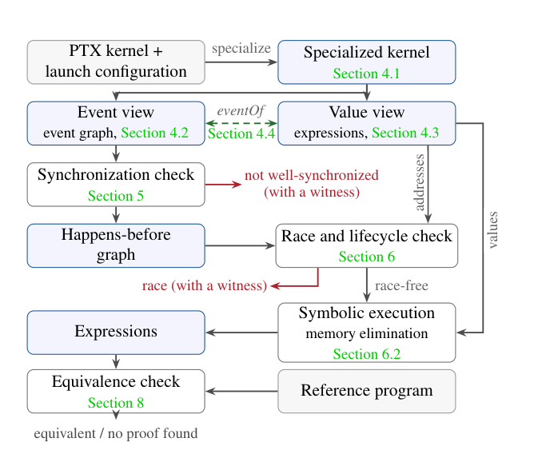查看原图 ↗</a>

*从特化内核和事件图，依次读取同步、竞态及等价性检查。*

<h2 class="daily-paper-title" id="paper-arxiv-2611.33181">SeQLean 区分查询等价、反例和未判定</h2>

Siddhartha Gadgil, Anirudh Gupta, Ajay Kumar Nair · arXiv v1 · 2026-10-25 · [SeQLean: Verifying SQL queries using Lean](https://arxiv.org/abs/2611.33181)

一个生成 SQL 的智能体可以给出两种看似合理的翻译。在样例库上得到相同结果，仍无法说明它们对所有满足约束的数据库等价。SeQLean 在 Lean 中表达关系代数和模式假设，先尝试确定性策略；失败时可以让模型修补证明，再交给内核检查。若找到差异，则返回见证数据库。在 397 对 Calcite 查询中得到 112 个判定，在 64 对 Literature 查询中得到 42 个，其中包括模型辅助阶段新找到的七个反例。未判定仍是合法结果。证明覆盖的是所表达的语义，例如无序结果集的相等无法说明两条查询返回顺序相同，而两种翻译相互吻合也无法独立证明都理解了用户意图。

<a class="note-image-link" href="/assets/images/digest/2026-11-27/33181.png" target="_blank" rel="noopener" aria-label="查看原图 ↗ 查询及数据库假设进入 Lean，证明和反例都要通过内核检查。">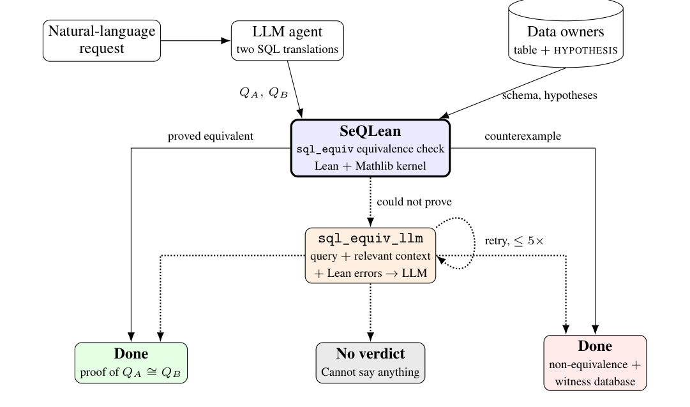查看原图 ↗</a>

*查询及数据库假设进入 Lean，证明和反例都要通过内核检查。*
