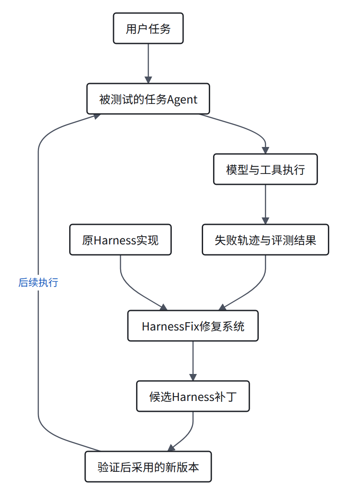
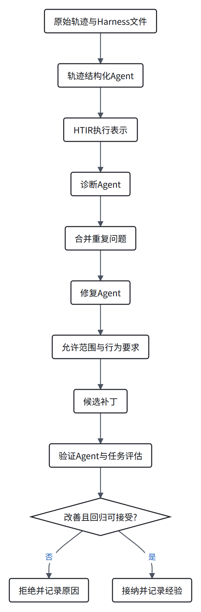
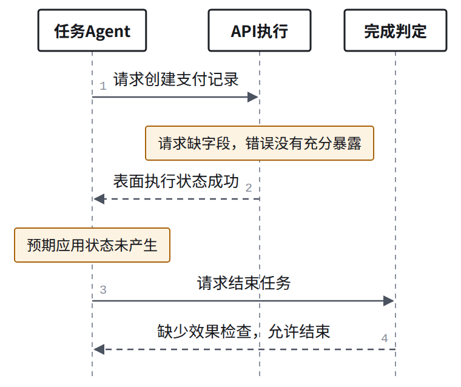
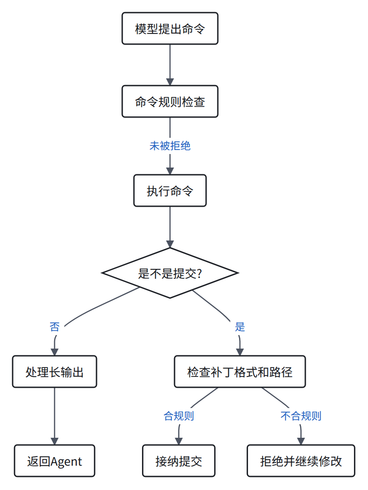

> AI 辅助精读。实验数字来自原文；代码核对与分析另行说明，未运行论文基准。

**HarnessFix 用失败轨迹指导 Harness 修改，并通过验证选择候选版本。** 它允许修改运行实现，与只提供恢复提示的方法有直接区别。

原文：From Failed Trajectories to Reliable LLM Agents: Diagnosing and Repairing Harness Flaws。阅读版本：arXiv 2606.06324v2。

<h2 id="section-a">修复对象是谁？任务 Agent 与修复 Agent 要分开</h2>

<figure>
<a class="note-image-link" href="/assets/images/digest/paper-close-readings/harnessfix/zh-01.png" target="_blank" rel="noopener" aria-label="外层 HarnessFix 读取失败轨迹与实现，为内层任务 Agent 生成并验证新的 Harness 版本。">放大图解 ↗</a>
<figcaption>外层 HarnessFix 读取失败轨迹与实现，为内层任务 Agent 生成并验证新的 Harness 版本。 根据论文与公开代码绘制的说明图。</figcaption>
</figure>
外层系统修改内层 Agent 使用的实现。主方法没有训练模型权重。

公开仓库提供修复流水线，以及初始和最终 Harness 快照；基准数据与完整原始轨迹并未全部随仓库发布。

| 任务基准 | 初始 Harness |
|---|---|
| GAIA | open-deep-research |
| SWE-bench Verified | mini-swe-agent |
| AppWorld | 官方 simplified ReAct code agent |
| Terminal-Bench 2.0 Verified | Harbor Terminus-2 |

这四个是实验对象，不是对 Codex、Pi、iCode 或 DSH 的直接修复实验。

依据：[论文实验设置](https://arxiv.org/html/2606.06324v2#S4)、[公开实现说明](https://github.com/HarnessFix/HarnessFix/blob/9167a0b9a58748c73b56c3ee04fdc3437ba0c56e/README.md)。

<h2 id="section-b">它具体怎么做？先组织证据，再限定修改</h2>

<figure>
<a class="note-image-link" href="/assets/images/digest/paper-close-readings/harnessfix/zh-02.png" target="_blank" rel="noopener" aria-label="结构化轨迹、诊断、范围约束和验证将失败证据连接到候选实现补丁。">放大图解 ↗</a>
<figcaption>结构化轨迹、诊断、范围约束和验证将失败证据连接到候选实现补丁。 根据论文与公开代码绘制的说明图。</figcaption>
</figure>
HTIR 可以理解为“关联实现位置的执行记录”。它组织步骤、数据与控制关系，再关联代码、模板或配置。

| HTIR 中的内容 | 它帮助回答什么？ |
|---|---|
| 步骤的请求、响应与外部效果 | 发生了什么，真实状态是否变化？ |
| 数据关系 | 前一步的信息怎样进入或没有进入后一步？ |
| 控制关系 | 什么条件让系统继续、重试或结束？ |
| 实现位置 | 哪段代码、模板或配置实现了该行为？ |

诊断从失败结果回溯证据。修复阶段明确允许改哪里、禁止改哪里，以及修改后应满足什么行为。

**关键边界**：这些联系主要由模型分析得到。结构化解释有助于定位，但不自动成为因果证明。

依据：[论文方法](https://arxiv.org/html/2606.06324v2#S3)。

<h2 id="section-c">看论文里的例子：返回成功，不等于任务已经完成</h2>

论文用 AppWorld 的支付请求说明这个问题。以下是对其示例的简化。

<figure>
<a class="note-image-link" href="/assets/images/digest/paper-close-readings/harnessfix/zh-03.png" target="_blank" rel="noopener" aria-label="论文 AppWorld 示例：执行状态表面成功，但预期状态变化缺失，完成判定仍允许退出。">放大图解 ↗</a>
<figcaption>论文 AppWorld 示例：执行状态表面成功，但预期状态变化缺失，完成判定仍允许退出。 根据论文与公开代码绘制的说明图。</figcaption>
</figure>
候选修复要求暴露 API 错误，并在结束前检查预期状态变化。禁止修改任务答案和评测标签。

分析：这里同时涉及请求构造、错误暴露与结束判定。增加完成检查有价值，但不能据此认定全部上游问题都已消除。

### 应分别问三个问题

| 问题 | 对应证据 |
|---|---|
| API 请求是否正确？ | 实际参数与接口契约 |
| 执行是否产生预期效果？ | 真实状态变化 |
| Harness 是否允许错误结束？ | 完成判定条件与控制轨迹 |

这三个问题也适用于 coding agent：提交了补丁、测试执行了、用户问题修好了，并不是同一个结论。

依据：[论文中的修复规格示例](https://arxiv.org/html/2606.06324v2#S3.SS3)。

<h2 id="section-d">公开代码到底改了什么？以 mini-swe-agent 为例</h2>

本次精读对比了同一固定提交中的初始目录与最终 SWE 快照。

| 文件类别 | 实际差异 |
|---|---|
| 三份 SWE 配置 YAML | 增加测试、编辑和提交指导 |
| environments/docker.py | 接入命令检查、输出处理与提交校验 |
| environments/local.py | 接入同类机制 |
| 新增 environments/safety.py | 实现保护与校验逻辑 |

`agents/default.py` 在这两个快照间没有变化。这个结果描述公开快照，不代表完整演化历史。

### 运行代码中的三项变化
<figure>
<a class="note-image-link" href="/assets/images/digest/paper-close-readings/harnessfix/zh-04.png" target="_blank" rel="noopener" aria-label="公开 SWE 快照的执行边界变化：命令规则、长输出处理和提交校验。">放大图解 ↗</a>
<figcaption>公开 SWE 快照的执行边界变化：命令规则、长输出处理和提交校验。 根据论文与公开代码绘制的说明图。</figcaption>
</figure>
- 命令规则尝试拦截部分提交和大范围搜索操作。
- 普通输出超过12,000字符时，保留首尾各6,000字符并加省略说明。
- 提交检查拒绝空补丁、不可识别diff和部分不允许的文件路径。

**分析判断**：这些是运行边界的检查与策略增强。它确实改了运行代码，但这组差异没有展示并发竞争或持久恢复机制的修复。

输出截断不能保证中间的关键信息不会丢失。补丁格式合法也不能证明功能正确。

依据：[最终保护逻辑](https://github.com/HarnessFix/HarnessFix/blob/9167a0b9a58748c73b56c3ee04fdc3437ba0c56e/task_agent/final/swe/src/minisweagent/environments/safety.py)、[最终Docker执行](https://github.com/HarnessFix/HarnessFix/blob/9167a0b9a58748c73b56c3ee04fdc3437ba0c56e/task_agent/final/swe/src/minisweagent/environments/docker.py)、[初始Docker执行](https://github.com/HarnessFix/HarnessFix/blob/9167a0b9a58748c73b56c3ee04fdc3437ba0c56e/task_agent/mini-swe-agent/src/minisweagent/environments/docker.py)。

<h2 id="section-e">它怎样验证有效？三类证据不能混用</h2>

| 验证内容 | 回答什么 | 不能单独证明什么 |
|---|---|---|
| 修改范围与静态检查 | 有没有越界、基本实现是否合理 | 功能一定正确 |
| 验证集目标改善与回归 | 新版本是否值得接纳 | 每个诊断都是真实根因 |
| 最终任务评测 | 在所测任务上是否有效 | 对任意真实runtime故障都有效 |

诊断质量另用80条失败轨迹与人工标签比较。公开表中，Full HTIR 的步骤定位为85.0%，实现位置定位为81.3%。

这些是诊断与标注的一致性指标，不是补丁修复率。标注未用于修复或验收决策。

**进一步验证需要**：针对明确的底层故障，加入可重复触发条件和独立契约测试。任务分数提升与根因修复需要分别验收。

依据：[诊断审计与指标](https://github.com/HarnessFix/HarnessFix/blob/9167a0b9a58748c73b56c3ee04fdc3437ba0c56e/exp/rq2_failure_diagnosis.md)、[论文验收流程](https://arxiv.org/html/2606.06324v2#S3.SS4)。

<h2 id="section-f">实验最能支持什么？允许改运行机制有价值</h2>

以下为作者报告，未在本机复现。数值是任务表现百分比。

| 方法 | GAIA | SWE | AppWorld | TB2 |
|---|---:|---:|---:|---:|
| 原始Harness | 43.3 | 45.3 | 36.7 | 17.6 |
| Prompt-only | 50.6 | 48.3 | 37.4 | 18.6 |
| 完整HarnessFix | 61.7 | 57.3 | 43.0 | 26.5 |

SWE 完整方法比原始版本高12个百分点，比Prompt-only高9个百分点。

该对照支持：在作者设置下，仅改提示词没有取得完整方法的收益。

**它没有直接比较“完整可执行扩展空间”与“核心修改”。** Hooks、脚本、插件可能实现部分检查，不能全部当作Prompt-only。

公开消融针对方法组件，不是逐项测量每条最终代码规则。因此不能把全部收益归给某一个提交检查或输出限制。

依据：[公开消融结果](https://github.com/HarnessFix/HarnessFix/blob/9167a0b9a58748c73b56c3ee04fdc3437ba0c56e/exp/rq3_ablation.md)。

<h2 id="section-g">和 Sentry 放在一起，区别在哪里？</h2>

下面按两篇方法的干预对象对照。不同基准的分数不直接排名。

| 维度 | Sentry | HarnessFix |
|---|---|---|
| 介入对象 | 当前任务的恢复指导 | Agent使用的Harness实现 |
| 输出 | 合法动作重生成提示、恢复建议 | 受约束的候选补丁 |
| 跨任务保留 | 验证后的恢复经验 | 修复规格、补丁与验收经验 |
| 验证重点 | 局部失败是否解除 | 目标改善与回归是否可接受 |
| 不能直接外推 | 局部恢复就是底层缺陷修复 | 得分提升就是全部根因消除 |

**Sentry 的 hard repair 不等于 HarnessFix 的代码修复。** 前者请求合法动作，后者允许改变执行实现。

分析：两者可研究互补关系，但不能假定组合后必然更好。额外监控和修改可能产生冲突，需要独立对照。

依据：[Sentry 方法](https://arxiv.org/html/2610.02994v1#S3)、[HarnessFix 方法](https://arxiv.org/html/2606.06324v2#S3)。[打开 Sentry 图解](/digest/zh/paper-sentry-close-reading/)。

<h2 id="section-h">对我们的稳定性与 RSI 研究意味着什么？</h2>

**“轨迹诊断 → 定向修改Harness → 回归验收”已被这篇直接覆盖。** 不能把这条链本身作为新意。

更具体的研究问题是：在真实开源runtime故障上，诊断能否选对干预范围，并证明修复成立？

| 需要进一步验证的问题 | 有说服力的证据 |
|---|---|
| 是底层缺陷还是能力不足？ | 复现版本、真实输入输出、对照干预 |
| 扩展能否处理？ | 明确允许的接口，而非只给提示词 |
| 是否真的修复？ | 故障契约、稳定性与独立任务验收 |
| 改动能否安全采用？ | 取消、恢复、插件组合与状态迁移回归 |
| 是否持续改进？ | 后续任务与迭代中的收益、退化和成本 |

例如，新增重试可能提高成功率，却引入重复副作用。新增截断可能节省上下文，却丢掉关键证据。这些需要异常路径测试。

**当前结论**：HarnessFix 应是直接相关工作和候选基线。我们的区别需要由真实故障、明确修改边界与独立验证建立。

证据范围：已读原文方法、实验和讨论，核对公开实验说明，比较SWE初始/最终快照。代码固定为 `9167a0b9a58748c73b56c3ee04fdc3437ba0c56e`。未运行模型、训练或基准实验。

[原论文](https://arxiv.org/abs/2606.06324) · [官方代码](https://github.com/HarnessFix/HarnessFix) · [Sentry 图解](/digest/zh/paper-sentry-close-reading/)
