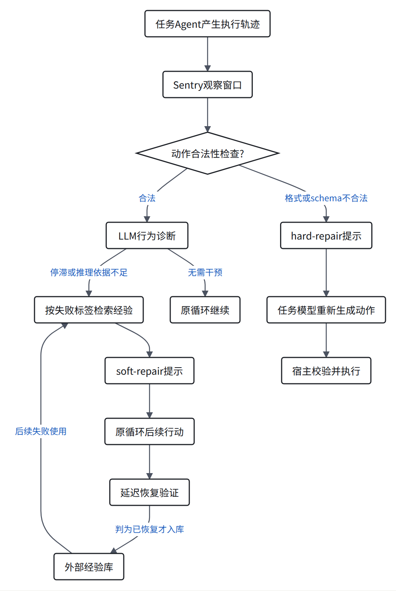
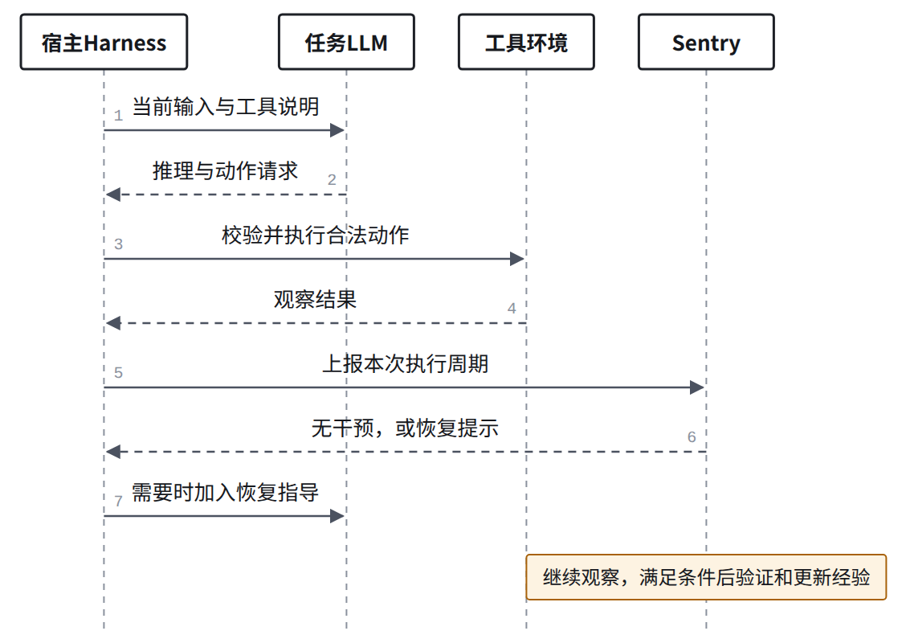

> AI 辅助精读。实验数字来自原文；代码核对与分析另行说明，未运行论文基准。

**Sentry 在任务执行中识别局部失败，按需给出恢复指导，并积累验证过的经验。** 它适合与我们的运行稳定性研究对照，但不等同于底层 runtime 修复。

论文：Sentry: Learning to Recover from LLM Agent Failures at Test Time。Changxiu Ji、Amy Lu、Qizheng Zhang、Kunle Olukotun。阅读版本：arXiv 2610.02994v1。

<h2 id="section-a">它想解决什么？经验并非随时都有用</h2>

作者观察到，失败时有用的建议，常驻上下文后可能干扰正常行动。另一类监控器会在失败时介入，却不积累恢复经验。

Sentry 将两者结合：平时保持经验库在外部，发现匹配失败后才提供少量建议。

| 机制 | 经验什么时候出现？ |
|---|---|
| 常驻指导 | 执行时一直可见 |
| 固定监控器 | 触发规则时给建议 |
| Sentry | 诊断失败后检索，并用已验证恢复更新经验 |

这里比较的是作者讨论的机制，不是宣称所有记忆系统都属于第一类。

分析判断：关键贡献是**恢复知识的使用时机与入库条件**，不只是再增加一个反思提示。

依据：[作者解读](https://nuglifeleoji.github.io/blog/2026/sentry/)。

<h2 id="section-b">怎样运行？两条恢复路径接入原有循环</h2>

<figure>
<a class="note-image-link" href="/assets/images/digest/paper-close-readings/sentry/zh-01.png" target="_blank" rel="noopener" aria-label="Sentry 将动作合法性失败与行为失败分流；只将验证通过的软恢复经验加入外部经验库。">放大图解 ↗</a>
<figcaption>Sentry 将动作合法性失败与行为失败分流；只将验证通过的软恢复经验加入外部经验库。 根据论文与公开代码绘制的说明图。</figcaption>
</figure>
默认读取最近5个推理—动作—观察周期。soft repair最多检索5条经验，观察后续10个周期再验证。

**Hard repair**是请求一个合法动作，不是“硬修复代码”。环境报错也不自动意味着动作格式错误。

代码首先读取宿主提供的 `parsed_ok` 和 `schema_valid`。行为诊断则调用模型，识别重复、停滞或缺乏依据的推理。

依据：[检测实现](https://github.com/nuglifeleoji/Sentry/blob/1d91bca14fa6a4e17908856cc787eb8e8354395f/Sentry/detector.py)、[论文配置](https://github.com/nuglifeleoji/Sentry/blob/1d91bca14fa6a4e17908856cc787eb8e8354395f/configs/paper.yaml)。

<h2 id="section-c">到底改了什么？宿主仍然负责实际执行</h2>

<figure>
<a class="note-image-link" href="/assets/images/digest/paper-close-readings/sentry/zh-02.png" target="_blank" rel="noopener" aria-label="Sentry 接收宿主上报的执行周期，返回可选恢复提示；宿主仍负责模型调用、工具执行和结果传递。">放大图解 ↗</a>
<figcaption>Sentry 接收宿主上报的执行周期，返回可选恢复提示；宿主仍负责模型调用、工具执行和结果传递。 根据论文与公开代码绘制的说明图。</figcaption>
</figure>
图是正常可执行动作的集成路径。非法动作仍由宿主标记后进入修复分支。

| 对象 | 是否被该方法直接更新？ |
|---|---|
| 下一步模型输入 | 是，加入恢复指导 |
| 恢复经验库 | 是，验证成功后增加条目 |
| 任务模型参数 | 方法没有训练步骤 |
| Harness调度和进程代码 | 没有由Sentry自动生成补丁 |

宿主调用 `runner.step()` 后取得提示，再决定如何加入对话。动作生成、校验和执行仍由宿主负责。

因此，“运行时介入”不等于“修改 runtime 实现”。

依据：[集成接口](https://github.com/nuglifeleoji/Sentry/blob/1d91bca14fa6a4e17908856cc787eb8e8354395f/Sentry/integration.py)、[官方仓库](https://github.com/nuglifeleoji/Sentry)。

<h2 id="section-d">怎样验证恢复？局部恢复不等于任务成功</h2>

| 路径 | 验证内容 | 是否写经验库？ |
|---|---|---|
| Hard repair | 新动作格式正确，且环境明确接受 | 不写 |
| Soft repair | 原失败模式停止，恢复有依据的任务推进 | 判为恢复后才写 |

soft verifier不读取最终任务奖励。它用后续轨迹作判断，因此仍然是需要审计的模型评价。

公开实现还有三个重要边界：

- 不足10个后续周期就结束时，不把该恢复写入经验库。
- 等待soft验证期间，不叠加新的soft干预；合法性修复仍可介入。
- verifier或updater异常会记录后抛出，宿主需要处理这条失败路径。

经验库变化，不能证明检测器本身变强。检测与检索规则保持固定。

依据：[运行状态与入库实现](https://github.com/nuglifeleoji/Sentry/blob/1d91bca14fa6a4e17908856cc787eb8e8354395f/Sentry/Sentry.py)、[验证器](https://github.com/nuglifeleoji/Sentry/blob/1d91bca14fa6a4e17908856cc787eb8e8354395f/Sentry/verifier.py)。

<h2 id="section-e">实验支持到哪一步？</h2>

默认模型为Qwen3.5-9B。下列为作者报告，未在本机复现。

| 证据 | 结果 | 正确解释 |
|---|---|---|
| SWE-bench Lite | 最强运行干预基线0.24，Sentry 0.30 | 50项任务上的解题准确率增加6个百分点 |
| 配对恢复实验 | 200个检查点：33.5%到60.5% | 同状态分叉后，局部恢复判断增加27个百分点 |
| 配对最终结果 | 74对更好，101对相同，25对更差 | 干预有收益，也有负面案例 |
| 资源总计 | token为基础Agent的1.54倍 | 收益不是零成本 |

评测还包含WebShop、AppWorld和Mind2Web Replay。AppWorld指标是平均检查通过率，不是完整任务成功率。Replay是受控重放，不等同原版Mind2Web指标。

论文的“平均提升37%”是跨指标的相对提升汇总，不是成功率统一增加37个百分点。

人工审计的99个soft窗口中，恢复判断与标注一致率为81.8%。这支持验证器有用，也说明其判断不应当作绝对真值。

依据：[论文方法、实验与附录](https://arxiv.org/html/2610.02994v1)。

<h2 id="section-f">从运行稳定性角度，哪些能管，哪些没有证明？</h2>

以下是根据接口与方法的分析，不是新增实验结果。

| 情形 | 与Sentry的关系 |
|---|---|
| 工具请求格式不合法 | 直接对应合法性修复 |
| 重复行动却没有推进 | 对应行为诊断与恢复指导 |
| 模型忽略已有证据 | 可以尝试局部指导，效果仍需验证 |
| 调度器卡死，无法上报步骤 | 提示层无法保证被触发 |
| 工具已执行但结果丢失 | 宿主需要提供真实状态，提示不能自动找回 |
| 进程重启后副作用重复 | 未证明具备持久恢复或幂等保证 |
| Sentry自身模型接口失败 | 宿主必须决定降级、暂停或退出 |

**它依赖观察通路和控制通路仍然可用。** 所以应区分“Agent 行为停滞”和“运行系统无法推进”。

可检验的问题：先在正常轨迹上测恢复收益。再破坏结果交付或调用配对，观察Sentry会恢复、误诊还是污染经验库。

<h2 id="section-g">对相关研究的意义：哪些重叠，哪些仍需证明？</h2>

**直接重叠：检测局部失败、选择干预、验证恢复、积累经验。** 不能把这四步本身当作新贡献。

| 我们关心的问题 | Sentry提供什么 | 后续需要补什么证据 |
|---|---|---|
| 什么时机介入？ | 条件式检测与指导 | 不同框架实际触发点和延迟 |
| 经验如何进入LLM？ | 外置经验，按失败检索 | 压缩与历史重放后指导如何保留 |
| 失败究竟来自哪里？ | 行为类别与局部证据 | 模型、输入传递、runtime缺陷的干预对照 |
| 什么时候必须改runtime？ | 主要通过提示指导恢复 | 扩展观察/控制范围与核心修复对比 |
| 改进能否长期稳定？ | 经验库跨任务积累 | 误验证累积、条目冲突及恢复机制自身故障 |

与此前的HarnessFix相比：Sentry主要改变恢复指导与经验；HarnessFix生成harness实现补丁。二者都需要区分局部改善、整体任务收益和根因消除。

分析判断：Sentry适合作为“行为恢复与经验学习”的直接相关工作。研究runtime稳定性时，可把它作为干预基线。验证它在哪些故障条件下有效，不预先假定它无法处理。

公开代码核对提交：`1d91bca14fa6a4e17908856cc787eb8e8354395f`。已读方法、实验及相关附录，并检查核心集成、检测、验证和入库代码；未安装执行基准。原文与代码哈希在本机研究目录保留。

[继续阅读 HarnessFix 精读](/digest/zh/paper-harnessfix-close-reading/)
