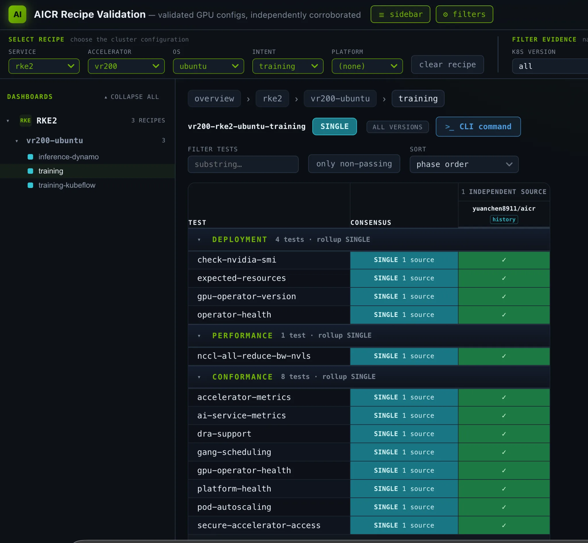

## New hardware requires version and ownership constraints

NVIDIA's Vera Rubin NVL72 report captures drivers, runtime, IMEX, networking and scheduling in AICR recipes. The tested host supplies R615.23; GPU Operator leaves driver installation disabled while managing the toolkit. Whole-GPU allocation remains on the device plugin, while DRA ComputeDomains manage cross-node IMEX. These are different responsibilities.

The recipe also records Ubuntu 26.04, an arm64 64K-page kernel and RKE2 requirements, and raises the NFD topology updater memory budget for multi-terabyte workers. Host-static IMEX and DRA-managed IMEX cannot own the node simultaneously. Explicit ownership explains failures better than a component version list alone.

## Three validation phases establish different facts

<a class="note-image-link" href="/assets/images/tech/2026-11-03-nvidia-kubernetes-ai-ready-vera-rubin/official-figure.webp" target="_blank" rel="noopener" aria-label="View figure">View figure ↗</a>

*The Rubin training recipe records deployment, performance and conformance checks separately; passing checks apply to the displayed tests.*

Deployment checks components, resources and nvidia-smi. Conformance checks access, scheduling and metrics contracts. The training performance gate runs cross-node NCCL all-reduce through an IMEX ComputeDomain over NVLink. Its 744.71 GB/s bus bandwidth at 16 GiB is a specific test result, not model training speed.

Inference deployment and conformance pass while inference performance remains deferred: Rubin dispatch code does not establish that a released image contains kernels built with the required CUDA. MIG and ConnectX-9 RDMA datapath performance are outside scope. Signed evidence belongs to its captured recipe coordinate; it does not automatically attest to later changes in a Preview recipe.

## Separate hardware faults from software defects

One initial fabric failure was resolved by reseating hardware and was unrelated to DRA. A separate unmapped Rubin architecture value in go-nvlib did crash-loop the DRA kubelet plugin; the article describes the fix propagating through bindings and shipping in DRA v0.5.0. A changed nvidia-smi banner also broke initial validator parsing, a distinct compatibility issue.

My interpretation is that visible healthy resources, functioning communication and workload performance are different milestones. Pinning a recipe and retaining phase-specific evidence transfers well to platform bring-up; passing Preview checks is not production-support certification. Host/Operator/DRA ownership and actual image build conditions are more informative than version recency alone.

Source: [Original engineering article](https://developer.nvidia.com/blog/making-kubernetes-ai-ready-for-nvidia-vera-rubin-on-day-one/)
