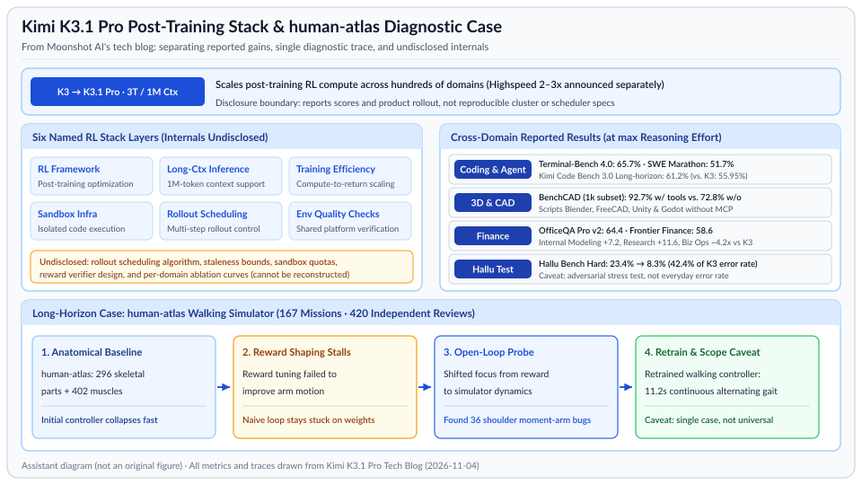
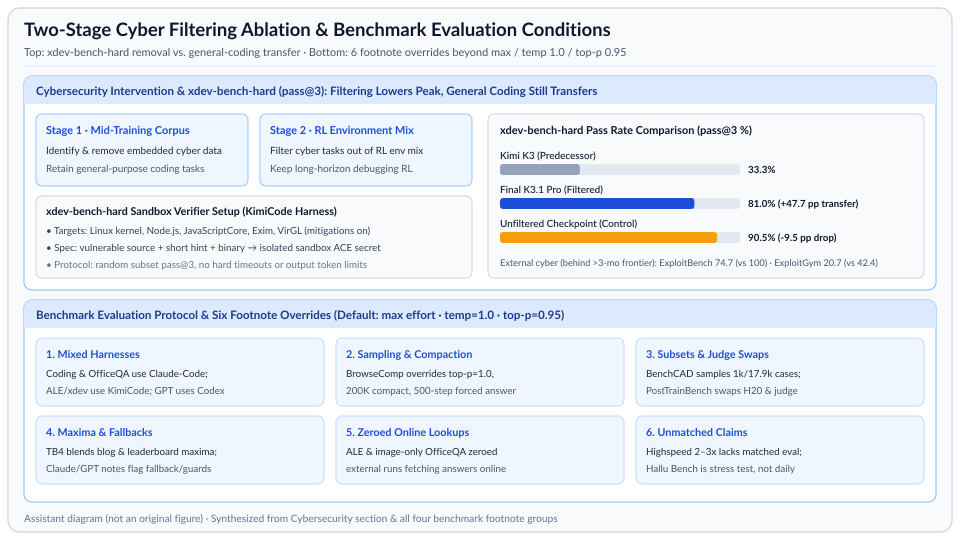

Moonshot AI (Kimi) · 2026-11-04 · [Original Engineering Post: "Kimi K3.1 Pro Tech Blog: Advancing Open Intelligence"](https://www.kimi.com/blog/kimi-k3-1-pro)

Kimi K3.1 Pro is introduced as the first model in Moonshot AI's K3.1 series and its strongest **3T-class open-weight model** to date, featuring a **1-million-token (`1M`) context window** alongside **Kimi K3.1 Pro Highspeed**, which claims **`2–3×`** the speed of the base model. Beyond standard release charts, the post includes concrete diagnostic and experimental disclosures across long-horizon RL debugging, two-stage cybersecurity filtering, and detailed benchmark footnotes—while leaving distributed RL scheduling, sandbox sizing, and matched `Highspeed` quality comparisons undisclosed.

> **Evidence boundary & scope**: All scores, ablation checkpoints, and case specifics below are verified directly against the frozen primary HTML and extracted text snapshot. We explicitly separate three layers: (1) **directly reported findings and traces**, including the `human-atlas` open-loop dynamics probe, the `xdev-bench-hard` filtering comparison, and benchmark footnote overrides; (2) **named but undisclosed infrastructure**, where six named RL stack layers provide zero reproducible algorithmic or capacity specifications; and (3) **product or stress-test claims requiring boundary separation**, specifically `Highspeed`'s `2–3×` throughput claim, `Kimi Hallu Bench Hard` stress-test error rates, and the announced Nov 4, 2026 weight-release schedule (distinct from independently verified artifact downloads).

## Joint RL Post-Training Scope & the `human-atlas` Open-Loop Diagnostic Case

Moonshot AI characterizes Kimi K3.1 Pro as a post-trained descendant of **Kimi K3** built with substantially larger post-training compute scaled across "hundreds of downstream domains." To translate extra RL compute into predictable gains, the team names six optimized infrastructure layers: **the RL framework, long-context inference, training efficiency, sandbox infrastructure, rollout scheduling, and a shared platform for environment quality checks**. Critically, however, the post does **not** disclose rollout scheduling policies, off-policy staleness bounds, sandbox isolation quotas, reward verifier architectures, or per-domain compute curves. Mentioning full-stack optimization therefore establishes engineering intent rather than a reconstructible distributed RL blueprint.

At the capability level, K3.1 Pro reports consistent gains across coding, 3D spatial modeling, and finance workflows: on `Terminal-Bench 4.0`, it reaches **`65.7%`** (ahead of `GPT-6 Astra` at `58.2%` and narrowly behind `Claude Opus 5.5` at `66.4%`); on `SWE Marathon v1.1`, **`51.7%`**; and on the internal `Kimi Code Bench 3.0 Long-horizon`, **`61.2%`** over K3's **`55.95%`**. On `BenchCAD` (a `1,000`-case sampled subset), K3.1 Pro scores **`92.7%`** with tools and **`72.8%`** without tools, while scripting Blender, FreeCAD, Trimesh, Unity, Unreal Engine, and Godot without MCP connectors. In finance, it reaches **`64.4`** on `OfficeQA Pro v2` and **`58.6`** on `Frontier Finance`, alongside internal jumps over K3 in `Financial Modeling` (`57.6` vs. `50.4`, `+7.2`), `Financial Research` (`70.4` vs. `58.8`, `+11.6`), and `Business Operation` (`~4.2×` K3's baseline of `8.9`). On factual grounding, claim-level hallucination on `Kimi Hallu Bench Hard` (with tools) drops from **`23.4%`** (K3) to **`8.3%`**, with the share of responses containing at least one factual error falling to **`42.4%`** of K3's rate.

<figure>
  <a class="note-image-link" href="/assets/images/tech/2026-11-04-kimi-k3-1-pro/k31-posttraining-diagnostics-en.svg" target="_blank" rel="noopener">
    
    Expand diagram ↗
  </a>
  <figcaption>Assistant diagram (not an original figure): Organizing K3.1 Pro's six named RL stack layers, reported domain gains, and the human-atlas open-loop diagnostic trace.</figcaption>
</figure>

The clearest behavioral window into K3.1 Pro's long-horizon coding comes from an internal **human walking dynamics simulator** built atop `human-atlas`—an open-source anatomical model comprising **`296` skeletal components (including cartilage) and `402` muscle components**—complete with integrated training and evaluation pipelines. Over **`167` missions and `420` independent reviews**, the model refined the controller from collapsing within seconds to continuous alternating-stride walking for **`11.2` seconds**. What makes this trace technically instructive is the diagnostic pivot: when reward shaping failed to improve arm motion, K3.1 Pro did not remain trapped adjusting reward weights. Instead, it ran **open-loop probes** of the simulator's dynamics, isolated and corrected **`36` errors in shoulder-muscle moment-arm calculations**, and only then retrained the controller.

Viewed strictly as evidence, this demonstrates an agent shifting root-cause investigation from optimization symptoms (reward tuning) to environment physics implementation. At the same time, it remains a **single internal demonstration** rather than a statistical reliability guarantee across arbitrary long-horizon repositories.

## Two-Stage Cybersecurity Filtering & Cross-Task Capability Transfer (`xdev-bench-hard`)

The cybersecurity section provides the post's **cleanest controlled intervention**. During development, vulnerability research performance rose steadily with post-training scale. Tracing the driver, the authors found cyber-related text embedded inside the general **mid-training corpus** and cyber tasks inside the **RL environment mix**. Preliminary internal ablations confirmed that leaving either stage unfiltered drove substantial downstream cyber gains. For the open-weight release of K3.1 Pro, Moonshot AI therefore identified and removed cyber-related material from **both** stages while deliberately **retaining general-purpose coding tasks** to preserve utility.

Post-cleaning capability was measured on **`xdev-bench-hard`**, an internal benchmark of expert-curated, source-code-based vulnerability discovery and exploitation tasks faithfully reproducing recently disclosed vulnerabilities in `Linux kernel`, `Node.js`, `JavaScriptCore`, `Exim`, and `VirGL` **with mitigations enabled**. Each task supplies vulnerable source code, a short bug hint, and the compiled binary; the agent must craft an exploit, achieve arbitrary code execution inside an **isolated sandbox**, and retrieve a secret string for automated verification. Results report **`pass@3`** over a random subset of runs **without hard timeouts or output token limits**, evaluated with the `KimiCode` harness for K3.1 Pro (while `DeepSeek-V4.1-Flash-1017` and `GLM-5.3` were run on `Claude Code`).

| Checkpoint / Model Evaluated | Evaluation Harness & Protocol | Score (`%`) | What This Establishes vs. Leaves Open |
| :--- | :--- | :--- | :--- |
| **Kimi K3** (predecessor) | `xdev-bench-hard` · `pass@3` (no hard timeout / token cap) | `33.3` | Establishes the generational baseline on the internal exploitation suite |
| **Unfiltered K3.1 Pro Checkpoint** | Same pipeline **without** mid-training removal or RL filtering | `90.5` | Shows how strongly joint post-training scales cyber exploitation if left unfiltered |
| **Final K3.1 Pro (Open-Weight)** | `KimiCode` harness · **both** mid-training & RL cyber data removed | `81.0` | **Proves** `-9.5` pp reduction from filtering; **reveals** `+47.7` pp transfer from general coding; **cannot** independently reconstruct private dataset filters |
| **DeepSeek-V4.1-Flash-1017 / GLM-5.3** | `Claude Code` harness (differs from K3.1 Pro's `KimiCode`) | `85.7` / `57.1` | Offers internal peer context under asymmetric harnesses and private task sampling |
| **ExploitBench / ExploitGym** (public) | `ExploitBench` 300-turn `pass@5`; `ExploitGym` `6`-hour wall-clock | `74.7` / `20.7` | Confirms K3.1 Pro remains behind proprietary models >3 months old (`GPT-6 Astra` `100` / `42.4`; `Opus 5.5` `91.0` / `34.5`) |

The experimental takeaway cuts two ways. Removing cyber data across both stages produced a measurable drop (**`90.5%` down to `81.0%`**, a **`9.5`-percentage-point** reduction), confirming data curation as a real control lever. Yet filtered K3.1 Pro still outscored predecessor K3 (**`33.3%`**) by **`47.7` percentage points**—showing that stronger general coding and long-horizon debugging capabilities **generalize across task boundaries into vulnerability exploitation** even after targeted filtering. Moonshot AI frames its release policy around two commitments: first, avoiding open weights that extend the absolute cyber offense frontier (staying behind frontier proprietary systems available for at least three months); second, progressively raising open-weight dual-use auditing power so defenders can inspect legacy and self-hosted codebases locally. Even so, because neither the unfiltered checkpoint nor the filtering taxonomy is public, external teams cannot independently reproduce the ablation.

<figure>
  <a class="note-image-link" href="/assets/images/tech/2026-11-04-kimi-k3-1-pro/k31-cyber-filtering-eval-boundaries-en.svg" target="_blank" rel="noopener">
    
    Expand diagram ↗
  </a>
  <figcaption>Assistant diagram (not an original figure): Juxtaposing two-stage cyber filtering transfer effects against the six footnote overrides across the benchmark suite.</figcaption>
</figure>

## Benchmark Evaluation Protocol & Footnote Overrides

Headline charts alone obscure how much scaffolding varies across benchmarks. While the footnotes open with a baseline rule—all K3.1 Pro results default to **reasoning effort = `'max'`, `temperature = 1.0`, and `top-p = 0.95`**—every major evaluation group introduces protocol exceptions that govern cross-model comparability:

- **Asymmetric Execution Harnesses**: Across coding benchmarks and `OfficeQA Pro/v2`, K3.1 Pro runs inside the **`Claude-Code` harness** (`Terminal-Bench 4.0`, `Terminal-Bench-Science 0.1`, `DeepSWE v1.1`, `SWE-Marathon v1.1`, `PostTrainBench v1.2`, `ProgramBench`, `Kimi Code Bench 2.0/3.0`, and `BenchCAD w/ tools`). Elsewhere, K3.1 Pro switches to **`Kimi Code` / `KimiCode`** (`BioMysteryBench`, `Agents' Last Exam`, `ExploitGym`, `xdev-bench-hard`) or **`Kimi Agent`** (`OSWorld V2.1`), while `GPT-6 Astra` runs on **`Codex`** for `BioMysteryBench` and `OfficeQA Pro/v2`.
- **Subsets, GPU Swaps, Binary Thresholds & Judge Substitutions**: `BenchCAD` evaluates open models on a **`1,000`-case random subset** of the full `17,900`-case `Vision2Code` dataset (`Claude Code` with tools vs. single-shot without tools). `PostTrainBench v1.2` ran internally on **`H20` GPUs** instead of `H100` GPUs, substituting **`DeepSeek-V4.1-Flash-1017 (max)`** for the official `GPT-5.6-Terra (xhigh)` judge. `ProgramBench` reports binary scores (**`1` only if raw score reaches `>=95%`**), and `MCP Atlas` evaluates a **`500`-task public subset** capped at **`100` turns**.
- **Sampling Overrides & Context Compaction**: `BrowseComp` overrides `top-p` from `0.95` to **`1.0`**, triggers Claude-style **context compaction at `200K` tokens**, and **forces a final answer at `500` steps** before grading.
- **Mixed Peer Score Sources, Fallbacks & Cyberguards**: On `Terminal-Bench 4.0`, the summary table takes the **maximum** across blogs or `tbench.ai` (`Claude Opus 5.5` at `66.4%`, `DeepSeek-V4.1-Flash-1017` at `42.3%` from its release blog), whereas the embedded Pareto cost chart cites `tbench.ai` and Artificial Analysis directly (`64.85%` at `$14.3` for `Opus 5.5`; `33.8%` at `$0.88` for `DeepSeek`; `65.7%` at `$5.25` for K3.1 Pro `max` vs. `52.8%` at `$4.16` at `high`). On `Terminal-Bench-Science 0.1`, Moonshot measured `DeepSeek-V4.1-Flash-1017` internally at `9.3`, yet reports an older `DeepSeek-V4.1-Flash` leaderboard score of `15.7`. Moreover, both table headers and chart footnotes warn that proprietary `Claude` and `GPT` scores are **`(max, with fallback)`** and `GPT` runs may include **`cyberguards`**.
- **Zeroing Cheating Runs & Heterogeneous Graders**: On `Agents' Last Exam` (`122` tasks, `86` CLI) and `OfficeQA Pro / v2` (all PDFs rendered purely as images with no machine-readable text), trajectories where external models fetched reference answers online—such as bypassing required `Wireshark` inspection—were **assigned a score of zero**. Automated grading varies across `Kimi K3`, `Gemini 3.1 Pro`, `Gemini-3.5-Flash Medium`, human-calibrated `DECK-Arena` graders (`10,000+` judgments), and fact-checking agents.

| Benchmark / Suite | Harness & Input Format | Key Footnote Override / Judge / Sourcing Detail | Comparability Constraint for Readers |
| :--- | :--- | :--- | :--- |
| **`Terminal-Bench 4.0` & `Science 0.1`** | K3.1 Pro on `Claude-Code` | TB4 table uses blog/leaderboard maxima while Pareto chart uses `tbench.ai` / AA (`33.8%` vs. `42.3%` on DS); `Science` reports older `15.7` over internal `9.3` | Cross-chart score differences show source/version sensitivity; proprietary columns include `fallback` and possible `cyberguards` |
| **`BenchCAD` (with/without tools)** | `Claude Code` w/ tools; single-shot w/o tools | Open models tested on **`1,000` random cases** out of `17,900`; proprietary scores from reports; `GPT-6 Astra` lacks w/o-tools score | Subset sampling variance and tool harness scaffolding mean `92.7%` is a scaffolded score, not pure single-shot generation |
| **`PostTrainBench v1.2` & `ProgramBench`** | `Claude-Code` harness | Internal v1.2 ran on **`H20`** (not `H100`) with `DS-V4.1-Flash-1017` replacing `GPT-5.6-Terra` judge; `ProgramBench` binarizes at **`>=95%`** | Hardware differences, judge substitution, and binary thresholding alter spread across close competitors |
| **`OfficeQA Pro / v2` & `Agents' Last Exam`** | `Claude Code` / `Codex` / `Kimi Code` | Image-only PDFs on `OfficeQA`; both benchmarks **zeroed external trajectories** caught looking up answers online | Scores reflect both reasoning accuracy and adherence to offline/tool-use rules within each harness |
| **`BrowseComp` & Multimodal `w/ python`** | Context compaction + sandbox IPython | `BrowseComp` sets `top-p=1.0`, **`200K` compaction**, and **`500`-step forced answer**; `GDP.pdf w/ python` averages `5` runs | Non-default sampling and forced termination shape long-horizon search tail behavior |
| **Internal Suites (`KCB 2.0/3.0`, Finance, `Hallu Bench`)** | `Claude-Code` or internal harnesses | Task pools and fact-checking agents are vendor-curated; `Hallu Bench` is explicitly marked an **adversarial stress test** | Useful for K3 -> K3.1 Pro generational tracking, not directly interchangeable with public benchmark populations |

## Deployment Boundaries: `Highspeed`, Hallucination Stress Tests, and Undisclosed Internals

Translating this announcement into engineering adoption rules yields four concrete guardrails:

First, **treat `Kimi K3.1 Pro` and `Kimi K3.1 Pro Highspeed` as uncoupled claims**. Although `Highspeed` launches alongside the base model on `Kimi.com`, `Kimi Work` (`>= v3.1.0`), `Kimi Code` (`/model`), and the `Kimi API` (`kimi-k3.1-pro` / `kimi-k3.1-pro-highspeed` with Zero Data Retention) advertising **`2–3×` speed**, every benchmark table and Pareto point in the post reflects standard `K3.1 Pro`—almost exclusively at **`max` reasoning effort**. Even on standard `K3.1 Pro`, `Terminal-Bench 4.0` shows a **`12.9`-point spread** between `high` (`52.8%` at `$4.16`) and `max` (`65.7%` at `$5.25`). Without matched latency, concurrency, quantization, and accuracy numbers for `Highspeed`, teams must evaluate `Highspeed` quality independently on their own workloads.

Second, **never extrapolate stress-test hallucination rates to everyday error rates**. Dropping `Kimi Hallu Bench Hard` claim-level hallucination from `23.4%` (K3) to `8.3%` (`5.4%` without tools) is meaningful relative progress against `Opus 5.5` (`6.8%` / `15.0%`) and `DS-V4.1-Flash-1017` (`13.1%` / `23.3%`). Yet the post's own parenthetical explicitly cautions that prompts are deliberately crafted to trigger failure modes and **do not measure daily overall error rates**.

Third, **distinguish a release schedule from verified self-hosted readiness**. The blog announces full weight release **"by Nov 4, 2026"**, while `Kimi Enterprise` access starts off by default. Independently deploying a **`3T-class`, `1M`-context** open-weight model still requires verifying published checksums, license terms, and actual serving hardware footprints—none of which can be inferred from six named RL stack layers.

Fourth, **focus engineering reuse on the report's evaluation and diagnostic patterns**: pin harnesses (`Claude-Code` vs. `KimiCode` vs. `Codex`) during model shootouts, deploy **open-loop environment probes** like the `human-atlas` shoulder moment-arm fix when reward or prompt tuning stalls, and assume **general coding gains transfer to security risk** even when domain-specific cyber corpora are scrubbed.

---

> **Provenance**: Rewritten and expanded by the assistant from Moonshot AI's frozen primary HTML and extracted text (`.preview/research-jobs/depth-repair-2026-11-05/work/evidence/2026-11-04-kimi-k3-1-pro.html` and `.frozen.txt`), retaining the original `id`, `permalink`, and `source_published_at` while using canonical `_data/note_tags.yml` IDs (`coding-agents`, `agent-reliability`, `systems-reliability`). Both `v3-blue` diagrams (`k31-posttraining-diagnostics-en.svg`, `k31-cyber-filtering-eval-boundaries-en.svg`) are assistant-drawn syntheses of primary text and footnotes (not original figures), leaving undisclosed RL scheduler internals and unmatched `Highspeed` quality claims explicitly unextrapolated.
