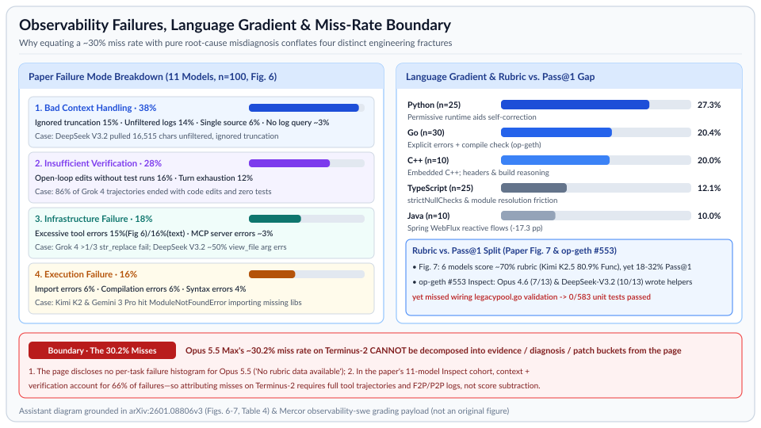

Abhi Kottamasu et al. (Mercor · Cognition) · [arXiv:2601.08806v3 (PDF)](https://arxiv.org/pdf/2601.08806) / [arXiv Abstract](https://arxiv.org/abs/2601.08806) (v3 2026-03-23; submitted 2026-01-13) · [Mercor APEX-SWE Observability Leaderboard](https://www.mercor.com/apex/apex-swe-leaderboard/observability-swe/) · [APEX-SWE Main Leaderboard](https://www.mercor.com/apex/apex-swe-leaderboard/) · [GitHub Eval Harness](https://github.com/Mercor-Intelligence/apex-swe) · [Hugging Face Dev Set (n=50)](https://huggingface.co/datasets/mercor/APEX-SWE) · [2026-11-04 X Context Post (`@laduramvishnoi`)](https://x.com/laduramvishnoi/status/2117733057184911567)

On November 4, 2026, Middleware Labs founder Laduram Vishnoi pointed to Mercor's APEX-SWE Observability leaderboard and asked a sharp operational question: even at `Max` effort, **`Claude Opus 5.5` still missed roughly 3 in 10 tasks (`100% - 69.8% = 30.2%`)**—and for an on-call team, what matters is whether an agent missed key evidence, diagnosed the wrong cause, or wrote a patch that failed to restore the system. Answering that question without guesswork requires reading the **live Mercor leaderboard snapshot** alongside its foundational technical paper, [`arXiv:2601.08806v3` (*APEX–SWE*, March 2026)](https://arxiv.org/pdf/2601.08806), which documents task sourcing, five-service container orchestration, grading separation, and failure modes across eleven models.

> **Evidence layers & scope boundary**: This close reading strictly cross-checks the frozen primary artifacts and explicitly separates four evidence layers: (1) **Paper baseline** (`arXiv:2601.08806v3`) covering 11 frontier models evaluated on the `Inspect` ReAct harness over `n=200` held-out prompts (`100` Integration + `100` Observability) and `n=50` open-source dev tasks; (2) **Frozen Nov 4, 2026 Mercor leaderboard and subpage snapshot** (`mercor-leaderboard.html` and `observability-swe/`), reflecting newer models, effort tiers, and `Terminus-2` (strictly excluding entries released after `2026-11-04`); (3) **Sample task & embedded grading payload** from `ethereum-optimism/op-geth` Issue `#553`, showing 583 unit tests plus 13 rubrics under `Inspect` alongside UI discrepancies on `Terminus-2` (`No rubric data available` and mismatched `bbot` test labels); and (4) **Attribution boundary**—the paper's failure percentages summarize 11 models on `Inspect` and cannot be retroactively reassigned to decompose `Opus 5.5 Max`'s `30.2%` misses on `Terminus-2`.

## Benchmark Architecture: Containerized Telemetry & Dual-Track Grading

[`arXiv:2601.08806v3`](https://arxiv.org/pdf/2601.08806) motivates APEX–SWE by contrasting coding-benchmark saturation with everyday engineering work. Citing IDC (Resnick, 2025), developers spend only **`16%`** of their time writing application code while **`84%`** goes to CI/CD, infrastructure monitoring, security, deployment, and debugging (with debugging estimated at `$312B` annually in Britton et al., 2013). Meanwhile, single-repository bug fixing on `SWE-bench Verified` has clustered around **`80% Pass@1`** and been flagged by OpenAI as contaminated enough for models to reproduce verbatim patches from task IDs alone (Glaese and Watkins, 2026). Mercor and Cognition therefore built APEX–SWE around **Integration (`n=100`)** and **Observability (`n=100`)**, alongside an open-source **`n=50`** dev set (`25` Integration + `25` Observability, CC-BY on Hugging Face) and open evaluation harness on GitHub.

Within **Observability** (Section 4.1 and Figure 5), tasks are sourced from real GitHub Issue–PR pairs in repositories with **`>=350` stars**, filtered for multi-file complexity (**`>=100` lines of code across `>=3` files**), test coverage, and low test brittleness (implementation-agnostic checks), then converted by software engineers with **`3+` years of experience**. The `100` held-out tasks span five languages: **Go (`30%`), Python (`25%`), TypeScript (`25%`), Java (`10%`), and C++ (`10%`)**. Crucially, unlike conventional bug-fix benchmarks, **agents are given zero failing unit tests upfront**.

Instead, each task boots a five-service Docker environment via `docker-compose.yaml` and `Dockerfile`: a client workspace (`/app/repo`), `Loki` and `Promtail` for log aggregation, `Grafana` for visualization, and `Plane` plus `Mattermost` for ticket and developer chat context. Engineers populate `data/` with scripted synthetic logs (**`500–1,000` normal lines mixed with `10–20` bug symptom lines**) paired with the original GitHub issue and public developer discussions (GitHub Discussions and Gitter). Under a `1`-hour wall-clock timeout and LiteLLM exponential-backoff retries (max `3` per request), the ReAct harness exposes: (1) `/bin/bash` inside a persistent `tmux` session; (2) workspace file read/write tools; and (3) **Model Context Protocol (MCP)** servers for `Loki`, `Plane`, and `Mattermost`. Tasks also bundle `interface.md` and `problem_statement.md`, while `test.patch` and `golden.patch` remain held out for evaluation.

<figure>
  <a class="note-image-link" href="/assets/images/tech/2026-11-04-mercor-apex-swe-observability/apex-swe-observability-pipeline-en.svg" target="_blank" rel="noopener">
    
    Expand diagram ↗
  </a>
  <figcaption>Assistant diagram (not an original figure): End-to-end construction, five-service telemetry environment, and dual grading tracks synthesized from arXiv:2601.08806v3 and the Mercor observability-swe snapshot.</figcaption>
</figure>

Examining both the paper and the live website reveals three subtle evaluation boundaries readers must keep separate:

- **Leaderboard rankings rely exclusively on `Pass@1` automated tests**: Sections 2 and 5 of `arXiv:2601.08806v3` establish that Observability `Pass@1` averages binary pass rates across **`3` independent epochs** using SWE-bench-style **`FAIL_TO_PASS` (F2P) and `PASS_TO_PASS` (P2P)** test suites (`Pass@3` measures solving at least once across 3 epochs). Section 5 explicitly states: **"Rubric scores are not used for the APEX–SWE leaderboard, which relies exclusively on Pass@1."**
- **Rubrics measure qualitative engineering quality separately**: Expert-written task rubrics—weighted **`50%` Functional, `30%` Robustness, and `20%` Style** (Style applies only to Observability)—are graded independently by `Gemini 3 Pro` (`Temperature = 0.1`, `Thinking = High`) over the final patch and execution logs. Notably, Mercor's parent-page FAQ copy generically borrows phrasing from `APEX-Agents` (describing `Pass@1` as scoring `100%` on the rubric), whereas the peer-reviewed paper and per-task test payloads confirm unit tests govern APEX-SWE rankings.
- **Small-sample inflation on the open dev set**: Appendix B (Table 6) compares identical evaluation rules on the **`n=200`** held-out leaderboard vs. the **`n=50`** open-source dev set. While the top two (`Opus 4.6`, `Opus 4.5`) and bottom three (`Grok 4`, `DeepSeek V3.2`, `Kimi K2 Instruct`) preserve exact rank order, mid-tier models shift (`Kimi K2.5` jumps from rank `6` to `4`; `GPT-5.2 Codex` drops from `5` to `7`), and mean scores inflate from **`27.9%`** to **`40.7%`** (**`+12.8` percentage points**)—making `n=50` dev scores non-comparable to full leaderboard claims.

## Paper Baseline vs. November 2026 Leaderboard: Harness, Effort & Cohort Shifts

Juxtaposing the March 2026 paper (`11` models on `Inspect`) with the November 4, 2026 Mercor leaderboard (`Terminus-2` default plus `Inspect` history) exposes how strongly both **execution scaffolding** and **reasoning effort** reshape Observability scores.

In the paper baseline (Tables 3 and 4, `Inspect` harness, `n=100` Observability), every model fell well below production reliability: **`Claude Opus 4.6 (High)`** led at **`31.7%` Pass@1** (`39.0%` Pass@3, `+7.3` pp), ahead of `Claude Opus 4.5 (High)` at **`26.7%`** (`34.0%`) and `GPT-5.2 Codex (High)` at **`21.3%`** (`29.0%`). A tight middle tier clustered between **`18.7%` and `21.0%`** (`Cognition SWE-1.6 Preview` `21.0%`, `GPT-5.1 Codex` `20.3%`, `DeepSeek V3.2` `20.0%`, `Kimi K2.5` `19.7%`, `Gemini 3 Pro` `19.7%`, `Claude Sonnet 4.5` `18.7%`), while `Grok 4` (`5.7%`) and `Kimi K2 Instruct` (`4.0%`) trailed sharply. Language segmentation (Table 4) revealed a **`17.3`-point** runtime feedback gradient: **Python (`27.3%` mean, `n=25`)** led thanks to permissive execution enabling iterative self-correction, followed by **Go (`20.4%`, `n=30`)** with explicit error returns and **C++ (`20.0%`, `n=10`)**, whereas **TypeScript (`12.1%`, `n=25`)** (`strictNullChecks` and module resolution) and **Java (`10.0%`, `n=10`)** (`Halo` with reactive `Spring WebFlux` flows) cut success rates roughly in half.

By the November 2026 snapshot (`mercor-leaderboard.html` and `observability-swe/`, strictly excluding models released after `2026-11-04`), scores climbed dramatically—but only when read alongside **harness** (`Terminus-2` vs. `Inspect`) and **effort tier** (`Max`, `xHigh`, `High`, `Medium`):

| Model & Cohort Source | `Inspect` Pass@1 | `Terminus-2` Pass@1 | `Pass@3` / Effort Swing | Key Methodological Takeaway |
| :--- | :--- | :--- | :--- | :--- |
| **`Opus 5.5`** (Nov 2026 board, `2026-09-22`) | Not listed | **`69.8%`** (`Max`) / `48.0%` (`Med`) | **`+21.8` pp** (`Max` vs. `Medium`) | Tops Nov 2026 Observability; dropping one effort tier loses over a fifth of total accuracy |
| **`Sonnet 5.5`** (Nov 2026 board, `2026-09-28`) | Not listed | **`63.5%`** (`Max`) / `28.2%` (`Med`) | **`+35.3` pp** (`Max` vs. `Medium`) | Demonstrates why citing model family names without `effort` invalidates comparisons |
| **`Opus 5`** (Nov 2026 board, `2026-07-24`) | `44.0%` (`Max`) | **`63.5%`** (`Max`) | **`+19.5` pp** across harnesses at `Max` | Holding model and effort fixed, switching `Inspect` to `Terminus-2` swings nearly 20 points |
| **`Fable 5.1` / `Fable 5`** (Nov 2026 board) | `-` / `50.33%` (`Max`) | **`59.0%`** / **`54.2%`** (`Max`) | `Fable 5` `Terminus-2` `+3.87` pp | Ranks 4th/5th on Nov 2026 `Terminus-2`; combined overall `Fable 5` `58.9% ± 6.4%` |
| **`Grok 4.6`** (Nov 2026 board, `2026-08-12`) | Not listed | **`51.7%`** (`xHigh`) / `50.0%` (`High`) | `+1.7` pp (`xHigh` vs. `High`) | Huge generational jump over `Grok 4` (`5.7%`), with smaller marginal effort gain |
| **`Opus 4.8`** (Nov 2026 board, `2026-05-28`) | **`43.3%`** (`High`) | `35.7%` (`Max`) | `Inspect` leads `Terminus-2` by **`+7.6` pp** | Proves `Terminus-2` is not uniformly superior across every model generation |
| **`Opus 4.6`** (Paper & Nov 2026 board) | **`31.7%`** (`High`) | `30.8%` (`Max`) | Paper `Pass@3` **`39.0%`** (`+7.3` pp) | Paper leader; nearly identical across harnesses with `+7.3` pp multi-attempt headroom |
| **`Opus 4.5`** (Paper Table 3) | **`26.7%`** (`High`) | Not listed | Paper `Pass@3` `34.0%` (`+7.3` pp) | Paper runner-up; shares the top-right Pass@1-vs-Rubric frontier in Fig. 7 |
| **`DeepSeek-V3.2`** (Paper & Nov 2026 board) | **`20.0%`** | `9.2%` | Paper `Pass@3` `22.0%`; **`-10.8` pp** shift | Struggled with truncation on `Inspect` and drops by over half under `Terminus-2` |
| **`Grok 4` / `Kimi K2`** (Paper Table 3) | `5.7%` / `4.0%` | `-` / `8.0%` (`High`) | Both `9.0%` `Pass@3` in paper | Paper notes `86%` unverified edits for `Grok 4` and frequent `ModuleNotFoundError` for `Kimi K2` |

In short, **`Model × Effort × Harness`** forms an indivisible tuple. On the combined 200-task APEX-SWE board frozen on November 4, `Opus 5.5 (Max)` scored `67.6% ± 5.9%` vs. `55.9% ± 6.3%` at `Medium`; on Observability alone, cutting effort drops `Opus 5.5` by `21.8` pp and `Sonnet 5.5` by `35.3` pp, while changing only the harness moves `Opus 5 (Max)` by `19.5` pp and flips `DeepSeek-V3.2` by `-10.8` pp.

## Sample Task Deep Dive: `op-geth #553` Stateful Rules & Rubric-Pass@1 Divergence

On `observability-swe/`, Mercor illustrates the domain using a Go task drawn from `ethereum-optimism/op-geth` — **Issue #553** (`core/txpool: Include operator fee in sufficient fund checks`, explicitly marked illustrative over the 100 held-out prompts). Looking closely at its 15 numbered requirements clarifies why locating the missing fee term is only step one of a valid patch:

1. **Upgrade-gated cost composition**: Using `NewTotalRollupCostFunc`, `ExtractOperatorFeeParams`, `ExtractEcotoneFeeParams` (`core/types/rollup_cost.go`), and `TotalTxCost` (`core/txpool/rollup.go`), the transaction pool must verify account balance against base execution cost (`gas limit × gas price + value`), L1 rollup cost, and operator rollup cost—branching on **`chain.Config().IsthmusTime`** so pre-Isthmus timestamps charge only L1 cost while timestamps at or after Isthmus charge both L1 and operator costs, reporting required cost vs. balance in `ErrInsufficientFunds`.
2. **Stateful mempool lifecycle & interface constraints**: The fix must wire validation into `core/txpool/legacypool/list.go:list.Add` without changing `list.Add`'s signature (keeping only nonce and price-bump arguments by routing through `rollupCostFuncProvider` / `newRollupList` and `legacypool.go:RollupCostFunc()`), and must preserve consistency across four state transitions: initial admission, **gas-price replacement** cost recalculation, **pending-pool re-evaluation** when operator fee constants rise, and **re-acceptance** once sufficient balance is restored.
3. **Defensive edge handling & test-infrastructure alignment (Requirements 12–15)**: Implementations must guard against `nil` configs or fee functions without panicking, surface `uint256` overflow booleans on execution/L1/operator addition, and update block RLP encoding/decoding, `ExecutableDataToBlock` (`DefaultBlockConfig`), and historical tx/block tracing tests to `OptimismTestCliqueConfig`.

Crucially, the task prompt gives the agent `Loki` (`{job="ethereum-optimism-op-geth-553-558-observability"}`), `Plane` (`mcp-plane`), and `Mattermost` (`mcp-mattermost`), explicitly warning: `CRITICAL: Do NOT add 2>/dev/null or 2>&1 /dev/null to MCP commands!` so failed diagnostics cannot hide silently.

Inspecting the embedded `grade_results` payload for `op-geth #553` exposes a striking confirmation of **Paper Section 5 / Figure 7's Rubric-vs-Pass@1 divergence**—alongside a critical UI trap:

- On **`Inspect`**, the sample task evaluates **`583` unit tests** (`573` `correctness-f2p` + `10` `correctness-p2p`) plus **`13` rubric criteria** (`2` functional, `7` nil/overflow robustness, `4` naming/error-message style). Real judge rationales explain why high rubric quality still fails end-to-end tests: **`Opus 4.6 (High)` scored `7/13` rubrics** (correctly adding nil checks inside `NewTotalRollupCostFunc`) yet passed **`0/583` unit tests** because *"`legacypool.go` was not updated to use `TotalTxCost` or `TotalRollupCostFunc`, so validation still uses only L1 cost"*; **`DeepSeek-V3.2` reached `10/13` rubrics** yet also passed **`0/583` tests** for failing to wire `RollupCostFn` in `legacypool.go` `opts`! `GPT-5.3 Codex (High)` passed **`13/13` rubrics** yet `378/583` unit tests, whereas `Opus 4.5 (High)` (`6/13` rubrics) and `Kimi K2.5` (`9/13` rubrics) passed all **`583/583`** unit tests. That directly mirrors Figure 7 in the paper, where six models hover near `~70%` rubric score (`Kimi K2.5` hits `80.9%` Functional on Observability) while `Pass@1` stays stuck between `18%` and `32%`.
- On **`Terminus-2`** (`Opus 5.5 Max 69.8%` and `Medium 48.0%`), however, the trajectory pane states **`No rubric data available for this model`**, and its underlying `grade_results` list actually contains `6` unit tests from an unrelated `bbot` task (`test_module_nuclei.py`) rather than `op-geth #553`. Readers therefore cannot extrapolate `Opus 5.5`'s actual tool usage on `op-geth #553` from the sample prompt shown on the page.

## Deconstructing the ~30% Miss Rate: Paper Failure Taxonomy vs. On-Call Attribution

Returning to `@laduramvishnoi`'s November 4 question—did the model miss evidence, misdiagnose the root cause, or write a patch that failed to restore the system—synthesizing the leaderboard snapshot with [`arXiv:2601.08806v3`](https://arxiv.org/pdf/2601.08806) yields a strict two-part answer.

First, **the `30.2%` miss-rate complement for `Opus 5.5 Max` (`100% - 69.8%`) cannot be broken down into those buckets from the Mercor page**, because neither per-task trajectories nor failure-category breakdowns are published for `Opus 5.5` on `Terminus-2`. Calling that `~30%` complement a "misdiagnosis rate" confuses unverified aggregate non-completion with a specific cognitive fault.

Second, **the paper's qualitative audit across 11 models (`n=100` held-out on `Inspect`, Sections 4.3–4.4 & Figure 6) shows what actually distinguishes passing vs. failing agents in this environment**. Winning models exhibit **epistemic discipline** across three concrete habits: (1) **iterative query narrowing** (`Opus 4.5` narrowed a `15,729`-character Loki dump via LogQL to `2,354` and then **`264` characters**, whereas `DeepSeek V3.2` pulled `16,515` unfiltered characters, ignored the truncation warning, and patched on partial data); (2) **multi-source triangulation** (**`100%`** of analyzed passing trajectories queried at least one MCP service beyond Loki, combining logs for what broke, `Mattermost` for developer hypotheses, and `Plane` for intended specs); and (3) **pre-patch codebase exploration** (passing runs read an average of **`11.3` files** before editing, reaching `23` files for `Opus 4.6` on a C++ IR remote library defect).

<figure>
  <a class="note-image-link" href="/assets/images/tech/2026-11-04-mercor-apex-swe-observability/observability-failure-boundaries-en.svg" target="_blank" rel="noopener">
    
    Expand diagram ↗
  </a>
  <figcaption>Assistant diagram (not an original figure): Grounding the miss-rate attribution boundary in arXiv:2601.08806v3 Fig. 6, Table 4, Fig. 7, and the op-geth #553 Inspect grading payload.</figcaption>
</figure>

Mapping Figure 6's empirical failure distribution onto an on-call debugging lifecycle clarifies why "wrong diagnosis" is only one piece of a much broader execution bottleneck:

| Paper Tier-1 Failure Mode (Fig. 6, `n=100`) | Tier-2 Breakdown (Sec. 4.4 & Fig. 6) | Verified Empirical Trajectory Signature | On-Call Stage Mapping & Eval Guardrail |
| :--- | :--- | :--- | :--- |
| **1. Bad Context Handling (`38%`)** | Ignored Truncation `15%` · Unfiltered Logs `14%` · Single Source `6%` · No Log Queries `~3%` | `DeepSeek V3.2` ignored a `16,515`-char truncation warning; skipping `Mattermost`/`Plane` misses intended invariants | **Missing / Incomplete Evidence**: verify progressive LogQL filtering, truncation handling, and multi-MCP triangulation |
| **2. Insufficient Verification (`28%`)** | Open-Loop Execution `16%` · Turn Exhaustion `12%` | `Grok 4` ended **`86%`** of trajectories immediately after code edits with zero verification runs | **Unverified Patch**: even when diagnosis is sound, skipping post-edit execution checks causes silent test failures |
| **3. Infrastructure Failure (`18%`)** | Excessive Tool Errors `15%` (Fig. 6) / `16%` (text) · MCP Server Errors `~3%` | `Grok 4` failed `>1/3` of first `str_replace` edits; `DeepSeek V3.2` failed `~50%` of `view_file` calls on argument format | **Tooling & Scaffold Friction**: repeated call-format errors burn episode budget before root-cause synthesis |
| **4. Execution Failure (`16%`)** | Import Errors `6%` · Compilation Errors `6%` · Syntax Errors `4%` | `Kimi K2` and `Gemini 3 Pro` hit `ModuleNotFoundError` importing uninstalled log tools without recovering | **Non-Functional Implementation**: covers compile/import breaks as well as helper code never wired into callers (e.g., `op-geth`) |

Taken together, **evidence handling (`38%`) plus verification gaps (`28%`) already account for `66%`** of all failures documented in the paper—and when tool-schema loops (`18%`) and compile/wiring defects (`16%`) are added, equating any `~30%` leaderboard miss rate with pure root-cause misdiagnosis masks distinct engineering levers.

For engineering teams evaluating AI SRE or debugging agents, combining `arXiv:2601.08806v3` with Mercor's November leaderboard suggests four concrete evaluation practices: first, **always lock `Harness × Effort × Sample Size`** before interpreting score jumps (`21.8`–`35.3` pp effort swings and `19.5` pp harness swings dwarf most model-to-model gaps, while `n=50` open dev subsets inflate averages by `+12.8` pp); second, **instrument log-truncation handling and multi-source MCP correlation explicitly** rather than granting tool access without checking query discipline; third, **never substitute partial functional rubrics for end-to-end state-machine tests** (as shown by `DeepSeek-V3.2` scoring `10/13` rubrics yet `0/583` unit tests on `op-geth #553`); and fourth, **demand trajectory-level failure attribution** separating retrieval, verification, tool formatting, and patch wiring before deciding whether to tune prompts, fix tool schemas, or harden test execution.

---

> **Provenance**: Rewritten and expanded by the assistant from [arXiv:2601.08806v3 (PDF)](https://arxiv.org/pdf/2601.08806), the frozen Nov 4, 2026 Mercor main leaderboard HTML (`mercor-leaderboard.html`), the [Mercor APEX-SWE Observability leaderboard](https://www.mercor.com/apex/apex-swe-leaderboard/observability-swe/) and embedded grading payload, plus the Nov 4 X context post (`@laduramvishnoi`). Preserves original `id`, `permalink`, `source_url`, `source_published_at`, and canonical tags (`observability`, `coding-agents`, `agent-reliability`, `systems-reliability`). Both diagrams (`apex-swe-observability-pipeline-en.svg`, `observability-failure-boundaries-en.svg`) are assistant-authored `v3-blue` figures; `Inspect` vs. `Terminus-2` boundaries are explicitly preserved, no unverified failure breakdown is fabricated for `Opus 5.5`, and post-Nov-4 leaderboard additions are excluded.
