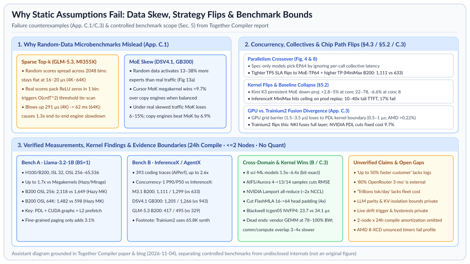

Simran Arora, Dan Fu, Reyna Abhyankar, Dylan Lim, et al. (Together AI Research) · 2026-11-04 · [Primary Post: "Polymorphic Inference: self-tuning inference for open models"](https://www.together.ai/blog/polymorphic-inference) · [Companion Post: "Together Compiler: Continual Compilation for AI inference"](https://www.together.ai/blog/together-compiler-continual-compilation-for-ai-inference) · [Technical Report: "Together Compiler: Continual Compilation for AI Inference" (alphaXiv)](https://www.alphaxiv.org/abs/2611.together-compiler-continual-ai-inference)

Read in isolation, Together AI's *Polymorphic Inference* overview reads like a high-level vendor thesis about "getting AI agents to optimize their own inference." Following its direct links into the companion *Together Compiler* implementation post and the **38-page Together Compiler (TKCC) technical report** reveals the concrete systems engineering underneath: the core bottleneck is not whether coding agents can write fast kernels, but a structural collision between **experimentation throughput and workload fidelity**—alongside real failure cases where static megakernels, offline random benchmarks, and fixed parallelism settings regress sharply on live production distributions.

> **Evidence boundary & scope**: Every metric, ablation, and incident cited below is cross-checked against the frozen primary post, the fetched companion blog, the two author/official X threads (`@simran_s_arora`, `@togethercompute`), and the alphaXiv technical report. We explicitly separate three layers: (1) **directly reported findings and controlled evaluations**, including live traffic drift examples, random-vs.-real failure counterexamples, `761s` vs. `17s/45s` (`467s` vs. `9.0s` in the blog) persistent hot-reload measurements, the 3-level parallelism cost model, `24h / <=2-node` InferenceX and bit-exact scientific model benchmarks, and `9` `Xid 154` GPU resets; (2) **vendor production/industry assertions lacking per-workload traces**, namely `"80% of OpenRouter traffic"` going to models under three months old, `"trillions of tokens per day,"` and `"up to 50% faster on customer workloads"`; and (3) **undisclosed internals plus our derived operational rules**, including LLM numerical/KL acceptance thresholds, KV-cache contamination harness details, drift-trigger hysteresis, and Section 4's governance matrix.

## Why Static Kernel Fusion and Fixed Parallelism Degrade Under Polymorphic Traffic

Together AI contrasts **Static Inference**—closed dense Transformers served at fixed shapes on a single chip generation—with **Polymorphic Inference**, where model architectures, traffic distributions, and accelerator SKUs drift simultaneously. Beyond external platform claims (such as `80%` of OpenRouter traffic shifting to models released in the last three months and the top-10 open-source models each using a distinct architecture), Section 3 of the Together Compiler paper documents three concrete production drift regimes observed across Together AI's fleet:

- **Regional and behavioral divergence**: On Lab A's model, working hours in one country sustain an average input sequence length (ISL) of **`~97K` tokens** (agent-heavy) versus **`~70K` tokens** (`1.4×` shorter) during off-hours or in chat-dominated regions.
- **Two-week post-release shifts and checkpoint updates**: Users initially treat a new model as interactive chat before integrating it into agent harnesses—driving an **`80%` jump in prompt length** in the companion blog, while the paper specifies Lab B's typical context moving from **`10K` to `18K`** alongside an **8-percentage-point rise in KV-cache hit rate** over two weeks. Separately, a Lab A checkpoint increasing reasoning ("thinking") depth doubled output lengths (**`2×` OSL**).
- **Customer burstiness**: Over **3 days**, Customer A's **P90 ISL** climbed from **`18K` to `33K`**, OSL rose from **`1K` to `1.9K`**, and cache hit rate dropped **4 percentage points**; within **1 week**, Customer B's average OSL jumped from **`700` to `1.7K`** with a **7-percentage-point** hit-rate drop.

Meanwhile, deployments turn over across **NVIDIA H100, B200, B300, GB300 (NVL72), upcoming Vera Rubin, AMD MI350X/MI355X, and AWS Trainium2**. Against this backdrop, the authors repudiate their own earlier 2025 push toward monolithic single-kernel fusion: **"megakernel fusion is actually not the right design goal for modern Polymorphic Inference"** on GPUs. Appendix C.1 and C.3 provide three empirical counterexamples explaining why static offline tuning breaks in production:

1. **Sparse top-k indexer quadratic collapse (Appendix C.1, Fig. 12/13b)**: On AMD MI355X for GLM-5.3, an Opus 5.5 agent authored `tk_topk5`, bucketing scores into `2,048` histogram bins and resolving ties inside the threshold bin `T` via an all-pairs **`O(cntT²)`** comparison. Against uniform random inputs spread evenly across bins, runtime stayed flat at **`16–20 µs`** from 4K to 64K sequence length. Against real activation scores—where ReLU produces large runs of **exact zeros** collapsing into a single bin—kernel latency exploded from **`291 µs` at 4K** to **`62 ms` at 64K/70K**, inflicting a **`1.3×` end-to-end engine slowdown**.
2. **Random-input MoE routing bias (Appendix C.1, Fig. 13a/c)**: On DeepSeek-V4.1-Flash (GB300), random benchmark data activates **`13–38%` more experts** than real production requests (`~222–256` vs. `~148–214` experts across 64–256 query tokens). Under artificially balanced load, Cursor's production MoE megakernel (Mixture-of-Kittens, MoK) runs **`9.7%` faster** than copy engines; under skewed production routing, MoK slows down **`6–15%`** and loses to copy engines by **`6.9%`**.
3. **Concurrency crossovers and GPU vs. Trainium2 architectural divergence (Section 5.2 & Appendix C.3)**: On Kimi K3, a persistent MoE down-projection speeds up decoding by **`+2.8–5%` at concurrency `22–78`**, yet degrades performance by **`-6.6%` at concurrency `8`**. At the kernel-launch level on GPUs, fusing layers into one persistent kernel requires grid-wide barriers costing **`1.5–3.5 µs`**, slower than NVIDIA's **Programmatic Dependent Launch (PDL)** boundary cost of **`0.5–1 µs`** (an AMD GLM-5.3 megakernel agent achieved just **`+0.22%`** over 24 hours, whereas Trainium2 flipped this pattern by fusing full decoder layers in NKI). Worse, replaying Together's production trace against the top InferenceX MiniMax-M3.1-Flash image hit a per-replica ceiling where **tail TTFT degraded `10–40×` and `17%` of requests failed**.

## Together Compiler's Continual Loop: Tiered Persistent Engines, Cost Modeling, and "Bitter Lesson" Ablations

Rather than translating static graphs through hand-crafted intermediate representations (IRs), Together Compiler (TKCC) treats optimization as a **continual multi-agent search loop directly over serving-engine forward-pass code (`tkcc_forward.py`)**, structured around three pillars:

<figure>
  <a class="note-image-link" href="/assets/images/tech/2026-11-05-together-polymorphic-inference/tkcc-continual-loop-architecture-en.svg" target="_blank" rel="noopener">
    
    Expand diagram ↗
  </a>
  <figcaption>Assistant diagram (not an original figure): Synthesizing TKCC's tiered persistent engine, cost model, and safety boundaries from the two blogs and technical report.</figcaption>
</figure>

**1. Tiered Persistent Engines with RPC Hot Reloading (Section 4.2 & Table 1).** End-to-end agent harnesses such as Apple's RSI-Inference Bench pay multi-minute cold-start penalties on every trial. Paper Table 1a breaks down cold startup for **MiniMax-M3.1-Flash on TensorRT-LLM** at **`761 s` (~12.7 min)**: model loading `265 s` (`34.8%`), autotuning `192 s` (`25.2%`), prefill/decode CUDA-graph capture `226 s` (`29.7%`), and KV-cache sizing `73 s` (`9.6%`); the companion blog's Table 1 baseline takes **`467 s`**. TKCC decouples engine lifecycle from forward execution: weights and KV cache stay locked in GPU memory once, parallel agents share discoveries on a message board (`2.3×` system speedup, `4.7×` in MiniMax-M3 layer-3 ablation), and each candidate `tkcc_forward.py` arrives via `hot_reload` RPC—patching `model.forward` and recapturing CUDA/HIP graphs in **`9.0 s`** (`1.7 s` setup + `7.3 s` capture in the blog table). In the paper's two-tier persistent setup (Table 1b):

- **Fast Tier (screening)**: Loads **`12` layers** (`3 min` startup, **`17 s` hot reload**, **`28 s` median job**, **`0.05%` variance**, plus CUPTI traces) and isolates destructive **illegal memory accesses (IMAs) and hangs (`3.9` crashes / 1,000 jobs)** away from the full-model engine.
- **Slow Tier (full fidelity)**: Loads all **`60` layers** (`11 min` startup, **`45 s` hot reload**, **`64 s` median job**, **`0.14%` variance**, **`0` crashes / 1,000 jobs**) to verify gains on realistic MoE skew and long-context data.
- **Variance control & caching**: Because continuous batching mixes prefill and decode and creates **`4–6%`** run-to-run jitter, TKCC splits prefill from decode timing (cutting variance from **`6.6%` to `2.7%`**), reuses prefix-cached prompt sets (**`2.6×`** lower measurement latency on Kimi K3), and caches kernel binaries. Across systems, this yields **`252×` higher agent experiment throughput** and **`11×` less idling**; in a 10-hour **B200 GLM-5.3** test (Fig. 2), two-tier gating evaluates **`1,354` vs. `168` candidates (`8.1×`)** over a single slow tier and lands a **`7.2%` faster** forward pass.

**2. Three-Level Cost Model for Parallelism Selection (Section 4.3 & Appendix D).** Across `N <= 4096` chips, TKCC enumerates admissible MoE (`EP`, `TP`), Dense (`TP`), and Attention (`TP`, `DP`, `CP_act`, `CP_kv`) layouts, prunes shapes failing divisibility, HBM fit, or latency SLAs (e.g., **`1.5 s` TTFT, `40` TPS**), computes per-layer time `T_pass`, bounds concurrency via **`C = min(C_memory, C_speed)`**, and unifies prefill/decode chip-seconds into **tokens/min per chip (`TPM`)**. Critically, it pairs **four spec tiers** (vendor spec sheets -> custom microbenchmarks -> vendor tools like `nvbandwidth` -> vendor libraries like `nccl-tests`/`cuBLASLt`) with **empirical traffic distributions** (measured MoE routing probabilities `π_e` / Zipf straggler expectation `E[max_j A_j]`, MTP acceptance lengths, and batch prompt unevenness). Spec-only modeling omits per-call collective overhead and stays stuck on `EP64`, whereas measured curves flip optimal selection to **`MoE-TP64` + higher attention TP** as decode TPS SLAs tighten (Fig. 4a–b). Deployed on **Kimi K3**, this model improved production **`TPS` by up to `24%` and `TPM` by up to `18%`**.

**3. "Bitter Lesson" Ablations on IRs and Agent Context (Section 4.4 & Appendix C.2).** Over two years, Together built three successive architectures: (1) hand-authored **Megakernels**, (2) **Torch Compile (Inductor FX Graph)** augmented with CUPTI/rocProf traces and lowered to PTX/PDL, and (3) **expert-curated context scaffolds** (a graph knowledge base, six fixed optimization strategies, and a CLI experiment lineage graph). Ablating those scaffolds as coding harnesses matured revealed that removing abstractions raised the ceiling:

| Design Choice | Baseline / Curated Alternative | TKCC Production Approach | Measured Ablation / Comparison Result | Scope & Operational Caveats |
| :--- | :--- | :--- | :--- | :--- |
| **Code Representation** | Augmented Torch Inductor FX Graph + CUPTI | Direct access to full engine source code | **Raw source wins**: Kimi K3 MLA host-side metadata rewrite gained **`1.7–2.5×`** | Agents spend **`~20%`** of time reading engine files; FX graphs cannot mutate host-side metadata |
| **Expert Knowledge Base** | Graph KB of recipes, kernels & paper summaries | No pre-seeded knowledge base | **No KB wins**: After 12h, KB-enabled runs scored **`25–31%` lower** (**`26%`** in Fig. 5a) | Tested on MiniMax-M3 layer 3 (B200 TP4, BS=1); agents wasted steps navigating KB links |
| **Strategy Prompting** | 6 expert prompts (Fusion, Overlap, Megakernel, etc.) | Single naive prompt ("make forward pass fast") | **Naive wins**: 10-trial ensemble **`6.2×` vs. `4.9×`**; single naive **`4.8×` vs. `3.1–4.5×`** | On AMD GLM-5.3, the prescribed Megakernel agent spent 24h for **`+0.22%`** |
| **Experiment Logging** | Typed experiment graph + Python CLI queries | Plain Markdown notes maintained by agents | **Markdown wins**: Bookkeeping time dropped from **`8%`** (**`~12.6 s`/call**, **`43%`** CLI calls) to **`<0.5%`** | End-to-end comparison on GLM-5.3 (AMD MI350X & NVIDIA B200) |
| **Engine Tiering** | Restart engine per trial / Single slow 60-layer tier | `12`-layer Fast Tier + `60`-layer Slow Tier | **Two-tier wins**: 10h B200 GLM-5.3 tried **`1,354` vs. `168` (`8.1×`)**, **`+7.2%`** faster | **`252×`** throughput over restart harnesses; agents still spend **`52.7–57.0%`** waiting on gates |

## Reported Speedups, Hardware-Specific Findings, and Evidence Boundaries

Separating controlled evaluations in Section 5 and Appendices A–C from high-level marketing figures clarifies exactly what TKCC proved—and where hardware or scope boundaries remain:

<figure>
  <a class="note-image-link" href="/assets/images/tech/2026-11-05-together-polymorphic-inference/polymorphic-failure-mechanisms-and-benchmarks-en.svg" target="_blank" rel="noopener">
    
    Expand diagram ↗
  </a>
  <figcaption>Assistant diagram (not an original figure): Contrasting data-dependent failure modes, strategy crossovers, controlled benchmark bounds, and undisclosed production gaps.</figcaption>
</figure>

- **Workhorse Llama-3.2-1B (Batch Size 1, ISL 32, OSL `256–65,536`, H100 & B200)**: TKCC beats hand-tuned megakernels (Hazy MK, Mirage Persistent Kernel, VDCores) and `torch CUDA graph (+ PDL)` by up to **`1.7×`**. On B200, it reaches **`2,118` TPS at OSL 256** (vs. `1,649` Hazy MK, `1,249` CUDA graph+PDL, `675` Mirage) and holds **`1,482` TPS at OSL 65,536** (vs. `598` Hazy MK, `892` CUDA graph+PDL, `98` Mirage). Crucially, fine-grained memory paging contributed just **`3.1%`** of the step; driver primitives (**PDL, CUDA graphs, and L2 prefetching**) recovered megakernel benefits without monolithic kernel complexity.
- **InferenceX / AgentX Frontier Evaluations (`<=24h` compile, `<=2` nodes/model, no quantization edits)**: Using SemiAnalysis's pinned harness (`agentx-harness/AIPerf 1.0.12`, `393` agentic-coding traces, `seed 42`, verified locally against published baselines to exact throughput and `~2%` on P90 interactivity), TKCC reaches up to **`2.6×` higher TPS**. At concurrency 1 (Fig. 8 / Fig. 10), cost-model layout shifts and forward rewrites lift **MiniMax-M3.1-Flash (B200)** P90 TPS from **`633` (TP4) to `1,111` (TP8)** (`1,299` vs. `690` P50; running the unmodified InferenceX image on TP8 did not match this gain), **DeepSeek-V4.1-Flash (GB300)** P90 from **`943` to `1,205`** (`1,266` vs. `971` P50), **DeepSeek-V4.1-Flash (B200)** P90 from `671` to **`813`**, **GLM-5.3 (B200)** from `329` to **`417`**, **Kimi K3 (GB300)** from `423` to **`450`**, and **GLM-5.3 (MI355X)** from `463` to **`480`**. Footnote 1 must be preserved whenever citing hardware generality: **Trainium2 was NOT run on AgentX**, instead using a **synthetic multi-turn workload (`65,792`-token context, `~95%` cache hit, `700` OSL)** because the prototype lacked HBM capacity for higher-concurrency AgentX traces.
- **Eight Non-LLM Scientific Models under Bit-Exact Verification (Appendix B)**: On H100 across weather (AIFS-ENS 2.0, Aurora 1.5), biology (Boltz-2, Evo 2), time series (Chronos-2, Panda-72M), and PDEs (Walrus, Poseidon-T), TKCC delivered **`1.5×–6.4×` speedups** with verified bit-exact and RNG-state agreement—whereas a Claude Code `/goal` baseline failed correctness on **AIFS-ENS 2.0** and lagged on 3 of 4 trajectory benchmarks. Within fixed wall-clock budgets, the speedup raised AIFS/Aurora ensemble sampling from `4` to **`13` and `14` members**, reducing temperature RMSE from `0.97 K` to **`0.94 K`** and `0.60 K` to **`0.55 K`**.
- **Where Agents Actually Found Speedups vs. Hit Walls (Appendix C.3)**: Productive wins came from **fusing collectives into adjacent ops** (custom Lamport sentinel all-reduce + residual + RMSNorm + quant beating NCCL by **`~2×`** at decode on MiniMax M3.1 Flash; direct writes into AMD AITER shared buffers), **eliminating dead work** (four agents independently removed **`4×` redundant head padding** from `16` to `64` in DeepSeek V4.1's stock FlashMLA decode kernel), **Blackwell `tcgen05` NVFP4** (`23.7 µs` vs. `34.1 µs` vendor kernel), **DeepGEMM tile tuning** (`273 -> 210 µs`), and **AMD HIP graph stream ordering + CK split-K gap filling**. Conversely, agents repeatedly failed when trying to out-write vendor GEMM/attention kernels already running at **`78–100%` of memory bandwidth**, when trying to overlap collectives with GEMMs (**`3–4×` slower** on NVIDIA; lost across all concurrencies on AMD), or when targeting unusable hardware primitives on AMD (CU masks were ignored, and MI350X/MI355X's **8 compute dies / XCDs have unsynchronized clocks** that break in-kernel timers).

By contrast, headline announcements outside the controlled benchmark tables—specifically `"up to 50% faster on customer workloads"` and `"trillions of tokens per day"` with `"a few hours of recompilation"`—lack public per-customer baselines, and the report omits fleet-wide compute-amortization math for dedicating `2×` replica GPUs for up to `24` hours per compile.

## Safety Boundaries for Continual Compilation and Fair Evaluation Discipline

Moving from offline kernel search to hot-swapping production serving engines surfaces concrete failure modes directly documented in Section 4.1 and Appendix C.3—defining hard boundaries before deploying continual compilation:

1. **Hardware Fault Containment (`Xid 154` Incidents)**: During NVIDIA **GLM-5.3** runs, illegal memory accesses in agent-authored kernels caused **`9` driver `Xid 154` GPU resets**, forcing **`2` physical machines to be pulled from the cluster**, alongside **`3.9` crashes per 1,000 jobs** on the Fast Tier. Search and screening tiers must stay strictly isolated from customer-serving pools—sharing neither GPU contexts nor cluster stability budgets.
2. **Coarse Guardrails vs. Formal Verification IRs**: The authors note that after two agent edits crashed GPUs, closed-model safety guardrails banned agents from editing the recorded sequence of GPU execution steps altogether—halting crashes at the cost of blocking legitimate graph optimizations. In Section 4.4, Together explicitly argues that future systems need **verification-oriented IRs** capable of proving candidate safety without shrinking the optimization search space.
3. **Undisclosed LLM Numerical & KV-Isolation Thresholds**: While scientific workloads enforce strict bit-exactness (Table 5), Section 4.1 mentions only a post-budget suite covering "KV cache contamination and quality," and Appendix A fixes precision by forbidding quantization. Exact acceptance bounds for **FP4/BF16 numerical ULP drift, logits KL tolerance, and multi-tenant KV-cache isolation across hot-reloaded CUDA graphs** remain undisclosed.

Translating those primary-source fault records and omissions into practical serving governance yields five verification rules (the right-hand column represents engineering derivation rather than Together's internal policy):

| Governance & Eval Axis | Evidence / Gap in Primary Sources | Required Production & Comparison Guardrail (Engineering Derivation) |
| :--- | :--- | :--- |
| **Fault Isolation & Instant Rollback** | **`3.9/1k`** Fast Tier crashes; **`9x Xid 154`** GPU resets removed **`2` machines** on GLM-5.3 | Run agent compile/screening on isolated sandbox GPUs; deploy only Slow-Tier-verified artifacts behind canary traffic with pinned baseline `model.forward` + CUDA-graph rollback |
| **Numerical & KV-Cache Parity** | Bit-exact on 8 sci models; LLM precision rules & KV-contamination test tolerances undisclosed | Gate every hot-reload candidate on multi-concurrency prefix-cache integrity checks, fixed-seed logprob KL bounds, and cross-request KV-isolation regression suites |
| **Drift Triggers & Thrashing Control** | Fleet shows 3-day spikes (`P90 18K->33K`) vs. 2-week shifts; compile runs up to `24h` on `<=2` nodes | Trigger recompilation via windowed distribution divergence (e.g., JS divergence + dwell hysteresis) so transient bursts do not thrash; dispatch regime-indexed `fwd.py` by active batch size |
| **Fair Baseline Attribution** | MiniMax B200 jump (`633->1,111`) combines **`TP4->TP8`** layout change + kernel edits; InferenceX baseline failed `17%` on prod replay | Separate parallelism-selection gains (cost model) from kernel-synthesis gains (agent loop) in ablations, enforcing `0%` request failure and matched cache-hit accounting |
| **Tail Latency & Search ROI** | Agents wait **`52.7–57.0%`** on gates; benchmarks center on TPS and P90 ITL | Gate promotions jointly on **P90/P99 TTFT and ITL** rather than peak TPS or P50 alone, and track net GPU-hour payback against compile cluster cost |

Reading *Polymorphic Inference* together with *Together Compiler* and its technical report turns a broad vendor slogan into a sharp systems finding: continual compilation works here not because LLMs magically out-code kernel engineers in a vacuum, but because Together **compressed experiment feedback from `467–761 s` down to `9–45 s` inside a two-tier persistent engine, anchored parallelism with measured collective and routing skew data, and stripped away restrictive human IRs and context scaffolding**. Yet the same evidence shows the frontier's real limits: agents still spend over half their wall time queued behind measurement gates, bad kernels can still take down physical nodes, and production drift hysteresis, LLM parity bounds, and compile-cost payback remain the decisive tests for turning continual compilation into standard infrastructure.

---

> **Provenance**: Rewritten and expanded by the assistant from Together AI's frozen primary post ([*Polymorphic Inference*](https://www.together.ai/blog/polymorphic-inference)), the companion [*Together Compiler*](https://www.together.ai/blog/together-compiler-continual-compilation-for-ai-inference) blog, and the linked alphaXiv technical report ([*Together Compiler: Continual Compilation for AI Inference*](https://www.alphaxiv.org/abs/2611.together-compiler-continual-ai-inference)), paired with [the Chinese edition](/tech/zh/2026-11-05-together-polymorphic-inference/). Preserves original `id`, `permalink`, `source_url`, `source_published_at`, and canonical tags `inference-serving`, `self-improvement`, and `systems-reliability`. Both `v3-blue` diagrams (`tkcc-continual-loop-architecture-en.svg`, `polymorphic-failure-mechanisms-and-benchmarks-en.svg`) are assistant-drawn syntheses (not original figures), while existing `official-figure.png` remains preserved on disk.
