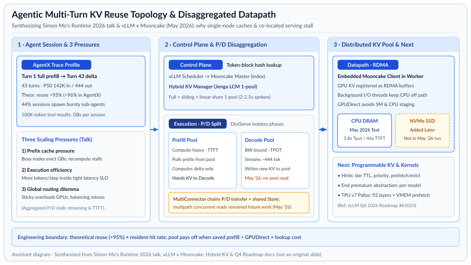
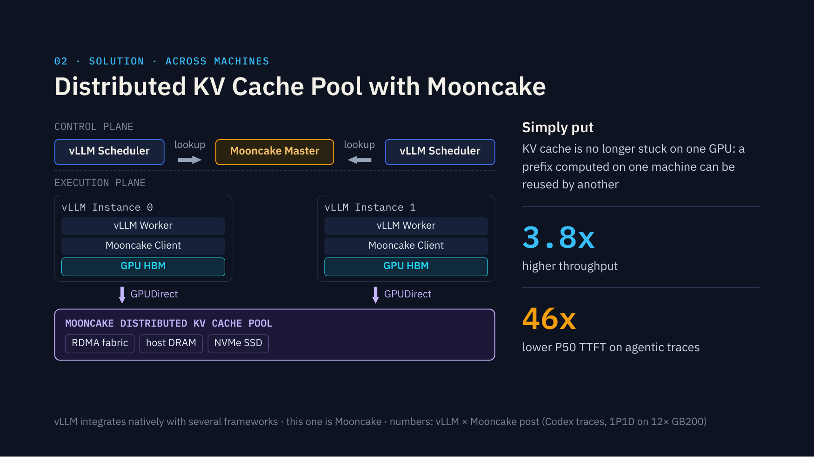
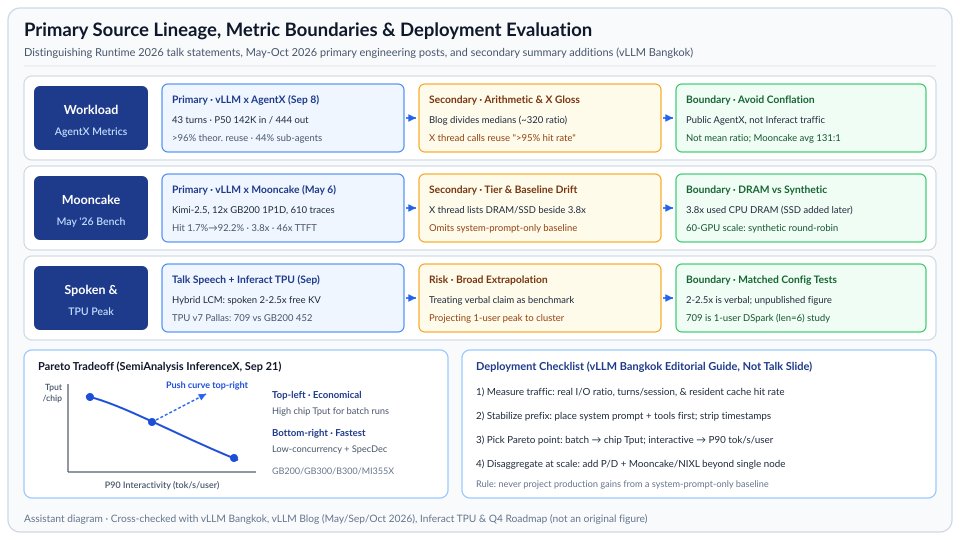

Natdhanai Praneenatthavee (Co-Founder, vLLM Bangkok) · 2026-11-04 · [Secondary Engineering Summary](https://vllmbangkok.com/en/blog/serving-the-agentic-workload/) · Talk Covered: Simon Mo (Co-Founder & CEO, Inferact) at Modal **Runtime 2026** (1 Oct 2026 in San Francisco; 18-minute recording published 2 Nov 2026)

When LLM traffic moves from isolated chat completions into multi-turn coding agents and tool loops, serving throughput stops depending mainly on raw FLOPs per forward pass and starts depending on whether the runtime avoids recomputing tens of thousands of historical tokens every turn. This reading note unpacks Simon Mo's Runtime 2026 talk on how agentic traffic reshapes vLLM—spanning Hybrid KV paging, prefill/decode disaggregation, Mooncake distributed KV pooling, hardware heterogeneity, TPU megakernels, and dropping premature abstractions.

> **Evidence & Attribution Boundary**: The primary URL of this note is a **community summary and 20-slide deck by vLLM Bangkok** (plus the author's `@agicafet` X thread), rather than a verbatim transcript. To keep arithmetic, spoken estimates, and benchmark conditions cleanly separated, this analysis distinguishes three layers: **Layer 1** covers Simon Mo's talk statements and slides (including verbal production claims lacking published benchmarks); **Layer 2** traces the primary May–October 2026 engineering posts and papers cited by the talk (`vLLM x Mooncake`, `vLLM x AgentX`, Inferact TPU megakernels, `vLLM Q4 Roadmap #61024`); and **Layer 3** isolates vLLM Bangkok's own additions (median-ratio arithmetic, terminology primer, independent sizing note, deployment checklist) alongside compression drift in the companion X thread.

## From Single-Turn Completions to Prefix-Heavy Loops: AgentX Metrics and Real Pressures

Tracing vLLM back to UC Berkeley's Sky Computing Lab—where its earliest prototype predated ChatGPT and repository contributors reached `3,488` by September 2026 (foundational design in [PagedAttention](https://arxiv.org/abs/2309.06180))—Simon Mo frames serving evolution in three waves: **2020–2022 single-turn completion** (`"one prompt auto complete"` before chat APIs existed), **2022–2024 multi-turn chat** (driving automatic prefix caching, chunked prefill, and P/D disaggregation), and **2024–2026 agentic and real-time systems** (tool calls, sub-agent fan-outs, and streaming loops causing `"just a blow up of all the complexities"`).

A central talk slide depicts a coding-agent session as stacked turns: Turn 1 runs a full prefill, whereas every subsequent turn appends thinking tokens, tool calls, and tool outputs onto the cached prefix so only the delta requires prefill; by Turn 43, nearly the entire prompt is historical prefix (`"cached prompt skips recompute"`), and a single tool step can fan out parallel sub-agents. Those headline numbers trace back to the September 8, 2026 [vLLM x AgentX blog post](https://blog.vllm.ai/2026/09/08/vllm-agentx.html) on SemiAnalysis **AgentX** (a public benchmark built from real-world coding-agent traces—framed by Simon alongside Inferact's serving experience, **not** presented as Inferact's private customer logs):

- **Extreme read/write asymmetry**: Median **43 turns per session**, **P50 input of 142K tokens**, and **P50 output of 444 tokens** (with individual tool calls or results occasionally reaching `100K` tokens).
- **Theoretical overlap and bursty fan-outs**: AgentX reports prefix reuse above **95%** (the blog states `"a theoretical cache hit rate of more than 96%"`), with **44% of sessions** spawning at least one parallel sub-agent.
- **Secondary arithmetic and X-thread compression caveats**: vLLM Bangkok divides the two population medians (`142,000 / 444`) to write `"about 320 tokens read for each token written"`, explicitly flagging that as **its own arithmetic on separate medians**, not a mean per-request ratio—whereas the [May 6, 2026 Mooncake post](https://vllm.ai/blog/2026-05-06-mooncake-store) measures an average **131:1** input-to-output ratio across real traces. In the companion X thread (`@agicafet`), `"above 95% prefix reuse"` is further compressed into `"Prefix cache hit rate above 95%"` alongside a `"300-page binder"` metaphor; practitioners must never mistake theoretical prefix overlap for actual resident cache hit rate in production.

Multiplied across hundreds or thousands of concurrent users running 10-to-100-turn sessions whose KV state occupies gigabytes apiece, Simon's slide names three scaling pressures: **prefix cache pressure** (busy instances evict long histories, forcing costly recomputation), **execution efficiency** (more tokens per step inside tight latency budgets), and **global routing** (sticky session affinity overloads hot instances while stateless load balancing triggers cross-node cache misses—exacerbated by bursty sub-agents).

<figure class="note-figure">
  <a class="note-image-link" href="/assets/images/tech/2026-11-05-vllm-bangkok-serving-agentic-workload/agentic-kv-reuse-topology-en.svg" target="_blank" rel="noopener" aria-label="Enlarge agentic KV reuse topology and disaggregated datapath diagram">
    
    Enlarge image ↗
  </a>
  <figcaption>Assistant diagram (not an original slide): Mapping Runtime 2026 scaling pressures onto Hybrid KV paging, P/D disaggregation, and Mooncake control/data planes.</figcaption>
</figure>

## Architecture Response: Hybrid KV Unification, P/D Disaggregation, and Mooncake

To address those pressures without forcing operators to over-provision GPUs solely for recomputation, vLLM re-architects KV handling across intra-node memory layout, role separation, and cluster-wide pooling:

1. **Hybrid KV Cache Manager (`LCM` unified pool)**: Original PagedAttention assumed uniform KV footprints across every transformer layer. Modern hybrid and sparse architectures mix full attention (growing linearly with tokens), sliding-window attention (fixed window per request), and linear or state-space layers (constant state per request, `"although a little bit large"`). Static per-type pools trap free memory in fragments. vLLM's [Hybrid KV Cache Manager](https://docs.vllm.ai/en/latest/design/hybrid_kv_cache_manager.html)—aligned with the allocator framework in [Jenga](https://arxiv.org/abs/2503.18292)—sets a single physical page size to the **least common multiple (`LCM(X, Y, Z)`)** across layer types so any free block serves any layer. Verbally during the talk, Simon remarked that production deployments see `"typically 2x or 2.5x more KV cache space that's getting freed up"`, driving throughput and cost gains—though vLLM Bangkok explicitly notes **this `2x–2.5x` figure is spoken, not published in a benchmark write-up**.
2. **Prefill / Decode Disaggregation**: Simon stated bluntly: `"Nobody is serving production agentic workload on an aggregated inference setup."` When a single server runs both phases, heavy prefills pause streaming decode answers mid-thought while dense decodes block incoming prefills and inflate TTFT. Separating prefill and decode pools (the research case laid out in [DistServe](https://arxiv.org/abs/2401.09670)) removes cross-phase interference and—as vLLM Bangkok notes editorially—allows each pool to be sized independently.
3. **Distributed KV Cache Pool via Mooncake**: Extending single-node caching across nodes, the talk highlighted vLLM's Mooncake integration documented in the [May 6, 2026 vLLM x Mooncake engineering post](https://vllm.ai/blog/2026-05-06-mooncake-store). In the **control plane**, vLLM schedulers hash token blocks and query a `Mooncake Master` that tracks block locations and node health. In the **execution and data planes**, each vLLM worker embeds a `Mooncake Client`, registers GPU HBM KV regions as RDMA buffers, uses background I/O threads to prepare descriptors off the CPU launch path, and transfers blocks via **GPUDirect RDMA**—avoiding both GPU SM contention and CPU bounce staging.

<figure class="note-figure">
  <a class="note-image-link" href="/assets/images/tech/2026-11-05-vllm-bangkok-serving-agentic-workload/mooncake-kv-pool.png" target="_blank" rel="noopener" aria-label="View original slide">
    
    Enlarge image ↗
  </a>
  <figcaption>Preserved slide from the vLLM Bangkok summary deck: Control-plane lookups and GPUDirect data movement into a shared Mooncake pool. Note that NVMe SSD appears as an architectural tier option, whereas the 3.8x throughput and 46x P50 TTFT figures come from the May 2026 CPU DRAM test on 12 GB200 GPUs.</figcaption>
</figure>

A crucial mechanism detail from the May 2026 primary post sits inside **`MultiConnector`**, which chains P/D KV transfer (`MooncakeTransferEngineConnector`) with the shared KV store (`MooncakeStoreConnector`). In that published version, **prefill instances pull cached prefixes from the pool and forward KV state to decode, while decode writes newly generated KV back into the pool—decode did not directly read from the pool, and multipath concurrent reads (fetching simultaneously from prefill and shared store) were explicitly marked as future work**. Likewise, even though later slides and `vLLM x AgentX` incorporate an **NVMe SSD** tier, the `3.8x` / `46x` figures in the May 6, 2026 evaluation ran purely on **CPU DRAM**, so later NVMe tiers cannot be retroactively credited for those May benchmarks.

| Architectural Component | Core Scaling Bottleneck Targeted | Primary Mechanism Reference | Verified Scope & Caveats |
| :--- | :--- | :--- | :--- |
| **Hybrid KV (`LCM` Unified Pool)** | Memory fragmentation across mixed full, sliding-window, and linear/SSM layers | [Hybrid KV Docs](https://docs.vllm.ai/en/latest/design/hybrid_kv_cache_manager.html) · [Jenga](https://arxiv.org/abs/2503.18292) | `2x–2.5x` freed KV capacity is a **spoken talk remark**, not a published benchmark; verify `SupportsHMA` when pairing connectors |
| **Prefill / Decode Disaggregation** | Compute-heavy prefills stalling decode streams; decode batching inflating TTFT | [DistServe](https://arxiv.org/abs/2401.09670) · Talk Slide | Positioned as standard for large-scale production; small low-concurrency nodes may incur transfer overhead without net gain |
| **Mooncake Master + GPUDirect** | Multi-GB cross-node prefix misses; CPU bounce copies and GPU SM overhead | [vLLM x Mooncake (May 6)](https://vllm.ai/blog/2026-05-06-mooncake-store) | Background threads keep descriptor prep off CPU launch path; fails to pay off if recompute costs less than RDMA restore plus lookup |
| **MultiConnector Coupling** | Bridging P/D state handoff with cluster-wide persistent prefix reuse | [vLLM x Mooncake (May 6)](https://vllm.ai/blog/2026-05-06-mooncake-store) | May 2026 version restores on Prefill and writes from Decode; multipath concurrent pool reads remained future work |
| **Programmable KV & Per-Model Kernels** | Blind LRU evictions; cross-model "premature abstraction" capping kernel speed | [Q4 Roadmap #61024](https://github.com/vllm-project/vllm/issues/61024) · [Inferact TPU](https://inferact.ai/blog/tpu-megakernels) | Tier TTLs, priorities, and request-level prefetch/evict hints live on the Q4 roadmap; flat per-model files require tighter CI |

## Primary Numbers Under the Microscope: May 2026 Mooncake, Pareto Frontiers, and TPU Megakernels

Separating headline numbers from their test baselines prevents misleading capacity projections when planning real clusters:

- **Conditioning the `3.8x` throughput and `46x` P50 TTFT gains**: Per the [May 6, 2026 vLLM x Mooncake post](https://vllm.ai/blog/2026-05-06-mooncake-store), that comparison ran **Kimi-2.5 (NVFP4)** across **12 GB200 GPUs (1P1D)** replaying **610 real Codex and SWE-bench Pro agentic traces** (median 33 turns, average `131:1` input-to-output ratio) backed by **CPU DRAM**. Crucially, the **baseline cached only the system prompt**: enabling the distributed KV pool raised cache hit rate from **1.7% to 92.2%**, lifting throughput **3.8x**, cutting P50 TTFT **46x**, and reducing end-to-end latency **8.6x**. That measures the jump from nearly zero multi-turn caching to cluster-wide prefix sharing—not a generic `3.8x` bonus over a deployment already running tuned local APC plus session-sticky routing.
- **Separate synthetic workload for 60-GPU scaling**: The same blog post reports near-linear scaling up to **60 GB200 GPUs** at above `95%` cache hit rate, but that test comes from a **separate synthetic workload** that scaled active sessions proportionally with GPU count while intentionally using **round-robin routing** to force cross-node cache lookups.
- **SemiAnalysis InferenceX Pareto Frontier (21 Sept 2026)**: For hardware and runtime tuning, Simon presented *"Kimi K3 2.8T Agentic Token Throughput per Chip vs. P90 Interactivity"* comparing `GB300 NVL72`, `GB200 NVL72`, `B200`, `B300`, and `MI355X` (vLLM and Dynamo series). The Y-axis captures **throughput per chip** (cost efficiency) while the X-axis plots **P90 interactivity in tokens/sec/user** (latency experience). `"You cannot get best of both world"`—top-left favors batch economics while bottom-right throws maximum silicon at a single user; vLLM's goal is pushing the frontier toward the **top-right** so operators can pick any target point.
- **Hardware Parity, MI355X, and the TPU v7 Megakernel**: Calling 2026 the year of hardware heterogeneity, Simon noted production parity between NVIDIA Blackwell and AMD Instinct MI355X (`288 GB` HBM3E at `8 TB/s`, matching B300 specs; in the October 16, 2026 [MI355X post](https://blog.vllm.ai/2026/10/16/scaling-kimi-k3-on-amd-instinct-mi355x.html), an 8-GPU AgentX run at a fixed `50 tok/s/user` P90 SLO reported `24.4%` higher throughput per GPU over B300). On Google **TPU v7 (Ironwood)**—which runs Gemini and Anthropic models—Inferact published [700 TPS on Kimi K3: A Case for TPU Megakernels](https://inferact.ai/blog/tpu-megakernels) (September 2026, echoed in the October 20 [Google Developers Blog](https://developers.googleblog.com/announcing-new-vllm-and-sglang-inference-engines-on-tpu/)). Written in **Pallas**, one decode-step megakernel fuses all **92 MoE layers** of Kimi K3, exploiting TPU's large, explicitly programmable **VMEM** to prefetch the next layer's attention and MoE weights asynchronously while computing the current layer—pipelining Simon noted was `"not doable today on NVIDIA's PDL"`. On `16x TPU v7`, **single-user** decode with **DSpark** speculative decoding reached **709 tok/s/user** versus `452` on a `16x GB200` vLLM baseline at acceptance length `6` (`1.57x`; GB200 hit `229` at acceptance length `3`), while the headline chart showed Qwen 3.8 27B at `1,515` vs `695` on `4x` chips (`2.18x`); without speculative decoding at batch sizes `1–8`, Inferact reports `1.4x–2x`. Notably, Inferact frames this work more conservatively than the slide title (`"a first step"` and `"the first open-source inference megakernel written in Pallas"`), and Simon stresses the goal is understanding hardware architecture rather than substituting single-user peaks for cluster TCO benchmarks.

That hardware deep dive reinforces vLLM's biggest structural pivot of 2026: **"Premature abstraction is bad."** After spending 2024–2025 unifying interfaces across models and accelerators, vLLM reversed course for peak speed—giving `"every single model ... their own file, their own kernel, and their own essentially inference engine"` atop vLLM's shared core runtime so hardware teams and coding agents can land specialized kernels cleanly. On the [Q4 2026 Roadmap (#61024)](https://github.com/vllm-project/vllm/issues/61024), that sits alongside open SIG tracks for production scaling, speculative decoding, CI/release reliability, RL/omni-modal support, and **Agentic-first programmable KV policies** (per-tier TTLs, priorities, and request-level prefetch/eviction hints for idle sessions).

| Highlighted Metric | Primary Source & Experimental Setup | Secondary-Summary Drift / Omission | Engineering Validity Boundary |
| :--- | :--- | :--- | :--- |
| **142K in / 444 out / 43 turns** | [vLLM x AgentX (Sep 8)](https://blog.vllm.ai/2026/09/08/vllm-agentx.html): public SemiAnalysis AgentX coding traces; `44%` sub-agents | vLLM Bangkok divides medians (`~320`); easily misread as Inferact customer traffic | Ratio of two population medians != per-request mean ratio (`131:1` mean in May Mooncake traces) |
| **>95% / >96% prefix reuse** | [vLLM x AgentX (Sep 8)](https://blog.vllm.ai/2026/09/08/vllm-agentx.html): `"theoretical cache hit rate of more than 96%"` | `@agicafet` X thread condenses to `"Prefix cache hit rate above 95%"` | Theoretical maximum prefix overlap, not actual resident hit rate under eviction or dynamic headers |
| **3.8x Tput / 46x P50 TTFT** | [vLLM x Mooncake (May 6)](https://vllm.ai/blog/2026-05-06-mooncake-store): Kimi-2.5, `12x GB200 1P1D`, `610` traces, **CPU DRAM**, system-prompt baseline | X thread mixes DRAM & SSD beside `3.8x` and drops baseline scope | Measures `1.7%` to `92.2%` jump over uncached history; `60`-GPU scaling used synthetic round-robin |
| **2x–2.5x freed KV capacity** | Simon Mo's **spoken** Runtime 2026 estimate for Hybrid KV LCM paging | Can blur into published benchmark figures in third-party recaps | Verbal production observation without a published benchmark table; test against model layer mix |
| **709 vs 452 tok/s/user** | [Inferact TPU Megakernel (Sep 2026)](https://inferact.ai/blog/tpu-megakernels): `16x TPU v7` vs `16x GB200`, **single-user DSpark** (`len=6`) | Risks oversimplification into broad "TPU beats GPU 2x everywhere" | Single-user latency peak, not cluster cost/chip throughput; non-speculative `BS 1–8` is `1.4x–2x` |

## Secondary-Summary Caveats and Deployment Takeaways

Read carefully, vLLM Bangkok's article does genuine service by linking Simon Mo's 18-minute talk back to underlying vLLM blogs, arXiv papers, and GitHub issue `#61024`, while candidly labeling its own primer, median division, P/D sizing note, and closing recommendations. The primary hazard lies in downstream social summaries—including the companion `@agicafet` X thread—where compressing multi-source caveats turns theoretical overlap into measured hit rate, mixes CPU DRAM tests with later NVMe tiers, and strips out the `system-prompt-only` baseline behind `3.8x`.

<figure class="note-figure">
  <a class="note-image-link" href="/assets/images/tech/2026-11-05-vllm-bangkok-serving-agentic-workload/talk-lineage-and-eval-boundaries-en.svg" target="_blank" rel="noopener" aria-label="Enlarge primary source lineage and evaluation boundaries diagram">
    
    Enlarge image ↗
  </a>
  <figcaption>Assistant diagram (not an original figure): Separating spoken talk claims, May-October 2026 primary benchmarks, and secondary-summary edits beside the InferenceX Pareto curve.</figcaption>
</figure>

Combining the talk's engineering direction with vLLM Bangkok's operational checklist and our primary-source constraints yields four concrete checks before scaling out an agent serving cluster:

- **Measure resident hit rate, not just theoretical overlap**: Instrument real input/output distributions, turns per session, and **actual resident cache hits** under concurrent eviction pressure with local APC enabled. If single-node HBM already retains active sessions, disaggregating immediately can add complexity without net gain.
- **Stabilize prompt assembly first**: Keep immutable system instructions, tool schemas, and static documents strictly at the front of the prompt, and strip dynamic timestamps or per-request IDs from prefixes—otherwise block-hash matching breaks on Turn 1 regardless of whether caching lives in HBM, CPU DRAM, or NVMe.
- **Anchor tuning to a specific InferenceX Pareto target**: Separate offline batch/background agent loops (maximize tokens/sec per chip) from human-in-the-loop coding IDEs (protect P90 tok/s/user and tail TTFT with speculative decoding and LCM hybrid paging).
- **Adopt P/D disaggregation and Mooncake/NIXL only past single-node saturation**: Distributed KV pooling earns its keep once multi-GB session histories overflow node HBM or bursty sub-agents force cross-node load balancing—and only where saved prefill compute exceeds GPUDirect restore latency, write amplification, and metadata lookup overhead, verified under matched baselines rather than extrapolated from `system-prompt-only` deltas or single-user TPU peaks.

---

### Primary & Secondary Sources Verified

- Secondary summary (note source): Natdhanai Praneenatthavee, *[Serving the agentic workload: Simon Mo on what AI agents change in vLLM](https://vllmbangkok.com/en/blog/serving-the-agentic-workload/)*, vLLM Bangkok, 2026-11-04 (summarizing Simon Mo's 1 Oct 2026 talk at Modal Runtime 2026, published 2 Nov 2026, with companion `@agicafet` X summary thread).
- Primary distributed KV pool post: vLLM Team, *[Serving Agentic Workloads at Scale with vLLM x Mooncake](https://vllm.ai/blog/2026-05-06-mooncake-store)*, vLLM Blog, 2026-05-06.
- Primary AgentX benchmark post: vLLM Team & Inferact, *[vLLM x AgentX: Optimizing for Real-World Agentic Serving](https://blog.vllm.ai/2026/09/08/vllm-agentx.html)*, vLLM Blog, 2026-09-08.
- Primary hybrid-memory docs & paper: *[Hybrid KV Cache Manager](https://docs.vllm.ai/en/latest/design/hybrid_kv_cache_manager.html)* (vLLM Docs) and Zhang, Du et al., *[Jenga: Effective Memory Management for Serving LLM with Heterogeneity](https://arxiv.org/abs/2503.18292)*, arXiv, 2025-03-24.
- Foundational serving papers: Kwon et al., *[Efficient Memory Management for Large Language Model Serving with PagedAttention](https://arxiv.org/abs/2309.06180)* (SOSP 2023) and Zhong et al., *[DistServe: Disaggregating Prefill and Decoding for Goodput-optimized Large Language Model Serving](https://arxiv.org/abs/2401.09670)* (arXiv, 2024-01-18).
- Primary hardware & roadmap references: Inferact, *[700 TPS on Kimi K3: A Case for TPU Megakernels](https://inferact.ai/blog/tpu-megakernels)* (Sep 2026); Google Developers Blog, *[Announcing New vLLM and SGLang Inference Engines on TPU](https://developers.googleblog.com/announcing-new-vllm-and-sglang-inference-engines-on-tpu/)* (20 Oct 2026); AMD & Embedded LLM, *[Scaling Kimi K3 on AMD Instinct MI355X](https://blog.vllm.ai/2026/10/16/scaling-kimi-k3-on-amd-instinct-mi355x.html)* (vLLM Blog, 16 Oct 2026); `simon-mo`, *[[Roadmap] vLLM Roadmap Q4 2026](https://github.com/vllm-project/vllm/issues/61024)* (GitHub Issue #61024, 10 Oct 2026).

> **Provenance**: Expanded and rewritten by the assistant (`authoring_source: assistant`, `translation_source: assistant`) from frozen captures of the vLLM Bangkok summary and `@agicafet` X thread, cross-checked against the primary May–October 2026 vLLM, Inferact, Google, and arXiv references above. Original `id`, `date`, `permalink`, `source_url`, and `source_published_at` are preserved; `mooncake-kv-pool.png` remains untouched on disk alongside two new paired `v3-blue` diagrams (`agentic-kv-reuse-topology-en.svg`, `talk-lineage-and-eval-boundaries-en.svg`). Only directly verified URLs are linked, and verbal or single-user experimental figures are scoped strictly to their stated setups.
