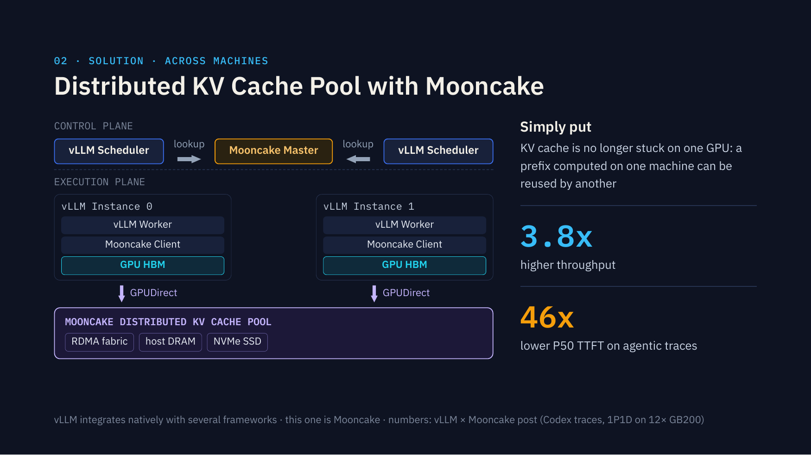

## Agent sessions turn serving into prefix reuse

The vLLM Bangkok article is a community summary of Simon Mo's Runtime 2026 talk; editorial additions are not speaker quotations. Coding agents repeatedly submit old history while appending tool results and short generations. AgentX's 142K median input and 444 median output are separate population statistics: their ratio is not a mean per-request ratio, and theoretical prefix reuse above 95% is not measured cache hit rate.

Long histories can occupy gigabytes, suffer eviction and miss when load balancing moves a session. Sticky routing preserves locality but may overload an instance. Cache placement therefore affects both initial waiting and serving cost.

## From block lookup to asynchronous restoration

The linked official vLLM Mooncake article supplies the mechanism. Schedulers hash token blocks and query a master that manages metadata and node health. Worker clients register GPU KV as RDMA buffers; background I/O threads prepare and issue transfers. GPUDirect avoids SM use and extra staging, while background descriptor work avoids blocking the main CPU launch path.

<a class="note-image-link" href="/assets/images/tech/2026-11-05-vllm-bangkok-serving-agentic-workload/mooncake-kv-pool.png" target="_blank" rel="noopener" aria-label="View figure">View figure ↗</a>

*The vLLM Bangkok slide shows the split between scheduler lookups and worker access to a shared KV pool via GPUDirect. The storage tiers are architectural options; the speedups come from a specific test.*

MultiConnector combines P/D transfer with shared storage. In that article's version, prefill restores prefixes and forwards them to decode; decode writes the pool but does not read it directly. Multipath reads are future work. A later diagram including NVMe does not turn an earlier DRAM experiment into verified SSD results.

## Results belong to a specific baseline

The official experiment uses Kimi-2.5 NVFP4, 12 GB200 GPUs, 1P1D and 610 Codex/SWE-bench Pro traces. The baseline caches only the system prompt. Hit rate increases from 1.7% to 92.2%, throughput by 3.8 times, and P50 TTFT improves 46-fold. This shows the value of previously uncached history, not the expected gain over an already effective cache.

Near-linear scaling to 60 GPUs uses a separate synthetic workload with session count scaled alongside hardware and round-robin cross-node routing. My interpretation is to distinguish reusable content, actual resident hits and restoration costs before choosing a throughput/interactivity tradeoff. Spoken hardware comparisons and experimental TPU peaks are not substitutes for matched deployment evidence.

[Official Mooncake mechanism and experiments](https://vllm.ai/blog/2026-05-06-mooncake-store)

Source: [Original engineering article](https://vllmbangkok.com/en/blog/serving-the-agentic-workload/)
