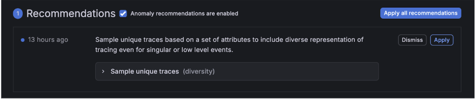

JK Basra, Steven Dungan · Grafana Labs · Originally published 2026-10-20 (7 min read) · [Primary Engineering Blog](https://grafana.com/blog/cut-costs-keep-what-you-need-adaptive-telemetry/) · Frozen Official Docs: [Volumetric sampling](https://grafana.com/docs/grafana-cloud/observe-and-act/adaptive-telemetry/adaptive-traces/manage-recommendations/volumetric-policy/), [Diversity sampling](https://grafana.com/docs/grafana-cloud/observe-and-act/adaptive-telemetry/adaptive-traces/manage-recommendations/diversity-policy/), [Query dropped traces](https://grafana.com/docs/grafana-cloud/observe-and-act/adaptive-telemetry/adaptive-traces/query-dropped-traces/), [Auto-Apply](https://grafana.com/docs/grafana-cloud/observe-and-act/adaptive-telemetry/adaptive-metrics/additional-configuration/auto-apply/)

When every LLM call, tool invocation, and multi-step agent loop emits telemetry, teams face an acute operational bind: traditional "data diet" shortcuts—shortening retention, excluding environments or services from collection, or dialing down a fixed sampling percentage—cut ingest bills at the risk of erasing the exact trace, log, or label needed when something breaks. Grafana Labs' October 20, 2026 Adaptive Telemetry update reframes retention around **observed query and usage value**, combining automated tail sampling, edge log filtering, and bounded trace recovery across three telemetry pillars.

> **Evidence & Scope Boundary**: This note synthesizes the frozen October 20, 2026 Grafana blog post alongside four frozen Grafana Cloud documentation pages, keeping four evidentiary tiers cleanly separated: **(1) Generally Available (GA) mechanics and API rules** documented for Adaptive Traces and Adaptive Metrics Auto-Apply; **(2) Preview and roadmap boundaries** where Fleet-managed Adaptive Logs and Log Archive sit in *public preview* while Log Replay remains *coming soon* (private preview signup); **(3) Unquantified vendor claims and qualitative customer testimony**—including the section headline *"cut volume by 90%"*, Grafana Labs' self-reported testing claim of *"about 25% higher information density than probabilistic sampling at the same volume"* (lacking workload, dataset, or metric definitions), and Rapid7 Principal Software Engineer Carl Eastman's qualitative operational remarks, none of which constitute cross-workload billing or MTTR guarantees; and **(4) Assistant engineering derivations** on diagnostic blind spots and agent-workload guardrails, labeled explicitly below.

## Control Loops Across Traces, Logs, and Metrics: From Usage Signals to Enforcement Boundaries

Rather than applying uniform edge drops everywhere, Grafana's October 2026 update establishes separate feedback loops across traces, logs, and metrics—differing sharply in where filtering happens, how exceptions are expressed, and whether dropped data remains recoverable.

<figure class="note-figure">
  <a class="note-image-link" href="/assets/images/tech/adaptive-telemetry/adaptive-telemetry-control-loop-en.svg" target="_blank" rel="noopener" aria-label="Click to zoom in on the Grafana Adaptive Telemetry control loops and maturity boundaries diagram">
    
    Click to zoom ↗
  </a>
  <figcaption>Assistant diagram (not an original figure): Synthesizing the October 20, 2026 blog post and four official docs across trace, log, and metric control loops, GA vs. preview status, and rule precedence.</figcaption>
</figure>

Inside **Adaptive Traces** (whose three new capabilities are all **generally available**), Grafana Cloud executes **tail sampling** server-side without requiring users to operate their own sampling pipeline. Two precedence and lifecycle rules matter in production: first, **drop policies** evaluate and exclude unwanted traces *before* volumetric sampling runs, whereas **service-specific rules** (e.g., 100% capture for a critical service) and **diversity policies** operate outside the volumetric percentage budget—meaning overall retained volume need not scale down linearly when `sampling_percentage` drops. Second, the volumetric documentation explicitly warns operators **never to delete** an unwanted volumetric policy directly, because deleting it can leave the tenant temporarily with no active sampling; instead, update the policy in place back to `probabilistic`.

Inside **Adaptive Logs**, Grafana Cloud already detects unqueried log patterns and trims them on ingest. The two October 2026 additions move filtering upstream and create a cold-storage bypass, yet carry distinct release states:

- **Fleet-managed Adaptive Logs (public preview)**: Takes existing drop rules and exemptions and syncs collector pipelines automatically via **Grafana Fleet Management**, filtering matching logs before they leave the customer environment to cut **egress and network overhead** on top of storage costs while cloud-side pattern analysis continues on remaining logs.
- **Archive and replay (Archive in public preview; Replay coming soon with private-preview signup)**: `Archive` routes unindexed low-value logs to customer-owned object storage instead of dropping them permanently, whereas `Replay` is designed to rehydrate them on demand for investigations, audits, or compliance requests. Because `Replay` was still forthcoming at publication, having `Archive` in object storage does not yet deliver a GA end-to-end replay workflow; teams must independently evaluate object-storage spend, retention rules, and manual recovery latency.

Inside **Adaptive Metrics**, **Auto-Apply (GA)** removes manual review from usage-driven cardinality reduction—auditing dashboards, alerts, recording rules, and queries to aggregate unused dimensions automatically per segment. As with logs and traces, operational safety hinges less on automation speed than on **pre-configured exemptions** and **gate mode selection**.

| Capability | Trigger Mechanism & Cadence | Controls, Config & API Surface | Release Status (Oct 20, 2026) | Documented Limits & Operational Caveats |
| :--- | :--- | :--- | :--- | :--- |
| **Volumetric sampling** | Groups traces by span attributes; recomputes group rates ~every **15 seconds** | `sampling_percentage` (`> 0` and `≤ 100`); optional `attributes`; UI / Adaptive Traces API | **GA** | Targets **bytes, not trace count**; **max 1 policy per tenant**; edit in place to `probabilistic` to disable |
| **Diversity sampling** | Extracts **9 attributes** on server/consumer spans; retains `≥ 1` trace per fingerprint every **15 minutes** | Enabled in UI onboarding (`keep unique traces`) or Recommendations; Policies page | **GA** | Baseline coverage only (no latency shape); omits custom/client attrs & intra-key variance |
| **Query dropped traces** | Unmatched traces remain queryable by **trace ID for 24 hours** post-ingest; 1st hit writes to **Tempo** | **Automatic across all tenants** (zero config) | **GA** | **Known `trace ID` required**; restored TraceQL search is best-effort; huge traces truncate |
| **Fleet-managed Adaptive Logs** | Cloud pattern analysis syncs drop rules & exemptions to edge collectors via Fleet Management | Existing drop/exemption rules pushed via **Grafana Fleet Management** | **Public Preview** | Filters matching patterns pre-egress; cloud analysis still runs on remaining logs |
| **Log Archive & Replay** | Routes low-value logs to customer-owned object storage; Replay targets on-demand rehydration | Customer object-storage Archive; Replay private-preview signup | Archive **Public Preview**; Replay **Coming Soon** | Archive storage alone does not equal a shipped Replay workflow; size storage & retrieval lag |
| **Adaptive Metrics Auto-Apply** | Usage audit across dashboards, alerts, recording rules, and queries per segment | **Admin** role; `auto_apply.gate.policy` (`unbounded` / `no-increase`); UI / REST API / Terraform | **GA** | May remove/replace **exact-match** rules (preserves affix & drop rules); `Cost-first` uses estimates |

## Inside Adaptive Traces: Byte-Targeted Grouping, 9-Attribute Fingerprints, and 24-Hour ID Recovery

Examining the exact configuration schema and span rules across the three Adaptive Traces docs clarifies both how coverage improves over uniform sampling and where hidden blind spots arise.

### Volumetric Sampling: Byte Budgets and Statistical Bias

Uniform probabilistic sampling suffers from structural skew: when a noisy service generates `90%` of requests, a fixed percentage also gives `90%` of retained storage to that service—leaving low-volume critical workflows starved of samples. [Volumetric sampling](https://grafana.com/docs/grafana-cloud/observe-and-act/adaptive-telemetry/adaptive-traces/manage-recommendations/volumetric-policy/) addresses this by automatically selecting grouping attributes (such as `service.name` and `http.method`, or an explicit `attributes` array) and recomputing per-group sample rates roughly **every 15 seconds** so aggregate retained volume converges toward `sampling_percentage`.

One architectural nuance directly shapes downstream analytics: **`sampling_percentage` targets trace data in bytes, not trace count**. Replacing a `10%` probabilistic policy with a `10%` volumetric policy changes the mix of trace sizes and services sampled, so total retained trace count may rise or fall compared with the previous policy. Furthermore, because group sampling rates adapt dynamically every ~15 seconds:

- Raw retained trace counts in Tempo **no longer reflect true relative request volume** across services;
- Feeding unnormalized retained trace counts into rate-based anomaly detectors or SRE triage agents confuses **diagnostic behavior coverage** with **unbiased traffic frequency**, turning sampler rate adjustments into phantom workload shifts unless traffic counters live separately in Prometheus metrics.

### Diversity Sampling: Nine Server/Consumer Span Keys and Intra-Fingerprint Masking

When teams lower global `sampling_percentage`, [Diversity sampling](https://grafana.com/docs/grafana-cloud/observe-and-act/adaptive-telemetry/adaptive-traces/manage-recommendations/diversity-policy/) establishes a baseline representation floor for uncommon paths.

<figure class="note-figure">
  <a class="note-image-link" href="/assets/images/tech/adaptive-telemetry/diversity.png" target="_blank" rel="noopener" aria-label="Click to zoom in on the preserved Grafana Cloud Adaptive Traces diversity recommendation screenshot">
    
    Click to zoom ↗
  </a>
  <figcaption>Preserved official image (source: Grafana Labs documentation and UI): The Adaptive Traces recommendation banner for retaining one representative trace per unique attribute combination—providing baseline visibility rather than full request capture.</figcaption>
</figure>

Reading the [diversity policy specification](https://grafana.com/docs/grafana-cloud/observe-and-act/adaptive-telemetry/adaptive-traces/manage-recommendations/diversity-policy/) closely reveals that Adaptive Traces constructs fingerprints exclusively from **incoming server and consumer spans** across **nine predefined span attributes**:

1. Service and cluster coordinates: `service.name`, `k8s.cluster.name`, `k8s.namespace.name`
2. Datastore identifiers: `db.system.name`, `db.collection.name`
3. HTTP and RPC endpoints/statuses: `http.route`, `http.response.status_code`, `rpc.method`, `rpc.grpc.status_code`

Within each fixed **15-minute window**, the diversity policy guarantees at least **one trace per unique 9-attribute fingerprint**; subsequent traces matching the same fingerprint inside that window are skipped by diversity (left to volumetric or other policies) until the bucket resets. Two engineering blind spots follow directly from this documented rule (assistant derivation from the schema, not reported as failures by Grafana):

- **Intra-fingerprint failure masking**: If `http.route="/v1/agent/run"` hits a transient `500` timeout early in a 15-minute window, that trace satisfies the diversity quota for `(route, 500)`. A distinct second failure mode returning the exact same route and `500` status two minutes later—for instance, a tool-schema violation or downstream auth failure—receives zero extra protection from diversity sampling.
- **Blindness to custom, client, and AI attributes**: Because fingerprints inspect only server/consumer spans across those nine fixed keys, high-cardinality operational dimensions such as `tenant.id`, `model.name`, `agent.tool_name`, or purely internal/client spans do **not** create separate diversity buckets; nor can a single 15-minute exemplar characterize p95/p99 latency distributions or intermittent error rates.

### Query Dropped Traces: 24-Hour Lookup, Tempo Promotion, and Truncation Tags

To backstop aggressive sampling, [Query dropped traces](https://grafana.com/docs/grafana-cloud/observe-and-act/adaptive-telemetry/adaptive-traces/query-dropped-traces/) applies automatically across all Adaptive Traces tenants: any trace dropped by sampling policies stays **queryable by trace ID for 24 hours after ingest**. The first trace-ID lookup writes the trace into **Tempo** for long-term retention (keeping it ID-queryable thereafter), whereas unqueried traces are permanently discarded once 24 hours elapse.

Crucially, Grafana documents three operational constraints via span provenance tags added to **every span** of a restored trace:

- **No reliable search without an ID**: While a restored trace *may* eventually surface in TraceQL searches, Grafana explicitly qualifies restored TraceQL search as **best-effort**, noting that the same trace may still be missing from attribute queries. Without a `trace ID` preserved in logs, exemplars, error payloads, or support tickets—and queried within **24 hours**—attribute-based incident hunting cannot recover dropped traces.
- **Explicit restoration provenance**: `grafana.adaptivetraces.restored = true` distinguishes post-hoc recovered traces from originally sampled traces in downstream investigations.
- **Partial truncation on huge traces**: Very large traces add `grafana.adaptivetraces.truncated = true` alongside `grafana.adaptivetraces.truncated_percentage` (the doc example shows `93.93200201457533`). On multi-turn coding or agent traces spanning dozens of tool payloads, severe truncation on restore can still clip the exact downstream child span where an error occurred.

## Adaptive Metrics Auto-Apply & Cross-Signal Guardrails: Coverage-First vs. Cost-First Under Cardinality Drift

Whereas traces balance byte distribution and post-hoc ID recovery, **Adaptive Metrics Auto-Apply** automates cardinality pruning—creating a different failure surface around rule precedence and estimation lag.

<figure class="note-figure">
  <a class="note-image-link" href="/assets/images/tech/adaptive-telemetry/diversity-scoring-guardrails-en.svg" target="_blank" rel="noopener" aria-label="Click to zoom in on the 9-attribute diversity fingerprint, 24h recovery, and Auto-Apply guardrails diagram">
    
    Click to zoom ↗
  </a>
  <figcaption>Assistant diagram (not an original figure): Mapping the documented 9-attribute diversity schema, restored-trace span tags, Auto-Apply API policies, and derived incident-blindspot guardrails.</figcaption>
</figure>

Per the [Auto-Apply documentation](https://grafana.com/docs/grafana-cloud/observe-and-act/adaptive-telemetry/adaptive-metrics/additional-configuration/auto-apply/), four configuration mechanics govern whether automation protects or blindsides on-call teams:

1. **Exemptions must precede enablement, and exact-match rules are mutable**: Enabling Auto-Apply requires the `Admin` role, and Grafana explicitly warns to **create exemptions before turning it on**. Critically, Auto-Apply **never modifies affix (prefix/suffix) aggregation rules or drop rules**, yet it **can remove or replace exact-match aggregation rules** unless an explicit exemption pins that metric. Segments near their aggregation-rule limit may also silently skip recommendations.
2. **`unbounded` (`Coverage-first`) is the silent API default**: Whether configured via UI, REST (`/aggregations/recommendations/config` for the `default` segment; `/aggregations/rules/segments` for custom PromQL-selected segments like `{team="team1"}`), or Terraform (`grafana-adaptive-metrics_recommendations_config` / `grafana-adaptive-metrics_segment`), omitting `gate` or `policy` defaults `auto_apply.gate.policy` to **`unbounded` (`Coverage-first`)**. That mode applies *all* recommendations—including ones expected to **increase active series** whenever new dashboards or queries touch previously aggregated detail.
3. **Even explicit `no-increase` (`Cost-first`) is not a live series-count guarantee**: `Cost-first` applies all series-reducing recommendations and caps series-increasing recommendations to the **budget freed by reductions applied in the same cycle** (leaving excess additions pending for UI review). However, Grafana's **Caution** block states bluntly that `Cost-first` relies on **series count estimates from the last analysis cycle** and **does not compare live series counts before and after rule updates**—making it a bounded guardrail rather than an unbreakable cap if new pod labels or traffic bursts arrive mid-cycle.
4. **Observed usage misses dormant audit and disaster-recovery queries**: Usage-driven pruning equates "not recently queried" with "safe to aggregate." In reliability operations, rare compliance audits, quarterly DR failovers, or brand-new failure dimensions often go untouched for weeks; unlike logs routed to object-storage Archive or traces inside the 24-hour lookup window, aggregated metric dimensions are irreversibly collapsed from that point forward.

## Evidence Calibration, AI-Workload Blind Spots, and Pre-Deployment Verification Checklist

Separating verified product mechanics from marketing framing and qualitative customer quotes clarifies what teams can rely on today versus what requires local validation:

- **"Cut volume by 90%"**: Appears as a section-level headline framing in the October 20 blog post; as the diversity and volumetric docs acknowledge, active service-specific overrides and unique fingerprints prevent strictly linear volume drops across arbitrary topologies, and byte reduction never guarantees an equal percentage drop on total observability bills.
- **"About 25% higher information density than probabilistic sampling at the same volume"**: Explicitly attributed to **Grafana Labs' testing**, yet the post provides no trace dataset specification, service count, traffic skew, or mathematical definition of "information density." Treat it as an uncalibrated vendor test signal—not a `+25%` guarantee in root-cause accuracy or MTTR reduction.
- **Rapid7 testimony (Carl Eastman)**: Three verbatim quotes illustrate real operational value—shifting engineers away from manual metric-cardinality and log-volume triage toward a small set of judgment calls, and reinvesting metric savings into broader log/trace visibility—yet remain qualitative operational experience rather than a controlled A/B cost or incident-resolution study.

| Claim or Mechanism | Verified Fact in Frozen Primary Sources | Unproven Gap or Blind Spot | Pre-Rollout Engineering Check |
| :--- | :--- | :--- | :--- |
| **Volumetric % & "Cut volume by 90%"** | Recomputes group rates ~every 15s; targets **bytes**, max 1 policy/tenant | Total trace count can rise or fall at same %; combined rules break linear scaling | Simulate retained bytes and per-service trace counts against billing dimensions first |
| **"~25% higher information density"** | Self-reported Grafana Labs test signal vs. probabilistic sampling | **Omitted** workload, trace volume, and density metric definition; no MTTR data | Replay known incident traces to verify RCA recall vs. existing sampling baseline |
| **Diversity 9-attribute 15m bucket** | Server/consumer spans only; 9 fixed keys; `≥ 1` trace / key / 15m | Ignores `tenant`/`model`/`tool` tags; same route+500 hides 2nd root cause | Add explicit policies for AI tool/tenant isolation; never rely on diversity for p99 |
| **24h dropped-trace recovery** | Enabled for all tenants; 1st ID lookup writes Tempo + `restored` tag | Requires known `trace ID`; best-effort TraceQL; oversized traces truncate | Emit `trace_id` in all error logs/tool returns & tickets; test multi-turn truncation |
| **Auto-Apply `no-increase` (`Cost-first`)** | Caps additions to same-cycle savings; omitting `policy` defaults to `unbounded` | Uses **prior-cycle estimates**, not live counts; can mutate exact-match rules | Set `exemptions` first (incl. exact-match rules); explicitly set `policy: "no-increase"` |
| **Log Archive & Replay** | Archive (public preview) → own bucket; Fleet edge drop (public preview) | **Replay is coming soon** (private preview)—not a GA on-demand replay pipeline | Account for object-storage charges and treat Archive as cold retention until GA |

Synthesizing these primary-source boundaries yields five concrete pre-deployment guardrails for teams running multi-step AI/agent pipelines or automated anomaly detection (assistant engineering checklist derived from the documented mechanisms):

1. **Enforce end-to-end `trace_id` emission before lowering `sampling_percentage`**: Unless error logs, Prometheus exemplars, LLM-gateway failures, and support tickets consistently log `trace_id`—and responders triage within **24 hours**—dropped-trace recovery remains unreachable when needed most.
2. **Benchmark `truncated_percentage` on realistic multi-turn agent traces**: Sample representative long-running coding or tool-use traces through dropped-trace lookup to check whether `grafana.adaptivetraces.truncated` fires and drops downstream tool-error spans; if so, pin critical agent entrypoints via explicit sampling rules rather than relying on post-hoc recovery.
3. **Version-tag policy transitions for anomaly detectors and SRE agents**: Record timestamps and config diffs whenever `Volumetric` percentages, `Diversity` rules, or `Auto-Apply` segments change so downstream anomaly models never interpret dynamic 15-second sampling redistribution as real request-rate drift.
4. **Lock exemptions and explicit gate fields in IaC before enabling Auto-Apply**: Audit dormant compliance/DR queries and existing **exact-match** aggregation rules first, register `exemptions` before flipping `enabled: true`, and explicitly declare `gate.policy = "no-increase"` in API/Terraform definitions so omitted fields never silently fall back to `unbounded` (`Coverage-first`).
5. **Accept retention changes against a four-tier evidence budget**: Validate candidate policies against historical common *and* rare incidents by checking what survives in **(a) searchable Tempo/Loki/Mimir retention, (b) 24h ID-only recovery, (c) cold object-storage Archive (without assuming GA Replay), and (d) irreversible metric aggregation**—pricing recovery latency directly into MTTR expectations.

---

### Verified Primary Sources

- Primary announcement: JK Basra & Steven Dungan, *[Break the link between data volume and your observability bill with Adaptive Telemetry](https://grafana.com/blog/cut-costs-keep-what-you-need-adaptive-telemetry/)*, Grafana Labs Blog, 2026-10-20.
- Adaptive Traces volumetric policy docs: *[Use volumetric sampling](https://grafana.com/docs/grafana-cloud/observe-and-act/adaptive-telemetry/adaptive-traces/manage-recommendations/volumetric-policy/)*, Grafana Cloud Documentation.
- Adaptive Traces diversity policy docs: *[Use diversity sampling](https://grafana.com/docs/grafana-cloud/observe-and-act/adaptive-telemetry/adaptive-traces/manage-recommendations/diversity-policy/)*, Grafana Cloud Documentation.
- Adaptive Traces dropped-trace lookup docs: *[Query dropped traces](https://grafana.com/docs/grafana-cloud/observe-and-act/adaptive-telemetry/adaptive-traces/query-dropped-traces/)*, Grafana Cloud Documentation.
- Adaptive Metrics Auto-Apply docs: *[Enable auto-apply](https://grafana.com/docs/grafana-cloud/observe-and-act/adaptive-telemetry/adaptive-metrics/additional-configuration/auto-apply/)*, Grafana Cloud Documentation.

> **AI-Assisted Curation & Archival Note**: Rewritten and expanded by the assistant (`authoring_source: assistant`, `translation_source: assistant`) from the frozen October 20, 2026 Grafana Labs blog capture and the four frozen Grafana Cloud documentation pages above, paired with the Chinese edition ([中文笔记](/tech/zh/adaptive-telemetry/)). Original `id`, `date: '2026-10-20'`, `permalink`, `source_url`, `published_at`, and canonical tags (`observability`, `systems-reliability`) are preserved; the official console screenshot `diversity.png` remains intact alongside two newly drawn `v3-blue` architecture and guardrail diagrams (`adaptive-telemetry-control-loop-en.svg`, `diversity-scoring-guardrails-en.svg`). All documented attributes, windows, API fields, and maturity boundaries trace directly to the frozen sources without invented benchmarks or billing claims.
