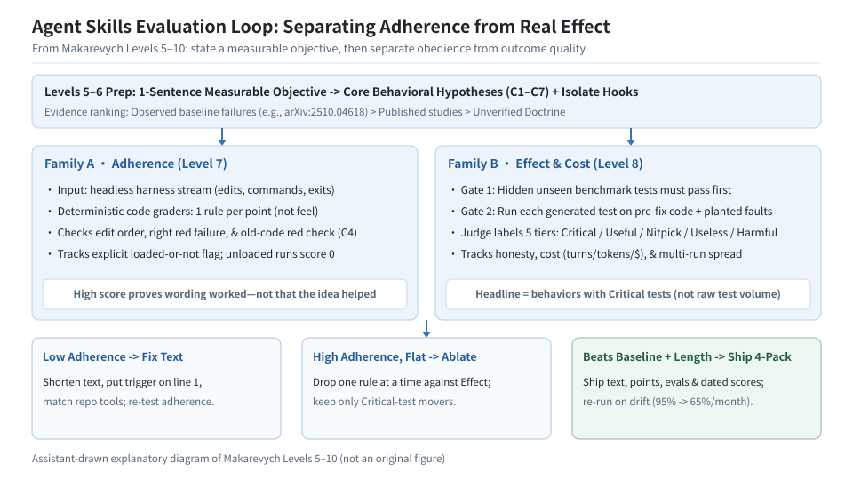
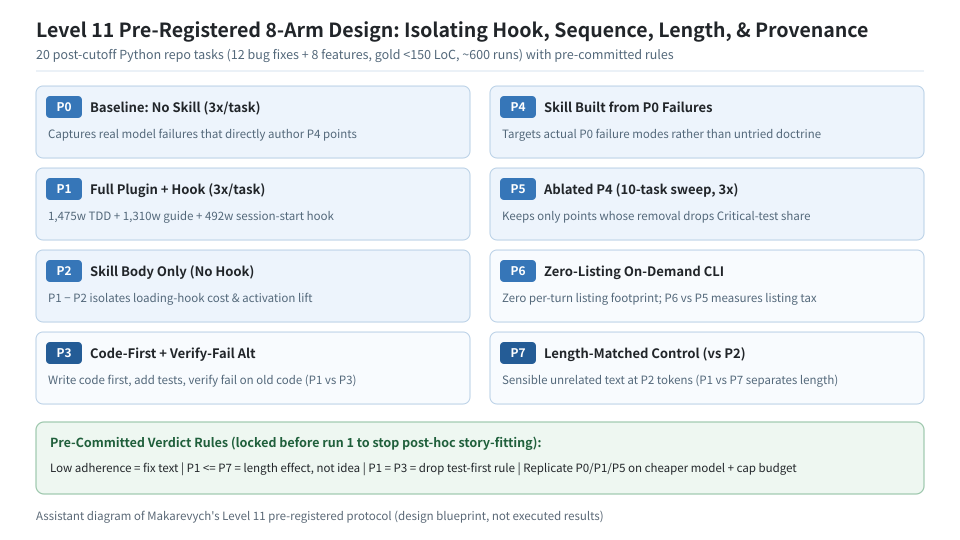

Sergii Makarevych · 2026-10-19/20 · [Original X Post](https://x.com/sermakarevich/status/2112198653469241856) · [Original X Article: "How to write and test agent skills with evals"](https://x.com/i/article/2112186374052802560)

Agent Skills package conventions, tooling guidance, and multi-step workflows into on-demand Markdown bundles. Across his **Level 0 to Level 11** guide—synthesizing **25 cited references (including 17 arXiv papers)**—Sergii Makarevych dismantles a common shortcut: checking whether an agent followed your instructions is not proof that those instructions helped. **A skill can load reliably, alter agent behavior on cue, and still deliver zero gain while inflating tokens, latency, and attack surface.**

> **Evidence boundary & scope**: The primary article mixes peer-reviewed/preprint studies, community tooling probes, vendor-reported figures, and an unexecuted experiment blueprint. **`Vercel (2026)`** (model and sample count undisclosed) and **`Anthropic (2026)`** (dozens of eval cases per topic inside an internal analytics agent) are summarized here explicitly as **vendor claims** as cited in the article. Likewise, the **Level 11 eight-arm `P0–P7` matrix** is a **pre-registered experimental design, not published benchmark scores**.

## Empirical Diagnosis: Low Activation, Token Taxes, and Scanner Blind Spots (Levels 1–4)

Before asking whether a skill improves pass rate, Makarevych separates three failure modes across the early levels:

- **Three token charges and poor need-awareness**: Installing a skill bills tokens three ways—the always-present listing summary in the system prompt, the body and companion files loaded on trigger, and optional session-start hooks (for example, `obra/superpowers` injects a `492`-word `using-superpowers` hook on every run). Using `skill-doctor` on a real workspace, **`81` of `89` installed skills were never triggered once**, and the remaining `8` had last fired at least **`37` days earlier**. A **vendor claim from `Vercel (2026)`** (model/sample size undisclosed) reports **`56%` zero-invocation**, **`53%` pass rate with a skill vs. `53%` without docs**, **`79%`** under explicit invocation, and **`100%`** with a compressed always-on docs index; separately, **`Spence (2026)`** tested Claude Sonnet 4.5 across `22` prompts and saw **`50%–55%` activation without a hook vs. `100%` with one**. Across broader academic suites, *SRA-Bench* (`arXiv:2604.24594`, `5,400` cases, `8` models) measured loading rates from **`11.1%` to `72.1%`** and concluded skill selection is not need-aware, while *Demystifying Agent Skills* (`arXiv:2608.14036`) found correct skill selection plunges from **`29.6%` (with 5 skills) to `3.3%` (with 100 skills)**.
- **Zero average lift, negative regressions, and wasted turns**: The open `agentskills.io` format defines file layout and loading—not tests. In *Signal or Noise* (`arXiv:2608.23067`, `31` skills × `50` web projects × `4` models), **all four models lost pass rate with skills enabled** (Claude Sonnet 4 fell **`-4.2` percentage points** at 2 attempts), token consumption surged **`+72%` to `+394%`**, and only **`1%` of skill-project pairs helped across all four models**. In *SWE-Skills-Bench* (`arXiv:2603.15401`, `49` skills), **`39` of `49` skills added zero lift** (mean `+1.2` points), token overhead reached **`+451%`**, and `3` skills degraded performance by up to **`-10` points** due to stale library guidance. Analyzing `307` harm cases, *Agent Skills Can Be Harmful* (`arXiv:2608.11888`) found **`182` (`62.6%`) produced zero quality improvement—pure token and step overhead**.
- **Near-zero cross-model transfer and one-month drift**: In *Signal or Noise*, the exact same skill on the same repository yielded **`+33` points on Claude Sonnet 4** while losing **`-22` points on DeepSeek and Qwen**, with roughly **`0` gain correlation** across model families. Well-curated skills still carry real upside: *SkillsBench* (`arXiv:2602.12670`) reports curated skills lifted **Claude Haiku 4.5 (`27.7%`) past unassisted Claude Opus 4.5 (`22.0%`)**, and *Demystifying Agent Skills* showed that library-doc skills gained `+2.8` points (with a CI crossing zero) primarily because **`65.7%` of the gain came from anchoring execution procedure rather than `4.5%` from new facts**. Even then, gains decay quickly: an **Anthropic vendor claim (`2026`)** notes an internal analytics agent rose from **`21%` to `>95%`** with skills and dozens of per-topic eval cases, only to fall **`95% → ~65%` within a single month** as underlying data drifted.
- **Static security scans are not code review**: Analyzing `31,132` public skills, *Agent Skills in the Wild* (`arXiv:2601.10338`) flagged **`26.1%`** with at least one vulnerability pattern (**`2.12×`** higher when bundled with scripts); *Do Not Mention This to the User* (`arXiv:2602.06547`, USENIX Security 2026, `98,380` skills) confirmed **`157` malicious packages**. Even though the scanner in `arXiv:2601.10338` reached `86.7%` precision / `82.5%` recall, **Trail of Bits and Cloud Security Alliance (June 2026)** bypassed **`5` skill security scanners** (`3/4` bypasses crafted in **under `1` hour**).

## Dual-Metric Eval Loop: Separating Adherence from Real Effect (Levels 5–10)

To isolate "did the agent read and obey" from "did obeying actually fix anything," Makarevych builds a closed **Levels 5–10 evaluation loop**. Rather than inspecting final patches in bulk, he tracks **Family A (Adherence)** and **Family B (Effect & Cost)** separately before revising or trimming a skill.

<figure>
  <a class="note-image-link" href="/assets/images/tech/agent-skills-evaluation/skill-eval-loop-en.svg" target="_blank" rel="noopener">
    
    Expand diagram ↗
  </a>
  <figcaption>Assistant diagram (not an original figure): Makarevych Levels 5–10 methodology separating instruction compliance from real defect-catching utility and ablation.</figcaption>
</figure>

Using the popular `obra/superpowers` TDD skill (`1,475`-word skill body + `1,310`-word companion testing guide + `492`-word session hook, enforced by `"NO PRODUCTION CODE WITHOUT A FAILING TEST FIRST"` and written with **TypeScript examples** that the author sets out to test on **Python repositories**), he strips away persuasion prose and hooks, decomposes the skill into **`C1–C7` core behavioral hypotheses** plus `6` secondary test-quality clauses, and ranks hypothesis provenance by reliability—highlighting *Agentic Context Engineering* (`arXiv:2510.04618`), where playbooks distilled directly from real baseline failures gained **`+12.3%`**, far safer than unverified *Doctrine*.

| Eval Stage / Mechanism | What Is Measured | Scoring Rules & Hard Gates | Primary Evidence & Anti-Gaming Design |
| :--- | :--- | :--- | :--- |
| **Adherence (Level 7)** | Headless harness event streams (`claude plugin eval`), edit order, commands, exit codes | One **deterministic code rule** per hypothesis (`C1–C7`): tests written before source edits, failing test output naming the new test, `C4` failing on pre-fix code | Explicitly logs whether the skill was loaded—**unloaded passes score `0`** so baseline competence never disguises dead skill text |
| **Effect Gates 1 & 2 (Level 8)** | Held-out acceptance tests + pre-fix code + injected regression faults | **Gate 1**: unseen benchmark tests must pass first. **Gate 2**: generated tests actually run against pre-fix code and planted faults | Counters fake test proliferation: `arXiv:2602.07900` found failed vs. solved SWE-bench runs wrote tests at equal rates (more `print` than `assert`), and `>6,000` faulty repos in `arXiv:2609.09315` ran buggy lines and passed |
| **5-Tier Effect & Cost (Level 8)** | Human-calibrated judge tiers + honesty + token/turn/cost spread | Labels generated tests **`Critical` / `Useful` / `Nitpick` / `Useless` / `Harmful`**; assertion-free green tests score `Useless` immediately | Matches mutation gap evidence (`arXiv:2607.22880` & *awesome-testing.com* Aug 2026: **`100%` line coverage vs. `61%` mutation score** on a buggy parser) alongside *GTDD* (`arXiv:2610.02952`) |
| **Ablation & 4-Pack Release (Levels 9–10)** | Single-point leave-one-out removal & periodic drift reruns | Drop any rule whose removal does not reduce `Critical` catch rate; ship **text + hypotheses + evals + dated model results** | Prevents un-gated context rewrites from hurting scores (*Memento-Skills* `arXiv:2603.18743` `+13.7` pts `52.3% -> 66.0%` vs. un-gated *Meta-Context Engineering* `arXiv:2607.16621` `-6.2 to -11.5` pts) |

## Level 11 Pre-Registered 8-Arm Design: Isolating Hook, Sequence, and Length

To stop teams from writing post-hoc rationalizations around noisy benchmark tables, Makarevych finishes with a **pre-registered 8-arm experiment blueprint (Level 11)**. Once again, **no run scores exist in the source yet**—this is an explicit before-the-fact test harness designed to isolate why a skill helps if it helps at all.

<figure>
  <a class="note-image-link" href="/assets/images/tech/agent-skills-evaluation/eight-arm-design-en.svg" target="_blank" rel="noopener">
    
    Expand diagram ↗
  </a>
  <figcaption>Assistant diagram (not an original figure): Pre-registered Level 11 eight-arm protocol and decision criteria (design blueprint, not executed results).</figcaption>
</figure>

The plan specifies **`20` post-cutoff real Python repository tasks** (**`12` bug fixes + `8` new features**, `<150` LoC gold patch, `<2 min` test suite, sampled from *SWE-bench-Live* `arXiv:2505.23419` and *SWE-rebench* `arXiv:2505.20411`), budgeted for approximately **`600` capped runs** plus cross-model replication on **`P0`, `P1`, and `P5`** using a cheaper second model:

| Comparison Pair (Protocol Arms) | Variable Isolated | Pre-Committed Interpretation Rule |
| :--- | :--- | :--- |
| **`P1` (Full + 492w hook) vs. `P2` (Body only) vs. `P6` (Zero-listing CLI)** | Separates **forced-activation lift** from recurring **system-prompt listing overhead** | `P1 - P2` isolates hook value directly; comparing `P6` (telling agents which CLI command lists tools instead of shipping permanent descriptions) against `P5` measures listing token tax directly |
| **`P1` (Test-first) vs. `P3` (Code-first + verify fail on old code)** | Tests whether TDD value sits in **writing order** or solely **verifying failure on pre-fix code** | If `P1` fails to beat `P3`, drop the strict "tests before code" doctrine and retain `C4` verify-fail alone |
| **`P1`/`P2` vs. `P7` (Equal-token unrelated prose) & `P4`/`P5` (Failure-mined + ablated)** | Guards against **pure context-length illusions** and bloated rulebooks | In *Signal or Noise* (`arXiv:2608.23067`), placebo equal-length controls alone cost `-3.3` and `-3.5` pts; if `P1 <= P7`, extra context length explains the curve, not the skill's engineering idea |

## Engineering Takeaways: Treat Skills as Tested Dependencies

Reading across Makarevych's 11 levels, the central lesson is operational rather than ideological: **an un-evaluated Skill has the reliability profile of untested configuration code**, except it bills tokens on every session whether triggered or not. Three habits carry over immediately without running a 600-run academic matrix:

1. **Always inspect `P0` baseline failures first**: Write each skill clause strictly against recurring defects observed in baseline traces—following `arXiv:2510.04618` and Level 6 failure mining rather than copying generic multi-thousand-word manifestos.
2. **Debug triggering before debating substance**: Never tune wording for task quality until headless logs verify the agent actually loaded the skill (`Adherence`). Once adherence is high and `Critical` test catch rate stays flat, ablate clauses one by one.
3. **Version and re-run across model swaps and calendar drift**: Assume cross-model transfer is zero until verified, bundle dated eval scores with every skill revision, and schedule drift checks so `95% -> 65%` decay surfaces in CI instead of production.

---

> **Provenance**: Rewritten and expanded by the assistant from Sergii Makarevych's primary X Article ("How to write and test agent skills with evals", `authoring_source: assistant`, `translation_source: assistant`), retaining original `id`, `permalink`, `published_at`, and topic tags. Both diagrams (`skill-eval-loop-en.svg`, `eight-arm-design-en.svg`) are assistant-authored visualizations summarizing Levels 5–11 and explicitly distinguish executed studies/vendor claims from the unexecuted Level 11 blueprint.