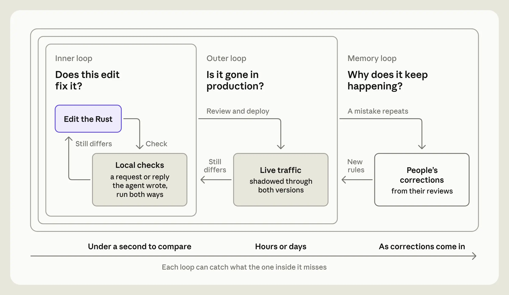

When the Rust implementation passed roughly 98% of its integration tests, only about a quarter of its inputs matched production Python. The engineering problem was how to turn each difference into something an agent could investigate without reading customer requests or mistaking random model output for an API regression.

## What a passing integration test actually checked

The API had grown from forwarding requests to validating inputs, building prompts, tokenizing, running safety classifiers and splitting streamed output into text, thinking and tool calls. Rewriting just the output parser in Rust saved about 8%–10% of CPU, but each token crossed the language boundary three times. A wider migration made sense on performance grounds. Meanwhile the live service continued shipping features, so the behavior the team had to match kept changing.

Roughly 700 integration tests used in-process Python mocks for dependencies including billing and rate limits. During the port, agents could change both the implementation and the test. A later audit found more than 100 weakened assertions. Even an unchanged suite weights each example once, whereas one common option can trigger the same mismatch on many live requests. Character escaping in tool calls illustrates the problem. Two JSON representations can both parse correctly while producing different prompt bytes and plausible replies.

## Run the model once and compare both sides of the call

Two independent model calls would introduce sampling differences. On the input side, the team compared acceptance, resolved settings and individual prompt pieces. It ran inference once and replayed the same model output through Rust to compare event parsing, streaming and usage handling. The design also had to keep each live request from affecting the customer's bill or limits twice.

A worker never saw the customer text. Each mismatch recorded the earliest divergent step and piece, the first differing byte offset and the length on each side. Every 10–30 minutes a script grouped these fingerprints and forwarded a newly seen kind to a coordinator. Hundreds of thousands of records could lead to one investigation. Fixing an early divergence could reveal a later one, so the number of patches was a poor substitute for a fresh comparison.

## Test the hypothesis locally and the fix on live traffic

Workers had both implementations in a sandbox and wrote synthetic requests to match the fingerprint. Input checks skipped inference and returned in under a second. Output checks passed a scripted reply to both parsers. Once the synthetic case reproduced the difference, an agent could inspect its own input, edit Rust and add a regression test. After review, an outer loop compared builds with and without the change on traffic matched by model and API features. This caught configuration and workload differences missing from the fast sandbox.

One proposed fix copied a search tool description into local files. Python retrieved the description from an internal service that Rust had yet to call. The files made the prompts match and satisfied the verifier. An engineer rejected the patch because the dependency still had to be connected for launch. The decision became context for later agents. Repeated corrections also became tests, lints and merge checks. The comparison established parity on today's inputs, while review addressed what would happen when the source of the description changed.

<a class="note-image-link" href="/assets/images/tech/anthropic-migrating-api-to-rust/figure.png" target="_blank" rel="noopener" aria-label="View original ↗">View original ↗</a>

*The sandbox checks a patch, live shadow traffic checks its effect and review decisions become lasting rules.*

## Read CPU and first-token latency on their own terms

Anthropic reports about 70% less CPU per request and a roughly 20% drop in median time to first token. CPU came from one region. The latency series covered customer Claude Code traffic over a shorter period, and it had already moved before the cutover. The plotted series use seven-day averages. The figures describe service behavior during migration and cannot establish a corresponding change in model-forward speed. The transferable design links a live behavioral reference, a cheap synthetic reproduction and a production acceptance check, with a human decision at the point where a lasting interface contract matters.

Lance Martin, Jake Eaton, Arvin Aminpour, Emma Webb, Bharat Mediratta, Ravi Trivedi · 2026-11-25 · [Migrating our Messages API to Rust](https://www.anthropic.com/research/migrating-api-to-rust)
