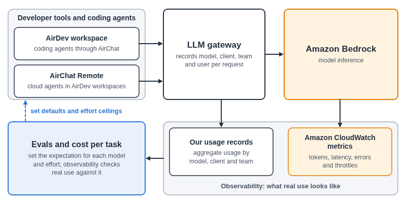

Airbnb saw eight new models in about five weeks. By mid-October about two thirds of coding-agent requests went to those releases. A price per million tokens leaves out retries, cache traffic and reasoning required to finish a task. It also leaves out a behavioral effect: engineers may use a more capable model more often. The former appears in an offline task evaluation, the latter in production usage.

## Accounting for whole tasks at each effort setting

AirChat and AirChat Remote reach Bedrock through a common gateway. Across seven fixed suites, the team evaluates each model and permitted effort with consistent graders. It sums list-price costs across the calls needed for a task, pricing uncached input, cache reads, cache writes and output separately. A cheap invocation repeated many times therefore affects the task total. For one model, raising effort from low to high added 0.8 score points at 2.5 times the cost per task. The gateway can use that evidence to set both the default and the maximum permitted effort.

<a class="note-image-link" href="/assets/images/tech/aws-airbnb-cost-per-task/overview.png" target="_blank" rel="noopener" aria-label="View original image ↗ — Both clients share a gateway. Task evaluations and observed usage inform subsequent defaults and effort ceilings.">View original image ↗</a>

*Both clients share a gateway. Task evaluations and observed usage inform subsequent defaults and effort ceilings.*

## Locating latency in waiting, generation rate or length

CloudWatch signals help explain production shifts beyond a benchmark score. In one example invocation latency rose 40% while time to first token and output tokens per second remained stable. Output tokens per request had increased 50% after a system prompt began asking for more thorough answers. Slower hardware would have been the wrong diagnosis. Similarly, throttling can depend on quota reserved at admission, which the eventual generated token count may fail to explain.

## Following the same users after a switch

An anonymized model A beat the previous best by over three points on fixed tasks at similar cost per task. Weeks after rollout, each production request cost about three times as much as on the previous model, and average users sent about three times as many requests. The fixed suite did not capture the change in usage. A newer model later scored higher on the same tasks at about one sixth of A's task cost. In the first full week after moving A's heavy users, that group's request count to its main model stayed similar while spending on it fell to roughly one seventh. Following the same group makes the comparison interpretable, though task mix and user intent could still change over time.

[How Airbnb uses cost per task to operate coding agents on Amazon Bedrock](https://aws.amazon.com/blogs/machine-learning/how-airbnb-uses-cost-per-task-to-operate-coding-agents-on-amazon-bedrock/) · Alan Yao, Rashim Gupta, Sang Kong, Jayadev Vadakkanmarveettil · 2026-11-18
