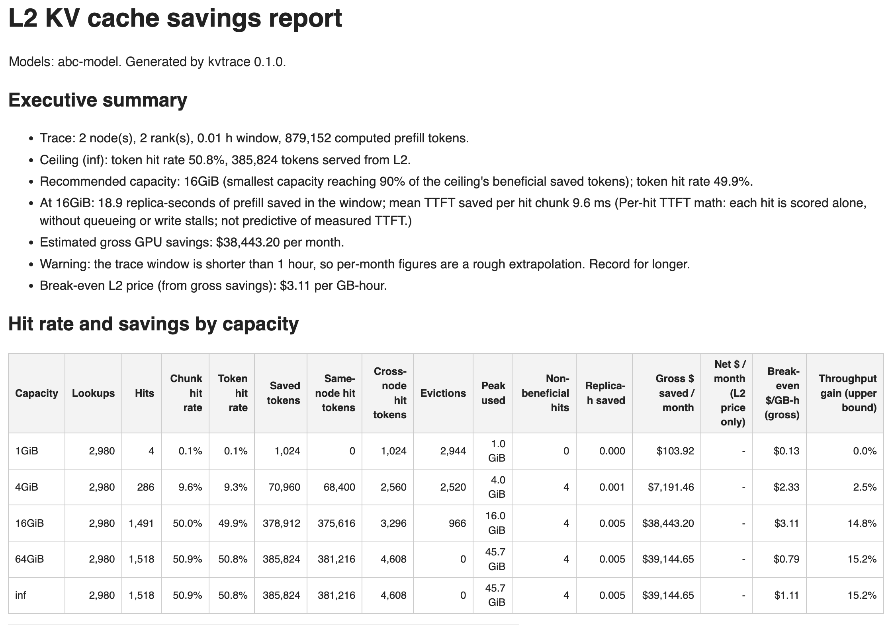

A legal assistant has 64K tokens of conversation history, yet a returning user waits 13 seconds for the first token after lunch. This is the scenario AWS uses to demonstrate its deployment skill. Repeated prefill identifies a source of delay. The case for buying another cache also depends on where requests land, when users return and how much time retrieval takes. The skill puts these questions before resource creation and checks for incorrect cache hits after setup.

Ravi Yadav, Chaitanya Nuthalapati and Neeraj Ramachandran · AWS Artificial Intelligence Blog · 2026-11-20 · [Cut self-hosted LLM cost and latency with the distributed KV caching agent skill](https://aws.amazon.com/blogs/machine-learning/cut-self-hosted-llm-cost-and-latency-with-the-distributed-kv-caching-agent-skill/)

## Identify the misses a shared tier could recover

The coding agent inspects GPU instances and EFA interfaces with a read-only call. It asks for the engine, model, tensor-parallel size, KV data type, hourly price and prompt repetition. Model and data type determine bytes transferred per token. Routing and return intervals determine how often a prefix has disappeared locally but could still be present elsewhere. Average prompt length alone cannot supply that estimate.

If local prefix caching is disabled, even consecutive turns can repeat prefill, making local configuration the first thing to check. With session affinity and an existing local hit rate above 90%, the authors give an example where a shared tier might add little. Short prefixes may also be cheaper to recompute. The legal assistant introduces a tenant constraint: response timing could reveal that another tenant submitted the same text. The example separates caches where isolation requires it or incorporates the tenant ID into the key.

## Find the useful capacity by replaying events

The sizing example has eight p5 servers handling 64,000-token prompts for multi-turn retrieval-augmented Q&A. The agent looks up GPU and cache prices and derives prefill rate and KV size from benchmarks. With no hit rate supplied, it presents scenarios. The quantity needed from real traffic is the share of otherwise recomputed tokens L2 could serve. A request-level hit rate cannot distinguish a few saved tokens from an entire document.

KVTrace records vLLM or SGLang cache events on each server, retaining block hashes and token counts. Offline replay tests the same arrivals against different shared capacities to see how much additional history each size retains. The recorder omits prompt text and token IDs, but hashes derive from content and sensitive prompts warrant the anonymization option. The window also needs to cover real return intervals. A short startup sample misses users who reopen documents after lunch.

<a class="note-image-link" href="/assets/images/tech/aws-distributed-kv-caching-agent-skill/figure.png" target="_blank" rel="noopener" aria-label="KVTrace demo report listing token hits and estimated savings by capacity">View original image ↗</a>

*Read down the capacity rows to see how many additional tokens survive as savings approach the ceiling.*

The synthetic report recommends the smallest capacity reaching 90% of the savings ceiling. The eight-p5 pricing example and the demo report illustrate a decision process. Freed GPU time becomes an economic benefit when the fleet serves more traffic or can shed servers. If the estimated benefit fails to cover the cache price, the skill stops before deployment.

## A hit counter still needs an output check

The setup uses the same key hash and seed across servers and sets KV data type explicitly. Different keys leave servers unable to find one another’s state. Layout mismatch is subtler: counters can show hits while the engine reads incorrect data. The skill empties local tiers, forces repeated runs to load from the remote tier and compares their outputs. The observed L2 share can then be compared with the KVTrace prediction to test whether the recording represented current demand.

The fourth demonstration diagnoses a successful Valkey connection and RDMA handshake followed by a rising count of write errors. The handshake uses the control path. Data movement separately needs EFA traffic to pass, so the example checks the rule between members of the same security group. The four conversations and synthetic replay establish how to narrow a diagnosis. Prediction error across production fleets remains unmeasured in this article.
