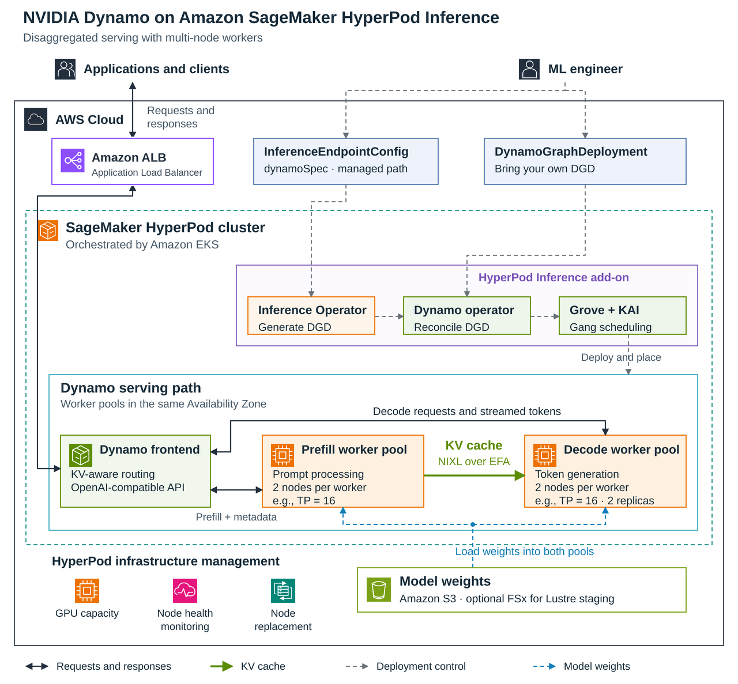

Multi-node model serving has two separate motivations. GLM-5.3 FP8 weights alone exceed the 640 GB on one ml.p5.48xlarge instance. Independently, a long prompt can interfere with users already generating tokens on the same GPUs. The Dynamo integration supports both a worker spanning nodes and separate worker pools for prefill and decode. Assessing these topologies requires different controls.

## From endpoint configuration to a complete worker

The dynamoSpec in an InferenceEndpointConfig describes the frontend, workers and replicas. The HyperPod inference operator manages the endpoint while the Dynamo operator manages the serving graph. Grove coordinates related pod groups and KAI gang-schedules the resources a multi-node worker needs together. HyperPod monitors node, GPU and EFA health and handles node replacement. The orchestration components recreate affected workers. The post establishes these responsibilities but its throughput tests do not measure recovery time.

<a class="note-image-link" href="/assets/images/tech/aws-dynamo-hyperpod/overview.png" target="_blank" rel="noopener" aria-label="View original image ↗ — The frontend routes to prefill and decode workers. Underlying orchestration handles grouped GPU placement and node replacement.">View original image ↗</a>

*The frontend routes to prefill and decode workers. Underlying orchestration handles grouped GPU placement and node replacement.*

## Each pool needs the weights and a state-transfer path

In disaggregated serving, prefill workers process prompts and decode workers generate output. Both pools load the full weights and transfer KV over EFA. Independent sizing can keep long prompts from interrupting generation. It also entails replicated weight placement, a working transfer path, and enough capacity on each side to avoid queueing at the handoff. Aggregated serving keeps the stages in one worker, which can still span instances via tensor or pipeline parallelism.

## The 2.05× result is throughput at qualified operating points

For Qwen3-235B-A22B-FP8 with TensorRT-LLM on 16 H200s across two instances, requests contained 4,000 input and 200 output tokens. The authors retained measurements with p90 TTFT under one second and median per-user generation of at least 50 tokens/s. Disaggregation delivered 207 output tokens/s/GPU at concurrency 80, versus 101 aggregated at concurrency 32. A separate Qwen3.5-397B test held eight active GPUs and TP4 × PP2 constant. At concurrency 32 with high prefix reuse, four GPUs on each of two nodes achieved 126.4 tokens/s/GPU, 99.1% of single-node throughput. The first experiment tests how to split work under latency objectives. The second isolates placement cost in one workload.

[Managed NVIDIA Dynamo on Amazon SageMaker HyperPod Inference](https://aws.amazon.com/blogs/machine-learning/managed-nvidia-dynamo-on-amazon-sagemaker-hyperpod-inference/) · Vinay Arora, Aryaman Kothari, Kshitiz Gupta, Marc Karp, Piyush Daftary, Preethi Ravula, Sai Devulapalli, Wenhan Tan, Xuan Lu · 2026-11-17
