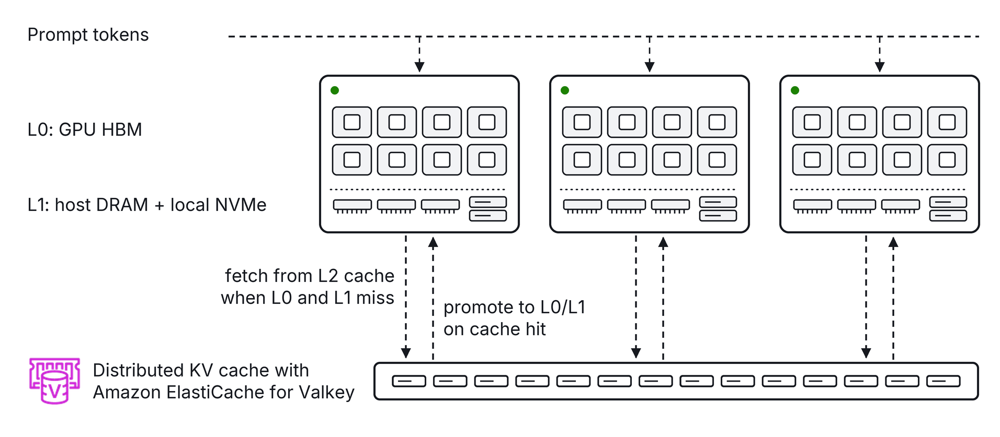

A second question about the same contract needs prefill only for the new text, provided the engine can find the attention keys and values it computed earlier. Load balancing can send the question to another GPU server that has none of them. ElastiCache for Valkey shares cached prefixes within an Availability Zone. AWS measured their value both at the limit of interactive capacity and immediately after a server left the fleet.

Meet Bhagdev, Chaitanya Nuthalapati and Kevin McGehee · AWS Database Blog · 2026-11-18 · [Announcing distributed KV caching for self-hosted LLMs with Amazon ElastiCache](https://aws.amazon.com/blogs/database/announcing-distributed-kv-caching-for-self-hosted-llms-with-amazon-elasticache/)

## Where a local miss goes

The engine first looks in GPU memory (L0), then in host memory or local NVMe (L1). Both tiers avoid repeated computation, but their contents belong to one server. Session affinity preserves hits at the cost of potential queues on popular machines while other GPUs have room. A shared L2 lets the scheduler send a request to an available machine and retrieve the prefix it lacks.

The LMCache connector writes new state to Valkey. A server that misses locally can fetch the blocks and promote them into its local tiers. Hot blocks reside in the shared node’s DRAM. Colder ones can move to its NVMe until eviction. RDMA over EFA transfers large objects between cache nodes and GPU hosts. On one cache.i8ge.48xlarge node, AWS measured a median read time of 477 microseconds for one 8 MB object and 41.7 ms for 128 such objects totaling 1 GB. Application time to first token also includes scheduling and prefill for the remaining prompt.

<a class="note-image-link" href="/assets/images/tech/aws-elasticache-distributed-kv-caching/figure.png" target="_blank" rel="noopener" aria-label="Three GPU hosts retain their own L0 and L1 and connect to one shared Valkey L2">View original image ↗</a>

*Dashed arrows show the fetch after a local miss and promotion back into the local tiers.*

## How much work fits under the same latency target?

AWS tested two to six P6 servers running vLLM, each with eight GPUs. The baseline already had about 150 GB of L0 and 205 GB of L1. The comparison added one cache node in the same zone. On shared-document Q&A, requests per second per server doubled under two targets: p90 time to first token below five seconds and p90 time per output token below 50 ms. Cost per million output tokens fell 40% including the cache node. That denominator matters. Freed capacity changes spending when it serves more output or lets the operator remove servers.

The coding-agent and AI-assistant traces had a different latency target. With p90 time to first token capped at 30 seconds, AWS reported up to 1.98× and 1.61× throughput respectively at matched load. Peak token throughput increased by 23% for both workloads. A difference at a given load and a change in the fleet’s peak answer different capacity questions.

## The tail after a server goes offline

AWS stopped one of two servers. During the next 300 seconds the survivor could fetch state left by its peer. Its p90 time to first token was 34.7 seconds, 43% lower than without L2, and it completed 1.48× as many requests. Once the stopped server returned, initial throughput and latency recovered within 60 seconds. The local-only configuration took up to 600 seconds to regain initial throughput, with queued requests still holding p90 at 12.1 seconds. The shared tier preserved work already spent on prefixes. The queue and surviving GPU capacity still constrained recovery.

## When a hit pays for the transfer

A hit exchanges prefill computation for a remote read. In AWS’s eight-model test, the length at which loading beat recomputing was below 512 tokens for one sparse model and between 1,000 and 7,600 tokens for hybrid models. Fixed-size state accounts for a larger share of a hybrid model’s transfer at short context. To realize the Q&A benefit, traffic must revisit history that has left the local tier, and retrieval must beat recomputation. Short, one-off inputs with long outputs offer few such opportunities even on a busy cluster.
