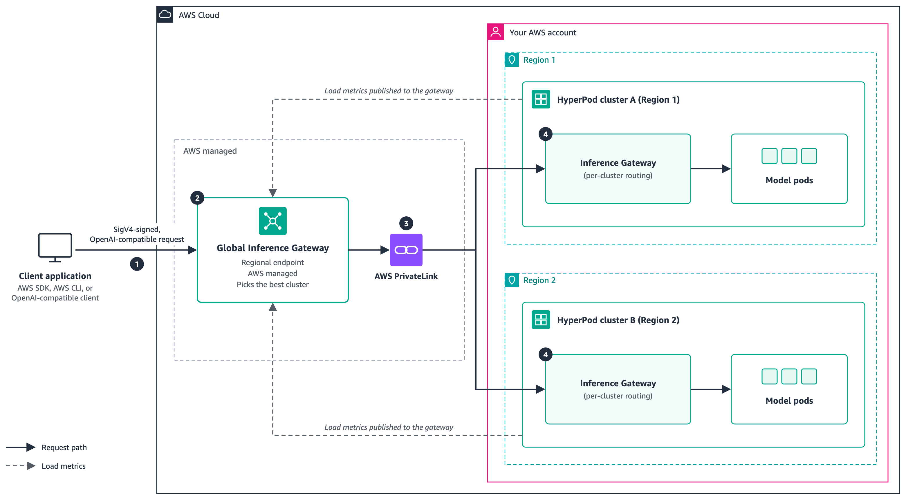

A gateway that finds an available GPU inside one cluster cannot see spare capacity in another region. AWS illustrates the issue with four models on five clusters across two regions. Per-model endpoints give clients twenty destinations; cluster gateways reduce that to five but leave clients choosing a cluster. Global Inference Gateway moves the first choice into a managed tier while each cluster retains pod placement.

Dmitry Soldatkin, Aryaman Kothari, Piyush Daftary · 2026-11-20 · [Introducing Amazon SageMaker HyperPod Global Inference Gateway: One endpoint across Regions and clusters](https://aws.amazon.com/blogs/machine-learning/introducing-amazon-sagemaker-hyperpod-global-inference-gateway-one-endpoint-across-regions-and-clusters/)

## Publish clusters before grouping them

The inference controller uses the globalRouting setting on the existing InferenceGatewayConfig to publish a private cluster entry in the customer account, including a load balancer and VPC endpoint service. Selected clusters are then enrolled behind a gateway. The service validates regions, certificates and endpoints and establishes private connectivity per cluster. Clients sign requests to a regional endpoint with SigV4. The gateway applies IAM checks and rate limits before forwarding over PrivateLink. Global reach refers to the destinations; ingress still has a region.

<a class="note-image-link" href="/assets/images/tech/aws-hyperpod-global-inference-gateway-2026-11-20/figure.png" target="_blank" rel="noopener" aria-label="The gateway selects a healthy cluster and forwards privately to its local inference gateway.">View original ↗</a>

*The gateway selects a healthy cluster and forwards privately to its local inference gateway.*

## Four weights determine the first hop

For each request the gateway scores healthy clusters and picks the highest score. Default weights for KV headroom, queue depth, region proximity and recent error rate are 0.20, 0.25, 0.40 and 0.15. Custom settings specify all four, sum to one and can disable a signal with zero. Proximity carries the largest default weight, while capacity and queue pressure can favor overflow. The chosen cluster then selects a pod using local KV and queue signals. First-tier headroom measures space; it does not establish that a particular prefix is cached.

## What the failover evidence establishes

Health checks determine eligibility, and recent failures influence scores among eligible clusters. Bagelcode reports that its two-region beta kept serving through the same endpoint when one cluster could no longer serve the model. This demonstrates a working failover path. The report leaves detection-to-switch time, outcomes for in-flight streams and tail latency during transition unquantified. Those quantities determine whether a particular service meets its objective.
