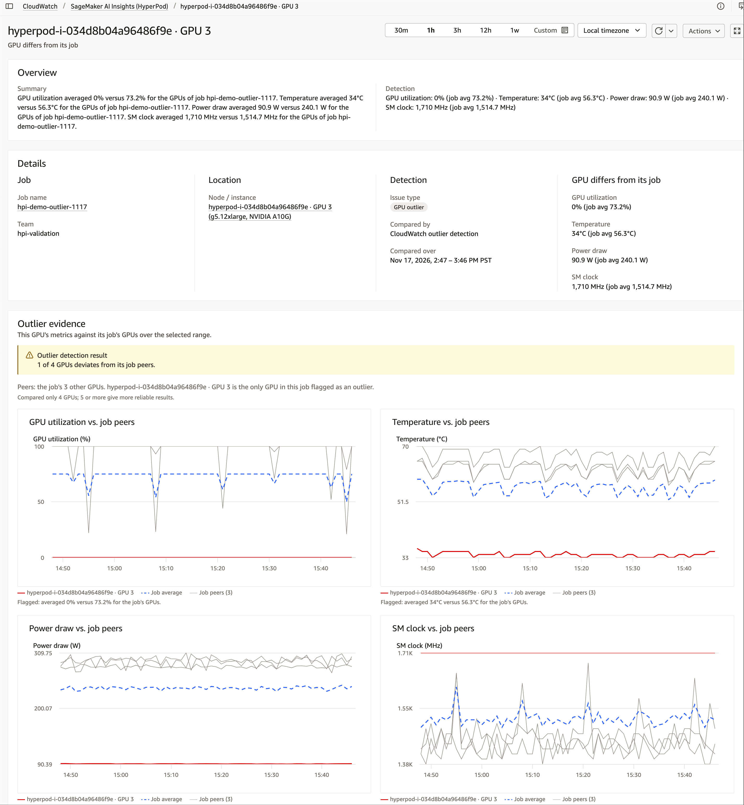

A synchronization point lets one slow accelerator delay the rest. Utilization may fall on healthy cards as they wait. HyperPod compares devices inside the affected job and brings deviations together with hardware events. This adds a question a fleet-wide mean cannot answer: which device started behaving differently from its peers?

Mijanur Palash, Aman Pratap Singh, Farrukh Sohail, Sai Kiran Akula, Subodh Kamble, Uday Singamala · 2026-11-20 · [Introducing enhanced infrastructure observability in Amazon SageMaker HyperPod](https://aws.amazon.com/blogs/machine-learning/introducing-enhanced-observability-in-amazon-sagemaker-hyperpod-to-diagnose-gpu-training-issues/)

## What the default collection costs

EKS uses an add-on and Slurm an extension. Every 30 seconds, default collection samples cluster health, CPU, disk and OS usage, GPU utilization and temperature, and per-job resource use. AWS gives an approximate footprint of 1–2% CPU and 250–300 MB memory. Optional suites add full node exporter, DCGM or Neuron metrics and EFA network telemetry. Clocks, power, PCIe errors, retransmissions and drops help distinguish device, host and network causes. The reported footprint applies to the default suite.

<a class="note-image-link" href="/assets/images/tech/aws-hyperpod-observability-2026-11-20/figure.png" target="_blank" rel="noopener" aria-label="Incident details connect the affected job and instance to network evidence from the same interval.">View original ↗</a>

*Incident details connect the affected job and instance to network evidence from the same interval.*

## How peer comparison narrows the search

CloudWatch DetectGroupOutliers compares utilization, memory, temperature, power and SM clock among GPUs in a job. Devices that deviate appear in the diagnostic summary. Static rules separately flag known signatures such as XID and ECC errors, overheating, throttling and EFA throughput drops. Peer comparison locates a candidate. A coincident clock drop and temperature rise provide a reason to investigate throttling, while a group of waiting devices also warrants checking communication and host activity.

## Following a device back to the job

Operators can follow a cluster summary into an incident and inspect job, node and device metrics over time. Network and NCCL views help locate propagation along communication paths. Symmetric workloads give peer comparisons a natural reference. Pipeline stages or uneven shards can produce legitimate differences within a job, so an outlier is an investigative lead. AWS documents the signals and diagnostic path. Detection accuracy and repair-time distributions remain open empirical questions.
