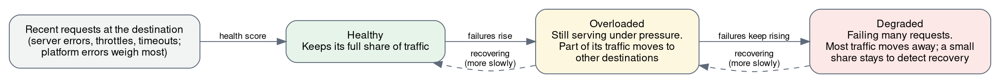

A GPU shortage in one region can coincide with spare capacity elsewhere. The difficult decision is whether the local endpoint is merely slow, unable to admit work, or has executed a request whose reply is missing. AWS’s inference router binds a logical model to already-running destinations and chooses among them per invocation. Retrying an existing request requires stronger evidence than observing a failure.

## How three health states change traffic

The router prefers its own region and spreads work evenly among healthy local destinations. Each destination is scored from recent requests in its own region. Server errors, throttles and timeouts lower health, with platform failures carrying more weight. Invalid inputs would fail elsewhere too and do not count. A slow model returning success does not alone trigger failover. Capacity signals such as failed launches accelerate the response only once requests begin failing.

An overloaded destination sheds part of its work. A degraded one retains a small probe share. Movement typically begins after about a minute of sustained errors, potentially longer at low volume. Traffic returns over several minutes to limit oscillation. Stale remote telemetry keeps work local. AWS’s test trace follows local overload, a cross-account permission loss and subsequent recovery. It supplies an example of destination changes rather than a production-wide distribution of failover times.

<a class="note-image-link" href="/assets/images/tech/aws-sagemaker-cross-region-inference-routing/figure.png" target="_blank" rel="noopener" aria-label="Healthy, overloaded and degraded destinations receive different traffic shares, with probes retained to detect recovery.">View original ↗</a>

*Healthy, overloaded and degraded destinations receive different traffic shares, with probes retained to detect recovery.*

## When the same request may run again

Health guides subsequent requests. A real-time retry depends on knowing that the model did not run. Throttling, model-not-ready responses and qualifying 503 rejections allow one attempt at another destination. Timeouts, 500s and model errors are not retried because absence of a reply cannot prove absence of execution. Asynchronous requests use acceptance semantics: each eligible destination is tried once, local first, until one accepts. A later health change does not interrupt work in flight.

A service-unavailable response after roughly a minute can also mean the call timed out and the model may have run. A client retry based solely on the error label loses the distinction from an immediate rejection before execution. Routing reasons explain where a successful real-time call went. Endpoint metrics remain in each destination region, allowing operators to distinguish a local recovery from traffic simply moving elsewhere.

## Reserving room for the receiving region’s users

The receiving endpoint can limit remote invocations to a fraction of its sustainable per-instance rate. At 50 requests per second per instance, four instances and a 20% cap, remote callers can use 40 requests per second. The cap follows the active instance count. Excess work is refused before model execution. Components sharing an endpoint share its allowance. Throttling remains possible when every alternative is full.

## Routing depends on capacity already in place

The router selects registered, authorized destinations. Operators still deploy the model and provision instances in each region. The router itself is regional. An impaired entry region needs another router and a client-side switch. A standby component scaled to zero receives only a small share and fails requests until copies start. Logical models fail over independently, and real-time responses identify the serving destination and routing reason. The two-region example uses nonstreaming calls. Response streaming is unsupported in the release, so an application requiring token-by-token delivery cannot directly adopt the same invocation path.

Dmitry Soldatkin, Apoorva Chandra, Barkha Saxena, Deepti Ragha, Felipe Lopez · 2026-11-19 · [Keep inference running through regional capacity shortfalls with cross-Region inference routing in Amazon SageMaker AI](https://aws.amazon.com/blogs/machine-learning/keep-inference-running-through-regional-capacity-shortfalls-with-cross-region-inference-routing-in-amazon-sagemaker-ai/)
